# Quantum and Post-Quantum Security: Implementing Quantum-Resistant Services

- Language: English (`en`); technologist course, three years; approximately 2,400 hours of planned study.
- Editorial state: **published**. Chapters 1–30 of 30 have authored teaching text; exercises EX001–EX060 (two per chapter) have matching worked results; offline labs use the Python 3 standard library with verified outputs. Independent review and the 300-page A4 verification remain open. Draft-chapter coverage is not a completed book.
- Audience: technology implementers and administrators — system, network, platform and DevOps staff — who will configure, integrate, automate, monitor and hand over post-quantum services. Entry knowledge: computing foundations and introductory security operations.
- Relation to neighbouring books: the [bachelor's book](../../../../bachelors-4-years/quantum-post-quantum-security/en/book/MANUSCRIPT.md) builds theory and research skills and the [engineering book](../../../../engineering-5-years/quantum-post-quantum-security/en/book/MANUSCRIPT.md) designs systems. **This book is about implementation**: finding cryptography in real services, configuring hybrid key exchange, integrating PKI and tooling, automating checks, monitoring, troubleshooting and handing over to operations.
- Author: [hiagokinlevi](https://github.com/hiagokinlevi). Original text [CC0 1.0](../../../../../LICENSE); cited works keep their rights.
- Educational boundary: not an accredited qualification. No authority to test real systems. All organizations, people and numbers in examples are **synthetic** unless a sentence cites a public source. Toy cryptography in the labs is deliberately insecure; production systems must use vetted implementations of [FIPS 203](https://doi.org/10.6028/NIST.FIPS.203), [FIPS 204](https://doi.org/10.6028/NIST.FIPS.204), [FIPS 205](https://doi.org/10.6028/NIST.FIPS.205) and [SP 800-208](https://doi.org/10.6028/NIST.SP.800-208).

[Course home](../../README.md) · [Chapter index](../SUBJECTS.md) · [Book plan](PLAN.md) · [Course skill](../../skill/SKILL.md) · [Worked results](#worked-results)

## How to use this draft

Thirty chapters run over three years: technology foundations (1–9), post-quantum implementation core (10–23) and project, deployment and capstone practice (24–30). Each chapter has learning outcomes, teaching, a worked example, a practical activity, common errors, two exercises scored 0–3 (0 absent or unsafe; 1 major gap; 2 minor gaps; 3 complete and justified), a synthesis and a **Continue studying** block. Labs run offline with Python 3; the printed output is shown so you can check your run. Configuration snippets are illustrative; check your product's current documentation.

### The running case: Kestrel Logistics Software

**Kestrel Logistics Software (KLS)** is a synthetic company of 600 staff that runs a multi-tenant logistics SaaS platform for freight customers: a public API gateway, a customer portal, an SFTP service for partner file exchange, a billing database, warehouse scanner fleets, office VPNs, an internal certificate authority and a CI/CD pipeline. Customer contracts require shipment records to stay confidential for ten years. KLS's platform team has been asked to make the platform quantum-resistant. Every number about KLS is invented.

### Source policy

Primary sources were checked on 12 October 2026: NIST FIPS 203/204/205 (August 2024), SP 800-208, [SP 800-227](https://doi.org/10.6028/NIST.SP.800-227), [NIST IR 8547 (initial public draft)](https://doi.org/10.6028/NIST.IR.8547.ipd), [CSWP 39 upd1](https://doi.org/10.6028/NIST.CSWP.39-upd1), [RFC 9794](https://www.rfc-editor.org/rfc/rfc9794.html) and [RFC 10024](https://www.rfc-editor.org/rfc/rfc10024.html). FN-DSA (FIPS 206) and the HQC standard were still in development. Re-verify status before relying on it.

## Contents

| Stage | Chapters |
|---|---|
| Foundations | [1 Computing systems](#ch-01) · [2 Networks and internet services](#ch-02) · [3 Programming foundations](#ch-03) · [4 Data models](#ch-04) · [5 Security literacy](#ch-05) · [6 Operating systems and virtualization](#ch-06) · [7 Identity and access foundations](#ch-07) · [8 Security architecture basics](#ch-08) · [9 Evidence and measurement](#ch-09) |
| Implementation core | [10 Orientation](#ch-10) · [11 Assets and context](#ch-11) · [12 Data flows](#ch-12) · [13 Risk scenarios](#ch-13) · [14 Methods I](#ch-14) · [15 Guided lab](#ch-15) · [16 Methods II](#ch-16) · [17 Tooling](#ch-17) · [18 Controls](#ch-18) · [19 Monitoring](#ch-19) · [20 Troubleshooting](#ch-20) · [21 Service integration](#ch-21) · [22 Automation](#ch-22) · [23 Evaluation](#ch-23) |
| Practice and capstone | [24 Applied research methods](#ch-24) · [25 Team project studio](#ch-25) · [26 Operational handoff](#ch-26) · [27 Deployment and validation](#ch-27) · [28 Field practice](#ch-28) · [29 Capstone build](#ch-29) · [30 Capstone assessment](#ch-30) |

[Worked results](#worked-results) · [References](#references)

<a id="ch-01"></a>

## Chapter 1 — Computing systems

<!-- cykin:lesson-figures:start ch-01 -->
### Lesson map

Lesson 01 published. Map, example, EX001.

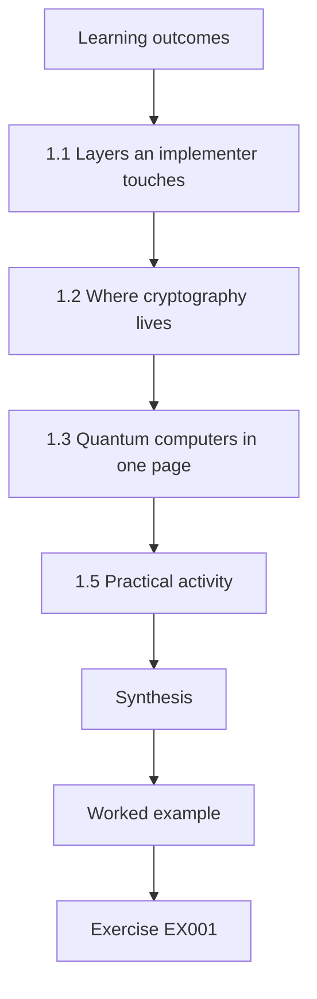

### Logical drawing

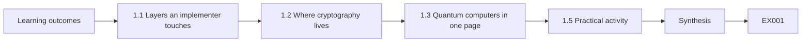

```text
[Learning outcomes]
    |
    v
[1.1 Layers an implementer touches]
    |
    v
[1.2 Where cryptography lives]
    |
    v
[1.3 Quantum computers in one page]
    |
    v
[1.5 Practical activity]
    |
    v
[Synthesis]
    |
    v
[Worked example] --> [Exercise EX001]
```
<!-- cykin:lesson-figures:end ch-01 -->


### Learning outcomes

You will (1) describe the hardware, firmware, OS, library and application layers of a service; (2) locate cryptographic functions and keys in each layer; (3) explain what a quantum computer is and is not; and (4) estimate how hard a cryptographic change is from the layer where it lives.

### 1.1 Layers an implementer touches

Every KLS service sits on a stack. Servers and scanners have processors, memory, TPMs and network cards; firmware boots them and checks signatures on the next stage; an operating system or hypervisor isolates workloads; libraries such as OpenSSL, BoringSSL, Go's crypto packages or Java's providers implement protocols; applications call those libraries; and managed services (load balancers, CDNs, cloud key-management services) wrap the whole thing. Implementers change cryptography mostly in the middle layers — library versions, configuration, certificates — but must know the layers above and below because they constrain what is possible.

### 1.2 Where cryptography lives

Cryptography appears at every layer: secure boot signatures in firmware; disk encryption and keystores in the OS; TLS, SSH and IPsec in libraries and daemons; JSON Web Token signatures and field encryption in applications; HSMs or cloud KMS holding root keys. Each location has a *change mechanism*: configuration (minutes), package upgrade (days), vendor release (months), hardware replacement (years). Writing down the mechanism next to each cryptographic use is the single most useful habit for planning work.

For KLS the habit pays off at once: the API gateway's TLS groups are a configuration change, the ingress library is an image rebuild, the scanners' bootloader is a hardware refresh.

### 1.3 Quantum computers in one page

Quantum computers manipulate qubits whose joint states interfere; specific algorithms exploit this. Shor's algorithm (Shor, 1997) finds hidden periods and so breaks RSA, Diffie–Hellman and elliptic-curve cryptography; Grover's algorithm (Grover, 1996) gives only a square-root speed-up for brute-force search, so AES-256 and SHA-256 stay fit for purpose. Breaking RSA-2048 needs a large *error-corrected* machine; Gidney (2025) estimated under a million noisy qubits running for under a week under stated assumptions, and no such machine exists. For implementers the practical message is simple: replace public-key key exchange and signatures; keep symmetric encryption and hashes at adequate sizes.

### 1.4 Worked example

KLS's warehouse scanner: TPM-less ARM board (hardware), vendor bootloader verifying RSA signatures (firmware, change by hardware refresh), embedded Linux (OS, vendor image), libcurl with an old TLS library (library, vendor release), and a scanning app that uploads manifests over HTTPS (application, KLS code). Of five layers, KLS directly controls one. The scanner's TLS key exchange can only become hybrid when the vendor ships a new image.

The table also shows where KLS can act now. The upload path can be shortened so manifests leave the scanner only once a day, and the vendor contract can be amended to require an image with hybrid TLS by a named date. Both are recorded against the scanner row, so the residual risk is owned rather than forgotten while the refresh is pending.

### 1.5 Practical activity

For one service you administer in a lab, list each layer, one cryptographic function in it, and the change mechanism. Mark which you control.

A worked line for a lab web server might read: library layer, OpenSSL 3.5 providing TLS key exchange, changed by package upgrade, controlled by you; firmware layer, UEFI secure boot with an RSA-signed shim, changed by the board vendor, not controlled. Aim for at least five rows. Where you cannot name the mechanism, write "unknown" rather than guessing, and note which document or person could answer it. Keep the table; the inventory schema built in Chapter 4 imports exactly these columns.

### 1.6 Common errors and limits

- Assuming an application change can fix firmware cryptography.
- Treating quantum computers as general accelerators.
- Forgetting managed services that terminate TLS on your behalf.

Each error has a KLS example. A developer proposing to "fix" the scanners' RSA bootloader in the upload app is changing the wrong layer; only the vendor's refresh reaches firmware. Expecting a quantum computer to speed up log processing confuses a narrow cryptanalytic capability with general computing. And the CDN, not KLS, terminates browser TLS: forgetting it means the inventory shows the origin settings while customers actually negotiate with the provider's edge. The limit of this chapter is breadth: it maps layers but does not yet measure them.

### Exercises

- **EX001 — Layer table.** Build a five-layer table for KLS's customer portal with function, change mechanism and owner. Rubric: 3 = five plausible rows.
- **EX002 — Keep or replace.** Classify RSA-2048 signatures, AES-256-GCM, SHA-256 and ECDHE P-256 as keep or replace, with one reason each. Rubric: 3 = four correct with reasons.

### Synthesis

Cryptography lives in every layer, and the layer determines who can change it and how fast. Quantum computers threaten public-key key exchange and signatures, not symmetric encryption or hashes.

### Continue studying — chapter 01 of 30

[← Course home](../../README.md) · [Course chapter index](../SUBJECTS.md) · [Chapter 02 (draft) →](#ch-02)

<a id="ch-02"></a>

## Chapter 2 — Networks and internet services

<!-- cykin:lesson-figures:start ch-02 -->
### Lesson map

Lesson 02 published. Map, example, EX003.

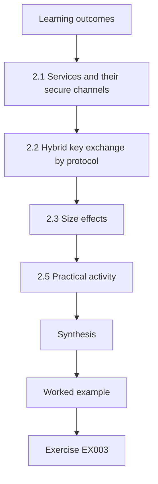

### Logical drawing

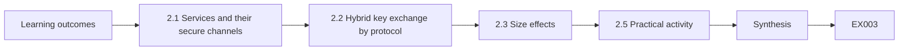

```text
[Learning outcomes]
    |
    v
[2.1 Services and their secure channels]
    |
    v
[2.2 Hybrid key exchange by protocol]
    |
    v
[2.3 Size effects]
    |
    v
[2.5 Practical activity]
    |
    v
[Synthesis]
    |
    v
[Worked example] --> [Exercise EX003]
```
<!-- cykin:lesson-figures:end ch-02 -->


### Learning outcomes

You will (1) explain DNS, HTTP, TLS, SSH and IPsec at implementation level; (2) identify key establishment and authentication in each; (3) recognise how post-quantum messages change sizes; and (4) name the standards that define hybrid key exchange in TLS, SSH and IKEv2.

### 2.1 Services and their secure channels

KLS's customers reach the API through DNS and HTTPS; partners exchange files over SFTP (SSH); offices connect over IPsec VPNs. Each secure channel does two jobs: *key establishment* (agreeing session keys) and *authentication* (proving identity with certificates, host keys or pre-shared keys). Quantum risk to the first is harvest-now-decrypt-later; to the second, future forgery.

The distinction decides the order of KLS's work. Recorded SFTP sessions carrying ten-year customs documents can be decrypted later if the key exchange is classical, so key establishment comes first. A forged host key or certificate only helps an attacker once a quantum computer exists and while that key is still trusted, so authentication can follow once libraries and trust stores are ready.

### 2.2 Hybrid key exchange by protocol

In TLS 1.3 ([RFC 8446](https://www.rfc-editor.org/rfc/rfc8446.html)) the hybrid group X25519MLKEM768 ([RFC 10024](https://www.rfc-editor.org/rfc/rfc10024.html)) combines ML-KEM-768 with X25519; the client key share grows from 32 to 1,216 bytes and the server share to 1,120 bytes. In SSH, OpenSSH added a hybrid ML-KEM/X25519 key exchange, `mlkem768x25519-sha256`, and later made it the default ([OpenSSH release notes](https://www.openssh.com/releasenotes.html)), after earlier shipping an sntrup761-based hybrid. In IKEv2, [RFC 9370](https://www.rfc-editor.org/rfc/rfc9370.html) allows up to seven additional key exchanges, used to add ML-KEM alongside classical Diffie–Hellman; [RFC 8784](https://www.rfc-editor.org/rfc/rfc8784.html) mixes post-quantum pre-shared keys as an interim measure. Terminology for such combinations is in [RFC 9794](https://www.rfc-editor.org/rfc/rfc9794.html).

### 2.3 Size effects

A ClientHello carrying an ML-KEM key share usually exceeds one 1,500-byte packet. Most stacks handle this; some middleboxes and old load balancers do not. Post-quantum signatures are larger still (ML-DSA-44: 2,420 bytes per signature in [FIPS 204](https://doi.org/10.6028/NIST.FIPS.204)), which matters once certificates change. DNSSEC, which runs over UDP with tight size limits, is especially sensitive to signature size.

For KLS the size effect is measured, not assumed: the hybrid client share adds 1,184 bytes, which pushes a typical ClientHello past one segment. Lab H in Chapter 20 shows the failure signature, 1,530-byte ClientHellos timing out on one proxy path. Certificates are not touched yet, so the 2,420-byte ML-DSA-44 signature is a later concern; the DNS zone stays classical until signature sizes and resolver behaviour are understood.

### 2.4 Worked example

KLS enables X25519MLKEM768 on a staging API gateway. Modern browsers and the Go-based customer SDK negotiate it immediately; a customer's legacy Java client offers only classical groups and falls back to X25519, as intended. A third-party monitoring probe times out — its appliance drops the two-segment ClientHello. The fix is a probe upgrade, not disabling the group.

The staging run also gave KLS its first rollout rule. Fallback by the Java client is acceptable and is tracked as a share of sessions; a timeout is not acceptable and must be traced to a device. The monitoring vendor received a ticket with the captured ClientHello size from the lab, and the staging group list stayed unchanged while the probe was upgraded.

### 2.5 Practical activity

In a lab, connect to a test server with a TLS client that prints the negotiated group, once with hybrid offered and once without. Record ClientHello sizes from a capture of your own lab traffic.

Use two clients if one library cannot disable the hybrid share: for example an OpenSSL 3.5 client with default groups and the same client forced to `X25519` only. Record, for each run, the negotiated group, the ClientHello length from your own capture, and whether the hello spans one or two TCP segments. Expect roughly 1,200 more bytes with hybrid. Write one sentence explaining what a middlebox that reassembles only the first segment would do to each run.

### 2.6 Common errors and limits

- Believing hybrid key exchange changes certificate algorithms.
- Treating SSH and TLS migrations as one task.
- Capturing traffic you are not authorized to capture.

Hybrid key exchange changes only the key-share extension; the certificate and its RSA or ECDSA signature are untouched, which is why KLS tracks certificates separately. SSH and TLS share the idea but not the software: OpenSSH's `KexAlgorithms` list on the SFTP hosts and the gateway's TLS group list are configured, tested and rolled back independently. Captures belong to lab traffic or authorized scopes only, because packets from customers contain their data.

### Exercises

- **EX003 — Protocol map.** For TLS 1.3, SSH and IKEv2 name the hybrid mechanism and its defining document. Rubric: 3 = three correct with sources.
- **EX004 — Byte delta.** How many bytes larger is the X25519MLKEM768 server share than an X25519 share? Rubric: 3 = 1,088 bytes (1,120 − 32), noting it equals the ML-KEM-768 ciphertext.

### Synthesis

Each secure channel separates key establishment from authentication. Hybrid key exchange is standardised for TLS, available in SSH and specified for IKEv2; it enlarges handshakes and can expose old middleboxes.

### Continue studying — chapter 02 of 30

[← Chapter 01 (draft)](#ch-01) · [Course chapter index](../SUBJECTS.md) · [Chapter 03 (draft) →](#ch-03)

<a id="ch-03"></a>

## Chapter 3 — Programming foundations

<!-- cykin:lesson-figures:start ch-03 -->
### Lesson map

Lesson 03 published. Map, example, EX005.

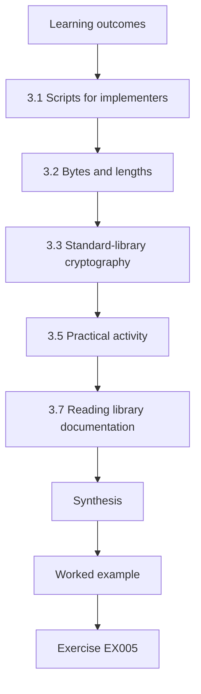

### Logical drawing

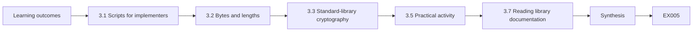

```text
[Learning outcomes]
    |
    v
[3.1 Scripts for implementers]
    |
    v
[3.2 Bytes and lengths]
    |
    v
[3.3 Standard-library cryptography]
    |
    v
[3.5 Practical activity]
    |
    v
[3.7 Reading library documentation]
    |
    v
[Synthesis]
    |
    v
[Worked example] --> [Exercise EX005]
```
<!-- cykin:lesson-figures:end ch-03 -->


### Learning outcomes

You will (1) write small Python scripts with functions, dictionaries and loops; (2) treat bytes, encodings and lengths precisely; (3) use `hashlib`, `hmac` and `secrets` correctly; and (4) write tests that can fail.

### 3.1 Scripts for implementers

Implementers script to inventory, verify and automate. A thirty-line script that parses configuration exports and flags classical-only services is worth more than a manual checklist because it can run every night. This book's labs use only the Python standard library so they run anywhere.

KLS's first such script reads the exported ingress and load-balancer configurations, lists the configured groups per listener and prints any tier-1 listener without `X25519MLKEM768`. Run nightly, it found the customer portal's misordered list long before the monitoring alert in Chapter 19 would have. Keeping the script under 50 lines kept it reviewable.

### 3.2 Bytes and lengths

Keys, ciphertexts and signatures are bytes with exact lengths: ML-KEM-768 encapsulation keys are 1,184 bytes and ciphertexts 1,088 bytes ([FIPS 203](https://doi.org/10.6028/NIST.FIPS.203)); ML-DSA-65 public keys 1,952 bytes and signatures 3,309 bytes (FIPS 204). Code that stores these in fixed-size database columns, base64 fields or protocol buffers sized for ECDSA will truncate or reject them. Always check lengths explicitly and fail closed.

Lengths are also the cheapest validation an implementer can add. A function that rejects a 1,183-byte ML-KEM-768 key, as Lab V does in Chapter 15, catches truncation, wrong parameter sets and encoding mix-ups before any library call. KLS stores the parameter set beside each key so the expected length can be looked up rather than guessed.

### 3.3 Standard-library cryptography

`secrets.token_bytes(n)` gives secure random bytes; `random` does not. `hashlib.sha256`, `hashlib.sha3_256` and `hashlib.shake_256` compute hashes; `hmac.new(key, msg, hashlib.sha256)` computes MACs; `hmac.compare_digest` compares secrets in constant time. Python's standard library does not implement ML-KEM or ML-DSA; production code calls a vetted library or the platform provider.

`hashlib.shake_256` is worth knowing because ML-KEM and ML-DSA use SHAKE internally; implementers meet it in known-answer tests even though they never implement the schemes. The `secrets` module draws from the operating system's generator, which is what KLS scripts use for lab keys and test vectors.

### 3.4 Worked example

A KLS developer stores public keys in a column `VARCHAR(512)` holding base64 text. Base64 expands bytes by 4/3, so a 1,952-byte ML-DSA-65 key needs 2,604 characters and is silently truncated by a permissive database mode. A test that round-trips a 1,952-byte random value through the storage layer would have caught it:

```python
import base64, secrets
key = secrets.token_bytes(1952)
enc = base64.b64encode(key).decode()
assert len(enc) == 2604 and base64.b64decode(enc) == key
print("round trip ok,", len(enc), "chars")
```

The fix was twofold: the column became a binary type sized from the largest key KLS plans to store, ML-DSA-87's 2,592 bytes, and the database was switched to strict mode so an oversize value raises an error instead of being cut. The round-trip test now runs for every key type in the inventory's length table.

### 3.5 Practical activity

Write `check_len(kind, data)` using a dictionary of expected lengths for ML-KEM-512/768/1024 encapsulation keys, and test valid and invalid inputs.

A good test file has at least six cases: the three correct lengths (800, 1,184 and 1,568 bytes), a value one byte short, a value one byte long, and a correct length passed with the wrong kind label, such as 1,184 bytes labelled ML-KEM-512. The function should raise an error naming the kind, expected length and actual length. Run the tests once with a deliberate bug, a wrong number in the dictionary, to show they can fail.

### 3.6 Common errors and limits

- Fixed-size fields sized for classical keys.
- `random` for secrets.
- Tests that only exercise success paths.

At KLS each error had a cost. The `VARCHAR(512)` column silently truncated ML-DSA keys in a permissive mode. A load-test script that built session tokens with `random` produced predictable values that a reviewer could reproduce from the seed. A storage test that only wrote valid keys passed for months while the truncation bug sat behind it. Scripts are small, but each of these errors survives precisely because nobody thinks a small script needs failure tests.

### 3.7 Reading library documentation

Before calling any cryptographic API, read what it promises: which parameter set a function uses by default, whether it returns errors or raises exceptions, whether keys are expanded or stored as seeds, and which encodings it accepts. FIPS 203 and FIPS 204 allow private keys to be stored as short seeds that expand deterministically; two libraries may disagree on which form they export. Write a short note in your repository for each library you use, with version, defaults and encodings, and link it from the inventory so the next implementer does not have to rediscover it.

### Exercises

- **EX005 — Base64 sizing.** How many base64 characters does a 3,309-byte ML-DSA-65 signature need? Rubric: 3 = 4,412 with method (ceil(3309/3) × 4).
- **EX006 — Constant time.** Explain why `a == b` is risky for comparing MAC tags and what to use instead. Rubric: 3 = early-exit timing leak, `hmac.compare_digest`.

### Synthesis

Implementation scripts must treat bytes and lengths exactly, use secure randomness and constant-time comparison, and be tested on failure as well as success.

### Continue studying — chapter 03 of 30

[← Chapter 02 (draft)](#ch-02) · [Course chapter index](../SUBJECTS.md) · [Chapter 04 (draft) →](#ch-04)

<a id="ch-04"></a>

## Chapter 4 — Data models

<!-- cykin:lesson-figures:start ch-04 -->
### Lesson map

Lesson 04 published. Map, example, EX007.

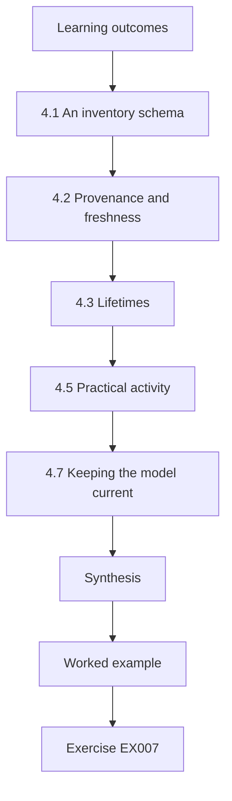

### Logical drawing

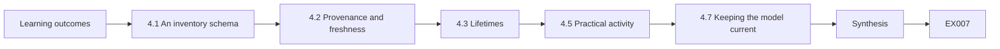

```text
[Learning outcomes]
    |
    v
[4.1 An inventory schema]
    |
    v
[4.2 Provenance and freshness]
    |
    v
[4.3 Lifetimes]
    |
    v
[4.5 Practical activity]
    |
    v
[4.7 Keeping the model current]
    |
    v
[Synthesis]
    |
    v
[Worked example] --> [Exercise EX007]
```
<!-- cykin:lesson-figures:end ch-04 -->


### Learning outcomes

You will (1) model services, endpoints, certificates and algorithms as related records; (2) design an inventory schema with provenance; (3) attach data-lifetime attributes; and (4) query the model for migration candidates.

### 4.1 An inventory schema

A practical schema has tables for `service` (name, owner, tier), `endpoint` (host, port, protocol), `crypto_use` (endpoint, function, algorithm, parameter, library, version), `observation` (crypto_use, method, timestamp, observer) and `data_class` (name, confidentiality_years) linked to services. Separating observation from use lets you record that the same use was seen by a scanner on Monday and confirmed in configuration on Wednesday.

KLS adds two practical columns: `change_mechanism` on `crypto_use`, holding configuration, package, vendor release or hardware, and `controller` on `endpoint`. With them, one query lists every classical key exchange KLS can fix by configuration this month.

### 4.2 Provenance and freshness

Every row needs a method (passive capture, configuration, code scan, vendor statement) and a timestamp. Stale observations are downgraded to "unverified" rather than deleted. Without provenance, a dashboard mixes facts with guesses and nobody knows which.

KLS uses three grades: confirmed (two independent methods agree), observed (one method within 30 days) and unverified (older or single vendor claim). The 71 % dashboard in Chapter 9 went wrong partly because scanner-era rows with no method label were counted as fresh. The grade is computed from the observation table, never typed by hand, so it cannot drift from the evidence.

### 4.3 Lifetimes

Attach `confidentiality_years` to data classes. KLS's shipment records must stay confidential for ten years by contract; billing data seven; telemetry one. A query joining lifetimes to key-exchange algorithms produces the harvest-now-decrypt-later candidate list automatically.

Contract text beats retention schedules: KLS's billing data is retained seven years for tax, but one freight customer's contract asks for ten-year confidentiality of rates, so that customer's billing rows inherit ten. The lifetime column therefore lives on the data class and may be overridden per customer, and the query takes the maximum lifetime of any class a flow carries.

### 4.4 Worked example

```python
import sqlite3
db = sqlite3.connect(":memory:")
db.executescript("""
CREATE TABLE use(service TEXT, function TEXT, algorithm TEXT, data_years INT);
INSERT INTO use VALUES ('api-gateway','kex','X25519MLKEM768',10),('partner-sftp','kex','ecdh-sha2-nistp256',10),
                       ('billing-db','kex','ECDHE-P256',7),('telemetry','kex','ECDHE-P256',1);""")
rows = db.execute("SELECT service FROM use WHERE function='kex' AND algorithm NOT LIKE '%MLKEM%' AND data_years>=5").fetchall()
print("HNDL candidates:", [r[0] for r in rows])
```

The query returns partner SFTP and the billing database; telemetry drops out because its data is short-lived, and the gateway is already hybrid.

The query encodes three decisions worth reading aloud. The `function='kex'` condition limits it to harvest-now-decrypt-later exposure, because signatures follow a different timetable. The `NOT LIKE '%MLKEM%'` test treats any hybrid group as acceptable. The `data_years>=5` threshold is KLS policy, not a standard; at three years the billing database would still be listed, and telemetry would still not be. Rerun after every inventory feed, the list becomes a live work queue for the platform team.

### 4.5 Practical activity

Extend the example with an `observation` table and a query listing uses whose newest observation is older than 90 days.

Give the `observation` table a foreign key to `use`, a `method` column and an `observed_at` timestamp stored as ISO text. Insert two observations for the gateway, one 10 days old and one 200 days old, and one 120-day-old observation for partner SFTP. The correct query groups by use and compares the maximum timestamp with the cut-off, so the gateway is fresh because its newest row is recent. A query that compares every row would wrongly list the gateway; include that mistake as a negative test.

### 4.6 Common errors and limits

- Flat spreadsheets without provenance.
- Deleting stale data instead of marking it.
- Lifetimes copied from retention schedules without checking contracts.

At KLS the flat spreadsheet had a column "algorithm" with values typed by four people; nobody could say whether "ECDHE" for billing came from a scan, a config file or memory. Deleting stale rows removed the forklift telemetry entirely, which hid that nobody knew its cryptography. And the first lifetime list copied the seven-year tax retention for billing, missing the ten-year contract clause. Each error makes the migration list shorter than it should be, which feels like progress but is not.

### 4.7 Keeping the model current

An inventory model decays the moment it is populated. Feed it automatically: nightly configuration exports from the load balancers, certificate lists from the CA database, image manifests from the registry, and handshake summaries from logs. Each feed writes observations with its own method label, so the model always shows what was seen, how and when. Hand-entered rows should be the exception and should carry the name of the person who entered them. When two sources disagree — configuration says hybrid is enabled, logs show no hybrid negotiations — record both and raise a task; the disagreement is usually the most useful fact in the model.

Access to the model also matters. A complete map of which services still use classical key exchange is useful to an attacker, so restrict write access to the feeds and read access to the teams who need it, and publish only aggregates outside the platform group.

### Exercises

- **EX007 — Schema.** List the columns of an `observation` table and explain each. Rubric: 3 = use reference, method, timestamp, observer, raw evidence pointer.
- **EX008 — Query.** Write SQL returning services with classical signatures on certificates valid beyond 2030. Rubric: 3 = correct conditions on function, algorithm and validity.

### Synthesis

A relational inventory with provenance and lifetimes turns migration planning into queries that can be rerun whenever the estate changes.

### Continue studying — chapter 04 of 30

[← Chapter 03 (draft)](#ch-03) · [Course chapter index](../SUBJECTS.md) · [Chapter 05 (draft) →](#ch-05)

<a id="ch-05"></a>

## Chapter 5 — Security literacy

<!-- cykin:lesson-figures:start ch-05 -->
### Lesson map

Lesson 05 published. Map, example, EX009.

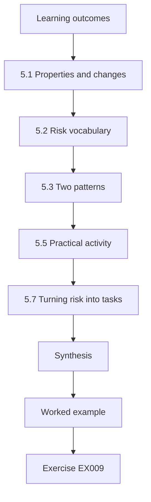

### Logical drawing

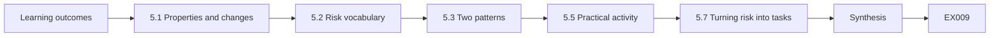

```text
[Learning outcomes]
    |
    v
[5.1 Properties and changes]
    |
    v
[5.2 Risk vocabulary]
    |
    v
[5.3 Two patterns]
    |
    v
[5.5 Practical activity]
    |
    v
[5.7 Turning risk into tasks]
    |
    v
[Synthesis]
    |
    v
[Worked example] --> [Exercise EX009]
```
<!-- cykin:lesson-figures:end ch-05 -->


### Learning outcomes

You will (1) apply confidentiality, integrity, availability and authenticity to service changes; (2) relate assets, threats, vulnerabilities and controls; (3) explain harvest-now-decrypt-later and forge-later; and (4) recognise availability risk in cryptographic change.

### 5.1 Properties and changes

Implementers change cryptography to improve confidentiality and authenticity, but every change risks availability. A hybrid group that a load balancer cannot parse is an outage. Good practice treats availability as a co-equal requirement: staged rollout, rollback, monitoring.

The rule shows in KLS's own records: the monitoring probe that timed out on the staging gateway would have been a production alert storm if the group had gone live everywhere at once. Each hybrid change therefore carries a rollback, a dashboard and a canary stage in its plan.

### 5.2 Risk vocabulary

An *asset* (shipment records), a *threat* (an adversary recording traffic), a *vulnerability* (classical key exchange) and a *control* (hybrid key exchange) combine into a risk scenario. Quantum vulnerabilities are properties of algorithms, not bugs, and become exploitable when a capability appears.

Writing the four parts separately also shows where a control acts. Hybrid key exchange removes the vulnerability for future sessions only; it does nothing for traffic already recorded. Shortening retention reduces the asset's value instead. For KLS's partner SFTP the full scenario reads: customs documents, recorded by an adversary on a transit network, readable because of ECDH key exchange, mitigated by `mlkem768x25519-sha256` from the upgrade date onward.

### 5.3 Two patterns

*Harvest now, decrypt later*: recorded traffic is decrypted once a quantum computer exists; urgent for data whose confidentiality lasts beyond that time. *Forge later*: once a quantum computer exists, signatures can be forged; urgent for long-lived trust (root CAs, firmware signing, documents verified for years) and for devices that cannot be updated.

The urgency of each is a matter of dates. HNDL exposure starts the day traffic is recorded, so for KLS's ten-year shipment data every classical session today matters. Forge-later exposure starts only when forgery becomes possible and lasts while the key is trusted, so the 15-year internal root is urgent and a weekly JWT key is not.

### 5.4 Worked example

KLS's partner SFTP service carries customs documents kept confidential ten years; it uses ECDH key exchange: HNDL-exposed now. Its host key is Ed25519: forge-later exposure, lower urgency because host keys can be rotated quickly once SSH clients support post-quantum host-key algorithms. The API's JWT signing keys rotate weekly: forge-later exposure is minimal until a quantum computer exists.

The three cases give KLS three different responses. The SFTP key exchange is scheduled for the next maintenance window. The host key is recorded as residual risk with a trigger: when OpenSSH ships a post-quantum host-key algorithm KLS clients support, rotate. The JWT keys need nothing beyond keeping rotation automated.

### 5.5 Practical activity

Write three risk scenarios for KLS services using the asset–threat–vulnerability–control pattern; label each HNDL, forge-later or neither.

A complete scenario names all four parts and the label. Example: asset, billing database replication carrying seven-year invoices; threat, recording on the provider's inter-zone network; vulnerability, ECDHE-P256 in the replication TLS; control, provider-supported hybrid or application-layer field encryption; label HNDL. Include one scenario labelled neither, such as AES-256 backups, and explain why: Grover's speed-up leaves a 256-bit key with ample margin, so no quantum-driven action is needed.

### 5.6 Common errors and limits

- Forgetting availability in change plans.
- Treating all quantum risk as equally urgent.
- Calling algorithms "bugs".

Each error leads to a recognisable failure. A plan without availability work enables hybrid on the portal and discovers the old proxy at a customer site through a support call. Treating all exposure as urgent puts weekly JWT keys in the same queue as ten-year SFTP traffic and slows both. Calling RSA a "bug" invites a patch mindset; there is no patch, only replacement, and the timeline depends on a capability that does not yet exist.

### 5.7 Turning risk into tasks

Implementers translate each risk scenario into work items with a clear definition of done. "Partner SFTP HNDL exposure" becomes: confirm the OpenSSH version on the SFTP hosts supports `mlkem768x25519-sha256`; enable it first in the server's key-exchange list in staging; check which partner clients negotiate it; publish a partner notice; promote to production; monitor the share of sessions using it. Each item has an owner and evidence that proves it is complete. Risk statements that never become tasks are the most common way security work stalls between the risk register and the platform backlog.

Keep availability in every definition of done: a task is not complete until rollback has been tested and monitoring shows no rise in failures.

### Exercises

- **EX009 — Classify.** Label HNDL, forge-later or neither: office VPN traffic, CI code-signing key, AES-256 backups, TLS to the customer portal. Rubric: 3 = four correct with reasons.
- **EX010 — Availability.** Name two ways enabling hybrid key exchange could cause an outage and one control for each. Rubric: 3 = two failure modes with controls.

### Synthesis

Implementers must weigh confidentiality and authenticity gains against availability risk, and distinguish the time-shaped patterns of harvest-now-decrypt-later and forge-later.

### Continue studying — chapter 05 of 30

[← Chapter 04 (draft)](#ch-04) · [Course chapter index](../SUBJECTS.md) · [Chapter 06 (draft) →](#ch-06)

<a id="ch-06"></a>

## Chapter 6 — Operating systems and virtualization

<!-- cykin:lesson-figures:start ch-06 -->
### Lesson map

Lesson 06 published. Map, example, EX011.

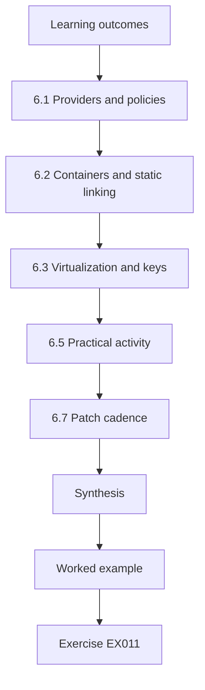

### Logical drawing

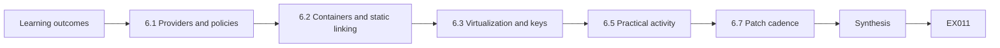

```text
[Learning outcomes]
    |
    v
[6.1 Providers and policies]
    |
    v
[6.2 Containers and static linking]
    |
    v
[6.3 Virtualization and keys]
    |
    v
[6.5 Practical activity]
    |
    v
[6.7 Patch cadence]
    |
    v
[Synthesis]
    |
    v
[Worked example] --> [Exercise EX011]
```
<!-- cykin:lesson-figures:end ch-06 -->


### Learning outcomes

You will (1) explain process isolation, privileges and keystores; (2) identify system crypto providers and policies; (3) recognise statically linked and container-bundled libraries; and (4) plan OS and image updates that enable post-quantum algorithms.

### 6.1 Providers and policies

On Linux, most services link a system TLS library; OpenSSL 3.5 added ML-KEM, ML-DSA and SLH-DSA support and hybrid TLS groups ([OpenSSL 3.5 release notes](https://github.com/openssl/openssl/blob/openssl-3.5/NEWS.md)). Some distributions centralise allowed algorithms in a system-wide crypto policy. Windows uses CNG; mobile platforms provide keystores and platform TLS. The provider version on the host largely determines what services can negotiate — unless the service brings its own library.

On KLS's nodes the first check is therefore `openssl version` plus the distribution's crypto policy, which can remove a group the library supports.

### 6.2 Containers and static linking

Containers bundle their own user-space libraries; upgrading the host OS does not change the TLS library inside an image. Go and Rust binaries often statically link their cryptography. Implementers must inventory images and binaries, not just hosts, and rebuild images on updated base layers.

KLS's registry scan found the pattern clearly: the NGINX ingress image carried an OpenSSL two minor versions behind the hosts, and three Go services were built with a toolchain that predated hybrid TLS. None of them changed when the node fleet was upgraded. The inventory now lists library and toolchain versions per image digest, not per host, and a rebuild is the change mechanism recorded for each.

### 6.3 Virtualization and keys

Hypervisors, virtual TPMs and cloud KMS hold keys for disks and workloads. Their APIs and algorithm support change on the cloud provider's schedule. Record which KMS key types and algorithms each workload uses.

For KLS this covers the cloud KMS keys wrapping database disks, the virtual TPMs in the CI runners and the HSM cluster behind the internal CA. Disk wrapping keys are symmetric and stay fit for purpose; the asymmetric keys used for KMS import and for CA signing are the ones to track. Each provider's published algorithm list and date of last check go into the vendor-evidence column of the inventory.

### 6.4 Worked example

KLS upgrades its Kubernetes nodes to a distribution with OpenSSL 3.5. The NGINX ingress container still runs an older base image and continues to offer only classical groups. A rebuild on a new base image enables X25519MLKEM768. The billing service, written in Go, gains hybrid support only after a toolchain upgrade because Go's TLS stack is compiled in.

The worked case gives three change mechanisms for one cluster: a node upgrade (done), an image rebuild (one pull request, tested in staging) and a toolchain upgrade (a service release with regression tests). KLS scheduled them separately and recorded which one turned the hybrid share on, so later regressions could be traced to the right artefact.

### 6.5 Practical activity

On a lab host, list the OpenSSL version on the host and inside two containers; list Go or Rust binaries and their toolchain versions.

Run `openssl version` on the host, then `docker run --rm IMAGE openssl version` for each container, or inspect the image's package list when no shell exists. For Go binaries, `go version -m BINARY` prints the toolchain; for Rust, check the build metadata or `Cargo.lock`. Put the results in a table with host, image digest, library, version and whether that version supports ML-KEM. A mismatch between host and container is the expected finding, not an anomaly.

### 6.6 Common errors and limits

- Assuming host upgrades change containers.
- Editing system crypto policies on production without staging.
- Ignoring compiled-in TLS stacks.

Each error showed up at KLS. The node upgrade announcement said "hybrid TLS available", while the ingress container kept negotiating X25519. A trial edit of the system crypto policy on one production host disabled a group a monitoring agent needed, and the agent stopped reporting until the change was reverted. And the Go billing service, invisible to package scans, kept its old TLS stack until someone read its build metadata.

### 6.7 Patch cadence

Post-quantum support arrives through ordinary patching, so the team's patch cadence becomes a migration lever. Track for each base image and toolchain how many days it lags the current supported release. Services that lag by a year cannot adopt hybrid key exchange without a large catch-up upgrade, which is riskier than the small regular upgrades that would have kept them current.

KLS measured the lag in its registry: median base-image age 140 days, worst 410 days for a legacy reporting service. That service now has a rebuild scheduled every 30 days, and its lag is a dashboard metric owned by its team.

### Exercises

- **EX011 — Where to change.** For an NGINX container, a Go service and a host SSH daemon, state what must change to enable hybrid key exchange. Rubric: 3 = image rebuild, toolchain/rebuild, host package/config.
- **EX012 — Image policy.** Propose a CI rule that prevents images with outdated TLS libraries from deploying. Rubric: 3 = concrete check, threshold, exception path.

### Synthesis

Operating systems supply cryptographic providers, but containers and compiled binaries carry their own; implementation work follows libraries into images and toolchains.

### Continue studying — chapter 06 of 30

[← Chapter 05 (draft)](#ch-05) · [Course chapter index](../SUBJECTS.md) · [Chapter 07 (draft) →](#ch-07)

<a id="ch-07"></a>

## Chapter 7 — Identity and access foundations

<!-- cykin:lesson-figures:start ch-07 -->
### Lesson map

Lesson 07 published. Map, example, EX013.

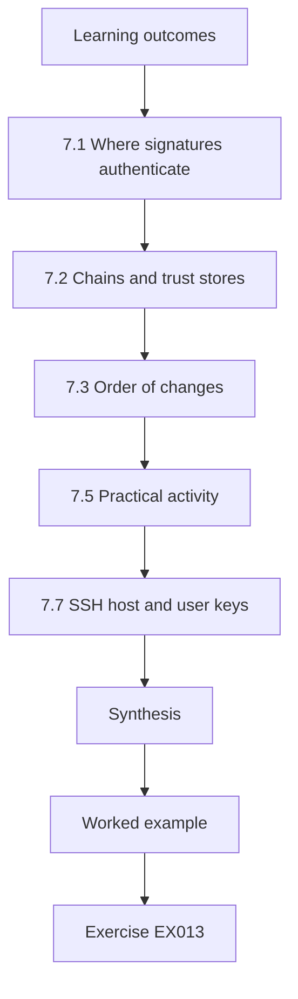

### Logical drawing

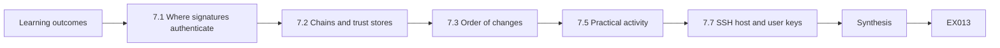

```text
[Learning outcomes]
    |
    v
[7.1 Where signatures authenticate]
    |
    v
[7.2 Chains and trust stores]
    |
    v
[7.3 Order of changes]
    |
    v
[7.5 Practical activity]
    |
    v
[7.7 SSH host and user keys]
    |
    v
[Synthesis]
    |
    v
[Worked example] --> [Exercise EX013]
```
<!-- cykin:lesson-figures:end ch-07 -->


### Learning outcomes

You will (1) distinguish authentication from authorization in services; (2) explain certificates, chains and trust stores; (3) identify quantum-relevant signatures in SSO, mTLS, SSH and code signing; and (4) plan the order of post-quantum identity changes.

### 7.1 Where signatures authenticate

Users log in through SSO whose tokens are signed (RSA or ECDSA); services authenticate each other with mutual TLS certificates; administrators use SSH keys; CI pipelines sign artefacts; devices hold certificates for enrolment. Authorization (roles, policies) is not threatened by quantum computers; the signatures behind authentication are.

At KLS that list maps to concrete keys: the SSO provider's RS256 token key, the internal CA's ECDSA P-256 issuing key, administrators' Ed25519 SSH keys, the RSA-3072 release-signing key and the device-enrolment certificates on the scanners. Each gets a row with algorithm, lifetime and the system that verifies it, because the verifier usually limits migration more than the signer does.

### 7.2 Chains and trust stores

A certificate is trusted if it chains to a root in the verifier's trust store. Introducing a post-quantum root means updating every trust store first — operating systems, language runtimes, appliances, partner systems. Internal PKI is the best place to start post-quantum certificates because KLS controls both issuers and verifiers.

Partner systems are the slowest stores to change because KLS cannot push updates to them; any mTLS link to a partner needs the new root shipped and confirmed months ahead. Inside KLS, the container base-image CA bundle and the Java truststores in services are the stores most often missed, since they are built into artefacts rather than managed on hosts.

### 7.3 Order of changes

Start with items where forge-later risk is high and control is high: internal root and intermediates, code signing for long-lived artefacts. Leave short-lived tokens for later; their keys can rotate quickly once libraries support ML-DSA ([FIPS 204](https://doi.org/10.6028/NIST.FIPS.204)). Public web certificates follow public CA and browser support.

The ordering has a practical benefit too. Internal roots and signing keys are few, owned by one team and changed in planned ceremonies, so they make good first projects. Thousands of leaf certificates and tokens follow automatically once issuers and verifiers support ML-DSA, so effort spent there early is mostly wasted waiting for libraries.

### 7.4 Worked example

KLS's identity inventory: SSO tokens RS256 (1-hour lifetime); service mTLS from internal CA (ECDSA P-256, 90-day leaves, 15-year root); SSH user keys Ed25519; release signing RSA-3072. Priority: internal root (long-lived, controlled), release signing (artefacts verified for years), then mTLS leaves, SSH and tokens.

The list also shows where KLS can prepare without new algorithms. Release signing can add a second signature slot to the artefact format now, so adding ML-DSA later is a pipeline change. SSH can move to certificates from a central authority so user keys rotate centrally. Neither step requires post-quantum support, and both shorten migration time later.

### 7.5 Practical activity

Draw KLS's internal PKI with root, intermediates and leaf types, and list every trust store that must accept a new root.

The drawing should show the 15-year root offline, at least one issuing intermediate, and leaf types for mesh services, ingress, monitoring agents and devices. Then list trust stores per relying party: host OS bundles, container image bundles, Java truststores, mesh sidecar trust bundles, monitoring agents, CI runners and any partner that verifies KLS certificates in mTLS. Mark which stores KLS updates by configuration and which only by rebuilding or by asking the partner. The longest of those paths sets the earliest safe date for issuing post-quantum leaves.

### 7.6 Common errors and limits

- Issuing post-quantum leaves before trust stores accept the root.
- Treating authorization data as quantum-vulnerable.
- Forgetting partner trust stores.

In KLS's lab the first error produced exactly the expected result: a test leaf signed by an ML-DSA intermediate failed validation in every Java service, because their truststores had not received the new root. Spending effort on role mappings or authorization policies is the second error, since those are not cryptographic. The third is the slowest to fix: a partner that pins KLS's current root will reject a new chain until its own operators update it.

### 7.7 SSH host and user keys

SSH illustrates the split between key exchange and identity. Hybrid key exchange in OpenSSH protects session confidentiality now, while host keys and user keys remain classical signatures. Rotating host keys is operationally cheap if clients use certificates or managed known-hosts files, and expensive if every user has pinned individual keys. Moving administrators to SSH certificates issued by a central authority is therefore a useful agility step even before any post-quantum host-key algorithm is deployed.

KLS administrators currently trust host keys through individual `known_hosts` entries, so a host-key change produces warnings across the team. Moving to host certificates means one CA key in each client's configuration, and a later move to a post-quantum host-key algorithm becomes a CA change.

### Exercises

- **EX013 — Prioritise.** Order KLS's five identity items in this chapter's worked example by migration priority and justify. Rubric: 3 = order consistent with lifetime and control.
- **EX014 — Trust stores.** List five trust stores KLS must update for a new internal root. Rubric: 3 = five plausible stores.

### Synthesis

Signatures underpin authentication in SSO, mTLS, SSH and code signing. Post-quantum identity starts with internal roots and long-lived signing, after trust stores are prepared.

### Continue studying — chapter 07 of 30

[← Chapter 06 (draft)](#ch-06) · [Course chapter index](../SUBJECTS.md) · [Chapter 08 (draft) →](#ch-08)

<a id="ch-08"></a>

## Chapter 8 — Security architecture basics

<!-- cykin:lesson-figures:start ch-08 -->
### Lesson map

Lesson 08 published. Map, example, EX015.

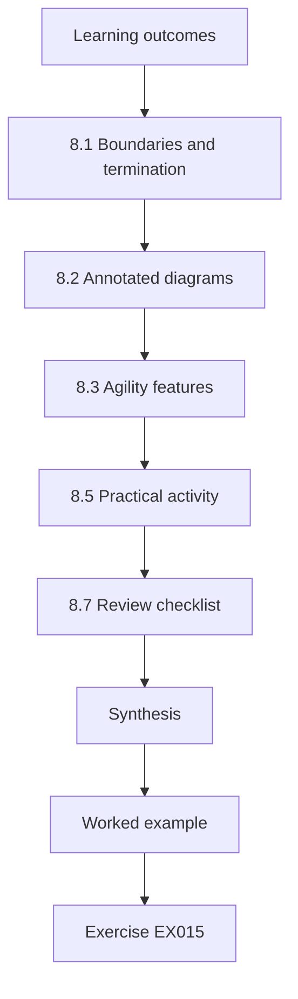

### Logical drawing

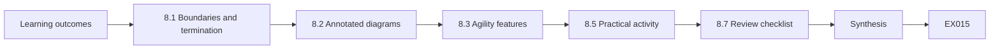

```text
[Learning outcomes]
    |
    v
[8.1 Boundaries and termination]
    |
    v
[8.2 Annotated diagrams]
    |
    v
[8.3 Agility features]
    |
    v
[8.5 Practical activity]
    |
    v
[8.7 Review checklist]
    |
    v
[Synthesis]
    |
    v
[Worked example] --> [Exercise EX015]
```
<!-- cykin:lesson-figures:end ch-08 -->


### Learning outcomes

You will (1) draw service diagrams with trust boundaries; (2) annotate flows with algorithms and data lifetimes; (3) explain TLS termination points and their consequences; and (4) describe crypto-agility features an implementer can build.

### 8.1 Boundaries and termination

Traffic crosses boundaries — internet to edge, edge to service mesh, service to database, office to cloud. TLS is often terminated and re-established at each hop: CDN, load balancer, ingress, sidecar. Each termination is a separate negotiation with its own algorithm choice; a hybrid group at the CDN says nothing about the CDN-to-origin hop.

KLS counts five TLS terminations on the customer path alone, and each has a different owner. The diagram must therefore show every termination with its controller, because each owner configures and changes its own hop on its own schedule.

### 8.2 Annotated diagrams

Annotate each flow with protocol, key exchange, authentication, data lifetime and who controls each end. The annotated diagram is the implementer's map: flows with long-lived data, classical key exchange and an untrusted path are the first to change.

KLS uses a single line per flow: `CDN→origin LB | TLS 1.3 | ECDHE X25519 | ECDSA P-256 | 10 y | KLS+CDN`. Listing the data lifetime on the line is what makes the CDN-to-origin hop stand out: same protocol as the browser hop, but classical, and carrying the same ten-year shipment data across networks KLS does not control.

### 8.3 Agility features

Implementers build agility by: configuring algorithms in one place (central TLS profiles, ingress annotations, crypto policies); keeping algorithm identifiers in stored data; using libraries that support several algorithms; leaving room in fields and buffers for larger keys; and testing every configured algorithm in CI. NIST's [CSWP 39](https://doi.org/10.6028/NIST.CSWP.39-upd1) discusses these considerations.

At KLS each feature has a test. The central profile is rendered in CI and compared with the approved one. Stored signatures carry an algorithm identifier, so verifiers can accept two algorithms during transition. Database columns for keys are sized for ML-DSA-87. A pipeline job attempts a handshake with each configured group against staging, so a group listed but unsupported fails before deployment, not after.

### 8.4 Worked example

KLS's customer path: browser → CDN (hybrid) → origin load balancer (classical) → ingress (classical) → API pods (plaintext inside mesh with mTLS sidecars, ECDHE). The internet hop is protected; the CDN-to-origin hop crosses the provider's network and the internet and carries ten-year data. Priority: enable hybrid on the origin load balancer and ingress; then evaluate the mesh.

The plan places the first changes where KLS controls both ends and the data is long-lived. The origin load balancer and ingress are KLS configuration; the CDN's origin settings are a provider option KLS can enable. The mesh is left for evaluation because its hops stay inside one provider's network and its sidecars are upgraded on the platform release schedule.

### 8.5 Practical activity

Draw and annotate the path for KLS's partner SFTP and office VPN flows; mark termination points.

For partner SFTP the path is short: partner client → internet → KLS bastion → SFTP host, with SSH terminating once, at the bastion or the host depending on the design. For the office VPN, show the office appliance, the internet, the cloud VPN gateway and the internal hop to services, noting that IPsec terminates at the gateway and traffic continues over the mesh. Give every hop the same five annotations as the diagram rule above. Mark any hop where you could not find the algorithm as unknown.

### 8.6 Common errors and limits

- Judging the whole path by the first hop.
- Hard-coding cipher suites in many places.
- Diagrams without data lifetimes.

KLS made all three. The early report "customer path is hybrid" judged the path by the browser-to-CDN hop. Cipher lists were hard-coded in the ingress, two load balancers and a sidecar template, so changing them meant four reviews and one forgotten location. And the first diagrams showed algorithms but not lifetimes, which made telemetry and shipment flows look equally urgent. The limit of diagrams is that they are drawn by hand; the traces in Chapter 12 turn them into data.

### 8.7 Review checklist

When reviewing a new service design, ask: which hops terminate TLS, and who configures each; which groups and signature algorithms each hop offers and prefers; where algorithm choices are configured; which stored data carries algorithm identifiers; and whether any field, buffer or message limit assumes classical sizes. Five questions asked at design time prevent most of the rework that later inventories uncover.

KLS adds the five questions to its design-review template. In the first quarter they flagged a new reporting service storing signatures in a 256-byte column and a new queue whose client library pinned classical groups.

### Exercises

- **EX015 — Termination.** Explain why a hybrid CDN edge does not protect the CDN-to-origin hop. Rubric: 3 = separate TLS sessions and negotiation.
- **EX016 — Agility feature.** Describe one agility feature you could add to KLS's ingress configuration. Rubric: 3 = central profile or annotation with test.

### Synthesis

Annotated diagrams reveal each termination point as a separate negotiation; agility features let implementers change all of them from one place.

### Continue studying — chapter 08 of 30

[← Chapter 07 (draft)](#ch-07) · [Course chapter index](../SUBJECTS.md) · [Chapter 09 (draft) →](#ch-09)

<a id="ch-09"></a>

## Chapter 9 — Evidence and measurement

<!-- cykin:lesson-figures:start ch-09 -->
### Lesson map

Lesson 09 published. Map, example, EX017.

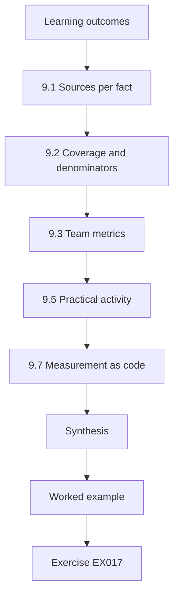

### Logical drawing

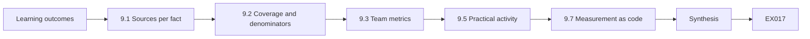

```text
[Learning outcomes]
    |
    v
[9.1 Sources per fact]
    |
    v
[9.2 Coverage and denominators]
    |
    v
[9.3 Team metrics]
    |
    v
[9.5 Practical activity]
    |
    v
[9.7 Measurement as code]
    |
    v
[Synthesis]
    |
    v
[Worked example] --> [Exercise EX017]
```
<!-- cykin:lesson-figures:end ch-09 -->


### Learning outcomes

You will (1) choose valid sources for each cryptographic fact; (2) state coverage and denominators; (3) design readiness metrics for implementation teams; and (4) present measurements with blind spots.

### 9.1 Sources per fact

The negotiated TLS group is visible in the ServerHello and server logs; in TLS 1.3 the certificate is encrypted, so certificate algorithms come from configuration or endpoint inspection. SSH key exchange appears in daemon logs at verbose levels. VPN negotiation appears in appliance logs. Match each fact to the source that can actually see it.

KLS learned this when a passive sensor reported ECDSA for a service whose certificate it could not see; the value had been inferred, not observed. Each fact now carries the source class that can legitimately see it, and inferred values are labelled.

### 9.2 Coverage and denominators

"80 % hybrid" needs a denominator (connections? services? tier-1 services?) and coverage (which sensors, which sites). Implementers should report: services with hybrid enabled (configuration), share of connections negotiating hybrid (logs), and share of services with no evidence.

KLS's dashboard uses three numbers per flow: listeners with hybrid configured, divided by listeners in the inventory; handshakes negotiating hybrid, divided by handshakes logged; and services with no source, divided by tier-1 services. Each number names its sensors and the time window. A reader can then see that 96 % of browser handshakes and 0 % of SFTP sessions are hybrid, instead of one blended figure that hides the SFTP gap.

### 9.3 Team metrics

Useful metrics for implementers: share of tier-1 services offering and preferring hybrid; share of images built on approved base layers; time from approved change to deployment; number of classical-only listeners on internet-facing addresses; failed-handshake rate by cause.

Each metric drives a specific action at KLS. A tier-1 service offering but not preferring hybrid gets a configuration ticket; an image off the approved base gets a rebuild; a growing time-to-deploy prompts a look at the change process; any new classical-only internet listener is reviewed within a week; and a rise in failures by one cause, such as large ClientHellos, opens a vendor case.

### 9.4 Worked example

KLS's first dashboard showed "hybrid connections: 71 %". Breakdown: browser traffic to CDN 96 % hybrid (CDN logs, full coverage); API SDK traffic 40 % (gateway logs); partner SFTP 0 % (daemon logs); office VPN 0 % (config); scanners unknown. The single figure mostly measured browsers.

The breakdown also showed what each team had to do. CDN traffic needed nothing. SDK traffic needed customers to upgrade, so KLS published SDK versions that send the hybrid share by default. SFTP and VPN needed configuration and appliance work. Scanners needed a data source before any target could be set. The single figure had suggested none of this; the breakdown produced four tickets and one vendor request.

### 9.5 Practical activity

Design three metrics with definition, source, denominator, coverage and owner.

For each metric write the definition in one sentence, the data source and its query, the denominator, the coverage (which sites, sensors and time window), the owner and the action taken when the value moves. Example: "Share of partner SFTP sessions negotiating `mlkem768x25519-sha256`, from sshd logs on both SFTP hosts, denominator all completed sessions in the last 7 days, owner Platform Team; below 50 % after the notice date triggers partner outreach." Add one "unknown" metric beside it, counting partners with no session in the window.

### 9.6 Common errors and limits

- Single headline percentages.
- Claiming certificate facts from passive TLS 1.3 captures.
- Metrics no one owns.

At KLS the headline 71 % came from mixing traffic types; the passive sensor's "ECDSA" label came from a TLS 1.3 capture in which the certificate was encrypted, so it could not have been observed; and the scanner-coverage metric had no owner, so when the scanner broke nobody noticed the figure froze. The limit of this chapter's methods is that they measure configuration and negotiation, not whether recorded traffic already exists in an adversary's archive.

### 9.7 Measurement as code

Keep metric definitions in version control next to the scripts that compute them. When someone asks why the hybrid share changed from 62 % to 58 %, you can show whether the estate changed or the definition did — for example, a new sensor that added previously invisible office traffic to the denominator. A change in coverage should be annotated on the dashboard, because a falling number caused by better visibility is progress, not regression.

Also publish an "unknown" metric beside every coverage metric: the number of tier-1 services for which no source currently reports the relevant fact. Teams that see their unknown count every week tend to fix the feeds that would reduce it, which is how measurement coverage improves without a separate project.

### Exercises

- **EX017 — Rewrite.** Rewrite "71 % hybrid" as three scoped statements. Rubric: 3 = scoped by flow with sources.
- **EX018 — Source match.** Name the best source for: TLS group negotiated, server certificate algorithm, SSH KEX, VPN key exchange. Rubric: 3 = four correct sources.

### Synthesis

Measurements are only as good as their sources, denominators and coverage; implementers report scoped figures with blind spots visible.

### Continue studying — chapter 09 of 30

[← Chapter 08 (draft)](#ch-08) · [Course chapter index](../SUBJECTS.md) · [Chapter 10 (draft) →](#ch-10)

<a id="ch-10"></a>

## Chapter 10 — Quantum and post-quantum security: orientation

<!-- cykin:lesson-figures:start ch-10 -->
### Lesson map

Lesson 10 published. Map, example, EX019.

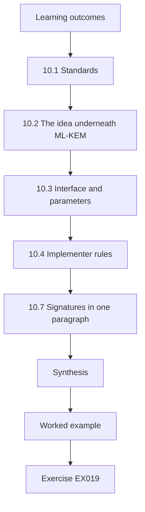

### Logical drawing

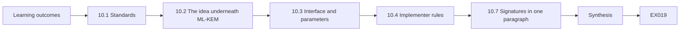

```text
[Learning outcomes]
    |
    v
[10.1 Standards]
    |
    v
[10.2 The idea underneath ML-KEM]
    |
    v
[10.3 Interface and parameters]
    |
    v
[10.4 Implementer rules]
    |
    v
[10.7 Signatures in one paragraph]
    |
    v
[Synthesis]
    |
    v
[Worked example] --> [Exercise EX019]
```
<!-- cykin:lesson-figures:end ch-10 -->


### Learning outcomes

You will (1) summarise NIST's post-quantum standards and their status; (2) explain LWE with a toy lab; (3) describe ML-KEM's interface and parameter sets; and (4) state what implementers must and must not do with PQC.

### 10.1 Standards

NIST published [FIPS 203](https://doi.org/10.6028/NIST.FIPS.203) (ML-KEM), [FIPS 204](https://doi.org/10.6028/NIST.FIPS.204) (ML-DSA) and [FIPS 205](https://doi.org/10.6028/NIST.FIPS.205) (SLH-DSA) in August 2024; [SP 800-208](https://doi.org/10.6028/NIST.SP.800-208) covers LMS and XMSS; [SP 800-227](https://doi.org/10.6028/NIST.SP.800-227) gives KEM recommendations. NIST's draft [IR 8547](https://doi.org/10.6028/NIST.IR.8547.ipd) proposes deprecating quantum-vulnerable algorithms after 2030 and disallowing them after 2035. FN-DSA and an HQC-based KEM were in development.

For KLS implementers, the practical reading is: ML-KEM for key establishment now, ML-DSA for signatures as tooling allows, hash-based signatures for firmware, and dates from the draft IR 8547 as planning assumptions until finalised.

### 10.2 The idea underneath ML-KEM

Learning With Errors (Regev, 2009) hides a secret in noisy linear equations.

```python
# Lab W (ch 10): a TOY Regev-style LWE encryption of one bit. Deliberately insecure parameters.
import random
rng = random.Random(5)
n, q, m = 16, 3329, 64
def small(): return rng.choice([-2, -1, 0, 1, 2])
s = [rng.randrange(q) for _ in range(n)]
A = [[rng.randrange(q) for _ in range(n)] for _ in range(m)]
b = [(sum(A[i][j] * s[j] for j in range(n)) + small()) % q for i in range(m)]   # b = A s + e
def enc(bit):
    r = [rng.randrange(2) for _ in range(m)]                                        # random subset
    u = [sum(r[i] * A[i][j] for i in range(m)) % q for j in range(n)]
    v = (sum(r[i] * b[i] for i in range(m)) + bit * (q // 2)) % q
    return u, v
def dec(u, v):
    d = (v - sum(u[j] * s[j] for j in range(n))) % q                                 # = bit*q/2 + small noise
    return 1 if q // 4 < d < 3 * q // 4 else 0
ok = sum(dec(*enc(bit)) == bit for bit in [rng.randrange(2) for _ in range(2000)])
print(f"toy LWE: {ok}/2000 bits decrypted correctly (noise stays below q/4)")
```

Expected output:

```text
toy LWE: 2000/2000 bits decrypted correctly (noise stays below q/4)
```

The toy uses 16 dimensions and is trivially breakable; ML-KEM uses structured module lattices with 256-coefficient polynomials and a transform that protects against chosen-ciphertext attacks.

The lab's design makes the decryption rule visible. The ciphertext value `v` carries the bit as either 0 or q/2, about 1,664, plus the accumulated noise from adding up to 64 small errors chosen in {−2,…,2}. Decryption subtracts `u·s` and asks whether the remainder is nearer 0 or q/2. Because the noise is far below q/4, every one of the 2,000 bits decrypts correctly. Larger error ranges or more summed rows would push noise over that threshold and decryption would start to fail, the same trade-off ML-KEM's parameters are chosen to manage.

### 10.3 Interface and parameters

ML-KEM is a KEM: KeyGen → (encapsulation key, decapsulation key); Encaps(ek) → (ciphertext, 32-byte shared secret); Decaps(dk, ct) → shared secret. ML-KEM-512/768/1024 target NIST categories 1/3/5, with encapsulation keys of 800/1,184/1,568 bytes and ciphertexts of 768/1,088/1,568 bytes. X25519MLKEM768 in TLS uses ML-KEM-768.

For implementers the interface matters more than the mathematics. The client generates a key pair and sends the encapsulation key; the server encapsulates and returns the ciphertext; both obtain the same 32-byte secret. There is no message encryption step, so ML-KEM is always paired with a symmetric cipher.

### 10.4 Implementer rules

Use vetted libraries and platform providers; never write your own. Keep libraries updated (KyberSlash showed timing leaks in some implementations; Bernstein et al., 2024). Prefer hybrids during transition. Check lengths and handle errors without leaking detail. Record algorithm and library versions in the inventory.

At KLS these rules become review questions on every pull request touching cryptography: which library and version, is it on the approved list, is the parameter set explicit, and what happens on malformed input. A pull request that answers "we wrote it ourselves" is closed without further review.

### 10.5 Worked example

A KLS developer proposes a home-grown ML-KEM in Python "for the scanners". Response: rejected — the standard library lacks ML-KEM, toy code is unsafe, and the vendor's image or a vetted library is the only acceptable route; meanwhile the scanners' data flows are minimised.

The minimisation step is concrete: the scanners upload manifests in one daily batch instead of per scan, which reduces the volume of harvestable sessions while the vendor's image is pending. The rejection and the interim control are both recorded in the scanner's inventory row with the vendor ticket number.

### 10.6 Common errors and limits

- Treating the toy lab as usable.
- Using ML-KEM as if it encrypted arbitrary messages.
- Ignoring library update advisories.

Each error has a recognisable symptom. Someone pasting Lab W's 16-dimensional code into a service, believing it is "lattice crypto", has shipped something breakable in seconds. Someone calling ML-KEM to "encrypt the manifest" has misread the interface: it only produces a shared secret for a symmetric cipher. And a team ignoring advisories such as KyberSlash keeps a timing leak that a library update would have removed. The orientation here is deliberately shallow; the standards themselves are the authority.

### 10.7 Signatures in one paragraph

ML-DSA (FIPS 204) is the general-purpose lattice signature, with ML-DSA-44/65/87 signatures of 2,420/3,309/4,627 bytes. SLH-DSA (FIPS 205) relies only on hash functions; its public keys are tiny but its signatures run from 7,856 to 49,856 bytes. LMS and XMSS (SP 800-208) are compact hash-based signatures that require the signer to track state and never reuse an index. Implementers will meet ML-DSA in certificates and code signing first, and hash-based schemes in firmware signing.

For KLS that means ML-DSA for the internal CA and release signing, and LMS for scanner firmware only if the vendor's HSM manages state.

### Exercises

- **EX019 — Sizes.** Give the ML-KEM-768 encapsulation key and ciphertext sizes and the shared secret length. Rubric: 3 = 1,184, 1,088 and 32 bytes.
- **EX020 — Rules.** List four implementer rules for PQC. Rubric: 3 = vetted libraries, updates, hybrids, length/error handling.

### Synthesis

NIST's standards define the replacements; ML-KEM is a KEM on module lattices with three parameter sets. Implementers configure vetted implementations, never build their own.

### Continue studying — chapter 10 of 30

[← Chapter 09 (draft)](#ch-09) · [Course chapter index](../SUBJECTS.md) · [Chapter 11 (draft) →](#ch-11)

<a id="ch-11"></a>

## Chapter 11 — Quantum and post-quantum security: assets and context

<!-- cykin:lesson-figures:start ch-11 -->
### Lesson map

Lesson 11 published. Map, example, EX021.

```mermaid
flowchart TD
  N0["Learning outcomes"]
  N1["11.1 Scoping the register"]
  N2["11.2 Tiers"]
  N3["11.3 Mosca's inequality for implementers"]
  N4["11.4 Dependencies and owners"]
  N5["11.6 Practical activity"]
  N6["Synthesis"]
  N0 --> N1 --> N2 --> N3 --> N4 --> N5 --> N6
  N6 --> EX["Worked example"]
  EX --> Q["Exercise EX021"]
```

### Logical drawing

```mermaid
flowchart LR
  N0["Learning outcomes"]
  N1["11.1 Scoping the register"]
  N2["11.2 Tiers"]
  N3["11.3 Mosca's inequality for implementers"]
  N4["11.4 Dependencies and owners"]
  N5["11.6 Practical activity"]
  N6["Synthesis"]
  N0 --> N1 --> N2 --> N3 --> N4 --> N5 --> N6 --> Q["EX021"]
```

```text
[Learning outcomes]
    |
    v
[11.1 Scoping the register]
    |
    v
[11.2 Tiers]
    |
    v
[11.3 Mosca's inequality for implementers]
    |
    v
[11.4 Dependencies and owners]
    |
    v
[11.6 Practical activity]
    |
    v
[Synthesis]
    |
    v
[Worked example] --> [Exercise EX021]
```
<!-- cykin:lesson-figures:end ch-11 -->


### Learning outcomes

You will (1) build an asset register scoped for cryptographic migration; (2) assign tiers using data lifetime and trust lifetime; (3) record owners, change mechanisms and dependencies; and (4) apply Mosca's inequality to set urgency.

### 11.1 Scoping the register

Start from the services customers and staff use, not from IP ranges. For each service list its endpoints, the data classes it handles, the cryptographic functions it performs, and the teams and vendors who control them. Include things that are easy to forget: CI/CD signing, backup transfers, monitoring agents, partner integrations, warehouse devices and administrative access paths.

KLS's first register, built from IP scans, missed the nightly backup job to object storage and the monitoring agents' outbound TLS, because neither listens on a port. Starting from services found both: the backup job appears under billing, and the agents appear under the observability service. The register now has 41 entries, of which 14 are tier-1 flows.

### 11.2 Tiers

Tier 1: flows carrying data whose confidentiality must last beyond plausible quantum timelines, and trust anchors whose signatures must remain unforgeable for many years. Tier 2: shorter-lived data or trust that is still important. Tier 3: short-lived data and easily rotated credentials. Tiers drive order of work, monitoring depth and evidence requirements.

KLS writes the criteria as numbers so two people tier the same asset identically: tier 1 if confidentiality or trust must last eight years or more, or the device cannot be updated remotely; tier 2 from three to eight years; tier 3 below three years with credentials rotatable within a day. Tier-1 assets get weekly evidence review, tier-2 monthly, tier-3 quarterly.

### 11.3 Mosca's inequality for implementers

Mosca (2018): if data must stay secure for *x* years, migration takes *y* years, and a cryptographically relevant quantum computer arrives in *z* years, then *x* + *y* > *z* means you are already late. Implementers control *y*. Estimate it per service from the change mechanism: a configuration change may take weeks including testing; a vendor-dependent change may take two years; hardware refresh five. With KLS's ten-year shipment data, the partner SFTP service's half-year estimate makes it late for any *z* below 10.5 years; the warehouse scanners, uploading the same shipment manifests on a four-year vendor refresh, are late for any *z* below fourteen.

### 11.4 Dependencies and owners

Each asset needs a named owner and a list of upstream dependencies: the CDN, the cloud load balancer, the managed database, the scanner vendor. A service is only as migrated as its slowest controlling party.

For KLS the slowest party is usually outside the company. The customer API depends on the CDN's origin feature, the billing replication on the database provider, the scanners on their vendor. Each dependency is a row with a contact and an open request, so the register shows who is waiting on whom.

### 11.5 Worked example

KLS tiers (synthetic): Tier 1 — partner SFTP (10-year customs data, ECDH), CDN-to-origin path (10-year shipment data), internal root CA (15-year validity), release signing. Tier 2 — billing DB replication (7-year data), office VPN. Tier 3 — telemetry, SSO tokens. Estimated *y*: SFTP 0.5 years (OpenSSH upgrade and partner coordination), CDN-to-origin 0.25 years (load-balancer configuration), internal CA 2 years, scanners 4 years (vendor refresh).

Reading the estimates through Mosca shows what to do first. SFTP and the CDN-to-origin path are tier 1 with short *y*, so finishing them is cheap and removes most HNDL exposure. The internal CA needs two years and should start now. The scanners' four years cannot be shortened by KLS, so their data flow is minimised and the vendor contract amended.

### 11.6 Practical activity

Create a tiered register of ten KLS assets with owner, data lifetime, trust lifetime, change mechanism and estimated *y*.

Use the columns asset, owner, data lifetime in years, trust lifetime in years, tier with the criterion that placed it there, change mechanism, controlling party and estimated *y* with its basis. Include at least one asset from each of: customer-facing services, partner integrations, internal PKI, devices and background jobs such as backups. Where *y* is a guess, write the assumption, for example "vendor quoted 18 months, plus 6 for rollout". Finish by marking which assets are late for a *z* of 10 years.

### 11.7 Common errors and limits

- Starting from network scans rather than services.
- Tiers without written criteria.
- Ignoring the slowest dependency when estimating *y*.

Each error distorted KLS's first register. Network scans found listeners but missed the backup job and the monitoring agents, which only make outbound connections. Tiers assigned by "feel" put telemetry in tier 1 because it sounded important. And the CDN-to-origin estimate of three months ignored that the provider's origin feature was not yet generally available, so the real *y* depended on the provider's schedule.

### Exercises

- **EX021 — Mosca for SFTP.** With *x* = 10 and *y* = 0.5, for which *z* is KLS late on partner SFTP? Rubric: 3 = *z* < 10.5 years.
- **EX022 — Tier criteria.** Write tier criteria that a new team member could apply consistently. Rubric: 3 = objective thresholds on data and trust lifetime.

### Synthesis

A tiered, owned asset register with change mechanisms and migration-time estimates lets implementers apply Mosca's inequality where it matters: shrinking *y* for tier-1 services.

### Continue studying — chapter 11 of 30

[← Chapter 10 (draft)](#ch-10) · [Course chapter index](../SUBJECTS.md) · [Chapter 12 (draft) →](#ch-12)

<a id="ch-12"></a>

## Chapter 12 — Quantum and post-quantum security: data flows

<!-- cykin:lesson-figures:start ch-12 -->
### Lesson map

Lesson 12 published. Map, example, EX023.

```mermaid
flowchart TD
  N0["Learning outcomes"]
  N1["12.1 Tracing flows"]
  N2["12.2 The CBOM"]
  N3["12.3 Practical activity — Lab I"]
  N4["12.4 Controllers"]
  N5["12.7 Keeping traces current"]
  N6["Synthesis"]
  N0 --> N1 --> N2 --> N3 --> N4 --> N5 --> N6
  N6 --> EX["Worked example"]
  EX --> Q["Exercise EX023"]
```

### Logical drawing

```mermaid
flowchart LR
  N0["Learning outcomes"]
  N1["12.1 Tracing flows"]
  N2["12.2 The CBOM"]
  N3["12.3 Practical activity — Lab I"]
  N4["12.4 Controllers"]
  N5["12.7 Keeping traces current"]
  N6["Synthesis"]
  N0 --> N1 --> N2 --> N3 --> N4 --> N5 --> N6 --> Q["EX023"]
```

```text
[Learning outcomes]
    |
    v
[12.1 Tracing flows]
    |
    v
[12.2 The CBOM]
    |
    v
[12.3 Practical activity — Lab I]
    |
    v
[12.4 Controllers]
    |
    v
[12.7 Keeping traces current]
    |
    v
[Synthesis]
    |
    v
[Worked example] --> [Exercise EX023]
```
<!-- cykin:lesson-figures:end ch-12 -->


### Learning outcomes

You will (1) trace data flows end to end across termination points; (2) build a cryptographic bill of materials (CBOM) from several sources; (3) compute coverage and unknown shares; and (4) identify which party controls each segment.

### 12.1 Tracing flows

A flow is protected only as strongly as its weakest segment. Trace shipment data from a customer's system through the CDN, origin load balancer, ingress, service mesh, message queue, database replication and backup copy. At each segment record protocol, key exchange, authentication, data lifetime and controller.

For KLS the trace of one shipment record has seven segments, and only the first was hybrid when the trace was drawn. The weakest-segment rule meant the flow was reported as classical, not as one-seventh migrated.

### 12.2 The CBOM

A CBOM lists, per asset and function, algorithm, parameters, implementation and evidence source. Build it by merging configuration exports, log summaries, image scans and vendor statements.

KLS's CBOM merges four feeds: ingress and load-balancer configuration exports, gateway handshake logs, registry image scans and vendor answers. Each row keeps its source, so a reader can see that the billing database's `RSA-kex` entry came from configuration while the scanner's key exchange came from passive capture. Conflicting rows are kept side by side and raise a task rather than being merged into one guessed value.

### 12.3 Practical activity — Lab I

```python
# Lab I (ch 12): aggregate a synthetic cryptographic bill of materials (CBOM) and measure coverage.
records = [  # (asset, function, algorithm, source)
    ("api-gateway", "key-exchange", "X25519MLKEM768", "passive"), ("api-gateway", "signature", "RSA-2048", "config"),
    ("warehouse-scanner", "key-exchange", "ECDHE-P256", "passive"), ("warehouse-scanner", "signature", "ECDSA-P256", "code"),
    ("billing-db", "key-exchange", "RSA-kex", "config"), ("billing", "data-at-rest", "AES-256-GCM", "code"),
    ("forklift-telemetry", "unknown", "unknown", "none"), ("office-vpn", "key-exchange", "ECDHE-P384", "config")]
VULN = {"RSA-2048", "ECDHE-P256", "ECDSA-P256", "RSA-kex", "ECDHE-P384"}
assets = {r[0] for r in records}
unknown = {r[0] for r in records if r[2] == "unknown"}
vuln = [r for r in records if r[2] in VULN]
print(f"assets {len(assets)}, unknown {len(unknown)} ({100*len(unknown)/len(assets):.0f}%)")
print(f"quantum-vulnerable uses {len(vuln)}:", ", ".join(f"{a}/{f}" for a, f, _, _ in vuln))
print("hybrid key exchange present on:", [r[0] for r in records if "MLKEM" in r[2]])
```

Expected output:

```text
assets 6, unknown 1 (17%)
quantum-vulnerable uses 5: api-gateway/signature, warehouse-scanner/key-exchange, warehouse-scanner/signature, billing-db/key-exchange, office-vpn/key-exchange
hybrid key exchange present on: ['api-gateway']
```

The forklift telemetry unit has no evidence at all; until the vendor answers, it stays unknown and blocks a tier decision for the warehouse network.

Lab I counts assets and uses separately, which matters for reporting. Six assets and eight uses produce two different denominators: one asset in six is unknown (17 %), while five uses in eight are quantum-vulnerable. The `billing` data-at-rest row, AES-256-GCM, is correctly absent from the vulnerable list. The api-gateway appears twice, as hybrid for key exchange and vulnerable for its RSA-2048 signature, which is the usual state of a service after its first migration step. Change one record to X25519MLKEM768 and rerun to see the counts move.

### 12.4 Controllers

KLS controls its load balancers, ingress and code; the CDN provider controls the edge; the cloud provider controls managed database replication; partners control their SFTP clients. Write controller next to every segment and open a ticket or vendor request for each segment KLS cannot change.

The controller column turns the trace into a work plan. Segments KLS controls get configuration tickets; segments others control get requests with a named contact and a follow-up date. For KLS, that meant tickets for the origin load balancer, ingress and Kafka, and requests to the CDN, the database provider and the object-storage SDK maintainers.

### 12.5 Worked example

Tracing a shipment record: customer API client → CDN edge (hybrid, CDN-controlled) → origin LB (classical, KLS) → ingress (classical, KLS) → API pod → Kafka (TLS classical, KLS) → managed Postgres replication (provider, algorithm undocumented) → nightly backup to object storage over HTTPS (provider SDK in KLS job, classical). Seven segments, four KLS can change, one unknown.

The four KLS-controlled segments, origin load balancer, ingress, Kafka and the backup job's SDK configuration, went into one sprint. The managed Postgres replication became a provider question with a deadline, and its unknown status kept the whole flow out of the migrated count until the provider answered in writing.

### 12.6 Common errors and limits

- Stopping the trace at the edge.
- Treating managed services as "secure by default" without evidence.
- Ignoring backup and replication paths.

Stopping at the edge produced KLS's first wrong claim that the customer path was hybrid. Treating the managed database as secure by default left its replication algorithm undocumented for months; "managed" says who operates it, not what it negotiates. And the nightly backup upload, carrying the same ten-year records, was missed entirely in the first trace because it runs from a batch job rather than a request path. Traces drawn from request paths alone routinely miss batch and replication traffic.

### 12.7 Keeping traces current

Architectures change faster than diagrams. Re-run the trace for each tier-1 flow whenever a hop is added or replaced — a new message queue, a new CDN feature, a migration from self-managed to managed databases — and add the trace to the change checklist for such work. Store the trace as structured data (segment, protocol, controller, algorithm, evidence) beside the CBOM so that a query can list every tier-1 flow with at least one classical or unknown segment. That query is the honest answer to "is this flow migrated?", because a single classical segment leaves the whole flow exposed to recording at that point.

### Exercises

- **EX023 — Unknown share.** In Lab I, what share of crypto uses (not assets) is quantum-vulnerable? Rubric: 3 = 5 of 8 records ≈ 63 %, noting the unknown record.
- **EX024 — Controller tickets.** For the trace in this chapter's worked example, list the external requests KLS must open. Rubric: 3 = CDN (origin hop support), managed DB provider (replication crypto), object storage/SDK.

### Synthesis

End-to-end traces and a multi-source CBOM show every segment's algorithm and controller; unknowns and external segments become explicit requests.

### Continue studying — chapter 12 of 30

[← Chapter 11 (draft)](#ch-11) · [Course chapter index](../SUBJECTS.md) · [Chapter 13 (draft) →](#ch-13)

<a id="ch-13"></a>

## Chapter 13 — Quantum and post-quantum security: risk scenarios

<!-- cykin:lesson-figures:start ch-13 -->
### Lesson map

Lesson 13 published. Map, example, EX025.

```mermaid
flowchart TD
  N0["Learning outcomes"]
  N1["13.1 Two kinds of risk"]
  N2["13.2 Scenario format"]
  N3["13.3 Silent fallback"]
  N4["13.5 Practical activity"]
  N5["13.7 From scenarios to runbooks"]
  N6["Synthesis"]
  N0 --> N1 --> N2 --> N3 --> N4 --> N5 --> N6
  N6 --> EX["Worked example"]
  EX --> Q["Exercise EX025"]
```

### Logical drawing

```mermaid
flowchart LR
  N0["Learning outcomes"]
  N1["13.1 Two kinds of risk"]
  N2["13.2 Scenario format"]
  N3["13.3 Silent fallback"]
  N4["13.5 Practical activity"]
  N5["13.7 From scenarios to runbooks"]
  N6["Synthesis"]
  N0 --> N1 --> N2 --> N3 --> N4 --> N5 --> N6 --> Q["EX025"]
```

```text
[Learning outcomes]
    |
    v
[13.1 Two kinds of risk]
    |
    v
[13.2 Scenario format]
    |
    v
[13.3 Silent fallback]
    |
    v
[13.5 Practical activity]
    |
    v
[13.7 From scenarios to runbooks]
    |
    v
[Synthesis]
    |
    v
[Worked example] --> [Exercise EX025]
```
<!-- cykin:lesson-figures:end ch-13 -->


### Learning outcomes

You will (1) write implementable risk scenarios for quantum and migration risks; (2) include migration-induced risks such as outages and silent fallback; (3) rank scenarios using simple scales; and (4) link each scenario to controls and tests.

### 13.1 Two kinds of risk

Quantum risk is what happens if nothing changes: recorded traffic decrypted, signatures forged. Migration risk is what can go wrong while changing: outages from large handshakes, silent fallback to classical, certificate validation failures, performance regressions, key-management mistakes. Implementers own both and must not trade one blindly for the other.

KLS records both kinds in the same register with the same fields, so a reviewer can see when a plan reduces quantum risk by adding migration risk. Enabling hybrid on all listeners in one change, for instance, removes HNDL exposure quickly but raises the outage likelihood that staged rollout would keep low.

### 13.2 Scenario format

Each scenario names the asset, the event, the cause, the effect, how it would be detected, likelihood and impact on simple 1–5 scales, the control and the test that shows the control works.

The fields force decisions. A scenario without detection cannot be monitored; one without a test cannot prove its control works. KLS uses 1–5 scales with written anchors: likelihood 4 means "seen at least once in our estate or a peer's", impact 4 means "tier-1 data exposed or a customer-facing outage over an hour". Scores multiply to a rank that orders the backlog, and the anchors stop scores drifting between reviewers.

### 13.3 Silent fallback

The most dangerous migration risk is invisible: a configuration change, image rollback or new load balancer reverts to classical-only negotiation, and nothing breaks. Without monitoring of negotiated groups, it may persist for months. Every hybrid deployment needs an alert on fallback share.

At KLS it happened in exactly this way: a release restored an old ingress annotation and the portal's hybrid share fell from 93 % to 4 %. No customer noticed and no error was logged; only the share alert, added weeks earlier, showed it. KLS alerts when the share drops more than five points in an hour.

### 13.4 Worked example

Scenario: "Origin LB rollback restores classical-only TLS profile." Cause: emergency rollback to an old configuration. Effect: tier-1 shipment data again HNDL-exposed. Detection: hybrid-share alert from LB logs. Likelihood 3, impact 4. Control: TLS profile versioned separately from application config; rollback runbooks restore application only. Test: monthly drill rolling back the application and confirming the hybrid share stays above 95 %.

The control is the key decision. Versioning the TLS profile apart from application configuration means an emergency rollback of code cannot reach the cryptographic settings; the drill tests that separation monthly. A score of 12 placed this scenario in KLS's top three, above the quantum scenario for telemetry.

### 13.5 Practical activity

Write five scenarios for KLS — two quantum, three migration — and rank them.

Quantum examples: partner SFTP sessions recorded and later decrypted (HNDL), and the internal root forged after a quantum computer exists (forge-later). Migration examples: a proxy dropping large ClientHellos, silent fallback after a rollback, and a monitoring agent rejecting an ML-DSA chain. For each, fill every field of the format: asset, event, cause, effect, detection, likelihood, impact, control and test. Rank by likelihood times impact and explain in one sentence why the top scenario outranks the others. Expect a migration scenario to come first.

### 13.6 Common errors and limits

- Ignoring migration-induced risk.
- Scenarios without detection.
- Controls without tests.

In KLS's first register every scenario was a quantum one; the proxy outages and silent fallback that actually happened in staging were missing. Several scenarios said "impact: high" with no way to detect the event, which made them impossible to monitor. And controls such as "profile versioned separately" were claimed without a drill, so nobody knew whether a rollback really left the profile untouched. A scenario list is a hypothesis about failure; without detection and tests it cannot be checked.

### 13.7 From scenarios to runbooks

The highest-ranked migration scenarios each deserve a runbook: the symptoms an operator will see, the first three checks, the safe rollback, and who to call. A runbook for "hybrid share dropped on a tier-1 listener" might say: check the last deployment and ingress annotations; compare the live TLS profile hash with the approved one; restore the approved profile without rolling back application code; confirm recovery on the dashboard; open a problem ticket. Runbooks written before the event shorten outages and reduce the temptation to disable post-quantum settings in a hurry.

Review the scenario list after every incident and every major platform change; new hops and new vendors introduce new ways for fallback or failure to occur.

### Exercises

- **EX025 — Scenario.** Write a full scenario for "partner SFTP client cannot negotiate hybrid KEX". Rubric: 3 = all fields present and coherent.
- **EX026 — Detection.** Propose detection for silent fallback on the office VPN. Rubric: 3 = data source, metric, threshold.

### Synthesis

Implementable scenarios cover quantum and migration risks, with detection, controls and tests; silent fallback deserves special attention because nothing visibly breaks.

### Continue studying — chapter 13 of 30

[← Chapter 12 (draft)](#ch-12) · [Course chapter index](../SUBJECTS.md) · [Chapter 14 (draft) →](#ch-14)

<a id="ch-14"></a>

## Chapter 14 — Quantum and post-quantum security: methods I

<!-- cykin:lesson-figures:start ch-14 -->
### Lesson map

Lesson 14 published. Map, example, EX027.

```mermaid
flowchart TD
  N0["Learning outcomes"]
  N1["14.1 Combining secrets"]
  N2["14.2 Practical activity — Lab C"]
  N3["14.3 X25519MLKEM768 in TLS 1.3"]
  N4["14.4 Configuring a lab server"]
  N5["14.7 Client-side configuration"]
  N6["Synthesis"]
  N0 --> N1 --> N2 --> N3 --> N4 --> N5 --> N6
  N6 --> EX["Worked example"]
  EX --> Q["Exercise EX027"]
```

### Logical drawing

```mermaid
flowchart LR
  N0["Learning outcomes"]
  N1["14.1 Combining secrets"]
  N2["14.2 Practical activity — Lab C"]
  N3["14.3 X25519MLKEM768 in TLS 1.3"]
  N4["14.4 Configuring a lab server"]
  N5["14.7 Client-side configuration"]
  N6["Synthesis"]
  N0 --> N1 --> N2 --> N3 --> N4 --> N5 --> N6 --> Q["EX027"]
```

```text
[Learning outcomes]
    |
    v
[14.1 Combining secrets]
    |
    v
[14.2 Practical activity — Lab C]
    |
    v
[14.3 X25519MLKEM768 in TLS 1.3]
    |
    v
[14.4 Configuring a lab server]
    |
    v
[14.7 Client-side configuration]
    |
    v
[Synthesis]
    |
    v
[Worked example] --> [Exercise EX027]
```
<!-- cykin:lesson-figures:end ch-14 -->


### Learning outcomes

You will (1) explain how hybrid key exchange combines secrets; (2) run a toy combiner and interpret it; (3) describe how TLS 1.3 integrates X25519MLKEM768; and (4) configure hybrid groups in a lab server.

### 14.1 Combining secrets

In a hybrid, both components produce shared secrets; a key-derivation step combines them with context so the result is secure if either component is. [SP 800-227](https://doi.org/10.6028/NIST.SP.800-227) discusses KEM combination; TLS concatenates the secrets and feeds them into its HKDF-based key schedule.

Lab C makes the property visible: change either secret alone and the output changes completely, so an attacker who breaks only X25519 or only ML-KEM still lacks the key. Binding the transcript prevents the same secrets producing the same key in another handshake.

### 14.2 Practical activity — Lab C

```python
# Lab C (ch 14): a hybrid key combiner. The session key depends on BOTH shared secrets.
import hashlib, hmac
def hkdf_extract(salt, ikm): return hmac.new(salt, ikm, hashlib.sha256).digest()
def combine(ss_pq, ss_trad, context):
    # Concatenate secrets (PQ first, as in X25519MLKEM768), bind the transcript/context, then extract.
    return hkdf_extract(b"\x00" * 32, ss_pq + ss_trad + context).hex()[:16]
pq, trad, ctx = b"P" * 32, b"T" * 32, b"handshake-transcript-hash"
print("baseline              ", combine(pq, trad, ctx))
print("PQ secret changed     ", combine(b"Q" * 32, trad, ctx))
print("traditional changed   ", combine(pq, b"U" * 32, ctx))
print("context changed       ", combine(pq, trad, b"other-transcript"))
```

Expected output:

```text
baseline               d48e982e8c06ca60
PQ secret changed      d4c36ea2d90b2e9c
traditional changed    8dcefa12ded3d99c
context changed        af06eca8abcd45a9
```

Read the four lines as a test of the combiner's three inputs. The baseline key `d48e982e8c06ca60` changes when the post-quantum secret changes, when the traditional secret changes and when only the context changes, and none of the changed outputs resembles the baseline. That is what "secure if either component is" requires: an attacker who recovers the X25519 secret still faces an unknown ML-KEM secret, and the output gives no hint which input was altered. The lab's 16-hex-digit truncation is for display only; TLS uses the full HKDF output.

### 14.3 X25519MLKEM768 in TLS 1.3

[RFC 10024](https://www.rfc-editor.org/rfc/rfc10024.html) defines the group: the client sends an ML-KEM-768 encapsulation key followed by an X25519 public key (1,216 bytes); the server returns an ML-KEM ciphertext followed by its X25519 share (1,120 bytes); the shared secret is the ML-KEM secret concatenated with the X25519 secret. If a client sends only classical shares, a server that prefers hybrid may answer with HelloRetryRequest asking for the hybrid share, adding a round trip; tune client key-share predictions accordingly.

The order inside the share matters for implementers reading captures: the ML-KEM part comes first in both directions, unlike some earlier draft hybrids. KLS's lab parser checks the share length, 1,216 or 1,120 bytes, to classify a captured handshake as hybrid.

### 14.4 Configuring a lab server

In OpenSSL-based servers the group list is configurable, for example `Groups = X25519MLKEM768:X25519:secp256r1` in an OpenSSL configuration file or an `ssl_ecdh_curve`-style directive in a web server. Order matters: the server's preference decides the outcome when the client offers several. OpenSSL 3.5's default keyshares include X25519MLKEM768 ([OpenSSL 3.5 NEWS](https://github.com/openssl/openssl/blob/openssl-3.5/NEWS.md)). Check your product's documentation for exact syntax.

For KLS's NGINX ingress the setting is `ssl_ecdh_curve X25519MLKEM768:X25519;`, which only works if the image's OpenSSL knows the group name; on an older library NGINX refuses to start, which is a useful failure in staging. Product syntax varies, so KLS keeps one tested snippet per product in the central profile repository.

### 14.5 Worked example

KLS staging ingress: groups set to `X25519MLKEM768:X25519`. Test client A (OpenSSL 3.5) negotiates the hybrid; test client B (older library) negotiates X25519. A misordered list `X25519:X25519MLKEM768` caused both to choose X25519 — offered, never selected.

The misordered case is the instructive one. Both clients supported the hybrid group, the server listed it, and nothing failed; the server's preference simply chose X25519. Only a check of the negotiated group, not of the configured list, revealed it. KLS's Lab T rule "hybrid offered but not preferred" exists because of this run.

### 14.6 Common errors and limits

- Hybrid listed but not preferred.
- Forgetting HelloRetryRequest latency.
- Copying syntax from blog posts without checking versions.

The first error is the portal case that Lab T in Chapter 17 detects: hybrid present, never chosen. The second shows up as latency: a client predicting only X25519 meets a hybrid-preferring server and pays an extra round trip, visible at the 99th percentile on mobile paths. The third bit KLS when a blog's group name for a draft hybrid was copied into a production profile; the library rejected it and the ingress failed to start in staging. Each is caught by checking negotiation, timing and version, not by reading configuration.

### 14.7 Client-side configuration

Servers are only half of the negotiation. Clients choose which key shares to send first, and a wrong prediction costs the extra round trip described in Section 14.3. Modern browsers and current libraries send the hybrid share by default. For KLS's own SDKs and internal clients, set the group list explicitly in code or configuration, test against the staging gateway, and record the library version in the release notes so customers know which SDK versions negotiate hybrid key exchange. KLS's Go SDK, for example, sets the group list in its own TLS configuration, so a customer who upgrades the SDK gets the hybrid share without changing any code.

### Exercises

- **EX027 — Combiner reasoning.** Using Lab C, explain why changing only the context changes the key and why that matters. Rubric: 3 = binding to transcript, prevents reuse across sessions.
- **EX028 — Order bug.** Explain how a server can list a hybrid group yet never negotiate it. Rubric: 3 = preference order or client support.

### Synthesis

Hybrid key exchange concatenates and derives secrets so either component protects the session. In TLS 1.3 it is one configurable group; order and client support decide whether it is used.

### Continue studying — chapter 14 of 30

[← Chapter 13 (draft)](#ch-13) · [Course chapter index](../SUBJECTS.md) · [Chapter 15 (draft) →](#ch-15)

<a id="ch-15"></a>

## Chapter 15 — Quantum and post-quantum security: guided lab

<!-- cykin:lesson-figures:start ch-15 -->
### Lesson map

Lesson 15 published. Map, example, EX029.

```mermaid
flowchart TD
  N0["Learning outcomes"]
  N1["15.1 Lab environment"]
  N2["15.2 Practical activity — Lab V"]
  N3["15.3 Lab records"]
  N4["15.4 Negative controls"]
  N5["15.7 Lab hygiene"]
  N6["Synthesis"]
  N0 --> N1 --> N2 --> N3 --> N4 --> N5 --> N6
  N6 --> EX["Worked example"]
  EX --> Q["Exercise EX029"]
```

### Logical drawing

```mermaid
flowchart LR
  N0["Learning outcomes"]
  N1["15.1 Lab environment"]
  N2["15.2 Practical activity — Lab V"]
  N3["15.3 Lab records"]
  N4["15.4 Negative controls"]
  N5["15.7 Lab hygiene"]
  N6["Synthesis"]
  N0 --> N1 --> N2 --> N3 --> N4 --> N5 --> N6 --> Q["EX029"]
```

```text
[Learning outcomes]
    |
    v
[15.1 Lab environment]
    |
    v
[15.2 Practical activity — Lab V]
    |
    v
[15.3 Lab records]
    |
    v
[15.4 Negative controls]
    |
    v
[15.7 Lab hygiene]
    |
    v
[Synthesis]
    |
    v
[Worked example] --> [Exercise EX029]
```
<!-- cykin:lesson-figures:end ch-15 -->


### Learning outcomes

You will (1) run known-answer and negative tests; (2) build a reproducible lab environment for PQC configuration; (3) record evidence properly; and (4) use negative controls.

### 15.1 Lab environment

Build an isolated lab: two VMs or containers (server and client) with a current TLS library supporting ML-KEM, a capture point on the lab network, and scripts to run handshakes and record outcomes. No production data; no connection to production networks.

KLS's lab is two containers on an isolated bridge network, a server image with OpenSSL 3.5 and NGINX and a client image holding four TLS libraries, plus a third container running tcpdump on the bridge. Everything is built from a script in the lab repository, so the environment can be destroyed and recreated in minutes.

### 15.2 Practical activity — Lab V

```python
# Lab V (ch 15): known-answer and negative tests - the habit behind validating PQC libraries.
import hashlib
KATS = [  # (function, input, expected hex prefix) - published test values for SHA-3 / SHAKE on empty input
    ("sha3_256", b"", "a7ffc6f8bf1ed76651c14756a061d662f580ff4de43b49fa82d80a4b80f8434a"),
    ("shake_128/32", b"", "7f9c2ba4e88f827d616045507605853ed73b8093f6efbc88eb1a6eacfa66ef26"),
]
def run(name, data):
    if name == "sha3_256": return hashlib.sha3_256(data).hexdigest()
    return hashlib.shake_128(data).hexdigest(32)
for name, data, want in KATS:
    print(f"KAT {name:13s}", "PASS" if run(name, data) == want else "FAIL")
SIZES = {"ML-KEM-512": 800, "ML-KEM-768": 1184, "ML-KEM-1024": 1568}   # encapsulation-key bytes, FIPS 203
def validate_ek(param, ek):
    if len(ek) != SIZES[param]: raise ValueError(f"{param}: expected {SIZES[param]} bytes, got {len(ek)}")
    return True
for param, n in [("ML-KEM-768", 1184), ("ML-KEM-768", 1183), ("ML-KEM-512", 1184)]:
    try: validate_ek(param, bytes(n)); print(f"negative/positive test {param} len {n}: accepted")
    except ValueError as e: print(f"negative/positive test {param} len {n}: rejected ({e})")
```

Expected output:

```text
KAT sha3_256      PASS
KAT shake_128/32  PASS
negative/positive test ML-KEM-768 len 1184: accepted
negative/positive test ML-KEM-768 len 1183: rejected (ML-KEM-768: expected 1184 bytes, got 1183)
negative/positive test ML-KEM-512 len 1184: rejected (ML-KEM-512: expected 800 bytes, got 1184)
```

Known-answer tests confirm primitives match references; negative tests confirm malformed inputs are rejected. Libraries supporting FIPS 203 should also reject encapsulation keys whose coefficients are out of range.

The lab has two halves. The known-answer tests compare SHA3-256 and SHAKE128 on empty input with published digests; a PASS shows the platform's hash functions match the standard. The length checks then exercise validation: a correct 1,184-byte ML-KEM-768 key is accepted, a 1,183-byte key is rejected, and a 1,184-byte value labelled ML-KEM-512 is rejected because the label demands 800 bytes. That third case is the one teams forget, a correct length for the wrong parameter set. Each rejection message names the parameter set, expected length and actual length, which is what an operator needs in a log.

### 15.3 Lab records

Record versions, configuration hashes, commands, outputs and interpretations. Store them in version control next to scripts. A lab result you cannot reproduce is an anecdote.

A KLS lab record is a Markdown file named by date and question, with fields for library versions, image digests, the SHA-256 of each configuration file, exact commands, raw output and a short interpretation. The record and the script that produced it are committed together, so a reviewer can rerun the commands and compare outputs line by line.

### 15.4 Negative controls

Before trusting a check, show it can fail: configure the server without the hybrid group and confirm your script reports classical; flip a byte in a KAT and confirm FAIL.

KLS adds a third control for the handshake script: a client that cannot speak the hybrid group must still be reported as classical, not as an error. A script passing all three cases has shown it can distinguish hybrid, classical and broken; one that only ever printed "hybrid" has shown nothing.

### 15.5 Worked example

KLS lab record "LAB-015": server OpenSSL 3.5.x, client matrix of four libraries, script `handshake.sh` printing negotiated group; results: three hybrid, one classical (older Java client, expected). Negative control: server without hybrid → script printed classical for all four. Interpretation: configuration correct; Java client upgrade required for hybrid.

The record also shows what the result is good for. Three hybrid negotiations confirm the server profile; the classical Java result is predicted by its library version, so it becomes an upgrade ticket rather than a bug. The negative control proves the script would have noticed a missing group. LAB-015 is cited in the change request that later moved the profile to production.

### 15.6 Common errors and limits

- Labs connected to production.
- Results without versions.
- Checks never shown to fail.

KLS saw each one. A lab VM given a route to production for convenience could reach real services, so the lab network was rebuilt without any route out. A result written up as "hybrid works with Java" had no versions attached and could not be reproduced after the Java image changed. And a handshake checker that printed "hybrid" for every server turned out to read the configuration file, not the negotiation; it had never been shown a classical server, so nobody noticed.

### 15.7 Lab hygiene

Tear down and rebuild the lab from scripts regularly so that it never drifts into an undocumented state. Pin package versions, record image digests and keep secrets used in the lab separate from any production secret store. When a lab produces a surprising result, rebuild from scratch and repeat before drawing conclusions; many apparent library bugs turn out to be leftovers from an earlier experiment.

Finally, share the lab. A lab that other teams can clone lets application owners test their own clients against the hybrid-enabled staging gateway before rollout, which finds incompatibilities earlier and spreads the work beyond the platform team.

### Exercises

- **EX029 — Negative control.** Design a negative control for a script that checks SSH KEX negotiation. Rubric: 3 = server configured without hybrid KEX, expect classical.
- **EX030 — Record fields.** List six fields of a lab record. Rubric: 3 = six relevant fields.

### Synthesis

Isolated, reproducible labs with known-answer tests, negative tests and negative controls produce evidence that configurations work as intended.

### Continue studying — chapter 15 of 30

[← Chapter 14 (draft)](#ch-14) · [Course chapter index](../SUBJECTS.md) · [Chapter 16 (draft) →](#ch-16)

<a id="ch-16"></a>

## Chapter 16 — Quantum and post-quantum security: methods II

<!-- cykin:lesson-figures:start ch-16 -->
### Lesson map

Lesson 16 published. Map, example, EX031.

```mermaid
flowchart TD
  N0["Learning outcomes"]
  N1["16.1 Signature options"]
  N2["16.2 Practical activity — Lab B"]
  N3["16.3 Internal PKI changes"]
  N4["16.4 Code and firmware signing"]
  N5["16.7 HSMs and key formats"]
  N6["Synthesis"]
  N0 --> N1 --> N2 --> N3 --> N4 --> N5 --> N6
  N6 --> EX["Worked example"]
  EX --> Q["Exercise EX031"]
```

### Logical drawing

```mermaid
flowchart LR
  N0["Learning outcomes"]
  N1["16.1 Signature options"]
  N2["16.2 Practical activity — Lab B"]
  N3["16.3 Internal PKI changes"]
  N4["16.4 Code and firmware signing"]
  N5["16.7 HSMs and key formats"]
  N6["Synthesis"]
  N0 --> N1 --> N2 --> N3 --> N4 --> N5 --> N6 --> Q["EX031"]
```

```text
[Learning outcomes]
    |
    v
[16.1 Signature options]
    |
    v
[16.2 Practical activity — Lab B]
    |
    v
[16.3 Internal PKI changes]
    |
    v
[16.4 Code and firmware signing]
    |
    v
[16.7 HSMs and key formats]
    |
    v
[Synthesis]
    |
    v
[Worked example] --> [Exercise EX031]
```
<!-- cykin:lesson-figures:end ch-16 -->


### Learning outcomes

You will (1) explain ML-DSA, SLH-DSA, LMS and XMSS from an implementer's view; (2) estimate certificate-chain sizes; (3) plan internal PKI changes; and (4) choose signatures for code and firmware signing.

### 16.1 Signature options

ML-DSA ([FIPS 204](https://doi.org/10.6028/NIST.FIPS.204)): fast, moderate sizes (44/65/87: public keys 1,312/1,952/2,592 bytes; signatures 2,420/3,309/4,627 bytes). SLH-DSA ([FIPS 205](https://doi.org/10.6028/NIST.FIPS.205)): hash-only assumptions, 32–64-byte public keys, 7,856–49,856-byte signatures, slower signing. LMS/XMSS ([SP 800-208](https://doi.org/10.6028/NIST.SP.800-208)): compact, stateful, to be used in hardware modules that manage state.

For KLS the choice follows the use: ML-DSA for the internal CA, mesh mTLS and release signing; SLH-DSA or LMS only where signing is rare and verifiers are simple, such as scanner firmware. Statefulness rules LMS out for any signer that is not a hardware module with managed counters.

### 16.2 Practical activity — Lab B

```python
# Lab B (ch 16): bytes of authentication in a TLS handshake for different signature choices.
# Sizes in bytes: (public key, signature). ML-DSA from FIPS 204; SLH-DSA-128s from FIPS 205.
algs = {"ECDSA P-256": (65, 72), "RSA-2048": (270, 256), "ML-DSA-44": (1312, 2420),
        "ML-DSA-65": (1952, 3309), "SLH-DSA-SHA2-128s": (32, 7856)}
def chain_bytes(alg, depth=2, scts=2):
    pk, sig = algs[alg]
    certs = depth * (pk + sig + 400)          # leaf + intermediate: key + CA signature + ~400 B fields
    return certs + sig + scts * sig           # + CertificateVerify + embedded SCT signatures
for a in algs:
    print(f"{a:20s} ~{chain_bytes(a):6d} bytes of certificates and signatures")
```

Expected output:

```text
ECDSA P-256          ~  1290 bytes of certificates and signatures
RSA-2048             ~  2620 bytes of certificates and signatures
ML-DSA-44            ~ 15524 bytes of certificates and signatures
ML-DSA-65            ~ 21249 bytes of certificates and signatures
SLH-DSA-SHA2-128s    ~ 40144 bytes of certificates and signatures
```

The model counts two certificates (leaf and intermediate), each carrying a public key, a CA signature and about 400 bytes of other fields, plus the CertificateVerify signature and two embedded SCT signatures. It is approximate on purpose, but the ordering is robust: ECDSA P-256 needs about 1.3 kB, RSA-2048 about 2.6 kB, ML-DSA-44 about 15.5 kB, ML-DSA-65 about 21.2 kB and SLH-DSA-SHA2-128s about 40.1 kB. The ML-DSA-44 increase of 14,234 bytes over ECDSA is what KLS weighs for the mesh. Note that SCTs belong to public certificates; an internal chain without SCTs is smaller, so rerun the function with `scts=0` for mesh leaves.

### 16.3 Internal PKI changes

For the internal CA: confirm HSM support for ML-DSA key generation and signing; create an ML-DSA root and intermediate in a lab; issue test leaves; test every relying party (ingress, mesh sidecars, Java services, monitoring agents) for chain validation; then distribute the root to trust stores in production before issuing production leaves. Keep the classical hierarchy in parallel.

KLS's relying-party list for the pilot had eleven entries; the monitoring agents and two Java services failed chain validation in the first lab run and needed library upgrades before the root could be distributed. That finding is why the parallel classical hierarchy stays in place until every relying party passes.

### 16.4 Code and firmware signing

For release artefacts verified for years, ML-DSA is the practical choice once package tooling supports it; consider dual signatures (classical plus ML-DSA) during transition so old verifiers still work. For firmware signed rarely, LMS in an HSM or SLH-DSA is attractive because verification is simple and assumptions conservative.

KLS's release artefacts are verified by customers' deployment tools for years, so dual signatures are the practical path: the existing RSA-3072 signature for current verifiers and an ML-DSA signature for upgraded ones. The scanner vendor is asked whether its bootloader can verify LMS or SLH-DSA in the next hardware generation.

### 16.5 Worked example

KLS's mesh uses 90-day ECDSA leaves. Lab B suggests ML-DSA-44 chains add ~14 kB per handshake. Inside a data centre that cost is acceptable; on scanner links over cellular it may not be. Plan: ML-DSA-44 for mesh mTLS after lab validation; scanners stay classical until vendor refresh, documented as residual risk.

The plan also records why the scanners differ: a 14 kB chain on every reconnect over a lossy cellular link adds segments and retransmissions, and the vendor's TLS library cannot verify ML-DSA anyway. The mesh decision is reversible because leaves are 90-day and the classical hierarchy remains, so a failed canary means reissuing ECDSA leaves, not rebuilding the PKI.

### 16.6 Common errors and limits

- Using LMS/XMSS in software without protected state.
- Issuing PQ leaves before trust stores accept the root.
- Ignoring HSM firmware support.

Each mistake has a specific cost. LMS state kept in a software file can be restored from a backup and an index reused, which breaks the scheme; that is why SP 800-208 expects hardware state management. Issuing PQ leaves early fails validation everywhere the root is absent, as KLS's lab showed with the Java services. And an HSM whose firmware lacks ML-DSA turns a planned ceremony into a vendor upgrade project; KLS checks firmware support before booking ceremony dates.

### 16.7 HSMs and key formats

HSM vendors add post-quantum algorithms in firmware releases, and key formats differ between products. Before committing to an ML-DSA root, test in the lab: key generation inside the HSM, signing a certificate, exporting the public key in the encoding your CA software expects, backing up and restoring the key under the vendor's procedure, and failover between cluster members. Record firmware versions and procedures in the key-ceremony document. Discovering a format mismatch during a production ceremony costs far more than a day of lab testing.

### Exercises

- **EX031 — Chain size.** From Lab B, how many more bytes does ML-DSA-44 use than ECDSA P-256? Rubric: 3 = 14,234 bytes.
- **EX032 — Signature choice.** Choose a signature for KLS's container image signing and justify. Rubric: 3 = ML-DSA (possibly dual) with verifier support reasoning.

### Synthesis

Signature migration trades size, speed, statefulness and assumptions. Implementers start with internal PKI and long-lived signing after confirming HSM and relying-party support.

### Continue studying — chapter 16 of 30

[← Chapter 15 (draft)](#ch-15) · [Course chapter index](../SUBJECTS.md) · [Chapter 17 (draft) →](#ch-17)

<a id="ch-17"></a>

## Chapter 17 — Quantum and post-quantum security: tooling

<!-- cykin:lesson-figures:start ch-17 -->
### Lesson map

Lesson 17 published. Map, example, EX033.

```mermaid
flowchart TD
  N0["Learning outcomes"]
  N1["17.1 Tool classes"]
  N2["17.2 Practical activity — Lab T"]
  N3["17.3 Evaluating tools"]
  N4["17.4 Authorized use"]
  N5["17.7 Making tools routine"]
  N6["Synthesis"]
  N0 --> N1 --> N2 --> N3 --> N4 --> N5 --> N6
  N6 --> EX["Worked example"]
  EX --> Q["Exercise EX033"]
```

### Logical drawing

```mermaid
flowchart LR
  N0["Learning outcomes"]
  N1["17.1 Tool classes"]
  N2["17.2 Practical activity — Lab T"]
  N3["17.3 Evaluating tools"]
  N4["17.4 Authorized use"]
  N5["17.7 Making tools routine"]
  N6["Synthesis"]
  N0 --> N1 --> N2 --> N3 --> N4 --> N5 --> N6 --> Q["EX033"]
```

```text
[Learning outcomes]
    |
    v
[17.1 Tool classes]
    |
    v
[17.2 Practical activity — Lab T]
    |
    v
[17.3 Evaluating tools]
    |
    v
[17.4 Authorized use]
    |
    v
[17.7 Making tools routine]
    |
    v
[Synthesis]
    |
    v
[Worked example] --> [Exercise EX033]
```
<!-- cykin:lesson-figures:end ch-17 -->


### Learning outcomes

You will (1) use configuration audits to detect classical-only and misordered services; (2) combine scanners, log parsers and image analysers; (3) evaluate tool output critically; and (4) integrate tools into routine checks.

### 17.1 Tool classes

*Configuration auditors* read server configuration and report offered groups and preference. *Active TLS/SSH clients* in a lab or authorized scope report what a server negotiates. *Log parsers* summarise negotiated algorithms from production logs. *Image and binary analysers* find library versions. *Certificate inventories* list signature algorithms and validity. Each sees part of the picture.

KLS runs all five classes and keeps them separate in the CBOM, each with its own method label. When they disagree, the disagreement is investigated rather than averaged.

### 17.2 Practical activity — Lab T

```python
# Lab T (ch 17): audit synthetic TLS server configurations for post-quantum key exchange and preference order.
configs = {  # service: ordered list of offered groups (server preference) - synthetic
    "api-gateway": ["X25519MLKEM768", "X25519", "secp256r1"],
    "customer-portal": ["X25519", "X25519MLKEM768", "secp256r1"],
    "partner-sftp": ["ecdh-sha2-nistp256"],
    "internal-grafana": ["X25519", "secp384r1"]}
HYBRID = {"X25519MLKEM768", "SecP256r1MLKEM768", "SecP384r1MLKEM1024"}
for svc, groups in configs.items():
    offered = [g for g in groups if g in HYBRID]
    if not offered: verdict = "CLASSICAL ONLY"
    elif groups[0] in HYBRID: verdict = "OK (hybrid preferred)"
    else: verdict = "WARN hybrid offered but not preferred"
    print(f"{svc:17s} {verdict}")
```

Expected output:

```text
api-gateway       OK (hybrid preferred)
customer-portal   WARN hybrid offered but not preferred
partner-sftp      CLASSICAL ONLY
internal-grafana  CLASSICAL ONLY
```

The customer portal offers hybrid but prefers X25519 — a quiet misconfiguration that a simple "is hybrid present?" check would miss.

The audit reads only the configured group list, so it answers two questions without touching any server: is a hybrid group present, and is it first. The gateway passes; the portal lists `X25519MLKEM768` second and is flagged; SFTP and Grafana have no hybrid group at all. Notice that `partner-sftp` is an SSH service with an SSH algorithm name; the lab treats it with the same rule, but a production audit should check SSH names such as `mlkem768x25519-sha256` separately. Extending the HYBRID set or the rules is a code change reviewed like any other.

### 17.3 Evaluating tools

Ask what a tool actually observes, from where, with which client library. An active scanner using an old library cannot negotiate hybrid and will report every server as classical. Validate tools against a lab server with known configuration before trusting them.

KLS validates each tool against three lab servers: hybrid preferred, hybrid offered but not preferred, and classical only. A tool that reports all three correctly, with its version recorded, is allowed in routine use; one that cannot tell the first two apart is limited to presence checks and labelled so in the CBOM.

### 17.4 Authorized use

Active scanning of services requires authorization even inside your organization; scope it to listed hosts and agreed windows. Never scan partners or third parties without written permission.

At KLS the written scope lists hostnames, ports, the scanner host, the time window and the contact who can stop the scan. Partner SFTP servers are never scanned; their support is learned from KLS's own server logs when partners connect, which needs no permission because it observes KLS's side only.

KLS runs its TLS group scans on Tuesday mornings and posts the scanner host's address in the SRE channel first; the one scan that ran without notice was paged as a possible intrusion and cost an hour of on-call time.

### 17.5 Worked example

KLS's first active scan reported "0 % hybrid" across the estate. The scanner's bundled OpenSSL predated ML-KEM support. After upgrading the scanner and validating it against the lab server, the scan showed the API gateway and CDN-fronted services negotiating hybrid, consistent with logs.

The lesson KLS drew was procedural. Validation against the lab's three known servers is now a precondition for any scanner result reaching the dashboard, and the scanner's library version is printed in every report. The "0 %" report was withdrawn with a note explaining why, so nobody later cited it.

### 17.6 Common errors and limits

- Trusting tool output without validation.
- Checking presence rather than preference.
- Scanning outside authorized scope.

The 0 % scan is KLS's example of the first error: the tool, not the estate, was classical. The second is the portal: a presence check passed it, a preference check flagged it. The third is a risk KLS avoided by scoping: a scanner pointed at a partner's SFTP server would have been unauthorized testing of a third party, regardless of intent. Tool limits remain: configuration audits miss hops that are not exported, and active scans see only what their client library can negotiate.

### 17.7 Making tools routine

Run configuration audits nightly against exported configuration and publish the result to the same dashboard as negotiation logs. A configuration audit that disagrees with logs is a signal: either the configuration export is stale, or a hop not in the export is changing negotiations. Keep each tool's version and validation record in the repository, and re-validate after every tool upgrade, since a scanner whose bundled library changes can silently change its findings.

Where possible, prefer passive and configuration-based tools for routine use and reserve active scanning for scheduled, authorized windows. This keeps operational load low and avoids surprising service owners with probes they did not expect.

### Exercises

- **EX033 — Extend Lab T.** Add a rule that flags services offering more than four groups as "review". Rubric: 3 = working code and sensible output.
- **EX034 — Tool validation.** Describe how to validate a TLS scanner before use. Rubric: 3 = lab server with known configurations, positive and negative cases.

### Synthesis

Tools see different slices; implementers validate them against known configurations, check preference as well as presence, and use them within authorized scope.

### Continue studying — chapter 17 of 30

[← Chapter 16 (draft)](#ch-16) · [Course chapter index](../SUBJECTS.md) · [Chapter 18 (draft) →](#ch-18)

<a id="ch-18"></a>

## Chapter 18 — Quantum and post-quantum security: controls

<!-- cykin:lesson-figures:start ch-18 -->
### Lesson map

Lesson 18 published. Map, example, EX035.

```mermaid
flowchart TD
  N0["Learning outcomes"]
  N1["18.1 Key-exchange controls"]
  N2["18.2 Data and key controls"]
  N3["18.3 Central profiles"]
  N4["18.4 Residual risk"]
  N5["18.6 Practical activity"]
  N6["18.8 Rolling out controls"]
  N7["Synthesis"]
  N0 --> N1 --> N2 --> N3 --> N4 --> N5 --> N6 --> N7
  N7 --> EX["Worked example"]
  EX --> Q["Exercise EX035"]
```

### Logical drawing

```mermaid
flowchart LR
  N0["Learning outcomes"]
  N1["18.1 Key-exchange controls"]
  N2["18.2 Data and key controls"]
  N3["18.3 Central profiles"]
  N4["18.4 Residual risk"]
  N5["18.6 Practical activity"]
  N6["18.8 Rolling out controls"]
  N7["Synthesis"]
  N0 --> N1 --> N2 --> N3 --> N4 --> N5 --> N6 --> N7 --> Q["EX035"]
```

```text
[Learning outcomes]
    |
    v
[18.1 Key-exchange controls]
    |
    v
[18.2 Data and key controls]
    |
    v
[18.3 Central profiles]
    |
    v
[18.4 Residual risk]
    |
    v
[18.6 Practical activity]
    |
    v
[18.8 Rolling out controls]
    |
    v
[Synthesis]
    |
    v
[Worked example] --> [Exercise EX035]
```
<!-- cykin:lesson-figures:end ch-18 -->


### Learning outcomes

You will (1) implement hybrid key exchange controls for TLS, SSH and IPsec; (2) implement data-minimization and key-management controls; (3) apply central crypto profiles; and (4) document residual risk per service.

### 18.1 Key-exchange controls

TLS: enable X25519MLKEM768 and prefer it on internet-facing and tier-1 listeners. SSH: place `mlkem768x25519-sha256` first in server `KexAlgorithms` where OpenSSH versions support it. IPsec: configure an additional ML-KEM key exchange per RFC 9370 where appliances support it, or RFC 8784 PSKs as an interim measure on fixed site-to-site links.

For KLS this means the gateway, portal, origin load balancer and ingress get the `kls-modern` TLS profile; the SFTP hosts get the hybrid-first `KexAlgorithms` line; and the office VPN, whose appliances lack RFC 9370 support, uses RFC 8784 PSKs with quarterly rotation until the appliance refresh.

### 18.2 Data and key controls

Send less long-lived data across untrusted links; encrypt sensitive fields at the application layer with keys that never cross the network under classical key exchange; shorten retention where contracts permit. Keep keys in HSM or KMS; record their algorithms in the inventory.

For KLS the strongest data control is application-layer encryption of customs document fields with keys from the KMS, so recorded transport sessions expose ciphertext even where key exchange is still classical. Shorter retention of scanner telemetry, from one year to 90 days, needed only a contract check.

### 18.3 Central profiles

Define named crypto profiles (for example `kls-modern`: TLS 1.3 only, groups `X25519MLKEM768:X25519`, ECDSA certificates) and apply them by reference in ingress, load balancers and service templates. Changing the profile changes all users after testing.

KLS stores profiles in one repository with version numbers. Ingress manifests reference `kls-modern@3` rather than group strings, and the CI gate renders each manifest and compares the result with the profile. A new version is rolled out by canary, and the previous version stays available for rollback without touching application code.

### 18.4 Residual risk

For each service record what remains classical (usually authentication), what is unknown, and what depends on third parties, with owner and review date.

KLS keeps residual notes in the inventory, one per tier-1 service. A typical entry: "API gateway: key exchange hybrid; certificate ECDSA P-256 (forge-later, awaiting public CA and browser ML-DSA support); payment-provider calls: hybrid support unknown (vendor ticket open); owner Platform Team; review 1 March." The review date matters most, because residual notes without dates become permanent acceptance by default.

The gateway entry, for instance, carries a separate line "unknown: whether the payment provider's endpoint supports hybrid groups", owned by the Platform Team until the vendor ticket is answered; folding it into the classical line would have recorded a guess as an accepted risk.

### 18.5 Worked example

Partner SFTP: OpenSSH upgraded; `KexAlgorithms mlkem768x25519-sha256,sntrup761x25519-sha512@openssh.com,curve25519-sha256`; partners using older clients still negotiate curve25519 and are notified; sessions using the hybrid are monitored. Residual: Ed25519 host key (forge-later), partners on old clients (HNDL until they upgrade), owner Platform Team, review quarterly.

The ordered list gives three tiers of client support: current OpenSSH negotiates the ML-KEM hybrid, somewhat older versions the sntrup761 hybrid, and old clients fall back to curve25519. Monitoring by algorithm shows which partners sit in each tier and drives the notices.

### 18.6 Practical activity

Write a `kls-modern` profile for one product you use and apply it in a lab.

For NGINX, the profile is a short include file with `ssl_protocols TLSv1.3;`, `ssl_ecdh_curve X25519MLKEM768:X25519;` and the certificate directives, referenced from each server block; for OpenSSH, it is a drop-in file under `sshd_config.d` with the `KexAlgorithms` line. Apply it in the lab, verify negotiation with two clients, then deliberately remove the hybrid group and confirm your check reports classical. Record the profile version and the file's hash in the lab record.

### 18.7 Common errors and limits

- Per-service hand configuration.
- Controls without residual-risk notes.
- PSKs without rotation.

KLS's audit found all three before the profile repository existed: eleven hand-edited ingress configurations with four different group lists; a VPN using PSKs with no residual note at all; and PSKs installed at the appliance commissioning, never rotated since. The fixes were a central profile, a residual note per tier-1 service, and a rotation calendar with an owner. Controls reduce exposure only where they are applied consistently and their gaps are written down.

### 18.8 Rolling out controls

Apply each control through the normal change process: test in staging with the client matrix, enable for a canary share of traffic, watch dashboards, then promote. Keep the previous profile version available for a fast, targeted rollback. Announce changes that affect partners — SFTP and API clients — with enough notice and a test endpoint, so partners can check their clients before production changes. A control that breaks a partner's nightly upload will be reverted under pressure, often without anyone recording why.

KLS's SFTP change followed this path: a partner notice with a test endpoint three months ahead, a canary on one of two SFTP hosts, and promotion after a week without new `no_shared_group` errors in the logs.

### Exercises

- **EX035 — SSH control.** Write the SSH server KEX line for a hybrid-first configuration with a classical fallback. Rubric: 3 = hybrid first, valid names, fallback present.
- **EX036 — Residual note.** Write a residual-risk note for the office VPN using RFC 8784 PSKs. Rubric: 3 = remaining risks, owner, review, exit condition.

### Synthesis

Key-exchange, data and key controls applied through central profiles reduce quantum exposure; residual risk is recorded per service.

### Continue studying — chapter 18 of 30

[← Chapter 17 (draft)](#ch-17) · [Course chapter index](../SUBJECTS.md) · [Chapter 19 (draft) →](#ch-19)

<a id="ch-19"></a>

## Chapter 19 — Quantum and post-quantum security: monitoring

<!-- cykin:lesson-figures:start ch-19 -->
### Lesson map

Lesson 19 published. Map, example, EX037.

```mermaid
flowchart TD
  N0["Learning outcomes"]
  N1["19.1 What to log"]
  N2["19.2 Dashboards and alerts"]
  N3["19.3 Practical activity — Lab K"]
  N4["19.4 Lag and coverage"]
  N5["19.7 Privacy of logs"]
  N6["Synthesis"]
  N0 --> N1 --> N2 --> N3 --> N4 --> N5 --> N6
  N6 --> EX["Worked example"]
  EX --> Q["Exercise EX037"]
```

### Logical drawing

```mermaid
flowchart LR
  N0["Learning outcomes"]
  N1["19.1 What to log"]
  N2["19.2 Dashboards and alerts"]
  N3["19.3 Practical activity — Lab K"]
  N4["19.4 Lag and coverage"]
  N5["19.7 Privacy of logs"]
  N6["Synthesis"]
  N0 --> N1 --> N2 --> N3 --> N4 --> N5 --> N6 --> Q["EX037"]
```

```text
[Learning outcomes]
    |
    v
[19.1 What to log]
    |
    v
[19.2 Dashboards and alerts]
    |
    v
[19.3 Practical activity — Lab K]
    |
    v
[19.4 Lag and coverage]
    |
    v
[19.7 Privacy of logs]
    |
    v
[Synthesis]
    |
    v
[Worked example] --> [Exercise EX037]
```
<!-- cykin:lesson-figures:end ch-19 -->


### Learning outcomes

You will (1) log negotiated algorithms in TLS, SSH and VPN services; (2) build dashboards and alerts for hybrid share and fallback; (3) use confidence bounds in canary decisions; and (4) handle measurement lag.

### 19.1 What to log

TLS: negotiated group, protocol version, cipher suite, certificate signature algorithm (server-side), client library hints if available. SSH: KEX algorithm and host-key algorithm. VPN: key-exchange methods per tunnel. Many servers can log these with configuration changes; add fields to access logs rather than enabling verbose debug logs in production.

KLS's ingress access log gained three fields: negotiated group, TLS version and cipher suite. The sshd hosts log the KEX algorithm per session at the default level after a small configuration change, and the VPN appliance exports tunnel parameters to the log platform. Together they feed the hybrid-share dashboard without any debug logging in production.

### 19.2 Dashboards and alerts

Per service and site: hybrid share, fallback share, handshake failure rate by cause. Alerts: hybrid share drops by more than five points in an hour (rollback or misconfiguration); failure rate exceeds budget during rollout.

KLS chose the five-point rule after looking at a month of normal variation: the hourly hybrid share on the gateway moved by at most two points without a change. A drop of five therefore signals a real event, while the absolute floor of 90 % catches slow drift. Each alert links to the runbook for a hybrid-share drop.

### 19.3 Practical activity — Lab K

```python
# Lab K (ch 19): canary gate for enabling a hybrid group - promote only if failures stay within budget.
import math
def upper95(k, n):                      # Wilson upper bound
    z = 1.96; p = k / n; d = 1 + z*z/n
    return ((p + z*z/(2*n)) + z*math.sqrt(p*(1-p)/n + z*z/(4*n*n))) / d
baseline, budget = 5e-4, 4e-4            # baseline failure rate, allowed increase
for stage, k, n in [("1% canary", 3, 5000), ("10% canary", 28, 50000), ("10% canary (proxy site)", 96, 50000)]:
    ub = upper95(k, n); ok = ub <= baseline + budget
    print(f"{stage:24s} {k}/{n}  upper95={ub:.5f}  {'PROMOTE' if ok else 'HOLD'}")
```

Expected output:

```text
1% canary                3/5000  upper95=0.00176  HOLD
10% canary               28/50000  upper95=0.00081  PROMOTE
10% canary (proxy site)  96/50000  upper95=0.00234  HOLD
```

The gate compares the 95 % Wilson upper bound of the observed failure rate with the baseline of 0.05 % plus a budget of 0.04 %, a ceiling of 0.09 %. The 1 % canary saw only 3 failures in 5,000 handshakes, a rate of 0.06 %, but with so few trials the upper bound is 0.176 %, so the gate says HOLD: not evidence of harm, just not enough evidence of safety. At 10 %, 28 in 50,000 gives a bound of 0.081 % and the gate promotes. The proxy site's 96 in 50,000 is a real elevation, 0.19 % observed, and holds for investigation.

### 19.4 Lag and coverage

Logs may arrive minutes or days late; partner-side changes are visible only when partners connect. Annotate dashboards with coverage and lag so that decisions use the right time window.

For KLS, ingress logs arrive within two minutes, VPN appliance exports hourly and partner SFTP evidence only when each partner's nightly job runs. The dashboard shows each panel's last data time, and canary decisions on SFTP wait at least a full week so every partner has connected.

Two KLS partners upload only at month end, so a one-week SFTP window would report them as untested rather than as failing; the dashboard lists them separately with their last connection date.

### 19.5 Worked example

KLS adds `$ssl_curve` (or the product's equivalent) to ingress logs and builds a dashboard. A week later the alert fires: hybrid share on the customer portal dropped from 93 % to 4 % after a release. Cause: the release restored an old ingress annotation. Rollback of the annotation restored the share within an hour.

Two details made the recovery quick. The alert linked to a runbook that started with "compare the live profile hash with the approved one", which pointed directly at the annotation. And because the profile was versioned separately, the fix restored the annotation without rolling back the release. The CI gate in Chapter 22 was added afterwards so the same annotation could not ship again.

### 19.6 Common errors and limits

- Debug logging in production.
- Monitoring failures but not fallback.
- Ignoring lag in decisions.

KLS considered turning on full TLS debug logging to see negotiations and rejected it: the volume would have overwhelmed the log platform and recorded more client detail than needed. Its first dashboard showed only failures, so the portal's silent drop from 93 % to 4 % hybrid would have been invisible. And a canary was nearly promoted on the basis of one hour of VPN data that, because of hourly export, actually described the previous hour.

### 19.7 Privacy of logs

Negotiation logs contain client addresses and timestamps. Log only what monitoring needs — algorithm fields, service, site and coarse client identifiers — and apply the same retention and access rules as other operational logs. Aggregated metrics can be kept longer than raw logs. This keeps monitoring consistent with privacy obligations and reduces the value of the logs to an attacker.

When sharing dashboards with vendors or partners during joint troubleshooting, export aggregated views rather than raw log extracts, and remove client identifiers.

### Exercises

- **EX037 — Alert rule.** Write an alert rule for hybrid share on the API gateway. Rubric: 3 = metric, threshold, window, action.
- **EX038 — Canary reading.** Using Lab K, decide what to do with the 10 % canary at the proxy site and why. Rubric: 3 = hold, investigate proxy, exclude/fix.

### Synthesis

Logging negotiated algorithms enables dashboards and alerts that catch fallback and failures; canary gates use confidence bounds, with lag and coverage visible.

### Continue studying — chapter 19 of 30

[← Chapter 18 (draft)](#ch-18) · [Course chapter index](../SUBJECTS.md) · [Chapter 20 (draft) →](#ch-20)

<a id="ch-20"></a>

## Chapter 20 — Quantum and post-quantum security: troubleshooting

<!-- cykin:lesson-figures:start ch-20 -->
### Lesson map

Lesson 20 published. Map, example, EX039.

```mermaid
flowchart TD
  N0["Learning outcomes"]
  N1["20.1 Method"]
  N2["20.2 Practical activity — Lab H"]
  N3["20.3 Common causes"]
  N4["20.4 Documenting"]
  N5["20.7 Escalating to vendors"]
  N6["Synthesis"]
  N0 --> N1 --> N2 --> N3 --> N4 --> N5 --> N6
  N6 --> EX["Worked example"]
  EX --> Q["Exercise EX039"]
```

### Logical drawing

```mermaid
flowchart LR
  N0["Learning outcomes"]
  N1["20.1 Method"]
  N2["20.2 Practical activity — Lab H"]
  N3["20.3 Common causes"]
  N4["20.4 Documenting"]
  N5["20.7 Escalating to vendors"]
  N6["Synthesis"]
  N0 --> N1 --> N2 --> N3 --> N4 --> N5 --> N6 --> Q["EX039"]
```

```text
[Learning outcomes]
    |
    v
[20.1 Method]
    |
    v
[20.2 Practical activity — Lab H]
    |
    v
[20.3 Common causes]
    |
    v
[20.4 Documenting]
    |
    v
[20.7 Escalating to vendors]
    |
    v
[Synthesis]
    |
    v
[Worked example] --> [Exercise EX039]
```
<!-- cykin:lesson-figures:end ch-20 -->


### Learning outcomes

You will (1) apply a systematic troubleshooting method to handshake failures; (2) triage failure logs into likely causes; (3) diagnose middlebox, size, group-mismatch and certificate problems; and (4) document fixes and residual issues.

### 20.1 Method

Reproduce, isolate, hypothesise, test, fix, verify, document. Reproduce in the lab with the same client and path; isolate by removing hops; form a hypothesis tied to evidence; change one thing; verify with negotiation logs; document the cause and fix.

Applied at KLS, the steps stop the reflex fix of disabling hybrid. The proxy-b case was reproduced with a lab replica, isolated by sending the same client directly, and the hypothesis, a dropped second segment, was confirmed before any change. Verification used the negotiation logs, not the absence of complaints.

### 20.2 Practical activity — Lab H

```python
# Lab H (ch 20): triage synthetic handshake failure logs into likely causes.
import re, collections
logs = """2026-10-01T10:00Z client=10.0.4.7 err=handshake_timeout size_clienthello=1530 path=proxy-b
2026-10-01T10:01Z client=10.0.4.9 err=handshake_timeout size_clienthello=1530 path=proxy-b
2026-10-01T10:02Z client=10.0.7.2 err=no_shared_group offered=x25519mlkem768
2026-10-01T10:03Z client=10.0.4.8 err=handshake_timeout size_clienthello=1530 path=proxy-b
2026-10-01T10:04Z client=10.0.9.1 err=bad_certificate alg=mldsa65
2026-10-01T10:05Z client=10.0.4.3 err=handshake_timeout size_clienthello=300 path=direct""".splitlines()
causes = collections.Counter()
for line in logs:
    f = dict(re.findall(r"(\w+)=(\S+)", line))
    if f["err"] == "handshake_timeout" and int(f.get("size_clienthello", 0)) > 1400: c = "large ClientHello dropped (" + f["path"] + ")"
    elif f["err"] == "no_shared_group": c = "client/server group mismatch"
    elif f["err"] == "bad_certificate": c = "client cannot verify PQ certificate"
    else: c = "other / investigate"
    causes[c] += 1
for c, n in causes.most_common(): print(f"{n}  {c}")
```

Expected output:

```text
3  large ClientHello dropped (proxy-b)
1  client/server group mismatch
1  client cannot verify PQ certificate
1  other / investigate
```

Three failures cluster on one proxy with large ClientHellos; that pattern points to a middlebox mishandling multi-segment messages.

The triage rules are ordered from specific to general. A timeout with a ClientHello over 1,400 bytes is attributed to the path, which groups the three proxy-b lines; the identical timeout at 300 bytes on the direct path falls through to "other", because a small hello cannot be explained by size. `no_shared_group` names the client offering only the hybrid group against a server that does not accept it, and `bad_certificate` with `alg=mldsa65` points at a client that cannot verify the new chain. The value of the script is the grouping: one path explains half the failures.

### 20.3 Common causes

*Large ClientHello dropped* by old firewalls or proxies: upgrade, bypass or adjust. *No shared group*: client and server lists do not overlap (e.g. a server configured hybrid-only and a classical-only client). *Certificate verification failure*: client cannot verify ML-DSA or lacks the new root. *HelloRetryRequest loops or latency*: client key-share prediction mismatches. *Performance*: CPU spikes on constrained devices.

For each cause KLS records the evidence that distinguishes it: segment-size thresholds and path for drops, the two group lists for mismatches, the certificate algorithm and client trust store for verification failures, timing with a HelloRetryRequest for latency, and CPU graphs for performance.

### 20.4 Documenting

Each incident record states symptoms, evidence, cause, fix, verification and residual issues. Patterns across incidents inform vendor requests and rollout plans.

KLS keeps incident records in the same repository as runbooks. After three proxy cases from the same appliance model, the pattern record became a vendor request and a pre-rollout check: any site behind that model gets a lab test before the profile reaches it.

Each record links to its lab reproduction and to the runbook it changed. A ticket closed without verification evidence is reopened by the weekly review, because "no new complaints" is not evidence that negotiations recovered.

### 20.5 Worked example

KLS ticket: "Warehouse office cannot reach portal since Tuesday." Evidence: timeouts only through proxy-b; ClientHello 1,530 bytes; direct path works. Hypothesis: proxy-b drops second segment. Test: lab replica of proxy-b firmware reproduces. Fix: proxy firmware update; interim: portal bypass rule for that office. Verified: hybrid negotiations from office resume. Residual: two other offices with the same proxy model scheduled for update.

The interim bypass was scoped to one office's address range and given an expiry, so it could not quietly become permanent. The verification step checked both directions: hybrid negotiations from the office appeared in the portal's logs, and the failure count for proxy-b fell to zero over the following week.

### 20.6 Common errors and limits

- Disabling hybrid globally to fix one path.
- Changing several things at once.
- Fixes without verification.

During the proxy-b ticket someone proposed removing `X25519MLKEM768` from the portal profile; that would have fixed one office and re-exposed every other client to harvest-now-decrypt-later. A second engineer upgraded the proxy and changed the portal profile in the same window, making the cause impossible to attribute. And an earlier ticket had been closed as fixed after the complaints stopped, though logs showed the office simply had a holiday.

### 20.7 Escalating to vendors

When the cause lies in a product you do not control, escalate with evidence: product and firmware version, a minimal reproduction in the lab, captures from lab traffic only, and the expected behaviour with a reference to the relevant standard (for example RFC 8446 on ClientHello handling, or RFC 10024 for the hybrid group). Precise reports get fixed faster, and they become part of the residual-risk record until the fix ships.

KLS's report on proxy-b's model gave firmware version, the 1,530-byte lab ClientHello and RFC 8446's requirement to handle multi-record handshake messages.

### Exercises

- **EX039 — Diagnose.** A partner reports `no_shared_group` after KLS changed SFTP settings. Give the likely cause and fix. Rubric: 3 = hybrid-only or removed classical, restore fallback or upgrade partner.
- **EX040 — Extend Lab H.** Add a rule classifying `err=hrr_timeout` as "HelloRetryRequest latency". Rubric: 3 = correct code and output.

### Synthesis

Systematic troubleshooting, log triage and documented fixes resolve post-quantum handshake failures without abandoning protection globally.

### Continue studying — chapter 20 of 30

[← Chapter 19 (draft)](#ch-19) · [Course chapter index](../SUBJECTS.md) · [Chapter 21 (draft) →](#ch-21)

<a id="ch-21"></a>

## Chapter 21 — Quantum and post-quantum security: service integration

<!-- cykin:lesson-figures:start ch-21 -->
### Lesson map

Lesson 21 published. Map, example, EX041.

```mermaid
flowchart TD
  N0["Learning outcomes"]
  N1["21.1 Layer by layer"]
  N2["21.2 Managed services"]
  N3["21.3 Partners and customers"]
  N4["21.4 Compatibility during transition"]
  N5["21.6 Practical activity"]
  N6["21.7 Integration testing"]
  N7["Synthesis"]
  N0 --> N1 --> N2 --> N3 --> N4 --> N5 --> N6 --> N7
  N7 --> EX["Worked example"]
  EX --> Q["Exercise EX041"]
```

### Logical drawing

```mermaid
flowchart LR
  N0["Learning outcomes"]
  N1["21.1 Layer by layer"]
  N2["21.2 Managed services"]
  N3["21.3 Partners and customers"]
  N4["21.4 Compatibility during transition"]
  N5["21.6 Practical activity"]
  N6["21.7 Integration testing"]
  N7["Synthesis"]
  N0 --> N1 --> N2 --> N3 --> N4 --> N5 --> N6 --> N7 --> Q["EX041"]
```

```text
[Learning outcomes]
    |
    v
[21.1 Layer by layer]
    |
    v
[21.2 Managed services]
    |
    v
[21.3 Partners and customers]
    |
    v
[21.4 Compatibility during transition]
    |
    v
[21.6 Practical activity]
    |
    v
[21.7 Integration testing]
    |
    v
[Synthesis]
    |
    v
[Worked example] --> [Exercise EX041]
```
<!-- cykin:lesson-figures:end ch-21 -->


### Learning outcomes

You will (1) integrate post-quantum settings across CDN, load balancer, ingress, mesh and application layers; (2) coordinate with managed-service providers; (3) handle partner and customer integrations; and (4) maintain compatibility during transition.

### 21.1 Layer by layer

Integration means every hop agrees. At the CDN, enable hybrid key exchange to clients and to origin where the provider supports it. At the origin load balancer and ingress, apply the central profile. In the service mesh, upgrade sidecar proxies and control-plane certificates; mesh mTLS is internal but may cross shared networks between availability zones. In applications, upgrade SDKs that make outbound calls to partners and cloud APIs.

For KLS the order of hops in the customer API flow fixes the order of work: CDN settings first, because the provider controls them and needs lead time; then KLS's own load balancer and ingress; then the mesh on the platform release cycle; and the SDKs last, because customers adopt them at their own pace.

### 21.2 Managed services

Managed databases, queues and object storage negotiate TLS with libraries the provider controls. Ask providers which groups their endpoints offer, whether hybrid is available, and how to require it. Record answers as vendor evidence and verify from client-side logs where possible. Some providers expose post-quantum options per endpoint or region; others publish roadmaps only.

KLS's questions to providers are written the same way each time: which groups the endpoint offers today, whether a hybrid group is available and in which regions, whether KLS can require it, and how KLS can verify it. Answers are dated and stored as vendor evidence; a roadmap slide is recorded as "planned", never as supported.

### 21.3 Partners and customers

Partners integrate through SFTP, APIs and VPNs. Publish a compatibility notice: what KLS now offers, what KLS will require and when, and a test endpoint. Keep classical fallback during a published transition window; set an end date aligned with policy and contracts, and track partner adoption.

KLS tracks partner adoption from its own sshd logs, which show the KEX algorithm each partner's client negotiates. Of the six client types seen, two were classical-only at the start of the window. Those partners receive a direct reminder at the six- and nine-month marks, with the test endpoint and the end date.

### 21.4 Compatibility during transition

Offer hybrid and classical, prefer hybrid, monitor fallback, and remove classical only when fallback share is below an agreed threshold for an agreed period and exceptions are documented. For certificates, run dual chains or dual endpoints only where products support them cleanly; otherwise keep classical certificates until relying parties can verify ML-DSA.

KLS's threshold for removing classical groups from a listener is a fallback share below 1 % for 30 consecutive days, with every remaining client listed as an exception with owner and expiry. Until then, the profile offers and prefers the hybrid while still accepting X25519, and the dashboard shows the fallback share beside the hybrid share.

### 21.5 Worked example

KLS integration plan for the customer API: CDN hybrid to clients (done) and to origin (provider supports it from Q1; enable and verify in origin logs); origin LB and ingress `kls-modern` profile; mesh sidecars upgraded in the next platform release; outbound SDK calls to the payment provider remain classical until the provider supports hybrid (vendor ticket). Partner notice published with a staging endpoint and a twelve-month window before classical-only partners must upgrade.

The plan lists each hop with an owner and the evidence that will close it, so status is counted by hop, not by effort. Two hops, the CDN-to-origin link and the payment provider calls, depend on third parties; both are tracked as dated requests, and the flow is reported as partly migrated until both close.

### 21.6 Practical activity

Write an integration checklist for one KLS flow covering every hop, the owner, evidence of completion and the external dependencies.

For the customer API, list the client → CDN, CDN → origin load balancer, load balancer → ingress, ingress → pods and pod → payment-provider hops. For each give the owner, the setting or upgrade needed, the evidence that proves it (a log field, a synthetic test result, a written provider statement) and the external dependency with its contact. Add the end-to-end test as the final line. A hop without evidence stays open, however confident the owner is.

### 21.7 Integration testing

Integration tests should exercise the whole path, not each hop alone: a synthetic client in each customer region calls the API through the CDN and records the negotiated group at the edge and, via origin logs, at the origin. Run the test after every change to any hop. When the test fails at one hop, the per-hop evidence tells you where to look. This end-to-end check is what lets the team claim that a flow, rather than a component, is migrated.

### 21.8 Common errors and limits

- Migrating hops independently with no end-to-end check.
- Removing classical support before partners are ready.
- Treating provider roadmaps as delivered features.

KLS hit the first error when the ingress and load balancer were migrated in separate sprints and nobody tested the path; the origin hop was still classical because the CDN's origin option had not been enabled. The second was avoided by the partner window; a test removal on the staging SFTP host showed two partner client types failing at once. The third is common: a provider slide promising hybrid "in Q1" was cited as done in a status report and had to be corrected.

### Exercises

- **EX041 — Hop checklist.** List every hop for KLS's customer API flow and the evidence that each is migrated. Rubric: 3 = all hops with concrete evidence.
- **EX042 — Partner notice.** Draft a five-sentence partner notice for SFTP hybrid key exchange. Rubric: 3 = what, when, test endpoint, fallback window, contact.

### Synthesis

Service integration aligns every hop, documents provider and partner dependencies and keeps compatibility through a measured transition window with end-to-end tests.

### Continue studying — chapter 21 of 30

[← Chapter 20 (draft)](#ch-20) · [Course chapter index](../SUBJECTS.md) · [Chapter 22 (draft) →](#ch-22)

<a id="ch-22"></a>

## Chapter 22 — Quantum and post-quantum security: automation

<!-- cykin:lesson-figures:start ch-22 -->
### Lesson map

Lesson 22 published. Map, example, EX043.

```mermaid
flowchart TD
  N0["Learning outcomes"]
  N1["22.1 Inventory and audits in pipelines"]
  N2["22.2 Policy-driven selection"]
  N3["22.3 Practical activity — Lab A"]
  N4["22.4 Regression gates"]
  N5["22.5 Certificate automation"]
  N6["22.7 Automation risks"]
  N7["Synthesis"]
  N0 --> N1 --> N2 --> N3 --> N4 --> N5 --> N6 --> N7
  N7 --> EX["Worked example"]
  EX --> Q["Exercise EX043"]
```

### Logical drawing

```mermaid
flowchart LR
  N0["Learning outcomes"]
  N1["22.1 Inventory and audits in pipelines"]
  N2["22.2 Policy-driven selection"]
  N3["22.3 Practical activity — Lab A"]
  N4["22.4 Regression gates"]
  N5["22.5 Certificate automation"]
  N6["22.7 Automation risks"]
  N7["Synthesis"]
  N0 --> N1 --> N2 --> N3 --> N4 --> N5 --> N6 --> N7 --> Q["EX043"]
```

```text
[Learning outcomes]
    |
    v
[22.1 Inventory and audits in pipelines]
    |
    v
[22.2 Policy-driven selection]
    |
    v
[22.3 Practical activity — Lab A]
    |
    v
[22.4 Regression gates]
    |
    v
[22.5 Certificate automation]
    |
    v
[22.7 Automation risks]
    |
    v
[Synthesis]
    |
    v
[Worked example] --> [Exercise EX043]
```
<!-- cykin:lesson-figures:end ch-22 -->


### Learning outcomes

You will (1) automate inventory, configuration audits and negotiation checks in CI/CD; (2) implement policy-driven algorithm selection; (3) prevent regressions with gates; and (4) automate certificate issuance with algorithm awareness.

### 22.1 Inventory and audits in pipelines

Pipelines already build images and deploy configuration; add steps that extract library versions from images, compare TLS profiles with the approved profile, and update the CBOM. A pull request that changes an ingress profile should show its cryptographic diff, just as it shows a code diff.

KLS's pipeline prints the cryptographic diff as a comment on the pull request: groups added or removed, preference order changes and library versions in the new image. Reviewers approve it the same way as code.

### 22.2 Policy-driven selection

Applications that sign or encrypt data should look up algorithms from configuration and record identifiers with data, so that migration is a policy change.

KLS's manifest-signing service stores an algorithm identifier with every signature, and the verifier reads which identifiers are acceptable from configuration. When ML-DSA becomes available in the signing library, switching is a policy edit followed by a canary, and old manifests still verify until the classical identifier is retired.

A manifest signed before identifiers were added is checked against a dated list of legacy signatures, not by assuming ECDSA; anything outside that list fails verification and goes to the logistics team for re-signing.

### 22.3 Practical activity — Lab A

```python
# Lab A (ch 22): crypto-agility through a policy-driven registry instead of hard-coded algorithms.
import hashlib, hmac
REGISTRY = {"hmac-sha256": lambda k, m: hmac.new(k, m, hashlib.sha256).digest(),
            "hmac-sha3-256": lambda k, m: hmac.new(k, m, hashlib.sha3_256).digest()}
POLICY = {"tag-algorithm": "hmac-sha256", "accept": ["hmac-sha256", "hmac-sha3-256"]}
def protect(key, msg):
    alg = POLICY["tag-algorithm"]; return alg, REGISTRY[alg](key, msg)
def check(key, msg, alg, tag):
    if alg not in POLICY["accept"]: return False            # algorithm identifier is authenticated by policy
    return hmac.compare_digest(REGISTRY[alg](key, msg), tag)
k, m = b"k" * 32, b"shipment manifest 42"
a1, t1 = protect(k, m)
POLICY["tag-algorithm"] = "hmac-sha3-256"                   # migration = one policy change
a2, t2 = protect(k, m)
print("old tag still verifies during transition:", check(k, m, a1, t1))
print("new tag verifies:", check(k, m, a2, t2), "| algorithms:", a1, "->", a2)
POLICY["accept"] = ["hmac-sha3-256"]                        # retire the old algorithm
print("old tag after retirement:", check(k, m, a1, t1))
```

Expected output:

```text
old tag still verifies during transition: True
new tag verifies: True | algorithms: hmac-sha256 -> hmac-sha3-256
old tag after retirement: False
```

The lab models the three phases of an algorithm migration. In transition, the policy produces new tags with HMAC-SHA3-256 while the accept list still contains HMAC-SHA256, so the old tag verifies and nothing breaks. After retirement, the old identifier is removed from the accept list, and the same valid old tag now fails. The algorithm identifier travels with the tag, but the verifier never trusts it on its own: it must also be on the policy's accept list, which is what stops an attacker relabelling a tag to choose a weaker algorithm. The same structure carries over to signatures when ML-DSA replaces ECDSA.

### 22.4 Regression gates

Gates fail a deployment if: a tier-1 listener's profile lacks the hybrid group or does not prefer it; a base image's TLS library is older than the approved minimum; a new dependency introduces a hard-coded classical algorithm where policy requires agility. Every gate needs an exception path with an owner and expiry.

KLS's exceptions are YAML entries in the gate's repository: listener, reason, owner and expiry date. The gate reads them, passes the listed listener with a warning, and fails again automatically when the expiry passes. That keeps exceptions visible and stops them from becoming silent permanent bypasses.

### 22.5 Certificate automation

ACME ([RFC 8555](https://www.rfc-editor.org/rfc/rfc8555.html)) and internal issuance APIs automate certificate renewal. Make the requested key and signature algorithms explicit parameters, so that switching internal leaves to ML-DSA is a change of template, not of scripts. Test renewal of a post-quantum certificate in staging before relying on it.

KLS's internal issuance template already names `ecdsa-p256` as an explicit parameter; the ML-DSA pilot uses the same template with `ml-dsa-44`. The staging test checks that renewal produces a valid chain and that every relying party accepts it before the template changes in production.

### 22.6 Worked example

KLS adds a CI job, `crypto-gate`, that parses rendered Kubernetes manifests, extracts ingress TLS groups, and fails if a tier-1 ingress lacks `X25519MLKEM768` first. In its first week it blocks two releases that copied an old annotation; both are fixed in minutes rather than discovered weeks later by monitoring.

Both blocked releases had copied an annotation from an old service template. The fix was to correct the template as well as the two services, so the gate stopped the pattern at its source. The gate runs in under a minute and has a documented exception path.

### 22.7 Automation risks

Automation multiplies mistakes as efficiently as it multiplies fixes. Protect pipeline configuration with review, sign pipeline definitions where tooling allows, and stage changes to central profiles through the same canary process as code. A wrong profile pushed automatically to every ingress is a large outage; the same profile pushed to one canary ingress is a small, informative one.

KLS learned this in staging: a profile change merged without the canary stage removed X25519 from every staging ingress at once, breaking the Java test client across all services. Now profile changes reach one canary ingress first, and the pipeline definitions are reviewed by two people.

### 22.8 Common errors and limits

- Gates without exception paths.
- Automating issuance with hard-coded algorithms.
- Pushing central profile changes everywhere at once.

Each error turns automation against the team. A gate with no exception path gets disabled the first time it blocks an urgent release; KLS's exception file exists so that never happens. Issuance scripts with an algorithm hard-coded in a string would have to be rewritten for ML-DSA instead of changing a template. And a profile pushed to every ingress at once turns a small mistake into a platform-wide outage, as the staging incident showed.

### Exercises

- **EX043 — Gate rule.** Write pseudo-code for a gate that checks hybrid preference on tier-1 listeners. Rubric: 3 = parses list, checks first element, tier condition, exit code.
- **EX044 — Agility.** Using Lab A, explain why old tags verify during transition but not after retirement. Rubric: 3 = accept list change with authenticated identifier.

### Synthesis

Automation embeds inventory, audits, policy-driven selection and regression gates in the delivery pipeline, with exception paths and staged rollout of central changes.

### Continue studying — chapter 22 of 30

[← Chapter 21 (draft)](#ch-21) · [Course chapter index](../SUBJECTS.md) · [Chapter 23 (draft) →](#ch-23)

<a id="ch-23"></a>

## Chapter 23 — Quantum and post-quantum security: evaluation

<!-- cykin:lesson-figures:start ch-23 -->
### Lesson map

Lesson 23 published. Map, example, EX045.

```mermaid
flowchart TD
  N0["Learning outcomes"]
  N1["23.1 Objectives"]
  N2["23.2 Performance"]
  N3["23.3 Coverage and residual risk"]
  N4["23.4 Report"]
  N5["23.6 Practical activity"]
  N6["23.7 Comparing with the baseline"]
  N7["Synthesis"]
  N0 --> N1 --> N2 --> N3 --> N4 --> N5 --> N6 --> N7
  N7 --> EX["Worked example"]
  EX --> Q["Exercise EX045"]
```

### Logical drawing

```mermaid
flowchart LR
  N0["Learning outcomes"]
  N1["23.1 Objectives"]
  N2["23.2 Performance"]
  N3["23.3 Coverage and residual risk"]
  N4["23.4 Report"]
  N5["23.6 Practical activity"]
  N6["23.7 Comparing with the baseline"]
  N7["Synthesis"]
  N0 --> N1 --> N2 --> N3 --> N4 --> N5 --> N6 --> N7 --> Q["EX045"]
```

```text
[Learning outcomes]
    |
    v
[23.1 Objectives]
    |
    v
[23.2 Performance]
    |
    v
[23.3 Coverage and residual risk]
    |
    v
[23.4 Report]
    |
    v
[23.6 Practical activity]
    |
    v
[23.7 Comparing with the baseline]
    |
    v
[Synthesis]
    |
    v
[Worked example] --> [Exercise EX045]
```
<!-- cykin:lesson-figures:end ch-23 -->


### Learning outcomes

You will (1) evaluate a deployment against its objectives; (2) measure performance impact; (3) assess residual risk and coverage; and (4) write an evaluation report for operations and management.

### 23.1 Objectives

Typical objectives: tier-1 flows negotiate hybrid key exchange end to end; failure rates within budget; latency within budget; fallback below threshold; residual risks documented; monitoring and runbooks in place.

KLS writes each objective with a threshold and a source, for example "tier-1 flows hybrid on every segment, from per-hop logs".

Others: failure rate within the 0.04-point budget, 99th-percentile latency increase under 5 ms, fallback below 5 % excluding listed exceptions, and runbooks exercised once. Each threshold is agreed before deployment, so the evaluation cannot move the goalposts afterwards.

### 23.2 Performance

Measure handshake latency at the median and 99th percentile, CPU per handshake on servers and constrained clients, and bytes per handshake. ML-KEM operations are fast — typically comparable to or faster than elliptic-curve operations on servers — so the visible costs are usually bytes and occasional extra round trips, not CPU. Measure on representative paths, including mobile and warehouse networks.

KLS measured bytes per handshake directly: about 2.3 kB more with the hybrid, matching the 1,184-byte and 1,088-byte additions in each direction. On the warehouse network that pushed some hellos into a second segment; CPU on the gateway rose by less than the measurement noise.

### 23.3 Coverage and residual risk

Report the share of tier-1 flows fully migrated (all segments), partly migrated and unknown. List residual risks with owners. Compare with the start of the programme.

KLS counts a flow as fully migrated only when every segment has evidence of hybrid key exchange; one classical or unknown segment makes it partial or unknown. Six months in, that rule gave 9 full, 4 partial and 1 unknown of 14 tier-1 flows. The comparison with the start, when only the browser-to-CDN segment was hybrid, is what management needed to see progress honestly.

### 23.4 Report

An evaluation report states objectives, methods, results, deviations, residual risk and recommendations, with evidence links. Operations need detail; management needs a one-page summary.

KLS's report fits on two pages for operations and one for management. The management page leads with the coverage figures, the residual risks with owners and the next decision needed, the internal PKI pilot. Every number links to the query that produced it, so a reader can rerun it.

The warehouse scanners appear on the first page as a deviation: they stay classical until the four-year vendor refresh, which by the Mosca estimate makes them late for any arrival date below fourteen years.

### 23.5 Worked example

KLS evaluation (synthetic) after six months: tier-1 flows 9 of 14 fully migrated, 4 partly (provider or partner segments), 1 unknown (forklift telemetry). Failure rate +0.01 points (within budget). API handshake p50 +0.6 ms, p99 +2.8 ms; warehouse scanners not migrated. Residual: certificates classical everywhere; payment-provider calls classical. Recommendation: internal PKI pilot next; continue partner adoption tracking.

The result shows why median latency alone misleads: the median changed by 0.6 ms, while the 99th percentile changed by 2.8 ms, which is where mobile clients and HelloRetryRequest round trips show up. The failure rate stayed within the 0.04-point budget used in the canary gates.

### 23.6 Practical activity

Write a one-page evaluation summary for your lab deployment with objectives, results and residual risk.

Use a lab deployment from earlier chapters: the hybrid profile on a lab ingress with a client matrix. State three objectives with thresholds; report results with numbers and sources, including at least one median and one 99th percentile; list residual risks, such as classical certificates and any client that negotiated X25519; and end with one recommendation and the decision it needs. Keep it to one page. If a result has no baseline, say so and describe how you would capture one.

### 23.7 Comparing with the baseline

An evaluation is only meaningful against a baseline captured before the change: failure rates, latency distributions, CPU and bytes per handshake on each path. If no baseline exists, capture one now from a classical-only control group — for example, a small share of traffic or a staging replica — before drawing conclusions. Without a baseline, an apparent regression may be normal weekly variation, and an apparent improvement may be a quiet week.

KLS kept 5 % of portal traffic on a classical-only listener for two weeks as its control group, then retired it.

### 23.8 Common errors and limits

- Counting partly migrated flows as done.
- Measuring only median latency.
- Evaluations without a baseline.

KLS's draft report first counted the four partial flows as done because their KLS-owned hops were finished; the external hops were still classical, so the claim was wrong. Its first latency figure was a median only, which hid the tail cost on mobile paths. And the comparison with "before" used remembered numbers rather than a captured baseline, so the apparent zero change in failures could not be trusted until a classical control group was measured.

### Exercises

- **EX045 — Coverage figure.** Express KLS's tier-1 status as percentages of the 14 flows. Rubric: 3 = 64 % full, 29 % partial, 7 % unknown.
- **EX046 — Performance claim.** Why are bytes and round trips usually more visible than CPU for ML-KEM? Rubric: 3 = fast operations vs larger messages and HRR/segments.

### Synthesis

Evaluation compares results with objectives and a baseline, measures tail latency and bytes, and reports full, partial and unknown coverage with residual risk.

### Continue studying — chapter 23 of 30

[← Chapter 22 (draft)](#ch-22) · [Course chapter index](../SUBJECTS.md) · [Chapter 24 (draft) →](#ch-24)

<a id="ch-24"></a>

## Chapter 24 — Applied research methods

<!-- cykin:lesson-figures:start ch-24 -->
### Lesson map

Lesson 24 published. Map, example, EX047.

```mermaid
flowchart TD
  N0["Learning outcomes"]
  N1["24.1 Practical questions"]
  N2["24.2 Experiments"]
  N3["24.3 Measurement studies"]
  N4["24.4 Reporting"]
  N5["24.6 Practical activity"]
  N6["24.7 Sample sizes"]
  N7["Synthesis"]
  N0 --> N1 --> N2 --> N3 --> N4 --> N5 --> N6 --> N7
  N7 --> EX["Worked example"]
  EX --> Q["Exercise EX047"]
```

### Logical drawing

```mermaid
flowchart LR
  N0["Learning outcomes"]
  N1["24.1 Practical questions"]
  N2["24.2 Experiments"]
  N3["24.3 Measurement studies"]
  N4["24.4 Reporting"]
  N5["24.6 Practical activity"]
  N6["24.7 Sample sizes"]
  N7["Synthesis"]
  N0 --> N1 --> N2 --> N3 --> N4 --> N5 --> N6 --> N7 --> Q["EX047"]
```

```text
[Learning outcomes]
    |
    v
[24.1 Practical questions]
    |
    v
[24.2 Experiments]
    |
    v
[24.3 Measurement studies]
    |
    v
[24.4 Reporting]
    |
    v
[24.6 Practical activity]
    |
    v
[24.7 Sample sizes]
    |
    v
[Synthesis]
    |
    v
[Worked example] --> [Exercise EX047]
```
<!-- cykin:lesson-figures:end ch-24 -->


### Learning outcomes

You will (1) frame practical research questions for implementation teams; (2) design small experiments and measurement studies; (3) control variables and repeat runs; and (4) report results honestly.

### 24.1 Practical questions

Implementation research answers questions like: does the hybrid group increase failures on the warehouse network? Which partner clients negotiate hybrid SSH? How much does an ML-DSA-44 chain add to mesh latency? Each has a population, a measure and a decision.

Writing the decision first keeps the study small. For the warehouse question KLS decided in advance: if the hybrid failure rate's upper bound exceeds the classical one by more than the 0.04-point budget, warehouse sites get a separate listener until proxies are upgraded; otherwise the profile goes ahead unchanged.

### 24.2 Experiments

Change one variable (hybrid on/off, chain type), hold others fixed (hardware, network emulation, client versions), randomise order, repeat runs, and record everything. Paired designs, where each client runs both conditions, reduce noise.

KLS's lab uses network emulation to fix loss and delay, pins client library versions by image digest, and lets a script choose the order of conditions from a recorded seed. Each run logs its configuration hash, so a later reader can tell exactly which condition produced each row. A paired design for the warehouse question runs every client type under hybrid and classical within the same hour, so time-of-day load affects both conditions equally.

### 24.3 Measurement studies

Count properties across a population: groups negotiated by partner SFTP clients over a month, image library versions across the registry. Define the population and coverage; report unknowns.

For the partner study KLS defined the population as every partner account with at least one SFTP session in a 30-day window, counted 23 accounts, and reported the KEX algorithm per account from sshd logs. Two dormant partners had no session and were listed as unknown rather than dropped, since they could reconnect with an old client at any time.

### 24.4 Reporting

Report medians and percentiles with intervals, numbers of runs, environment and limitations. Share scripts. If a result surprises you, replicate before acting.

KLS's report template has fixed headings: question, population or setup, number of runs, results with intervals, environment, limitations and decision. Latency is reported as median and 99th percentile, never as a mean, because handshake times are skewed by a few slow clients. The scripts and raw data are linked from the report, and a surprising result is rerun on a rebuilt lab before anyone acts on it.

### 24.5 Worked example

Question: does ML-DSA-44 mTLS increase p99 latency for mesh calls? Design: staging cluster, 10 service pairs, 2,000 calls per pair per condition, randomised order, three days. Result (synthetic): p50 +0.3 ms, p99 +1.9 ms (95 % CI 1.2–2.7); CPU unchanged within noise. Limitation: staging traffic patterns are simpler than production. Decision: proceed to a production canary.

The design choices each remove a confounder. Ten service pairs cover different payload sizes; randomised order spreads time-of-day effects across conditions; three days cover the daily batch pattern. The confidence interval for p99 excludes zero, so the increase is real but small, and the limitation is stated where the decision is.

### 24.6 Practical activity

Design an experiment comparing hybrid and classical handshake failure rates on an emulated warehouse network with 2 % loss.

Specify the emulated network (2 % loss, a fixed delay such as 80 ms, one MTU), the client library versions, the two conditions (hybrid offered and preferred; classical only), the number of handshakes per condition and how you chose it, and the order in which runs execute. Use a paired design so each client runs both conditions. State the decision rule in advance, for example comparing 95 % upper bounds of the failure rates with a budget, and list one limitation of emulation compared with real warehouse links.

### 24.7 Sample sizes

For rare events, sample size decides whether a result is informative. To show a failure rate below 0.1 % with reasonable confidence, you need several thousand trials with few failures; with a few hundred, even zero failures leaves an upper bound near 1 %. Estimate the needed sample before starting, using the confidence-bound method of Chapter 19, and plan the run length accordingly rather than stopping when the result looks good.

KLS planned the warehouse study for 6,000 handshakes per condition for that reason.

With 6,000 handshakes and no failures, the upper bound is about 0.05 %, below the 0.1 % target; at 600, the same clean result would only have bounded the rate near 0.5 %.

### 24.8 Common errors and limits

- Changing several variables at once.
- Stopping early when results look favourable.
- Reporting means of skewed latency.

KLS's first warehouse test changed the client library and the group list together, so its result could not say which change mattered. A canary was once stopped after a good first hour, before the evening batch that usually exposed failures. And an early report quoted mean handshake latency, which a handful of slow scanner connections pulled up by several milliseconds; the median and 99th percentile told a clearer story. Each error makes a result look more decisive than the evidence allows.

### Exercises

- **EX047 — Design check.** Identify two weaknesses in an experiment that tests hybrid on Monday and classical on Friday. Rubric: 3 = time confounding, unpaired/load differences.
- **EX048 — Zero failures.** With 300 trials and 0 failures, roughly what upper bound on the failure rate can you claim (rule of three)? Rubric: 3 = ≈ 1 % (3/300).

### Synthesis

Practical research uses controlled, repeated experiments and well-defined measurement studies with honest reporting and sample sizes planned in advance.

### Continue studying — chapter 24 of 30

[← Chapter 23 (draft)](#ch-23) · [Course chapter index](../SUBJECTS.md) · [Chapter 25 (draft) →](#ch-25)

<a id="ch-25"></a>

## Chapter 25 — Team project studio

<!-- cykin:lesson-figures:start ch-25 -->
### Lesson map

Lesson 25 published. Map, example, EX049.

```mermaid
flowchart TD
  N0["Learning outcomes"]
  N1["25.1 The studio brief"]
  N2["25.2 Dividing work"]
  N3["25.3 Reviews"]
  N4["25.4 Status communication"]
  N5["25.6 Practical activity"]
  N6["25.7 Working agreements"]
  N7["Synthesis"]
  N0 --> N1 --> N2 --> N3 --> N4 --> N5 --> N6 --> N7
  N7 --> EX["Worked example"]
  EX --> Q["Exercise EX049"]
```

### Logical drawing

```mermaid
flowchart LR
  N0["Learning outcomes"]
  N1["25.1 The studio brief"]
  N2["25.2 Dividing work"]
  N3["25.3 Reviews"]
  N4["25.4 Status communication"]
  N5["25.6 Practical activity"]
  N6["25.7 Working agreements"]
  N7["Synthesis"]
  N0 --> N1 --> N2 --> N3 --> N4 --> N5 --> N6 --> N7 --> Q["EX049"]
```

```text
[Learning outcomes]
    |
    v
[25.1 The studio brief]
    |
    v
[25.2 Dividing work]
    |
    v
[25.3 Reviews]
    |
    v
[25.4 Status communication]
    |
    v
[25.6 Practical activity]
    |
    v
[25.7 Working agreements]
    |
    v
[Synthesis]
    |
    v
[Worked example] --> [Exercise EX049]
```
<!-- cykin:lesson-figures:end ch-25 -->


### Learning outcomes

You will (1) work in a team to plan and execute a migration slice; (2) divide work by layer and dependency; (3) use reviews and shared evidence; and (4) communicate status clearly.

### 25.1 The studio brief

Teams of four take one KLS flow — partner SFTP, office VPN, customer API or internal mesh — and deliver a migrated lab replica with inventory, configuration, tests, monitoring, runbook and evaluation.

Each team gets the same constraints: lab only, synthetic data, the KLS profiles as the starting point and five weeks. The deliverable is judged as a whole flow, so a perfect configuration without monitoring or a runbook does not pass. Teams pick their flow in week one and cannot change it after the inventory is complete, which forces early decisions about scope.

### 25.2 Dividing work

Split by layer (network, platform, application, PKI) and by dependency: tasks that unblock others (lab environment, inventory) come first. Keep a shared board with owners and definitions of done.

In the SFTP team the lab and inventory owner finished first because the configuration work needed both; the client-matrix owner prepared test clients in parallel. The shared board lists each task with owner, dependency and definition of done, so a blocked task shows what it waits on.

When the client-matrix owner waited on a partner's test credentials, the board showed the dependency, and the SFTP team's 24-hour blocker-escalation rule (Section 25.7) moved the request to the partner manager at the next morning's stand-up.

### 25.3 Reviews

Every configuration change gets a peer review against the central profile; every claim in the evaluation needs evidence a reviewer can rerun. Reviews catch the misordered group list and the missing negative control.

Teams pair reviewers across layers, so the network specialist reviews the PKI owner's work and the reverse. A review comment must point at evidence, such as the rendered profile, a log line or a script output, and the author answers with a change or a reason. Reviews are tracked on the board with the date requested and answered.

### 25.4 Status communication

Weekly status: done, next, blocked, risks. Blockers name what is needed and from whom. Avoid percentage-complete figures that hide risk.

A blocker reads like: "Need partner client image v3.2 from the partner manager by Thursday; without it the matrix lacks two client types." Risks name what could change the plan. A report saying "70 % done" tells the reader nothing about whether the flow will be ready, so studio reports never use percentages.

Each risk is written with a trigger and a response, so the reader also knows what the team would do.

### 25.5 Worked example

Team "SFTP": week 1 lab and inventory (owner A); week 2 OpenSSH upgrade and KEX configuration (B); week 3 partner client matrix — six client types, two classical-only (C); week 4 monitoring and runbook (D); week 5 evaluation. Blocked in week 3 waiting for a partner client image; escalated to the instructor acting as partner manager; substituted a documented emulation.

The emulation was a reasonable substitute only because the team documented its limits: the emulated client used the partner's library version but not its proxy, so the evaluation marked results for that client type as lower confidence.

### 25.6 Practical activity

Form a team, choose a flow, write the plan and first status report.

Write the plan as a dependency-ordered list of tasks with owner, definition of done and the artefact each produces. Include the lab environment, inventory and trace, configuration, client matrix, monitoring, runbook and evaluation. The first status report uses the four headings done, next, blocked and risks. If nothing is blocked in week one, say what you expect to be blocked later and what you are doing now to avoid it.

### 25.7 Working agreements

Agree how the team will work before starting: how decisions are made and recorded, how reviews are requested and how quickly they are answered, how secrets used in the lab are stored, and what happens when someone is blocked for more than a day. Written agreements prevent the most common studio failures — silent blocking and unreviewed changes — and mirror how production platform teams operate.

The SFTP team's agreement set reviews within one working day and a blocker escalation after 24 hours.

### 25.8 Common errors and limits

- Everyone working on the same layer.
- Reviews skipped under time pressure.
- Status reports without blockers.

In one studio cohort a team of four all worked on the OpenSSH configuration in week two; nobody built the client matrix, and the evaluation had no data. Another team skipped reviews in the final week and shipped a profile with the hybrid listed second, the same misordering Lab T detects. A third reported "on track" every week until the deadline, without mentioning the missing partner image. Each failure is a process failure, not a technical one, which is why the studio grades process.

### Exercises

- **EX049 — Dependency order.** Order five SFTP-team tasks by dependency and justify. Rubric: 3 = lab/inventory before config, config before matrix, monitoring before evaluation.
- **EX050 — Status report.** Write a status report for week 3 of the worked example. Rubric: 3 = done, next, blocked with ask, risks.

### Synthesis

Studio projects practise team implementation: dependency-aware division of work, evidence-based reviews and clear status communication.

### Continue studying — chapter 25 of 30

[← Chapter 24 (draft)](#ch-24) · [Course chapter index](../SUBJECTS.md) · [Chapter 26 (draft) →](#ch-26)

<a id="ch-26"></a>

## Chapter 26 — Quantum and post-quantum security: operational handoff

<!-- cykin:lesson-figures:start ch-26 -->
### Lesson map

Lesson 26 published. Map, example, EX051.

```mermaid
flowchart TD
  N0["Learning outcomes"]
  N1["26.1 Handoff package"]
  N2["26.2 Runbooks"]
  N3["26.3 Ownership"]
  N4["26.4 Training"]
  N5["26.6 Practical activity"]
  N6["26.7 Acceptance criteria"]
  N7["Synthesis"]
  N0 --> N1 --> N2 --> N3 --> N4 --> N5 --> N6 --> N7
  N7 --> EX["Worked example"]
  EX --> Q["Exercise EX051"]
```

### Logical drawing

```mermaid
flowchart LR
  N0["Learning outcomes"]
  N1["26.1 Handoff package"]
  N2["26.2 Runbooks"]
  N3["26.3 Ownership"]
  N4["26.4 Training"]
  N5["26.6 Practical activity"]
  N6["26.7 Acceptance criteria"]
  N7["Synthesis"]
  N0 --> N1 --> N2 --> N3 --> N4 --> N5 --> N6 --> N7 --> Q["EX051"]
```

```text
[Learning outcomes]
    |
    v
[26.1 Handoff package]
    |
    v
[26.2 Runbooks]
    |
    v
[26.3 Ownership]
    |
    v
[26.4 Training]
    |
    v
[26.6 Practical activity]
    |
    v
[26.7 Acceptance criteria]
    |
    v
[Synthesis]
    |
    v
[Worked example] --> [Exercise EX051]
```
<!-- cykin:lesson-figures:end ch-26 -->


### Learning outcomes

You will (1) prepare a service for handoff to operations; (2) write runbooks for post-quantum-specific failures; (3) define ownership of profiles, certificates and exceptions; and (4) train operators.

### 26.1 Handoff package

Operations need: architecture and trace for the flow; the applied crypto profile and its version; the inventory entries; dashboards and alerts; runbooks; residual-risk register; exception list with expiries; vendor and partner contacts; and the evaluation report.

Every item is a link in the service repository, not an attachment, so operations always see the current version. KLS's package index lists 12 items with owner and last review date.

KLS tested this at handoff: an SRE who had not seen the SFTP work answered a simulated "hybrid handshake failures above threshold" alert from the package alone, using the runbook's isolate-and-exception steps.

### 26.2 Runbooks

Write runbooks for: hybrid share drop; handshake failures through a proxy; partner `no_shared_group`; certificate verification failures after PKI changes; HSM or KMS errors in issuance. Each has symptoms, checks, safe actions, rollback and escalation.

KLS's runbook for a hybrid-share drop starts with the three checks that solved its real incident: the last deployment, the ingress annotations and the live profile hash against the approved one. The safe action restores the approved profile without touching application code; rollback restores the previous profile version; escalation goes to the platform on-call and, for provider hops, the CDN contact. Every runbook is tested in a tabletop before it counts.

### 26.3 Ownership

Name owners for the central profiles, the internal CA, exception approvals, the CBOM feeds and the dashboards. Ownership gaps are where regressions live.

At KLS, the Platform Team owns the central profiles and CBOM feeds, the PKI team owns the internal CA, the security office approves exceptions and SRE owns the dashboards and alerts. Each owner is a team with an on-call rotation, recorded in the service catalogue, never a single named person who might leave.

The first quarterly review found the CBOM feed for the VPN appliances still listed under a team that had been merged into the Platform Team; the feed had kept running, but its alerts went to an empty channel.

### 26.4 Training

Run a short session for operators: what changed, how to read the dashboard, what the runbooks say, and one tabletop exercise. Record attendance and questions; update runbooks with answers.

KLS's session for SRE took 45 minutes: 10 on what changed, 10 on the dashboard, 10 on the runbooks and 15 on the tabletop. The question "can we just remove the hybrid group if handshakes fail?" came up and is now answered in the runbook: no, isolate the path and use an exception.

The hybrid-group question and its answer are linked from the handoff record, together with the names of the SRE staff who attended and one question still open: how to read the dashboard when a partner connects only monthly.

### 26.5 Worked example

KLS hands the customer API flow to the SRE team with a package in the service repository. The tabletop: "hybrid share drops to 5 % after a release". Operators follow the runbook, identify the annotation, restore the profile, and confirm recovery in 12 minutes. One gap found: the runbook assumed access to a dashboard SREs did not have — fixed before sign-off.

The 12-minute recovery is the baseline for future drills. The access gap is the kind of finding a tabletop exists for: on paper the runbook was correct, in practice its first step was impossible for the people who would follow it.

### 26.6 Practical activity

Write the handoff package index and one runbook for your studio flow.

The index lists each item from the handoff package with its location, owner and last review date: trace, applied profile and version, inventory entries, dashboards, alerts, runbooks, residual-risk register, exceptions with expiries, contacts and evaluation. The runbook covers one failure your studio flow can produce, with symptoms, the first three checks, the safe action, rollback and escalation. Test it by having a teammate who did not write it follow it on the lab.

### 26.7 Acceptance criteria

Operations should accept a handoff only when criteria are met: dashboards visible to the on-call team, alerts routed and tested, runbooks exercised in a tabletop, owners named in the service catalogue, and the residual-risk register reviewed. Writing the criteria down turns handoff from a meeting into a checklist, and it gives operations a fair basis to say "not yet".

KLS's SRE team declined the first handoff because alerts were routed to the platform channel, not to on-call.

The handoff passed a week later, once routing was fixed and an alert was tested end to end.

### 26.8 Common errors and limits

- Handoffs without runbooks.
- Unowned profiles or exceptions.
- Training without exercises.

Before KLS required runbooks, a fallback alert fired at night and the on-call engineer, with no guidance, disabled the alert. An exception for a customer proxy had no owner, so it passed its expiry and nobody renewed or closed it. And a slide-only training left operators unable to find the profile hash check when they needed it. Each gap was found in an incident rather than in the handoff, which is the most expensive place to find it.

### Exercises

- **EX051 — Runbook.** Write a runbook for "partner reports `no_shared_group` on SFTP". Rubric: 3 = symptoms, checks, actions, rollback, escalation.
- **EX052 — Acceptance criteria.** List five handoff acceptance criteria. Rubric: 3 = five verifiable criteria.

### Synthesis

A complete handoff gives operations the map, the controls, the alarms, the runbooks, the owners and the practice to keep post-quantum protections in place.

### Continue studying — chapter 26 of 30

[← Chapter 25 (draft)](#ch-25) · [Course chapter index](../SUBJECTS.md) · [Chapter 27 (draft) →](#ch-27)

<a id="ch-27"></a>

## Chapter 27 — Deployment and validation

<!-- cykin:lesson-figures:start ch-27 -->
### Lesson map

Lesson 27 published. Map, example, EX053.

```mermaid
flowchart TD
  N0["Learning outcomes"]
  N1["27.1 Stages and gates"]
  N2["27.2 Validation in production"]
  N3["27.3 Exceptions"]
  N4["27.4 Closing"]
  N5["27.6 Practical activity"]
  N6["27.7 Change freeze and timing"]
  N7["Synthesis"]
  N0 --> N1 --> N2 --> N3 --> N4 --> N5 --> N6 --> N7
  N7 --> EX["Worked example"]
  EX --> Q["Exercise EX053"]
```

### Logical drawing

```mermaid
flowchart LR
  N0["Learning outcomes"]
  N1["27.1 Stages and gates"]
  N2["27.2 Validation in production"]
  N3["27.3 Exceptions"]
  N4["27.4 Closing"]
  N5["27.6 Practical activity"]
  N6["27.7 Change freeze and timing"]
  N7["Synthesis"]
  N0 --> N1 --> N2 --> N3 --> N4 --> N5 --> N6 --> N7 --> Q["EX053"]
```

```text
[Learning outcomes]
    |
    v
[27.1 Stages and gates]
    |
    v
[27.2 Validation in production]
    |
    v
[27.3 Exceptions]
    |
    v
[27.4 Closing]
    |
    v
[27.6 Practical activity]
    |
    v
[27.7 Change freeze and timing]
    |
    v
[Synthesis]
    |
    v
[Worked example] --> [Exercise EX053]
```
<!-- cykin:lesson-figures:end ch-27 -->


### Learning outcomes

You will (1) plan production deployment with stages, gates and rollback; (2) validate end-to-end behaviour in production; (3) handle exceptions during rollout; and (4) close a deployment with evidence.

### 27.1 Stages and gates

Stage 1: canary listener or 1 % of traffic; stage 2: 10 %; stage 3: all tier-1 listeners; stage 4: remaining listeners. Gates: failure-rate upper bound within budget, fallback within expectation, no unexplained alert, runbooks ready. Each stage has a minimum duration covering weekly patterns.

KLS's stages last at least seven days so weekly batch jobs and partner uploads are included. Each gate is checked by someone outside the deploying team and recorded with its numbers, for example the Wilson upper bound and the fallback share at the end of the stage.

### 27.2 Validation in production

Validate with synthetic clients in each region and with production negotiation logs; confirm every segment of tier-1 flows. Sample certificates and configurations independently of the deploying team.

KLS runs synthetic clients from five regions every 15 minutes, each recording the group negotiated at the CDN edge, while origin logs show the group on the next hop. An engineer from another team samples ten listeners per stage, comparing the live profile hash and certificate algorithm with the inventory. Disagreements stop the stage until explained.

### 27.3 Exceptions

When a client population cannot cope — an old proxy, a partner client — create an exception: scope, reason, compensating control, owner, expiry. Route the population to a classical-compatible listener if needed, rather than weakening the default.

A dedicated listener keeps the default profile intact for everyone else: the exception population is routed by address range to a listener that still accepts X25519 only, with its own monitoring. The exception's expiry is enforced by the CI gate's exception file, so the listener's configuration fails the gate when the date passes.

### 27.4 Closing

Close the deployment with an evidence pack: stages and gate results, validation results, exceptions, residual risk, and the handoff acceptance.

KLS's closure pack is a folder in the change record with the stage table, each gate's numbers, the regional validation results, the exception list, the residual-risk entries and the signed handoff acceptance from SRE. The deployment is closed only when every item links to evidence. Anything open moves to a named follow-up ticket instead of keeping the change open indefinitely.

### 27.5 Worked example

KLS deploys `kls-modern` to all internet-facing listeners. Stage 2 shows one customer's corporate proxy failing; exception created with a dedicated listener for that customer's IP range, expiry six months, customer notified. Stage 3 passes; validation from five regions shows hybrid at edge and origin. Closure pack filed; residual risk: certificates classical.

The exception kept the customer working without weakening anyone else's profile, and the customer received the test endpoint so its proxy upgrade could be verified before the expiry. The closure pack recorded the remaining classical certificates as the next programme item.

### 27.6 Practical activity

Write a deployment plan with stages, gates, rollback and exception process for your studio flow.

Write the stages with traffic share and minimum duration; the gates for each with thresholds and the data source; the rollback for each stage and how long it takes; and the exception process with the fields an exception record needs. Add who checks each gate and how the result is recorded. State the scheduling constraint for your flow, such as avoiding a partner's month-end batch for SFTP. A reviewer should be able to run your plan without asking you a question.

### 27.7 Change freeze and timing

Avoid deploying cryptographic changes just before peak business periods — for a logistics platform, end-of-quarter shipping peaks — or during other major changes, because overlapping changes make failures hard to attribute. Schedule stages when the owning team is staffed to watch dashboards, and record the planned and actual timing in the closure pack.

KLS freezes cryptographic changes in the last two weeks of each quarter and avoids weeks with platform upgrades.

For KLS this also means no SFTP changes in the first days of a month, when partners run their largest uploads. Planned and actual times are compared in the closure pack, and any stage that slipped explains why.

### 27.8 Common errors and limits

- Weakening the default to accommodate one client.
- Stages shorter than weekly cycles.
- Deployments closed without validation evidence.

During KLS's rollout an engineer suggested dropping the hybrid group from the default profile to fix the one customer's proxy; the dedicated listener solved it without exposing every other client. A stage planned for three days would have missed the weekly partner batch that later produced the only SFTP failures. And an early closure lacked regional validation, so a CDN region still classical to origin went unnoticed until the synthetic clients were added.

### Exercises

- **EX053 — Gate list.** Write four gates for stage 3. Rubric: 3 = measurable gates with thresholds.
- **EX054 — Exception.** Write the exception record for the customer proxy in this chapter's worked example. Rubric: 3 = scope, reason, compensating control, owner, expiry.

### Synthesis

Staged deployment with gates, production validation, contained exceptions and an evidence-based closure delivers post-quantum protection without weakening defaults.

### Continue studying — chapter 27 of 30

[← Chapter 26 (draft)](#ch-26) · [Course chapter index](../SUBJECTS.md) · [Chapter 28 (draft) →](#ch-28)

<a id="ch-28"></a>

## Chapter 28 — Field practice

<!-- cykin:lesson-figures:start ch-28 -->
### Lesson map

Lesson 28 published. Map, example, EX055.

```mermaid
flowchart TD
  N0["Learning outcomes"]
  N1["28.1 Placement tasks"]
  N2["28.2 Change control and authorization"]
  N3["28.3 Working with mentors"]
  N4["28.4 Reflection"]
  N5["28.6 Practical activity"]
  N6["28.7 Professional conduct"]
  N7["Synthesis"]
  N0 --> N1 --> N2 --> N3 --> N4 --> N5 --> N6 --> N7
  N7 --> EX["Worked example"]
  EX --> Q["Exercise EX055"]
```

### Logical drawing

```mermaid
flowchart LR
  N0["Learning outcomes"]
  N1["28.1 Placement tasks"]
  N2["28.2 Change control and authorization"]
  N3["28.3 Working with mentors"]
  N4["28.4 Reflection"]
  N5["28.6 Practical activity"]
  N6["28.7 Professional conduct"]
  N7["Synthesis"]
  N0 --> N1 --> N2 --> N3 --> N4 --> N5 --> N6 --> N7 --> Q["EX055"]
```

```text
[Learning outcomes]
    |
    v
[28.1 Placement tasks]
    |
    v
[28.2 Change control and authorization]
    |
    v
[28.3 Working with mentors]
    |
    v
[28.4 Reflection]
    |
    v
[28.6 Practical activity]
    |
    v
[28.7 Professional conduct]
    |
    v
[Synthesis]
    |
    v
[Worked example] --> [Exercise EX055]
```
<!-- cykin:lesson-figures:end ch-28 -->


### Learning outcomes

You will (1) apply implementation skills in a supervised placement; (2) work within change control and authorization; (3) contribute to inventory, configuration or monitoring tasks; and (4) reflect on practice with evidence.

### 28.1 Placement tasks

Typical tasks: extend an inventory feed, validate a scanner, update a crypto profile in staging, build a dashboard panel, write a runbook, test a vendor appliance's hybrid support in a lab.

Each task should be small enough to finish and review in the placement, produce an artefact the host keeps, and connect to a chapter of this book. A good placement gives the student one task with production impact after review, such as the dashboard panel in the worked example, and keeps the rest in lab or staging.

### 28.2 Change control and authorization

Follow the host organization's change process; get written scope for any scanning or testing; never run tools against production without approval; never take data off approved systems. Report serious findings — such as exposed private keys — immediately through the organization's process.

The scope agreement is signed before any tool runs and lists systems, methods, windows, data handling and contacts. If a task drifts outside it, such as a mentor asking for a quick scan of another subnet, the student asks for the scope to be amended in writing first. Findings outside the task are reported, not investigated further.

### 28.3 Working with mentors

Agree goals with your mentor in week one; ask for review of every change; keep a log of what you did and learned; ask questions early.

A short weekly meeting with the mentor reviews the log and next week's tasks. Students who ask early, for example "which host list is approved for the scanner?", avoid the scope errors that end placements. Mentors also review written artefacts, because a runbook a student wrote will be used by the host's operators.

A KLS student who asked about the scanner host list in a ticket got a written answer naming the approved hosts, which later settled a disagreement about whether a staging proxy had been in scope.

### 28.4 Reflection

Each week: task, evidence produced, surprise, lesson, next step. Link lessons to chapters of this book.

A useful entry is specific: "Validated the scanner against three lab servers; it reported the hybrid-preferred server as classical; surprise: the bundled library was older than the scanner's release date suggested; lesson: record tool library versions, Chapter 17; next: upgrade and re-validate." Entries that only list tasks give the assessor nothing to judge.

Assessors read the entries in order, looking for lessons that change what the student does in later weeks rather than repeating the same mistake.

### 28.5 Worked example

A student on placement at a (synthetic) regional parcel company validates the company's TLS scanner against a lab server, finds its library predates ML-KEM support, and documents the upgrade. With approval, they add a negotiated-group field to the load-balancer logs in staging and build a dashboard panel; the mentor promotes it to production after review.

The student's two contributions follow the book's habits: validate a tool before trusting it, and add a log field rather than debug logging. The mentor's review before production is part of the result, not a formality; it is the host's change control working as intended.

### 28.6 Practical activity

Write your placement scope agreement and the first two weekly reflection entries.

The scope lists the systems you may touch (lab and named staging hosts), the methods and tools with versions, the time windows, the data you may store and where, what you must not do, and the contacts for questions and for reporting serious findings. Sign it with your mentor. The two reflection entries each use the headings task, evidence produced, surprise, lesson and next step, and each lesson links to a chapter of this book.

### 28.7 Professional conduct

Placements are also a test of conduct: respecting confidentiality agreements, not discussing the host's weaknesses outside approved channels, crediting colleagues' work, and admitting mistakes quickly. A student who reports "I ran the audit against the wrong host list; here is what happened and what I did" builds more trust than one whose error is discovered later by someone else.

Conduct also covers what leaves the placement: no screenshots of the host's dashboards in a portfolio without written permission.

KLS approved one student's write-up on the 1,530-byte ClientHello problem only after proxy-b's model and firmware version were removed, because they would have pointed attackers to an unpatched device.

### 28.8 Common errors and limits

- Acting outside scope.
- Unreviewed changes.
- Logs listing tasks without lessons.

A student who scans a host because it "looked like staging" has acted outside scope, whatever the result; the agreement exists to prevent exactly that. A change merged without the mentor's review, even a log field, bypasses the host's change control. And a log reading "Monday: dashboard; Tuesday: runbook" shows activity but not learning. Each of these costs trust, which is what placements are meant to build.

At KLS a student who scanned a partner-facing SFTP host instead of the lab copy kept the placement because she reported it within the hour, and the security office recorded the incident with the scan logs she supplied.

### Exercises

- **EX055 — Scope.** Write a placement scope for validating a TLS scanner. Rubric: 3 = systems, methods, window, data, contacts.
- **EX056 — Reflection.** Write one reflection entry for the worked example. Rubric: 3 = task, evidence, surprise, lesson, next step.

### Synthesis

Field practice applies implementation skills inside real change control and authorization, with mentor review, professional conduct and evidence-based reflection.

### Continue studying — chapter 28 of 30

[← Chapter 27 (draft)](#ch-27) · [Course chapter index](../SUBJECTS.md) · [Chapter 29 (draft) →](#ch-29)

<a id="ch-29"></a>

## Chapter 29 — Capstone build

<!-- cykin:lesson-figures:start ch-29 -->
### Lesson map

Lesson 29 published. Map, example, EX057.

```mermaid
flowchart TD
  N0["Learning outcomes"]
  N1["29.1 Scope"]
  N2["29.2 Build order"]
  N3["29.3 Reproducibility"]
  N4["29.4 Decision records"]
  N5["29.6 Practical activity"]
  N6["29.7 Security of the build"]
  N7["Synthesis"]
  N0 --> N1 --> N2 --> N3 --> N4 --> N5 --> N6 --> N7
  N7 --> EX["Worked example"]
  EX --> Q["Exercise EX057"]
```

### Logical drawing

```mermaid
flowchart LR
  N0["Learning outcomes"]
  N1["29.1 Scope"]
  N2["29.2 Build order"]
  N3["29.3 Reproducibility"]
  N4["29.4 Decision records"]
  N5["29.6 Practical activity"]
  N6["29.7 Security of the build"]
  N7["Synthesis"]
  N0 --> N1 --> N2 --> N3 --> N4 --> N5 --> N6 --> N7 --> Q["EX057"]
```

```text
[Learning outcomes]
    |
    v
[29.1 Scope]
    |
    v
[29.2 Build order]
    |
    v
[29.3 Reproducibility]
    |
    v
[29.4 Decision records]
    |
    v
[29.6 Practical activity]
    |
    v
[29.7 Security of the build]
    |
    v
[Synthesis]
    |
    v
[Worked example] --> [Exercise EX057]
```
<!-- cykin:lesson-figures:end ch-29 -->


### Learning outcomes

You will (1) build a complete migrated slice of a service in a lab; (2) integrate inventory, configuration, automation, monitoring and runbooks; (3) keep everything reproducible; and (4) document decisions.

### 29.1 Scope

Choose one KLS-like flow end to end with at least three hops. Deliver: lab infrastructure as code; inventory entries and trace; central crypto profile applied at each hop; CI gate; negotiation logging and dashboard; runbooks; exception and residual-risk register; evaluation data.

Three hops is the minimum because the capstone must show that every termination is configured and evidenced, not just one. Every deliverable lives in one repository, and assessors judge the slice as a whole: a perfect profile with no monitoring is incomplete.

### 29.2 Build order

Lab infrastructure → inventory and trace → profile → automation gate → monitoring → runbooks → evaluation. Commit at each step with a short decision record.

The order follows dependencies: nothing can be inventoried before the lab exists, the profile needs the inventory to know where it applies, the gate needs the profile to check against, and monitoring needs a running profile to observe. Runbooks need monitoring to name symptoms, and evaluation needs all of it. Each step ends with a commit and a short decision record, so the repository history tells the story of the build. Teams that start with the dashboard usually rebuild it later.

### 29.3 Reproducibility

Anyone should be able to clone the repository, run one command to build the lab, and reproduce the dashboard numbers from logged runs. Pin versions; fix random seeds for synthetic data.

The test is literal: an assessor runs the build command on a clean machine. Pin package and image versions by digest, keep lab keys generated at build time, and store recorded session logs so the dashboard can be rebuilt from them. A random seed fixed in the synthetic data generator makes the numbers identical on every rebuild, which is what lets an assessor compare them with the report.

### 29.4 Decision records

Record decisions such as "ML-KEM-768 hybrid rather than ML-KEM-1024 because policy requires category 3 and RFC 10024's group uses -768" or "classical certificates retained because relying-party library X lacks ML-DSA".

A decision record has context, options considered, the decision and its consequences, and is dated. KLS-style examples also include the evidence behind the decision, such as the lab record showing a relying party failing ML-DSA validation, and the condition that would reopen it. Records are short; their value is that a later team can see why something is the way it is.

### 29.5 Worked example

Capstone (synthetic): partner SFTP via a bastion and an internal file processor. Build: Terraform-style lab scripts, OpenSSH with hybrid KEX first, an audit script in CI checking `KexAlgorithms`, log parser feeding a dashboard of KEX share, runbooks for `no_shared_group` and fallback, exception for an emulated legacy partner client. Evaluation data from 3,000 sessions across six client types.

The six client types match the studio's partner matrix, so the evaluation reuses its known results. The exception for the legacy client shows the full exception record in practice, and the 3,000 sessions are enough to give a meaningful upper bound on failures.

### 29.6 Practical activity

Create your capstone repository with the build order as milestones.

Create one milestone per build-order step, with the artefact that closes it: lab build script, inventory and trace files, profile, CI gate, logging and dashboard, runbooks and evaluation data. Add a README stating the flow, the hops and how to build. Open an issue for each known unknown, such as a client type you cannot emulate, so it is tracked from the start rather than discovered at assessment.

For the SFTP slice, the profile milestone links to the record choosing the hybrid group and the record listing which partner clients stay classical, so an examiner can see why the gate allows them.

### 29.7 Security of the build

Treat the capstone repository as production-grade: no real secrets committed, lab keys generated at build time, access limited to the team and assessors, and dependency versions pinned. Include a short threat note for the lab itself — what an attacker could do with the repository and how you prevented it. Assessors will look for this, and it is a habit worth keeping.

KLS assessors check the history for committed keys with a secret scanner.

They also confirm that lab keys are regenerated on each build, so a leaked key from an old clone is useless.

### 29.8 Common errors and limits

- Building without infrastructure as code.
- Skipping the CI gate.
- Undocumented decisions.

A capstone built by hand on a lab machine cannot be rebuilt by the assessor, so its numbers cannot be checked. A capstone without the CI gate leaves the demonstration's "gate blocks a bad change" step impossible and loses the automation criterion. And undocumented decisions, such as why host keys stayed classical, turn into examiner questions the student cannot answer with evidence. These three account for most lost marks.

### Exercises

- **EX057 — Decision record.** Write a decision record for keeping classical host keys in the SFTP capstone. Rubric: 3 = context, options, decision, consequences.
- **EX058 — Reproducibility test.** Describe how an assessor verifies your dashboard numbers. Rubric: 3 = clone, build, replay logs, compare.

### Synthesis

The capstone build integrates every implementation skill into one reproducible, documented, secure lab slice ready for assessment.

### Continue studying — chapter 29 of 30

[← Chapter 28 (draft)](#ch-28) · [Course chapter index](../SUBJECTS.md) · [Chapter 30 (draft) →](#ch-30)

<a id="ch-30"></a>

## Chapter 30 — Capstone assessment

<!-- cykin:lesson-figures:start ch-30 -->
### Lesson map

Lesson 30 published. Map, example, EX059.

```mermaid
flowchart TD
  N0["Learning outcomes"]
  N1["30.1 Criteria"]
  N2["30.2 Live demonstration"]
  N3["30.3 Questions"]
  N4["30.4 Handover"]
  N5["30.6 Practical activity"]
  N6["30.7 Self-assessment"]
  N7["30.9 After the assessment"]
  N0 --> N1 --> N2 --> N3 --> N4 --> N5 --> N6 --> N7
  N7 --> EX["Worked example"]
  EX --> Q["Exercise EX059"]
```

### Logical drawing

```mermaid
flowchart LR
  N0["Learning outcomes"]
  N1["30.1 Criteria"]
  N2["30.2 Live demonstration"]
  N3["30.3 Questions"]
  N4["30.4 Handover"]
  N5["30.6 Practical activity"]
  N6["30.7 Self-assessment"]
  N7["30.9 After the assessment"]
  N0 --> N1 --> N2 --> N3 --> N4 --> N5 --> N6 --> N7 --> Q["EX059"]
```

```text
[Learning outcomes]
    |
    v
[30.1 Criteria]
    |
    v
[30.2 Live demonstration]
    |
    v
[30.3 Questions]
    |
    v
[30.4 Handover]
    |
    v
[30.6 Practical activity]
    |
    v
[30.7 Self-assessment]
    |
    v
[30.9 After the assessment]
    |
    v
[Worked example] --> [Exercise EX059]
```
<!-- cykin:lesson-figures:end ch-30 -->


### Learning outcomes

You will (1) evaluate your capstone against criteria; (2) demonstrate it live; (3) answer technical questions; and (4) hand over artefacts for reuse.

### 30.1 Criteria

Assessment criteria: completeness of the slice; correctness of configuration (hybrid preferred, fallback controlled); quality of automation and monitoring; runbooks exercised; reproducibility; residual risk and exceptions documented; clarity of decisions and evaluation.

Each criterion maps to evidence in the repository: configuration correctness to the rendered profile and logs, automation to the gate and its test, monitoring to the dashboard rebuilt from recorded logs, runbooks to the tabletop record. Examiners score each from 0 to 3 using the same scale as the exercises, so a candidate can predict the outcome from the evidence.

### 30.2 Live demonstration

Demonstrate: build the lab; show negotiation of hybrid KEX; trigger a fallback by reverting configuration and show the alert; follow the runbook to recover; show the CI gate blocking a bad change.

Each step has a time and an observable result: the lab builds without manual steps; logs show the hybrid algorithm; a configuration revert triggers the fallback alert; the runbook restores the profile and the alert clears; a pull request with a reordered list fails the gate. Rehearse the failure steps, since they are the ones that go wrong live.

### 30.3 Questions

Expect: "Why is the server's order important?", "What does hybrid not protect?", "How would you migrate host keys?", "What happens if ML-KEM is weakened?", "How do you know the scanner is right?" Answer with evidence from your repository.

Good answers cite the repository. On order: the lab record showing a misordered list negotiating X25519. On what hybrid does not protect: authentication, recorded past traffic and any classical hop. On a weakened ML-KEM: the combiner keeps the session as strong as X25519. On the scanner: its validation record against the three lab servers.

### 30.4 Handover

Leave a README, decision records, runbooks and open issues so another team can extend the work.

The README states what the slice does, how to build it and what is out of scope. Open issues are written for someone who was not on the team, with the evidence that prompted each and a suggested first step. Decision records and runbooks stay in the repository so the next team inherits the reasoning, not just the configuration.

For the SFTP slice, the emulation-only client weakness becomes issue 1, with the matrix row and the reason no real device was available.

### 30.5 Worked example

Assessment of the SFTP capstone: build in 9 minutes; hybrid KEX shown in logs; fallback triggered and alert raised in 2 minutes; recovery by runbook in 4 minutes; CI gate blocked a reordered `KexAlgorithms` line. Examiner asks about host keys; student explains forge-later timing, SSH certificates as an agility step and waiting for post-quantum host-key algorithms in OpenSSH.

The timings show the slice is operable, not only configured: an alert within two minutes of fallback and recovery within four by runbook. The host-key answer earned full marks because it separated key exchange from authentication and named a concrete agility step rather than promising future algorithms.

### 30.6 Practical activity

Rehearse your demonstration with a peer acting as examiner; time each step.

Run the full demonstration end to end with a peer who asks the five questions from the assessment list without warning. Time each step and note where you hesitated or needed a manual command. Fix any step that depended on something not in the repository, then rehearse again. A demonstration that runs within its time twice in a row is ready; one that worked once is not.

In KLS rehearsals the slowest step was usually rebuilding the lab after the CI gate demo; one team cut it from nine minutes to two by caching the container images in the repository's build script.

### 30.7 Self-assessment

Before the assessment, score yourself against each criterion with evidence links, and note one weakness you would fix with more time. Examiners value candidates who see their own gaps; it shows the judgment that operations teams rely on. Include the self-assessment in the handover so future teams know where to start.

For the SFTP capstone, a score of 3 on verification links to the 3,000-session evaluation run, not just to the dashboard.

Name one weakness, the evidence that shows it and the fix you would make with another week. For the SFTP capstone a fair example is a client type tested only in emulation. Note the weakness openly; examiners treat it as judgment, not as a lost mark.

### 30.8 Common errors and limits

- Demos that depend on manual steps not in the repository.
- Claiming hybrid protects authentication.
- No handover.

A demo that needs a hand-typed command not in the repository fails reproducibility on the spot. A candidate who says hybrid key exchange protects the SFTP host's identity has confused key establishment with authentication; the host key is still Ed25519. And a capstone with no README or open issues leaves the next team to rediscover everything. Each is visible to an examiner within minutes.

### 30.9 After the assessment

Within a week of the assessment the student files the examiner's questions and their answers with the capstone record, fixes any documentation gap the examiner found, and hands KLS operations a one-page summary of what the SFTP service now negotiates and what is still classical. That summary is the starting point for the next migration step.

It also states the next step explicitly: host certificates for SSH, then post-quantum host keys when available.

Those two steps become the first issues in the next team's repository, each with the evidence that prompted it.

### Exercises

- **EX059 — Demo script.** Write a five-step demo script for your capstone. Rubric: 3 = build, show, break, recover, gate.
- **EX060 — Examiner answer.** Answer "What does your capstone not protect?" Rubric: 3 = authentication/host keys, partner clients on classical, unknown devices.

### Synthesis

Assessment shows a working, monitored, recoverable slice, honest answers about its limits, and artefacts that others can reuse.

### Continue studying — chapter 30 of 30

[← Chapter 29 (draft)](#ch-29) · [Course chapter index](../SUBJECTS.md) · [Worked results ↓](#worked-results) · [Next course via chapter index →](../SUBJECTS.md)

<a id="worked-results"></a>

## Worked results

Model answers; any answer meeting the rubric scores equally. Numbers about KLS are synthetic.

**EX001.** Hardware: load-balancer appliances/cloud hosts (provider). Firmware: signed boot of hosts (provider/vendor; hardware change). OS: node distribution with OpenSSL (platform team; package upgrade). Library: ingress/NGINX image TLS (platform team; image rebuild). Application: portal session cookies signed/encrypted (app team; release). Managed: CDN edge TLS (CDN provider; configuration).

**EX002.** RSA-2048 signatures: replace (Shor). AES-256-GCM: keep (Grover leaves ~128-bit work). SHA-256: keep (adequate for collision/preimage at current sizes). ECDHE P-256: replace (Shor; HNDL).

**EX003.** TLS 1.3: X25519MLKEM768 group, RFC 10024. SSH: `mlkem768x25519-sha256` key exchange, OpenSSH release notes. IKEv2: additional key exchanges, RFC 9370 (interim PSK mixing RFC 8784).

**EX004.** 1,120 − 32 = 1,088 bytes, which is exactly the ML-KEM-768 ciphertext (FIPS 203).

**EX005.** ceil(3,309 / 3) = 1,103 groups × 4 = 4,412 characters.

**EX006.** `==` may return as soon as a byte differs, so response time leaks how many leading bytes match, enabling tag guessing; use `hmac.compare_digest`.

**EX007.** `use_id` (which crypto use); `method` (passive, config, code, vendor); `observed_at` (timestamp); `observer` (tool or person); `evidence_ref` (pointer to raw log/config hash); optionally `grade`.

**EX008.** `SELECT service FROM certs WHERE function='signature' AND algorithm IN ('RSA','ECDSA') AND not_after > '2030-12-31';`

**EX009.** Office VPN traffic: HNDL (if data long-lived). CI code-signing key: forge-later (artefacts trusted for years). AES-256 backups: neither (Grover-adequate). TLS to customer portal: HNDL for session data; forge-later for its certificate.

**EX010.** Middlebox drops multi-segment ClientHello → staged rollout and proxy upgrade/bypass. Hybrid-only server rejects classical clients → keep classical fallback during transition. (Also: HRR latency, CPU on constrained clients.)

**EX011.** NGINX container: rebuild image on a base with a PQ-capable OpenSSL and set groups. Go service: upgrade Go toolchain and rebuild, configure curve preferences if needed. Host SSH daemon: upgrade OpenSSH package and set `KexAlgorithms`.

**EX012.** CI step reads image SBOM, fails if OpenSSL < approved minimum (e.g. 3.5) for tier-1 services; exceptions require a ticket with owner and expiry.

**EX013.** 1) Internal root CA (15-year trust, KLS-controlled). 2) Release signing (artefacts verified for years). 3) Service mTLS leaves (after root). 4) SSH user keys (rotatable; adopt certificates). 5) SSO tokens (1-hour lifetime, quick rotation).

**EX014.** Host OS trust stores; container base-image CA bundles; Java truststores in services; mesh sidecar trust bundles; monitoring agents; partner systems using mTLS; CI runners.

**EX015.** The CDN terminates the client's TLS and opens a new TLS session to origin; each negotiation is independent, so origin hop algorithms depend on the CDN's origin settings and the origin's configuration.

**EX016.** Reference a named profile (e.g. annotation `tls-profile: kls-modern`) resolved centrally, with a CI test that rendered groups match the profile.

**EX017.** "Browser traffic to CDN: 96 % hybrid (CDN logs, all edges)." "API SDK traffic at gateway: 40 % hybrid (gateway logs)." "Partner SFTP and office VPN: 0 % (daemon logs, configuration); scanners: unknown (no source)."

**EX018.** TLS group: ServerHello/server logs. Server certificate algorithm: server configuration or certificate inventory. SSH KEX: sshd logs (with appropriate log level). VPN key exchange: appliance logs/configuration.

**EX019.** 1,184-byte encapsulation key, 1,088-byte ciphertext, 32-byte shared secret.

**EX020.** Use vetted libraries/providers; keep them updated; prefer hybrids during transition; validate lengths and handle errors without leaking detail.

**EX021.** Late when 10 + 0.5 > *z*, i.e. *z* < 10.5 years.

**EX022.** Tier 1: confidentiality ≥ 8 years or trust anchors/signatures relied on ≥ 8 years or non-updatable devices. Tier 2: 3–8 years. Tier 3: < 3 years and credentials rotatable within a day.

**EX023.** Records: 8; quantum-vulnerable: 5 → 62.5 % ≈ 63 %; one record unknown, so the true share may be higher.

**EX024.** CDN provider (hybrid to origin); managed Postgres provider (replication cryptography); object storage provider/SDK (hybrid support for backup uploads).

**EX025.** Asset: partner SFTP sessions. Event: partner client negotiates classical only. Cause: old client library. Effect: customs data HNDL-exposed for that partner. Detection: KEX share per partner from sshd logs. Likelihood 4, impact 3. Control: partner notice, test endpoint, transition deadline. Test: monthly report of partners not using hybrid.

**EX026.** Source: VPN appliance logs per tunnel. Metric: tunnels negotiating without the ML-KEM additional exchange (or PSK). Threshold: any tier-1 tunnel for > 1 hour → alert.

**EX027.** The derived key mixes the transcript; secrets reused in another handshake yield a different key, preventing cross-session replay or splicing.

**EX028.** Server preference lists classical first and the server's choice wins; or clients do not support the hybrid group.

**EX029.** Configure the lab sshd without hybrid KEX; the check must report the classical algorithm; then restore and confirm hybrid.

**EX030.** Question; environment versions; configuration hash; commands; outputs; interpretation (and date, author).

**EX031.** 15,524 − 1,290 = 14,234 bytes.

**EX032.** ML-DSA-65 (or -44 per policy), possibly as a dual signature alongside ECDSA during transition, because verifiers (registries, admission controllers) must support it; record identifiers in signatures.

**EX033.** Add `if len(groups) > 4: verdict += " (review: long group list)"` before printing; output marks no current service (all lists ≤ 3), and a test service with five groups shows the review note.

**EX034.** Run the scanner against lab servers with known configurations: hybrid preferred, hybrid not preferred, classical only; it must report each correctly; record scanner version.

**EX035.** `KexAlgorithms mlkem768x25519-sha256,sntrup761x25519-sha512@openssh.com,curve25519-sha256`

**EX036.** Residual: PSK compromise or poor rotation; authentication classical; scalability. Owner: Network Team. Review: quarterly. Exit: appliances support RFC 9370 ML-KEM and are migrated; PSKs revoked.

**EX037.** Metric: hybrid share of handshakes on API gateway (5-minute window). Alert if < 90 % for 15 minutes or drop > 5 points in an hour; action: check last deployment and profile hash, follow runbook.

**EX038.** Hold: upper bound 0.234 % exceeds the 0.09 % limit (baseline plus budget) with a real elevated rate; investigate proxy, exclude or fix that site, then re-run.

**EX039.** KLS likely removed classical KEX (hybrid-only) and the partner's client lacks hybrid support; restore classical fallback and notify the partner to upgrade within the transition window.

**EX040.** Add `elif f["err"] == "hrr_timeout": c = "HelloRetryRequest latency"`; a log line with `err=hrr_timeout` is then counted under that cause.

**EX041.** Client → CDN edge (CDN logs show hybrid); CDN → origin LB (origin LB logs show hybrid); LB → ingress (ingress logs); ingress → pods/mesh (sidecar stats); outbound SDK to provider (client logs or provider statement). End-to-end synthetic test results per region.

**EX042.** "From 1 March, KLS SFTP servers offer hybrid post-quantum key exchange (mlkem768x25519-sha256). Please test your client against sftp-test.kls.example by 1 June. Classical key exchange remains available until 1 March next year. After that, clients without hybrid support will be unable to connect. Contact platform@kls.example for help."

**EX043.** `for l in listeners: if l.tier == 1: groups = parse(l.groups); if not groups or groups[0] not in HYBRID: fail(l)`; exit non-zero if any failure; print offending listeners.

**EX044.** During transition the accept list contains both identifiers, so old tags verify; after retirement the old identifier is removed from the accepted list and verification fails, even though the tag is valid under the old algorithm.

**EX045.** 9/14 ≈ 64 % full; 4/14 ≈ 29 % partial; 1/14 ≈ 7 % unknown.

**EX046.** ML-KEM operations are fast on modern CPUs, while the added ~2.3 kB per handshake can cross packet/initial-window boundaries and trigger extra round trips or HelloRetryRequest.

**EX047.** Day-of-week load and network conditions confound the comparison; unpaired design — different clients/conditions on each day.

**EX048.** About 3/300 = 1 % (rule of three, ~95 % upper bound).

**EX049.** Lab + inventory → OpenSSH upgrade/config → partner client matrix → monitoring/runbook → evaluation. Each requires the previous artefact.

**EX050.** Done: hybrid KEX configured; four client types tested. Next: remaining two clients, dashboard. Blocked: partner client image — need from partner manager by Thursday. Risks: emulation may not match real client.

**EX051.** Symptoms: partner connection fails with `no_shared_group`. Checks: partner client version; current `KexAlgorithms`; recent changes. Actions: confirm classical fallback present; if removed, restore approved profile. Rollback: previous sshd config. Escalation: platform on-call, partner contact.

**EX052.** Dashboards visible to on-call; alerts routed and tested; runbooks exercised; owners in service catalogue; residual-risk register reviewed.

**EX053.** Failure-rate upper bound ≤ baseline + 0.04 points; fallback share ≤ 5 % (known legacy clients); no unexplained alerts for 7 days; runbooks and owners confirmed.

**EX054.** Scope: customer X corporate proxy IP range; reason: proxy drops large ClientHello; control: dedicated classical-compatible listener, monitoring; owner: Platform Team with account manager; expiry: six months.

**EX055.** Systems: lab TLS servers and approved staging hosts; methods: scanner runs with listed options; window: weeks 2–3, office hours; data: results stored in repo, no production data; contacts: mentor and security office.

**EX056.** Task: validated scanner. Evidence: lab results showing misreport. Surprise: bundled old library. Lesson: always validate tools. Next: upgrade and re-validate.

**EX057.** Context: OpenSSH host keys are Ed25519; no PQ host-key algorithm adopted. Options: keep classical; experimental PQ host keys. Decision: keep, adopt SSH certificates for rotation. Consequences: forge-later residual risk recorded; quick rotation possible later.

**EX058.** Clone repository; build lab with one command; replay recorded session logs through the parser; compare dashboard figures with the report.

**EX059.** Build lab; show hybrid KEX in logs; revert config to trigger fallback alert; recover via runbook; push a bad change and show CI gate block.

**EX060.** Host and user authentication (classical); partner clients still on classical KEX; unknown or unmanaged devices; data already recorded before migration.

## Thirty-subject teaching route

This is the **technologist** course for implementers, following the synthetic **Kestrel Logistics Software (KLS)** from foundations to configured, automated, monitored and handed-over post-quantum services.

<a id="references"></a>

## References

Links checked 12 October 2026; standards status changes, so re-verify.

- Bernstein, D. J., et al. (2024). KyberSlash. IACR ePrint 2024/1049. <https://eprint.iacr.org/2024/1049>
- Gidney, C. (2025). How to factor 2048 bit RSA integers with less than a million noisy qubits. arXiv:2505.15917. <https://arxiv.org/abs/2505.15917>
- Grover, L. K. (1996). A fast quantum mechanical algorithm for database search. *STOC '96*. <https://doi.org/10.1145/237814.237866>
- IETF RFCs: 8446 (TLS 1.3), 8555 (ACME), 8784 (IKEv2 PSK mixing), 9370 (multiple key exchanges in IKEv2), 9794 (PQ/T hybrid terminology), 10024 (hybrid TLS 1.3 groups). <https://www.rfc-editor.org/>
- Mosca, M. (2018). Cybersecurity in an era with quantum computers: will we be ready? *IEEE Security & Privacy* 16(5). <https://doi.org/10.1109/MSP.2018.3761723>
- NIST FIPS 203, 204, 205 (2024). <https://doi.org/10.6028/NIST.FIPS.203> · <https://doi.org/10.6028/NIST.FIPS.204> · <https://doi.org/10.6028/NIST.FIPS.205>
- NIST SP 800-208 (2020); SP 800-227 (2025). <https://doi.org/10.6028/NIST.SP.800-208> · <https://doi.org/10.6028/NIST.SP.800-227>
- NIST IR 8547 initial public draft (2024); CSWP 39 upd1. <https://doi.org/10.6028/NIST.IR.8547.ipd> · <https://doi.org/10.6028/NIST.CSWP.39-upd1>
- OpenSSH release notes. <https://www.openssh.com/releasenotes.html>
- OpenSSL 3.5 NEWS. <https://github.com/openssl/openssl/blob/openssl-3.5/NEWS.md>
- Regev, O. (2009). *J. ACM* 56(6). <https://doi.org/10.1145/1568318.1568324>
- Shor, P. W. (1997). *SIAM J. Computing* 26(5), 1484–1509. <https://doi.org/10.1137/S0097539795293172>
