# Segurança Quântica e Pós-Quântica: Implementando Serviços Resistentes ao Quântico

- Idioma: português do Brasil (`pt`); curso de tecnólogo, três anos; aproximadamente 2.400 horas de estudo planejado. Edição de referência: [inglês](../../en/book/MANUSCRIPT.md).
- Estado editorial: **publicado**. Os capítulos 1–30 de 30 têm texto didático escrito; os exercícios EX001–EX060 (dois por capítulo) têm as resoluções correspondentes; os laboratórios offline usam a biblioteca padrão do Python 3, com saídas verificadas. A revisão independente e a verificação de 300 páginas A4 continuam em aberto. Cobertura de capítulos em rascunho não é um livro concluído.
- Público: implementadores e administradores de tecnologia — equipes de sistemas, redes, plataforma e DevOps — que vão configurar, integrar, automatizar, monitorar e passar para as operações serviços pós-quânticos. Conhecimento de entrada: fundamentos de computação e operações de segurança introdutórias.
- Relação com os livros vizinhos: o [livro de bacharelado](../../../../bachelors-4-years/quantum-post-quantum-security/en/book/MANUSCRIPT.md) desenvolve a teoria e as habilidades de pesquisa, e o [livro de engenharia](../../../../engineering-5-years/quantum-post-quantum-security/en/book/MANUSCRIPT.md) projeta sistemas. **Este livro trata da implementação**: encontrar a criptografia em serviços reais, configurar a troca de chaves híbrida, integrar a PKI e as ferramentas, automatizar verificações, monitorar, diagnosticar problemas e passar o serviço para as operações.
- Autoria: [hiagokinlevi](https://github.com/hiagokinlevi). Texto original sob [CC0 1.0](../../../../../LICENSE); as obras citadas mantêm seus direitos.
- Limite educacional: não é uma qualificação credenciada. Não concede autorização para testar sistemas reais. Todas as organizações, pessoas e números dos exemplos são **sintéticos**, salvo quando uma frase cita uma fonte pública. A criptografia de brinquedo dos laboratórios é propositalmente insegura; sistemas de produção devem usar implementações verificadas da [FIPS 203](https://doi.org/10.6028/NIST.FIPS.203), da [FIPS 204](https://doi.org/10.6028/NIST.FIPS.204), da [FIPS 205](https://doi.org/10.6028/NIST.FIPS.205) e da [SP 800-208](https://doi.org/10.6028/NIST.SP.800-208).

[Página do curso](../../README.md) · [Índice de capítulos](../SUBJECTS.md) · [Plano do livro](PLAN.md) · [Skill do curso](../../skill/SKILL.md) · [Resoluções](#worked-results)

## Como usar este rascunho

Trinta capítulos se distribuem por três anos: fundamentos de tecnologia (1–9), núcleo de implementação pós-quântica (10–23) e prática de projeto, implantação e projeto final (24–30). Cada capítulo tem objetivos de aprendizagem, ensino, um caso resolvido, uma atividade prática, erros comuns, dois exercícios pontuados de 0 a 3 (0 ausente ou inseguro; 1 lacuna grave; 2 lacunas menores; 3 completo e justificado), uma síntese e um bloco **Continue estudando**. Os laboratórios rodam offline com Python 3; a saída impressa é mostrada para que você possa conferir a sua execução. Os trechos de configuração são ilustrativos; consulte a documentação atual do seu produto.

### O caso contínuo: Kestrel Logistics Software

A **Kestrel Logistics Software (KLS)** é uma empresa sintética de 600 funcionários que opera uma plataforma SaaS de logística multi-inquilino para clientes de frete: um gateway de API público, um portal do cliente, um serviço SFTP para troca de arquivos com parceiros, um banco de dados de faturamento, frotas de leitores nos armazéns, VPNs de escritório, uma autoridade certificadora interna e um pipeline de CI/CD. Os contratos com os clientes exigem que os registros de embarque permaneçam confidenciais por dez anos. A equipe de plataforma da KLS recebeu a tarefa de tornar a plataforma resistente ao quântico. Todos os números sobre a KLS são inventados.

### Política de fontes

As fontes primárias foram verificadas em 12 de outubro de 2026: NIST FIPS 203/204/205 (agosto de 2024), SP 800-208, [SP 800-227](https://doi.org/10.6028/NIST.SP.800-227), [NIST IR 8547 (rascunho público inicial)](https://doi.org/10.6028/NIST.IR.8547.ipd), [CSWP 39 upd1](https://doi.org/10.6028/NIST.CSWP.39-upd1), [RFC 9794](https://www.rfc-editor.org/rfc/rfc9794.html) e [RFC 10024](https://www.rfc-editor.org/rfc/rfc10024.html). O FN-DSA (FIPS 206) e a norma do HQC ainda estavam em desenvolvimento. Verifique a situação de novo antes de se apoiar nela.

## Sumário

| Etapa | Capítulos |
|---|---|
| Fundamentos | [1 Sistemas computacionais](#ch-01) · [2 Redes e serviços de internet](#ch-02) · [3 Fundamentos de programação](#ch-03) · [4 Modelos de dados](#ch-04) · [5 Letramento em segurança](#ch-05) · [6 Sistemas operacionais e virtualização](#ch-06) · [7 Fundamentos de identidade e acesso](#ch-07) · [8 Fundamentos de arquitetura de segurança](#ch-08) · [9 Evidências e medição](#ch-09) |
| Núcleo de implementação | [10 Orientação](#ch-10) · [11 Ativos e contexto](#ch-11) · [12 Fluxos de dados](#ch-12) · [13 Cenários de risco](#ch-13) · [14 Métodos I](#ch-14) · [15 Laboratório guiado](#ch-15) · [16 Métodos II](#ch-16) · [17 Ferramentas](#ch-17) · [18 Controles](#ch-18) · [19 Monitoramento](#ch-19) · [20 Diagnóstico de problemas](#ch-20) · [21 Integração de serviços](#ch-21) · [22 Automação](#ch-22) · [23 Avaliação](#ch-23) |
| Prática e projeto final | [24 Métodos de pesquisa aplicada](#ch-24) · [25 Ateliê de projeto em equipe](#ch-25) · [26 Passagem para as operações](#ch-26) · [27 Implantação e validação](#ch-27) · [28 Prática de campo](#ch-28) · [29 Construção do projeto final](#ch-29) · [30 Avaliação do projeto final](#ch-30) |

[Resoluções](#worked-results) · [Referências](#references)

<a id="ch-01"></a>

## Capítulo 1 — Sistemas computacionais

<!-- open-cyber-academy:lesson-figures:start ch-01 -->
### Mapa da aula

Aula 01 publicada. Mapa, exemplo, EX001.

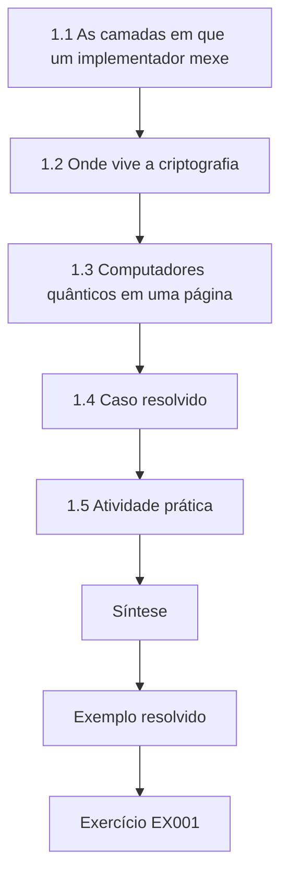

### Desenho lógico

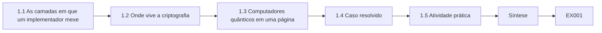

```text
[1.1 As camadas em que um implementador mexe]
    |
    v
[1.2 Onde vive a criptografia]
    |
    v
[1.3 Computadores quânticos em uma página]
    |
    v
[1.4 Caso resolvido]
    |
    v
[1.5 Atividade prática]
    |
    v
[Síntese]
    |
    v
[Exemplo resolvido] --> [Exercício EX001]
```
<!-- open-cyber-academy:lesson-figures:end ch-01 -->


### Objetivos de aprendizagem

Você vai (1) descrever as camadas de hardware, firmware, sistema operacional, biblioteca e aplicação de um serviço; (2) localizar as funções criptográficas e as chaves em cada camada; (3) explicar o que um computador quântico é e o que não é; e (4) estimar o quão difícil é uma mudança criptográfica a partir da camada em que ela vive.

### 1.1 As camadas em que um implementador mexe

Todo serviço da KLS fica sobre uma pilha. Servidores e leitores têm processadores, memória, TPMs e placas de rede; o firmware os inicializa e verifica as assinaturas do estágio seguinte; um sistema operacional ou hipervisor isola as cargas de trabalho; bibliotecas como OpenSSL, BoringSSL, os pacotes de criptografia do Go ou os provedores do Java implementam os protocolos; as aplicações chamam essas bibliotecas; e os serviços gerenciados (balanceadores de carga, CDNs, serviços de gerenciamento de chaves na nuvem) envolvem tudo isso. Os implementadores mudam a criptografia sobretudo nas camadas do meio — versões de bibliotecas, configuração, certificados —, mas precisam conhecer as camadas de cima e de baixo, porque elas limitam o que é possível.

### 1.2 Onde vive a criptografia

A criptografia aparece em todas as camadas: assinaturas de inicialização segura no firmware; cifragem de disco e repositórios de chaves no sistema operacional; TLS, SSH e IPsec em bibliotecas e daemons; assinaturas de JSON Web Token e cifragem de campos nas aplicações; HSMs ou KMS na nuvem guardando as chaves raiz. Cada local tem um *mecanismo de mudança*: configuração (minutos), atualização de pacote (dias), versão do fornecedor (meses), substituição de hardware (anos). Anotar o mecanismo ao lado de cada uso criptográfico é o hábito mais útil para planejar o trabalho.

Na KLS, o hábito se paga de imediato: os grupos TLS do gateway de API são uma mudança de configuração, a biblioteca do ingress é uma reconstrução de imagem, o bootloader dos leitores é uma renovação de hardware.

### 1.3 Computadores quânticos em uma página

Os computadores quânticos manipulam qubits cujos estados conjuntos interferem entre si; algoritmos específicos exploram isso. O algoritmo de Shor (Shor, 1997) encontra períodos ocultos e, assim, quebra o RSA, o Diffie–Hellman e a criptografia de curvas elípticas; o algoritmo de Grover (Grover, 1996) dá apenas uma aceleração de raiz quadrada para a busca por força bruta, então o AES-256 e o SHA-256 continuam adequados ao uso. Quebrar o RSA-2048 exige uma máquina grande *com correção de erros*; Gidney (2025) estimou menos de um milhão de qubits ruidosos rodando por menos de uma semana, sob premissas declaradas, e essa máquina não existe. Para os implementadores, a mensagem prática é simples: substituir a troca de chaves e as assinaturas de chave pública; manter a cifragem simétrica e os hashes em tamanhos adequados.

### 1.4 Caso resolvido

O leitor de armazém da KLS: placa ARM sem TPM (hardware), bootloader do fornecedor que verifica assinaturas RSA (firmware, mudança por renovação de hardware), Linux embarcado (sistema operacional, imagem do fornecedor), libcurl com uma biblioteca TLS antiga (biblioteca, versão do fornecedor) e um aplicativo de leitura que envia manifestos por HTTPS (aplicação, código da KLS). Das cinco camadas, a KLS controla diretamente uma. A troca de chaves TLS do leitor só pode se tornar híbrida quando o fornecedor entregar uma nova imagem.

A tabela também mostra onde a KLS pode agir agora. O caminho de envio pode ser encurtado para que os manifestos saiam do leitor só uma vez por dia, e o contrato com o fornecedor pode ser alterado para exigir uma imagem com TLS híbrido até uma data definida. Os dois são registrados na linha do leitor, para que o risco residual tenha um dono, em vez de ser esquecido enquanto a renovação está pendente.

### 1.5 Atividade prática

Para um serviço que você administra em laboratório, liste cada camada, uma função criptográfica nela e o mecanismo de mudança. Marque as que você controla.

Uma linha resolvida para um servidor web de laboratório poderia ser: camada de biblioteca, OpenSSL 3.5 fornecendo a troca de chaves TLS, mudada por atualização de pacote, controlada por você; camada de firmware, inicialização segura UEFI com um shim assinado com RSA, mudada pelo fabricante da placa, não controlada. Procure ter pelo menos cinco linhas. Onde não conseguir nomear o mecanismo, escreva "desconhecido" em vez de chutar e anote qual documento ou pessoa poderia responder. Guarde a tabela; o esquema de inventário construído no Capítulo 4 importa exatamente estas colunas.

### 1.6 Erros comuns e limites

- Supor que uma mudança na aplicação pode corrigir a criptografia do firmware.
- Tratar os computadores quânticos como aceleradores de uso geral.
- Esquecer os serviços gerenciados que terminam o TLS em seu nome.

Cada erro tem um exemplo na KLS. Um desenvolvedor que propõe "corrigir" o bootloader RSA dos leitores no aplicativo de envio está mudando a camada errada; só a renovação do fornecedor chega ao firmware. Esperar que um computador quântico acelere o processamento de logs confunde uma capacidade criptoanalítica estreita com computação geral. E é a CDN, não a KLS, que termina o TLS dos navegadores: esquecê-la significa que o inventário mostra as configurações da origem, enquanto os clientes na verdade negociam com a borda do provedor. O limite deste capítulo é a amplitude: ele mapeia as camadas, mas ainda não as mede.

### Exercícios

- **EX001 — Tabela de camadas.** Monte uma tabela de cinco camadas para o portal do cliente da KLS, com função, mecanismo de mudança e dono. Rubrica: 3 = cinco linhas plausíveis.
- **EX002 — Manter ou substituir.** Classifique as assinaturas RSA-2048, o AES-256-GCM, o SHA-256 e o ECDHE P-256 como manter ou substituir, com um motivo para cada. Rubrica: 3 = quatro corretas, com motivos.

### Síntese

A criptografia vive em todas as camadas, e a camada determina quem pode mudá-la e com que rapidez. Os computadores quânticos ameaçam a troca de chaves e as assinaturas de chave pública, não a cifragem simétrica nem os hashes.

<!-- open-cyber-academy:chapter-navigation:start ch-01 -->
### Continue estudando — capítulo 01 de 30

[← Página do curso](../../README.md) · [Índice de capítulos do curso](../SUBJECTS.md) · [Capítulo 02 →](#ch-02)

Siga para a próxima lição escrita.
<!-- open-cyber-academy:chapter-navigation:end -->

<a id="ch-02"></a>

## Capítulo 2 — Redes e serviços de internet

<!-- open-cyber-academy:lesson-figures:start ch-02 -->
### Mapa da aula

Aula 02 publicada. Mapa, exemplo, EX003.

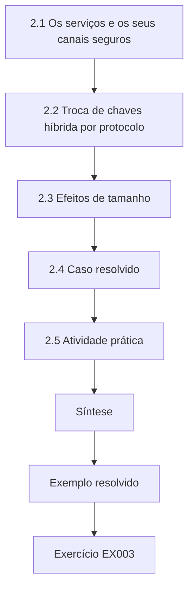

### Desenho lógico

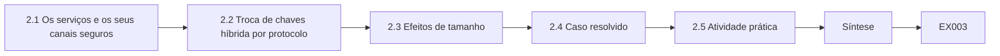

```text
[2.1 Os serviços e os seus canais seguros]
    |
    v
[2.2 Troca de chaves híbrida por protocolo]
    |
    v
[2.3 Efeitos de tamanho]
    |
    v
[2.4 Caso resolvido]
    |
    v
[2.5 Atividade prática]
    |
    v
[Síntese]
    |
    v
[Exemplo resolvido] --> [Exercício EX003]
```
<!-- open-cyber-academy:lesson-figures:end ch-02 -->


### Objetivos de aprendizagem

Você vai (1) explicar DNS, HTTP, TLS, SSH e IPsec no nível de implementação; (2) identificar o estabelecimento de chaves e a autenticação em cada um; (3) reconhecer como as mensagens pós-quânticas mudam de tamanho; e (4) nomear as normas que definem a troca de chaves híbrida no TLS, no SSH e no IKEv2.

### 2.1 Os serviços e os seus canais seguros

Os clientes da KLS chegam à API por DNS e HTTPS; os parceiros trocam arquivos por SFTP (SSH); os escritórios se conectam por VPNs IPsec. Cada canal seguro faz dois trabalhos: o *estabelecimento de chaves* (combinar as chaves de sessão) e a *autenticação* (provar a identidade com certificados, chaves de host ou chaves pré-compartilhadas). O risco quântico para o primeiro é colher agora, decifrar depois; para o segundo, a falsificação futura.

A distinção decide a ordem do trabalho da KLS. Sessões SFTP gravadas que transportam documentos aduaneiros de dez anos podem ser decifradas depois se a troca de chaves for clássica, então o estabelecimento de chaves vem primeiro. Uma chave de host ou um certificado falsificados só ajudam um atacante quando existir um computador quântico e enquanto essa chave ainda for confiável, então a autenticação pode vir depois, quando as bibliotecas e os repositórios de confiança estiverem prontos.

### 2.2 Troca de chaves híbrida por protocolo

No TLS 1.3 ([RFC 8446](https://www.rfc-editor.org/rfc/rfc8446.html)), o grupo híbrido X25519MLKEM768 ([RFC 10024](https://www.rfc-editor.org/rfc/rfc10024.html)) combina o ML-KEM-768 com o X25519; o key share do cliente cresce de 32 para 1.216 bytes e o do servidor para 1.120 bytes. No SSH, o OpenSSH acrescentou uma troca de chaves híbrida ML-KEM/X25519, `mlkem768x25519-sha256`, e depois a tornou o padrão ([notas de versão do OpenSSH](https://www.openssh.com/releasenotes.html)), depois de ter oferecido antes um híbrido baseado no sntrup761. No IKEv2, a [RFC 9370](https://www.rfc-editor.org/rfc/rfc9370.html) permite até sete trocas de chaves adicionais, usadas para acrescentar o ML-KEM ao lado do Diffie–Hellman clássico; a [RFC 8784](https://www.rfc-editor.org/rfc/rfc8784.html) mistura chaves pré-compartilhadas pós-quânticas como medida provisória. A terminologia dessas combinações está na [RFC 9794](https://www.rfc-editor.org/rfc/rfc9794.html).

### 2.3 Efeitos de tamanho

Um ClientHello que transporta um key share ML-KEM geralmente ultrapassa um pacote de 1.500 bytes. A maioria das pilhas lida com isso; alguns middleboxes e balanceadores de carga antigos, não. As assinaturas pós-quânticas são ainda maiores (ML-DSA-44: 2.420 bytes por assinatura na [FIPS 204](https://doi.org/10.6028/NIST.FIPS.204)), o que importa quando os certificados mudarem. O DNSSEC, que roda sobre UDP com limites de tamanho apertados, é especialmente sensível ao tamanho das assinaturas.

Na KLS, o efeito de tamanho é medido, não suposto: o key share híbrido do cliente acrescenta 1.184 bytes, o que empurra um ClientHello típico para além de um segmento. O Laboratório H, no Capítulo 20, mostra a assinatura da falha: ClientHellos de 1.530 bytes expirando num caminho de proxy. Os certificados ainda não foram alterados, então a assinatura de 2.420 bytes do ML-DSA-44 é uma preocupação posterior; a zona DNS continua clássica até que os tamanhos de assinatura e o comportamento dos resolvedores sejam entendidos.

### 2.4 Caso resolvido

A KLS habilita o X25519MLKEM768 num gateway de API de homologação. Os navegadores modernos e o SDK do cliente baseado em Go o negociam de imediato; o cliente Java legado de um cliente oferece apenas grupos clássicos e recua para o X25519, como previsto. Uma sonda de monitoramento de terceiros expira — o seu appliance descarta o ClientHello de dois segmentos. A correção é atualizar a sonda, não desabilitar o grupo.

A execução em homologação também deu à KLS a sua primeira regra de implantação. O recuo do cliente Java é aceitável e é acompanhado como uma fração das sessões; um timeout não é aceitável e precisa ser rastreado até um dispositivo. O fornecedor do monitoramento recebeu um chamado com o tamanho do ClientHello capturado no laboratório, e a lista de grupos da homologação ficou inalterada enquanto a sonda era atualizada.

### 2.5 Atividade prática

Em laboratório, conecte-se a um servidor de teste com um cliente TLS que imprima o grupo negociado, uma vez com o híbrido oferecido e outra sem ele. Registre os tamanhos do ClientHello a partir de uma captura do tráfego do seu próprio laboratório.

Use dois clientes se uma biblioteca não conseguir desabilitar o key share híbrido: por exemplo, um cliente OpenSSL 3.5 com os grupos padrão e o mesmo cliente forçado a usar apenas `X25519`. Registre, para cada execução, o grupo negociado, o comprimento do ClientHello na sua própria captura e se o hello ocupa um ou dois segmentos TCP. Espere cerca de 1.200 bytes a mais com o híbrido. Escreva uma frase explicando o que um middlebox que remonta apenas o primeiro segmento faria com cada execução.

### 2.6 Erros comuns e limites

- Acreditar que a troca de chaves híbrida muda os algoritmos dos certificados.
- Tratar as migrações de SSH e de TLS como uma única tarefa.
- Capturar tráfego que você não tem autorização para capturar.

A troca de chaves híbrida muda apenas a extensão do key share; o certificado e a sua assinatura RSA ou ECDSA ficam intactos, e é por isso que a KLS acompanha os certificados separadamente. SSH e TLS compartilham a ideia, mas não o software: a lista `KexAlgorithms` do OpenSSH nos hosts SFTP e a lista de grupos TLS do gateway são configuradas, testadas e revertidas de forma independente. As capturas se restringem ao tráfego de laboratório ou a escopos autorizados, porque os pacotes dos clientes contêm os dados deles.

### Exercícios

- **EX003 — Mapa de protocolos.** Para o TLS 1.3, o SSH e o IKEv2, nomeie o mecanismo híbrido e o documento que o define. Rubrica: 3 = três corretos, com fontes.
- **EX004 — Diferença em bytes.** Quantos bytes o key share do servidor no X25519MLKEM768 tem a mais do que um key share X25519? Rubrica: 3 = 1.088 bytes (1.120 − 32), observando que isso é igual ao texto cifrado do ML-KEM-768.

### Síntese

Cada canal seguro separa o estabelecimento de chaves da autenticação. A troca de chaves híbrida é padronizada para o TLS, está disponível no SSH e é especificada para o IKEv2; ela aumenta os handshakes e pode expor middleboxes antigos.

<!-- open-cyber-academy:chapter-navigation:start ch-02 -->
### Continue estudando — capítulo 02 de 30

[← Capítulo 01](#ch-01) · [Índice de capítulos do curso](../SUBJECTS.md) · [Capítulo 03 →](#ch-03)

Siga para a próxima lição escrita.
<!-- open-cyber-academy:chapter-navigation:end -->

<a id="ch-03"></a>

## Capítulo 3 — Fundamentos de programação

<!-- open-cyber-academy:lesson-figures:start ch-03 -->
### Mapa da aula

Aula 03 publicada. Mapa, exemplo, EX005.

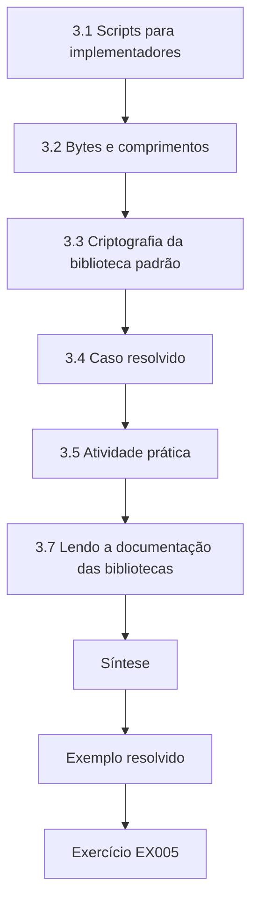

### Desenho lógico

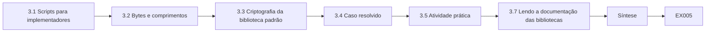

```text
[3.1 Scripts para implementadores]
    |
    v
[3.2 Bytes e comprimentos]
    |
    v
[3.3 Criptografia da biblioteca padrão]
    |
    v
[3.4 Caso resolvido]
    |
    v
[3.5 Atividade prática]
    |
    v
[3.7 Lendo a documentação das bibliotecas]
    |
    v
[Síntese]
    |
    v
[Exemplo resolvido] --> [Exercício EX005]
```
<!-- open-cyber-academy:lesson-figures:end ch-03 -->


### Objetivos de aprendizagem

Você vai (1) escrever pequenos scripts em Python com funções, dicionários e laços; (2) tratar bytes, codificações e comprimentos com precisão; (3) usar corretamente `hashlib`, `hmac` e `secrets`; e (4) escrever testes que possam falhar.

### 3.1 Scripts para implementadores

Os implementadores escrevem scripts para inventariar, verificar e automatizar. Um script de trinta linhas que analisa exportações de configuração e sinaliza serviços apenas clássicos vale mais do que uma checklist manual, porque pode rodar toda noite. Os laboratórios deste livro usam apenas a biblioteca padrão do Python, para que rodem em qualquer lugar.

O primeiro script desse tipo da KLS lê as configurações exportadas do ingress e dos balanceadores de carga, lista os grupos configurados por listener e imprime qualquer listener de nível 1 sem `X25519MLKEM768`. Rodando toda noite, ele encontrou a lista mal ordenada do portal do cliente muito antes do que o alerta de monitoramento do Capítulo 19 teria encontrado. Manter o script com menos de 50 linhas o manteve revisável.

### 3.2 Bytes e comprimentos

Chaves, textos cifrados e assinaturas são bytes com comprimentos exatos: as chaves de encapsulamento do ML-KEM-768 têm 1.184 bytes e os textos cifrados, 1.088 bytes ([FIPS 203](https://doi.org/10.6028/NIST.FIPS.203)); as chaves públicas do ML-DSA-65 têm 1.952 bytes e as assinaturas, 3.309 bytes (FIPS 204). Um código que os guarda em colunas de banco de dados de tamanho fixo, campos base64 ou protocol buffers dimensionados para o ECDSA vai truncá-los ou rejeitá-los. Verifique sempre os comprimentos explicitamente e falhe de forma fechada.

Os comprimentos também são a validação mais barata que um implementador pode acrescentar. Uma função que rejeita uma chave ML-KEM-768 de 1.183 bytes, como faz o Laboratório V no Capítulo 15, apanha truncamentos, conjuntos de parâmetros errados e confusões de codificação antes de qualquer chamada à biblioteca. A KLS guarda o conjunto de parâmetros ao lado de cada chave, para que o comprimento esperado possa ser consultado em vez de adivinhado.

### 3.3 Criptografia da biblioteca padrão

`secrets.token_bytes(n)` fornece bytes aleatórios seguros; `random`, não. `hashlib.sha256`, `hashlib.sha3_256` e `hashlib.shake_256` calculam hashes; `hmac.new(key, msg, hashlib.sha256)` calcula MACs; `hmac.compare_digest` compara segredos em tempo constante. A biblioteca padrão do Python não implementa o ML-KEM nem o ML-DSA; o código de produção chama uma biblioteca verificada ou o provedor da plataforma.

Vale a pena conhecer o `hashlib.shake_256`, porque o ML-KEM e o ML-DSA usam SHAKE internamente; os implementadores o encontram nos testes de resposta conhecida, mesmo que nunca implementem os esquemas. O módulo `secrets` tira os seus valores do gerador do sistema operacional, que é o que os scripts da KLS usam para chaves de laboratório e vetores de teste.

### 3.4 Caso resolvido

Um desenvolvedor da KLS guarda chaves públicas numa coluna `VARCHAR(512)` com texto base64. O base64 expande os bytes em 4/3, então uma chave ML-DSA-65 de 1.952 bytes precisa de 2.604 caracteres e é truncada silenciosamente por um modo permissivo do banco de dados. Um teste que fizesse um valor aleatório de 1.952 bytes ir e voltar pela camada de armazenamento teria apanhado o problema:

```python
import base64, secrets
key = secrets.token_bytes(1952)
enc = base64.b64encode(key).decode()
assert len(enc) == 2604 and base64.b64decode(enc) == key
print("round trip ok,", len(enc), "chars")
```

A correção teve duas partes: a coluna passou a um tipo binário dimensionado a partir da maior chave que a KLS planeja guardar, os 2.592 bytes do ML-DSA-87, e o banco de dados passou ao modo estrito, para que um valor grande demais gere um erro em vez de ser cortado. O teste de ida e volta agora roda para cada tipo de chave da tabela de comprimentos do inventário.

### 3.5 Atividade prática

Escreva `check_len(kind, data)` usando um dicionário com os comprimentos esperados das chaves de encapsulamento do ML-KEM-512/768/1024, e teste entradas válidas e inválidas.

Um bom arquivo de testes tem pelo menos seis casos: os três comprimentos corretos (800, 1.184 e 1.568 bytes), um valor com um byte a menos, um valor com um byte a mais e um comprimento correto passado com o rótulo de tipo errado, como 1.184 bytes rotulados ML-KEM-512. A função deve gerar um erro que nomeie o tipo, o comprimento esperado e o comprimento real. Rode os testes uma vez com um defeito proposital, um número errado no dicionário, para mostrar que eles podem falhar.

### 3.6 Erros comuns e limites

- Campos de tamanho fixo dimensionados para chaves clássicas.
- `random` para segredos.
- Testes que só exercitam os caminhos de sucesso.

Na KLS, cada erro teve um custo. A coluna `VARCHAR(512)` truncou silenciosamente chaves ML-DSA num modo permissivo. Um script de teste de carga que montava tokens de sessão com `random` produziu valores previsíveis que um revisor conseguiu reproduzir a partir da semente. Um teste de armazenamento que só gravava chaves válidas passou por meses, enquanto o defeito de truncamento ficava escondido atrás dele. Os scripts são pequenos, mas cada um desses erros sobrevive justamente porque ninguém acha que um script pequeno precisa de testes de falha.

### 3.7 Lendo a documentação das bibliotecas

Antes de chamar qualquer API criptográfica, leia o que ela promete: qual conjunto de parâmetros uma função usa por padrão, se ela devolve erros ou lança exceções, se as chaves são expandidas ou guardadas como sementes e quais codificações ela aceita. A FIPS 203 e a FIPS 204 permitem que as chaves privadas sejam guardadas como sementes curtas que se expandem de forma determinística; duas bibliotecas podem discordar sobre qual forma exportam. Escreva no seu repositório uma nota curta para cada biblioteca que usar, com versão, padrões e codificações, e crie um link para ela no inventário, para que o próximo implementador não precise redescobrir tudo.

### Exercícios

- **EX005 — Dimensionamento em base64.** Quantos caracteres base64 uma assinatura ML-DSA-65 de 3.309 bytes exige? Rubrica: 3 = 4.412, com o método (ceil(3309/3) × 4).
- **EX006 — Tempo constante.** Explique por que `a == b` é arriscado para comparar tags de MAC e o que usar no lugar. Rubrica: 3 = vazamento de tempo por saída antecipada, `hmac.compare_digest`.

### Síntese

Os scripts de implementação precisam tratar bytes e comprimentos com exatidão, usar aleatoriedade segura e comparação em tempo constante, e ser testados tanto na falha quanto no sucesso.

<!-- open-cyber-academy:chapter-navigation:start ch-03 -->
### Continue estudando — capítulo 03 de 30

[← Capítulo 02](#ch-02) · [Índice de capítulos do curso](../SUBJECTS.md) · [Capítulo 04 →](#ch-04)

Siga para a próxima lição escrita.
<!-- open-cyber-academy:chapter-navigation:end -->

<a id="ch-04"></a>

## Capítulo 4 — Modelos de dados

<!-- open-cyber-academy:lesson-figures:start ch-04 -->
### Mapa da aula

Aula 04 publicada. Mapa, exemplo, EX007.

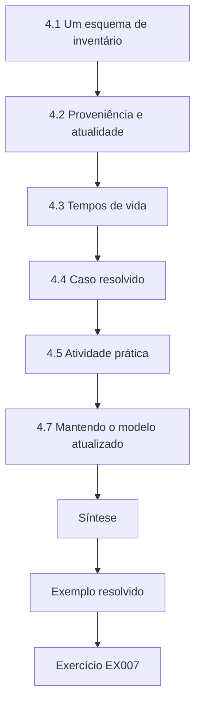

### Desenho lógico

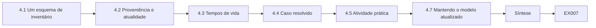

```text
[4.1 Um esquema de inventário]
    |
    v
[4.2 Proveniência e atualidade]
    |
    v
[4.3 Tempos de vida]
    |
    v
[4.4 Caso resolvido]
    |
    v
[4.5 Atividade prática]
    |
    v
[4.7 Mantendo o modelo atualizado]
    |
    v
[Síntese]
    |
    v
[Exemplo resolvido] --> [Exercício EX007]
```
<!-- open-cyber-academy:lesson-figures:end ch-04 -->


### Objetivos de aprendizagem

Você vai (1) modelar serviços, endpoints, certificados e algoritmos como registros relacionados; (2) projetar um esquema de inventário com proveniência; (3) associar atributos de tempo de vida dos dados; e (4) consultar o modelo em busca de candidatos à migração.

### 4.1 Um esquema de inventário

Um esquema prático tem tabelas para `service` (nome, dono, nível), `endpoint` (host, porta, protocolo), `crypto_use` (endpoint, função, algoritmo, parâmetro, biblioteca, versão), `observation` (crypto_use, método, data e hora, observador) e `data_class` (nome, confidentiality_years) ligadas aos serviços. Separar a observação do uso permite registrar que o mesmo uso foi visto por um scanner na segunda-feira e confirmado na configuração na quarta-feira.

A KLS acrescenta duas colunas práticas: `change_mechanism` em `crypto_use`, com configuração, pacote, versão do fornecedor ou hardware, e `controller` em `endpoint`. Com elas, uma única consulta lista todas as trocas de chaves clássicas que a KLS pode corrigir por configuração neste mês.

### 4.2 Proveniência e atualidade

Toda linha precisa de um método (captura passiva, configuração, varredura de código, declaração do fornecedor) e de uma data e hora. As observações antigas são rebaixadas para "não verificadas" em vez de apagadas. Sem proveniência, um painel mistura fatos com palpites, e ninguém sabe quais são quais.

A KLS usa três graus: confirmado (dois métodos independentes concordam), observado (um método nos últimos 30 dias) e não verificado (mais antigo, ou uma única declaração do fornecedor). O painel de 71 % do Capítulo 9 deu errado em parte porque linhas da época do scanner, sem rótulo de método, foram contadas como atuais. O grau é calculado a partir da tabela de observações, nunca digitado à mão, para que não possa se afastar das evidências.

### 4.3 Tempos de vida

Associe `confidentiality_years` às classes de dados. Os registros de embarque da KLS precisam permanecer confidenciais por dez anos, por contrato; os dados de faturamento, sete; a telemetria, um. Uma consulta que cruza os tempos de vida com os algoritmos de troca de chaves produz automaticamente a lista de candidatos a colher agora, decifrar depois.

O texto do contrato vale mais do que as tabelas de retenção: os dados de faturamento da KLS são retidos por sete anos por razões fiscais, mas o contrato de um cliente de frete exige confidencialidade de dez anos para as tarifas, então as linhas de faturamento desse cliente herdam dez. Por isso, a coluna de tempo de vida fica na classe de dados e pode ser sobrescrita por cliente, e a consulta usa o maior tempo de vida entre as classes que um fluxo transporta.

### 4.4 Caso resolvido

```python
import sqlite3
db = sqlite3.connect(":memory:")
db.executescript("""
CREATE TABLE use(service TEXT, function TEXT, algorithm TEXT, data_years INT);
INSERT INTO use VALUES ('api-gateway','kex','X25519MLKEM768',10),('partner-sftp','kex','ecdh-sha2-nistp256',10),
                       ('billing-db','kex','ECDHE-P256',7),('telemetry','kex','ECDHE-P256',1);""")
rows = db.execute("SELECT service FROM use WHERE function='kex' AND algorithm NOT LIKE '%MLKEM%' AND data_years>=5").fetchall()
print("HNDL candidates:", [r[0] for r in rows])
```

A consulta devolve o SFTP dos parceiros e o banco de dados de faturamento; a telemetria fica de fora porque os seus dados têm vida curta, e o gateway já é híbrido.

A consulta codifica três decisões que vale a pena ler em voz alta. A condição `function='kex'` a limita à exposição a colher agora, decifrar depois, porque as assinaturas seguem outro calendário. O teste `NOT LIKE '%MLKEM%'` trata qualquer grupo híbrido como aceitável. O limite `data_years>=5` é uma política da KLS, não uma norma; com três anos, o banco de dados de faturamento continuaria listado e a telemetria continuaria fora. Executada de novo após cada alimentação do inventário, a lista se torna uma fila de trabalho viva para a equipe de plataforma.

### 4.5 Atividade prática

Estenda o exemplo com uma tabela `observation` e uma consulta que liste os usos cuja observação mais recente tem mais de 90 dias.

Dê à tabela `observation` uma chave estrangeira para `use`, uma coluna `method` e uma data e hora `observed_at` guardada como texto ISO. Insira duas observações para o gateway, uma de 10 dias e outra de 200 dias, e uma observação de 120 dias para o SFTP dos parceiros. A consulta correta agrupa por uso e compara a data e hora máxima com o limite, de modo que o gateway é atual porque a sua linha mais recente é recente. Uma consulta que compara todas as linhas listaria o gateway por engano; inclua esse erro como teste negativo.

### 4.6 Erros comuns e limites

- Planilhas planas sem proveniência.
- Apagar dados antigos em vez de marcá-los.
- Tempos de vida copiados das tabelas de retenção sem conferir os contratos.

Na KLS, a planilha plana tinha uma coluna "algoritmo" com valores digitados por quatro pessoas; ninguém sabia dizer se o "ECDHE" do faturamento tinha vindo de uma varredura, de um arquivo de configuração ou da memória. Apagar as linhas antigas removeu por completo a telemetria das empilhadeiras, o que escondeu que ninguém conhecia a sua criptografia. E a primeira lista de tempos de vida copiou a retenção fiscal de sete anos para o faturamento, deixando de lado a cláusula contratual de dez anos. Cada erro torna a lista de migração mais curta do que deveria ser, o que parece progresso, mas não é.

### 4.7 Mantendo o modelo atualizado

Um modelo de inventário começa a envelhecer no momento em que é preenchido. Alimente-o automaticamente: exportações noturnas de configuração dos balanceadores de carga, listas de certificados do banco de dados da AC, manifestos de imagens do registro e resumos de handshakes tirados dos logs. Cada alimentação grava observações com o seu próprio rótulo de método, para que o modelo sempre mostre o que foi visto, como e quando. As linhas digitadas à mão devem ser a exceção e devem trazer o nome de quem as digitou. Quando duas fontes discordam — a configuração diz que o híbrido está habilitado, os logs não mostram nenhuma negociação híbrida —, registre as duas e abra uma tarefa; a discordância costuma ser o fato mais útil do modelo.

O acesso ao modelo também importa. Um mapa completo de quais serviços ainda usam troca de chaves clássica é útil para um atacante, então restrinja o acesso de escrita às alimentações e o de leitura às equipes que precisam dele, e publique apenas agregados fora do grupo de plataforma.

### Exercícios

- **EX007 — Esquema.** Liste as colunas de uma tabela `observation` e explique cada uma. Rubrica: 3 = referência ao uso, método, data e hora, observador, ponteiro para a evidência bruta.
- **EX008 — Consulta.** Escreva um SQL que devolva os serviços com assinaturas clássicas em certificados válidos além de 2030. Rubrica: 3 = condições corretas sobre função, algoritmo e validade.

### Síntese

Um inventário relacional com proveniência e tempos de vida transforma o planejamento da migração em consultas que podem ser executadas de novo sempre que o parque mudar.

<!-- open-cyber-academy:chapter-navigation:start ch-04 -->
### Continue estudando — capítulo 04 de 30

[← Capítulo 03](#ch-03) · [Índice de capítulos do curso](../SUBJECTS.md) · [Capítulo 05 →](#ch-05)

Siga para a próxima lição escrita.
<!-- open-cyber-academy:chapter-navigation:end -->

<a id="ch-05"></a>

## Capítulo 5 — Letramento em segurança

<!-- open-cyber-academy:lesson-figures:start ch-05 -->
### Mapa da aula

Aula 05 publicada. Mapa, exemplo, EX009.

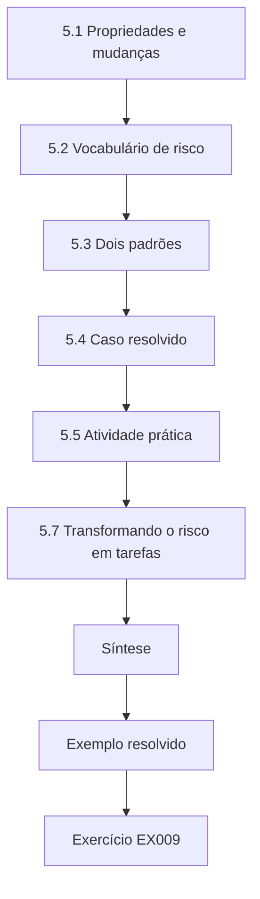

### Desenho lógico

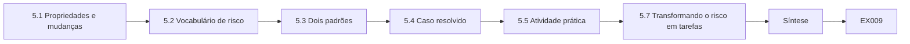

```text
[5.1 Propriedades e mudanças]
    |
    v
[5.2 Vocabulário de risco]
    |
    v
[5.3 Dois padrões]
    |
    v
[5.4 Caso resolvido]
    |
    v
[5.5 Atividade prática]
    |
    v
[5.7 Transformando o risco em tarefas]
    |
    v
[Síntese]
    |
    v
[Exemplo resolvido] --> [Exercício EX009]
```
<!-- open-cyber-academy:lesson-figures:end ch-05 -->


### Objetivos de aprendizagem

Você vai (1) aplicar confidencialidade, integridade, disponibilidade e autenticidade às mudanças em serviços; (2) relacionar ativos, ameaças, vulnerabilidades e controles; (3) explicar colher agora, decifrar depois e forjar depois; e (4) reconhecer o risco de disponibilidade numa mudança criptográfica.

### 5.1 Propriedades e mudanças

Os implementadores mudam a criptografia para melhorar a confidencialidade e a autenticidade, mas toda mudança arrisca a disponibilidade. Um grupo híbrido que um balanceador de carga não consegue interpretar é uma indisponibilidade. A boa prática trata a disponibilidade como um requisito de mesmo peso: implantação em etapas, reversão, monitoramento.

A regra aparece nos próprios registros da KLS: a sonda de monitoramento que expirou no gateway de homologação teria sido uma tempestade de alertas em produção se o grupo tivesse entrado no ar em todos os lugares ao mesmo tempo. Por isso, cada mudança híbrida traz no seu plano uma reversão, um painel e uma etapa canário.

### 5.2 Vocabulário de risco

Um *ativo* (os registros de embarque), uma *ameaça* (um adversário gravando o tráfego), uma *vulnerabilidade* (a troca de chaves clássica) e um *controle* (a troca de chaves híbrida) se combinam num cenário de risco. As vulnerabilidades quânticas são propriedades dos algoritmos, não defeitos, e se tornam exploráveis quando surge uma capacidade.

Escrever as quatro partes separadamente também mostra onde um controle atua. A troca de chaves híbrida remove a vulnerabilidade apenas para as sessões futuras; ela não faz nada pelo tráfego já gravado. Encurtar a retenção, por sua vez, reduz o valor do ativo. Para o SFTP dos parceiros da KLS, o cenário completo é: documentos aduaneiros, gravados por um adversário numa rede de trânsito, legíveis por causa da troca de chaves ECDH, mitigados pelo `mlkem768x25519-sha256` a partir da data da atualização.

### 5.3 Dois padrões

*Colher agora, decifrar depois*: o tráfego gravado é decifrado quando existir um computador quântico; é urgente para dados cuja confidencialidade dura além desse momento. *Forjar depois*: quando existir um computador quântico, as assinaturas podem ser forjadas; é urgente para a confiança de longa duração (ACs raiz, assinatura de firmware, documentos verificados por anos) e para dispositivos que não podem ser atualizados.

A urgência de cada um é uma questão de datas. A exposição a HNDL começa no dia em que o tráfego é gravado, então, para os dados de embarque de dez anos da KLS, cada sessão clássica de hoje importa. A exposição a forjar depois só começa quando a falsificação se torna possível e dura enquanto a chave for confiável, então a raiz interna de 15 anos é urgente e uma chave de JWT semanal não é.

### 5.4 Caso resolvido

O serviço SFTP dos parceiros da KLS transporta documentos aduaneiros mantidos confidenciais por dez anos; ele usa troca de chaves ECDH: exposto a HNDL agora. A sua chave de host é Ed25519: exposição a forjar depois, de menor urgência, porque as chaves de host podem ser rotacionadas rapidamente quando os clientes SSH suportarem algoritmos de chave de host pós-quânticos. As chaves de assinatura de JWT da API são rotacionadas semanalmente: a exposição a forjar depois é mínima até que exista um computador quântico.

Os três casos dão à KLS três respostas diferentes. A troca de chaves do SFTP é agendada para a próxima janela de manutenção. A chave de host é registrada como risco residual com um gatilho: quando o OpenSSH lançar um algoritmo de chave de host pós-quântico que os clientes da KLS suportem, rotacionar. As chaves de JWT não precisam de nada além de manter a rotação automatizada.

### 5.5 Atividade prática

Escreva três cenários de risco para serviços da KLS usando o padrão ativo–ameaça–vulnerabilidade–controle; rotule cada um como HNDL, forjar depois ou nenhum.

Um cenário completo nomeia as quatro partes e o rótulo. Exemplo: ativo, a replicação do banco de dados de faturamento transportando faturas de sete anos; ameaça, gravação na rede entre zonas do provedor; vulnerabilidade, ECDHE-P256 no TLS da replicação; controle, híbrido suportado pelo provedor ou cifragem de campos na camada de aplicação; rótulo HNDL. Inclua um cenário rotulado nenhum, como os backups em AES-256, e explique por quê: a aceleração de Grover deixa uma chave de 256 bits com ampla margem, então nenhuma ação motivada pelo quântico é necessária.

### 5.6 Erros comuns e limites

- Esquecer a disponibilidade nos planos de mudança.
- Tratar todo risco quântico como igualmente urgente.
- Chamar os algoritmos de "defeitos".

Cada erro leva a uma falha reconhecível. Um plano sem trabalho de disponibilidade habilita o híbrido no portal e descobre o proxy antigo num cliente por meio de um chamado de suporte. Tratar toda exposição como urgente coloca as chaves de JWT semanais na mesma fila do tráfego SFTP de dez anos e atrasa as duas. Chamar o RSA de "defeito" convida a uma mentalidade de correção; não há correção, só substituição, e o cronograma depende de uma capacidade que ainda não existe.

### 5.7 Transformando o risco em tarefas

Os implementadores traduzem cada cenário de risco em itens de trabalho com uma definição clara de pronto. "Exposição a HNDL do SFTP dos parceiros" se torna: confirmar que a versão do OpenSSH nos hosts SFTP suporta `mlkem768x25519-sha256`; habilitá-lo em primeiro lugar na lista de troca de chaves do servidor em homologação; verificar quais clientes dos parceiros o negociam; publicar um aviso aos parceiros; promover para produção; monitorar a fração de sessões que o usam. Cada item tem um dono e uma evidência que prova que está concluído. Declarações de risco que nunca viram tarefas são a forma mais comum de o trabalho de segurança empacar entre o registro de riscos e o backlog da plataforma.

Mantenha a disponibilidade em toda definição de pronto: uma tarefa não está concluída até que a reversão tenha sido testada e o monitoramento não mostre aumento de falhas.

### Exercícios

- **EX009 — Classificar.** Rotule como HNDL, forjar depois ou nenhum: o tráfego da VPN do escritório, a chave de assinatura de código do CI, os backups em AES-256, o TLS para o portal do cliente. Rubrica: 3 = quatro corretos, com motivos.
- **EX010 — Disponibilidade.** Nomeie duas formas pelas quais habilitar a troca de chaves híbrida poderia causar uma indisponibilidade e um controle para cada uma. Rubrica: 3 = dois modos de falha, com controles.

### Síntese

Os implementadores precisam pesar os ganhos de confidencialidade e de autenticidade contra o risco de disponibilidade, e distinguir os padrões ligados ao tempo de colher agora, decifrar depois e de forjar depois.

<!-- open-cyber-academy:chapter-navigation:start ch-05 -->
### Continue estudando — capítulo 05 de 30

[← Capítulo 04](#ch-04) · [Índice de capítulos do curso](../SUBJECTS.md) · [Capítulo 06 →](#ch-06)

Siga para a próxima lição escrita.
<!-- open-cyber-academy:chapter-navigation:end -->

<a id="ch-06"></a>

## Capítulo 6 — Sistemas operacionais e virtualização

<!-- open-cyber-academy:lesson-figures:start ch-06 -->
### Mapa da aula

Aula 06 publicada. Mapa, exemplo, EX011.

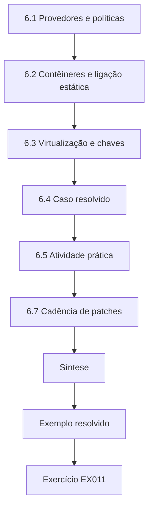

### Desenho lógico

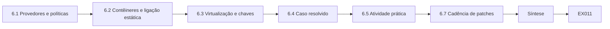

```text
[6.1 Provedores e políticas]
    |
    v
[6.2 Contêineres e ligação estática]
    |
    v
[6.3 Virtualização e chaves]
    |
    v
[6.4 Caso resolvido]
    |
    v
[6.5 Atividade prática]
    |
    v
[6.7 Cadência de patches]
    |
    v
[Síntese]
    |
    v
[Exemplo resolvido] --> [Exercício EX011]
```
<!-- open-cyber-academy:lesson-figures:end ch-06 -->


### Objetivos de aprendizagem

Você vai (1) explicar o isolamento de processos, os privilégios e os repositórios de chaves; (2) identificar os provedores e as políticas criptográficas do sistema; (3) reconhecer bibliotecas ligadas estaticamente e empacotadas em contêineres; e (4) planejar atualizações de sistema operacional e de imagem que habilitem algoritmos pós-quânticos.

### 6.1 Provedores e políticas

No Linux, a maioria dos serviços se liga a uma biblioteca TLS do sistema; o OpenSSL 3.5 acrescentou suporte ao ML-KEM, ao ML-DSA e ao SLH-DSA e grupos TLS híbridos ([notas de versão do OpenSSL 3.5](https://github.com/openssl/openssl/blob/openssl-3.5/NEWS.md)). Algumas distribuições centralizam os algoritmos permitidos numa política criptográfica de todo o sistema. O Windows usa o CNG; as plataformas móveis fornecem repositórios de chaves e o TLS da plataforma. A versão do provedor no host determina em grande parte o que os serviços podem negociar — a menos que o serviço traga a sua própria biblioteca.

Nos nós da KLS, a primeira verificação é, portanto, `openssl version` mais a política criptográfica da distribuição, que pode remover um grupo que a biblioteca suporta.

### 6.2 Contêineres e ligação estática

Os contêineres empacotam as suas próprias bibliotecas de espaço de usuário; atualizar o sistema operacional do host não muda a biblioteca TLS dentro de uma imagem. Os binários Go e Rust frequentemente ligam a sua criptografia de forma estática. Os implementadores precisam inventariar imagens e binários, não só hosts, e reconstruir as imagens sobre camadas base atualizadas.

A varredura do registro da KLS encontrou o padrão com clareza: a imagem do ingress NGINX trazia um OpenSSL duas versões menores atrás dos hosts, e três serviços Go foram compilados com um toolchain anterior ao TLS híbrido. Nenhum deles mudou quando a frota de nós foi atualizada. O inventário agora lista as versões de biblioteca e de toolchain por digest de imagem, não por host, e a reconstrução é o mecanismo de mudança registrado para cada um.

### 6.3 Virtualização e chaves

Hipervisores, TPMs virtuais e KMS na nuvem guardam chaves de discos e cargas de trabalho. As suas APIs e o suporte a algoritmos mudam no calendário do provedor de nuvem. Registre quais tipos de chave e algoritmos de KMS cada carga de trabalho usa.

Na KLS, isso abrange as chaves do KMS na nuvem que envolvem os discos dos bancos de dados, os TPMs virtuais dos runners de CI e o cluster de HSMs por trás da AC interna. As chaves de envolvimento de disco são simétricas e continuam adequadas ao uso; as chaves assimétricas usadas na importação para o KMS e na assinatura da AC são as que devem ser acompanhadas. A lista de algoritmos publicada por cada provedor e a data da última verificação vão para a coluna de evidências de fornecedores do inventário.

### 6.4 Caso resolvido

A KLS atualiza os seus nós Kubernetes para uma distribuição com OpenSSL 3.5. O contêiner do ingress NGINX ainda roda uma imagem base antiga e continua oferecendo apenas grupos clássicos. Uma reconstrução sobre uma nova imagem base habilita o X25519MLKEM768. O serviço de faturamento, escrito em Go, só ganha suporte ao híbrido depois de uma atualização do toolchain, porque a pilha TLS do Go é compilada junto.

O caso resolvido dá três mecanismos de mudança para um único cluster: uma atualização de nós (feita), uma reconstrução de imagem (um pull request, testado em homologação) e uma atualização de toolchain (uma versão do serviço com testes de regressão). A KLS os agendou separadamente e registrou qual deles ativou a fração híbrida, para que as regressões posteriores pudessem ser rastreadas até o artefato certo.

### 6.5 Atividade prática

Num host de laboratório, liste a versão do OpenSSL no host e dentro de dois contêineres; liste os binários Go ou Rust e as versões dos seus toolchains.

Rode `openssl version` no host e depois `docker run --rm IMAGE openssl version` para cada contêiner, ou inspecione a lista de pacotes da imagem quando não houver shell. Para binários Go, `go version -m BINARY` imprime o toolchain; para Rust, verifique os metadados de compilação ou o `Cargo.lock`. Coloque os resultados numa tabela com host, digest da imagem, biblioteca, versão e se essa versão suporta o ML-KEM. Uma divergência entre o host e o contêiner é a constatação esperada, não uma anomalia.

### 6.6 Erros comuns e limites

- Supor que as atualizações do host mudam os contêineres.
- Editar as políticas criptográficas do sistema em produção sem homologação.
- Ignorar as pilhas TLS compiladas junto.

Cada erro apareceu na KLS. O anúncio da atualização dos nós dizia "TLS híbrido disponível", enquanto o contêiner do ingress continuava negociando X25519. Uma edição de teste da política criptográfica do sistema num host de produção desabilitou um grupo de que um agente de monitoramento precisava, e o agente parou de reportar até que a mudança fosse revertida. E o serviço de faturamento em Go, invisível às varreduras de pacotes, manteve a sua pilha TLS antiga até que alguém lesse os seus metadados de compilação.

### 6.7 Cadência de patches

O suporte pós-quântico chega por meio dos patches comuns, então a cadência de patches da equipe se torna uma alavanca da migração. Acompanhe, para cada imagem base e toolchain, quantos dias ela está atrasada em relação à versão suportada atual. Os serviços atrasados em um ano não conseguem adotar a troca de chaves híbrida sem uma grande atualização de recuperação, que é mais arriscada do que as pequenas atualizações regulares que os teriam mantido em dia.

A KLS mediu o atraso no seu registro: idade mediana das imagens base de 140 dias, pior caso de 410 dias para um serviço legado de relatórios. Esse serviço agora tem uma reconstrução agendada a cada 30 dias, e o seu atraso é uma métrica de painel sob a responsabilidade da sua equipe.

### Exercícios

- **EX011 — Onde mudar.** Para um contêiner NGINX, um serviço Go e um daemon SSH do host, diga o que precisa mudar para habilitar a troca de chaves híbrida. Rubrica: 3 = reconstrução da imagem, toolchain/reconstrução, pacote/configuração do host.
- **EX012 — Política de imagens.** Proponha uma regra de CI que impeça a implantação de imagens com bibliotecas TLS desatualizadas. Rubrica: 3 = verificação concreta, limite, caminho de exceção.

### Síntese

Os sistemas operacionais fornecem provedores criptográficos, mas os contêineres e os binários compilados trazem os seus próprios; o trabalho de implementação segue as bibliotecas até as imagens e os toolchains.

<!-- open-cyber-academy:chapter-navigation:start ch-06 -->
### Continue estudando — capítulo 06 de 30

[← Capítulo 05](#ch-05) · [Índice de capítulos do curso](../SUBJECTS.md) · [Capítulo 07 →](#ch-07)

Siga para a próxima lição escrita.
<!-- open-cyber-academy:chapter-navigation:end -->

<a id="ch-07"></a>

## Capítulo 7 — Fundamentos de identidade e acesso

<!-- open-cyber-academy:lesson-figures:start ch-07 -->
### Mapa da aula

Aula 07 publicada. Mapa, exemplo, EX013.

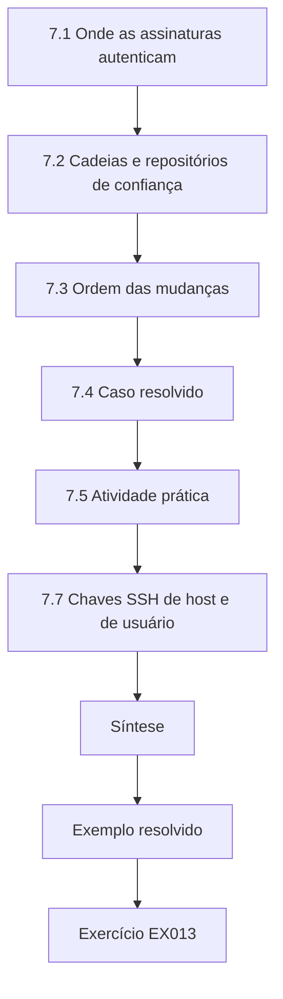

### Desenho lógico

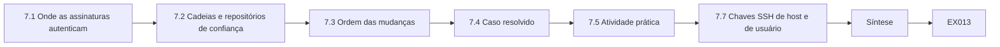

```text
[7.1 Onde as assinaturas autenticam]
    |
    v
[7.2 Cadeias e repositórios de confiança]
    |
    v
[7.3 Ordem das mudanças]
    |
    v
[7.4 Caso resolvido]
    |
    v
[7.5 Atividade prática]
    |
    v
[7.7 Chaves SSH de host e de usuário]
    |
    v
[Síntese]
    |
    v
[Exemplo resolvido] --> [Exercício EX013]
```
<!-- open-cyber-academy:lesson-figures:end ch-07 -->


### Objetivos de aprendizagem

Você vai (1) distinguir autenticação de autorização nos serviços; (2) explicar certificados, cadeias e repositórios de confiança; (3) identificar as assinaturas relevantes para o quântico em SSO, mTLS, SSH e assinatura de código; e (4) planejar a ordem das mudanças de identidade pós-quânticas.

### 7.1 Onde as assinaturas autenticam

Os usuários entram por um SSO cujos tokens são assinados (RSA ou ECDSA); os serviços se autenticam entre si com certificados de TLS mútuo; os administradores usam chaves SSH; os pipelines de CI assinam artefatos; os dispositivos guardam certificados para o registro. A autorização (papéis, políticas) não é ameaçada pelos computadores quânticos; as assinaturas por trás da autenticação, sim.

Na KLS, essa lista corresponde a chaves concretas: a chave de token RS256 do provedor de SSO, a chave emissora ECDSA P-256 da AC interna, as chaves SSH Ed25519 dos administradores, a chave de assinatura de versões RSA-3072 e os certificados de registro de dispositivos nos leitores. Cada uma ganha uma linha com algoritmo, tempo de vida e o sistema que a verifica, porque é o verificador, mais do que o signatário, que costuma limitar a migração.

### 7.2 Cadeias e repositórios de confiança

Um certificado é confiável se encadeia até uma raiz no repositório de confiança do verificador. Introduzir uma raiz pós-quântica significa atualizar primeiro todos os repositórios de confiança — sistemas operacionais, runtimes de linguagens, appliances, sistemas de parceiros. A PKI interna é o melhor lugar para começar com certificados pós-quânticos, porque a KLS controla tanto os emissores quanto os verificadores.

Os sistemas dos parceiros são os repositórios mais lentos de mudar, porque a KLS não pode enviar atualizações para eles; qualquer ligação mTLS com um parceiro precisa que a nova raiz seja entregue e confirmada com meses de antecedência. Dentro da KLS, o pacote de ACs da imagem base dos contêineres e os truststores Java dos serviços são os repositórios mais esquecidos, já que são embutidos nos artefatos em vez de gerenciados nos hosts.

### 7.3 Ordem das mudanças

Comece pelos itens em que o risco de forjar depois é alto e o controle também: a raiz e as intermediárias internas, a assinatura de código de artefatos de vida longa. Deixe os tokens de vida curta para depois; as suas chaves podem ser rotacionadas rapidamente quando as bibliotecas suportarem o ML-DSA ([FIPS 204](https://doi.org/10.6028/NIST.FIPS.204)). Os certificados web públicos seguem o suporte das ACs públicas e dos navegadores.

A ordem também tem uma vantagem prática. As raízes internas e as chaves de assinatura são poucas, pertencem a uma única equipe e mudam em cerimônias planejadas, então são bons primeiros projetos. Os milhares de certificados finais e de tokens seguem automaticamente quando os emissores e os verificadores suportarem o ML-DSA, então o esforço gasto neles cedo é, na maior parte, desperdiçado esperando pelas bibliotecas.

### 7.4 Caso resolvido

O inventário de identidade da KLS: tokens de SSO RS256 (tempo de vida de 1 hora); mTLS dos serviços pela AC interna (ECDSA P-256, certificados finais de 90 dias, raiz de 15 anos); chaves SSH de usuário Ed25519; assinatura de versões RSA-3072. Prioridade: a raiz interna (vida longa, controlada), a assinatura de versões (artefatos verificados por anos), depois os certificados finais de mTLS, o SSH e os tokens.

A lista também mostra onde a KLS pode se preparar sem algoritmos novos. A assinatura de versões pode acrescentar desde já um segundo campo de assinatura ao formato dos artefatos, de modo que acrescentar o ML-DSA depois seja uma mudança de pipeline. O SSH pode passar a usar certificados de uma autoridade central, para que as chaves de usuário sejam rotacionadas de forma central. Nenhum dos dois passos exige suporte pós-quântico, e ambos encurtam o tempo de migração mais tarde.

### 7.5 Atividade prática

Desenhe a PKI interna da KLS com a raiz, as intermediárias e os tipos de certificados finais, e liste todos os repositórios de confiança que precisam aceitar uma nova raiz.

O desenho deve mostrar a raiz de 15 anos offline, pelo menos uma intermediária emissora e os tipos de certificados finais para os serviços da malha, o ingress, os agentes de monitoramento e os dispositivos. Depois, liste os repositórios de confiança por parte confiante: pacotes do sistema operacional do host, pacotes das imagens de contêiner, truststores Java, pacotes de confiança dos sidecars da malha, agentes de monitoramento, runners de CI e qualquer parceiro que verifique certificados da KLS em mTLS. Marque quais repositórios a KLS atualiza por configuração e quais só por reconstrução ou pedindo ao parceiro. O mais longo desses caminhos define a data segura mais cedo para emitir certificados finais pós-quânticos.

### 7.6 Erros comuns e limites

- Emitir certificados finais pós-quânticos antes que os repositórios de confiança aceitem a raiz.
- Tratar os dados de autorização como vulneráveis ao quântico.
- Esquecer os repositórios de confiança dos parceiros.

No laboratório da KLS, o primeiro erro produziu exatamente o resultado esperado: um certificado final de teste assinado por uma intermediária ML-DSA falhou na validação em todos os serviços Java, porque os seus truststores não tinham recebido a nova raiz. Gastar esforço com mapeamentos de papéis ou políticas de autorização é o segundo erro, já que eles não são criptográficos. O terceiro é o mais lento de corrigir: um parceiro que fixa a raiz atual da KLS vai rejeitar uma nova cadeia até que os seus próprios operadores a atualizem.

### 7.7 Chaves SSH de host e de usuário

O SSH ilustra a separação entre a troca de chaves e a identidade. A troca de chaves híbrida no OpenSSH protege desde já a confidencialidade da sessão, enquanto as chaves de host e de usuário continuam sendo assinaturas clássicas. Rotacionar as chaves de host é barato do ponto de vista operacional se os clientes usam certificados ou arquivos known-hosts gerenciados, e caro se cada usuário fixou chaves individuais. Por isso, passar os administradores para certificados SSH emitidos por uma autoridade central é um passo útil de agilidade, mesmo antes de implantar qualquer algoritmo de chave de host pós-quântico.

Os administradores da KLS hoje confiam nas chaves de host por meio de entradas individuais em `known_hosts`, então uma mudança de chave de host produz avisos em toda a equipe. Passar para certificados de host significa uma única chave de AC na configuração de cada cliente, e uma futura mudança para um algoritmo de chave de host pós-quântico se torna uma mudança de AC.

### Exercícios

- **EX013 — Priorizar.** Ordene os cinco itens de identidade da KLS do caso resolvido deste capítulo por prioridade de migração e justifique. Rubrica: 3 = ordem coerente com o tempo de vida e o controle.
- **EX014 — Repositórios de confiança.** Liste cinco repositórios de confiança que a KLS precisa atualizar para uma nova raiz interna. Rubrica: 3 = cinco repositórios plausíveis.

### Síntese

As assinaturas sustentam a autenticação no SSO, no mTLS, no SSH e na assinatura de código. A identidade pós-quântica começa pelas raízes internas e pela assinatura de longa duração, depois que os repositórios de confiança estiverem preparados.

<!-- open-cyber-academy:chapter-navigation:start ch-07 -->
### Continue estudando — capítulo 07 de 30

[← Capítulo 06](#ch-06) · [Índice de capítulos do curso](../SUBJECTS.md) · [Capítulo 08 →](#ch-08)

Siga para a próxima lição escrita.
<!-- open-cyber-academy:chapter-navigation:end -->

<a id="ch-08"></a>

## Capítulo 8 — Fundamentos de arquitetura de segurança

<!-- open-cyber-academy:lesson-figures:start ch-08 -->
### Mapa da aula

Aula 08 publicada. Mapa, exemplo, EX015.

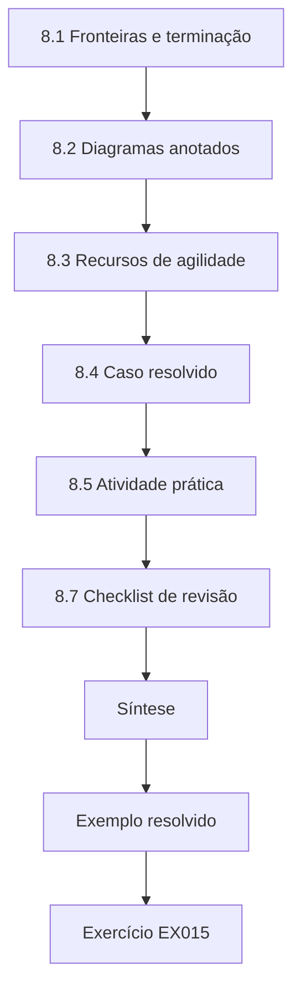

### Desenho lógico

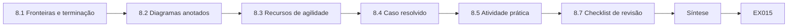

```text
[8.1 Fronteiras e terminação]
    |
    v
[8.2 Diagramas anotados]
    |
    v
[8.3 Recursos de agilidade]
    |
    v
[8.4 Caso resolvido]
    |
    v
[8.5 Atividade prática]
    |
    v
[8.7 Checklist de revisão]
    |
    v
[Síntese]
    |
    v
[Exemplo resolvido] --> [Exercício EX015]
```
<!-- open-cyber-academy:lesson-figures:end ch-08 -->


### Objetivos de aprendizagem

Você vai (1) desenhar diagramas de serviços com fronteiras de confiança; (2) anotar os fluxos com algoritmos e tempos de vida dos dados; (3) explicar os pontos de terminação TLS e as suas consequências; e (4) descrever os recursos de agilidade criptográfica que um implementador pode construir.

### 8.1 Fronteiras e terminação

O tráfego atravessa fronteiras — da internet para a borda, da borda para a malha de serviços, do serviço para o banco de dados, do escritório para a nuvem. O TLS muitas vezes é terminado e restabelecido a cada salto: CDN, balanceador de carga, ingress, sidecar. Cada terminação é uma negociação separada, com a sua própria escolha de algoritmo; um grupo híbrido na CDN não diz nada sobre o salto da CDN até a origem.

A KLS conta cinco terminações TLS só no caminho do cliente, e cada uma tem um dono diferente. Por isso, o diagrama precisa mostrar cada terminação com o seu controlador, porque cada dono configura e muda o seu próprio salto no seu próprio calendário.

### 8.2 Diagramas anotados

Anote cada fluxo com protocolo, troca de chaves, autenticação, tempo de vida dos dados e quem controla cada ponta. O diagrama anotado é o mapa do implementador: os fluxos com dados de vida longa, troca de chaves clássica e um caminho não confiável são os primeiros a mudar.

A KLS usa uma linha por fluxo: `CDN→origin LB | TLS 1.3 | ECDHE X25519 | ECDSA P-256 | 10 y | KLS+CDN`. É listar o tempo de vida dos dados na linha que faz o salto da CDN até a origem se destacar: o mesmo protocolo do salto do navegador, mas clássico, e transportando os mesmos dados de embarque de dez anos por redes que a KLS não controla.

### 8.3 Recursos de agilidade

Os implementadores constroem agilidade: configurando os algoritmos num só lugar (perfis TLS centrais, anotações do ingress, políticas criptográficas); mantendo os identificadores de algoritmo nos dados armazenados; usando bibliotecas que suportam vários algoritmos; deixando espaço nos campos e buffers para chaves maiores; e testando no CI cada algoritmo configurado. O [CSWP 39](https://doi.org/10.6028/NIST.CSWP.39-upd1) do NIST discute essas considerações.

Na KLS, cada recurso tem um teste. O perfil central é renderizado no CI e comparado com o aprovado. As assinaturas armazenadas trazem um identificador de algoritmo, para que os verificadores possam aceitar dois algoritmos durante a transição. As colunas de chaves do banco de dados são dimensionadas para o ML-DSA-87. Um job do pipeline tenta um handshake com cada grupo configurado contra a homologação, para que um grupo listado mas não suportado falhe antes da implantação, e não depois.

### 8.4 Caso resolvido

O caminho do cliente da KLS: navegador → CDN (híbrido) → balanceador de carga da origem (clássico) → ingress (clássico) → pods da API (texto claro dentro da malha, com sidecars mTLS, ECDHE). O salto da internet está protegido; o salto da CDN até a origem atravessa a rede do provedor e a internet e transporta dados de dez anos. Prioridade: habilitar o híbrido no balanceador de carga da origem e no ingress; depois, avaliar a malha.

O plano coloca as primeiras mudanças onde a KLS controla as duas pontas e os dados têm vida longa. O balanceador de carga da origem e o ingress são configuração da KLS; as configurações de origem da CDN são uma opção do provedor que a KLS pode habilitar. A malha fica para avaliação porque os seus saltos permanecem dentro da rede de um único provedor e os seus sidecars são atualizados no calendário de versões da plataforma.

### 8.5 Atividade prática

Desenhe e anote o caminho dos fluxos do SFTP dos parceiros e da VPN do escritório da KLS; marque os pontos de terminação.

Para o SFTP dos parceiros, o caminho é curto: cliente do parceiro → internet → bastion da KLS → host SFTP, com o SSH terminando uma única vez, no bastion ou no host, dependendo do projeto. Para a VPN do escritório, mostre o appliance do escritório, a internet, o gateway de VPN na nuvem e o salto interno até os serviços, observando que o IPsec termina no gateway e o tráfego continua pela malha. Dê a cada salto as mesmas cinco anotações da regra de diagramas acima. Marque como desconhecido qualquer salto em que você não tenha encontrado o algoritmo.

### 8.6 Erros comuns e limites

- Julgar o caminho inteiro pelo primeiro salto.
- Fixar suítes de cifras no código em muitos lugares.
- Diagramas sem tempos de vida dos dados.

A KLS cometeu os três. O relatório inicial "o caminho do cliente é híbrido" julgou o caminho pelo salto do navegador até a CDN. As listas de cifras estavam fixadas no ingress, em dois balanceadores de carga e num modelo de sidecar, então mudá-las exigia quatro revisões e um local esquecido. E os primeiros diagramas mostravam os algoritmos, mas não os tempos de vida, o que fazia os fluxos de telemetria e de embarque parecerem igualmente urgentes. O limite dos diagramas é que eles são desenhados à mão; os traces do Capítulo 12 os transformam em dados.

### 8.7 Checklist de revisão

Ao revisar o projeto de um novo serviço, pergunte: quais saltos terminam o TLS, e quem configura cada um; quais grupos e algoritmos de assinatura cada salto oferece e prefere; onde as escolhas de algoritmo são configuradas; quais dados armazenados trazem identificadores de algoritmo; e se algum campo, buffer ou limite de mensagem supõe tamanhos clássicos. Cinco perguntas feitas no momento do projeto evitam a maior parte do retrabalho que os inventários descobrem depois.

A KLS acrescenta as cinco perguntas ao seu modelo de revisão de projeto. No primeiro trimestre, elas sinalizaram um novo serviço de relatórios que guardava assinaturas numa coluna de 256 bytes e uma nova fila cuja biblioteca cliente fixava grupos clássicos.

### Exercícios

- **EX015 — Terminação.** Explique por que uma borda de CDN híbrida não protege o salto da CDN até a origem. Rubrica: 3 = sessões TLS e negociações separadas.
- **EX016 — Recurso de agilidade.** Descreva um recurso de agilidade que você poderia acrescentar à configuração do ingress da KLS. Rubrica: 3 = perfil central ou anotação, com teste.

### Síntese

Os diagramas anotados revelam cada ponto de terminação como uma negociação separada; os recursos de agilidade permitem que os implementadores mudem todos eles a partir de um só lugar.

<!-- open-cyber-academy:chapter-navigation:start ch-08 -->
### Continue estudando — capítulo 08 de 30

[← Capítulo 07](#ch-07) · [Índice de capítulos do curso](../SUBJECTS.md) · [Capítulo 09 →](#ch-09)

Siga para a próxima lição escrita.
<!-- open-cyber-academy:chapter-navigation:end -->

<a id="ch-09"></a>

## Capítulo 9 — Evidências e medição

<!-- open-cyber-academy:lesson-figures:start ch-09 -->
### Mapa da aula

Aula 09 publicada. Mapa, exemplo, EX017.

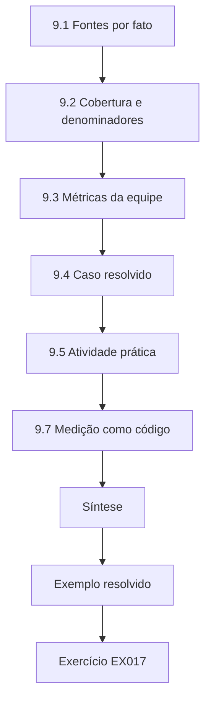

### Desenho lógico

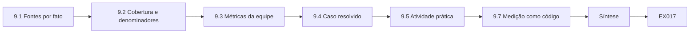

```text
[9.1 Fontes por fato]
    |
    v
[9.2 Cobertura e denominadores]
    |
    v
[9.3 Métricas da equipe]
    |
    v
[9.4 Caso resolvido]
    |
    v
[9.5 Atividade prática]
    |
    v
[9.7 Medição como código]
    |
    v
[Síntese]
    |
    v
[Exemplo resolvido] --> [Exercício EX017]
```
<!-- open-cyber-academy:lesson-figures:end ch-09 -->


### Objetivos de aprendizagem

Você vai (1) escolher fontes válidas para cada fato criptográfico; (2) declarar a cobertura e os denominadores; (3) projetar métricas de prontidão para as equipes de implementação; e (4) apresentar as medições com os pontos cegos.

### 9.1 Fontes por fato

O grupo TLS negociado é visível no ServerHello e nos logs do servidor; no TLS 1.3, o certificado é cifrado, então os algoritmos dos certificados vêm da configuração ou da inspeção do endpoint. A troca de chaves do SSH aparece nos logs do daemon em níveis detalhados. A negociação da VPN aparece nos logs do appliance. Associe cada fato à fonte que consegue de fato vê-lo.

A KLS aprendeu isso quando um sensor passivo reportou ECDSA para um serviço cujo certificado ele não conseguia ver; o valor tinha sido inferido, não observado. Cada fato agora traz a classe de fonte que pode legitimamente vê-lo, e os valores inferidos são rotulados.

### 9.2 Cobertura e denominadores

"80 % híbrido" precisa de um denominador (conexões? serviços? serviços de nível 1?) e de uma cobertura (quais sensores, quais locais). Os implementadores devem reportar: os serviços com o híbrido habilitado (configuração), a fração de conexões que negociam o híbrido (logs) e a fração de serviços sem nenhuma evidência.

O painel da KLS usa três números por fluxo: listeners com o híbrido configurado, divididos pelos listeners do inventário; handshakes que negociam o híbrido, divididos pelos handshakes registrados; e serviços sem fonte, divididos pelos serviços de nível 1. Cada número nomeia os seus sensores e a janela de tempo. Um leitor pode então ver que 96 % dos handshakes de navegadores e 0 % das sessões SFTP são híbridos, em vez de um único número misturado que esconde a lacuna do SFTP.

### 9.3 Métricas da equipe

Métricas úteis para os implementadores: a fração dos serviços de nível 1 que oferecem e preferem o híbrido; a fração das imagens construídas sobre camadas base aprovadas; o tempo entre a mudança aprovada e a implantação; o número de listeners apenas clássicos em endereços voltados para a internet; a taxa de handshakes com falha, por causa.

Cada métrica dispara uma ação específica na KLS. Um serviço de nível 1 que oferece mas não prefere o híbrido recebe um chamado de configuração; uma imagem fora da base aprovada recebe uma reconstrução; um tempo de implantação crescente leva a examinar o processo de mudança; qualquer novo listener apenas clássico na internet é revisado em uma semana; e um aumento das falhas por uma causa, como ClientHellos grandes, abre um caso com o fornecedor.

### 9.4 Caso resolvido

O primeiro painel da KLS mostrava "conexões híbridas: 71 %". Detalhamento: tráfego de navegadores para a CDN 96 % híbrido (logs da CDN, cobertura total); tráfego do SDK da API 40 % (logs do gateway); SFTP dos parceiros 0 % (logs do daemon); VPN do escritório 0 % (configuração); leitores desconhecido. O número único media sobretudo os navegadores.

O detalhamento também mostrou o que cada equipe precisava fazer. O tráfego da CDN não precisava de nada. O tráfego do SDK precisava que os clientes atualizassem, então a KLS publicou versões do SDK que enviam o key share híbrido por padrão. O SFTP e a VPN precisavam de trabalho de configuração e de appliance. Os leitores precisavam de uma fonte de dados antes que qualquer meta pudesse ser definida. O número único não tinha sugerido nada disso; o detalhamento produziu quatro chamados e um pedido ao fornecedor.

### 9.5 Atividade prática

Projete três métricas com definição, fonte, denominador, cobertura e dono.

Para cada métrica, escreva a definição numa frase, a fonte dos dados e a sua consulta, o denominador, a cobertura (quais locais, sensores e janela de tempo), o dono e a ação tomada quando o valor se move. Exemplo: "Fração das sessões SFTP dos parceiros que negociam `mlkem768x25519-sha256`, a partir dos logs do sshd nos dois hosts SFTP, denominador todas as sessões concluídas nos últimos 7 dias, dono Platform Team; abaixo de 50 % depois da data do aviso, dispara um contato com os parceiros." Acrescente ao lado uma métrica de "desconhecidos", contando os parceiros sem nenhuma sessão na janela.

### 9.6 Erros comuns e limites

- Percentuais únicos de manchete.
- Afirmar fatos sobre certificados a partir de capturas passivas de TLS 1.3.
- Métricas sem dono.

Na KLS, os 71 % da manchete vieram da mistura de tipos de tráfego; o rótulo "ECDSA" do sensor passivo veio de uma captura TLS 1.3 em que o certificado estava cifrado, então não podia ter sido observado; e a métrica de cobertura do scanner não tinha dono, então, quando o scanner quebrou, ninguém percebeu que o número congelou. O limite dos métodos deste capítulo é que eles medem a configuração e a negociação, não se o tráfego gravado já existe no arquivo de um adversário.

### 9.7 Medição como código

Mantenha as definições das métricas no controle de versão, ao lado dos scripts que as calculam. Quando alguém perguntar por que a fração híbrida mudou de 62 % para 58 %, você pode mostrar se mudou o parque ou a definição — por exemplo, um novo sensor que acrescentou ao denominador o tráfego do escritório antes invisível. Uma mudança de cobertura deve ser anotada no painel, porque um número que cai por causa de uma visibilidade melhor é progresso, não regressão.

Publique também uma métrica de "desconhecidos" ao lado de cada métrica de cobertura: o número de serviços de nível 1 para os quais nenhuma fonte reporta hoje o fato relevante. As equipes que veem a sua contagem de desconhecidos toda semana tendem a corrigir as alimentações que a reduziriam, e é assim que a cobertura da medição melhora sem um projeto separado.

### Exercícios

- **EX017 — Reescrever.** Reescreva "71 % híbrido" como três afirmações com escopo. Rubrica: 3 = escopo por fluxo, com fontes.
- **EX018 — Associar fontes.** Nomeie a melhor fonte para: o grupo TLS negociado, o algoritmo do certificado do servidor, a KEX do SSH, a troca de chaves da VPN. Rubrica: 3 = quatro fontes corretas.

### Síntese

As medições são tão boas quanto as suas fontes, os seus denominadores e a sua cobertura; os implementadores reportam números com escopo e com os pontos cegos visíveis.

<!-- open-cyber-academy:chapter-navigation:start ch-09 -->
### Continue estudando — capítulo 09 de 30

[← Capítulo 08](#ch-08) · [Índice de capítulos do curso](../SUBJECTS.md) · [Capítulo 10 →](#ch-10)

Siga para a próxima lição escrita.
<!-- open-cyber-academy:chapter-navigation:end -->

<a id="ch-10"></a>

## Capítulo 10 — Segurança quântica e pós-quântica: orientação

<!-- open-cyber-academy:lesson-figures:start ch-10 -->
### Mapa da aula

Aula 10 publicada. Mapa, exemplo, EX019.

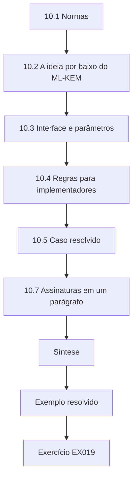

### Desenho lógico

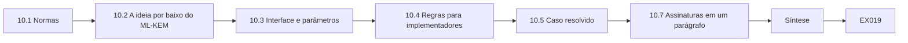

```text
[10.1 Normas]
    |
    v
[10.2 A ideia por baixo do ML-KEM]
    |
    v
[10.3 Interface e parâmetros]
    |
    v
[10.4 Regras para implementadores]
    |
    v
[10.5 Caso resolvido]
    |
    v
[10.7 Assinaturas em um parágrafo]
    |
    v
[Síntese]
    |
    v
[Exemplo resolvido] --> [Exercício EX019]
```
<!-- open-cyber-academy:lesson-figures:end ch-10 -->


### Objetivos de aprendizagem

Você vai (1) resumir as normas pós-quânticas do NIST e a sua situação; (2) explicar o LWE com um laboratório de brinquedo; (3) descrever a interface e os conjuntos de parâmetros do ML-KEM; e (4) dizer o que os implementadores devem e não devem fazer com a PQC.

### 10.1 Normas

O NIST publicou a [FIPS 203](https://doi.org/10.6028/NIST.FIPS.203) (ML-KEM), a [FIPS 204](https://doi.org/10.6028/NIST.FIPS.204) (ML-DSA) e a [FIPS 205](https://doi.org/10.6028/NIST.FIPS.205) (SLH-DSA) em agosto de 2024; a [SP 800-208](https://doi.org/10.6028/NIST.SP.800-208) trata do LMS e do XMSS; a [SP 800-227](https://doi.org/10.6028/NIST.SP.800-227) dá recomendações sobre KEMs. O rascunho [IR 8547](https://doi.org/10.6028/NIST.IR.8547.ipd) do NIST propõe tornar obsoletos os algoritmos vulneráveis ao quântico após 2030 e proibi-los após 2035. O FN-DSA e um KEM baseado no HQC estavam em desenvolvimento.

Para os implementadores da KLS, a leitura prática é: ML-KEM para o estabelecimento de chaves desde já, ML-DSA para as assinaturas conforme as ferramentas permitirem, assinaturas baseadas em hash para o firmware, e as datas do rascunho IR 8547 como premissas de planejamento até a versão final.

### 10.2 A ideia por baixo do ML-KEM

O Learning With Errors (Regev, 2009) esconde um segredo em equações lineares com ruído.

```python
# Lab W (ch 10): a TOY Regev-style LWE encryption of one bit. Deliberately insecure parameters.
import random
rng = random.Random(5)
n, q, m = 16, 3329, 64
def small(): return rng.choice([-2, -1, 0, 1, 2])
s = [rng.randrange(q) for _ in range(n)]
A = [[rng.randrange(q) for _ in range(n)] for _ in range(m)]
b = [(sum(A[i][j] * s[j] for j in range(n)) + small()) % q for i in range(m)]   # b = A s + e
def enc(bit):
    r = [rng.randrange(2) for _ in range(m)]                                        # random subset
    u = [sum(r[i] * A[i][j] for i in range(m)) % q for j in range(n)]
    v = (sum(r[i] * b[i] for i in range(m)) + bit * (q // 2)) % q
    return u, v
def dec(u, v):
    d = (v - sum(u[j] * s[j] for j in range(n))) % q                                 # = bit*q/2 + small noise
    return 1 if q // 4 < d < 3 * q // 4 else 0
ok = sum(dec(*enc(bit)) == bit for bit in [rng.randrange(2) for _ in range(2000)])
print(f"toy LWE: {ok}/2000 bits decrypted correctly (noise stays below q/4)")
```

Saída esperada:

```text
toy LWE: 2000/2000 bits decrypted correctly (noise stays below q/4)
```

O brinquedo usa 16 dimensões e é trivialmente quebrável; o ML-KEM usa reticulados de módulo estruturados, com polinômios de 256 coeficientes, e uma transformação que protege contra ataques de texto cifrado escolhido.

O desenho do laboratório torna visível a regra de decifragem. O valor `v` do texto cifrado transporta o bit como 0 ou q/2, cerca de 1.664, mais o ruído acumulado da soma de até 64 pequenos erros escolhidos em {−2,…,2}. A decifragem subtrai `u·s` e pergunta se o resto está mais perto de 0 ou de q/2. Como o ruído fica muito abaixo de q/4, todos os 2.000 bits são decifrados corretamente. Faixas de erro maiores ou mais linhas somadas empurrariam o ruído para além desse limite e a decifragem começaria a falhar, o mesmo compromisso que os parâmetros do ML-KEM são escolhidos para administrar.

### 10.3 Interface e parâmetros

O ML-KEM é um KEM: KeyGen → (chave de encapsulamento, chave de desencapsulamento); Encaps(ek) → (texto cifrado, segredo compartilhado de 32 bytes); Decaps(dk, ct) → segredo compartilhado. O ML-KEM-512/768/1024 visa as categorias 1/3/5 do NIST, com chaves de encapsulamento de 800/1.184/1.568 bytes e textos cifrados de 768/1.088/1.568 bytes. O X25519MLKEM768 no TLS usa o ML-KEM-768.

Para os implementadores, a interface importa mais do que a matemática. O cliente gera um par de chaves e envia a chave de encapsulamento; o servidor encapsula e devolve o texto cifrado; os dois obtêm o mesmo segredo de 32 bytes. Não há etapa de cifragem de mensagens, então o ML-KEM é sempre combinado com uma cifra simétrica.

### 10.4 Regras para implementadores

Use bibliotecas verificadas e provedores da plataforma; nunca escreva a sua própria. Mantenha as bibliotecas atualizadas (o KyberSlash mostrou vazamentos de tempo em algumas implementações; Bernstein et al., 2024). Prefira híbridos durante a transição. Verifique os comprimentos e trate os erros sem vazar detalhes. Registre o algoritmo e as versões das bibliotecas no inventário.

Na KLS, essas regras viram perguntas de revisão em todo pull request que mexe com criptografia: qual biblioteca e versão, se ela está na lista aprovada, se o conjunto de parâmetros é explícito e o que acontece com entradas malformadas. Um pull request que responde "nós mesmos escrevemos" é fechado sem mais revisão.

### 10.5 Caso resolvido

Um desenvolvedor da KLS propõe um ML-KEM caseiro em Python "para os leitores". Resposta: rejeitado — a biblioteca padrão não tem o ML-KEM, o código de brinquedo é inseguro, e a imagem do fornecedor ou uma biblioteca verificada é o único caminho aceitável; enquanto isso, os fluxos de dados dos leitores são minimizados.

A etapa de minimização é concreta: os leitores enviam os manifestos num único lote diário, em vez de a cada leitura, o que reduz o volume de sessões que podem ser colhidas enquanto a imagem do fornecedor está pendente. A rejeição e o controle provisório são ambos registrados na linha do leitor no inventário, com o número do chamado do fornecedor.

### 10.6 Erros comuns e limites

- Tratar o laboratório de brinquedo como utilizável.
- Usar o ML-KEM como se ele cifrasse mensagens arbitrárias.
- Ignorar os avisos de atualização das bibliotecas.

Cada erro tem um sintoma reconhecível. Alguém que cola o código de 16 dimensões do Laboratório W num serviço, acreditando que é "criptografia de reticulados", entregou algo que se quebra em segundos. Alguém que chama o ML-KEM para "cifrar o manifesto" leu errado a interface: ele só produz um segredo compartilhado para uma cifra simétrica. E uma equipe que ignora avisos como o KyberSlash mantém um vazamento de tempo que uma atualização de biblioteca teria removido. A orientação aqui é propositalmente rasa; a autoridade são as próprias normas.

### 10.7 Assinaturas em um parágrafo

O ML-DSA (FIPS 204) é a assinatura de reticulados de uso geral, com assinaturas ML-DSA-44/65/87 de 2.420/3.309/4.627 bytes. O SLH-DSA (FIPS 205) depende apenas de funções de hash; as suas chaves públicas são minúsculas, mas as suas assinaturas vão de 7.856 a 49.856 bytes. O LMS e o XMSS (SP 800-208) são assinaturas compactas baseadas em hash que exigem que o signatário acompanhe o estado e nunca reutilize um índice. Os implementadores vão encontrar o ML-DSA primeiro nos certificados e na assinatura de código, e os esquemas baseados em hash na assinatura de firmware.

Para a KLS, isso significa ML-DSA para a AC interna e a assinatura de versões, e LMS para o firmware dos leitores somente se o HSM do fornecedor gerenciar o estado.

### Exercícios

- **EX019 — Tamanhos.** Dê os tamanhos da chave de encapsulamento e do texto cifrado do ML-KEM-768 e o comprimento do segredo compartilhado. Rubrica: 3 = 1.184, 1.088 e 32 bytes.
- **EX020 — Regras.** Liste quatro regras para implementadores de PQC. Rubrica: 3 = bibliotecas verificadas, atualizações, híbridos, tratamento de comprimentos/erros.

### Síntese

As normas do NIST definem as substituições; o ML-KEM é um KEM sobre reticulados de módulo, com três conjuntos de parâmetros. Os implementadores configuram implementações verificadas, nunca constroem as suas próprias.

<!-- open-cyber-academy:chapter-navigation:start ch-10 -->
### Continue estudando — capítulo 10 de 30

[← Capítulo 09](#ch-09) · [Índice de capítulos do curso](../SUBJECTS.md) · [Capítulo 11 →](#ch-11)

Siga para a próxima lição escrita.
<!-- open-cyber-academy:chapter-navigation:end -->

<a id="ch-11"></a>

## Capítulo 11 — Segurança quântica e pós-quântica: ativos e contexto

<!-- open-cyber-academy:lesson-figures:start ch-11 -->
### Mapa da aula

Aula 11 publicada. Mapa, exemplo, EX021.

```mermaid
flowchart TD
  N0["11.1 Definindo o escopo do registro"]
  N1["11.2 Níveis"]
  N2["11.3 A desigualdade de Mosca para implementadores"]
  N3["11.4 Dependências e donos"]
  N4["11.5 Caso resolvido"]
  N5["11.6 Atividade prática"]
  N6["Síntese"]
  N0 --> N1 --> N2 --> N3 --> N4 --> N5 --> N6
  N6 --> EX["Exemplo resolvido"]
  EX --> Q["Exercício EX021"]
```

### Desenho lógico

```mermaid
flowchart LR
  N0["11.1 Definindo o escopo do registro"]
  N1["11.2 Níveis"]
  N2["11.3 A desigualdade de Mosca para implementadores"]
  N3["11.4 Dependências e donos"]
  N4["11.5 Caso resolvido"]
  N5["11.6 Atividade prática"]
  N6["Síntese"]
  N0 --> N1 --> N2 --> N3 --> N4 --> N5 --> N6 --> Q["EX021"]
```

```text
[11.1 Definindo o escopo do registro]
    |
    v
[11.2 Níveis]
    |
    v
[11.3 A desigualdade de Mosca para implementadores]
    |
    v
[11.4 Dependências e donos]
    |
    v
[11.5 Caso resolvido]
    |
    v
[11.6 Atividade prática]
    |
    v
[Síntese]
    |
    v
[Exemplo resolvido] --> [Exercício EX021]
```
<!-- open-cyber-academy:lesson-figures:end ch-11 -->


### Objetivos de aprendizagem

Você vai (1) montar um registro de ativos com o escopo da migração criptográfica; (2) atribuir níveis usando o tempo de vida dos dados e o tempo de vida da confiança; (3) registrar donos, mecanismos de mudança e dependências; e (4) aplicar a desigualdade de Mosca para definir a urgência.

### 11.1 Definindo o escopo do registro

Comece pelos serviços que os clientes e os funcionários usam, não pelas faixas de IP. Para cada serviço, liste os seus endpoints, as classes de dados que ele trata, as funções criptográficas que executa e as equipes e fornecedores que os controlam. Inclua coisas fáceis de esquecer: assinatura no CI/CD, transferências de backup, agentes de monitoramento, integrações com parceiros, dispositivos dos armazéns e caminhos de acesso administrativo.

O primeiro registro da KLS, montado a partir de varreduras de IP, deixou de fora o job noturno de backup para o armazenamento de objetos e o TLS de saída dos agentes de monitoramento, porque nenhum dos dois escuta numa porta. Começar pelos serviços encontrou os dois: o job de backup aparece sob o faturamento, e os agentes aparecem sob o serviço de observabilidade. O registro tem agora 41 entradas, das quais 14 são fluxos de nível 1.

### 11.2 Níveis

Nível 1: fluxos que transportam dados cuja confidencialidade precisa durar além dos prazos quânticos plausíveis, e âncoras de confiança cujas assinaturas precisam permanecer impossíveis de forjar por muitos anos. Nível 2: dados ou confiança de vida mais curta, mas ainda importantes. Nível 3: dados de vida curta e credenciais fáceis de rotacionar. Os níveis determinam a ordem do trabalho, a profundidade do monitoramento e as exigências de evidência.

A KLS escreve os critérios como números, para que duas pessoas classifiquem o mesmo ativo de forma idêntica: nível 1 se a confidencialidade ou a confiança precisa durar oito anos ou mais, ou se o dispositivo não pode ser atualizado remotamente; nível 2 de três a oito anos; nível 3 abaixo de três anos, com credenciais rotacionáveis em um dia. Os ativos de nível 1 têm revisão de evidências semanal; os de nível 2, mensal; os de nível 3, trimestral.

### 11.3 A desigualdade de Mosca para implementadores

Mosca (2018): se os dados precisam permanecer seguros por *x* anos, a migração leva *y* anos e um computador quântico criptograficamente relevante chega em *z* anos, então *x* + *y* > *z* significa que você já está atrasado. Os implementadores controlam o *y*. Estime-o por serviço a partir do mecanismo de mudança: uma mudança de configuração pode levar semanas, incluindo os testes; uma mudança que depende do fornecedor pode levar dois anos; uma renovação de hardware, cinco. Com os dados de embarque de dez anos da KLS, a estimativa de meio ano do serviço SFTP dos parceiros o deixa atrasado para qualquer *z* abaixo de 10,5 anos; os leitores dos armazéns, que enviam os mesmos manifestos de embarque numa renovação de fornecedor de quatro anos, ficam atrasados para qualquer *z* abaixo de catorze.

### 11.4 Dependências e donos

Cada ativo precisa de um dono nomeado e de uma lista de dependências a montante: a CDN, o balanceador de carga na nuvem, o banco de dados gerenciado, o fornecedor dos leitores. Um serviço só está tão migrado quanto a sua parte controladora mais lenta.

Na KLS, a parte mais lenta costuma estar fora da empresa. A API do cliente depende do recurso de origem da CDN; a replicação do faturamento, do provedor do banco de dados; os leitores, do seu fornecedor. Cada dependência é uma linha com um contato e um pedido em aberto, para que o registro mostre quem está esperando por quem.

### 11.5 Caso resolvido

Os níveis da KLS (sintéticos): Nível 1 — SFTP dos parceiros (dados aduaneiros de 10 anos, ECDH), caminho da CDN até a origem (dados de embarque de 10 anos), AC raiz interna (validade de 15 anos), assinatura de versões. Nível 2 — replicação do banco de dados de faturamento (dados de 7 anos), VPN do escritório. Nível 3 — telemetria, tokens de SSO. *y* estimado: SFTP 0,5 ano (atualização do OpenSSH e coordenação com os parceiros), CDN até a origem 0,25 ano (configuração do balanceador de carga), AC interna 2 anos, leitores 4 anos (renovação do fornecedor).

Ler as estimativas pela desigualdade de Mosca mostra o que fazer primeiro. O SFTP e o caminho da CDN até a origem são de nível 1 com *y* curto, então concluí-los é barato e remove a maior parte da exposição a HNDL. A AC interna precisa de dois anos e deve começar agora. Os quatro anos dos leitores não podem ser encurtados pela KLS, então o seu fluxo de dados é minimizado e o contrato com o fornecedor, alterado.

### 11.6 Atividade prática

Crie um registro com níveis de dez ativos da KLS, com dono, tempo de vida dos dados, tempo de vida da confiança, mecanismo de mudança e *y* estimado.

Use as colunas ativo, dono, tempo de vida dos dados em anos, tempo de vida da confiança em anos, nível com o critério que o colocou ali, mecanismo de mudança, parte controladora e *y* estimado com a sua base. Inclua pelo menos um ativo de cada grupo: serviços voltados ao cliente, integrações com parceiros, PKI interna, dispositivos e jobs em segundo plano, como os backups. Onde o *y* for um palpite, escreva a premissa, por exemplo "o fornecedor cotou 18 meses, mais 6 para a implantação". Termine marcando quais ativos estão atrasados para um *z* de 10 anos.

### 11.7 Erros comuns e limites

- Começar pelas varreduras de rede em vez dos serviços.
- Níveis sem critérios escritos.
- Ignorar a dependência mais lenta ao estimar o *y*.

Cada erro distorceu o primeiro registro da KLS. As varreduras de rede encontraram os listeners, mas deixaram de fora o job de backup e os agentes de monitoramento, que só fazem conexões de saída. Níveis atribuídos "por intuição" colocaram a telemetria no nível 1 porque parecia importante. E a estimativa de três meses para a CDN até a origem ignorou que o recurso de origem do provedor ainda não estava disponível para todos, então o *y* real dependia do calendário do provedor.

### Exercícios

- **EX021 — Mosca para o SFTP.** Com *x* = 10 e *y* = 0,5, para qual *z* a KLS está atrasada no SFTP dos parceiros? Rubrica: 3 = *z* < 10,5 anos.
- **EX022 — Critérios de nível.** Escreva critérios de nível que um novo membro da equipe possa aplicar de forma consistente. Rubrica: 3 = limites objetivos sobre o tempo de vida dos dados e da confiança.

### Síntese

Um registro de ativos com níveis e donos, com mecanismos de mudança e estimativas do tempo de migração, permite que os implementadores apliquem a desigualdade de Mosca onde ela importa: encolhendo o *y* dos serviços de nível 1.

<!-- open-cyber-academy:chapter-navigation:start ch-11 -->
### Continue estudando — capítulo 11 de 30

[← Capítulo 10](#ch-10) · [Índice de capítulos do curso](../SUBJECTS.md) · [Capítulo 12 →](#ch-12)

Siga para a próxima lição escrita.
<!-- open-cyber-academy:chapter-navigation:end -->

<a id="ch-12"></a>

## Capítulo 12 — Segurança quântica e pós-quântica: fluxos de dados

<!-- open-cyber-academy:lesson-figures:start ch-12 -->
### Mapa da aula

Aula 12 publicada. Mapa, exemplo, EX023.

```mermaid
flowchart TD
  N0["12.1 Rastreando os fluxos"]
  N1["12.2 A CBOM"]
  N2["12.3 Atividade prática — Laboratório I"]
  N3["12.4 Controladores"]
  N4["12.5 Caso resolvido"]
  N5["12.7 Mantendo os rastreamentos atualizados"]
  N6["Síntese"]
  N0 --> N1 --> N2 --> N3 --> N4 --> N5 --> N6
  N6 --> EX["Exemplo resolvido"]
  EX --> Q["Exercício EX023"]
```

### Desenho lógico

```mermaid
flowchart LR
  N0["12.1 Rastreando os fluxos"]
  N1["12.2 A CBOM"]
  N2["12.3 Atividade prática — Laboratório I"]
  N3["12.4 Controladores"]
  N4["12.5 Caso resolvido"]
  N5["12.7 Mantendo os rastreamentos atualizados"]
  N6["Síntese"]
  N0 --> N1 --> N2 --> N3 --> N4 --> N5 --> N6 --> Q["EX023"]
```

```text
[12.1 Rastreando os fluxos]
    |
    v
[12.2 A CBOM]
    |
    v
[12.3 Atividade prática — Laboratório I]
    |
    v
[12.4 Controladores]
    |
    v
[12.5 Caso resolvido]
    |
    v
[12.7 Mantendo os rastreamentos atualizados]
    |
    v
[Síntese]
    |
    v
[Exemplo resolvido] --> [Exercício EX023]
```
<!-- open-cyber-academy:lesson-figures:end ch-12 -->


### Objetivos de aprendizagem

Você vai (1) rastrear os fluxos de dados de ponta a ponta através dos pontos de terminação; (2) montar uma lista de materiais criptográficos (CBOM) a partir de várias fontes; (3) calcular as frações de cobertura e de desconhecidos; e (4) identificar qual parte controla cada segmento.

### 12.1 Rastreando os fluxos

Um fluxo só está protegido com a força do seu segmento mais fraco. Rastreie os dados de embarque desde o sistema de um cliente através da CDN, do balanceador de carga da origem, do ingress, da malha de serviços, da fila de mensagens, da replicação do banco de dados e da cópia de backup. Em cada segmento, registre o protocolo, a troca de chaves, a autenticação, o tempo de vida dos dados e o controlador.

Na KLS, o rastreamento de um registro de embarque tem sete segmentos, e só o primeiro era híbrido quando o rastreamento foi desenhado. A regra do segmento mais fraco fez com que o fluxo fosse reportado como clássico, e não como um sétimo migrado.

### 12.2 A CBOM

Uma CBOM lista, por ativo e função, o algoritmo, os parâmetros, a implementação e a fonte da evidência. Monte-a mesclando exportações de configuração, resumos de logs, varreduras de imagens e declarações de fornecedores.

A CBOM da KLS mescla quatro alimentações: exportações de configuração do ingress e dos balanceadores de carga, logs de handshake do gateway, varreduras de imagens do registro e respostas de fornecedores. Cada linha mantém a sua fonte, para que um leitor possa ver que a entrada `RSA-kex` do banco de dados de faturamento veio da configuração, enquanto a troca de chaves do leitor veio de captura passiva. As linhas conflitantes são mantidas lado a lado e abrem uma tarefa, em vez de serem fundidas num único valor adivinhado.

### 12.3 Atividade prática — Laboratório I

```python
# Lab I (ch 12): aggregate a synthetic cryptographic bill of materials (CBOM) and measure coverage.
records = [  # (asset, function, algorithm, source)
    ("api-gateway", "key-exchange", "X25519MLKEM768", "passive"), ("api-gateway", "signature", "RSA-2048", "config"),
    ("warehouse-scanner", "key-exchange", "ECDHE-P256", "passive"), ("warehouse-scanner", "signature", "ECDSA-P256", "code"),
    ("billing-db", "key-exchange", "RSA-kex", "config"), ("billing", "data-at-rest", "AES-256-GCM", "code"),
    ("forklift-telemetry", "unknown", "unknown", "none"), ("office-vpn", "key-exchange", "ECDHE-P384", "config")]
VULN = {"RSA-2048", "ECDHE-P256", "ECDSA-P256", "RSA-kex", "ECDHE-P384"}
assets = {r[0] for r in records}
unknown = {r[0] for r in records if r[2] == "unknown"}
vuln = [r for r in records if r[2] in VULN]
print(f"assets {len(assets)}, unknown {len(unknown)} ({100*len(unknown)/len(assets):.0f}%)")
print(f"quantum-vulnerable uses {len(vuln)}:", ", ".join(f"{a}/{f}" for a, f, _, _ in vuln))
print("hybrid key exchange present on:", [r[0] for r in records if "MLKEM" in r[2]])
```

Saída esperada:

```text
assets 6, unknown 1 (17%)
quantum-vulnerable uses 5: api-gateway/signature, warehouse-scanner/key-exchange, warehouse-scanner/signature, billing-db/key-exchange, office-vpn/key-exchange
hybrid key exchange present on: ['api-gateway']
```

A unidade de telemetria da empilhadeira não tem nenhuma evidência; até que o fornecedor responda, ela continua desconhecida e bloqueia uma decisão de nível para a rede do armazém.

O Laboratório I conta ativos e usos separadamente, o que importa para os relatórios. Seis ativos e oito usos produzem dois denominadores diferentes: um ativo em seis é desconhecido (17 %), enquanto cinco usos em oito são vulneráveis ao quântico. A linha de dados em repouso de `billing`, AES-256-GCM, está corretamente ausente da lista de vulneráveis. O api-gateway aparece duas vezes, como híbrido na troca de chaves e vulnerável pela sua assinatura RSA-2048, que é o estado habitual de um serviço depois do seu primeiro passo de migração. Mude um registro para X25519MLKEM768 e execute de novo para ver as contagens mudarem.

### 12.4 Controladores

A KLS controla os seus balanceadores de carga, o ingress e o código; o provedor da CDN controla a borda; o provedor de nuvem controla a replicação do banco de dados gerenciado; os parceiros controlam os seus clientes SFTP. Anote o controlador ao lado de cada segmento e abra um chamado ou um pedido ao fornecedor para cada segmento que a KLS não pode mudar.

A coluna de controlador transforma o rastreamento num plano de trabalho. Os segmentos que a KLS controla recebem chamados de configuração; os segmentos controlados por outros recebem pedidos com um contato nomeado e uma data de acompanhamento. Na KLS, isso significou chamados para o balanceador de carga da origem, o ingress e o Kafka, e pedidos à CDN, ao provedor do banco de dados e aos mantenedores do SDK do armazenamento de objetos.

### 12.5 Caso resolvido

Rastreando um registro de embarque: cliente da API do cliente → borda da CDN (híbrido, controlada pela CDN) → LB da origem (clássico, KLS) → ingress (clássico, KLS) → pod da API → Kafka (TLS clássico, KLS) → replicação do Postgres gerenciado (provedor, algoritmo não documentado) → backup noturno para o armazenamento de objetos por HTTPS (SDK do provedor num job da KLS, clássico). Sete segmentos, quatro que a KLS pode mudar, um desconhecido.

Os quatro segmentos controlados pela KLS — balanceador de carga da origem, ingress, Kafka e a configuração do SDK do job de backup — entraram numa única sprint. A replicação do Postgres gerenciado se tornou uma pergunta ao provedor com prazo, e a sua situação de desconhecida manteve o fluxo inteiro fora da contagem de migrados até que o provedor respondesse por escrito.

### 12.6 Erros comuns e limites

- Parar o rastreamento na borda.
- Tratar os serviços gerenciados como "seguros por padrão" sem evidências.
- Ignorar os caminhos de backup e de replicação.

Parar na borda produziu a primeira afirmação errada da KLS de que o caminho do cliente era híbrido. Tratar o banco de dados gerenciado como seguro por padrão deixou o seu algoritmo de replicação sem documentação por meses; "gerenciado" diz quem o opera, não o que ele negocia. E o envio noturno de backup, que transporta os mesmos registros de dez anos, ficou totalmente de fora do primeiro rastreamento porque roda a partir de um job em lote, e não de um caminho de requisição. Rastreamentos desenhados só a partir dos caminhos de requisição costumam deixar de fora o tráfego de lote e de replicação.

### 12.7 Mantendo os rastreamentos atualizados

As arquiteturas mudam mais rápido do que os diagramas. Refaça o rastreamento de cada fluxo de nível 1 sempre que um salto for acrescentado ou substituído — uma nova fila de mensagens, um novo recurso da CDN, uma migração de bancos de dados autogerenciados para gerenciados — e acrescente o rastreamento à checklist de mudança desses trabalhos. Guarde o rastreamento como dados estruturados (segmento, protocolo, controlador, algoritmo, evidência) ao lado da CBOM, para que uma consulta possa listar todo fluxo de nível 1 com pelo menos um segmento clássico ou desconhecido. Essa consulta é a resposta honesta a "este fluxo está migrado?", porque um único segmento clássico deixa o fluxo inteiro exposto à gravação naquele ponto.

### Exercícios

- **EX023 — Fração de desconhecidos.** No Laboratório I, que fração dos usos criptográficos (não dos ativos) é vulnerável ao quântico? Rubrica: 3 = 5 de 8 registros ≈ 63 %, observando o registro desconhecido.
- **EX024 — Chamados por controlador.** Para o rastreamento do caso resolvido deste capítulo, liste os pedidos externos que a KLS precisa abrir. Rubrica: 3 = CDN (suporte no salto até a origem), provedor do banco de dados gerenciado (criptografia da replicação), armazenamento de objetos/SDK.

### Síntese

Os rastreamentos de ponta a ponta e uma CBOM de várias fontes mostram o algoritmo e o controlador de cada segmento; os desconhecidos e os segmentos externos se tornam pedidos explícitos.

<!-- open-cyber-academy:chapter-navigation:start ch-12 -->
### Continue estudando — capítulo 12 de 30

[← Capítulo 11](#ch-11) · [Índice de capítulos do curso](../SUBJECTS.md) · [Capítulo 13 →](#ch-13)

Siga para a próxima lição escrita.
<!-- open-cyber-academy:chapter-navigation:end -->

<a id="ch-13"></a>

## Capítulo 13 — Segurança quântica e pós-quântica: cenários de risco

<!-- open-cyber-academy:lesson-figures:start ch-13 -->
### Mapa da aula

Aula 13 publicada. Mapa, exemplo, EX025.

```mermaid
flowchart TD
  N0["13.1 Dois tipos de risco"]
  N1["13.2 Formato do cenário"]
  N2["13.3 Recuo silencioso"]
  N3["13.4 Caso resolvido"]
  N4["13.5 Atividade prática"]
  N5["13.7 Dos cenários aos runbooks"]
  N6["Síntese"]
  N0 --> N1 --> N2 --> N3 --> N4 --> N5 --> N6
  N6 --> EX["Exemplo resolvido"]
  EX --> Q["Exercício EX025"]
```

### Desenho lógico

```mermaid
flowchart LR
  N0["13.1 Dois tipos de risco"]
  N1["13.2 Formato do cenário"]
  N2["13.3 Recuo silencioso"]
  N3["13.4 Caso resolvido"]
  N4["13.5 Atividade prática"]
  N5["13.7 Dos cenários aos runbooks"]
  N6["Síntese"]
  N0 --> N1 --> N2 --> N3 --> N4 --> N5 --> N6 --> Q["EX025"]
```

```text
[13.1 Dois tipos de risco]
    |
    v
[13.2 Formato do cenário]
    |
    v
[13.3 Recuo silencioso]
    |
    v
[13.4 Caso resolvido]
    |
    v
[13.5 Atividade prática]
    |
    v
[13.7 Dos cenários aos runbooks]
    |
    v
[Síntese]
    |
    v
[Exemplo resolvido] --> [Exercício EX025]
```
<!-- open-cyber-academy:lesson-figures:end ch-13 -->


### Objetivos de aprendizagem

Você vai (1) escrever cenários de risco implementáveis para os riscos quânticos e de migração; (2) incluir os riscos induzidos pela migração, como indisponibilidades e recuo silencioso; (3) classificar os cenários com escalas simples; e (4) ligar cada cenário a controles e testes.

### 13.1 Dois tipos de risco

O risco quântico é o que acontece se nada mudar: tráfego gravado decifrado, assinaturas forjadas. O risco de migração é o que pode dar errado durante a mudança: indisponibilidades por handshakes grandes, recuo silencioso para o clássico, falhas de validação de certificados, regressões de desempenho, erros de gerenciamento de chaves. Os implementadores são donos dos dois e não devem trocar um pelo outro às cegas.

A KLS registra os dois tipos no mesmo registro, com os mesmos campos, para que um revisor possa ver quando um plano reduz o risco quântico acrescentando risco de migração. Habilitar o híbrido em todos os listeners numa única mudança, por exemplo, remove rapidamente a exposição a HNDL, mas eleva a probabilidade de indisponibilidade que uma implantação em etapas manteria baixa.

### 13.2 Formato do cenário

Cada cenário nomeia o ativo, o evento, a causa, o efeito, como ele seria detectado, a probabilidade e o impacto em escalas simples de 1 a 5, o controle e o teste que mostra que o controle funciona.

Os campos forçam decisões. Um cenário sem detecção não pode ser monitorado; um sem teste não pode provar que o seu controle funciona. A KLS usa escalas de 1 a 5 com âncoras escritas: probabilidade 4 significa "visto pelo menos uma vez no nosso parque ou no de um par", impacto 4 significa "dados de nível 1 expostos ou indisponibilidade voltada ao cliente por mais de uma hora". As notas se multiplicam numa classificação que ordena o backlog, e as âncoras impedem que as notas variem entre revisores.

### 13.3 Recuo silencioso

O risco de migração mais perigoso é invisível: uma mudança de configuração, a reversão de uma imagem ou um novo balanceador de carga volta à negociação apenas clássica, e nada quebra. Sem monitoramento dos grupos negociados, isso pode persistir por meses. Toda implantação híbrida precisa de um alerta sobre a fração de recuo.

Na KLS, aconteceu exatamente assim: uma versão restaurou uma anotação antiga do ingress e a fração híbrida do portal caiu de 93 % para 4 %. Nenhum cliente percebeu e nenhum erro foi registrado; só o alerta de fração, acrescentado semanas antes, mostrou o problema. A KLS alerta quando a fração cai mais de cinco pontos em uma hora.

### 13.4 Caso resolvido

Cenário: "A reversão do LB da origem restaura um perfil TLS apenas clássico." Causa: reversão de emergência para uma configuração antiga. Efeito: dados de embarque de nível 1 de novo expostos a HNDL. Detecção: alerta de fração híbrida a partir dos logs do LB. Probabilidade 3, impacto 4. Controle: perfil TLS versionado separadamente da configuração da aplicação; os runbooks de reversão restauram apenas a aplicação. Teste: exercício mensal que reverte a aplicação e confirma que a fração híbrida continua acima de 95 %.

O controle é a decisão-chave. Versionar o perfil TLS à parte da configuração da aplicação significa que uma reversão de emergência do código não pode chegar às configurações criptográficas; o exercício testa essa separação todo mês. Uma nota de 12 colocou este cenário entre os três primeiros da KLS, acima do cenário quântico da telemetria.

### 13.5 Atividade prática

Escreva cinco cenários para a KLS — dois quânticos, três de migração — e classifique-os.

Exemplos quânticos: sessões SFTP dos parceiros gravadas e decifradas depois (HNDL), e a raiz interna forjada depois que existir um computador quântico (forjar depois). Exemplos de migração: um proxy que descarta ClientHellos grandes, o recuo silencioso depois de uma reversão e um agente de monitoramento que rejeita uma cadeia ML-DSA. Para cada um, preencha todos os campos do formato: ativo, evento, causa, efeito, detecção, probabilidade, impacto, controle e teste. Classifique pela probabilidade vezes o impacto e explique numa frase por que o cenário do topo supera os outros. Espere que um cenário de migração fique em primeiro.

### 13.6 Erros comuns e limites

- Ignorar o risco induzido pela migração.
- Cenários sem detecção.
- Controles sem testes.

No primeiro registro da KLS, todos os cenários eram quânticos; as indisponibilidades por proxy e o recuo silencioso que de fato aconteceram em homologação estavam ausentes. Vários cenários diziam "impacto: alto" sem nenhuma forma de detectar o evento, o que os tornava impossíveis de monitorar. E controles como "perfil versionado separadamente" eram afirmados sem exercício, então ninguém sabia se uma reversão realmente deixava o perfil intacto. Uma lista de cenários é uma hipótese sobre falhas; sem detecção e testes, ela não pode ser verificada.

### 13.7 Dos cenários aos runbooks

Os cenários de migração mais bem classificados merecem, cada um, um runbook: os sintomas que um operador vai ver, as três primeiras verificações, a reversão segura e a quem ligar. Um runbook para "a fração híbrida caiu num listener de nível 1" poderia dizer: verificar a última implantação e as anotações do ingress; comparar o hash do perfil TLS em produção com o aprovado; restaurar o perfil aprovado sem reverter o código da aplicação; confirmar a recuperação no painel; abrir um chamado de problema. Os runbooks escritos antes do evento encurtam as indisponibilidades e reduzem a tentação de desabilitar às pressas as configurações pós-quânticas.

Revise a lista de cenários depois de cada incidente e de cada grande mudança de plataforma; novos saltos e novos fornecedores introduzem novas formas de recuo ou de falha.

### Exercícios

- **EX025 — Cenário.** Escreva um cenário completo para "o cliente SFTP de um parceiro não consegue negociar a KEX híbrida". Rubrica: 3 = todos os campos presentes e coerentes.
- **EX026 — Detecção.** Proponha uma detecção para o recuo silencioso na VPN do escritório. Rubrica: 3 = fonte de dados, métrica, limite.

### Síntese

Os cenários implementáveis cobrem os riscos quânticos e de migração, com detecção, controles e testes; o recuo silencioso merece atenção especial porque nada quebra de forma visível.

<!-- open-cyber-academy:chapter-navigation:start ch-13 -->
### Continue estudando — capítulo 13 de 30

[← Capítulo 12](#ch-12) · [Índice de capítulos do curso](../SUBJECTS.md) · [Capítulo 14 →](#ch-14)

Siga para a próxima lição escrita.
<!-- open-cyber-academy:chapter-navigation:end -->

<a id="ch-14"></a>

## Capítulo 14 — Segurança quântica e pós-quântica: métodos I

<!-- open-cyber-academy:lesson-figures:start ch-14 -->
### Mapa da aula

Aula 14 publicada. Mapa, exemplo, EX027.

```mermaid
flowchart TD
  N0["14.1 Combinando os segredos"]
  N1["14.2 Atividade prática — Laboratório C"]
  N2["14.3 O X25519MLKEM768 no TLS 1.3"]
  N3["14.4 Configurando um servidor de laboratório"]
  N4["14.5 Caso resolvido"]
  N5["14.7 Configuração do lado do cliente"]
  N6["Síntese"]
  N0 --> N1 --> N2 --> N3 --> N4 --> N5 --> N6
  N6 --> EX["Exemplo resolvido"]
  EX --> Q["Exercício EX027"]
```

### Desenho lógico

```mermaid
flowchart LR
  N0["14.1 Combinando os segredos"]
  N1["14.2 Atividade prática — Laboratório C"]
  N2["14.3 O X25519MLKEM768 no TLS 1.3"]
  N3["14.4 Configurando um servidor de laboratório"]
  N4["14.5 Caso resolvido"]
  N5["14.7 Configuração do lado do cliente"]
  N6["Síntese"]
  N0 --> N1 --> N2 --> N3 --> N4 --> N5 --> N6 --> Q["EX027"]
```

```text
[14.1 Combinando os segredos]
    |
    v
[14.2 Atividade prática — Laboratório C]
    |
    v
[14.3 O X25519MLKEM768 no TLS 1.3]
    |
    v
[14.4 Configurando um servidor de laboratório]
    |
    v
[14.5 Caso resolvido]
    |
    v
[14.7 Configuração do lado do cliente]
    |
    v
[Síntese]
    |
    v
[Exemplo resolvido] --> [Exercício EX027]
```
<!-- open-cyber-academy:lesson-figures:end ch-14 -->


### Objetivos de aprendizagem

Você vai (1) explicar como a troca de chaves híbrida combina os segredos; (2) executar um combinador de brinquedo e interpretá-lo; (3) descrever como o TLS 1.3 integra o X25519MLKEM768; e (4) configurar grupos híbridos num servidor de laboratório.

### 14.1 Combinando os segredos

Num híbrido, os dois componentes produzem segredos compartilhados; uma etapa de derivação de chaves os combina com o contexto, de modo que o resultado é seguro se qualquer um dos componentes for. A [SP 800-227](https://doi.org/10.6028/NIST.SP.800-227) discute a combinação de KEMs; o TLS concatena os segredos e os alimenta na sua programação de chaves baseada no HKDF.

O Laboratório C torna a propriedade visível: mude qualquer um dos segredos sozinho e a saída muda por completo, então um atacante que quebra só o X25519 ou só o ML-KEM continua sem a chave. Vincular o transcript impede que os mesmos segredos produzam a mesma chave em outro handshake.

### 14.2 Atividade prática — Laboratório C

```python
# Lab C (ch 14): a hybrid key combiner. The session key depends on BOTH shared secrets.
import hashlib, hmac
def hkdf_extract(salt, ikm): return hmac.new(salt, ikm, hashlib.sha256).digest()
def combine(ss_pq, ss_trad, context):
    # Concatenate secrets (PQ first, as in X25519MLKEM768), bind the transcript/context, then extract.
    return hkdf_extract(b"\x00" * 32, ss_pq + ss_trad + context).hex()[:16]
pq, trad, ctx = b"P" * 32, b"T" * 32, b"handshake-transcript-hash"
print("baseline              ", combine(pq, trad, ctx))
print("PQ secret changed     ", combine(b"Q" * 32, trad, ctx))
print("traditional changed   ", combine(pq, b"U" * 32, ctx))
print("context changed       ", combine(pq, trad, b"other-transcript"))
```

Saída esperada:

```text
baseline               d48e982e8c06ca60
PQ secret changed      d4c36ea2d90b2e9c
traditional changed    8dcefa12ded3d99c
context changed        af06eca8abcd45a9
```

Leia as quatro linhas como um teste das três entradas do combinador. A chave de referência `d48e982e8c06ca60` muda quando muda o segredo pós-quântico, quando muda o segredo tradicional e quando muda apenas o contexto, e nenhuma das saídas alteradas se parece com a de referência. É isso que "seguro se qualquer um dos componentes for" exige: um atacante que recupera o segredo do X25519 ainda enfrenta um segredo ML-KEM desconhecido, e a saída não dá nenhuma pista de qual entrada foi alterada. O truncamento em 16 dígitos hexadecimais do laboratório serve apenas para exibição; o TLS usa a saída completa do HKDF.

### 14.3 O X25519MLKEM768 no TLS 1.3

A [RFC 10024](https://www.rfc-editor.org/rfc/rfc10024.html) define o grupo: o cliente envia uma chave de encapsulamento ML-KEM-768 seguida de uma chave pública X25519 (1.216 bytes); o servidor devolve um texto cifrado ML-KEM seguido do seu key share X25519 (1.120 bytes); o segredo compartilhado é o segredo do ML-KEM concatenado com o segredo do X25519. Se um cliente envia apenas key shares clássicos, um servidor que prefere o híbrido pode responder com um HelloRetryRequest pedindo o key share híbrido, acrescentando uma ida e volta; ajuste as previsões de key share dos clientes de acordo.

A ordem dentro do key share importa para os implementadores que leem capturas: a parte ML-KEM vem primeiro nos dois sentidos, ao contrário de alguns híbridos de rascunhos anteriores. O analisador de laboratório da KLS verifica o comprimento do key share, 1.216 ou 1.120 bytes, para classificar um handshake capturado como híbrido.

### 14.4 Configurando um servidor de laboratório

Nos servidores baseados no OpenSSL, a lista de grupos é configurável, por exemplo `Groups = X25519MLKEM768:X25519:secp256r1` num arquivo de configuração do OpenSSL ou uma diretiva no estilo de `ssl_ecdh_curve` num servidor web. A ordem importa: a preferência do servidor decide o resultado quando o cliente oferece vários. Os key shares padrão do OpenSSL 3.5 incluem o X25519MLKEM768 ([NEWS do OpenSSL 3.5](https://github.com/openssl/openssl/blob/openssl-3.5/NEWS.md)). Consulte a documentação do seu produto para a sintaxe exata.

Para o ingress NGINX da KLS, a configuração é `ssl_ecdh_curve X25519MLKEM768:X25519;`, que só funciona se o OpenSSL da imagem conhecer o nome do grupo; numa biblioteca mais antiga, o NGINX se recusa a iniciar, o que é uma falha útil em homologação. A sintaxe varia por produto, então a KLS mantém um trecho testado por produto no repositório central de perfis.

### 14.5 Caso resolvido

Ingress de homologação da KLS: grupos definidos como `X25519MLKEM768:X25519`. O cliente de teste A (OpenSSL 3.5) negocia o híbrido; o cliente de teste B (biblioteca mais antiga) negocia o X25519. Uma lista mal ordenada, `X25519:X25519MLKEM768`, fez os dois escolherem o X25519 — oferecido, nunca selecionado.

O caso mal ordenado é o instrutivo. Os dois clientes suportavam o grupo híbrido, o servidor o listava e nada falhou; a preferência do servidor simplesmente escolheu o X25519. Só uma verificação do grupo negociado, e não da lista configurada, o revelou. A regra "híbrido oferecido mas não preferido" do Laboratório T da KLS existe por causa dessa execução.

### 14.6 Erros comuns e limites

- Híbrido listado, mas não preferido.
- Esquecer a latência do HelloRetryRequest.
- Copiar a sintaxe de posts de blog sem conferir as versões.

O primeiro erro é o caso do portal que o Laboratório T, no Capítulo 17, detecta: híbrido presente, nunca escolhido. O segundo aparece como latência: um cliente que prevê apenas o X25519 encontra um servidor que prefere o híbrido e paga uma ida e volta a mais, visível no percentil 99 dos caminhos móveis. O terceiro atingiu a KLS quando o nome de grupo de um híbrido de rascunho, tirado de um blog, foi copiado para um perfil de produção; a biblioteca o rejeitou e o ingress não iniciou em homologação. Cada um é apanhado verificando a negociação, o tempo e a versão, não lendo a configuração.

### 14.7 Configuração do lado do cliente

Os servidores são só metade da negociação. Os clientes escolhem quais key shares enviar primeiro, e uma previsão errada custa a ida e volta a mais descrita na Seção 14.3. Os navegadores modernos e as bibliotecas atuais enviam o key share híbrido por padrão. Para os SDKs próprios e os clientes internos da KLS, defina a lista de grupos explicitamente no código ou na configuração, teste contra o gateway de homologação e registre a versão da biblioteca nas notas de versão, para que os clientes saibam quais versões do SDK negociam a troca de chaves híbrida. O SDK em Go da KLS, por exemplo, define a lista de grupos na sua própria configuração TLS, de modo que um cliente que atualiza o SDK recebe o key share híbrido sem mudar nenhuma linha de código.

### Exercícios

- **EX027 — Raciocínio sobre o combinador.** Usando o Laboratório C, explique por que mudar apenas o contexto muda a chave e por que isso importa. Rubrica: 3 = vinculação ao transcript, impede a reutilização entre sessões.
- **EX028 — Defeito de ordem.** Explique como um servidor pode listar um grupo híbrido e, ainda assim, nunca negociá-lo. Rubrica: 3 = ordem de preferência ou suporte do cliente.

### Síntese

A troca de chaves híbrida concatena e deriva os segredos para que qualquer um dos componentes proteja a sessão. No TLS 1.3, ela é um único grupo configurável; a ordem e o suporte do cliente decidem se ela é usada.

<!-- open-cyber-academy:chapter-navigation:start ch-14 -->
### Continue estudando — capítulo 14 de 30

[← Capítulo 13](#ch-13) · [Índice de capítulos do curso](../SUBJECTS.md) · [Capítulo 15 →](#ch-15)

Siga para a próxima lição escrita.
<!-- open-cyber-academy:chapter-navigation:end -->

<a id="ch-15"></a>

## Capítulo 15 — Segurança quântica e pós-quântica: laboratório guiado

<!-- open-cyber-academy:lesson-figures:start ch-15 -->
### Mapa da aula

Aula 15 publicada. Mapa, exemplo, EX029.

```mermaid
flowchart TD
  N0["15.1 Ambiente de laboratório"]
  N1["15.2 Atividade prática — Laboratório V"]
  N2["15.3 Registros de laboratório"]
  N3["15.4 Controles negativos"]
  N4["15.5 Caso resolvido"]
  N5["15.7 Higiene do laboratório"]
  N6["Síntese"]
  N0 --> N1 --> N2 --> N3 --> N4 --> N5 --> N6
  N6 --> EX["Exemplo resolvido"]
  EX --> Q["Exercício EX029"]
```

### Desenho lógico

```mermaid
flowchart LR
  N0["15.1 Ambiente de laboratório"]
  N1["15.2 Atividade prática — Laboratório V"]
  N2["15.3 Registros de laboratório"]
  N3["15.4 Controles negativos"]
  N4["15.5 Caso resolvido"]
  N5["15.7 Higiene do laboratório"]
  N6["Síntese"]
  N0 --> N1 --> N2 --> N3 --> N4 --> N5 --> N6 --> Q["EX029"]
```

```text
[15.1 Ambiente de laboratório]
    |
    v
[15.2 Atividade prática — Laboratório V]
    |
    v
[15.3 Registros de laboratório]
    |
    v
[15.4 Controles negativos]
    |
    v
[15.5 Caso resolvido]
    |
    v
[15.7 Higiene do laboratório]
    |
    v
[Síntese]
    |
    v
[Exemplo resolvido] --> [Exercício EX029]
```
<!-- open-cyber-academy:lesson-figures:end ch-15 -->


### Objetivos de aprendizagem

Você vai (1) executar testes de resposta conhecida e testes negativos; (2) construir um ambiente de laboratório reproduzível para a configuração de PQC; (3) registrar as evidências de forma adequada; e (4) usar controles negativos.

### 15.1 Ambiente de laboratório

Construa um laboratório isolado: duas VMs ou contêineres (servidor e cliente) com uma biblioteca TLS atual que suporte o ML-KEM, um ponto de captura na rede do laboratório e scripts para executar os handshakes e registrar os resultados. Nenhum dado de produção; nenhuma conexão com as redes de produção.

O laboratório da KLS são dois contêineres numa rede bridge isolada, uma imagem de servidor com OpenSSL 3.5 e NGINX e uma imagem de cliente com quatro bibliotecas TLS, além de um terceiro contêiner rodando o tcpdump na bridge. Tudo é construído a partir de um script no repositório do laboratório, para que o ambiente possa ser destruído e recriado em minutos.

### 15.2 Atividade prática — Laboratório V

```python
# Lab V (ch 15): known-answer and negative tests - the habit behind validating PQC libraries.
import hashlib
KATS = [  # (function, input, expected hex prefix) - published test values for SHA-3 / SHAKE on empty input
    ("sha3_256", b"", "a7ffc6f8bf1ed76651c14756a061d662f580ff4de43b49fa82d80a4b80f8434a"),
    ("shake_128/32", b"", "7f9c2ba4e88f827d616045507605853ed73b8093f6efbc88eb1a6eacfa66ef26"),
]
def run(name, data):
    if name == "sha3_256": return hashlib.sha3_256(data).hexdigest()
    return hashlib.shake_128(data).hexdigest(32)
for name, data, want in KATS:
    print(f"KAT {name:13s}", "PASS" if run(name, data) == want else "FAIL")
SIZES = {"ML-KEM-512": 800, "ML-KEM-768": 1184, "ML-KEM-1024": 1568}   # encapsulation-key bytes, FIPS 203
def validate_ek(param, ek):
    if len(ek) != SIZES[param]: raise ValueError(f"{param}: expected {SIZES[param]} bytes, got {len(ek)}")
    return True
for param, n in [("ML-KEM-768", 1184), ("ML-KEM-768", 1183), ("ML-KEM-512", 1184)]:
    try: validate_ek(param, bytes(n)); print(f"negative/positive test {param} len {n}: accepted")
    except ValueError as e: print(f"negative/positive test {param} len {n}: rejected ({e})")
```

Saída esperada:

```text
KAT sha3_256      PASS
KAT shake_128/32  PASS
negative/positive test ML-KEM-768 len 1184: accepted
negative/positive test ML-KEM-768 len 1183: rejected (ML-KEM-768: expected 1184 bytes, got 1183)
negative/positive test ML-KEM-512 len 1184: rejected (ML-KEM-512: expected 800 bytes, got 1184)
```

Os testes de resposta conhecida confirmam que as primitivas coincidem com as referências; os testes negativos confirmam que as entradas malformadas são rejeitadas. As bibliotecas que suportam a FIPS 203 também devem rejeitar chaves de encapsulamento cujos coeficientes estejam fora do intervalo.

O laboratório tem duas metades. Os testes de resposta conhecida comparam o SHA3-256 e o SHAKE128 sobre a entrada vazia com os digests publicados; um PASS mostra que as funções de hash da plataforma coincidem com a norma. As verificações de comprimento então exercitam a validação: uma chave ML-KEM-768 correta, de 1.184 bytes, é aceita; uma chave de 1.183 bytes é rejeitada; e um valor de 1.184 bytes rotulado ML-KEM-512 é rejeitado, porque o rótulo exige 800 bytes. Esse terceiro caso é o que as equipes esquecem: um comprimento correto para o conjunto de parâmetros errado. Cada mensagem de rejeição nomeia o conjunto de parâmetros, o comprimento esperado e o comprimento real, que é o que um operador precisa num log.

### 15.3 Registros de laboratório

Registre as versões, os hashes da configuração, os comandos, as saídas e as interpretações. Guarde-os no controle de versão, ao lado dos scripts. Um resultado de laboratório que você não consegue reproduzir é uma anedota.

Um registro de laboratório da KLS é um arquivo Markdown nomeado pela data e pela pergunta, com campos para as versões das bibliotecas, os digests das imagens, o SHA-256 de cada arquivo de configuração, os comandos exatos, a saída bruta e uma interpretação curta. O registro e o script que o produziu são commitados juntos, para que um revisor possa executar de novo os comandos e comparar as saídas linha a linha.

### 15.4 Controles negativos

Antes de confiar numa verificação, mostre que ela pode falhar: configure o servidor sem o grupo híbrido e confirme que o seu script reporta clássico; inverta um byte num KAT e confirme o FAIL.

A KLS acrescenta um terceiro controle para o script de handshake: um cliente que não sabe falar o grupo híbrido ainda precisa ser reportado como clássico, e não como erro. Um script que passa nos três casos mostrou que consegue distinguir híbrido, clássico e quebrado; um que só imprimiu "híbrido" não mostrou nada.

### 15.5 Caso resolvido

Registro de laboratório da KLS "LAB-015": servidor OpenSSL 3.5.x, matriz de clientes com quatro bibliotecas, script `handshake.sh` imprimindo o grupo negociado; resultados: três híbridos, um clássico (cliente Java mais antigo, esperado). Controle negativo: servidor sem o híbrido → o script imprimiu clássico para os quatro. Interpretação: configuração correta; é necessária uma atualização do cliente Java para o híbrido.

O registro também mostra para que o resultado serve. Três negociações híbridas confirmam o perfil do servidor; o resultado clássico do Java é previsto pela versão da sua biblioteca, então vira um chamado de atualização, e não um defeito. O controle negativo prova que o script teria percebido a falta de um grupo. O LAB-015 é citado na solicitação de mudança que depois levou o perfil para a produção.

### 15.6 Erros comuns e limites

- Laboratórios conectados à produção.
- Resultados sem versões.
- Verificações nunca mostradas falhando.

A KLS viu cada um deles. Uma VM de laboratório que recebeu uma rota para a produção por conveniência conseguia alcançar serviços reais, então a rede do laboratório foi reconstruída sem nenhuma rota de saída. Um resultado redigido como "o híbrido funciona com Java" não tinha versões anexadas e não pôde ser reproduzido depois que a imagem Java mudou. E um verificador de handshakes que imprimia "híbrido" para todos os servidores revelou-se lendo o arquivo de configuração, e não a negociação; ele nunca tinha recebido um servidor clássico, então ninguém percebeu.

### 15.7 Higiene do laboratório

Desmonte e reconstrua o laboratório a partir dos scripts com regularidade, para que ele nunca derive para um estado não documentado. Fixe as versões dos pacotes, registre os digests das imagens e mantenha os segredos usados no laboratório separados de qualquer repositório de segredos de produção. Quando um laboratório produzir um resultado surpreendente, reconstrua do zero e repita antes de tirar conclusões; muitos aparentes defeitos de biblioteca acabam sendo restos de um experimento anterior.

Por fim, compartilhe o laboratório. Um laboratório que outras equipes podem clonar permite que os donos das aplicações testem os seus próprios clientes contra o gateway de homologação com o híbrido habilitado antes da implantação, o que encontra as incompatibilidades mais cedo e distribui o trabalho para além da equipe de plataforma.

### Exercícios

- **EX029 — Controle negativo.** Projete um controle negativo para um script que verifica a negociação da KEX do SSH. Rubrica: 3 = servidor configurado sem a KEX híbrida, esperar clássico.
- **EX030 — Campos do registro.** Liste seis campos de um registro de laboratório. Rubrica: 3 = seis campos relevantes.

### Síntese

Laboratórios isolados e reproduzíveis, com testes de resposta conhecida, testes negativos e controles negativos, produzem evidências de que as configurações funcionam como pretendido.

<!-- open-cyber-academy:chapter-navigation:start ch-15 -->
### Continue estudando — capítulo 15 de 30

[← Capítulo 14](#ch-14) · [Índice de capítulos do curso](../SUBJECTS.md) · [Capítulo 16 →](#ch-16)

Siga para a próxima lição escrita.
<!-- open-cyber-academy:chapter-navigation:end -->

<a id="ch-16"></a>

## Capítulo 16 — Segurança quântica e pós-quântica: métodos II

<!-- open-cyber-academy:lesson-figures:start ch-16 -->
### Mapa da aula

Aula 16 publicada. Mapa, exemplo, EX031.

```mermaid
flowchart TD
  N0["16.1 Opções de assinatura"]
  N1["16.2 Atividade prática — Laboratório B"]
  N2["16.3 Mudanças na PKI interna"]
  N3["16.4 Assinatura de código e de firmware"]
  N4["16.5 Caso resolvido"]
  N5["16.7 HSMs e formatos de chave"]
  N6["Síntese"]
  N0 --> N1 --> N2 --> N3 --> N4 --> N5 --> N6
  N6 --> EX["Exemplo resolvido"]
  EX --> Q["Exercício EX031"]
```

### Desenho lógico

```mermaid
flowchart LR
  N0["16.1 Opções de assinatura"]
  N1["16.2 Atividade prática — Laboratório B"]
  N2["16.3 Mudanças na PKI interna"]
  N3["16.4 Assinatura de código e de firmware"]
  N4["16.5 Caso resolvido"]
  N5["16.7 HSMs e formatos de chave"]
  N6["Síntese"]
  N0 --> N1 --> N2 --> N3 --> N4 --> N5 --> N6 --> Q["EX031"]
```

```text
[16.1 Opções de assinatura]
    |
    v
[16.2 Atividade prática — Laboratório B]
    |
    v
[16.3 Mudanças na PKI interna]
    |
    v
[16.4 Assinatura de código e de firmware]
    |
    v
[16.5 Caso resolvido]
    |
    v
[16.7 HSMs e formatos de chave]
    |
    v
[Síntese]
    |
    v
[Exemplo resolvido] --> [Exercício EX031]
```
<!-- open-cyber-academy:lesson-figures:end ch-16 -->


### Objetivos de aprendizagem

Você vai (1) explicar o ML-DSA, o SLH-DSA, o LMS e o XMSS do ponto de vista de um implementador; (2) estimar os tamanhos das cadeias de certificados; (3) planejar as mudanças na PKI interna; e (4) escolher as assinaturas para a assinatura de código e de firmware.

### 16.1 Opções de assinatura

ML-DSA ([FIPS 204](https://doi.org/10.6028/NIST.FIPS.204)): rápido, tamanhos moderados (44/65/87: chaves públicas de 1.312/1.952/2.592 bytes; assinaturas de 2.420/3.309/4.627 bytes). SLH-DSA ([FIPS 205](https://doi.org/10.6028/NIST.FIPS.205)): premissas apenas de hash, chaves públicas de 32 a 64 bytes, assinaturas de 7.856 a 49.856 bytes, assinatura mais lenta. LMS/XMSS ([SP 800-208](https://doi.org/10.6028/NIST.SP.800-208)): compactos, com estado, para uso em módulos de hardware que gerenciam o estado.

Na KLS, a escolha segue o uso: ML-DSA para a AC interna, o mTLS da malha e a assinatura de versões; SLH-DSA ou LMS apenas onde a assinatura é rara e os verificadores são simples, como o firmware dos leitores. O estado exclui o LMS para qualquer signatário que não seja um módulo de hardware com contadores gerenciados.

### 16.2 Atividade prática — Laboratório B

```python
# Lab B (ch 16): bytes of authentication in a TLS handshake for different signature choices.
# Sizes in bytes: (public key, signature). ML-DSA from FIPS 204; SLH-DSA-128s from FIPS 205.
algs = {"ECDSA P-256": (65, 72), "RSA-2048": (270, 256), "ML-DSA-44": (1312, 2420),
        "ML-DSA-65": (1952, 3309), "SLH-DSA-SHA2-128s": (32, 7856)}
def chain_bytes(alg, depth=2, scts=2):
    pk, sig = algs[alg]
    certs = depth * (pk + sig + 400)          # leaf + intermediate: key + CA signature + ~400 B fields
    return certs + sig + scts * sig           # + CertificateVerify + embedded SCT signatures
for a in algs:
    print(f"{a:20s} ~{chain_bytes(a):6d} bytes of certificates and signatures")
```

Saída esperada:

```text
ECDSA P-256          ~  1290 bytes of certificates and signatures
RSA-2048             ~  2620 bytes of certificates and signatures
ML-DSA-44            ~ 15524 bytes of certificates and signatures
ML-DSA-65            ~ 21249 bytes of certificates and signatures
SLH-DSA-SHA2-128s    ~ 40144 bytes of certificates and signatures
```

O modelo conta dois certificados (final e intermediário), cada um com uma chave pública, uma assinatura da AC e cerca de 400 bytes de outros campos, mais a assinatura do CertificateVerify e duas assinaturas de SCT embutidas. Ele é aproximado de propósito, mas a ordem é robusta: o ECDSA P-256 precisa de cerca de 1,3 kB, o RSA-2048 de cerca de 2,6 kB, o ML-DSA-44 de cerca de 15,5 kB, o ML-DSA-65 de cerca de 21,2 kB e o SLH-DSA-SHA2-128s de cerca de 40,1 kB. O aumento de 14.234 bytes do ML-DSA-44 em relação ao ECDSA é o que a KLS pondera para a malha. Observe que os SCTs pertencem aos certificados públicos; uma cadeia interna sem SCTs é menor, então execute de novo a função com `scts=0` para os certificados finais da malha.

### 16.3 Mudanças na PKI interna

Para a AC interna: confirme o suporte do HSM à geração de chaves e à assinatura com ML-DSA; crie uma raiz e uma intermediária ML-DSA em laboratório; emita certificados finais de teste; teste a validação da cadeia em todas as partes confiantes (ingress, sidecars da malha, serviços Java, agentes de monitoramento); depois distribua a raiz aos repositórios de confiança em produção antes de emitir certificados finais de produção. Mantenha a hierarquia clássica em paralelo.

A lista de partes confiantes da KLS para o piloto tinha onze entradas; os agentes de monitoramento e dois serviços Java falharam na validação da cadeia na primeira execução do laboratório e precisaram de atualizações de biblioteca antes que a raiz pudesse ser distribuída. Essa constatação é o motivo pelo qual a hierarquia clássica paralela continua em uso até que todas as partes confiantes passem.

### 16.4 Assinatura de código e de firmware

Para os artefatos de versão verificados por anos, o ML-DSA é a escolha prática quando as ferramentas de empacotamento o suportarem; considere assinaturas duplas (clássica mais ML-DSA) durante a transição, para que os verificadores antigos continuem funcionando. Para um firmware assinado raramente, o LMS num HSM ou o SLH-DSA são atraentes, porque a verificação é simples e as premissas são conservadoras.

Os artefatos de versão da KLS são verificados pelas ferramentas de implantação dos clientes por anos, então as assinaturas duplas são o caminho prático: a assinatura RSA-3072 existente para os verificadores atuais e uma assinatura ML-DSA para os atualizados. O fornecedor dos leitores é questionado se o seu bootloader consegue verificar LMS ou SLH-DSA na próxima geração de hardware.

### 16.5 Caso resolvido

A malha da KLS usa certificados finais ECDSA de 90 dias. O Laboratório B sugere que as cadeias ML-DSA-44 acrescentam ~14 kB por handshake. Dentro de um data center, esse custo é aceitável; nos enlaces celulares dos leitores, pode não ser. Plano: ML-DSA-44 para o mTLS da malha depois da validação em laboratório; os leitores continuam clássicos até a renovação do fornecedor, documentado como risco residual.

O plano também registra por que os leitores são diferentes: uma cadeia de 14 kB a cada reconexão num enlace celular com perdas acrescenta segmentos e retransmissões, e a biblioteca TLS do fornecedor não consegue verificar o ML-DSA de qualquer forma. A decisão da malha é reversível, porque os certificados finais são de 90 dias e a hierarquia clássica permanece, então um canário com falha significa reemitir certificados finais ECDSA, e não reconstruir a PKI.

### 16.6 Erros comuns e limites

- Usar LMS/XMSS em software sem estado protegido.
- Emitir certificados finais PQ antes que os repositórios de confiança aceitem a raiz.
- Ignorar o suporte do firmware do HSM.

Cada erro tem um custo específico. Um estado do LMS guardado num arquivo de software pode ser restaurado de um backup e um índice reutilizado, o que quebra o esquema; é por isso que a SP 800-208 espera um gerenciamento de estado em hardware. Emitir certificados finais PQ cedo falha na validação em todo lugar onde a raiz está ausente, como o laboratório da KLS mostrou com os serviços Java. E um HSM cujo firmware não tem o ML-DSA transforma uma cerimônia planejada num projeto de atualização com o fornecedor; a KLS verifica o suporte do firmware antes de marcar as datas das cerimônias.

### 16.7 HSMs e formatos de chave

Os fornecedores de HSM acrescentam algoritmos pós-quânticos em versões de firmware, e os formatos de chave diferem entre produtos. Antes de se comprometer com uma raiz ML-DSA, teste em laboratório: a geração de chaves dentro do HSM, a assinatura de um certificado, a exportação da chave pública na codificação que o software da sua AC espera, o backup e a restauração da chave segundo o procedimento do fornecedor e o failover entre os membros do cluster. Registre as versões de firmware e os procedimentos no documento da cerimônia de chaves. Descobrir uma incompatibilidade de formato durante uma cerimônia de produção custa muito mais do que um dia de testes em laboratório.

### Exercícios

- **EX031 — Tamanho da cadeia.** Pelo Laboratório B, quantos bytes o ML-DSA-44 usa a mais do que o ECDSA P-256? Rubrica: 3 = 14.234 bytes.
- **EX032 — Escolha da assinatura.** Escolha uma assinatura para a assinatura de imagens de contêiner da KLS e justifique. Rubrica: 3 = ML-DSA (possivelmente dupla), com raciocínio sobre o suporte dos verificadores.

### Síntese

A migração das assinaturas troca tamanho, velocidade, estado e premissas. Os implementadores começam pela PKI interna e pela assinatura de longa duração, depois de confirmar o suporte dos HSMs e das partes confiantes.

<!-- open-cyber-academy:chapter-navigation:start ch-16 -->
### Continue estudando — capítulo 16 de 30

[← Capítulo 15](#ch-15) · [Índice de capítulos do curso](../SUBJECTS.md) · [Capítulo 17 →](#ch-17)

Siga para a próxima lição escrita.
<!-- open-cyber-academy:chapter-navigation:end -->

<a id="ch-17"></a>

## Capítulo 17 — Segurança quântica e pós-quântica: ferramentas

<!-- open-cyber-academy:lesson-figures:start ch-17 -->
### Mapa da aula

Aula 17 publicada. Mapa, exemplo, EX033.

```mermaid
flowchart TD
  N0["17.1 Classes de ferramentas"]
  N1["17.2 Atividade prática — Laboratório T"]
  N2["17.3 Avaliando as ferramentas"]
  N3["17.4 Uso autorizado"]
  N4["17.5 Caso resolvido"]
  N5["17.7 Tornando as ferramentas rotina"]
  N6["Síntese"]
  N0 --> N1 --> N2 --> N3 --> N4 --> N5 --> N6
  N6 --> EX["Exemplo resolvido"]
  EX --> Q["Exercício EX033"]
```

### Desenho lógico

```mermaid
flowchart LR
  N0["17.1 Classes de ferramentas"]
  N1["17.2 Atividade prática — Laboratório T"]
  N2["17.3 Avaliando as ferramentas"]
  N3["17.4 Uso autorizado"]
  N4["17.5 Caso resolvido"]
  N5["17.7 Tornando as ferramentas rotina"]
  N6["Síntese"]
  N0 --> N1 --> N2 --> N3 --> N4 --> N5 --> N6 --> Q["EX033"]
```

```text
[17.1 Classes de ferramentas]
    |
    v
[17.2 Atividade prática — Laboratório T]
    |
    v
[17.3 Avaliando as ferramentas]
    |
    v
[17.4 Uso autorizado]
    |
    v
[17.5 Caso resolvido]
    |
    v
[17.7 Tornando as ferramentas rotina]
    |
    v
[Síntese]
    |
    v
[Exemplo resolvido] --> [Exercício EX033]
```
<!-- open-cyber-academy:lesson-figures:end ch-17 -->


### Objetivos de aprendizagem

Você vai (1) usar auditorias de configuração para detectar serviços apenas clássicos e mal ordenados; (2) combinar scanners, analisadores de logs e analisadores de imagens; (3) avaliar criticamente a saída das ferramentas; e (4) integrar as ferramentas às verificações de rotina.

### 17.1 Classes de ferramentas

Os *auditores de configuração* leem a configuração do servidor e reportam os grupos oferecidos e a preferência. Os *clientes TLS/SSH ativos*, em laboratório ou num escopo autorizado, reportam o que um servidor negocia. Os *analisadores de logs* resumem os algoritmos negociados a partir dos logs de produção. Os *analisadores de imagens e binários* encontram as versões das bibliotecas. Os *inventários de certificados* listam os algoritmos de assinatura e a validade. Cada um vê uma parte do quadro.

A KLS usa as cinco classes e as mantém separadas na CBOM, cada uma com o seu próprio rótulo de método. Quando elas discordam, a discordância é investigada, e não tirada a média.

### 17.2 Atividade prática — Laboratório T

```python
# Lab T (ch 17): audit synthetic TLS server configurations for post-quantum key exchange and preference order.
configs = {  # service: ordered list of offered groups (server preference) - synthetic
    "api-gateway": ["X25519MLKEM768", "X25519", "secp256r1"],
    "customer-portal": ["X25519", "X25519MLKEM768", "secp256r1"],
    "partner-sftp": ["ecdh-sha2-nistp256"],
    "internal-grafana": ["X25519", "secp384r1"]}
HYBRID = {"X25519MLKEM768", "SecP256r1MLKEM768", "SecP384r1MLKEM1024"}
for svc, groups in configs.items():
    offered = [g for g in groups if g in HYBRID]
    if not offered: verdict = "CLASSICAL ONLY"
    elif groups[0] in HYBRID: verdict = "OK (hybrid preferred)"
    else: verdict = "WARN hybrid offered but not preferred"
    print(f"{svc:17s} {verdict}")
```

Saída esperada:

```text
api-gateway       OK (hybrid preferred)
customer-portal   WARN hybrid offered but not preferred
partner-sftp      CLASSICAL ONLY
internal-grafana  CLASSICAL ONLY
```

O portal do cliente oferece o híbrido, mas prefere o X25519 — uma configuração errada silenciosa que uma verificação simples de "o híbrido está presente?" deixaria passar.

A auditoria lê apenas a lista de grupos configurada, então responde a duas perguntas sem tocar em nenhum servidor: há um grupo híbrido presente, e ele vem primeiro? O gateway passa; o portal lista `X25519MLKEM768` em segundo lugar e é sinalizado; o SFTP e o Grafana não têm nenhum grupo híbrido. Repare que `partner-sftp` é um serviço SSH com um nome de algoritmo SSH; o laboratório o trata com a mesma regra, mas uma auditoria de produção deve verificar separadamente os nomes SSH, como `mlkem768x25519-sha256`. Estender o conjunto HYBRID ou as regras é uma mudança de código revisada como qualquer outra.

### 17.3 Avaliando as ferramentas

Pergunte o que uma ferramenta de fato observa, de onde e com qual biblioteca cliente. Um scanner ativo que usa uma biblioteca antiga não consegue negociar o híbrido e vai reportar todos os servidores como clássicos. Valide as ferramentas contra um servidor de laboratório com configuração conhecida antes de confiar nelas.

A KLS valida cada ferramenta contra três servidores de laboratório: híbrido preferido, híbrido oferecido mas não preferido, e apenas clássico. Uma ferramenta que reporta corretamente os três, com a sua versão registrada, é liberada para uso de rotina; uma que não consegue distinguir os dois primeiros fica limitada a verificações de presença e é rotulada assim na CBOM.

### 17.4 Uso autorizado

A varredura ativa de serviços exige autorização, mesmo dentro da sua organização; limite-a aos hosts listados e às janelas acordadas. Nunca varra parceiros ou terceiros sem permissão por escrito.

Na KLS, o escopo escrito lista os nomes de host, as portas, o host do scanner, a janela de tempo e o contato que pode interromper a varredura. Os servidores SFTP dos parceiros nunca são varridos; o suporte deles é conhecido pelos logs do próprio servidor da KLS quando os parceiros se conectam, o que não exige permissão porque observa apenas o lado da KLS.

A KLS executa as suas varreduras de grupos TLS nas manhãs de terça-feira e publica antes o endereço do host do scanner no canal de SRE; a única varredura que rodou sem aviso foi acionada como possível intrusão e custou uma hora do plantão.

### 17.5 Caso resolvido

A primeira varredura ativa da KLS reportou "0 % híbrido" em todo o parque. O OpenSSL embutido no scanner era anterior ao suporte ao ML-KEM. Depois de atualizar o scanner e validá-lo contra o servidor de laboratório, a varredura mostrou o gateway de API e os serviços atrás da CDN negociando o híbrido, em coerência com os logs.

A lição que a KLS tirou foi de procedimento. A validação contra os três servidores conhecidos do laboratório é agora uma pré-condição para que qualquer resultado de scanner chegue ao painel, e a versão da biblioteca do scanner é impressa em cada relatório. O relatório de "0 %" foi retirado com uma nota explicando o porquê, para que ninguém o citasse depois.

### 17.6 Erros comuns e limites

- Confiar na saída das ferramentas sem validação.
- Verificar a presença em vez da preferência.
- Varrer fora do escopo autorizado.

A varredura de 0 % é o exemplo da KLS para o primeiro erro: a ferramenta, e não o parque, era clássica. O segundo é o portal: uma verificação de presença o aprovou, uma verificação de preferência o sinalizou. O terceiro é um risco que a KLS evitou com o escopo: um scanner apontado para o servidor SFTP de um parceiro teria sido um teste não autorizado de um terceiro, qualquer que fosse a intenção. Os limites das ferramentas continuam: as auditorias de configuração deixam de fora os saltos que não são exportados, e as varreduras ativas só veem o que a sua biblioteca cliente consegue negociar.

### 17.7 Tornando as ferramentas rotina

Execute as auditorias de configuração toda noite contra a configuração exportada e publique o resultado no mesmo painel dos logs de negociação. Uma auditoria de configuração que discorda dos logs é um sinal: ou a exportação da configuração está desatualizada, ou um salto que não está na exportação está mudando as negociações. Mantenha no repositório a versão e o registro de validação de cada ferramenta, e valide de novo depois de cada atualização da ferramenta, já que um scanner cuja biblioteca embutida muda pode mudar silenciosamente as suas constatações.

Sempre que possível, prefira ferramentas passivas e baseadas em configuração para o uso de rotina e reserve a varredura ativa para janelas agendadas e autorizadas. Isso mantém baixa a carga operacional e evita surpreender os donos dos serviços com sondagens que eles não esperavam.

### Exercícios

- **EX033 — Estender o Laboratório T.** Acrescente uma regra que sinalize como "review" os serviços que oferecem mais de quatro grupos. Rubrica: 3 = código funcional e saída sensata.
- **EX034 — Validação de ferramentas.** Descreva como validar um scanner TLS antes do uso. Rubrica: 3 = servidor de laboratório com configurações conhecidas, casos positivos e negativos.

### Síntese

As ferramentas veem fatias diferentes; os implementadores as validam contra configurações conhecidas, verificam a preferência além da presença e as usam dentro do escopo autorizado.

<!-- open-cyber-academy:chapter-navigation:start ch-17 -->
### Continue estudando — capítulo 17 de 30

[← Capítulo 16](#ch-16) · [Índice de capítulos do curso](../SUBJECTS.md) · [Capítulo 18 →](#ch-18)

Siga para a próxima lição escrita.
<!-- open-cyber-academy:chapter-navigation:end -->

<a id="ch-18"></a>

## Capítulo 18 — Segurança quântica e pós-quântica: controles

<!-- open-cyber-academy:lesson-figures:start ch-18 -->
### Mapa da aula

Aula 18 publicada. Mapa, exemplo, EX035.

```mermaid
flowchart TD
  N0["18.1 Controles de troca de chaves"]
  N1["18.2 Controles de dados e de chaves"]
  N2["18.3 Perfis centrais"]
  N3["18.4 Risco residual"]
  N4["18.5 Caso resolvido"]
  N5["18.6 Atividade prática"]
  N6["18.8 Implantando os controles"]
  N7["Síntese"]
  N0 --> N1 --> N2 --> N3 --> N4 --> N5 --> N6 --> N7
  N7 --> EX["Exemplo resolvido"]
  EX --> Q["Exercício EX035"]
```

### Desenho lógico

```mermaid
flowchart LR
  N0["18.1 Controles de troca de chaves"]
  N1["18.2 Controles de dados e de chaves"]
  N2["18.3 Perfis centrais"]
  N3["18.4 Risco residual"]
  N4["18.5 Caso resolvido"]
  N5["18.6 Atividade prática"]
  N6["18.8 Implantando os controles"]
  N7["Síntese"]
  N0 --> N1 --> N2 --> N3 --> N4 --> N5 --> N6 --> N7 --> Q["EX035"]
```

```text
[18.1 Controles de troca de chaves]
    |
    v
[18.2 Controles de dados e de chaves]
    |
    v
[18.3 Perfis centrais]
    |
    v
[18.4 Risco residual]
    |
    v
[18.5 Caso resolvido]
    |
    v
[18.6 Atividade prática]
    |
    v
[18.8 Implantando os controles]
    |
    v
[Síntese]
    |
    v
[Exemplo resolvido] --> [Exercício EX035]
```
<!-- open-cyber-academy:lesson-figures:end ch-18 -->


### Objetivos de aprendizagem

Você vai (1) implementar controles de troca de chaves híbrida para TLS, SSH e IPsec; (2) implementar controles de minimização de dados e de gerenciamento de chaves; (3) aplicar perfis criptográficos centrais; e (4) documentar o risco residual por serviço.

### 18.1 Controles de troca de chaves

TLS: habilitar o X25519MLKEM768 e preferi-lo nos listeners voltados para a internet e de nível 1. SSH: colocar o `mlkem768x25519-sha256` em primeiro lugar no `KexAlgorithms` do servidor, onde as versões do OpenSSH o suportarem. IPsec: configurar uma troca de chaves ML-KEM adicional segundo a RFC 9370, onde os appliances a suportarem, ou PSKs da RFC 8784 como medida provisória em enlaces fixos entre sites.

Na KLS, isso significa que o gateway, o portal, o balanceador de carga da origem e o ingress recebem o perfil TLS `kls-modern`; os hosts SFTP recebem a linha `KexAlgorithms` com o híbrido em primeiro lugar; e a VPN do escritório, cujos appliances não suportam a RFC 9370, usa PSKs da RFC 8784 com rotação trimestral até a renovação dos appliances.

### 18.2 Controles de dados e de chaves

Envie menos dados de vida longa por enlaces não confiáveis; cifre os campos sensíveis na camada de aplicação com chaves que nunca atravessam a rede sob troca de chaves clássica; encurte a retenção onde os contratos permitirem. Mantenha as chaves num HSM ou KMS; registre os seus algoritmos no inventário.

Na KLS, o controle de dados mais forte é a cifragem na camada de aplicação dos campos dos documentos aduaneiros, com chaves do KMS, de modo que as sessões de transporte gravadas expõem texto cifrado mesmo onde a troca de chaves ainda é clássica. Encurtar a retenção da telemetria dos leitores, de um ano para 90 dias, exigiu apenas uma verificação de contrato.

### 18.3 Perfis centrais

Defina perfis criptográficos nomeados (por exemplo, `kls-modern`: somente TLS 1.3, grupos `X25519MLKEM768:X25519`, certificados ECDSA) e aplique-os por referência no ingress, nos balanceadores de carga e nos modelos de serviço. Mudar o perfil muda todos os usuários, depois dos testes.

A KLS guarda os perfis num único repositório, com números de versão. Os manifestos do ingress referenciam `kls-modern@3` em vez de strings de grupos, e o gate de CI renderiza cada manifesto e compara o resultado com o perfil. Uma nova versão é implantada por canário, e a versão anterior continua disponível para reversão sem mexer no código da aplicação.

### 18.4 Risco residual

Para cada serviço, registre o que continua clássico (geralmente a autenticação), o que é desconhecido e o que depende de terceiros, com dono e data de revisão.

A KLS mantém as notas residuais no inventário, uma por serviço de nível 1. Uma entrada típica: "Gateway de API: troca de chaves híbrida; certificado ECDSA P-256 (forjar depois, aguardando o suporte ao ML-DSA das ACs públicas e dos navegadores); chamadas ao provedor de pagamentos: suporte ao híbrido desconhecido (chamado com o fornecedor aberto); dono Platform Team; revisão em 1º de março." A data de revisão é o que mais importa, porque as notas residuais sem data se tornam, por padrão, uma aceitação permanente.

A entrada do gateway, por exemplo, traz uma linha separada "desconhecido: se o endpoint do provedor de pagamentos suporta grupos híbridos", sob a responsabilidade da Platform Team até que o chamado com o fornecedor seja respondido; fundi-la com a linha clássica teria registrado um palpite como um risco aceito.

### 18.5 Caso resolvido

SFTP dos parceiros: OpenSSH atualizado; `KexAlgorithms mlkem768x25519-sha256,sntrup761x25519-sha512@openssh.com,curve25519-sha256`; os parceiros que usam clientes mais antigos ainda negociam curve25519 e são avisados; as sessões que usam o híbrido são monitoradas. Residual: chave de host Ed25519 (forjar depois), parceiros com clientes antigos (HNDL até atualizarem), dono Platform Team, revisão trimestral.

A lista ordenada dá três níveis de suporte de clientes: o OpenSSH atual negocia o híbrido ML-KEM, versões um pouco mais antigas o híbrido sntrup761, e os clientes antigos recuam para o curve25519. O monitoramento por algoritmo mostra quais parceiros estão em cada nível e orienta os avisos.

### 18.6 Atividade prática

Escreva um perfil `kls-modern` para um produto que você usa e aplique-o em laboratório.

Para o NGINX, o perfil é um arquivo de include curto, com `ssl_protocols TLSv1.3;`, `ssl_ecdh_curve X25519MLKEM768:X25519;` e as diretivas de certificado, referenciado em cada bloco de servidor; para o OpenSSH, é um arquivo drop-in em `sshd_config.d` com a linha `KexAlgorithms`. Aplique-o no laboratório, verifique a negociação com dois clientes, depois remova de propósito o grupo híbrido e confirme que a sua verificação reporta clássico. Registre a versão do perfil e o hash do arquivo no registro de laboratório.

### 18.7 Erros comuns e limites

- Configuração manual por serviço.
- Controles sem notas de risco residual.
- PSKs sem rotação.

A auditoria da KLS encontrou os três antes de existir o repositório de perfis: onze configurações de ingress editadas à mão, com quatro listas de grupos diferentes; uma VPN que usava PSKs sem nenhuma nota residual; e PSKs instaladas na entrada em operação do appliance, nunca rotacionadas desde então. As correções foram um perfil central, uma nota residual por serviço de nível 1 e um calendário de rotação com um dono. Os controles só reduzem a exposição onde são aplicados de forma consistente e onde as suas lacunas estão escritas.

### 18.8 Implantando os controles

Aplique cada controle pelo processo normal de mudança: teste em homologação com a matriz de clientes, habilite para uma fração canário do tráfego, acompanhe os painéis e depois promova. Mantenha disponível a versão anterior do perfil para uma reversão rápida e direcionada. Anuncie as mudanças que afetam os parceiros — clientes SFTP e de API — com antecedência suficiente e um endpoint de teste, para que os parceiros possam verificar os seus clientes antes das mudanças em produção. Um controle que quebra o envio noturno de um parceiro será revertido sob pressão, muitas vezes sem que ninguém registre o porquê.

A mudança do SFTP da KLS seguiu esse caminho: um aviso aos parceiros com um endpoint de teste três meses antes, um canário num dos dois hosts SFTP e a promoção depois de uma semana sem novos erros `no_shared_group` nos logs.

### Exercícios

- **EX035 — Controle de SSH.** Escreva a linha de KEX do servidor SSH para uma configuração com o híbrido em primeiro lugar e um recuo clássico. Rubrica: 3 = híbrido primeiro, nomes válidos, recuo presente.
- **EX036 — Nota residual.** Escreva uma nota de risco residual para a VPN do escritório que usa PSKs da RFC 8784. Rubrica: 3 = riscos restantes, dono, revisão, condição de saída.

### Síntese

Os controles de troca de chaves, de dados e de chaves aplicados por meio de perfis centrais reduzem a exposição quântica; o risco residual é registrado por serviço.

<!-- open-cyber-academy:chapter-navigation:start ch-18 -->
### Continue estudando — capítulo 18 de 30

[← Capítulo 17](#ch-17) · [Índice de capítulos do curso](../SUBJECTS.md) · [Capítulo 19 →](#ch-19)

Siga para a próxima lição escrita.
<!-- open-cyber-academy:chapter-navigation:end -->

<a id="ch-19"></a>

## Capítulo 19 — Segurança quântica e pós-quântica: monitoramento

<!-- open-cyber-academy:lesson-figures:start ch-19 -->
### Mapa da aula

Aula 19 publicada. Mapa, exemplo, EX037.

```mermaid
flowchart TD
  N0["19.1 O que registrar"]
  N1["19.2 Painéis e alertas"]
  N2["19.3 Atividade prática — Laboratório K"]
  N3["19.4 Atraso e cobertura"]
  N4["19.5 Caso resolvido"]
  N5["19.7 Privacidade dos logs"]
  N6["Síntese"]
  N0 --> N1 --> N2 --> N3 --> N4 --> N5 --> N6
  N6 --> EX["Exemplo resolvido"]
  EX --> Q["Exercício EX037"]
```

### Desenho lógico

```mermaid
flowchart LR
  N0["19.1 O que registrar"]
  N1["19.2 Painéis e alertas"]
  N2["19.3 Atividade prática — Laboratório K"]
  N3["19.4 Atraso e cobertura"]
  N4["19.5 Caso resolvido"]
  N5["19.7 Privacidade dos logs"]
  N6["Síntese"]
  N0 --> N1 --> N2 --> N3 --> N4 --> N5 --> N6 --> Q["EX037"]
```

```text
[19.1 O que registrar]
    |
    v
[19.2 Painéis e alertas]
    |
    v
[19.3 Atividade prática — Laboratório K]
    |
    v
[19.4 Atraso e cobertura]
    |
    v
[19.5 Caso resolvido]
    |
    v
[19.7 Privacidade dos logs]
    |
    v
[Síntese]
    |
    v
[Exemplo resolvido] --> [Exercício EX037]
```
<!-- open-cyber-academy:lesson-figures:end ch-19 -->


### Objetivos de aprendizagem

Você vai (1) registrar em log os algoritmos negociados nos serviços TLS, SSH e VPN; (2) construir painéis e alertas para a fração híbrida e o recuo; (3) usar limites de confiança nas decisões de canário; e (4) lidar com o atraso da medição.

### 19.1 O que registrar

TLS: grupo negociado, versão do protocolo, suíte de cifras, algoritmo de assinatura do certificado (do lado do servidor), indícios da biblioteca do cliente, se disponíveis. SSH: algoritmo de KEX e algoritmo da chave de host. VPN: métodos de troca de chaves por túnel. Muitos servidores conseguem registrar isso com mudanças de configuração; acrescente campos aos logs de acesso, em vez de habilitar logs de depuração detalhados em produção.

O log de acesso do ingress da KLS ganhou três campos: grupo negociado, versão do TLS e suíte de cifras. Os hosts sshd registram o algoritmo de KEX por sessão no nível padrão depois de uma pequena mudança de configuração, e o appliance de VPN exporta os parâmetros dos túneis para a plataforma de logs. Juntos, eles alimentam o painel de fração híbrida sem nenhum log de depuração em produção.

### 19.2 Painéis e alertas

Por serviço e local: fração híbrida, fração de recuo, taxa de falhas de handshake por causa. Alertas: a fração híbrida cai mais de cinco pontos em uma hora (reversão ou configuração errada); a taxa de falhas excede o orçamento durante a implantação.

A KLS escolheu a regra dos cinco pontos depois de observar um mês de variação normal: a fração híbrida horária no gateway variou no máximo dois pontos sem nenhuma mudança. Uma queda de cinco, portanto, sinaliza um evento real, enquanto o piso absoluto de 90 % apanha a deriva lenta. Cada alerta tem um link para o runbook de queda da fração híbrida.

### 19.3 Atividade prática — Laboratório K

```python
# Lab K (ch 19): canary gate for enabling a hybrid group - promote only if failures stay within budget.
import math
def upper95(k, n):                      # Wilson upper bound
    z = 1.96; p = k / n; d = 1 + z*z/n
    return ((p + z*z/(2*n)) + z*math.sqrt(p*(1-p)/n + z*z/(4*n*n))) / d
baseline, budget = 5e-4, 4e-4            # baseline failure rate, allowed increase
for stage, k, n in [("1% canary", 3, 5000), ("10% canary", 28, 50000), ("10% canary (proxy site)", 96, 50000)]:
    ub = upper95(k, n); ok = ub <= baseline + budget
    print(f"{stage:24s} {k}/{n}  upper95={ub:.5f}  {'PROMOTE' if ok else 'HOLD'}")
```

Saída esperada:

```text
1% canary                3/5000  upper95=0.00176  HOLD
10% canary               28/50000  upper95=0.00081  PROMOTE
10% canary (proxy site)  96/50000  upper95=0.00234  HOLD
```

O gate compara o limite superior de Wilson de 95 % da taxa de falhas observada com a linha de base de 0,05 % mais um orçamento de 0,04 %, um teto de 0,09 %. O canário de 1 % viu apenas 3 falhas em 5.000 handshakes, uma taxa de 0,06 %, mas, com tão poucos ensaios, o limite superior é 0,176 %, então o gate diz HOLD: não é evidência de dano, apenas não há evidência suficiente de segurança. Com 10 %, 28 em 50.000 dão um limite de 0,081 % e o gate promove. Os 96 em 50.000 do local com proxy são uma elevação real, 0,19 % observado, e ficam retidos para investigação.

### 19.4 Atraso e cobertura

Os logs podem chegar com minutos ou dias de atraso; as mudanças do lado dos parceiros só ficam visíveis quando os parceiros se conectam. Anote nos painéis a cobertura e o atraso, para que as decisões usem a janela de tempo certa.

Na KLS, os logs do ingress chegam em até dois minutos, o appliance de VPN exporta de hora em hora, e as evidências do SFTP dos parceiros só aparecem quando o job noturno de cada parceiro roda. O painel mostra o horário do último dado de cada painel, e as decisões de canário no SFTP esperam pelo menos uma semana inteira, para que todos os parceiros tenham se conectado.

Dois parceiros da KLS só enviam no fim do mês, então uma janela de SFTP de uma semana os reportaria como não testados, e não como falhando; o painel os lista separadamente, com a data da última conexão.

### 19.5 Caso resolvido

A KLS acrescenta `$ssl_curve` (ou o equivalente do produto) aos logs do ingress e constrói um painel. Uma semana depois, o alerta dispara: a fração híbrida no portal do cliente caiu de 93 % para 4 % depois de uma versão. Causa: a versão restaurou uma anotação antiga do ingress. A reversão da anotação restaurou a fração em uma hora.

Dois detalhes tornaram a recuperação rápida. O alerta tinha um link para um runbook que começava com "comparar o hash do perfil em produção com o aprovado", o que apontou diretamente para a anotação. E, como o perfil era versionado separadamente, a correção restaurou a anotação sem reverter a versão. O gate de CI do Capítulo 22 foi acrescentado depois, para que a mesma anotação não pudesse ser entregue de novo.

### 19.6 Erros comuns e limites

- Log de depuração em produção.
- Monitorar as falhas, mas não o recuo.
- Ignorar o atraso nas decisões.

A KLS considerou ativar o log de depuração TLS completo para ver as negociações e o rejeitou: o volume teria sobrecarregado a plataforma de logs e registrado mais detalhes dos clientes do que o necessário. O seu primeiro painel mostrava apenas as falhas, então a queda silenciosa do portal de 93 % para 4 % de híbrido teria sido invisível. E um canário quase foi promovido com base em uma hora de dados da VPN que, por causa da exportação horária, na verdade descreviam a hora anterior.

### 19.7 Privacidade dos logs

Os logs de negociação contêm endereços de clientes e datas e horas. Registre apenas o que o monitoramento precisa — campos de algoritmo, serviço, local e identificadores de cliente grosseiros — e aplique as mesmas regras de retenção e de acesso dos outros logs operacionais. As métricas agregadas podem ser mantidas por mais tempo do que os logs brutos. Isso mantém o monitoramento coerente com as obrigações de privacidade e reduz o valor dos logs para um atacante.

Ao compartilhar painéis com fornecedores ou parceiros durante um diagnóstico conjunto, exporte visões agregadas em vez de extratos de logs brutos e remova os identificadores dos clientes.

### Exercícios

- **EX037 — Regra de alerta.** Escreva uma regra de alerta para a fração híbrida no gateway de API. Rubrica: 3 = métrica, limite, janela, ação.
- **EX038 — Leitura do canário.** Usando o Laboratório K, decida o que fazer com o canário de 10 % no local com proxy e por quê. Rubrica: 3 = reter, investigar o proxy, excluir/corrigir.

### Síntese

Registrar os algoritmos negociados permite painéis e alertas que apanham o recuo e as falhas; os gates de canário usam limites de confiança, com o atraso e a cobertura visíveis.

<!-- open-cyber-academy:chapter-navigation:start ch-19 -->
### Continue estudando — capítulo 19 de 30

[← Capítulo 18](#ch-18) · [Índice de capítulos do curso](../SUBJECTS.md) · [Capítulo 20 →](#ch-20)

Siga para a próxima lição escrita.
<!-- open-cyber-academy:chapter-navigation:end -->

<a id="ch-20"></a>

## Capítulo 20 — Segurança quântica e pós-quântica: diagnóstico de problemas

<!-- open-cyber-academy:lesson-figures:start ch-20 -->
### Mapa da aula

Aula 20 publicada. Mapa, exemplo, EX039.

```mermaid
flowchart TD
  N0["20.1 Método"]
  N1["20.2 Atividade prática — Laboratório H"]
  N2["20.3 Causas comuns"]
  N3["20.4 Documentando"]
  N4["20.5 Caso resolvido"]
  N5["20.7 Escalando para os fornecedores"]
  N6["Síntese"]
  N0 --> N1 --> N2 --> N3 --> N4 --> N5 --> N6
  N6 --> EX["Exemplo resolvido"]
  EX --> Q["Exercício EX039"]
```

### Desenho lógico

```mermaid
flowchart LR
  N0["20.1 Método"]
  N1["20.2 Atividade prática — Laboratório H"]
  N2["20.3 Causas comuns"]
  N3["20.4 Documentando"]
  N4["20.5 Caso resolvido"]
  N5["20.7 Escalando para os fornecedores"]
  N6["Síntese"]
  N0 --> N1 --> N2 --> N3 --> N4 --> N5 --> N6 --> Q["EX039"]
```

```text
[20.1 Método]
    |
    v
[20.2 Atividade prática — Laboratório H]
    |
    v
[20.3 Causas comuns]
    |
    v
[20.4 Documentando]
    |
    v
[20.5 Caso resolvido]
    |
    v
[20.7 Escalando para os fornecedores]
    |
    v
[Síntese]
    |
    v
[Exemplo resolvido] --> [Exercício EX039]
```
<!-- open-cyber-academy:lesson-figures:end ch-20 -->


### Objetivos de aprendizagem

Você vai (1) aplicar um método sistemático de diagnóstico às falhas de handshake; (2) fazer a triagem dos logs de falha em causas prováveis; (3) diagnosticar problemas de middlebox, de tamanho, de incompatibilidade de grupos e de certificados; e (4) documentar as correções e os problemas residuais.

### 20.1 Método

Reproduzir, isolar, formular hipóteses, testar, corrigir, verificar, documentar. Reproduza em laboratório com o mesmo cliente e o mesmo caminho; isole removendo saltos; forme uma hipótese ligada às evidências; mude uma coisa só; verifique com os logs de negociação; documente a causa e a correção.

Aplicadas na KLS, as etapas impedem a correção reflexa de desabilitar o híbrido. O caso do proxy-b foi reproduzido com uma réplica de laboratório, isolado enviando o mesmo cliente diretamente, e a hipótese, um segundo segmento descartado, foi confirmada antes de qualquer mudança. A verificação usou os logs de negociação, e não a ausência de reclamações.

### 20.2 Atividade prática — Laboratório H

```python
# Lab H (ch 20): triage synthetic handshake failure logs into likely causes.
import re, collections
logs = """2026-10-01T10:00Z client=10.0.4.7 err=handshake_timeout size_clienthello=1530 path=proxy-b
2026-10-01T10:01Z client=10.0.4.9 err=handshake_timeout size_clienthello=1530 path=proxy-b
2026-10-01T10:02Z client=10.0.7.2 err=no_shared_group offered=x25519mlkem768
2026-10-01T10:03Z client=10.0.4.8 err=handshake_timeout size_clienthello=1530 path=proxy-b
2026-10-01T10:04Z client=10.0.9.1 err=bad_certificate alg=mldsa65
2026-10-01T10:05Z client=10.0.4.3 err=handshake_timeout size_clienthello=300 path=direct""".splitlines()
causes = collections.Counter()
for line in logs:
    f = dict(re.findall(r"(\w+)=(\S+)", line))
    if f["err"] == "handshake_timeout" and int(f.get("size_clienthello", 0)) > 1400: c = "large ClientHello dropped (" + f["path"] + ")"
    elif f["err"] == "no_shared_group": c = "client/server group mismatch"
    elif f["err"] == "bad_certificate": c = "client cannot verify PQ certificate"
    else: c = "other / investigate"
    causes[c] += 1
for c, n in causes.most_common(): print(f"{n}  {c}")
```

Saída esperada:

```text
3  large ClientHello dropped (proxy-b)
1  client/server group mismatch
1  client cannot verify PQ certificate
1  other / investigate
```

Três falhas se concentram num único proxy, com ClientHellos grandes; esse padrão aponta para um middlebox que trata mal as mensagens de vários segmentos.

As regras de triagem são ordenadas do específico para o geral. Um timeout com um ClientHello acima de 1.400 bytes é atribuído ao caminho, o que agrupa as três linhas do proxy-b; o timeout idêntico com 300 bytes no caminho direto cai em "other", porque um hello pequeno não pode ser explicado pelo tamanho. O `no_shared_group` aponta o cliente que oferece apenas o grupo híbrido contra um servidor que não o aceita, e o `bad_certificate` com `alg=mldsa65` aponta para um cliente que não consegue verificar a nova cadeia. O valor do script está no agrupamento: um único caminho explica metade das falhas.

### 20.3 Causas comuns

*ClientHello grande descartado* por firewalls ou proxies antigos: atualizar, contornar ou ajustar. *Nenhum grupo em comum*: as listas do cliente e do servidor não se sobrepõem (por exemplo, um servidor configurado apenas com o híbrido e um cliente apenas clássico). *Falha na verificação do certificado*: o cliente não consegue verificar o ML-DSA ou não tem a nova raiz. *Laços ou latência do HelloRetryRequest*: a previsão de key share do cliente não coincide. *Desempenho*: picos de CPU em dispositivos com recursos limitados.

Para cada causa, a KLS registra a evidência que a distingue: os limites de tamanho de segmento e o caminho, para os descartes; as duas listas de grupos, para as incompatibilidades; o algoritmo do certificado e o repositório de confiança do cliente, para as falhas de verificação; o tempo com um HelloRetryRequest, para a latência; e os gráficos de CPU, para o desempenho.

### 20.4 Documentando

Cada registro de incidente declara os sintomas, as evidências, a causa, a correção, a verificação e os problemas residuais. Os padrões entre incidentes alimentam os pedidos aos fornecedores e os planos de implantação.

A KLS mantém os registros de incidentes no mesmo repositório dos runbooks. Depois de três casos de proxy com o mesmo modelo de appliance, o registro do padrão se tornou um pedido ao fornecedor e uma verificação prévia à implantação: qualquer local atrás desse modelo recebe um teste de laboratório antes que o perfil chegue a ele.

Cada registro tem um link para a sua reprodução em laboratório e para o runbook que ele alterou. Um chamado fechado sem evidência de verificação é reaberto pela revisão semanal, porque "nenhuma nova reclamação" não é evidência de que as negociações se recuperaram.

### 20.5 Caso resolvido

Chamado da KLS: "O escritório do armazém não consegue acessar o portal desde terça-feira." Evidências: timeouts apenas pelo proxy-b; ClientHello de 1.530 bytes; o caminho direto funciona. Hipótese: o proxy-b descarta o segundo segmento. Teste: uma réplica de laboratório do firmware do proxy-b reproduz o problema. Correção: atualização do firmware do proxy; provisoriamente, uma regra de contorno do portal para aquele escritório. Verificado: as negociações híbridas a partir do escritório voltam. Residual: outros dois escritórios com o mesmo modelo de proxy, com atualização agendada.

O contorno provisório foi limitado à faixa de endereços de um escritório e recebeu uma data de expiração, para que não pudesse se tornar permanente sem ninguém perceber. A etapa de verificação conferiu as duas pontas: as negociações híbridas a partir do escritório apareceram nos logs do portal, e a contagem de falhas do proxy-b caiu a zero ao longo da semana seguinte.

### 20.6 Erros comuns e limites

- Desabilitar o híbrido globalmente para corrigir um único caminho.
- Mudar várias coisas ao mesmo tempo.
- Correções sem verificação.

Durante o chamado do proxy-b, alguém propôs remover o `X25519MLKEM768` do perfil do portal; isso teria corrigido um escritório e voltado a expor todos os outros clientes a colher agora, decifrar depois. Um segundo engenheiro atualizou o proxy e mudou o perfil do portal na mesma janela, o que tornou impossível atribuir a causa. E um chamado anterior tinha sido fechado como corrigido depois que as reclamações pararam, embora os logs mostrassem que o escritório simplesmente estava num feriado.

### 20.7 Escalando para os fornecedores

Quando a causa está num produto que você não controla, escale com evidências: produto e versão de firmware, uma reprodução mínima em laboratório, capturas apenas do tráfego de laboratório e o comportamento esperado, com referência à norma relevante (por exemplo, a RFC 8446 sobre o tratamento do ClientHello, ou a RFC 10024 para o grupo híbrido). Relatórios precisos são corrigidos mais rápido e passam a fazer parte do registro de risco residual até que a correção seja entregue.

O relatório da KLS sobre o modelo do proxy-b trouxe a versão do firmware, o ClientHello de laboratório de 1.530 bytes e a exigência da RFC 8446 de tratar mensagens de handshake em vários registros.

### Exercícios

- **EX039 — Diagnosticar.** Um parceiro reporta `no_shared_group` depois que a KLS mudou as configurações do SFTP. Dê a causa provável e a correção. Rubrica: 3 = apenas híbrido ou clássico removido, restaurar o recuo ou atualizar o parceiro.
- **EX040 — Estender o Laboratório H.** Acrescente uma regra que classifique `err=hrr_timeout` como "HelloRetryRequest latency". Rubrica: 3 = código e saída corretos.

### Síntese

O diagnóstico sistemático, a triagem de logs e as correções documentadas resolvem as falhas de handshake pós-quânticas sem abandonar a proteção globalmente.

<!-- open-cyber-academy:chapter-navigation:start ch-20 -->
### Continue estudando — capítulo 20 de 30

[← Capítulo 19](#ch-19) · [Índice de capítulos do curso](../SUBJECTS.md) · [Capítulo 21 →](#ch-21)

Siga para a próxima lição escrita.
<!-- open-cyber-academy:chapter-navigation:end -->

<a id="ch-21"></a>

## Capítulo 21 — Segurança quântica e pós-quântica: integração de serviços

<!-- open-cyber-academy:lesson-figures:start ch-21 -->
### Mapa da aula

Aula 21 publicada. Mapa, exemplo, EX041.

```mermaid
flowchart TD
  N0["21.1 Camada por camada"]
  N1["21.2 Serviços gerenciados"]
  N2["21.3 Parceiros e clientes"]
  N3["21.4 Compatibilidade durante a transição"]
  N4["21.5 Caso resolvido"]
  N5["21.6 Atividade prática"]
  N6["21.7 Testes de integração"]
  N7["Síntese"]
  N0 --> N1 --> N2 --> N3 --> N4 --> N5 --> N6 --> N7
  N7 --> EX["Exemplo resolvido"]
  EX --> Q["Exercício EX041"]
```

### Desenho lógico

```mermaid
flowchart LR
  N0["21.1 Camada por camada"]
  N1["21.2 Serviços gerenciados"]
  N2["21.3 Parceiros e clientes"]
  N3["21.4 Compatibilidade durante a transição"]
  N4["21.5 Caso resolvido"]
  N5["21.6 Atividade prática"]
  N6["21.7 Testes de integração"]
  N7["Síntese"]
  N0 --> N1 --> N2 --> N3 --> N4 --> N5 --> N6 --> N7 --> Q["EX041"]
```

```text
[21.1 Camada por camada]
    |
    v
[21.2 Serviços gerenciados]
    |
    v
[21.3 Parceiros e clientes]
    |
    v
[21.4 Compatibilidade durante a transição]
    |
    v
[21.5 Caso resolvido]
    |
    v
[21.6 Atividade prática]
    |
    v
[21.7 Testes de integração]
    |
    v
[Síntese]
    |
    v
[Exemplo resolvido] --> [Exercício EX041]
```
<!-- open-cyber-academy:lesson-figures:end ch-21 -->


### Objetivos de aprendizagem

Você vai (1) integrar as configurações pós-quânticas nas camadas de CDN, balanceador de carga, ingress, malha e aplicação; (2) coordenar com os provedores de serviços gerenciados; (3) lidar com as integrações de parceiros e clientes; e (4) manter a compatibilidade durante a transição.

### 21.1 Camada por camada

Integração significa que todos os saltos concordam. Na CDN, habilite a troca de chaves híbrida para os clientes e para a origem, onde o provedor a suportar. No balanceador de carga da origem e no ingress, aplique o perfil central. Na malha de serviços, atualize os proxies sidecar e os certificados do plano de controle; o mTLS da malha é interno, mas pode atravessar redes compartilhadas entre zonas de disponibilidade. Nas aplicações, atualize os SDKs que fazem chamadas de saída para parceiros e APIs de nuvem.

Na KLS, a ordem dos saltos no fluxo da API do cliente fixa a ordem do trabalho: primeiro as configurações da CDN, porque o provedor as controla e precisa de antecedência; depois o balanceador de carga e o ingress da própria KLS; depois a malha, no ciclo de versões da plataforma; e os SDKs por último, porque os clientes os adotam no seu próprio ritmo.

### 21.2 Serviços gerenciados

Os bancos de dados, as filas e o armazenamento de objetos gerenciados negociam o TLS com bibliotecas que o provedor controla. Pergunte aos provedores quais grupos os seus endpoints oferecem, se o híbrido está disponível e como exigi-lo. Registre as respostas como evidência de fornecedor e verifique pelos logs do lado do cliente, sempre que possível. Alguns provedores expõem opções pós-quânticas por endpoint ou região; outros só publicam roadmaps.

As perguntas da KLS aos provedores são escritas sempre da mesma forma: quais grupos o endpoint oferece hoje, se há um grupo híbrido disponível e em quais regiões, se a KLS pode exigi-lo e como a KLS pode verificá-lo. As respostas são datadas e guardadas como evidência de fornecedor; um slide de roadmap é registrado como "planejado", nunca como suportado.

### 21.3 Parceiros e clientes

Os parceiros se integram por SFTP, APIs e VPNs. Publique um aviso de compatibilidade: o que a KLS oferece agora, o que a KLS vai exigir e quando, e um endpoint de teste. Mantenha o recuo clássico durante uma janela de transição publicada; defina uma data de término alinhada à política e aos contratos, e acompanhe a adoção pelos parceiros.

A KLS acompanha a adoção pelos parceiros a partir dos seus próprios logs do sshd, que mostram o algoritmo de KEX que o cliente de cada parceiro negocia. Dos seis tipos de cliente vistos, dois eram apenas clássicos no início da janela. Esses parceiros recebem um lembrete direto nas marcas de seis e de nove meses, com o endpoint de teste e a data de término.

### 21.4 Compatibilidade durante a transição

Ofereça o híbrido e o clássico, prefira o híbrido, monitore o recuo e remova o clássico apenas quando a fração de recuo estiver abaixo de um limite acordado por um período acordado e as exceções estiverem documentadas. Para os certificados, use cadeias duplas ou endpoints duplos apenas onde os produtos os suportarem de forma limpa; caso contrário, mantenha os certificados clássicos até que as partes confiantes consigam verificar o ML-DSA.

O limite da KLS para remover os grupos clássicos de um listener é uma fração de recuo abaixo de 1 % por 30 dias consecutivos, com cada cliente restante listado como exceção, com dono e data de expiração. Até lá, o perfil oferece e prefere o híbrido, enquanto ainda aceita o X25519, e o painel mostra a fração de recuo ao lado da fração híbrida.

### 21.5 Caso resolvido

O plano de integração da KLS para a API do cliente: CDN híbrida para os clientes (feito) e para a origem (o provedor a suporta a partir do 1º trimestre; habilitar e verificar nos logs da origem); perfil `kls-modern` no LB da origem e no ingress; sidecars da malha atualizados na próxima versão da plataforma; as chamadas de saída do SDK para o provedor de pagamentos continuam clássicas até que o provedor suporte o híbrido (chamado com o fornecedor). Aviso aos parceiros publicado com um endpoint de homologação e uma janela de doze meses antes que os parceiros apenas clássicos precisem atualizar.

O plano lista cada salto com um dono e a evidência que vai fechá-lo, para que a situação seja contada por salto, e não por esforço. Dois saltos, o enlace da CDN até a origem e as chamadas ao provedor de pagamentos, dependem de terceiros; ambos são acompanhados como pedidos datados, e o fluxo é reportado como parcialmente migrado até que os dois sejam fechados.

### 21.6 Atividade prática

Escreva uma checklist de integração para um fluxo da KLS, cobrindo cada salto, o dono, a evidência de conclusão e as dependências externas.

Para a API do cliente, liste os saltos cliente → CDN, CDN → balanceador de carga da origem, balanceador de carga → ingress, ingress → pods e pod → provedor de pagamentos. Para cada um, dê o dono, a configuração ou a atualização necessária, a evidência que o comprova (um campo de log, o resultado de um teste sintético, uma declaração escrita do provedor) e a dependência externa com o seu contato. Acrescente o teste de ponta a ponta como última linha. Um salto sem evidência continua aberto, por mais confiante que o dono esteja.

### 21.7 Testes de integração

Os testes de integração devem exercitar o caminho inteiro, e não cada salto isoladamente: um cliente sintético em cada região de clientes chama a API pela CDN e registra o grupo negociado na borda e, pelos logs da origem, na origem. Execute o teste depois de cada mudança em qualquer salto. Quando o teste falha num salto, as evidências por salto dizem onde procurar. Essa verificação de ponta a ponta é o que permite à equipe afirmar que um fluxo, e não um componente, está migrado.

### 21.8 Erros comuns e limites

- Migrar os saltos de forma independente, sem verificação de ponta a ponta.
- Remover o suporte clássico antes que os parceiros estejam prontos.
- Tratar os roadmaps dos provedores como recursos entregues.

A KLS cometeu o primeiro erro quando o ingress e o balanceador de carga foram migrados em sprints separadas e ninguém testou o caminho; o salto até a origem continuava clássico porque a opção de origem da CDN não tinha sido habilitada. O segundo foi evitado pela janela dos parceiros; uma remoção de teste no host SFTP de homologação mostrou dois tipos de cliente de parceiros falhando ao mesmo tempo. O terceiro é comum: um slide de um provedor que prometia o híbrido "no 1º trimestre" foi citado como concluído num relatório de situação e precisou ser corrigido.

### Exercícios

- **EX041 — Checklist de saltos.** Liste todos os saltos do fluxo da API do cliente da KLS e a evidência de que cada um está migrado. Rubrica: 3 = todos os saltos, com evidências concretas.
- **EX042 — Aviso aos parceiros.** Redija um aviso de cinco frases aos parceiros sobre a troca de chaves híbrida no SFTP. Rubrica: 3 = o quê, quando, endpoint de teste, janela de recuo, contato.

### Síntese

A integração de serviços alinha todos os saltos, documenta as dependências de provedores e parceiros e mantém a compatibilidade ao longo de uma janela de transição medida, com testes de ponta a ponta.

<!-- open-cyber-academy:chapter-navigation:start ch-21 -->
### Continue estudando — capítulo 21 de 30

[← Capítulo 20](#ch-20) · [Índice de capítulos do curso](../SUBJECTS.md) · [Capítulo 22 →](#ch-22)

Siga para a próxima lição escrita.
<!-- open-cyber-academy:chapter-navigation:end -->

<a id="ch-22"></a>

## Capítulo 22 — Segurança quântica e pós-quântica: automação

<!-- open-cyber-academy:lesson-figures:start ch-22 -->
### Mapa da aula

Aula 22 publicada. Mapa, exemplo, EX043.

```mermaid
flowchart TD
  N0["22.1 Inventário e auditorias nos pipelines"]
  N1["22.2 Seleção orientada por política"]
  N2["22.3 Atividade prática — Laboratório A"]
  N3["22.4 Gates de regressão"]
  N4["22.5 Automação de certificados"]
  N5["22.6 Caso resolvido"]
  N6["22.7 Riscos da automação"]
  N7["Síntese"]
  N0 --> N1 --> N2 --> N3 --> N4 --> N5 --> N6 --> N7
  N7 --> EX["Exemplo resolvido"]
  EX --> Q["Exercício EX043"]
```

### Desenho lógico

```mermaid
flowchart LR
  N0["22.1 Inventário e auditorias nos pipelines"]
  N1["22.2 Seleção orientada por política"]
  N2["22.3 Atividade prática — Laboratório A"]
  N3["22.4 Gates de regressão"]
  N4["22.5 Automação de certificados"]
  N5["22.6 Caso resolvido"]
  N6["22.7 Riscos da automação"]
  N7["Síntese"]
  N0 --> N1 --> N2 --> N3 --> N4 --> N5 --> N6 --> N7 --> Q["EX043"]
```

```text
[22.1 Inventário e auditorias nos pipelines]
    |
    v
[22.2 Seleção orientada por política]
    |
    v
[22.3 Atividade prática — Laboratório A]
    |
    v
[22.4 Gates de regressão]
    |
    v
[22.5 Automação de certificados]
    |
    v
[22.6 Caso resolvido]
    |
    v
[22.7 Riscos da automação]
    |
    v
[Síntese]
    |
    v
[Exemplo resolvido] --> [Exercício EX043]
```
<!-- open-cyber-academy:lesson-figures:end ch-22 -->


### Objetivos de aprendizagem

Você vai (1) automatizar no CI/CD o inventário, as auditorias de configuração e as verificações de negociação; (2) implementar a seleção de algoritmos orientada por política; (3) evitar regressões com gates; e (4) automatizar a emissão de certificados com consciência dos algoritmos.

### 22.1 Inventário e auditorias nos pipelines

Os pipelines já constroem imagens e implantam configurações; acrescente etapas que extraiam as versões das bibliotecas das imagens, comparem os perfis TLS com o perfil aprovado e atualizem a CBOM. Um pull request que muda um perfil do ingress deve mostrar a sua diferença criptográfica, assim como mostra a diferença de código.

O pipeline da KLS imprime a diferença criptográfica como um comentário no pull request: grupos acrescentados ou removidos, mudanças na ordem de preferência e versões das bibliotecas na nova imagem. Os revisores a aprovam da mesma forma que o código.

### 22.2 Seleção orientada por política

As aplicações que assinam ou cifram dados devem consultar os algoritmos na configuração e registrar os identificadores junto com os dados, para que a migração seja uma mudança de política.

O serviço de assinatura de manifestos da KLS guarda um identificador de algoritmo com cada assinatura, e o verificador lê na configuração quais identificadores são aceitáveis. Quando o ML-DSA estiver disponível na biblioteca de assinatura, a troca será uma edição de política seguida de um canário, e os manifestos antigos continuarão sendo verificados até que o identificador clássico seja aposentado.

Um manifesto assinado antes de os identificadores serem acrescentados é verificado contra uma lista datada de assinaturas legadas, e não supondo ECDSA; qualquer coisa fora dessa lista falha na verificação e vai para a equipe de logística para ser assinada de novo.

### 22.3 Atividade prática — Laboratório A

```python
# Lab A (ch 22): crypto-agility through a policy-driven registry instead of hard-coded algorithms.
import hashlib, hmac
REGISTRY = {"hmac-sha256": lambda k, m: hmac.new(k, m, hashlib.sha256).digest(),
            "hmac-sha3-256": lambda k, m: hmac.new(k, m, hashlib.sha3_256).digest()}
POLICY = {"tag-algorithm": "hmac-sha256", "accept": ["hmac-sha256", "hmac-sha3-256"]}
def protect(key, msg):
    alg = POLICY["tag-algorithm"]; return alg, REGISTRY[alg](key, msg)
def check(key, msg, alg, tag):
    if alg not in POLICY["accept"]: return False            # algorithm identifier is authenticated by policy
    return hmac.compare_digest(REGISTRY[alg](key, msg), tag)
k, m = b"k" * 32, b"shipment manifest 42"
a1, t1 = protect(k, m)
POLICY["tag-algorithm"] = "hmac-sha3-256"                   # migration = one policy change
a2, t2 = protect(k, m)
print("old tag still verifies during transition:", check(k, m, a1, t1))
print("new tag verifies:", check(k, m, a2, t2), "| algorithms:", a1, "->", a2)
POLICY["accept"] = ["hmac-sha3-256"]                        # retire the old algorithm
print("old tag after retirement:", check(k, m, a1, t1))
```

Saída esperada:

```text
old tag still verifies during transition: True
new tag verifies: True | algorithms: hmac-sha256 -> hmac-sha3-256
old tag after retirement: False
```

O laboratório modela as três fases de uma migração de algoritmo. Na transição, a política produz novas tags com HMAC-SHA3-256 enquanto a lista de aceitação ainda contém o HMAC-SHA256, então a tag antiga é verificada e nada quebra. Depois da aposentadoria, o identificador antigo é removido da lista de aceitação, e a mesma tag antiga válida agora falha. O identificador de algoritmo viaja com a tag, mas o verificador nunca confia nele por si só: ele também precisa estar na lista de aceitação da política, e é isso que impede um atacante de rerrotular uma tag para escolher um algoritmo mais fraco. A mesma estrutura se aplica às assinaturas quando o ML-DSA substituir o ECDSA.

### 22.4 Gates de regressão

Os gates reprovam uma implantação se: o perfil de um listener de nível 1 não tiver o grupo híbrido ou não o preferir; a biblioteca TLS de uma imagem base for mais antiga que o mínimo aprovado; uma nova dependência introduzir um algoritmo clássico fixo no código onde a política exige agilidade. Todo gate precisa de um caminho de exceção com dono e data de expiração.

As exceções da KLS são entradas YAML no repositório do gate: listener, motivo, dono e data de expiração. O gate as lê, aprova o listener listado com um aviso e volta a reprovar automaticamente quando a data de expiração passa. Isso mantém as exceções visíveis e impede que elas se tornem desvios permanentes e silenciosos.

### 22.5 Automação de certificados

O ACME ([RFC 8555](https://www.rfc-editor.org/rfc/rfc8555.html)) e as APIs internas de emissão automatizam a renovação de certificados. Torne os algoritmos de chave e de assinatura solicitados parâmetros explícitos, para que passar os certificados finais internos para o ML-DSA seja uma mudança de modelo, e não de scripts. Teste a renovação de um certificado pós-quântico em homologação antes de depender dela.

O modelo interno de emissão da KLS já nomeia `ecdsa-p256` como um parâmetro explícito; o piloto de ML-DSA usa o mesmo modelo com `ml-dsa-44`. O teste em homologação verifica se a renovação produz uma cadeia válida e se todas as partes confiantes a aceitam, antes que o modelo mude em produção.

### 22.6 Caso resolvido

A KLS acrescenta um job de CI, `crypto-gate`, que analisa os manifestos Kubernetes renderizados, extrai os grupos TLS do ingress e reprova se um ingress de nível 1 não tiver o `X25519MLKEM768` em primeiro lugar. Na primeira semana, ele bloqueia duas versões que copiaram uma anotação antiga; ambas são corrigidas em minutos, em vez de serem descobertas semanas depois pelo monitoramento.

As duas versões bloqueadas tinham copiado uma anotação de um modelo de serviço antigo. A correção foi ajustar o modelo além dos dois serviços, para que o gate interrompesse o padrão na origem. O gate roda em menos de um minuto e tem um caminho de exceção documentado.

### 22.7 Riscos da automação

A automação multiplica os erros com a mesma eficiência com que multiplica as correções. Proteja a configuração dos pipelines com revisão, assine as definições dos pipelines onde as ferramentas permitirem e encaminhe as mudanças nos perfis centrais pelo mesmo processo de canário do código. Um perfil errado enviado automaticamente para todos os ingresses é uma grande indisponibilidade; o mesmo perfil enviado para um único ingress canário é uma indisponibilidade pequena e informativa.

A KLS aprendeu isso em homologação: uma mudança de perfil mesclada sem a etapa de canário removeu o X25519 de todos os ingresses de homologação ao mesmo tempo, quebrando o cliente de teste Java em todos os serviços. Agora as mudanças de perfil chegam primeiro a um ingress canário, e as definições dos pipelines são revisadas por duas pessoas.

### 22.8 Erros comuns e limites

- Gates sem caminhos de exceção.
- Automatizar a emissão com algoritmos fixos no código.
- Enviar as mudanças dos perfis centrais para todos os lugares ao mesmo tempo.

Cada erro volta a automação contra a equipe. Um gate sem caminho de exceção é desabilitado na primeira vez que bloqueia uma versão urgente; o arquivo de exceções da KLS existe para que isso nunca aconteça. Scripts de emissão com um algoritmo fixo numa string teriam de ser reescritos para o ML-DSA, em vez de se mudar um modelo. E um perfil enviado para todos os ingresses ao mesmo tempo transforma um pequeno erro numa indisponibilidade de toda a plataforma, como mostrou o incidente em homologação.

### Exercícios

- **EX043 — Regra do gate.** Escreva o pseudocódigo de um gate que verifique a preferência pelo híbrido nos listeners de nível 1. Rubrica: 3 = analisa a lista, verifica o primeiro elemento, condição de nível, código de saída.
- **EX044 — Agilidade.** Usando o Laboratório A, explique por que as tags antigas são verificadas durante a transição, mas não depois da aposentadoria. Rubrica: 3 = mudança da lista de aceitação, com identificador autenticado.

### Síntese

A automação incorpora ao pipeline de entrega o inventário, as auditorias, a seleção orientada por política e os gates de regressão, com caminhos de exceção e implantação em etapas das mudanças centrais.

<!-- open-cyber-academy:chapter-navigation:start ch-22 -->
### Continue estudando — capítulo 22 de 30

[← Capítulo 21](#ch-21) · [Índice de capítulos do curso](../SUBJECTS.md) · [Capítulo 23 →](#ch-23)

Siga para a próxima lição escrita.
<!-- open-cyber-academy:chapter-navigation:end -->

<a id="ch-23"></a>

## Capítulo 23 — Segurança quântica e pós-quântica: avaliação

<!-- open-cyber-academy:lesson-figures:start ch-23 -->
### Mapa da aula

Aula 23 publicada. Mapa, exemplo, EX045.

```mermaid
flowchart TD
  N0["23.2 Desempenho"]
  N1["23.3 Cobertura e risco residual"]
  N2["23.4 Relatório"]
  N3["23.5 Caso resolvido"]
  N4["23.6 Atividade prática"]
  N5["23.7 Comparando com a linha de base"]
  N6["Síntese"]
  N0 --> N1 --> N2 --> N3 --> N4 --> N5 --> N6
  N6 --> EX["Exemplo resolvido"]
  EX --> Q["Exercício EX045"]
```

### Desenho lógico

```mermaid
flowchart LR
  N0["23.2 Desempenho"]
  N1["23.3 Cobertura e risco residual"]
  N2["23.4 Relatório"]
  N3["23.5 Caso resolvido"]
  N4["23.6 Atividade prática"]
  N5["23.7 Comparando com a linha de base"]
  N6["Síntese"]
  N0 --> N1 --> N2 --> N3 --> N4 --> N5 --> N6 --> Q["EX045"]
```

```text
[23.2 Desempenho]
    |
    v
[23.3 Cobertura e risco residual]
    |
    v
[23.4 Relatório]
    |
    v
[23.5 Caso resolvido]
    |
    v
[23.6 Atividade prática]
    |
    v
[23.7 Comparando com a linha de base]
    |
    v
[Síntese]
    |
    v
[Exemplo resolvido] --> [Exercício EX045]
```
<!-- open-cyber-academy:lesson-figures:end ch-23 -->


### Objetivos de aprendizagem

Você vai (1) avaliar uma implantação em relação aos seus objetivos; (2) medir o impacto no desempenho; (3) avaliar o risco residual e a cobertura; e (4) escrever um relatório de avaliação para as operações e a gestão.

### 23.1 Objetivos

Objetivos típicos: os fluxos de nível 1 negociam a troca de chaves híbrida de ponta a ponta; taxas de falha dentro do orçamento; latência dentro do orçamento; recuo abaixo do limite; riscos residuais documentados; monitoramento e runbooks implantados.

A KLS escreve cada objetivo com um limite e uma fonte, por exemplo "fluxos de nível 1 híbridos em todos os segmentos, segundo os logs por salto".

Outros: taxa de falhas dentro do orçamento de 0,04 ponto, aumento da latência no percentil 99 abaixo de 5 ms, recuo abaixo de 5 % excluindo as exceções listadas e runbooks exercitados uma vez. Cada limite é acordado antes da implantação, para que a avaliação não possa mudar as regras depois.

### 23.2 Desempenho

Meça a latência de handshake na mediana e no percentil 99, a CPU por handshake nos servidores e nos clientes com recursos limitados, e os bytes por handshake. As operações do ML-KEM são rápidas — tipicamente comparáveis ou mais rápidas do que as operações de curvas elípticas nos servidores —, então os custos visíveis costumam ser os bytes e as idas e voltas extras ocasionais, e não a CPU. Meça em caminhos representativos, incluindo as redes móveis e dos armazéns.

A KLS mediu os bytes por handshake diretamente: cerca de 2,3 kB a mais com o híbrido, coerente com os acréscimos de 1.184 bytes e de 1.088 bytes em cada sentido. Na rede do armazém, isso empurrou alguns hellos para um segundo segmento; a CPU no gateway subiu menos do que o ruído da medição.

### 23.3 Cobertura e risco residual

Reporte a fração dos fluxos de nível 1 totalmente migrados (todos os segmentos), parcialmente migrados e desconhecidos. Liste os riscos residuais com os donos. Compare com o início do programa.

A KLS conta um fluxo como totalmente migrado apenas quando todos os segmentos têm evidência de troca de chaves híbrida; um único segmento clássico ou desconhecido o torna parcial ou desconhecido. Depois de seis meses, essa regra deu 9 completos, 4 parciais e 1 desconhecido entre os 14 fluxos de nível 1. A comparação com o início, quando só o segmento do navegador até a CDN era híbrido, é o que a gestão precisava ver para enxergar o progresso de forma honesta.

### 23.4 Relatório

Um relatório de avaliação declara os objetivos, os métodos, os resultados, os desvios, o risco residual e as recomendações, com links para as evidências. As operações precisam de detalhes; a gestão precisa de um resumo de uma página.

O relatório da KLS cabe em duas páginas para as operações e em uma para a gestão. A página da gestão começa pelos números de cobertura, pelos riscos residuais com os donos e pela próxima decisão necessária, o piloto da PKI interna. Cada número tem um link para a consulta que o produziu, para que um leitor possa executá-la de novo.

Os leitores dos armazéns aparecem na primeira página como um desvio: eles continuam clássicos até a renovação de quatro anos do fornecedor, o que, pela estimativa de Mosca, os deixa atrasados para qualquer data de chegada abaixo de catorze anos.

### 23.5 Caso resolvido

Avaliação da KLS (sintética) depois de seis meses: fluxos de nível 1, 9 de 14 totalmente migrados, 4 parcialmente (segmentos de provedores ou parceiros), 1 desconhecido (telemetria das empilhadeiras). Taxa de falhas +0,01 ponto (dentro do orçamento). Handshake da API p50 +0,6 ms, p99 +2,8 ms; leitores dos armazéns não migrados. Residual: certificados clássicos em todo lugar; chamadas ao provedor de pagamentos clássicas. Recomendação: piloto da PKI interna em seguida; continuar acompanhando a adoção pelos parceiros.

O resultado mostra por que a latência mediana sozinha engana: a mediana mudou 0,6 ms, enquanto o percentil 99 mudou 2,8 ms, que é onde aparecem os clientes móveis e as idas e voltas do HelloRetryRequest. A taxa de falhas ficou dentro do orçamento de 0,04 ponto usado nos gates de canário.

### 23.6 Atividade prática

Escreva um resumo de avaliação de uma página para a sua implantação de laboratório, com objetivos, resultados e risco residual.

Use uma implantação de laboratório dos capítulos anteriores: o perfil híbrido num ingress de laboratório com uma matriz de clientes. Declare três objetivos com limites; reporte os resultados com números e fontes, incluindo pelo menos uma mediana e um percentil 99; liste os riscos residuais, como os certificados clássicos e qualquer cliente que tenha negociado o X25519; e termine com uma recomendação e a decisão de que ela precisa. Limite-se a uma página. Se um resultado não tiver linha de base, diga isso e descreva como você capturaria uma.

### 23.7 Comparando com a linha de base

Uma avaliação só tem sentido em relação a uma linha de base capturada antes da mudança: taxas de falha, distribuições de latência, CPU e bytes por handshake em cada caminho. Se não existir linha de base, capture uma agora a partir de um grupo de controle apenas clássico — por exemplo, uma pequena fração do tráfego ou uma réplica de homologação — antes de tirar conclusões. Sem uma linha de base, uma aparente regressão pode ser a variação semanal normal, e uma aparente melhora pode ser uma semana tranquila.

A KLS manteve 5 % do tráfego do portal num listener apenas clássico por duas semanas como grupo de controle e depois o aposentou.

### 23.8 Erros comuns e limites

- Contar os fluxos parcialmente migrados como concluídos.
- Medir apenas a latência mediana.
- Avaliações sem linha de base.

O rascunho do relatório da KLS contou primeiro os quatro fluxos parciais como concluídos, porque os seus saltos sob controle da KLS estavam terminados; os saltos externos ainda eram clássicos, então a afirmação estava errada. O seu primeiro número de latência era apenas uma mediana, o que escondia o custo da cauda nos caminhos móveis. E a comparação com o "antes" usou números lembrados em vez de uma linha de base capturada, então a aparente mudança zero nas falhas não pôde ser confiável até que um grupo de controle clássico fosse medido.

### Exercícios

- **EX045 — Número de cobertura.** Expresse a situação de nível 1 da KLS em percentuais dos 14 fluxos. Rubrica: 3 = 64 % completos, 29 % parciais, 7 % desconhecidos.
- **EX046 — Afirmação de desempenho.** Por que os bytes e as idas e voltas costumam ser mais visíveis do que a CPU no ML-KEM? Rubrica: 3 = operações rápidas vs. mensagens maiores e HRR/segmentos.

### Síntese

A avaliação compara os resultados com os objetivos e com uma linha de base, mede a latência de cauda e os bytes, e reporta a cobertura completa, parcial e desconhecida, com o risco residual.

<!-- open-cyber-academy:chapter-navigation:start ch-23 -->
### Continue estudando — capítulo 23 de 30

[← Capítulo 22](#ch-22) · [Índice de capítulos do curso](../SUBJECTS.md) · [Capítulo 24 →](#ch-24)

Siga para a próxima lição escrita.
<!-- open-cyber-academy:chapter-navigation:end -->

<a id="ch-24"></a>

## Capítulo 24 — Métodos de pesquisa aplicada

<!-- open-cyber-academy:lesson-figures:start ch-24 -->
### Mapa da aula

Aula 24 publicada. Mapa, exemplo, EX047.

```mermaid
flowchart TD
  N0["24.1 Perguntas práticas"]
  N1["24.2 Experimentos"]
  N2["24.3 Estudos de medição"]
  N3["24.4 Reportando"]
  N4["24.5 Caso resolvido"]
  N5["24.6 Atividade prática"]
  N6["24.7 Tamanhos de amostra"]
  N7["Síntese"]
  N0 --> N1 --> N2 --> N3 --> N4 --> N5 --> N6 --> N7
  N7 --> EX["Exemplo resolvido"]
  EX --> Q["Exercício EX047"]
```

### Desenho lógico

```mermaid
flowchart LR
  N0["24.1 Perguntas práticas"]
  N1["24.2 Experimentos"]
  N2["24.3 Estudos de medição"]
  N3["24.4 Reportando"]
  N4["24.5 Caso resolvido"]
  N5["24.6 Atividade prática"]
  N6["24.7 Tamanhos de amostra"]
  N7["Síntese"]
  N0 --> N1 --> N2 --> N3 --> N4 --> N5 --> N6 --> N7 --> Q["EX047"]
```

```text
[24.1 Perguntas práticas]
    |
    v
[24.2 Experimentos]
    |
    v
[24.3 Estudos de medição]
    |
    v
[24.4 Reportando]
    |
    v
[24.5 Caso resolvido]
    |
    v
[24.6 Atividade prática]
    |
    v
[24.7 Tamanhos de amostra]
    |
    v
[Síntese]
    |
    v
[Exemplo resolvido] --> [Exercício EX047]
```
<!-- open-cyber-academy:lesson-figures:end ch-24 -->


### Objetivos de aprendizagem

Você vai (1) formular perguntas de pesquisa práticas para as equipes de implementação; (2) projetar pequenos experimentos e estudos de medição; (3) controlar variáveis e repetir execuções; e (4) reportar os resultados com honestidade.

### 24.1 Perguntas práticas

A pesquisa de implementação responde a perguntas como: o grupo híbrido aumenta as falhas na rede do armazém? Quais clientes dos parceiros negociam o SSH híbrido? Quanto uma cadeia ML-DSA-44 acrescenta à latência da malha? Cada uma tem uma população, uma medida e uma decisão.

Escrever a decisão primeiro mantém o estudo pequeno. Para a pergunta do armazém, a KLS decidiu de antemão: se o limite superior da taxa de falhas com o híbrido exceder o do clássico em mais do que o orçamento de 0,04 ponto, os locais dos armazéns recebem um listener separado até que os proxies sejam atualizados; caso contrário, o perfil segue sem mudanças.

### 24.2 Experimentos

Mude uma variável (híbrido ligado/desligado, tipo de cadeia), mantenha as outras fixas (hardware, emulação de rede, versões dos clientes), sorteie a ordem, repita as execuções e registre tudo. Os desenhos pareados, em que cada cliente executa as duas condições, reduzem o ruído.

O laboratório da KLS usa emulação de rede para fixar a perda e o atraso, fixa as versões das bibliotecas dos clientes pelo digest da imagem e deixa um script escolher a ordem das condições a partir de uma semente registrada. Cada execução registra o hash da sua configuração, para que um leitor posterior possa dizer exatamente qual condição produziu cada linha. Um desenho pareado para a pergunta do armazém executa cada tipo de cliente com o híbrido e com o clássico dentro da mesma hora, para que a carga de cada horário do dia afete igualmente as duas condições.

### 24.3 Estudos de medição

Conte propriedades numa população: os grupos negociados pelos clientes SFTP dos parceiros ao longo de um mês, as versões das bibliotecas das imagens em todo o registro. Defina a população e a cobertura; reporte os desconhecidos.

Para o estudo dos parceiros, a KLS definiu a população como toda conta de parceiro com pelo menos uma sessão SFTP numa janela de 30 dias, contou 23 contas e reportou o algoritmo de KEX por conta a partir dos logs do sshd. Dois parceiros inativos não tiveram sessão e foram listados como desconhecidos, e não descartados, já que poderiam se reconectar com um cliente antigo a qualquer momento.

### 24.4 Reportando

Reporte medianas e percentis com intervalos, números de execuções, ambiente e limitações. Compartilhe os scripts. Se um resultado surpreender você, replique-o antes de agir.

O modelo de relatório da KLS tem títulos fixos: pergunta, população ou montagem, número de execuções, resultados com intervalos, ambiente, limitações e decisão. A latência é reportada como mediana e percentil 99, nunca como média, porque os tempos de handshake são distorcidos por alguns clientes lentos. Os scripts e os dados brutos têm links no relatório, e um resultado surpreendente é executado de novo num laboratório reconstruído antes que alguém aja com base nele.

### 24.5 Caso resolvido

Pergunta: o mTLS com ML-DSA-44 aumenta a latência p99 das chamadas na malha? Desenho: cluster de homologação, 10 pares de serviços, 2.000 chamadas por par e por condição, ordem sorteada, três dias. Resultado (sintético): p50 +0,3 ms, p99 +1,9 ms (IC de 95 % 1,2–2,7); CPU inalterada dentro do ruído. Limitação: os padrões de tráfego da homologação são mais simples do que os da produção. Decisão: seguir para um canário em produção.

Cada escolha de desenho remove um fator de confusão. Dez pares de serviços cobrem tamanhos de payload diferentes; a ordem sorteada distribui os efeitos do horário do dia entre as condições; três dias cobrem o padrão diário dos lotes. O intervalo de confiança do p99 exclui o zero, então o aumento é real, mas pequeno, e a limitação é declarada no mesmo lugar da decisão.

### 24.6 Atividade prática

Projete um experimento que compare as taxas de falha de handshake híbrido e clássico numa rede de armazém emulada, com 2 % de perda.

Especifique a rede emulada (2 % de perda, um atraso fixo como 80 ms, uma MTU), as versões das bibliotecas dos clientes, as duas condições (híbrido oferecido e preferido; apenas clássico), o número de handshakes por condição e como você o escolheu, e a ordem em que as execuções acontecem. Use um desenho pareado, para que cada cliente execute as duas condições. Declare a regra de decisão de antemão, por exemplo comparando os limites superiores de 95 % das taxas de falha com um orçamento, e liste uma limitação da emulação em comparação com os enlaces reais do armazém.

### 24.7 Tamanhos de amostra

Para eventos raros, o tamanho da amostra decide se um resultado é informativo. Para mostrar uma taxa de falhas abaixo de 0,1 % com confiança razoável, você precisa de vários milhares de ensaios com poucas falhas; com algumas centenas, mesmo zero falhas deixa um limite superior perto de 1 %. Estime a amostra necessária antes de começar, usando o método de limites de confiança do Capítulo 19, e planeje a duração da execução de acordo, em vez de parar quando o resultado parecer bom.

A KLS planejou o estudo do armazém com 6.000 handshakes por condição por esse motivo.

Com 6.000 handshakes e nenhuma falha, o limite superior é de cerca de 0,05 %, abaixo da meta de 0,1 %; com 600, o mesmo resultado limpo só teria limitado a taxa perto de 0,5 %.

### 24.8 Erros comuns e limites

- Mudar várias variáveis ao mesmo tempo.
- Parar cedo quando os resultados parecem favoráveis.
- Reportar médias de latências distorcidas.

O primeiro teste de armazém da KLS mudou a biblioteca do cliente e a lista de grupos juntas, então o seu resultado não podia dizer qual mudança importava. Um canário certa vez foi interrompido depois de uma boa primeira hora, antes do lote da noite que costumava expor as falhas. E um relatório inicial citou a latência média de handshake, que um punhado de conexões lentas de leitores elevou em vários milissegundos; a mediana e o percentil 99 contavam uma história mais clara. Cada erro faz um resultado parecer mais decisivo do que as evidências permitem.

### Exercícios

- **EX047 — Verificação do desenho.** Identifique duas fraquezas num experimento que testa o híbrido na segunda-feira e o clássico na sexta-feira. Rubrica: 3 = confusão pelo tempo, sem pareamento/diferenças de carga.
- **EX048 — Zero falhas.** Com 300 ensaios e 0 falhas, que limite superior aproximado da taxa de falhas você pode afirmar (regra de três)? Rubrica: 3 = ≈ 1 % (3/300).

### Síntese

A pesquisa prática usa experimentos controlados e repetidos e estudos de medição bem definidos, com relatórios honestos e tamanhos de amostra planejados de antemão.

<!-- open-cyber-academy:chapter-navigation:start ch-24 -->
### Continue estudando — capítulo 24 de 30

[← Capítulo 23](#ch-23) · [Índice de capítulos do curso](../SUBJECTS.md) · [Capítulo 25 →](#ch-25)

Siga para a próxima lição escrita.
<!-- open-cyber-academy:chapter-navigation:end -->

<a id="ch-25"></a>

## Capítulo 25 — Ateliê de projeto em equipe

<!-- open-cyber-academy:lesson-figures:start ch-25 -->
### Mapa da aula

Aula 25 publicada. Mapa, exemplo, EX049.

```mermaid
flowchart TD
  N0["25.1 O enunciado do ateliê"]
  N1["25.2 Dividindo o trabalho"]
  N2["25.3 Revisões"]
  N3["25.4 Comunicação da situação"]
  N4["25.5 Caso resolvido"]
  N5["25.6 Atividade prática"]
  N6["25.7 Acordos de trabalho"]
  N7["Síntese"]
  N0 --> N1 --> N2 --> N3 --> N4 --> N5 --> N6 --> N7
  N7 --> EX["Exemplo resolvido"]
  EX --> Q["Exercício EX049"]
```

### Desenho lógico

```mermaid
flowchart LR
  N0["25.1 O enunciado do ateliê"]
  N1["25.2 Dividindo o trabalho"]
  N2["25.3 Revisões"]
  N3["25.4 Comunicação da situação"]
  N4["25.5 Caso resolvido"]
  N5["25.6 Atividade prática"]
  N6["25.7 Acordos de trabalho"]
  N7["Síntese"]
  N0 --> N1 --> N2 --> N3 --> N4 --> N5 --> N6 --> N7 --> Q["EX049"]
```

```text
[25.1 O enunciado do ateliê]
    |
    v
[25.2 Dividindo o trabalho]
    |
    v
[25.3 Revisões]
    |
    v
[25.4 Comunicação da situação]
    |
    v
[25.5 Caso resolvido]
    |
    v
[25.6 Atividade prática]
    |
    v
[25.7 Acordos de trabalho]
    |
    v
[Síntese]
    |
    v
[Exemplo resolvido] --> [Exercício EX049]
```
<!-- open-cyber-academy:lesson-figures:end ch-25 -->


### Objetivos de aprendizagem

Você vai (1) trabalhar em equipe para planejar e executar uma fatia da migração; (2) dividir o trabalho por camada e por dependência; (3) usar revisões e evidências compartilhadas; e (4) comunicar a situação com clareza.

### 25.1 O enunciado do ateliê

Equipes de quatro pessoas assumem um fluxo da KLS — SFTP dos parceiros, VPN do escritório, API do cliente ou malha interna — e entregam uma réplica migrada em laboratório, com inventário, configuração, testes, monitoramento, runbook e avaliação.

Cada equipe recebe as mesmas restrições: apenas laboratório, dados sintéticos, os perfis da KLS como ponto de partida e cinco semanas. A entrega é julgada como um fluxo inteiro, então uma configuração perfeita sem monitoramento ou sem runbook não é aprovada. As equipes escolhem o seu fluxo na primeira semana e não podem mudá-lo depois que o inventário estiver concluído, o que força decisões cedo sobre o escopo.

### 25.2 Dividindo o trabalho

Divida por camada (rede, plataforma, aplicação, PKI) e por dependência: as tarefas que desbloqueiam as outras (ambiente de laboratório, inventário) vêm primeiro. Mantenha um quadro compartilhado com donos e definições de pronto.

Na equipe do SFTP, o dono do laboratório e do inventário terminou primeiro, porque o trabalho de configuração precisava dos dois; o dono da matriz de clientes preparou os clientes de teste em paralelo. O quadro compartilhado lista cada tarefa com dono, dependência e definição de pronto, para que uma tarefa bloqueada mostre pelo que está esperando.

Quando o dono da matriz de clientes ficou esperando as credenciais de teste de um parceiro, o quadro mostrou a dependência, e a regra de escalonamento de bloqueios em 24 horas da equipe do SFTP (Seção 25.7) levou o pedido ao gerente de parceiros na reunião diária da manhã seguinte.

### 25.3 Revisões

Toda mudança de configuração recebe uma revisão por pares em relação ao perfil central; toda afirmação da avaliação precisa de uma evidência que um revisor possa executar de novo. As revisões apanham a lista de grupos mal ordenada e o controle negativo ausente.

As equipes formam pares de revisores entre camadas, de modo que o especialista em rede revisa o trabalho do dono da PKI e vice-versa. Um comentário de revisão precisa apontar para uma evidência, como o perfil renderizado, uma linha de log ou a saída de um script, e o autor responde com uma mudança ou com um motivo. As revisões são acompanhadas no quadro, com a data em que foram pedidas e respondidas.

### 25.4 Comunicação da situação

Situação semanal: feito, próximo, bloqueado, riscos. Os bloqueios nomeiam o que é necessário e de quem. Evite números de percentual concluído que escondem riscos.

Um bloqueio se lê assim: "Precisamos da imagem do cliente do parceiro v3.2, do gerente de parceiros, até quinta-feira; sem ela, a matriz fica sem dois tipos de cliente." Os riscos nomeiam o que poderia mudar o plano. Um relatório que diz "70 % feito" não diz nada ao leitor sobre se o fluxo estará pronto, então os relatórios do ateliê nunca usam percentuais.

Cada risco é escrito com um gatilho e uma resposta, para que o leitor também saiba o que a equipe faria.

### 25.5 Caso resolvido

Equipe "SFTP": semana 1, laboratório e inventário (dono A); semana 2, atualização do OpenSSH e configuração da KEX (B); semana 3, matriz de clientes dos parceiros — seis tipos de cliente, dois apenas clássicos (C); semana 4, monitoramento e runbook (D); semana 5, avaliação. Bloqueada na semana 3 esperando a imagem do cliente de um parceiro; escalado ao instrutor, no papel de gerente de parceiros; substituída por uma emulação documentada.

A emulação só foi uma substituta razoável porque a equipe documentou os seus limites: o cliente emulado usava a versão da biblioteca do parceiro, mas não o seu proxy, então a avaliação marcou os resultados desse tipo de cliente como de menor confiança.

### 25.6 Atividade prática

Forme uma equipe, escolha um fluxo, escreva o plano e o primeiro relatório de situação.

Escreva o plano como uma lista de tarefas ordenada por dependência, com dono, definição de pronto e o artefato que cada uma produz. Inclua o ambiente de laboratório, o inventário e o rastreamento, a configuração, a matriz de clientes, o monitoramento, o runbook e a avaliação. O primeiro relatório de situação usa os quatro títulos feito, próximo, bloqueado e riscos. Se nada estiver bloqueado na primeira semana, diga o que você espera que fique bloqueado mais tarde e o que está fazendo agora para evitar isso.

### 25.7 Acordos de trabalho

Combine como a equipe vai trabalhar antes de começar: como as decisões são tomadas e registradas, como as revisões são pedidas e com que rapidez são respondidas, como os segredos usados no laboratório são guardados e o que acontece quando alguém fica bloqueado por mais de um dia. Os acordos escritos evitam as falhas mais comuns do ateliê — bloqueios silenciosos e mudanças sem revisão — e espelham a forma como as equipes de plataforma de produção operam.

O acordo da equipe do SFTP fixou as revisões em até um dia útil e o escalonamento de bloqueios depois de 24 horas.

### 25.8 Erros comuns e limites

- Todos trabalhando na mesma camada.
- Revisões puladas sob pressão de tempo.
- Relatórios de situação sem bloqueios.

Numa turma do ateliê, uma equipe de quatro pessoas trabalhou inteira na configuração do OpenSSH na segunda semana; ninguém montou a matriz de clientes, e a avaliação ficou sem dados. Outra equipe pulou as revisões na última semana e entregou um perfil com o híbrido listado em segundo lugar, o mesmo erro de ordem que o Laboratório T detecta. Uma terceira reportou "no prazo" toda semana até o prazo final, sem mencionar a imagem de parceiro que faltava. Cada falha é uma falha de processo, não técnica, e é por isso que o ateliê avalia o processo.

### Exercícios

- **EX049 — Ordem de dependências.** Ordene cinco tarefas da equipe do SFTP por dependência e justifique. Rubrica: 3 = laboratório/inventário antes da configuração, configuração antes da matriz, monitoramento antes da avaliação.
- **EX050 — Relatório de situação.** Escreva um relatório de situação para a semana 3 do caso resolvido. Rubrica: 3 = feito, próximo, bloqueado com pedido, riscos.

### Síntese

Os projetos de ateliê praticam a implementação em equipe: divisão do trabalho atenta às dependências, revisões baseadas em evidências e comunicação clara da situação.

<!-- open-cyber-academy:chapter-navigation:start ch-25 -->
### Continue estudando — capítulo 25 de 30

[← Capítulo 24](#ch-24) · [Índice de capítulos do curso](../SUBJECTS.md) · [Capítulo 26 →](#ch-26)

Siga para a próxima lição escrita.
<!-- open-cyber-academy:chapter-navigation:end -->

<a id="ch-26"></a>

## Capítulo 26 — Segurança quântica e pós-quântica: passagem para as operações

<!-- open-cyber-academy:lesson-figures:start ch-26 -->
### Mapa da aula

Aula 26 publicada. Mapa, exemplo, EX051.

```mermaid
flowchart TD
  N0["26.1 Pacote de passagem"]
  N1["26.2 Runbooks"]
  N2["26.3 Responsabilidade"]
  N3["26.4 Treinamento"]
  N4["26.5 Caso resolvido"]
  N5["26.6 Atividade prática"]
  N6["26.7 Critérios de aceite"]
  N7["Síntese"]
  N0 --> N1 --> N2 --> N3 --> N4 --> N5 --> N6 --> N7
  N7 --> EX["Exemplo resolvido"]
  EX --> Q["Exercício EX051"]
```

### Desenho lógico

```mermaid
flowchart LR
  N0["26.1 Pacote de passagem"]
  N1["26.2 Runbooks"]
  N2["26.3 Responsabilidade"]
  N3["26.4 Treinamento"]
  N4["26.5 Caso resolvido"]
  N5["26.6 Atividade prática"]
  N6["26.7 Critérios de aceite"]
  N7["Síntese"]
  N0 --> N1 --> N2 --> N3 --> N4 --> N5 --> N6 --> N7 --> Q["EX051"]
```

```text
[26.1 Pacote de passagem]
    |
    v
[26.2 Runbooks]
    |
    v
[26.3 Responsabilidade]
    |
    v
[26.4 Treinamento]
    |
    v
[26.5 Caso resolvido]
    |
    v
[26.6 Atividade prática]
    |
    v
[26.7 Critérios de aceite]
    |
    v
[Síntese]
    |
    v
[Exemplo resolvido] --> [Exercício EX051]
```
<!-- open-cyber-academy:lesson-figures:end ch-26 -->


### Objetivos de aprendizagem

Você vai (1) preparar um serviço para a passagem às operações; (2) escrever runbooks para as falhas específicas do pós-quântico; (3) definir a responsabilidade pelos perfis, certificados e exceções; e (4) treinar os operadores.

### 26.1 Pacote de passagem

As operações precisam de: a arquitetura e o rastreamento do fluxo; o perfil criptográfico aplicado e a sua versão; as entradas do inventário; os painéis e os alertas; os runbooks; o registro de riscos residuais; a lista de exceções com as datas de expiração; os contatos de fornecedores e parceiros; e o relatório de avaliação.

Cada item é um link no repositório do serviço, e não um anexo, para que as operações sempre vejam a versão atual. O índice do pacote da KLS lista 12 itens, com dono e data da última revisão.

A KLS testou isso na passagem: um SRE que não tinha visto o trabalho do SFTP respondeu a um alerta simulado de "falhas de handshake híbrido acima do limite" apenas com o pacote, usando as etapas de isolar e de exceção do runbook.

### 26.2 Runbooks

Escreva runbooks para: queda da fração híbrida; falhas de handshake por um proxy; `no_shared_group` de um parceiro; falhas de verificação de certificados depois de mudanças na PKI; erros de HSM ou KMS na emissão. Cada um tem sintomas, verificações, ações seguras, reversão e escalonamento.

O runbook da KLS para a queda da fração híbrida começa com as três verificações que resolveram o seu incidente real: a última implantação, as anotações do ingress e o hash do perfil em produção comparado com o aprovado. A ação segura restaura o perfil aprovado sem mexer no código da aplicação; a reversão restaura a versão anterior do perfil; o escalonamento vai para o plantão da plataforma e, nos saltos de provedores, para o contato da CDN. Todo runbook é testado num exercício de mesa antes de contar.

### 26.3 Responsabilidade

Nomeie os donos dos perfis centrais, da AC interna, das aprovações de exceções, das alimentações da CBOM e dos painéis. As lacunas de responsabilidade são onde vivem as regressões.

Na KLS, a Platform Team é dona dos perfis centrais e das alimentações da CBOM, a equipe de PKI é dona da AC interna, o escritório de segurança aprova as exceções e o SRE é dono dos painéis e dos alertas. Cada dono é uma equipe com uma escala de plantão, registrada no catálogo de serviços, nunca uma única pessoa nomeada que pode sair.

A primeira revisão trimestral encontrou a alimentação da CBOM dos appliances de VPN ainda listada sob uma equipe que tinha sido incorporada à Platform Team; a alimentação continuou rodando, mas os seus alertas iam para um canal vazio.

### 26.4 Treinamento

Faça uma sessão curta para os operadores: o que mudou, como ler o painel, o que os runbooks dizem e um exercício de mesa. Registre a presença e as perguntas; atualize os runbooks com as respostas.

A sessão da KLS para o SRE levou 45 minutos: 10 sobre o que mudou, 10 sobre o painel, 10 sobre os runbooks e 15 sobre o exercício de mesa. A pergunta "podemos simplesmente remover o grupo híbrido se os handshakes falharem?" surgiu e agora está respondida no runbook: não, isole o caminho e use uma exceção.

A pergunta sobre o grupo híbrido e a sua resposta têm um link no registro da passagem, junto com os nomes das pessoas do SRE que participaram e uma pergunta ainda em aberto: como ler o painel quando um parceiro só se conecta uma vez por mês.

### 26.5 Caso resolvido

A KLS passa o fluxo da API do cliente para a equipe de SRE com um pacote no repositório do serviço. O exercício de mesa: "a fração híbrida cai para 5 % depois de uma versão". Os operadores seguem o runbook, identificam a anotação, restauram o perfil e confirmam a recuperação em 12 minutos. Uma lacuna encontrada: o runbook supunha acesso a um painel que os SREs não tinham — corrigido antes do aceite.

A recuperação em 12 minutos é a linha de base para os próximos exercícios. A lacuna de acesso é o tipo de constatação para a qual existe um exercício de mesa: no papel, o runbook estava correto; na prática, o seu primeiro passo era impossível para as pessoas que o seguiriam.

### 26.6 Atividade prática

Escreva o índice do pacote de passagem e um runbook para o fluxo do seu ateliê.

O índice lista cada item do pacote de passagem com a sua localização, o dono e a data da última revisão: rastreamento, perfil aplicado e versão, entradas do inventário, painéis, alertas, runbooks, registro de riscos residuais, exceções com datas de expiração, contatos e avaliação. O runbook cobre uma falha que o fluxo do seu ateliê pode produzir, com sintomas, as três primeiras verificações, a ação segura, a reversão e o escalonamento. Teste-o pedindo a um colega de equipe que não o escreveu que o siga no laboratório.

### 26.7 Critérios de aceite

As operações só devem aceitar uma passagem quando os critérios forem atendidos: painéis visíveis para a equipe de plantão, alertas roteados e testados, runbooks exercitados num exercício de mesa, donos nomeados no catálogo de serviços e o registro de riscos residuais revisado. Escrever os critérios transforma a passagem de uma reunião numa checklist, e dá às operações uma base justa para dizer "ainda não".

A equipe de SRE da KLS recusou a primeira passagem porque os alertas eram roteados para o canal da plataforma, e não para o plantão.

A passagem foi aprovada uma semana depois, quando o roteamento foi corrigido e um alerta foi testado de ponta a ponta.

### 26.8 Erros comuns e limites

- Passagens sem runbooks.
- Perfis ou exceções sem dono.
- Treinamento sem exercícios.

Antes de a KLS exigir runbooks, um alerta de recuo disparou à noite e o engenheiro de plantão, sem orientação, desabilitou o alerta. Uma exceção para o proxy de um cliente não tinha dono, então passou da data de expiração e ninguém a renovou nem a encerrou. E um treinamento só com slides deixou os operadores sem saber encontrar a verificação do hash do perfil quando precisaram dela. Cada lacuna foi encontrada num incidente, e não na passagem, que é o lugar mais caro para encontrá-la.

### Exercícios

- **EX051 — Runbook.** Escreva um runbook para "um parceiro reporta `no_shared_group` no SFTP". Rubrica: 3 = sintomas, verificações, ações, reversão, escalonamento.
- **EX052 — Critérios de aceite.** Liste cinco critérios de aceite da passagem. Rubrica: 3 = cinco critérios verificáveis.

### Síntese

Uma passagem completa dá às operações o mapa, os controles, os alarmes, os runbooks, os donos e a prática para manter as proteções pós-quânticas no lugar.

<!-- open-cyber-academy:chapter-navigation:start ch-26 -->
### Continue estudando — capítulo 26 de 30

[← Capítulo 25](#ch-25) · [Índice de capítulos do curso](../SUBJECTS.md) · [Capítulo 27 →](#ch-27)

Siga para a próxima lição escrita.
<!-- open-cyber-academy:chapter-navigation:end -->

<a id="ch-27"></a>

## Capítulo 27 — Implantação e validação

<!-- open-cyber-academy:lesson-figures:start ch-27 -->
### Mapa da aula

Aula 27 publicada. Mapa, exemplo, EX053.

```mermaid
flowchart TD
  N0["27.1 Etapas e gates"]
  N1["27.2 Validação em produção"]
  N2["27.3 Exceções"]
  N3["27.4 Encerramento"]
  N4["27.5 Caso resolvido"]
  N5["27.6 Atividade prática"]
  N6["27.7 Congelamento de mudanças e calendário"]
  N7["Síntese"]
  N0 --> N1 --> N2 --> N3 --> N4 --> N5 --> N6 --> N7
  N7 --> EX["Exemplo resolvido"]
  EX --> Q["Exercício EX053"]
```

### Desenho lógico

```mermaid
flowchart LR
  N0["27.1 Etapas e gates"]
  N1["27.2 Validação em produção"]
  N2["27.3 Exceções"]
  N3["27.4 Encerramento"]
  N4["27.5 Caso resolvido"]
  N5["27.6 Atividade prática"]
  N6["27.7 Congelamento de mudanças e calendário"]
  N7["Síntese"]
  N0 --> N1 --> N2 --> N3 --> N4 --> N5 --> N6 --> N7 --> Q["EX053"]
```

```text
[27.1 Etapas e gates]
    |
    v
[27.2 Validação em produção]
    |
    v
[27.3 Exceções]
    |
    v
[27.4 Encerramento]
    |
    v
[27.5 Caso resolvido]
    |
    v
[27.6 Atividade prática]
    |
    v
[27.7 Congelamento de mudanças e calendário]
    |
    v
[Síntese]
    |
    v
[Exemplo resolvido] --> [Exercício EX053]
```
<!-- open-cyber-academy:lesson-figures:end ch-27 -->


### Objetivos de aprendizagem

Você vai (1) planejar a implantação em produção com etapas, gates e reversão; (2) validar o comportamento de ponta a ponta em produção; (3) lidar com as exceções durante a implantação; e (4) encerrar uma implantação com evidências.

### 27.1 Etapas e gates

Etapa 1: listener canário ou 1 % do tráfego; etapa 2: 10 %; etapa 3: todos os listeners de nível 1; etapa 4: os listeners restantes. Gates: limite superior da taxa de falhas dentro do orçamento, recuo dentro do esperado, nenhum alerta sem explicação, runbooks prontos. Cada etapa tem uma duração mínima que cobre os padrões semanais.

As etapas da KLS duram pelo menos sete dias, para que os jobs semanais em lote e os envios dos parceiros sejam incluídos. Cada gate é verificado por alguém de fora da equipe que implanta e registrado com os seus números, por exemplo o limite superior de Wilson e a fração de recuo no fim da etapa.

### 27.2 Validação em produção

Valide com clientes sintéticos em cada região e com os logs de negociação de produção; confirme cada segmento dos fluxos de nível 1. Faça amostragens de certificados e configurações de forma independente da equipe que implanta.

A KLS executa clientes sintéticos a partir de cinco regiões a cada 15 minutos, cada um registrando o grupo negociado na borda da CDN, enquanto os logs da origem mostram o grupo no salto seguinte. Um engenheiro de outra equipe faz a amostragem de dez listeners por etapa, comparando o hash do perfil em produção e o algoritmo do certificado com o inventário. As discordâncias interrompem a etapa até serem explicadas.

### 27.3 Exceções

Quando uma população de clientes não consegue lidar com a mudança — um proxy antigo, o cliente de um parceiro —, crie uma exceção: escopo, motivo, controle compensatório, dono, data de expiração. Encaminhe a população para um listener compatível com o clássico, se necessário, em vez de enfraquecer o padrão.

Um listener dedicado mantém o perfil padrão intacto para todos os demais: a população da exceção é encaminhada por faixa de endereços para um listener que ainda aceita apenas o X25519, com o seu próprio monitoramento. A data de expiração da exceção é imposta pelo arquivo de exceções do gate de CI, de modo que a configuração do listener reprova no gate quando a data passa.

### 27.4 Encerramento

Encerre a implantação com um pacote de evidências: as etapas e os resultados dos gates, os resultados da validação, as exceções, o risco residual e o aceite da passagem.

O pacote de encerramento da KLS é uma pasta no registro da mudança com a tabela de etapas, os números de cada gate, os resultados da validação regional, a lista de exceções, as entradas de risco residual e o aceite assinado da passagem pelo SRE. A implantação só é encerrada quando cada item tem um link para a sua evidência. Qualquer pendência vai para um chamado de acompanhamento nomeado, em vez de manter a mudança aberta indefinidamente.

### 27.5 Caso resolvido

A KLS implanta o `kls-modern` em todos os listeners voltados para a internet. A etapa 2 mostra o proxy corporativo de um cliente falhando; é criada uma exceção com um listener dedicado para a faixa de IPs desse cliente, expiração em seis meses, cliente avisado. A etapa 3 passa; a validação a partir de cinco regiões mostra o híbrido na borda e na origem. Pacote de encerramento arquivado; risco residual: certificados clássicos.

A exceção manteve o cliente funcionando sem enfraquecer o perfil de mais ninguém, e o cliente recebeu o endpoint de teste para que a atualização do seu proxy pudesse ser verificada antes da expiração. O pacote de encerramento registrou os certificados clássicos restantes como o próximo item do programa.

### 27.6 Atividade prática

Escreva um plano de implantação com etapas, gates, reversão e processo de exceção para o fluxo do seu ateliê.

Escreva as etapas com a fração de tráfego e a duração mínima; os gates de cada uma, com os limites e a fonte dos dados; a reversão de cada etapa e quanto tempo ela leva; e o processo de exceção, com os campos de que um registro de exceção precisa. Acrescente quem verifica cada gate e como o resultado é registrado. Declare a restrição de calendário do seu fluxo, como evitar o lote de fim de mês de um parceiro no SFTP. Um revisor deve conseguir executar o seu plano sem precisar lhe fazer nenhuma pergunta.

### 27.7 Congelamento de mudanças e calendário

Evite implantar mudanças criptográficas logo antes dos períodos de pico do negócio — para uma plataforma de logística, os picos de embarque de fim de trimestre — ou durante outras grandes mudanças, porque mudanças sobrepostas tornam as falhas difíceis de atribuir. Agende as etapas quando a equipe responsável estiver com pessoal para acompanhar os painéis, e registre o calendário planejado e o real no pacote de encerramento.

A KLS congela as mudanças criptográficas nas duas últimas semanas de cada trimestre e evita as semanas com atualizações da plataforma.

Na KLS, isso também significa nenhuma mudança no SFTP nos primeiros dias do mês, quando os parceiros fazem os seus maiores envios. Os horários planejados e reais são comparados no pacote de encerramento, e qualquer etapa que atrasou explica o porquê.

### 27.8 Erros comuns e limites

- Enfraquecer o padrão para acomodar um único cliente.
- Etapas mais curtas do que os ciclos semanais.
- Implantações encerradas sem evidências de validação.

Durante a implantação da KLS, um engenheiro sugeriu tirar o grupo híbrido do perfil padrão para resolver o proxy daquele cliente; o listener dedicado resolveu o problema sem expor todos os outros clientes. Uma etapa planejada para três dias teria perdido o lote semanal dos parceiros que depois produziu as únicas falhas no SFTP. E um encerramento antecipado não tinha validação regional, então uma região da CDN ainda clássica até a origem passou despercebida até que os clientes sintéticos fossem acrescentados.

### Exercícios

- **EX053 — Lista de gates.** Escreva quatro gates para a etapa 3. Rubrica: 3 = gates mensuráveis, com limites.
- **EX054 — Exceção.** Escreva o registro de exceção para o proxy do cliente do caso resolvido deste capítulo. Rubrica: 3 = escopo, motivo, controle compensatório, dono, data de expiração.

### Síntese

A implantação em etapas, com gates, validação em produção, exceções contidas e um encerramento baseado em evidências, entrega a proteção pós-quântica sem enfraquecer os padrões.

<!-- open-cyber-academy:chapter-navigation:start ch-27 -->
### Continue estudando — capítulo 27 de 30

[← Capítulo 26](#ch-26) · [Índice de capítulos do curso](../SUBJECTS.md) · [Capítulo 28 →](#ch-28)

Siga para a próxima lição escrita.
<!-- open-cyber-academy:chapter-navigation:end -->

<a id="ch-28"></a>

## Capítulo 28 — Prática de campo

<!-- open-cyber-academy:lesson-figures:start ch-28 -->
### Mapa da aula

Aula 28 publicada. Mapa, exemplo, EX055.

```mermaid
flowchart TD
  N0["28.1 Tarefas do estágio"]
  N1["28.2 Controle de mudanças e autorização"]
  N2["28.3 Trabalhando com os mentores"]
  N3["28.4 Reflexão"]
  N4["28.5 Caso resolvido"]
  N5["28.6 Atividade prática"]
  N6["28.7 Conduta profissional"]
  N7["Síntese"]
  N0 --> N1 --> N2 --> N3 --> N4 --> N5 --> N6 --> N7
  N7 --> EX["Exemplo resolvido"]
  EX --> Q["Exercício EX055"]
```

### Desenho lógico

```mermaid
flowchart LR
  N0["28.1 Tarefas do estágio"]
  N1["28.2 Controle de mudanças e autorização"]
  N2["28.3 Trabalhando com os mentores"]
  N3["28.4 Reflexão"]
  N4["28.5 Caso resolvido"]
  N5["28.6 Atividade prática"]
  N6["28.7 Conduta profissional"]
  N7["Síntese"]
  N0 --> N1 --> N2 --> N3 --> N4 --> N5 --> N6 --> N7 --> Q["EX055"]
```

```text
[28.1 Tarefas do estágio]
    |
    v
[28.2 Controle de mudanças e autorização]
    |
    v
[28.3 Trabalhando com os mentores]
    |
    v
[28.4 Reflexão]
    |
    v
[28.5 Caso resolvido]
    |
    v
[28.6 Atividade prática]
    |
    v
[28.7 Conduta profissional]
    |
    v
[Síntese]
    |
    v
[Exemplo resolvido] --> [Exercício EX055]
```
<!-- open-cyber-academy:lesson-figures:end ch-28 -->


### Objetivos de aprendizagem

Você vai (1) aplicar as habilidades de implementação num estágio supervisionado; (2) trabalhar dentro do controle de mudanças e da autorização; (3) contribuir com tarefas de inventário, configuração ou monitoramento; e (4) refletir sobre a prática com evidências.

### 28.1 Tarefas do estágio

Tarefas típicas: estender uma alimentação do inventário, validar um scanner, atualizar um perfil criptográfico em homologação, construir um painel, escrever um runbook, testar em laboratório o suporte ao híbrido do appliance de um fornecedor.

Cada tarefa deve ser pequena o bastante para ser concluída e revisada durante o estágio, produzir um artefato que a organização anfitriã guarde e se ligar a um capítulo deste livro. Um bom estágio dá ao estudante uma tarefa com impacto em produção depois da revisão, como o painel do caso resolvido, e mantém o resto em laboratório ou homologação.

### 28.2 Controle de mudanças e autorização

Siga o processo de mudança da organização anfitriã; obtenha um escopo por escrito para qualquer varredura ou teste; nunca execute ferramentas contra a produção sem aprovação; nunca leve dados para fora dos sistemas aprovados. Comunique imediatamente as constatações graves — como chaves privadas expostas — pelo processo da organização.

O acordo de escopo é assinado antes de qualquer ferramenta rodar e lista os sistemas, os métodos, as janelas, o tratamento dos dados e os contatos. Se uma tarefa sair dele, como um mentor pedindo uma varredura rápida de outra sub-rede, o estudante pede primeiro que o escopo seja alterado por escrito. As constatações fora da tarefa são comunicadas, e não investigadas mais a fundo.

### 28.3 Trabalhando com os mentores

Combine os objetivos com o seu mentor na primeira semana; peça revisão de cada mudança; mantenha um registro do que fez e aprendeu; faça perguntas cedo.

Uma reunião semanal curta com o mentor revisa o registro e as tarefas da semana seguinte. Os estudantes que perguntam cedo, por exemplo "qual lista de hosts está aprovada para o scanner?", evitam os erros de escopo que encerram estágios. Os mentores também revisam os artefatos escritos, porque um runbook escrito por um estudante será usado pelos operadores da organização anfitriã.

Um estudante na KLS que perguntou sobre a lista de hosts do scanner num chamado recebeu uma resposta escrita nomeando os hosts aprovados, o que depois resolveu uma divergência sobre se um proxy de homologação estava no escopo.

### 28.4 Reflexão

Toda semana: tarefa, evidência produzida, surpresa, lição, próximo passo. Ligue as lições aos capítulos deste livro.

Uma entrada útil é específica: "Validei o scanner contra três servidores de laboratório; ele reportou o servidor com o híbrido preferido como clássico; surpresa: a biblioteca embutida era mais antiga do que a data de lançamento do scanner sugeria; lição: registrar as versões das bibliotecas das ferramentas, Capítulo 17; próximo: atualizar e validar de novo." Entradas que só listam tarefas não dão ao avaliador nada para julgar.

Os avaliadores leem as entradas em ordem, procurando lições que mudem o que o estudante faz nas semanas seguintes, em vez de repetir o mesmo erro.

### 28.5 Caso resolvido

Um estudante em estágio numa empresa regional de encomendas (sintética) valida o scanner TLS da empresa contra um servidor de laboratório, descobre que a sua biblioteca é anterior ao suporte ao ML-KEM e documenta a atualização. Com aprovação, ele acrescenta um campo de grupo negociado aos logs do balanceador de carga em homologação e constrói um painel; o mentor o promove para a produção depois da revisão.

As duas contribuições do estudante seguem os hábitos do livro: validar uma ferramenta antes de confiar nela, e acrescentar um campo de log em vez de log de depuração. A revisão do mentor antes da produção faz parte do resultado, não é uma formalidade; é o controle de mudanças da organização anfitriã funcionando como previsto.

### 28.6 Atividade prática

Escreva o seu acordo de escopo do estágio e as duas primeiras entradas semanais de reflexão.

O escopo lista os sistemas em que você pode mexer (laboratório e hosts de homologação nomeados), os métodos e as ferramentas com versões, as janelas de tempo, os dados que você pode guardar e onde, o que você não deve fazer e os contatos para dúvidas e para comunicar constatações graves. Assine-o com o seu mentor. As duas entradas de reflexão usam, cada uma, os títulos tarefa, evidência produzida, surpresa, lição e próximo passo, e cada lição se liga a um capítulo deste livro.

### 28.7 Conduta profissional

Os estágios também são um teste de conduta: respeitar os acordos de confidencialidade, não discutir as fraquezas da organização anfitriã fora dos canais aprovados, dar crédito ao trabalho dos colegas e admitir os erros rapidamente. Um estudante que reporta "rodei a auditoria contra a lista de hosts errada; foi isto o que aconteceu e isto o que fiz" constrói mais confiança do que um cujo erro é descoberto depois por outra pessoa.

A conduta também abrange o que sai do estágio: nenhuma captura de tela dos painéis da organização anfitriã num portfólio sem permissão por escrito.

A KLS só aprovou o relato de um estudante sobre o problema do ClientHello de 1.530 bytes depois que o modelo e a versão de firmware do proxy-b foram removidos, porque eles teriam apontado aos atacantes um dispositivo sem correção.

### 28.8 Erros comuns e limites

- Agir fora do escopo.
- Mudanças sem revisão.
- Registros que listam tarefas sem lições.

Um estudante que varre um host porque ele "parecia de homologação" agiu fora do escopo, qualquer que seja o resultado; o acordo existe para evitar exatamente isso. Uma mudança mesclada sem a revisão do mentor, mesmo que seja um campo de log, contorna o controle de mudanças da organização anfitriã. E um registro que diz "segunda: painel; terça: runbook" mostra atividade, mas não aprendizado. Cada um desses erros custa confiança, que é o que os estágios devem construir.

Na KLS, uma estudante que varreu um host SFTP voltado aos parceiros em vez da cópia de laboratório manteve o estágio porque o comunicou em menos de uma hora, e o escritório de segurança registrou o incidente com os logs de varredura que ela forneceu.

### Exercícios

- **EX055 — Escopo.** Escreva um escopo de estágio para validar um scanner TLS. Rubrica: 3 = sistemas, métodos, janela, dados, contatos.
- **EX056 — Reflexão.** Escreva uma entrada de reflexão para o caso resolvido. Rubrica: 3 = tarefa, evidência, surpresa, lição, próximo passo.

### Síntese

A prática de campo aplica as habilidades de implementação dentro de um controle de mudanças e de uma autorização reais, com revisão do mentor, conduta profissional e reflexão baseada em evidências.

<!-- open-cyber-academy:chapter-navigation:start ch-28 -->
### Continue estudando — capítulo 28 de 30

[← Capítulo 27](#ch-27) · [Índice de capítulos do curso](../SUBJECTS.md) · [Capítulo 29 →](#ch-29)

Siga para a próxima lição escrita.
<!-- open-cyber-academy:chapter-navigation:end -->

<a id="ch-29"></a>

## Capítulo 29 — Construção do projeto final

<!-- open-cyber-academy:lesson-figures:start ch-29 -->
### Mapa da aula

Aula 29 publicada. Mapa, exemplo, EX057.

```mermaid
flowchart TD
  N0["29.1 Escopo"]
  N1["29.2 Ordem de construção"]
  N2["29.3 Reprodutibilidade"]
  N3["29.4 Registros de decisão"]
  N4["29.5 Caso resolvido"]
  N5["29.6 Atividade prática"]
  N6["29.7 Segurança da construção"]
  N7["Síntese"]
  N0 --> N1 --> N2 --> N3 --> N4 --> N5 --> N6 --> N7
  N7 --> EX["Exemplo resolvido"]
  EX --> Q["Exercício EX057"]
```

### Desenho lógico

```mermaid
flowchart LR
  N0["29.1 Escopo"]
  N1["29.2 Ordem de construção"]
  N2["29.3 Reprodutibilidade"]
  N3["29.4 Registros de decisão"]
  N4["29.5 Caso resolvido"]
  N5["29.6 Atividade prática"]
  N6["29.7 Segurança da construção"]
  N7["Síntese"]
  N0 --> N1 --> N2 --> N3 --> N4 --> N5 --> N6 --> N7 --> Q["EX057"]
```

```text
[29.1 Escopo]
    |
    v
[29.2 Ordem de construção]
    |
    v
[29.3 Reprodutibilidade]
    |
    v
[29.4 Registros de decisão]
    |
    v
[29.5 Caso resolvido]
    |
    v
[29.6 Atividade prática]
    |
    v
[29.7 Segurança da construção]
    |
    v
[Síntese]
    |
    v
[Exemplo resolvido] --> [Exercício EX057]
```
<!-- open-cyber-academy:lesson-figures:end ch-29 -->


### Objetivos de aprendizagem

Você vai (1) construir em laboratório uma fatia migrada completa de um serviço; (2) integrar inventário, configuração, automação, monitoramento e runbooks; (3) manter tudo reproduzível; e (4) documentar as decisões.

### 29.1 Escopo

Escolha um fluxo do tipo da KLS, de ponta a ponta, com pelo menos três saltos. Entregue: a infraestrutura do laboratório como código; as entradas do inventário e o rastreamento; o perfil criptográfico central aplicado em cada salto; o gate de CI; o registro das negociações e o painel; os runbooks; o registro de exceções e de riscos residuais; os dados da avaliação.

Três saltos é o mínimo porque o projeto final precisa mostrar que cada terminação está configurada e evidenciada, e não só uma. Todas as entregas ficam num único repositório, e os avaliadores julgam a fatia como um todo: um perfil perfeito sem monitoramento está incompleto.

### 29.2 Ordem de construção

Infraestrutura do laboratório → inventário e rastreamento → perfil → gate de automação → monitoramento → runbooks → avaliação. Faça um commit a cada etapa, com um registro de decisão curto.

A ordem segue as dependências: nada pode ser inventariado antes que o laboratório exista, o perfil precisa do inventário para saber onde se aplica, o gate precisa do perfil para verificar contra ele, e o monitoramento precisa de um perfil em execução para observar. Os runbooks precisam do monitoramento para nomear os sintomas, e a avaliação precisa de tudo isso. Cada etapa termina com um commit e um registro de decisão curto, para que o histórico do repositório conte a história da construção. As equipes que começam pelo painel costumam reconstruí-lo depois.

### 29.3 Reprodutibilidade

Qualquer pessoa deve conseguir clonar o repositório, executar um comando para construir o laboratório e reproduzir os números do painel a partir das execuções registradas. Fixe as versões; fixe as sementes aleatórias dos dados sintéticos.

O teste é literal: um avaliador executa o comando de construção numa máquina limpa. Fixe as versões dos pacotes e das imagens pelo digest, mantenha as chaves do laboratório geradas no momento da construção e guarde os logs de sessão registrados, para que o painel possa ser reconstruído a partir deles. Uma semente aleatória fixada no gerador de dados sintéticos torna os números idênticos a cada reconstrução, e é isso que permite a um avaliador compará-los com o relatório.

### 29.4 Registros de decisão

Registre decisões como "híbrido com ML-KEM-768 em vez de ML-KEM-1024 porque a política exige a categoria 3 e o grupo da RFC 10024 usa o -768" ou "certificados clássicos mantidos porque a biblioteca X de uma parte confiante não tem o ML-DSA".

Um registro de decisão tem o contexto, as opções consideradas, a decisão e as suas consequências, e é datado. Os exemplos no estilo da KLS também incluem a evidência por trás da decisão, como o registro de laboratório que mostra uma parte confiante falhando na validação ML-DSA, e a condição que a reabriria. Os registros são curtos; o seu valor é que uma equipe posterior possa ver por que algo é como é.

### 29.5 Caso resolvido

Projeto final (sintético): SFTP dos parceiros através de um bastion e de um processador interno de arquivos. Construção: scripts de laboratório no estilo Terraform, OpenSSH com a KEX híbrida em primeiro lugar, um script de auditoria no CI que verifica o `KexAlgorithms`, um analisador de logs alimentando um painel da fração de KEX, runbooks para `no_shared_group` e para o recuo, uma exceção para um cliente de parceiro legado emulado. Dados de avaliação de 3.000 sessões em seis tipos de cliente.

Os seis tipos de cliente correspondem à matriz de parceiros do ateliê, então a avaliação reaproveita os seus resultados conhecidos. A exceção do cliente legado mostra na prática o registro de exceção completo, e as 3.000 sessões bastam para dar um limite superior significativo para as falhas.

### 29.6 Atividade prática

Crie o repositório do seu projeto final com a ordem de construção como marcos.

Crie um marco por etapa da ordem de construção, com o artefato que o fecha: script de construção do laboratório, arquivos de inventário e de rastreamento, perfil, gate de CI, registro de logs e painel, runbooks e dados da avaliação. Acrescente um README que declare o fluxo, os saltos e como construir. Abra uma issue para cada desconhecido conhecido, como um tipo de cliente que você não consegue emular, para que ele seja acompanhado desde o início, em vez de descoberto na avaliação.

Para a fatia do SFTP, o marco do perfil tem links para o registro que escolheu o grupo híbrido e para o registro que lista quais clientes de parceiros continuam clássicos, para que um examinador possa ver por que o gate os permite.

### 29.7 Segurança da construção

Trate o repositório do projeto final como de nível de produção: nenhum segredo real commitado, chaves de laboratório geradas no momento da construção, acesso limitado à equipe e aos avaliadores, e versões das dependências fixadas. Inclua uma nota de ameaças curta para o próprio laboratório — o que um atacante poderia fazer com o repositório e como você o impediu. Os avaliadores vão procurar isso, e é um hábito que vale a pena manter.

Os avaliadores da KLS verificam o histórico em busca de chaves commitadas com um scanner de segredos.

Eles também confirmam que as chaves do laboratório são regeneradas a cada construção, para que uma chave vazada de um clone antigo seja inútil.

### 29.8 Erros comuns e limites

- Construir sem infraestrutura como código.
- Pular o gate de CI.
- Decisões não documentadas.

Um projeto final construído à mão numa máquina de laboratório não pode ser reconstruído pelo avaliador, então os seus números não podem ser verificados. Um projeto final sem o gate de CI torna impossível a etapa "o gate bloqueia uma mudança ruim" da demonstração e perde o critério de automação. E as decisões não documentadas, como por que as chaves de host continuaram clássicas, se transformam em perguntas do examinador que o estudante não consegue responder com evidências. Esses três respondem pela maior parte das notas perdidas.

### Exercícios

- **EX057 — Registro de decisão.** Escreva um registro de decisão para manter as chaves de host clássicas no projeto final do SFTP. Rubrica: 3 = contexto, opções, decisão, consequências.
- **EX058 — Teste de reprodutibilidade.** Descreva como um avaliador verifica os números do seu painel. Rubrica: 3 = clonar, construir, reproduzir os logs, comparar.

### Síntese

A construção do projeto final integra todas as habilidades de implementação numa fatia de laboratório única, reproduzível, documentada e segura, pronta para a avaliação.

<!-- open-cyber-academy:chapter-navigation:start ch-29 -->
### Continue estudando — capítulo 29 de 30

[← Capítulo 28](#ch-28) · [Índice de capítulos do curso](../SUBJECTS.md) · [Capítulo 30 →](#ch-30)

Siga para a próxima lição escrita.
<!-- open-cyber-academy:chapter-navigation:end -->

<a id="ch-30"></a>

## Capítulo 30 — Avaliação do projeto final

<!-- open-cyber-academy:lesson-figures:start ch-30 -->
### Mapa da aula

Aula 30 publicada. Mapa, exemplo, EX059.

```mermaid
flowchart TD
  N0["30.1 Critérios"]
  N1["30.2 Demonstração ao vivo"]
  N2["30.3 Perguntas"]
  N3["30.4 Entrega"]
  N4["30.5 Caso resolvido"]
  N5["30.6 Atividade prática"]
  N6["30.7 Autoavaliação"]
  N7["30.9 Depois da avaliação"]
  N0 --> N1 --> N2 --> N3 --> N4 --> N5 --> N6 --> N7
  N7 --> EX["Exemplo resolvido"]
  EX --> Q["Exercício EX059"]
```

### Desenho lógico

```mermaid
flowchart LR
  N0["30.1 Critérios"]
  N1["30.2 Demonstração ao vivo"]
  N2["30.3 Perguntas"]
  N3["30.4 Entrega"]
  N4["30.5 Caso resolvido"]
  N5["30.6 Atividade prática"]
  N6["30.7 Autoavaliação"]
  N7["30.9 Depois da avaliação"]
  N0 --> N1 --> N2 --> N3 --> N4 --> N5 --> N6 --> N7 --> Q["EX059"]
```

```text
[30.1 Critérios]
    |
    v
[30.2 Demonstração ao vivo]
    |
    v
[30.3 Perguntas]
    |
    v
[30.4 Entrega]
    |
    v
[30.5 Caso resolvido]
    |
    v
[30.6 Atividade prática]
    |
    v
[30.7 Autoavaliação]
    |
    v
[30.9 Depois da avaliação]
    |
    v
[Exemplo resolvido] --> [Exercício EX059]
```
<!-- open-cyber-academy:lesson-figures:end ch-30 -->


### Objetivos de aprendizagem

Você vai (1) avaliar o seu projeto final em relação aos critérios; (2) demonstrá-lo ao vivo; (3) responder a perguntas técnicas; e (4) entregar os artefatos para reutilização.

### 30.1 Critérios

Critérios de avaliação: completude da fatia; correção da configuração (híbrido preferido, recuo controlado); qualidade da automação e do monitoramento; runbooks exercitados; reprodutibilidade; risco residual e exceções documentados; clareza das decisões e da avaliação.

Cada critério corresponde a uma evidência no repositório: a correção da configuração, ao perfil renderizado e aos logs; a automação, ao gate e ao seu teste; o monitoramento, ao painel reconstruído a partir dos logs registrados; os runbooks, ao registro do exercício de mesa. Os examinadores pontuam cada um de 0 a 3, na mesma escala dos exercícios, para que um candidato possa prever o resultado a partir das evidências.

### 30.2 Demonstração ao vivo

Demonstre: construir o laboratório; mostrar a negociação da KEX híbrida; provocar um recuo revertendo a configuração e mostrar o alerta; seguir o runbook para recuperar; mostrar o gate de CI bloqueando uma mudança ruim.

Cada etapa tem um tempo e um resultado observável: o laboratório é construído sem etapas manuais; os logs mostram o algoritmo híbrido; uma reversão da configuração dispara o alerta de recuo; o runbook restaura o perfil e o alerta se encerra; um pull request com uma lista reordenada reprova no gate. Ensaie as etapas de falha, já que são elas que dão errado ao vivo.

### 30.3 Perguntas

Espere: "Por que a ordem do servidor é importante?", "O que o híbrido não protege?", "Como você migraria as chaves de host?", "O que acontece se o ML-KEM for enfraquecido?", "Como você sabe que o scanner está certo?" Responda com evidências do seu repositório.

As boas respostas citam o repositório. Sobre a ordem: o registro de laboratório que mostra uma lista mal ordenada negociando o X25519. Sobre o que o híbrido não protege: a autenticação, o tráfego passado já gravado e qualquer salto clássico. Sobre um ML-KEM enfraquecido: o combinador mantém a sessão tão forte quanto o X25519. Sobre o scanner: o seu registro de validação contra os três servidores de laboratório.

### 30.4 Entrega

Deixe um README, os registros de decisão, os runbooks e as issues abertas, para que outra equipe possa estender o trabalho.

O README declara o que a fatia faz, como construí-la e o que está fora do escopo. As issues abertas são escritas para alguém que não estava na equipe, com a evidência que motivou cada uma e um primeiro passo sugerido. Os registros de decisão e os runbooks ficam no repositório, para que a próxima equipe herde o raciocínio, e não só a configuração.

Para a fatia do SFTP, a fraqueza do cliente apenas emulado se torna a issue 1, com a linha da matriz e o motivo pelo qual nenhum dispositivo real estava disponível.

### 30.5 Caso resolvido

Avaliação do projeto final do SFTP: construção em 9 minutos; KEX híbrida mostrada nos logs; recuo provocado e alerta disparado em 2 minutos; recuperação pelo runbook em 4 minutos; o gate de CI bloqueou uma linha `KexAlgorithms` reordenada. O examinador pergunta sobre as chaves de host; o estudante explica o calendário de forjar depois, os certificados SSH como passo de agilidade e a espera por algoritmos de chave de host pós-quânticos no OpenSSH.

Os tempos mostram que a fatia é operável, e não só configurada: um alerta em até dois minutos depois do recuo e a recuperação em até quatro pelo runbook. A resposta sobre as chaves de host recebeu a nota máxima porque separou a troca de chaves da autenticação e nomeou um passo de agilidade concreto, em vez de prometer algoritmos futuros.

### 30.6 Atividade prática

Ensaie a sua demonstração com um colega no papel de examinador; cronometre cada etapa.

Execute a demonstração completa de ponta a ponta com um colega que faça as cinco perguntas da lista de avaliação sem aviso. Cronometre cada etapa e anote onde você hesitou ou precisou de um comando manual. Corrija qualquer etapa que dependia de algo que não está no repositório e ensaie de novo. Uma demonstração que roda dentro do seu tempo duas vezes seguidas está pronta; uma que funcionou uma vez, não.

Nos ensaios da KLS, a etapa mais lenta costumava ser reconstruir o laboratório depois da demonstração do gate de CI; uma equipe a reduziu de nove minutos para dois guardando em cache as imagens de contêiner no script de construção do repositório.

### 30.7 Autoavaliação

Antes da avaliação, pontue-se em cada critério, com links para as evidências, e anote uma fraqueza que você corrigiria com mais tempo. Os examinadores valorizam os candidatos que enxergam as próprias lacunas; isso mostra o discernimento de que as equipes de operações dependem. Inclua a autoavaliação na entrega, para que as próximas equipes saibam por onde começar.

Para o projeto final do SFTP, uma nota 3 em verificação tem um link para a execução de avaliação de 3.000 sessões, e não só para o painel.

Nomeie uma fraqueza, a evidência que a mostra e a correção que você faria com mais uma semana. Para o projeto final do SFTP, um exemplo justo é um tipo de cliente testado apenas em emulação. Declare a fraqueza abertamente; os examinadores a tratam como discernimento, e não como nota perdida.

### 30.8 Erros comuns e limites

- Demonstrações que dependem de etapas manuais que não estão no repositório.
- Afirmar que o híbrido protege a autenticação.
- Nenhuma entrega.

Uma demonstração que precisa de um comando digitado à mão que não está no repositório reprova na reprodutibilidade na hora. Um candidato que diz que a troca de chaves híbrida protege a identidade do host SFTP confundiu o estabelecimento de chaves com a autenticação; a chave de host continua sendo Ed25519. E um projeto final sem README nem issues abertas deixa a próxima equipe redescobrindo tudo. Cada um desses erros fica visível para um examinador em minutos.

### 30.9 Depois da avaliação

Até uma semana depois da avaliação, o estudante arquiva as perguntas do examinador e as suas respostas junto com o registro do projeto final, corrige qualquer lacuna de documentação que o examinador tenha encontrado e entrega às operações da KLS um resumo de uma página sobre o que o serviço SFTP negocia agora e o que ainda é clássico. Esse resumo é o ponto de partida do próximo passo da migração.

Ele também declara explicitamente o próximo passo: certificados de host para o SSH e, depois, chaves de host pós-quânticas quando estiverem disponíveis.

Esses dois passos se tornam as primeiras issues no repositório da próxima equipe, cada uma com a evidência que a motivou.

### Exercícios

- **EX059 — Roteiro da demonstração.** Escreva um roteiro de demonstração de cinco etapas para o seu projeto final. Rubrica: 3 = construir, mostrar, quebrar, recuperar, gate.
- **EX060 — Resposta ao examinador.** Responda a "O que o seu projeto final não protege?" Rubrica: 3 = autenticação/chaves de host, clientes de parceiros no clássico, dispositivos desconhecidos.

### Síntese

A avaliação mostra uma fatia funcional, monitorada e recuperável, respostas honestas sobre os seus limites e artefatos que outras pessoas podem reutilizar.

<!-- open-cyber-academy:chapter-navigation:start ch-30 -->
### Continue estudando — capítulo 30 de 30

[← Capítulo 29](#ch-29) · [Índice de capítulos do curso](../SUBJECTS.md) · [Resoluções →](#worked-results)

Siga para a próxima lição escrita.
<!-- open-cyber-academy:chapter-navigation:end -->

<a id="worked-results"></a>

## Resoluções

Respostas-modelo; qualquer resposta que atenda à rubrica recebe a mesma pontuação. Os números sobre a KLS são sintéticos.

**EX001.** Hardware: appliances de balanceamento de carga/hosts na nuvem (provedor). Firmware: inicialização assinada dos hosts (provedor/fornecedor; troca de hardware). Sistema operacional: distribuição dos nós com OpenSSL (equipe de plataforma; atualização de pacote). Biblioteca: TLS da imagem do ingress/NGINX (equipe de plataforma; reconstrução da imagem). Aplicação: cookies de sessão do portal assinados/cifrados (equipe da aplicação; versão). Gerenciado: TLS da borda da CDN (provedor da CDN; configuração).

**EX002.** Assinaturas RSA-2048: substituir (Shor). AES-256-GCM: manter (Grover deixa um trabalho de ~128 bits). SHA-256: manter (adequado para colisão/pré-imagem nos tamanhos atuais). ECDHE P-256: substituir (Shor; HNDL).

**EX003.** TLS 1.3: grupo X25519MLKEM768, RFC 10024. SSH: troca de chaves `mlkem768x25519-sha256`, notas de versão do OpenSSH. IKEv2: trocas de chaves adicionais, RFC 9370 (mistura provisória de PSK, RFC 8784).

**EX004.** 1.120 − 32 = 1.088 bytes, que é exatamente o texto cifrado do ML-KEM-768 (FIPS 203).

**EX005.** ceil(3.309 / 3) = 1.103 grupos × 4 = 4.412 caracteres.

**EX006.** O `==` pode retornar assim que um byte difere, então o tempo de resposta vaza quantos bytes iniciais coincidem, o que permite adivinhar a tag; use `hmac.compare_digest`.

**EX007.** `use_id` (qual uso criptográfico); `method` (passivo, configuração, código, fornecedor); `observed_at` (data e hora); `observer` (ferramenta ou pessoa); `evidence_ref` (ponteiro para o log bruto/hash da configuração); opcionalmente `grade`.

**EX008.** `SELECT service FROM certs WHERE function='signature' AND algorithm IN ('RSA','ECDSA') AND not_after > '2030-12-31';`

**EX009.** Tráfego da VPN do escritório: HNDL (se os dados forem de vida longa). Chave de assinatura de código do CI: forjar depois (artefatos confiáveis por anos). Backups em AES-256: nenhum (adequado frente a Grover). TLS para o portal do cliente: HNDL para os dados da sessão; forjar depois para o seu certificado.

**EX010.** Um middlebox descarta o ClientHello de vários segmentos → implantação em etapas e atualização/contorno do proxy. Um servidor apenas híbrido rejeita os clientes clássicos → manter o recuo clássico durante a transição. (Também: latência do HRR, CPU em clientes com recursos limitados.)

**EX011.** Contêiner NGINX: reconstruir a imagem sobre uma base com um OpenSSL com suporte a PQ e definir os grupos. Serviço Go: atualizar o toolchain do Go e recompilar, configurando as preferências de curvas se necessário. Daemon SSH do host: atualizar o pacote do OpenSSH e definir o `KexAlgorithms`.

**EX012.** Uma etapa de CI lê o SBOM da imagem e reprova se o OpenSSL for anterior ao mínimo aprovado (por exemplo, 3.5) nos serviços de nível 1; as exceções exigem um chamado com dono e data de expiração.

**EX013.** 1) AC raiz interna (confiança de 15 anos, controlada pela KLS). 2) Assinatura de versões (artefatos verificados por anos). 3) Certificados finais de mTLS dos serviços (depois da raiz). 4) Chaves SSH de usuário (rotacionáveis; adotar certificados). 5) Tokens de SSO (tempo de vida de 1 hora, rotação rápida).

**EX014.** Repositórios de confiança do sistema operacional dos hosts; pacotes de ACs das imagens base dos contêineres; truststores Java nos serviços; pacotes de confiança dos sidecars da malha; agentes de monitoramento; sistemas dos parceiros que usam mTLS; runners de CI.

**EX015.** A CDN termina o TLS do cliente e abre uma nova sessão TLS até a origem; cada negociação é independente, então os algoritmos do salto até a origem dependem das configurações de origem da CDN e da configuração da origem.

**EX016.** Referenciar um perfil nomeado (por exemplo, a anotação `tls-profile: kls-modern`) resolvido de forma central, com um teste de CI que confirme que os grupos renderizados coincidem com o perfil.

**EX017.** "Tráfego de navegadores para a CDN: 96 % híbrido (logs da CDN, todas as bordas)." "Tráfego do SDK da API no gateway: 40 % híbrido (logs do gateway)." "SFTP dos parceiros e VPN do escritório: 0 % (logs do daemon, configuração); leitores: desconhecido (sem fonte)."

**EX018.** Grupo TLS: ServerHello/logs do servidor. Algoritmo do certificado do servidor: configuração do servidor ou inventário de certificados. KEX do SSH: logs do sshd (com o nível de log adequado). Troca de chaves da VPN: logs/configuração do appliance.

**EX019.** Chave de encapsulamento de 1.184 bytes, texto cifrado de 1.088 bytes, segredo compartilhado de 32 bytes.

**EX020.** Usar bibliotecas/provedores verificados; mantê-los atualizados; preferir híbridos durante a transição; validar os comprimentos e tratar os erros sem vazar detalhes.

**EX021.** Atrasada quando 10 + 0,5 > *z*, isto é, *z* < 10,5 anos.

**EX022.** Nível 1: confidencialidade ≥ 8 anos, ou âncoras de confiança/assinaturas das quais se depende por ≥ 8 anos, ou dispositivos não atualizáveis. Nível 2: 3–8 anos. Nível 3: < 3 anos e credenciais rotacionáveis em um dia.

**EX023.** Registros: 8; vulneráveis ao quântico: 5 → 62,5 % ≈ 63 %; um registro é desconhecido, então a fração real pode ser maior.

**EX024.** Provedor da CDN (híbrido até a origem); provedor do Postgres gerenciado (criptografia da replicação); provedor do armazenamento de objetos/SDK (suporte ao híbrido nos envios de backup).

**EX025.** Ativo: sessões SFTP dos parceiros. Evento: o cliente do parceiro negocia apenas o clássico. Causa: biblioteca cliente antiga. Efeito: dados aduaneiros expostos a HNDL para esse parceiro. Detecção: fração de KEX por parceiro a partir dos logs do sshd. Probabilidade 4, impacto 3. Controle: aviso aos parceiros, endpoint de teste, prazo de transição. Teste: relatório mensal dos parceiros que não usam o híbrido.

**EX026.** Fonte: logs do appliance de VPN por túnel. Métrica: túneis que negociam sem a troca adicional ML-KEM (ou PSK). Limite: qualquer túnel de nível 1 por > 1 hora → alerta.

**EX027.** A chave derivada mistura o transcript; segredos reutilizados em outro handshake geram uma chave diferente, o que impede a repetição ou a combinação entre sessões.

**EX028.** A preferência do servidor lista o clássico primeiro e a escolha do servidor prevalece; ou os clientes não suportam o grupo híbrido.

**EX029.** Configurar o sshd do laboratório sem a KEX híbrida; a verificação precisa reportar o algoritmo clássico; depois restaurar e confirmar o híbrido.

**EX030.** Pergunta; versões do ambiente; hash da configuração; comandos; saídas; interpretação (e data, autor).

**EX031.** 15.524 − 1.290 = 14.234 bytes.

**EX032.** ML-DSA-65 (ou -44, conforme a política), possivelmente como assinatura dupla ao lado do ECDSA durante a transição, porque os verificadores (registros, controladores de admissão) precisam suportá-lo; registrar os identificadores nas assinaturas.

**EX033.** Acrescentar `if len(groups) > 4: verdict += " (review: long group list)"` antes de imprimir; a saída não marca nenhum serviço atual (todas as listas ≤ 3), e um serviço de teste com cinco grupos mostra a nota de revisão.

**EX034.** Executar o scanner contra servidores de laboratório com configurações conhecidas: híbrido preferido, híbrido não preferido, apenas clássico; ele precisa reportar cada um corretamente; registrar a versão do scanner.

**EX035.** `KexAlgorithms mlkem768x25519-sha256,sntrup761x25519-sha512@openssh.com,curve25519-sha256`

**EX036.** Residual: comprometimento da PSK ou rotação deficiente; autenticação clássica; escalabilidade. Dono: Network Team. Revisão: trimestral. Saída: os appliances suportam o ML-KEM da RFC 9370 e são migrados; PSKs revogadas.

**EX037.** Métrica: fração híbrida dos handshakes no gateway de API (janela de 5 minutos). Alertar se < 90 % por 15 minutos ou se cair > 5 pontos em uma hora; ação: verificar a última implantação e o hash do perfil, seguir o runbook.

**EX038.** Reter: o limite superior de 0,234 % excede o limite de 0,09 % (linha de base mais orçamento), com uma taxa realmente elevada; investigar o proxy, excluir ou corrigir esse local e depois executar de novo.

**EX039.** A KLS provavelmente removeu a KEX clássica (apenas híbrido) e o cliente do parceiro não tem suporte ao híbrido; restaurar o recuo clássico e avisar o parceiro para atualizar dentro da janela de transição.

**EX040.** Acrescentar `elif f["err"] == "hrr_timeout": c = "HelloRetryRequest latency"`; uma linha de log com `err=hrr_timeout` passa então a ser contada nessa causa.

**EX041.** Cliente → borda da CDN (os logs da CDN mostram o híbrido); CDN → LB da origem (os logs do LB da origem mostram o híbrido); LB → ingress (logs do ingress); ingress → pods/malha (estatísticas dos sidecars); SDK de saída para o provedor (logs do cliente ou declaração do provedor). Resultados do teste sintético de ponta a ponta por região.

**EX042.** "A partir de 1º de março, os servidores SFTP da KLS oferecem troca de chaves pós-quântica híbrida (mlkem768x25519-sha256). Testem o seu cliente contra sftp-test.kls.example até 1º de junho. A troca de chaves clássica continua disponível até 1º de março do ano que vem. Depois disso, os clientes sem suporte ao híbrido não conseguirão se conectar. Para ajuda, contatem platform@kls.example."

**EX043.** `for l in listeners: if l.tier == 1: groups = parse(l.groups); if not groups or groups[0] not in HYBRID: fail(l)`; sair com código diferente de zero se houver alguma falha; imprimir os listeners problemáticos.

**EX044.** Durante a transição, a lista de aceitação contém os dois identificadores, então as tags antigas são verificadas; depois da aposentadoria, o identificador antigo é removido da lista de aceitação e a verificação falha, mesmo que a tag seja válida sob o algoritmo antigo.

**EX045.** 9/14 ≈ 64 % completos; 4/14 ≈ 29 % parciais; 1/14 ≈ 7 % desconhecidos.

**EX046.** As operações do ML-KEM são rápidas nas CPUs modernas, enquanto os ~2,3 kB acrescentados por handshake podem cruzar os limites de pacote/janela inicial e provocar idas e voltas extras ou um HelloRetryRequest.

**EX047.** A carga e as condições de rede de cada dia da semana confundem a comparação; desenho sem pareamento — clientes/condições diferentes em cada dia.

**EX048.** Cerca de 3/300 = 1 % (regra de três, limite superior de ~95 %).

**EX049.** Laboratório + inventário → atualização/configuração do OpenSSH → matriz de clientes dos parceiros → monitoramento/runbook → avaliação. Cada uma exige o artefato anterior.

**EX050.** Feito: KEX híbrida configurada; quatro tipos de cliente testados. Próximo: os dois clientes restantes, painel. Bloqueado: imagem do cliente do parceiro — precisamos dela do gerente de parceiros até quinta-feira. Riscos: a emulação pode não corresponder ao cliente real.

**EX051.** Sintomas: a conexão do parceiro falha com `no_shared_group`. Verificações: versão do cliente do parceiro; `KexAlgorithms` atual; mudanças recentes. Ações: confirmar que o recuo clássico está presente; se foi removido, restaurar o perfil aprovado. Reversão: configuração anterior do sshd. Escalonamento: plantão da plataforma, contato do parceiro.

**EX052.** Painéis visíveis para o plantão; alertas roteados e testados; runbooks exercitados; donos no catálogo de serviços; registro de riscos residuais revisado.

**EX053.** Limite superior da taxa de falhas ≤ linha de base + 0,04 ponto; fração de recuo ≤ 5 % (clientes legados conhecidos); nenhum alerta sem explicação por 7 dias; runbooks e donos confirmados.

**EX054.** Escopo: faixa de IPs do proxy corporativo do cliente X; motivo: o proxy descarta ClientHellos grandes; controle: listener dedicado compatível com o clássico, monitoramento; dono: Platform Team com o gerente de conta; expiração: seis meses.

**EX055.** Sistemas: servidores TLS de laboratório e hosts de homologação aprovados; métodos: execuções do scanner com as opções listadas; janela: semanas 2–3, horário comercial; dados: resultados guardados no repositório, nenhum dado de produção; contatos: mentor e escritório de segurança.

**EX056.** Tarefa: validei o scanner. Evidência: resultados de laboratório mostrando o relato errado. Surpresa: biblioteca embutida antiga. Lição: sempre validar as ferramentas. Próximo: atualizar e validar de novo.

**EX057.** Contexto: as chaves de host do OpenSSH são Ed25519; nenhum algoritmo de chave de host PQ adotado. Opções: manter o clássico; chaves de host PQ experimentais. Decisão: manter, adotar certificados SSH para a rotação. Consequências: risco residual de forjar depois registrado; rotação rápida possível mais tarde.

**EX058.** Clonar o repositório; construir o laboratório com um comando; reproduzir os logs de sessão registrados pelo analisador; comparar os números do painel com o relatório.

**EX059.** Construir o laboratório; mostrar a KEX híbrida nos logs; reverter a configuração para disparar o alerta de recuo; recuperar pelo runbook; enviar uma mudança ruim e mostrar o bloqueio do gate de CI.

**EX060.** Autenticação de host e de usuário (clássica); clientes de parceiros ainda na KEX clássica; dispositivos desconhecidos ou não gerenciados; dados já gravados antes da migração.

## Rota de ensino de trinta disciplinas

Este é o curso de **tecnólogo** para implementadores, acompanhando a sintética **Kestrel Logistics Software (KLS)** desde os fundamentos até serviços pós-quânticos configurados, automatizados, monitorados e passados para as operações.

<a id="references"></a>

## Referências

Links verificados em 12 de outubro de 2026; a situação das normas muda, então verifique de novo.

- Bernstein, D. J., et al. (2024). KyberSlash. IACR ePrint 2024/1049. <https://eprint.iacr.org/2024/1049>
- Gidney, C. (2025). How to factor 2048 bit RSA integers with less than a million noisy qubits. arXiv:2505.15917. <https://arxiv.org/abs/2505.15917>
- Grover, L. K. (1996). A fast quantum mechanical algorithm for database search. *STOC '96*. <https://doi.org/10.1145/237814.237866>
- IETF RFCs: 8446 (TLS 1.3), 8555 (ACME), 8784 (IKEv2 PSK mixing), 9370 (multiple key exchanges in IKEv2), 9794 (PQ/T hybrid terminology), 10024 (hybrid TLS 1.3 groups). <https://www.rfc-editor.org/>
- Mosca, M. (2018). Cybersecurity in an era with quantum computers: will we be ready? *IEEE Security & Privacy* 16(5). <https://doi.org/10.1109/MSP.2018.3761723>
- NIST FIPS 203, 204, 205 (2024). <https://doi.org/10.6028/NIST.FIPS.203> · <https://doi.org/10.6028/NIST.FIPS.204> · <https://doi.org/10.6028/NIST.FIPS.205>
- NIST SP 800-208 (2020); SP 800-227 (2025). <https://doi.org/10.6028/NIST.SP.800-208> · <https://doi.org/10.6028/NIST.SP.800-227>
- NIST IR 8547 initial public draft (2024); CSWP 39 upd1. <https://doi.org/10.6028/NIST.IR.8547.ipd> · <https://doi.org/10.6028/NIST.CSWP.39-upd1>
- OpenSSH release notes. <https://www.openssh.com/releasenotes.html>
- OpenSSL 3.5 NEWS. <https://github.com/openssl/openssl/blob/openssl-3.5/NEWS.md>
- Regev, O. (2009). *J. ACM* 56(6). <https://doi.org/10.1145/1568318.1568324>
- Shor, P. W. (1997). *SIAM J. Computing* 26(5), 1484–1509. <https://doi.org/10.1137/S0097539795293172>
