# Security Architecture and Engineering: Technologist Course

- Language: English (`en`); course 076, Technologist course (3 years).
- Editorial state: **published**. Chapters 1–30 of 30 have hand-written teaching text; exercises EX001–EX090 have matching worked results with 0–3 rubrics; six offline labs use only the Python 3 standard library on synthetic data, and their outputs are embedded from real runs. Independent review and the 300-page A4 verification remain open.
- Audience: technologist students who will build, verify and operate security architecture in small and mid-sized organisations.
- Author: [hiagokinlevi](https://github.com/hiagokinlevi). Original text [CC0 1.0](../../../../../LICENSE); cited works keep their rights.
- Boundary: the labs flag firewall rules, compute health figures, check manifests, run alert rules, compare leaver lists and compare reporting rates, all on synthetic data; nothing touches a real network. Production designs use vetted products and standards; never roll your own cryptography. All people, organisations, systems and data are **synthetic** unless a sentence cites a public source.

[Course home](../../README.md) · [Chapter index](../SUBJECTS.md) · [Book plan](PLAN.md) · [Course skill](../../skill/SKILL.md) · [Worked results](#worked-results)

## How to use this draft

Read in order. The chapters follow one technologist student on placement at a parcel logistics firm: computing, networks, programming, data, literacy, operating systems and identity; architecture basics and measurement; the security architecture and engineering sequence from orientation to evaluation; research methods, team studio, handoff, deployment, field practice and the capstone. Run each lab where it appears, attempt the exercises before the worked results, and score yourself with the rubrics.

### Synthetic running case

| Element | Role | Boundary |
|---|---|---|
| **Tomás Ferreira** | Technologist student | Invented |
| **Ruth Adeyemi** | Instructor | Invented |
| **Sam Okafor** | Infrastructure lead at Brightwater | Invented |
| **Kestrel Polytechnic** | Fictional polytechnic | Invented |
| **Brightwater Logistics** | Fictional operator of four parcel depots | Invented |

### Core sources

Saltzer and Schroeder (1975), [doi:10.1109/PROC.1975.9939](https://doi.org/10.1109/PROC.1975.9939); Anderson, *Security Engineering* 3e (2020); Shostack, *Threat Modeling* (2014); NIST [SP 800-160 Vol. 1 Rev. 1](https://doi.org/10.6028/NIST.SP.800-160v1r1), [SP 800-30 Rev. 1](https://doi.org/10.6028/NIST.SP.800-30r1) and [SP 800-218](https://doi.org/10.6028/NIST.SP.800-218); ISO/IEC 27002:2022. Full list in [References](#references).

## Contents

| Chapters |
|---|
| [1](#ch-01) · [2](#ch-02) · [3](#ch-03) · [4](#ch-04) · [5](#ch-05) · [6](#ch-06) · [7](#ch-07) · [8](#ch-08) · [9](#ch-09) · [10](#ch-10) · [11](#ch-11) · [12](#ch-12) · [13](#ch-13) · [14](#ch-14) · [15](#ch-15) · [16](#ch-16) · [17](#ch-17) · [18](#ch-18) · [19](#ch-19) · [20](#ch-20) · [21](#ch-21) · [22](#ch-22) · [23](#ch-23) · [24](#ch-24) · [25](#ch-25) · [26](#ch-26) · [27](#ch-27) · [28](#ch-28) · [29](#ch-29) · [30](#ch-30) |

[Worked results](#worked-results) · [References](#references)

<a id="ch-01"></a>

## Chapter 1 — Computing systems

<!-- cykin:lesson-figures:start ch-01 -->
### Lesson map

Lesson 01 published. Map, example, EX001.

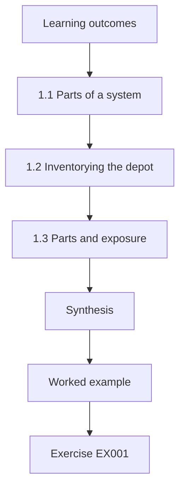

### Logical drawing

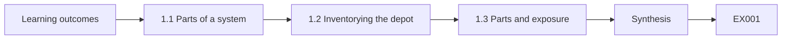

```text
[Learning outcomes]
    |
    v
[1.1 Parts of a system]
    |
    v
[1.2 Inventorying the depot]
    |
    v
[1.3 Parts and exposure]
    |
    v
[Synthesis]
    |
    v
[Worked example] --> [Exercise EX001]
```
<!-- cykin:lesson-figures:end ch-01 -->


### Learning outcomes

You will (1) describe the parts of a computing system and how they interact; (2) inventory a depot's systems; (3) relate system parts to security exposure.

### 1.1 Parts of a system

Tomás Ferreira is a technologist student at the fictional Kestrel Polytechnic, placed with the fictional Brightwater Logistics, which runs four parcel depots. His instructor, Ruth Adeyemi, starts with the basics: a computing system combines hardware, firmware, an operating system, applications, data and the people who use it. Each layer depends on the one below. A depot's handheld scanner, for example, has a processor, firmware from the manufacturer, a mobile operating system, a scanning app and the parcel data it sends to the central tracking service.

### 1.2 Inventorying the depot

Tomás walks the main depot with Sam Okafor, Brightwater's infrastructure lead, and records every system: forty handheld scanners, twelve label printers, six office PCs, a sorting conveyor controller, two network switches, a wireless controller and a cloud tracking service. For each he notes the owner, the operating system, who maintains it and whether it holds parcel or customer data. He finds three label printers that nobody claims to own, which means nobody updates them. An inventory is the first security control because unknown systems cannot be protected.

### 1.3 Parts and exposure

Each layer brings its own exposure. Hardware can be stolen, firmware may carry flaws that are rarely patched, operating systems need updates, applications may have weak settings and data may leak. Tomás marks which layers Brightwater can change and which only the vendor can. The scanners' firmware, for example, can only be updated through the vendor's tool. Anderson (2020) stresses that security depends on the whole system, including the people and the maintenance arrangements, not only on its most visible software layer.

### Worked example

Tomás describes system layers using a scanner, inventories a depot's systems and maps which layers Brightwater and vendors control.

> **Synthetic case.** Brightwater, Kestrel and all people are synthetic; Anderson (2020) is real.

### Errors and limits

Walk-through inventories miss systems in cupboards and vehicles. Ownership may be disputed.

### Exercises

- **EX001 — Scanner layers.** Name the layers in a depot handheld scanner. *Rubric:* 3 = processor, firmware, mobile OS, scanning app, parcel data;; 2 = three;; 1 = vague;; 0 = none.
- **EX002 — Unowned printers.** Why are the three unowned label printers a problem? *Rubric:* 3 = nobody updates them;; 2 = no updates;; 1 = vague;; 0 = none.
- **EX003 — Vendor-only layer.** Which scanner layer can only the vendor update? *Rubric:* 3 = the firmware, through the vendor's tool;; 2 = firmware;; 1 = app;; 0 = none.

### Synthesis

Knowing every layer of every system, and who can change it, is where security begins.

### Continue studying — chapter 01 of 30

[← Course home](../../README.md) · [Course chapter index](../SUBJECTS.md) · [Chapter 02 (draft) →](#ch-02)

<a id="ch-02"></a>

## Chapter 2 — Networks and internet services

<!-- cykin:lesson-figures:start ch-02 -->
### Lesson map

Lesson 02 published. Map, example, EX004.

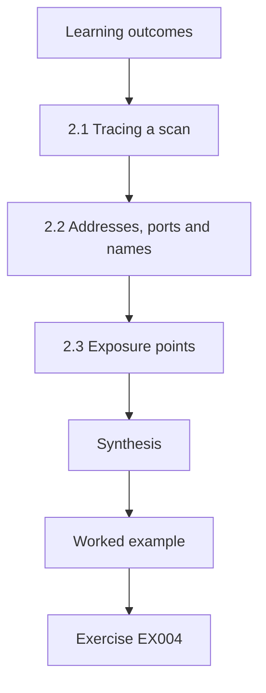

### Logical drawing

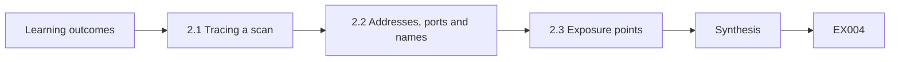

```text
[Learning outcomes]
    |
    v
[2.1 Tracing a scan]
    |
    v
[2.2 Addresses, ports and names]
    |
    v
[2.3 Exposure points]
    |
    v
[Synthesis]
    |
    v
[Worked example] --> [Exercise EX004]
```
<!-- cykin:lesson-figures:end ch-02 -->


### Learning outcomes

You will (1) trace how depot devices reach cloud services; (2) explain addresses, ports and name resolution; (3) identify network exposure points.

### 2.1 Tracing a scan

Tomás follows one parcel scan from the handheld to the cloud. The scanner joins the depot wireless network, receives an address from the router, looks up the tracking service's name through DNS and opens an encrypted HTTPS connection on port 443. The depot firewall allows outbound web traffic, and the cloud service replies. Tracing one path end to end teaches him more than memorising protocol tables, because he sees where each component could fail or be attacked and which team owns each step.

### 2.2 Addresses, ports and names

Ruth explains three ideas. An IP address identifies a device on a network; a port identifies a service on that device; DNS turns names into addresses. Tomás uses these to read the depot firewall rules. One rule allows inbound connections on port 3389, used for remote desktop, to an office PC. Sam explains it was opened years ago so a former manager could work from home. Inbound remote desktop from the internet is a frequent route for ransomware, so the rule needs urgent attention.

### 2.3 Exposure points

Tomás lists every place the depot network meets the outside world: the internet connection, the remote desktop rule, the vendor's remote support link to the conveyor controller and the guest wireless network used by drivers. For each, he notes what is reachable and who uses it. Sam closes the remote desktop rule the same day and offers the manager the company's VPN instead. The guest network turns out to be separated correctly. Knowing exposure points lets a small team focus effort where attackers would start.

### Worked example

Tomás traces a scan to the cloud, reads firewall rules with addresses, ports and names, and lists four exposure points, closing an old remote desktop rule.

> **Synthetic case.** Network details are synthetic.

### Errors and limits

Firewall rules may not reflect cloud-side settings. Vendor links can be undocumented.

### Exercises

- **EX004 — Port 443.** Which port did the scanner use and why? *Rubric:* 3 = 443 for encrypted HTTPS;; 2 = 443;; 1 = 80;; 0 = none.
- **EX005 — Remote desktop risk.** Why was the inbound port 3389 rule urgent? *Rubric:* 3 = internet remote desktop is a frequent ransomware route;; 2 = ransomware;; 1 = vague;; 0 = none.
- **EX006 — Exposure list.** Name two exposure points Tomás listed. *Rubric:* 3 = internet connection, remote desktop rule, conveyor vendor link, guest wireless;; 2 = one;; 1 = vague;; 0 = none.

### Synthesis

Tracing real traffic and listing exposure points turns networking knowledge into security action.

### Continue studying — chapter 02 of 30

[← Chapter 01 (draft)](#ch-01) · [Course chapter index](../SUBJECTS.md) · [Chapter 03 (draft) →](#ch-03)

<a id="ch-03"></a>

## Chapter 3 — Programming foundations

<!-- cykin:lesson-figures:start ch-03 -->
### Lesson map

Lesson 03 published. Map, example, EX007.

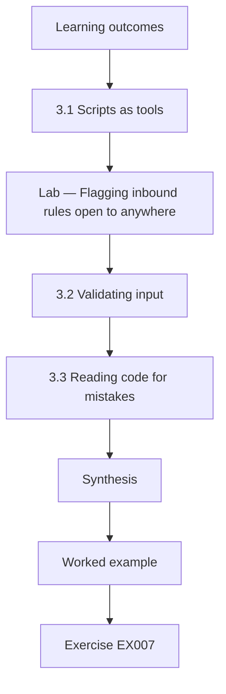

### Logical drawing

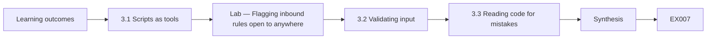

```text
[Learning outcomes]
    |
    v
[3.1 Scripts as tools]
    |
    v
[Lab — Flagging inbound rules open to anywhere]
    |
    v
[3.2 Validating input]
    |
    v
[3.3 Reading code for mistakes]
    |
    v
[Synthesis]
    |
    v
[Worked example] --> [Exercise EX007]
```
<!-- cykin:lesson-figures:end ch-03 -->


### Learning outcomes

You will (1) write small Python scripts to check configurations; (2) validate input safely; (3) read code for common security mistakes.

### 3.1 Scripts as tools

Ruth wants technologists who can automate small checks. Tomás writes a Python script that reads the depot's exported firewall rules and lists any rule allowing inbound traffic from anywhere. Writing the check once means it can run after every change instead of relying on someone reading the rules by eye. He keeps the script short, comments each step and tests it on a sample file containing one rule he knows should be flagged. Testing with a known bad case confirms the script actually finds what it claims to find.

### Lab — Flagging inbound rules open to anywhere

```python
# Flag inbound firewall rules that allow any source (synthetic export).
rules = [("in", "any", "office-pc3", 3389), ("in", "10.1.0.0/16", "printer2", 9100),
         ("out", "depot", "any", 443), ("in", "any", "switch1", 22), ("in", "vpn", "office-pc1", 3389)]
flagged = [r for r in rules if r[0] == "in" and r[1] == "any"]
for d, src, dst, port in flagged: print(f"FLAG inbound from {src} to {dst} port {port}")
print(f"{len(flagged)} of {len(rules)} rules flagged")
```

Run with `python3 lab_rules.py`. Verified output:

```text
FLAG inbound from any to office-pc3 port 3389
FLAG inbound from any to switch1 port 22
2 of 5 rules flagged
```

### 3.2 Validating input

Tomás's next script imports parcel weights from a CSV file sent by a partner. Ruth asks what happens if a line contains text where a number should be, or a negative weight. He adds checks that reject bad lines and report them, instead of crashing or silently storing nonsense. Input validation protects systems from both mistakes and deliberate attacks. He follows the principle of validating against what is allowed, such as numbers between zero and seventy kilograms, rather than trying to list everything that is forbidden.

### 3.3 Reading code for mistakes

Ruth gives the class short code samples to review. Tomás spots a database query built by joining text with user input, which allows injection; a password written into the source code; and an error message that prints internal details to users. For each he writes the safer pattern: parameterised queries, secrets loaded from a managed store and generic error messages with details logged privately. Reading code for common mistakes is a skill technologists use when reviewing vendor scripts and small internal tools.

### Worked example

Tomás writes and tests a rule-checking script, adds allow-list validation to an import and reviews code samples for three common mistakes.

> **Synthetic case.** Rules and code samples are synthetic.

### Errors and limits

Small scripts can grow without tests. Allow-lists need updating when business rules change.

### Exercises

- **EX007 — Known bad case.** Why test the script with a rule known to be bad? *Rubric:* 3 = to confirm it finds what it claims;; 2 = confirmation;; 1 = speed;; 0 = none.
- **EX008 — Flagged rules.** How many rules did the lab flag? *Rubric:* 3 = two: 3389 to office-pc3 and 22 to switch1;; 2 = two;; 1 = vague;; 0 = none.
- **EX009 — Safer query.** What is the safer pattern for database queries with user input? *Rubric:* 3 = parameterised queries;; 2 = parameters;; 1 = string joining;; 0 = none.

### Synthesis

Small, tested scripts and careful code reading let technologists check systems reliably and spot common mistakes.

### Continue studying — chapter 03 of 30

[← Chapter 02 (draft)](#ch-02) · [Course chapter index](../SUBJECTS.md) · [Chapter 04 (draft) →](#ch-04)

<a id="ch-04"></a>

## Chapter 4 — Data models

<!-- cykin:lesson-figures:start ch-04 -->
### Lesson map

Lesson 04 published. Map, example, EX010.

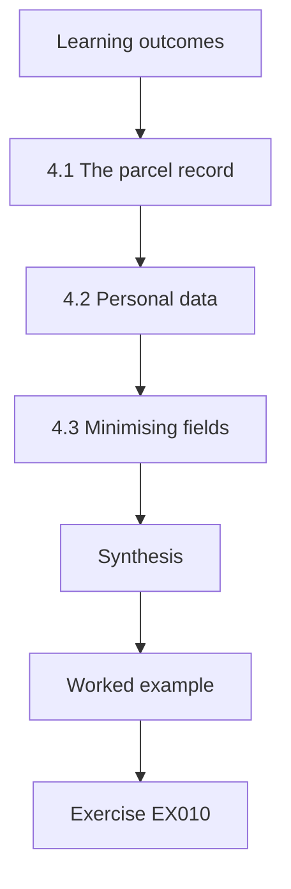

### Logical drawing

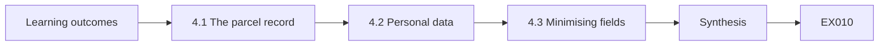

```text
[Learning outcomes]
    |
    v
[4.1 The parcel record]
    |
    v
[4.2 Personal data]
    |
    v
[4.3 Minimising fields]
    |
    v
[Synthesis]
    |
    v
[Worked example] --> [Exercise EX010]
```
<!-- cykin:lesson-figures:end ch-04 -->


### Learning outcomes

You will (1) describe Brightwater's parcel data model; (2) identify personal data within it; (3) apply minimisation to data fields.

### 4.1 The parcel record

Tomás studies the tracking service's data model with the developer who supports it. A parcel record holds an identifier, sender, recipient name, address, phone number, weight, service level, scan events and a delivery photo. Scan events link to depots, drivers and times. Understanding the model shows how data flows and where it accumulates. Ruth asks the class to sketch entities and relationships on paper first, because a clear diagram helps everyone discuss which fields are needed, by whom and for how long.

### 4.2 Personal data

Tomás marks fields that identify people: recipient name, address and phone, driver identity on scan events, and delivery photos that may show a person or a house. Some fields are personal in combination, such as a delivery time and an address revealing when someone is at home. He notes which teams access each field. Customer service needs recipient contact details; depot sorters need only the postcode and service level. Mapping personal data by role shows where access is broader than any job requires.

### 4.3 Minimising fields

Tomás proposes changes. Sorter screens show only postcode, service level and weight. Phone numbers are hidden after delivery. Delivery photos are deleted after ninety days unless a claim is open. The developer estimates the work at two weeks. Sam supports it because fewer people seeing personal data means fewer chances of misuse and a smaller impact if a handheld is lost. Data minimisation, required by data protection law in many countries, is also one of the cheapest security controls available to a small company.

### Worked example

Tomás maps the parcel data model, marks personal fields by role and proposes three minimisation changes to screens and retention.

> **Synthetic case.** The data model is synthetic.

### Errors and limits

Hidden fields may still exist in exports. Retention deletion must include backups over time.

### Exercises

- **EX010 — Combined fields.** How can delivery time and address together be personal? *Rubric:* 3 = they reveal when someone is home;; 2 = inference;; 1 = vague;; 0 = none.
- **EX011 — Sorter needs.** Which fields do sorters need? *Rubric:* 3 = postcode, service level and weight;; 2 = postcode;; 1 = full address;; 0 = none.
- **EX012 — Photo retention.** How long are delivery photos kept under the proposal? *Rubric:* 3 = ninety days unless a claim is open;; 2 = ninety days;; 1 = forever;; 0 = none.

### Synthesis

Mapping personal data in the data model by role shows how to minimise exposure cheaply.

### Continue studying — chapter 04 of 30

[← Chapter 03 (draft)](#ch-03) · [Course chapter index](../SUBJECTS.md) · [Chapter 05 (draft) →](#ch-05)

<a id="ch-05"></a>

## Chapter 5 — Security literacy

<!-- cykin:lesson-figures:start ch-05 -->
### Lesson map

Lesson 05 published. Map, example, EX013.

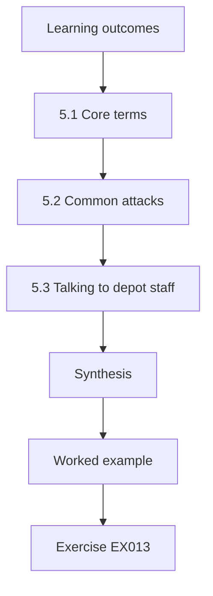

### Logical drawing

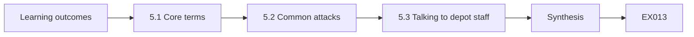

```text
[Learning outcomes]
    |
    v
[5.1 Core terms]
    |
    v
[5.2 Common attacks]
    |
    v
[5.3 Talking to depot staff]
    |
    v
[Synthesis]
    |
    v
[Worked example] --> [Exercise EX013]
```
<!-- cykin:lesson-figures:end ch-05 -->


### Learning outcomes

You will (1) explain core security terms; (2) recognise common attacks on logistics firms; (3) communicate security simply to depot staff.

### 5.1 Core terms

Ruth teaches a shared vocabulary. Confidentiality keeps information from the wrong people; integrity keeps it correct; availability keeps it usable when needed. A vulnerability is a weakness; a threat is something that could exploit it; risk combines likelihood and impact. A control reduces risk. Tomás uses these terms when writing up his depot walk, so that Sam and the operations manager understand exactly what he means. Shared vocabulary avoids misunderstandings like calling every problem a hack. He adds a one-page glossary to the depot's shared folder so new staff can look terms up later.

### 5.2 Common attacks

Tomás studies attacks seen in logistics: fake delivery text messages that steal customer details, invoice fraud where criminals pose as fuel suppliers, ransomware that stops sorting and deliveries, and theft of handheld devices from vans. He links each to Brightwater's systems. Invoice fraud targets the finance office; ransomware would hit the tracking service and conveyor. Knowing the real attacks against a sector focuses training and controls better than generic lists, because staff recognise threats that resemble their own work. He checks each attack against the last year of help desk tickets to see which have already happened locally.

### 5.3 Talking to depot staff

Tomás prepares a ten-minute briefing for a shift change. He avoids jargon and uses three stories: a driver who reported a phishing text, a lost handheld that was wiped remotely and an invoice email with a changed bank account. Each ends with one action: report, report, call to check. Staff ask practical questions, such as whether personal phones are affected. Ruth reminds him that good security communication is short, concrete and respectful of people's time, and invites questions instead of blaming mistakes.

### Worked example

Tomás defines core terms, links four logistics attacks to Brightwater and gives a ten-minute story-based briefing to depot staff.

> **Synthetic case.** Stories and staff are synthetic.

### Errors and limits

One briefing fades quickly. Stories must match real local risks to stay credible.

### Exercises

- **EX013 — Risk definition.** How is risk defined in the chapter? *Rubric:* 3 = likelihood combined with impact;; 2 = both;; 1 = threat only;; 0 = none.
- **EX014 — Finance target.** Which attack targets Brightwater's finance office? *Rubric:* 3 = invoice fraud posing as a fuel supplier;; 2 = invoice fraud;; 1 = ransomware;; 0 = none.
- **EX015 — Briefing actions.** What were the three briefing actions? *Rubric:* 3 = report, report, call to check;; 2 = two;; 1 = vague;; 0 = none.

### Synthesis

Shared terms, sector-specific attacks and short practical briefings build security literacy.

### Continue studying — chapter 05 of 30

[← Chapter 04 (draft)](#ch-04) · [Course chapter index](../SUBJECTS.md) · [Chapter 06 (draft) →](#ch-06)

<a id="ch-06"></a>

## Chapter 6 — Operating systems and virtualization

<!-- cykin:lesson-figures:start ch-06 -->
### Lesson map

Lesson 06 published. Map, example, EX016.

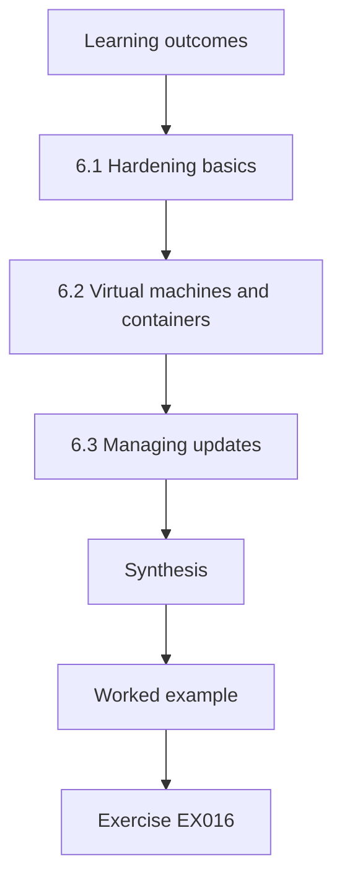

### Logical drawing

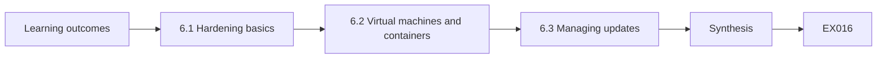

```text
[Learning outcomes]
    |
    v
[6.1 Hardening basics]
    |
    v
[6.2 Virtual machines and containers]
    |
    v
[6.3 Managing updates]
    |
    v
[Synthesis]
    |
    v
[Worked example] --> [Exercise EX016]
```
<!-- cykin:lesson-figures:end ch-06 -->


### Learning outcomes

You will (1) harden an operating system configuration; (2) explain virtual machines and containers; (3) manage updates across depot devices.

### 6.1 Hardening basics

Tomás reviews the depot office PCs. Hardening means removing what is not needed and tightening what remains: disabling unused services, removing local administrator rights from daily accounts, turning on disk encryption, enabling the built-in firewall and setting screen locks. He compares each PC with a checklist based on the vendor's security baseline. Two PCs have users with administrator rights, which would let malware install itself freely. He documents changes and tests that the depot's label software still runs before rolling out across sites.

### 6.2 Virtual machines and containers

Brightwater runs its route-planning tool on a virtual machine in a small server room. Ruth explains that a hypervisor lets several virtual machines share hardware while staying isolated from each other, and that containers share one operating system kernel but separate applications. Isolation is useful but not absolute: a flaw in the hypervisor or kernel can break it. Tomás notes that the route planner's virtual machine and the file server share a host, so patching the host matters for both.

### 6.3 Managing updates

Tomás lists update sources: Windows updates for PCs, vendor tools for scanners and printers, firmware for switches and the hypervisor. He finds the scanners were last updated eleven months ago because the vendor tool needs a manual step. Sam agrees a monthly update window per depot, outside peak sorting hours, with a rollback plan. Tomás writes a short schedule showing each device type, its update method and its owner. Updates only happen reliably when someone owns them and they fit operations.

### Worked example

Tomás hardens office PCs against a baseline, explains virtualization isolation limits and builds a monthly update schedule with owners.

> **Synthetic case.** Devices and schedules are synthetic.

### Errors and limits

Hardening can break legacy software. Shared hosts concentrate risk.

### Exercises

- **EX016 — Admin rights risk.** Why remove local administrator rights from daily accounts? *Rubric:* 3 = malware could install itself freely;; 2 = malware;; 1 = speed;; 0 = none.
- **EX017 — Containers versus VMs.** How do containers differ from virtual machines? *Rubric:* 3 = containers share one kernel; VMs each have their own OS on a hypervisor;; 2 = kernel;; 1 = vague;; 0 = none.
- **EX018 — Scanner updates.** Why were scanners eleven months out of date? *Rubric:* 3 = the vendor tool needs a manual step;; 2 = manual;; 1 = no updates exist;; 0 = none.

### Synthesis

Hardening, understanding isolation and owned update schedules keep operating systems trustworthy.

### Continue studying — chapter 06 of 30

[← Chapter 05 (draft)](#ch-05) · [Course chapter index](../SUBJECTS.md) · [Chapter 07 (draft) →](#ch-07)

<a id="ch-07"></a>

## Chapter 7 — Identity and access foundations

<!-- cykin:lesson-figures:start ch-07 -->
### Lesson map

Lesson 07 published. Map, example, EX019.

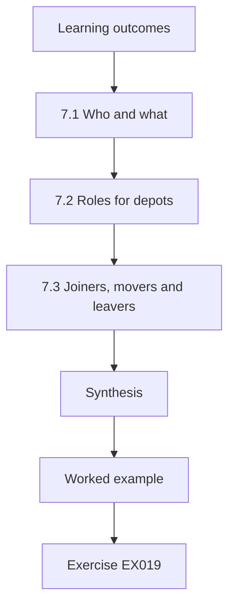

### Logical drawing

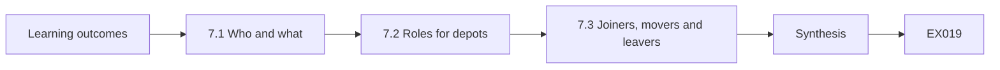

```text
[Learning outcomes]
    |
    v
[7.1 Who and what]
    |
    v
[7.2 Roles for depots]
    |
    v
[7.3 Joiners, movers and leavers]
    |
    v
[Synthesis]
    |
    v
[Worked example] --> [Exercise EX019]
```
<!-- cykin:lesson-figures:end ch-07 -->


### Learning outcomes

You will (1) explain authentication and authorisation; (2) design role-based access for depots; (3) handle joiners, movers and leavers.

### 7.1 Who and what

Ruth separates two questions. Authentication asks who you are, using something you know, have or are. Authorisation asks what you may do once known. Brightwater's drivers sign in to handhelds with a four-digit PIN shared by each van crew, so the company cannot tell which driver made a scan. Tomás recommends individual sign-in using a badge tap and a personal PIN. Individual identity is the foundation of accountability, because without it logs cannot show who did what and access cannot be removed for one person.

### 7.2 Roles for depots

Tomás designs roles: driver, sorter, depot supervisor, customer service, finance and administrator. Each role lists the permissions it needs. Supervisors can reassign parcels but not change customer addresses; customer service can change addresses but not reassign routes. He checks the design against real tasks by shadowing a supervisor for a shift. Role-based access keeps permissions understandable, so a new supervisor gets the right rights in one step instead of copying a colleague's account and inheriting their history. Agency workers receive the sorter role with an end date matching their contract.

### 7.3 Joiners, movers and leavers

Brightwater hires many seasonal staff before winter. Tomás writes a process: joiners get a role on their start date, movers lose old rights when they gain new ones, and leavers are disabled on their last day by a request from human resources. He notes that movers are often forgotten, so a sorter promoted to supervisor keeps sorter rights forever. Sam adds a quarterly review where supervisors confirm their team's access. A short documented process removes most of the access drift seen in small companies.

### Worked example

Tomás replaces shared crew PINs with individual sign-in, designs six depot roles and writes a joiner, mover and leaver process with quarterly review.

> **Synthetic case.** Roles and processes are synthetic.

### Errors and limits

Badge loss creates support load. Reviews become rubber stamps without guidance.

### Exercises

- **EX019 — Shared PIN problem.** Why is a shared crew PIN a problem? *Rubric:* 3 = the company cannot tell which driver made a scan;; 2 = accountability;; 1 = weak PIN;; 0 = none.
- **EX020 — Supervisor limits.** What can supervisors not do? *Rubric:* 3 = change customer addresses;; 2 = addresses;; 1 = reassign parcels;; 0 = none.
- **EX021 — Forgotten movers.** Why are movers a risk? *Rubric:* 3 = they keep old rights when gaining new ones;; 2 = drift;; 1 = vague;; 0 = none.

### Synthesis

Individual identities, clear roles and a joiner, mover and leaver process are the foundation of access control.

### Continue studying — chapter 07 of 30

[← Chapter 06 (draft)](#ch-06) · [Course chapter index](../SUBJECTS.md) · [Chapter 08 (draft) →](#ch-08)

<a id="ch-08"></a>

## Chapter 8 — Security architecture basics

<!-- cykin:lesson-figures:start ch-08 -->
### Lesson map

Lesson 08 published. Map, example, EX022.

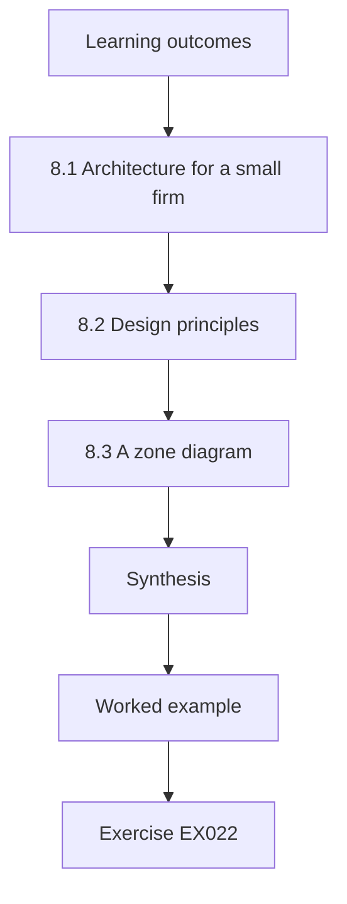

### Logical drawing

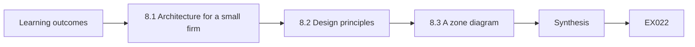

```text
[Learning outcomes]
    |
    v
[8.1 Architecture for a small firm]
    |
    v
[8.2 Design principles]
    |
    v
[8.3 A zone diagram]
    |
    v
[Synthesis]
    |
    v
[Worked example] --> [Exercise EX022]
```
<!-- cykin:lesson-figures:end ch-08 -->


### Learning outcomes

You will (1) explain what security architecture means for a small firm; (2) apply core design principles; (3) draw a simple zone diagram.

### 8.1 Architecture for a small firm

Ruth explains that security architecture is the overall arrangement of protections across systems, not a single device. For Brightwater, it answers questions such as which systems can talk to which, where identities are checked, where data is stored and how services recover after failure. Even a four-depot company benefits from writing this down, because decisions made one at a time tend to contradict each other. A simple architecture gives Sam a reference when vendors propose new connections. The written version also helps new IT staff understand past choices without relying on memory.

### 8.2 Design principles

Tomás applies classic principles from Saltzer and Schroeder (1975). Least privilege: each role gets only what it needs. Fail-safe defaults: new devices join a quarantine network until approved. Economy of mechanism: one identity service rather than separate logins per application. Complete mediation: the tracking service checks permissions on every request, not just at sign-in. Separation of privilege: changes to bank details in finance need two people. He links each principle to a specific Brightwater decision so it becomes practical. Ruth asks him to mark where two principles pull in different directions.

### 8.3 A zone diagram

Tomás draws a diagram of the main depot with four zones: office, operations devices such as scanners and printers, the conveyor control system and guest wireless. Arrows show permitted flows: operations devices reach the cloud tracking service; the conveyor accepts connections only from the vendor's support gateway; guests reach only the internet. The diagram fits on one page. Sam pins it next to the network cabinet so anyone making changes can check whether a new connection fits the design before plugging in.

### Worked example

Tomás explains architecture for a small firm, links five principles to Brightwater decisions and draws a four-zone diagram with permitted flows.

> **Synthetic case.** Zones and flows are synthetic; Saltzer and Schroeder (1975) is real.

### Errors and limits

One-page diagrams omit detail. Principles may conflict in practice.

### Exercises

- **EX022 — Why write it down.** Why does a small firm benefit from a written architecture? *Rubric:* 3 = decisions made one at a time contradict each other;; 2 = consistency;; 1 = vague;; 0 = none.
- **EX023 — Fail-safe example.** How does Brightwater apply fail-safe defaults? *Rubric:* 3 = new devices join a quarantine network until approved;; 2 = quarantine;; 1 = open network;; 0 = none.
- **EX024 — Conveyor flow.** What may connect to the conveyor control system? *Rubric:* 3 = only the vendor's support gateway;; 2 = gateway;; 1 = anything;; 0 = none.

### Synthesis

Even small firms need a written architecture grounded in principles and a simple zone diagram.

### Continue studying — chapter 08 of 30

[← Chapter 07 (draft)](#ch-07) · [Course chapter index](../SUBJECTS.md) · [Chapter 09 (draft) →](#ch-09)

<a id="ch-09"></a>

## Chapter 9 — Evidence and measurement

<!-- cykin:lesson-figures:start ch-09 -->
### Lesson map

Lesson 09 published. Map, example, EX025.

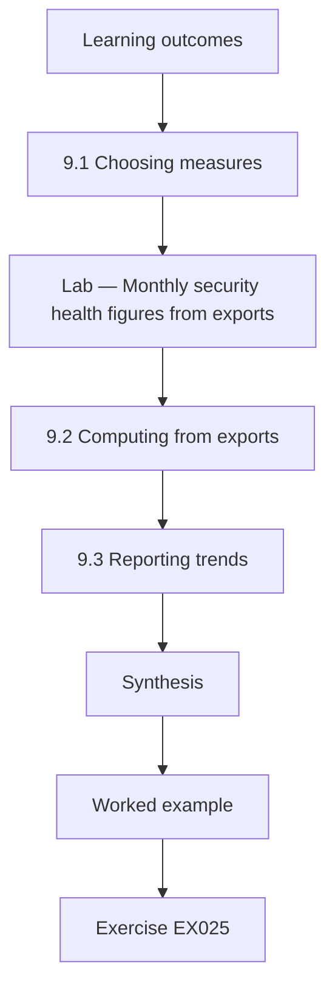

### Logical drawing

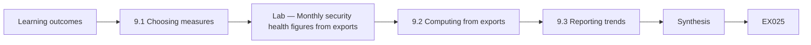

```text
[Learning outcomes]
    |
    v
[9.1 Choosing measures]
    |
    v
[Lab — Monthly security health figures from exports]
    |
    v
[9.2 Computing from exports]
    |
    v
[9.3 Reporting trends]
    |
    v
[Synthesis]
    |
    v
[Worked example] --> [Exercise EX025]
```
<!-- cykin:lesson-figures:end ch-09 -->


### Learning outcomes

You will (1) choose simple measures of security health; (2) compute them from exports; (3) report trends to managers.

### 9.1 Choosing measures

Sam asks Tomás how Brightwater can tell if it is improving. Tomás proposes five measures: share of devices updated within thirty days, share of staff using individual sign-in, number of inbound internet rules, days from leaving to account disablement and number of unowned devices. Each is cheap to collect from existing exports. He writes a one-line definition for each so that the figure means the same thing every month, and he records where the data comes from and who produces it.

### Lab — Monthly security health figures from exports

```python
# Monthly security health figures from synthetic exports.
import datetime as dt
today = dt.date(2026, 3, 31)
updated = [dt.date(2026, 3, d) for d in range(3, 32)] + [dt.date(2026, 1, 15)] * 31   # 60 devices
owners = ["sam"] * 57 + [None] * 3
leavers = [(dt.date(2026, 3, 2), dt.date(2026, 3, 3)), (dt.date(2026, 3, 9), dt.date(2026, 3, 16)),
           (dt.date(2026, 3, 20), dt.date(2026, 3, 24))]
recent = sum((today - d).days <= 30 for d in updated)
print(f"updated within 30 days: {recent}/{len(updated)} = {recent/len(updated):.0%}")
print(f"unowned devices: {owners.count(None)}")
days = [(off - left).days for left, off in leavers]
print(f"days to disable leavers: {days}, average {sum(days)/len(days):.0f}")
```

Run with `python3 lab_health.py`. Verified output:

```text
updated within 30 days: 29/60 = 48%
unowned devices: 3
days to disable leavers: [1, 7, 4], average 4
```

### 9.2 Computing from exports

Tomás writes a script that reads synthetic device and account exports and computes the measures. The lab shows the current month: twenty-nine of sixty devices updated within thirty days, three unowned devices and an average of four days to disable leavers. He checks a sample of records by hand to make sure the script reads dates correctly. A small error in date parsing would make every month look better or worse than reality, undermining trust in the whole report. He also keeps the raw exports for a month so figures can be rechecked.

### 9.3 Reporting trends

Tomás presents three months of figures to the operations manager as a simple table with arrows showing direction. He explains what each figure means and what action it suggests. The update share is the weakest figure, which supports the monthly update window agreed in chapter 6. He avoids colour-coded scores that hide detail. The manager asks for the report monthly. Trends matter more than single numbers, because they show whether changes are working and give early warning when something slips.

### Worked example

Tomás defines five health measures, computes them from synthetic exports with a hand-checked sample and reports a three-month trend.

> **Synthetic case.** Exports and figures are synthetic.

### Errors and limits

Measures can be gamed once targets are set. Exports may miss devices.

### Exercises

- **EX025 — Measure definitions.** Why write a one-line definition for each measure? *Rubric:* 3 = so it means the same thing every month;; 2 = consistency;; 1 = vague;; 0 = none.
- **EX026 — Update share.** What was the update share in the lab? *Rubric:* 3 = 29 of 60, 48%;; 2 = 48%;; 1 = vague;; 0 = none.
- **EX027 — Hand checking.** Why check a sample of records by hand? *Rubric:* 3 = to confirm dates are read correctly;; 2 = parsing;; 1 = vague;; 0 = none.

### Synthesis

A few well-defined measures computed from exports and shown as trends tell managers whether security is improving.

### Continue studying — chapter 09 of 30

[← Chapter 08 (draft)](#ch-08) · [Course chapter index](../SUBJECTS.md) · [Chapter 10 (draft) →](#ch-10)

<a id="ch-10"></a>

## Chapter 10 — Security architecture and engineering: orientation

<!-- cykin:lesson-figures:start ch-10 -->
### Lesson map

Lesson 10 published. Map, example, EX028.

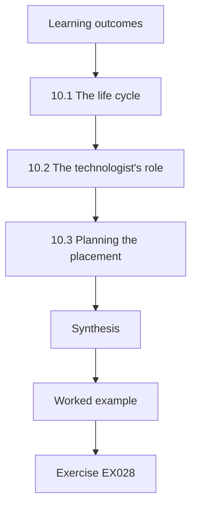

### Logical drawing

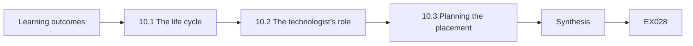

```text
[Learning outcomes]
    |
    v
[10.1 The life cycle]
    |
    v
[10.2 The technologist's role]
    |
    v
[10.3 Planning the placement]
    |
    v
[Synthesis]
    |
    v
[Worked example] --> [Exercise EX028]
```
<!-- cykin:lesson-figures:end ch-10 -->


### Learning outcomes

You will (1) describe the security architecture and engineering life cycle; (2) locate a technologist's role in it; (3) plan the rest of the placement.

### 10.1 The life cycle

Ruth outlines the life cycle described in NIST SP 800-160 Vol. 1 Rev. 1: understand needs and context, define requirements, design, build or acquire, verify, deploy, operate and retire. Security belongs in every stage, not only at the end. Tomás maps recent Brightwater changes onto the cycle. The new label printers were bought without any security requirement, so their default passwords were never changed. Had a requirement existed at the acquisition stage, the supplier would have delivered them configured correctly. He adds this example to his placement log as a lesson about acquisition.

### 10.2 The technologist's role

Technologists work mostly in build, verify, deploy and operate. Tomás's tasks will include configuring devices to the design, testing that controls work, documenting changes and spotting problems in operation that should change the design. Architects decide the overall shape; technologists make it real and report where reality differs from the drawing. Ruth stresses that this feedback loop is essential: designs that ignore operational experience become fiction, and technologists are the people best placed to notice. Sam agrees to hold a short monthly meeting where Tomás reports such differences.

### 10.3 Planning the placement

Tomás agrees a plan with Sam for the remaining weeks: map assets and data flows, write risk scenarios, apply two methods to a real change, run a guided lab, build automation, set up monitoring, troubleshoot and finally hand over a capstone. Each week has a deliverable reviewed by Sam. Writing the plan down helps both sides manage expectations and lets Ruth check that the placement covers the course outcomes. It also gives Tomás a record of what he achieved for future job applications.

### Worked example

Tomás maps changes onto the life cycle, defines the technologist's role in it and agrees a weekly placement plan with deliverables.

> **Synthetic case.** Plans and devices are synthetic; SP 800-160 Vol. 1 Rev. 1 is real.

### Errors and limits

Life-cycle models look linear; real work loops back. Placement plans change with business needs.

### Exercises

- **EX028 — Printer lesson.** What went wrong with the new label printers? *Rubric:* 3 = no security requirement at purchase, so default passwords stayed;; 2 = requirements;; 1 = vendor;; 0 = none.
- **EX029 — Technologist stages.** In which stages do technologists mostly work? *Rubric:* 3 = build, verify, deploy and operate;; 2 = three;; 1 = design only;; 0 = none.
- **EX030 — Feedback loop.** Why is the technologist's feedback essential? *Rubric:* 3 = designs that ignore operations become fiction;; 2 = reality;; 1 = vague;; 0 = none.

### Synthesis

Technologists make architecture real across the life cycle and feed operational reality back into design.

### Continue studying — chapter 10 of 30

[← Chapter 09 (draft)](#ch-09) · [Course chapter index](../SUBJECTS.md) · [Chapter 11 (draft) →](#ch-11)

<a id="ch-11"></a>

## Chapter 11 — Security architecture and engineering: assets and context

<!-- cykin:lesson-figures:start ch-11 -->
### Lesson map

Lesson 11 published. Map, example, EX031.

```mermaid
flowchart TD
  N0["Learning outcomes"]
  N1["11.1 Ranking assets"]
  N2["11.2 Business context"]
  N3["11.3 Assets and attributes"]
  N4["Synthesis"]
  N0 --> N1 --> N2 --> N3 --> N4
  N4 --> EX["Worked example"]
  EX --> Q["Exercise EX031"]
```

### Logical drawing

```mermaid
flowchart LR
  N0["Learning outcomes"]
  N1["11.1 Ranking assets"]
  N2["11.2 Business context"]
  N3["11.3 Assets and attributes"]
  N4["Synthesis"]
  N0 --> N1 --> N2 --> N3 --> N4 --> Q["EX031"]
```

```text
[Learning outcomes]
    |
    v
[11.1 Ranking assets]
    |
    v
[11.2 Business context]
    |
    v
[11.3 Assets and attributes]
    |
    v
[Synthesis]
    |
    v
[Worked example] --> [Exercise EX031]
```
<!-- cykin:lesson-figures:end ch-11 -->


### Learning outcomes

You will (1) rank assets by business importance; (2) describe the business context and constraints; (3) link assets to security attributes.

### 11.1 Ranking assets

Using the inventory from chapter 1, Tomás asks operations managers which systems matter most. The tracking service ranks first, because without it parcels cannot be routed or tracked. The conveyor controller ranks second, because manual sorting cuts depot throughput by two thirds. Handhelds rank third. Office PCs matter less except for the finance office. Ranking by business consequence, rather than by technical complexity, tells Tomás where protection and recovery effort should go first when time is limited. He records the ranking with the date and the names of the managers consulted, so it can be revisited before each peak season.

### 11.2 Business context

Tomás records the constraints that shape design. Depots run from four in the morning to ten at night, leaving short maintenance windows. Peak season in winter triples volume. The conveyor vendor requires remote access for support. Staff turnover among sorters is high, and many are agency workers. Margins are thin, so expensive tools are hard to justify. Every security recommendation must fit these constraints, and writing them down early stops Tomás proposing designs that would never be accepted. He shares the list with Ruth so she can judge his later proposals against it.

### 11.3 Assets and attributes

For each top asset, Tomás notes which security attribute matters most. The tracking service needs availability and integrity, since wrong routing causes missed deliveries. Customer data needs confidentiality. The conveyor needs availability and safety, since faulty commands could injure staff. Finance needs integrity of payments. Linking assets to attributes in the style of SABSA's business attributes (Sherwood, Clark and Lynas, 2005) helps him choose controls: backups and redundancy for availability, access control and encryption for confidentiality. He keeps the attribute list beside the asset ranking so both are reviewed together each year.

### Worked example

Tomás ranks assets by business consequence, records operational constraints and links each top asset to its most important security attribute.

> **Synthetic case.** Rankings and constraints are synthetic; SABSA is real.

### Errors and limits

Managers may overrate their own systems. Attributes change with seasons and contracts.

### Exercises

- **EX031 — Top asset.** Which asset ranked first and why? *Rubric:* 3 = the tracking service; parcels cannot be routed without it;; 2 = tracking;; 1 = conveyor;; 0 = none.
- **EX032 — Constraint example.** Name two constraints Tomás recorded. *Rubric:* 3 = long operating hours, peak season, vendor remote access, staff turnover, thin margins;; 2 = one;; 1 = vague;; 0 = none.
- **EX033 — Conveyor attributes.** Which attributes matter most for the conveyor? *Rubric:* 3 = availability and safety;; 2 = availability;; 1 = confidentiality;; 0 = none.

### Synthesis

Ranking assets by business consequence within real constraints shows where to focus protection.

### Continue studying — chapter 11 of 30

[← Chapter 10 (draft)](#ch-10) · [Course chapter index](../SUBJECTS.md) · [Chapter 12 (draft) →](#ch-12)

<a id="ch-12"></a>

## Chapter 12 — Security architecture and engineering: data flows

<!-- cykin:lesson-figures:start ch-12 -->
### Lesson map

Lesson 12 published. Map, example, EX034.

```mermaid
flowchart TD
  N0["Learning outcomes"]
  N1["12.1 Drawing the flows"]
  N2["12.2 Trust boundaries"]
  N3["12.3 Unprotected flows"]
  N4["Synthesis"]
  N0 --> N1 --> N2 --> N3 --> N4
  N4 --> EX["Worked example"]
  EX --> Q["Exercise EX034"]
```

### Logical drawing

```mermaid
flowchart LR
  N0["Learning outcomes"]
  N1["12.1 Drawing the flows"]
  N2["12.2 Trust boundaries"]
  N3["12.3 Unprotected flows"]
  N4["Synthesis"]
  N0 --> N1 --> N2 --> N3 --> N4 --> Q["EX034"]
```

```text
[Learning outcomes]
    |
    v
[12.1 Drawing the flows]
    |
    v
[12.2 Trust boundaries]
    |
    v
[12.3 Unprotected flows]
    |
    v
[Synthesis]
    |
    v
[Worked example] --> [Exercise EX034]
```
<!-- cykin:lesson-figures:end ch-12 -->


### Learning outcomes

You will (1) draw data flows for parcel handling; (2) mark trust boundaries; (3) find unprotected flows.

### 12.1 Drawing the flows

Tomás draws how parcel data moves: a retailer sends a manifest to the tracking service; depots scan parcels; the tracking service sends routes to drivers' handhelds; drivers capture delivery photos; customers receive text updates through a messaging provider. He labels each arrow with the data it carries. Sam corrects him on one point: manifests from small retailers arrive by email as spreadsheets and are uploaded by hand. Diagrams must match reality, not the official process description. He redraws the diagram twice before Sam and the developer agree it matches what actually happens at the depots.

### 12.2 Trust boundaries

Tomás marks boundaries where data crosses between organisations or privilege levels: retailer to Brightwater, Brightwater to the messaging provider, depot network to cloud, and the email inbox where manifests arrive. Each crossing should have checks: authentication of the sender, encryption in transit and validation of content. Shostack (2014) recommends looking carefully at every crossing because attackers exploit the places where one party assumes the other has already checked. He numbers each boundary on the diagram and lists, for each one, which of the three checks is already present and which is missing, so the gaps are easy to see at a glance.

### 12.3 Unprotected flows

The emailed spreadsheet flow has no sender verification and no content validation, and anyone with access to the shared inbox can upload it. A criminal could send a fake manifest to redirect parcels. Tomás recommends moving small retailers to a simple upload portal with accounts, and validating manifests for unusual changes such as many address updates at once. The messaging provider flow is encrypted and authenticated, so no change is needed there. Data flow diagrams turn vague worries into specific fixes.

### Worked example

Tomás draws parcel data flows, corrected by Sam, marks four trust boundaries and finds an unprotected emailed manifest flow.

> **Synthetic case.** Flows and providers are synthetic; Shostack (2014) is real.

### Errors and limits

Diagrams age quickly. Portals add work for small retailers.

### Exercises

- **EX034 — Sam's correction.** What did Sam correct in the diagram? *Rubric:* 3 = small retailers email spreadsheets uploaded by hand;; 2 = email manifests;; 1 = vague;; 0 = none.
- **EX035 — Boundary checks.** What checks should each boundary crossing have? *Rubric:* 3 = sender authentication, encryption and content validation;; 2 = two;; 1 = vague;; 0 = none.
- **EX036 — Fake manifest.** What could a criminal do with the emailed flow? *Rubric:* 3 = send a fake manifest to redirect parcels;; 2 = redirect;; 1 = vague;; 0 = none.

### Synthesis

Data flow diagrams with marked trust boundaries expose specific unprotected crossings.

### Continue studying — chapter 12 of 30

[← Chapter 11 (draft)](#ch-11) · [Course chapter index](../SUBJECTS.md) · [Chapter 13 (draft) →](#ch-13)

<a id="ch-13"></a>

## Chapter 13 — Security architecture and engineering: risk scenarios

<!-- cykin:lesson-figures:start ch-13 -->
### Lesson map

Lesson 13 published. Map, example, EX037.

```mermaid
flowchart TD
  N0["Learning outcomes"]
  N1["13.1 Writing scenarios"]
  N2["13.2 Rating consistently"]
  N3["13.3 Choosing treatments"]
  N4["Synthesis"]
  N0 --> N1 --> N2 --> N3 --> N4
  N4 --> EX["Worked example"]
  EX --> Q["Exercise EX037"]
```

### Logical drawing

```mermaid
flowchart LR
  N0["Learning outcomes"]
  N1["13.1 Writing scenarios"]
  N2["13.2 Rating consistently"]
  N3["13.3 Choosing treatments"]
  N4["Synthesis"]
  N0 --> N1 --> N2 --> N3 --> N4 --> Q["EX037"]
```

```text
[Learning outcomes]
    |
    v
[13.1 Writing scenarios]
    |
    v
[13.2 Rating consistently]
    |
    v
[13.3 Choosing treatments]
    |
    v
[Synthesis]
    |
    v
[Worked example] --> [Exercise EX037]
```
<!-- cykin:lesson-figures:end ch-13 -->


### Learning outcomes

You will (1) write concrete risk scenarios; (2) rate them consistently; (3) choose treatments.

### 13.1 Writing scenarios

Tomás turns his findings into scenarios: a fake manifest redirects high-value parcels; ransomware encrypts the route-planning virtual machine during peak; a lost handheld exposes recipient details; the conveyor vendor's support account is misused. Each scenario names a threat, a weakness, an asset and a consequence. Concrete scenarios are easier for managers to judge than abstract risk statements, because they can picture the event and recognise it from their own experience. He keeps each scenario to two or three sentences and avoids technical jargon, so that the operations manager and finance staff can rate them without needing an explanation from IT.

### 13.2 Rating consistently

Tomás uses a simple three-level scale for likelihood and impact, with examples for each level, following the structure in NIST SP 800-30 Rev. 1. He asks Sam and the operations manager to rate independently. They agree on three scenarios but differ on the lost handheld: the operations manager rates it high likelihood because handhelds go missing every month. That local knowledge changes the rating. Comparing independent ratings brings hidden knowledge into the open and makes the final ratings more defensible. The agreed ratings are recorded with the date of the discussion.

### 13.3 Choosing treatments

For each scenario, the group chooses a treatment. The fake manifest is reduced by the upload portal and validation. Ransomware is reduced by offline backups and tested restores of the route-planning machine. The lost handheld is reduced by remote wipe and minimised data on screens. Vendor misuse is reduced by time-limited access approved per session. Each treatment has an owner and a date. One low-rated scenario, a printer outage, is accepted because spare printers are kept at each depot. The treatment list is filed with the scenarios for the next review.

### Worked example

Tomás writes four concrete scenarios, compares independent ratings using SP 800-30-style scales and records treatments with owners.

> **Synthetic case.** Scenarios and ratings are synthetic; SP 800-30 Rev. 1 is real.

### Errors and limits

Three-level scales are coarse. Scenario lists miss surprises.

### Exercises

- **EX037 — Scenario parts.** What four parts does each scenario name? *Rubric:* 3 = threat, weakness, asset and consequence;; 2 = three;; 1 = vague;; 0 = none.
- **EX038 — Rating difference.** Why did the operations manager rate the lost handheld higher? *Rubric:* 3 = handhelds go missing every month;; 2 = local knowledge;; 1 = vague;; 0 = none.
- **EX039 — Accepted risk.** Which scenario was accepted and why? *Rubric:* 3 = printer outage; spare printers at each depot;; 2 = printer;; 1 = ransomware;; 0 = none.

### Synthesis

Concrete scenarios, independent ratings and owned treatments make risk management practical.

### Continue studying — chapter 13 of 30

[← Chapter 12 (draft)](#ch-12) · [Course chapter index](../SUBJECTS.md) · [Chapter 14 (draft) →](#ch-14)

<a id="ch-14"></a>

## Chapter 14 — Security architecture and engineering: methods I

<!-- cykin:lesson-figures:start ch-14 -->
### Lesson map

Lesson 14 published. Map, example, EX040.

```mermaid
flowchart TD
  N0["Learning outcomes"]
  N1["14.1 STRIDE on the portal"]
  N2["14.2 Recording the results"]
  N3["14.3 Reviewing with the developer"]
  N4["Synthesis"]
  N0 --> N1 --> N2 --> N3 --> N4
  N4 --> EX["Worked example"]
  EX --> Q["Exercise EX040"]
```

### Logical drawing

```mermaid
flowchart LR
  N0["Learning outcomes"]
  N1["14.1 STRIDE on the portal"]
  N2["14.2 Recording the results"]
  N3["14.3 Reviewing with the developer"]
  N4["Synthesis"]
  N0 --> N1 --> N2 --> N3 --> N4 --> Q["EX040"]
```

```text
[Learning outcomes]
    |
    v
[14.1 STRIDE on the portal]
    |
    v
[14.2 Recording the results]
    |
    v
[14.3 Reviewing with the developer]
    |
    v
[Synthesis]
    |
    v
[Worked example] --> [Exercise EX040]
```
<!-- cykin:lesson-figures:end ch-14 -->


### Learning outcomes

You will (1) apply STRIDE to the upload portal design; (2) record threats and mitigations; (3) review the result with the developer.

### 14.1 STRIDE on the portal

Brightwater builds the manifest upload portal recommended in chapter 12. Tomás applies STRIDE from Shostack (2014) to its design. Spoofing: a criminal could pose as a retailer, so accounts need strong sign-in. Tampering: a manifest could be altered in transit, so uploads use HTTPS. Repudiation: a retailer might deny uploading a change, so uploads are logged with the account. Information disclosure: one retailer must not see another's manifests. Denial of service: huge files could overload the import. Elevation of privilege: a retailer account must not reach admin functions.

### 14.2 Recording the results

Tomás records each threat in a table with the element affected, the mitigation, the owner and how the mitigation will be tested. Some mitigations already exist in the portal framework, such as HTTPS. Others need work: a file size limit, per-retailer data separation checked by a test, and multi-factor sign-in for retailer accounts. He marks one item, address-change spikes, as needing business input on what counts as unusual. A table makes the review traceable and gives the developer a checklist.

### 14.3 Reviewing with the developer

Tomás walks through the table with the developer in thirty minutes. The developer points out a threat Tomás missed: the portal's password reset emails could be intercepted if a retailer's email is compromised. They add a mitigation: reset links expire in fifteen minutes and notify the account's second contact. The developer also challenges one mitigation as excessive. Joint review improves the result because developers know how the code really behaves, and technologists bring a structured view of threats. They agree to repeat the review whenever the portal design changes.

### Worked example

Tomás applies STRIDE to the portal, records six threats with mitigations and tests, and reviews them with the developer, who adds a reset threat.

> **Synthetic case.** The portal is synthetic; Shostack (2014) is real.

### Errors and limits

STRIDE finds categories, not every attack. Reviews depend on available time.

### Exercises

- **EX040 — Information disclosure.** What information disclosure threat did Tomás find? *Rubric:* 3 = one retailer seeing another's manifests;; 2 = cross-retailer;; 1 = vague;; 0 = none.
- **EX041 — Business input item.** Which item needed business input? *Rubric:* 3 = defining unusual address-change spikes;; 2 = spikes;; 1 = vague;; 0 = none.
- **EX042 — Missed threat.** What threat did the developer add? *Rubric:* 3 = interception of password reset emails;; 2 = reset;; 1 = vague;; 0 = none.

### Synthesis

STRIDE gives structure, and joint review with developers catches threats either side would miss alone.

### Continue studying — chapter 14 of 30

[← Chapter 13 (draft)](#ch-13) · [Course chapter index](../SUBJECTS.md) · [Chapter 15 (draft) →](#ch-15)

<a id="ch-15"></a>

## Chapter 15 — Security architecture and engineering: guided lab

<!-- cykin:lesson-figures:start ch-15 -->
### Lesson map

Lesson 15 published. Map, example, EX043.

```mermaid
flowchart TD
  N0["Learning outcomes"]
  N1["15.1 The lab task"]
  N2["Lab — Flagging suspicious redirects in a manifest"]
  N3["15.2 Setting thresholds"]
  N4["15.3 Explaining alerts"]
  N5["Synthesis"]
  N0 --> N1 --> N2 --> N3 --> N4 --> N5
  N5 --> EX["Worked example"]
  EX --> Q["Exercise EX043"]
```

### Logical drawing

```mermaid
flowchart LR
  N0["Learning outcomes"]
  N1["15.1 The lab task"]
  N2["Lab — Flagging suspicious redirects in a manifest"]
  N3["15.2 Setting thresholds"]
  N4["15.3 Explaining alerts"]
  N5["Synthesis"]
  N0 --> N1 --> N2 --> N3 --> N4 --> N5 --> Q["EX043"]
```

```text
[Learning outcomes]
    |
    v
[15.1 The lab task]
    |
    v
[Lab — Flagging suspicious redirects in a manifest]
    |
    v
[15.2 Setting thresholds]
    |
    v
[15.3 Explaining alerts]
    |
    v
[Synthesis]
    |
    v
[Worked example] --> [Exercise EX043]
```
<!-- cykin:lesson-figures:end ch-15 -->


### Learning outcomes

You will (1) validate manifests for suspicious changes; (2) set thresholds from data; (3) explain alerts to operations staff.

### 15.1 The lab task

Ruth sets a guided lab: write a script that compares a new manifest with the previous one from the same retailer and flags suspicious changes, such as many parcels redirected to one new address. The script runs on synthetic manifests. Tomás starts by listing what normal looks like: retailers rarely change more than a few addresses between uploads, and almost never send many parcels to a single new address. Defining normal first keeps the rule tied to the business rather than to guesses about attackers.

### Lab — Flagging suspicious redirects in a manifest

```python
# Flag manifests sending more than three parcels to the same new address (synthetic).
known = {"12 Hill Rd", "4 Mill St", "7 Park Ave", "22 Dock St", "3 Elm Ct"}
manifests = {"R1": ["12 Hill Rd", "4 Mill St", "8 Oak Way", "7 Park Ave"],
             "R2": ["9 Quay Lane"] * 5 + ["22 Dock St", "3 Elm Ct"],
             "R3": ["5 Bay Rd", "5 Bay Rd", "6 Fern Cl", "12 Hill Rd"]}
for r, addrs in manifests.items():
    new = {}
    for a in addrs:
        if a not in known: new[a] = new.get(a, 0) + 1
    hits = {a: n for a, n in new.items() if n > 3}
    print(f"{r}: {len(addrs)} parcels, new addresses {new} -> {'FLAG ' + str(hits) if hits else 'ok'}")
```

Run with `python3 lab_manifest.py`. Verified output:

```text
R1: 4 parcels, new addresses {'8 Oak Way': 1} -> ok
R2: 7 parcels, new addresses {'9 Quay Lane': 5} -> FLAG {'9 Quay Lane': 5}
R3: 4 parcels, new addresses {'5 Bay Rd': 2, '6 Fern Cl': 1} -> ok
```

### 15.2 Setting thresholds

The script counts parcels whose address changed and parcels sent to an address that appears for the first time. Tomás sets a threshold: flag if more than three parcels move to the same new address. The lab finds one retailer's manifest with five parcels redirected to one new address, which he marks for a phone call to the retailer before dispatch. He checks the threshold against three months of synthetic history to make sure it would not have flagged normal manifests more than once a week.

### 15.3 Explaining alerts

Tomás writes a one-paragraph explanation for depot supervisors: what the alert means, why it matters and what to do, which is to hold the parcels and call the retailer on a known number, not one in the manifest. He adds an example from the lab. Supervisors ask how often alerts will appear; he answers with his historical estimate. Clear explanations matter because an alert nobody understands is ignored, and an alert that says what to do gets acted on. The explanation is printed and kept at each supervisor desk.

### Worked example

Tomás builds a manifest comparison rule, sets a threshold checked against history and writes a clear supervisor instruction.

> **Synthetic case.** Manifests and history are synthetic.

### Errors and limits

Thresholds miss attacks below them. Calling retailers adds delay.

### Exercises

- **EX043 — Normal first.** Why define normal before writing the rule? *Rubric:* 3 = to tie the rule to the business, not guesses;; 2 = business;; 1 = vague;; 0 = none.
- **EX044 — Lab finding.** What did the lab flag? *Rubric:* 3 = retailer R2: 5 parcels to new address 9 Quay Lane;; 2 = five;; 1 = vague;; 0 = none.
- **EX045 — Known number.** Why call the retailer on a known number? *Rubric:* 3 = the manifest's number may belong to the criminal;; 2 = fraud;; 1 = quicker;; 0 = none.

### Synthesis

Simple rules built from normal behaviour, with clear instructions, catch fraud that technical controls miss.

### Continue studying — chapter 15 of 30

[← Chapter 14 (draft)](#ch-14) · [Course chapter index](../SUBJECTS.md) · [Chapter 16 (draft) →](#ch-16)

<a id="ch-16"></a>

## Chapter 16 — Security architecture and engineering: methods II

<!-- cykin:lesson-figures:start ch-16 -->
### Lesson map

Lesson 16 published. Map, example, EX046.

```mermaid
flowchart TD
  N0["Learning outcomes"]
  N1["16.1 An attack tree"]
  N2["16.2 Cheapest path"]
  N3["16.3 Prioritising defences"]
  N4["Synthesis"]
  N0 --> N1 --> N2 --> N3 --> N4
  N4 --> EX["Worked example"]
  EX --> Q["Exercise EX046"]
```

### Logical drawing

```mermaid
flowchart LR
  N0["Learning outcomes"]
  N1["16.1 An attack tree"]
  N2["16.2 Cheapest path"]
  N3["16.3 Prioritising defences"]
  N4["Synthesis"]
  N0 --> N1 --> N2 --> N3 --> N4 --> Q["EX046"]
```

```text
[Learning outcomes]
    |
    v
[16.1 An attack tree]
    |
    v
[16.2 Cheapest path]
    |
    v
[16.3 Prioritising defences]
    |
    v
[Synthesis]
    |
    v
[Worked example] --> [Exercise EX046]
```
<!-- cykin:lesson-figures:end ch-16 -->


### Learning outcomes

You will (1) use an attack tree for the conveyor; (2) find the cheapest attack path; (3) prioritise defences.

### 16.1 An attack tree

Tomás analyses the goal "stop the conveyor during peak season". Branches include: misuse the vendor's remote support account, infect the conveyor workstation through a USB stick, flood the control network from a compromised office PC, or physically damage the controller. Each branch splits into steps. Building the tree with the maintenance engineer reveals that the USB branch is realistic: engineers copy configuration files using personal sticks. Attack trees bring attacker thinking into a structured, reviewable form. The finished tree fits on one page and is kept with the conveyor documentation.

### 16.2 Cheapest path

Tomás estimates effort for each leaf as low, medium or high. Physical damage needs site access and is noticed quickly. Flooding needs a path from office to control network, which the zone design from chapter 8 blocks. The vendor account needs stolen credentials, which is medium effort. The USB path is low effort if malware reaches a personal stick. The cheapest path is therefore the USB route, which no previous control addressed. The tree points defensive effort at the attacker's easiest option.

### 16.3 Prioritising defences

Tomás recommends company-issued, scanned USB sticks for configuration work, disabling USB storage on the conveyor workstation except for an approved device, and a backup of the controller configuration kept offline. For the vendor account he confirms time-limited access is in place. He presents the recommendations in order of the attack paths they close. The maintenance engineer agrees, noting the offline configuration backup would also speed recovery after ordinary hardware faults, giving a business benefit beyond security. Sam schedules the three changes for the next maintenance window before peak season.

### Worked example

Tomás builds an attack tree for stopping the conveyor, finds the USB path cheapest and prioritises three defences.

> **Synthetic case.** The tree and estimates are synthetic.

### Errors and limits

Effort estimates are judgement. Trees miss branches nobody imagined.

### Exercises

- **EX046 — Realistic branch.** Which branch did the maintenance engineer make realistic? *Rubric:* 3 = USB sticks used to copy configuration files;; 2 = USB;; 1 = vendor;; 0 = none.
- **EX047 — Blocked path.** Why is flooding from an office PC unlikely? *Rubric:* 3 = the zone design blocks office-to-control paths;; 2 = zones;; 1 = vague;; 0 = none.
- **EX048 — Extra benefit.** What business benefit did the offline configuration backup bring? *Rubric:* 3 = faster recovery from ordinary hardware faults;; 2 = recovery;; 1 = vague;; 0 = none.

### Synthesis

Attack trees reveal the cheapest attacker path so that defences close it first.

### Continue studying — chapter 16 of 30

[← Chapter 15 (draft)](#ch-15) · [Course chapter index](../SUBJECTS.md) · [Chapter 17 (draft) →](#ch-17)

<a id="ch-17"></a>

## Chapter 17 — Security architecture and engineering: tooling

<!-- cykin:lesson-figures:start ch-17 -->
### Lesson map

Lesson 17 published. Map, example, EX049.

```mermaid
flowchart TD
  N0["Learning outcomes"]
  N1["17.1 Needs before tools"]
  N2["17.2 A trial"]
  N3["17.3 Avoiding sprawl"]
  N4["Synthesis"]
  N0 --> N1 --> N2 --> N3 --> N4
  N4 --> EX["Worked example"]
  EX --> Q["Exercise EX049"]
```

### Logical drawing

```mermaid
flowchart LR
  N0["Learning outcomes"]
  N1["17.1 Needs before tools"]
  N2["17.2 A trial"]
  N3["17.3 Avoiding sprawl"]
  N4["Synthesis"]
  N0 --> N1 --> N2 --> N3 --> N4 --> Q["EX049"]
```

```text
[Learning outcomes]
    |
    v
[17.1 Needs before tools]
    |
    v
[17.2 A trial]
    |
    v
[17.3 Avoiding sprawl]
    |
    v
[Synthesis]
    |
    v
[Worked example] --> [Exercise EX049]
```
<!-- cykin:lesson-figures:end ch-17 -->


### Learning outcomes

You will (1) choose tools for a small security team; (2) evaluate a tool on a trial; (3) avoid tool sprawl.

### 17.1 Needs before tools

Vendors approach Brightwater with security products. Tomás lists needs first: device inventory, update reporting, central logs, vulnerability scanning of internet-facing services and backup monitoring. He checks what existing systems already do: the device management service covers inventory and updates, and the cloud provider offers basic logging. Only vulnerability scanning and log alerting are true gaps. Starting from needs rather than products prevents buying overlapping tools that nobody has time to run. He writes the needs list on one page and asks Sam to rank them, so that any later purchase can be traced back to a specific, agreed gap.

### 17.2 A trial

Tomás runs a two-week trial of an external vulnerability scanner against Brightwater's public addresses, with written permission from Sam and the hosting provider. He defines trial criteria: findings accuracy, false alarms, effort to run and cost. The scanner finds an outdated web server banner on the old customer portal and a certificate due to expire. It also reports two false alarms about services that are not running. He records the time spent each week, because a tool that takes hours of triage may not suit a team of two.

### 17.3 Avoiding sprawl

Tomás recommends one scanner and using existing cloud logging with three alert rules rather than buying a full monitoring platform. He writes down who runs each tool, how often and where results go. Each tool must have an owner and a purpose linked to a risk scenario from chapter 13. Tools without owners become shelfware that gives false comfort. Sam approves the plan, noting that the total cost is lower than one vendor's opening quote for an all-in-one platform. The tool list is reviewed each year with the risk scenarios.

### Worked example

Tomás lists needs before products, trials a scanner with written permission against set criteria and recommends a minimal owned toolset.

> **Synthetic case.** Tools and findings are synthetic.

### Errors and limits

Trials are short and may miss issues. Free tiers can change.

### Exercises

- **EX049 — True gaps.** Which needs were true gaps? *Rubric:* 3 = vulnerability scanning and log alerting;; 2 = one;; 1 = inventory;; 0 = none.
- **EX050 — Trial permission.** What did Tomás obtain before scanning? *Rubric:* 3 = written permission from Sam and the hosting provider;; 2 = permission;; 1 = vague;; 0 = none.
- **EX051 — Shelfware.** What happens to tools without owners? *Rubric:* 3 = they become shelfware giving false comfort;; 2 = shelfware;; 1 = vague;; 0 = none.

### Synthesis

Choose tools from needs, trial them against criteria and give each one an owner and a purpose.

### Continue studying — chapter 17 of 30

[← Chapter 16 (draft)](#ch-16) · [Course chapter index](../SUBJECTS.md) · [Chapter 18 (draft) →](#ch-18)

<a id="ch-18"></a>

## Chapter 18 — Security architecture and engineering: controls

<!-- cykin:lesson-figures:start ch-18 -->
### Lesson map

Lesson 18 published. Map, example, EX052.

```mermaid
flowchart TD
  N0["Learning outcomes"]
  N1["18.1 Controls from scenarios"]
  N2["18.2 Checking coverage"]
  N3["18.3 Evidence"]
  N4["Synthesis"]
  N0 --> N1 --> N2 --> N3 --> N4
  N4 --> EX["Worked example"]
  EX --> Q["Exercise EX052"]
```

### Logical drawing

```mermaid
flowchart LR
  N0["Learning outcomes"]
  N1["18.1 Controls from scenarios"]
  N2["18.2 Checking coverage"]
  N3["18.3 Evidence"]
  N4["Synthesis"]
  N0 --> N1 --> N2 --> N3 --> N4 --> Q["EX052"]
```

```text
[Learning outcomes]
    |
    v
[18.1 Controls from scenarios]
    |
    v
[18.2 Checking coverage]
    |
    v
[18.3 Evidence]
    |
    v
[Synthesis]
    |
    v
[Worked example] --> [Exercise EX052]
```
<!-- cykin:lesson-figures:end ch-18 -->


### Learning outcomes

You will (1) map controls to risk scenarios; (2) use a control catalogue to check coverage; (3) record evidence for each control.

### 18.1 Controls from scenarios

Tomás lists the controls already chosen for Brightwater's risk scenarios: upload portal with multi-factor sign-in, manifest validation, offline backups, remote wipe, time-limited vendor access, USB restrictions on the conveyor workstation and monthly updates. He maps each to the scenarios it reduces. A control that reduces several scenarios, such as monthly updates, deserves extra attention because its failure would weaken many defences at once. The map also shows that no control yet addresses invoice fraud in finance. He adds invoice fraud to the list of gaps to close next.

### 18.2 Checking coverage

Tomás uses ISO/IEC 27002:2022 as a catalogue to look for gaps. Its controls on supplier relationships, information transfer and secure disposal prompt three additions: a supplier security clause for the conveyor vendor, a call-back rule for bank detail changes in finance, and wiping handhelds before return to the leasing company. The catalogue is used as a reminder list, not a checklist to implement in full. Tomás records why other catalogue controls are not needed at Brightwater's size. The reasons are kept in a short appendix for auditors and customers.

### 18.3 Evidence

For each control Tomás records what proves it works: a screenshot of the portal's multi-factor setting, a restore test log, a list of wiped handhelds, vendor session approvals and the update report. Evidence must be produced regularly, not once. He sets reminders for monthly and quarterly checks. Sam notes that the evidence list will also help when a large retail customer sends its supplier security questionnaire, which happens every year and previously took days of searching. Each item names who produces it and where it is stored.

### Worked example

Tomás maps seven controls to scenarios, uses ISO/IEC 27002 to add three, and defines regular evidence for each control.

> **Synthetic case.** Controls and evidence are synthetic; ISO/IEC 27002:2022 is real.

### Errors and limits

Evidence can show configuration without proving effectiveness. Catalogues tempt over-implementation.

### Exercises

- **EX052 — Shared control.** Why does monthly updating deserve extra attention? *Rubric:* 3 = its failure weakens defences against many scenarios;; 2 = many scenarios;; 1 = vague;; 0 = none.
- **EX053 — Catalogue additions.** Name two controls added from ISO/IEC 27002. *Rubric:* 3 = supplier clause, bank change call-back, handheld wiping;; 2 = one;; 1 = vague;; 0 = none.
- **EX054 — Questionnaire benefit.** How will the evidence list help with customers? *Rubric:* 3 = answering supplier security questionnaires quickly;; 2 = questionnaires;; 1 = vague;; 0 = none.

### Synthesis

Controls mapped to scenarios, checked against a catalogue and backed by regular evidence form a coherent defence.

### Continue studying — chapter 18 of 30

[← Chapter 17 (draft)](#ch-17) · [Course chapter index](../SUBJECTS.md) · [Chapter 19 (draft) →](#ch-19)

<a id="ch-19"></a>

## Chapter 19 — Security architecture and engineering: monitoring

<!-- cykin:lesson-figures:start ch-19 -->
### Lesson map

Lesson 19 published. Map, example, EX055.

```mermaid
flowchart TD
  N0["Learning outcomes"]
  N1["19.1 What to log"]
  N2["Lab — Simple alert rules over a day of events"]
  N3["19.2 Alert rules"]
  N4["19.3 Weekly review"]
  N5["Synthesis"]
  N0 --> N1 --> N2 --> N3 --> N4 --> N5
  N5 --> EX["Worked example"]
  EX --> Q["Exercise EX055"]
```

### Logical drawing

```mermaid
flowchart LR
  N0["Learning outcomes"]
  N1["19.1 What to log"]
  N2["Lab — Simple alert rules over a day of events"]
  N3["19.2 Alert rules"]
  N4["19.3 Weekly review"]
  N5["Synthesis"]
  N0 --> N1 --> N2 --> N3 --> N4 --> N5 --> Q["EX055"]
```

```text
[Learning outcomes]
    |
    v
[19.1 What to log]
    |
    v
[Lab — Simple alert rules over a day of events]
    |
    v
[19.2 Alert rules]
    |
    v
[19.3 Weekly review]
    |
    v
[Synthesis]
    |
    v
[Worked example] --> [Exercise EX055]
```
<!-- cykin:lesson-figures:end ch-19 -->


### Learning outcomes

You will (1) choose what to log and alert on; (2) write simple alert rules; (3) run a weekly review routine.

### 19.1 What to log

Tomás decides which events matter: sign-ins to the tracking service and portal, administrator actions, vendor support sessions, firewall changes, backup results and manifest validation flags. He avoids collecting everything, because a small team cannot review it and storage costs money. Each log source is linked to a risk scenario. He checks that clocks on devices are synchronised, since events with wrong times are hard to correlate when investigating an incident across several systems. He also sets retention periods for each source, keeping most logs for ninety days and backup results for a year, so investigations have enough history without excessive storage costs.

### Lab — Simple alert rules over a day of events

```python
# Three alert rules over a synthetic day of events: (minute, kind, subject, detail)
events = [(480 + i, "signin_fail", "r-07", "") for i in range(0, 7)] + \
         [(600, "signin_fail", "r-02", ""), (605, "signin_fail", "r-02", ""),
          (130, "vendor_session", "conveyor", "unapproved"), (840, "vendor_session", "conveyor", "approved"),
          (180, "backup", "routeplan", "fail"), (185, "backup", "files", "ok")]
alerts = []
fails = {}
for t, k, s, d in sorted(events):
    if k == "signin_fail":
        fails.setdefault(s, []).append(t)
        recent = [x for x in fails[s] if t - x <= 10]
        if len(recent) > 5 and not any(a[1] == s for a in alerts if a[0] == "signin"):
            alerts.append(("signin", s, f"{len(recent)} failures by {t//60:02d}:{t%60:02d}"))
    elif k == "vendor_session" and d != "approved":
        alerts.append(("vendor", s, f"session at {t//60:02d}:{t%60:02d} without approval"))
    elif k == "backup" and d == "fail":
        alerts.append(("backup", s, "backup failed"))
for a in alerts: print("ALERT", *a)
print(f"{len(alerts)} alerts")
```

Run with `python3 lab_alerts.py`. Verified output:

```text
ALERT vendor conveyor session at 02:10 without approval
ALERT backup routeplan backup failed
ALERT signin r-07 6 failures by 08:05
3 alerts
```

### 19.2 Alert rules

Tomás writes three rules: alert on more than five failed portal sign-ins for one account within ten minutes; alert on any vendor session outside an approved window; and alert on a failed backup. The lab runs them over a synthetic day of events. It raises three alerts: a burst of failed sign-ins for one retailer account, one vendor session at night with no approval and one failed backup. He investigates each in the synthetic data and writes what a real responder should check first.

### 19.3 Weekly review

Sam and Tomás set a thirty-minute weekly review: alerts raised, how each was handled, any rule changes and backup status. They record decisions in a shared log. Rules that fire too often are tuned; rules that never fire are tested with a simulated event to make sure they still work. Ruth notes that monitoring is a routine, not a product. A small team that reviews a few good alerts every week sees more than a large team buried in unread dashboards.

### Worked example

Tomás chooses log sources tied to scenarios, writes three alert rules tested on synthetic events and sets a weekly review routine.

> **Synthetic case.** Events and rules are synthetic.

### Errors and limits

Thresholds miss slow attacks. Unsynchronised clocks confuse investigations.

### Exercises

- **EX055 — Clock sync.** Why check device clocks? *Rubric:* 3 = events with wrong times are hard to correlate;; 2 = correlation;; 1 = vague;; 0 = none.
- **EX056 — Lab alerts.** Which three alerts did the lab raise? *Rubric:* 3 = failed sign-ins for r-07, unapproved night vendor session, failed backup;; 2 = two;; 1 = vague;; 0 = none.
- **EX057 — Silent rules.** What do they do with rules that never fire? *Rubric:* 3 = test them with a simulated event;; 2 = test;; 1 = delete;; 0 = none.

### Synthesis

Monitoring is a weekly routine built on a few well-chosen logs and rules that are tuned and tested.

### Continue studying — chapter 19 of 30

[← Chapter 18 (draft)](#ch-18) · [Course chapter index](../SUBJECTS.md) · [Chapter 20 (draft) →](#ch-20)

<a id="ch-20"></a>

## Chapter 20 — Security architecture and engineering: troubleshooting

<!-- cykin:lesson-figures:start ch-20 -->
### Lesson map

Lesson 20 published. Map, example, EX058.

```mermaid
flowchart TD
  N0["Learning outcomes"]
  N1["20.1 A method"]
  N2["20.2 Control failure or attack"]
  N3["20.3 Fixing safely"]
  N4["Synthesis"]
  N0 --> N1 --> N2 --> N3 --> N4
  N4 --> EX["Worked example"]
  EX --> Q["Exercise EX058"]
```

### Logical drawing

```mermaid
flowchart LR
  N0["Learning outcomes"]
  N1["20.1 A method"]
  N2["20.2 Control failure or attack"]
  N3["20.3 Fixing safely"]
  N4["Synthesis"]
  N0 --> N1 --> N2 --> N3 --> N4 --> Q["EX058"]
```

```text
[Learning outcomes]
    |
    v
[20.1 A method]
    |
    v
[20.2 Control failure or attack]
    |
    v
[20.3 Fixing safely]
    |
    v
[Synthesis]
    |
    v
[Worked example] --> [Exercise EX058]
```
<!-- cykin:lesson-figures:end ch-20 -->


### Learning outcomes

You will (1) troubleshoot security controls methodically; (2) distinguish control failures from attacks; (3) fix without weakening security.

### 20.1 A method

When drivers at the north depot report that handhelds cannot sync routes, Tomás follows a method: describe the symptom precisely, check what changed recently, test one layer at a time from the network up, and form one hypothesis at a time. The symptom started that morning on all north depot handhelds but not elsewhere. The recent change was a firewall update the previous evening. A methodical approach avoids random changes that make problems harder to diagnose and can quietly remove protections.

### 20.2 Control failure or attack

Tomás checks whether the cause is an attack or a misconfiguration. Logs show the handhelds reaching the firewall and being denied on the tracking service's new address, which the provider had announced the week before. The firewall rule allowed the old address only. There are no signs of malicious activity. Ruth stresses that many apparent incidents are control failures, and many control failures look like attacks. Checking logs before assuming either avoids both panic and complacency. He records which log lines ruled out an attack in the incident note.

### 20.3 Fixing safely

The quick fix suggested by a supervisor is to allow all outbound traffic from the handheld zone. Tomás instead updates the rule to allow the provider's published address range for the service and adds a note to subscribe to the provider's change announcements. Syncing resumes within an hour. He records the incident, the cause and the fix in the change log. Troubleshooting under pressure tempts people to remove controls; a good technologist restores service while keeping the design intact. Sam adds the provider's announcements to his weekly reading.

### Worked example

Tomás troubleshoots a sync failure layer by layer, rules out an attack from logs and fixes the firewall rule without opening all traffic.

> **Synthetic case.** The incident is synthetic.

### Errors and limits

Providers do not always announce changes. Quick fixes become permanent if unrecorded.

### Exercises

- **EX058 — Recent change.** What recent change pointed to the cause? *Rubric:* 3 = a firewall update the previous evening;; 2 = firewall;; 1 = vague;; 0 = none.
- **EX059 — Real cause.** What was the actual cause? *Rubric:* 3 = the tracking service moved to a new address not allowed by the rule;; 2 = new address;; 1 = attack;; 0 = none.
- **EX060 — Rejected fix.** Why reject allowing all outbound traffic? *Rubric:* 3 = it removes a control to restore service;; 2 = weakens;; 1 = slow;; 0 = none.

### Synthesis

Methodical troubleshooting restores service while keeping security controls intact.

### Continue studying — chapter 20 of 30

[← Chapter 19 (draft)](#ch-19) · [Course chapter index](../SUBJECTS.md) · [Chapter 21 (draft) →](#ch-21)

<a id="ch-21"></a>

## Chapter 21 — Security architecture and engineering: service integration

<!-- cykin:lesson-figures:start ch-21 -->
### Lesson map

Lesson 21 published. Map, example, EX061.

```mermaid
flowchart TD
  N0["Learning outcomes"]
  N1["21.1 A new partner"]
  N2["21.2 Protecting credentials"]
  N3["21.3 Limiting the partner"]
  N4["Synthesis"]
  N0 --> N1 --> N2 --> N3 --> N4
  N4 --> EX["Worked example"]
  EX --> Q["Exercise EX061"]
```

### Logical drawing

```mermaid
flowchart LR
  N0["Learning outcomes"]
  N1["21.1 A new partner"]
  N2["21.2 Protecting credentials"]
  N3["21.3 Limiting the partner"]
  N4["Synthesis"]
  N0 --> N1 --> N2 --> N3 --> N4 --> Q["EX061"]
```

```text
[Learning outcomes]
    |
    v
[21.1 A new partner]
    |
    v
[21.2 Protecting credentials]
    |
    v
[21.3 Limiting the partner]
    |
    v
[Synthesis]
    |
    v
[Worked example] --> [Exercise EX061]
```
<!-- cykin:lesson-figures:end ch-21 -->


### Learning outcomes

You will (1) integrate a new partner service securely; (2) protect API credentials; (3) limit what a partner can do.

### 21.1 A new partner

Brightwater signs a contract with a parcel locker network so customers can collect parcels from lockers. The locker company needs delivery events and receives collection confirmations back. Tomás reviews the integration plan with the developer. Data flows through an application programming interface over HTTPS. He asks what data the locker company truly needs: parcel identifier, locker location and a collection code, but not the customer's home address or phone number. Minimising shared data limits harm if the partner is breached.

### 21.2 Protecting credentials

The locker API uses keys to authenticate each side. Tomás insists keys are stored in the cloud provider's secrets manager rather than in code or configuration files, are different for test and production, and are rotated every six months. Incoming messages from the locker company are signed so Brightwater can verify their origin. He follows the secure development practices in NIST SP 800-218, which calls for protecting secrets and reviewing third-party components. A leaked key would let an attacker mark parcels as collected.

### 21.3 Limiting the partner

The locker company's key can only report collection events for parcels assigned to its lockers; it cannot query other parcels or change routes. Tomás tests this by attempting to fetch an unrelated parcel with the partner's test key, which is correctly refused. He documents the integration in the architecture diagram as a new trust boundary and adds alerting for unusual volumes of collection events. Each integration expands the attack surface, so limits and tests should be built in from the first day.

### Worked example

Tomás minimises data shared with a locker partner, protects API keys in a secrets manager and tests that the partner key cannot query unrelated parcels.

> **Synthetic case.** The partner and API are synthetic; SP 800-218 is real.

### Errors and limits

Partners may change their systems without notice. Secrets managers create a dependency.

### Exercises

- **EX061 — Data not needed.** Which data does the locker company not need? *Rubric:* 3 = home address and phone number;; 2 = contact details;; 1 = collection code;; 0 = none.
- **EX062 — Key leak impact.** What could an attacker do with a leaked locker key? *Rubric:* 3 = mark parcels as collected;; 2 = false collection;; 1 = vague;; 0 = none.
- **EX063 — Limit test.** How did Tomás test the partner's limits? *Rubric:* 3 = tried fetching an unrelated parcel with the test key; refused;; 2 = test;; 1 = vague;; 0 = none.

### Synthesis

Secure integrations share minimal data, protect keys and enforce tested limits on what partners can do.

### Continue studying — chapter 21 of 30

[← Chapter 20 (draft)](#ch-20) · [Course chapter index](../SUBJECTS.md) · [Chapter 22 (draft) →](#ch-22)

<a id="ch-22"></a>

## Chapter 22 — Security architecture and engineering: automation

<!-- cykin:lesson-figures:start ch-22 -->
### Lesson map

Lesson 22 published. Map, example, EX064.

```mermaid
flowchart TD
  N0["Learning outcomes"]
  N1["22.1 Choosing a task"]
  N2["Lab — Comparing accounts with the leaver list"]
  N3["22.2 Safe automation"]
  N4["22.3 Time saved"]
  N5["Synthesis"]
  N0 --> N1 --> N2 --> N3 --> N4 --> N5
  N5 --> EX["Worked example"]
  EX --> Q["Exercise EX064"]
```

### Logical drawing

```mermaid
flowchart LR
  N0["Learning outcomes"]
  N1["22.1 Choosing a task"]
  N2["Lab — Comparing accounts with the leaver list"]
  N3["22.2 Safe automation"]
  N4["22.3 Time saved"]
  N5["Synthesis"]
  N0 --> N1 --> N2 --> N3 --> N4 --> N5 --> Q["EX064"]
```

```text
[Learning outcomes]
    |
    v
[22.1 Choosing a task]
    |
    v
[Lab — Comparing accounts with the leaver list]
    |
    v
[22.2 Safe automation]
    |
    v
[22.3 Time saved]
    |
    v
[Synthesis]
    |
    v
[Worked example] --> [Exercise EX064]
```
<!-- cykin:lesson-figures:end ch-22 -->


### Learning outcomes

You will (1) automate a repetitive security task; (2) make automation safe and reviewable; (3) measure time saved.

### 22.1 Choosing a task

Tomás looks for repetitive work. Every month Sam manually compares the account list with human resources' leaver list to find accounts not disabled. It takes two hours and errors creep in. Tomás automates it: a script compares the two exports and lists accounts belonging to leavers that are still active. Good candidates for automation are frequent, rule-based and error-prone when done by hand. Tasks needing judgement stay with people, with automation preparing the information. He also confirms both exports use the same username format before writing any code, since mismatched names would produce false results.

### Lab — Comparing accounts with the leaver list

```python
# Compare active accounts with the HR leaver list (synthetic exports).
active = {"a.silva", "j.mensah", "t.ferreira", "p.kowal", "s.okafor", "l.chen"}
leavers = {"j.mensah", "p.kowal", "r.dubois"}
still_active = sorted(active & leavers)
print(f"leavers still active: {still_active}")
print(f"leavers already disabled: {sorted(leavers - active)}")
```

Run with `python3 lab_leavers.py`. Verified output:

```text
leavers still active: ['j.mensah', 'p.kowal']
leavers already disabled: ['r.dubois']
```

### 22.2 Safe automation

The script only reports; it does not disable accounts. Sam reviews the list and disables accounts himself, because some former staff have approved short extensions for handover. Tomás stores the script in the company's code repository, adds tests using synthetic data, and records the expected input format. If human resources changes its export, the script fails loudly rather than producing an empty, misleading list. Automation that acts without review can cause outages; automation that reports with checks saves time safely.

### 22.3 Time saved

The lab finds two active accounts belonging to leavers, matching Sam's last manual check plus one he missed. Running the script takes seconds; reviewing the output takes ten minutes. Tomás estimates savings of nearly two hours a month and fewer missed accounts. He records the estimate in the placement log. Ruth points out that the main gain is not time but reliability: the check now happens every month even when Sam is on holiday, because anyone can run it. Sam adds the script to the monthly operating calendar.

### Worked example

Tomás automates a monthly leaver check as a report-only script with tests and loud failure, finding two active leaver accounts.

> **Synthetic case.** Accounts and lists are synthetic.

### Errors and limits

Name mismatches between systems cause false results. Report-only scripts still need someone to act.

### Exercises

- **EX064 — Automation candidates.** What makes a task a good automation candidate? *Rubric:* 3 = frequent, rule-based and error-prone by hand;; 2 = two;; 1 = judgement tasks;; 0 = none.
- **EX065 — Report only.** Why does the script only report? *Rubric:* 3 = some leavers have approved extensions needing judgement;; 2 = judgement;; 1 = speed;; 0 = none.
- **EX066 — Lab result.** Which leaver accounts were still active in the lab? *Rubric:* 3 = j.mensah and p.kowal;; 2 = two;; 1 = vague;; 0 = none.

### Synthesis

Safe automation reports clearly, fails loudly and leaves judgement to people, improving reliability more than speed.

### Continue studying — chapter 22 of 30

[← Chapter 21 (draft)](#ch-21) · [Course chapter index](../SUBJECTS.md) · [Chapter 23 (draft) →](#ch-23)

<a id="ch-23"></a>

## Chapter 23 — Security architecture and engineering: evaluation

<!-- cykin:lesson-figures:start ch-23 -->
### Lesson map

Lesson 23 published. Map, example, EX067.

```mermaid
flowchart TD
  N0["Learning outcomes"]
  N1["23.1 Did it work"]
  N2["23.2 Before and after"]
  N3["Synthesis"]
  N0 --> N1 --> N2 --> N3
  N3 --> EX["Worked example"]
  EX --> Q["Exercise EX067"]
```

### Logical drawing

```mermaid
flowchart LR
  N0["Learning outcomes"]
  N1["23.1 Did it work"]
  N2["23.2 Before and after"]
  N3["Synthesis"]
  N0 --> N1 --> N2 --> N3 --> Q["EX067"]
```

```text
[Learning outcomes]
    |
    v
[23.1 Did it work]
    |
    v
[23.2 Before and after]
    |
    v
[Synthesis]
    |
    v
[Worked example] --> [Exercise EX067]
```
<!-- cykin:lesson-figures:end ch-23 -->


### Learning outcomes

You will (1) evaluate whether controls achieved their goals; (2) compare before and after figures; (3) report limits of the evaluation.

### 23.1 Did it work

Six months into the placement, Sam asks whether the changes made a difference. Tomás returns to the health measures from chapter 9 and the risk scenarios from chapter 13. For each control he asks: was it implemented, is it operating, and did the risk change? He uses evidence rather than impressions. The upload portal now carries ninety percent of manifests; emailed spreadsheets have fallen to a handful from very small retailers. The manifest check has flagged two suspicious uploads, both confirmed as fraud attempts by the retailers.

### 23.2 Before and after

Tomás compares figures. Devices updated within thirty days rose from forty-eight to eighty-five percent. Average days to disable leavers fell from four to one. Inbound internet rules fell from two to zero. Unowned devices fell from three to zero. He presents each with its source and notes that some improvement may come from other causes, such as the vendor releasing an easier scanner update tool. Before-and-after figures are persuasive but do not by themselves prove which change caused the improvement.

### 23.3 Limits

Tomás lists what the evaluation cannot show. No serious incident in six months may reflect luck as much as controls. Two fraud attempts caught does not reveal how many were missed. Staff behaviour may slip once the placement ends. He recommends continuing the measures monthly and repeating the evaluation in a year. Ruth praises the honesty, noting that an evaluation which admits its limits is more useful to managers than one that claims complete success, because it tells them what to keep watching.

### Worked example

Tomás evaluates controls with before-and-after measures, records two caught fraud attempts and lists the limits of what the evaluation shows.

> **Synthetic case.** Figures are synthetic.

### Errors and limits

Absence of incidents is weak evidence. Attribution of improvement is uncertain.

### Exercises

- **EX067 — Portal share.** What share of manifests now uses the portal? *Rubric:* 3 = ninety percent;; 2 = 90%;; 1 = all;; 0 = none.
- **EX068 — Update improvement.** How did the thirty-day update share change? *Rubric:* 3 = from 48 to 85 percent;; 2 = rise;; 1 = vague;; 0 = none.
- **EX069 — No incidents.** Why is the absence of serious incidents weak evidence? *Rubric:* 3 = it may reflect luck as much as controls;; 2 = luck;; 1 = vague;; 0 = none.

### Synthesis

Honest evaluation compares measured outcomes and states clearly what the evidence cannot prove.

### Continue studying — chapter 23 of 30

[← Chapter 22 (draft)](#ch-22) · [Course chapter index](../SUBJECTS.md) · [Chapter 24 (draft) →](#ch-24)

<a id="ch-24"></a>

## Chapter 24 — Applied research methods

<!-- cykin:lesson-figures:start ch-24 -->
### Lesson map

Lesson 24 published. Map, example, EX070.

```mermaid
flowchart TD
  N0["Learning outcomes"]
  N1["24.1 A practical question"]
  N2["24.2 Ethical collection"]
  N3["Lab — Reporting rates before and after the message"]
  N4["24.3 Analysis and presentation"]
  N5["Synthesis"]
  N0 --> N1 --> N2 --> N3 --> N4 --> N5
  N5 --> EX["Worked example"]
  EX --> Q["Exercise EX070"]
```

### Logical drawing

```mermaid
flowchart LR
  N0["Learning outcomes"]
  N1["24.1 A practical question"]
  N2["24.2 Ethical collection"]
  N3["Lab — Reporting rates before and after the message"]
  N4["24.3 Analysis and presentation"]
  N5["Synthesis"]
  N0 --> N1 --> N2 --> N3 --> N4 --> N5 --> Q["EX070"]
```

```text
[Learning outcomes]
    |
    v
[24.1 A practical question]
    |
    v
[24.2 Ethical collection]
    |
    v
[Lab — Reporting rates before and after the message]
    |
    v
[24.3 Analysis and presentation]
    |
    v
[Synthesis]
    |
    v
[Worked example] --> [Exercise EX070]
```
<!-- cykin:lesson-figures:end ch-24 -->


### Learning outcomes

You will (1) pose a small applied research question; (2) collect data ethically at a workplace; (3) analyse and present results simply.

### 24.1 A practical question

Ruth asks each student to answer one applied question with data. Tomás asks: does a two-minute message on handhelds at shift start reduce the number of unreported lost devices? Brightwater records lost handhelds and when they are reported. He plans to compare the eight weeks before the message with the eight weeks after. The question is small, answerable and useful. He notes the weakness of a before-and-after design: other changes over the same period could explain any difference. He writes the question in one sentence and has Ruth approve it.

### 24.2 Ethical collection

Tomás uses only counts of lost and reported devices per week, with no names. Sam and the operations manager approve, and staff are told through the shift notice that anonymous counts are used for a student project. Ruth checks the plan against the polytechnic's ethics guidance. Tomás stores the counts on the polytechnic's system and will delete them after assessment. Even simple workplace studies need consent from the organisation, transparency with staff and minimal data. He writes the plan as a one-page form signed by Sam and filed with Ruth, so the approval can be shown if anyone asks later.

### Lab — Reporting rates before and after the message

```python
# Share of lost handhelds reported within one hour, before and after the shift message (synthetic).
before = [1] * 9 + [0] * 11
after = [1] * 17 + [0] * 4
for name, xs in (("before", before), ("after", after)):
    print(f"{name}: {sum(xs)}/{len(xs)} reported within 1 hour = {sum(xs)/len(xs):.0%}")
print(f"difference: {sum(after)/len(after) - sum(before)/len(before):+.0%} points")
```

Run with `python3 lab_reports.py`. Verified output:

```text
before: 9/20 reported within 1 hour = 45%
after: 17/21 reported within 1 hour = 81%
difference: +36% points
```

### 24.3 Analysis and presentation

The lab compares the share of lost devices reported within one hour. Before the message, nine of twenty lost handhelds were reported promptly; after it, seventeen of twenty-one. Tomás presents the result as a simple table with a sentence of caution: the improvement is large, but the design cannot rule out other causes, such as the new remote wipe process making reporting feel worthwhile. He recommends keeping the message, since it costs almost nothing, and checking the figure again after peak season.

### Worked example

Tomás asks whether a shift message improves prompt reporting of lost handhelds, collects anonymous counts with approval and presents a cautious result.

> **Synthetic case.** Counts are synthetic.

### Errors and limits

Before-and-after designs cannot isolate causes. Small counts swing easily.

### Exercises

- **EX070 — Design weakness.** What is the weakness of the before-and-after design? *Rubric:* 3 = other changes in the same period could explain differences;; 2 = confounding;; 1 = vague;; 0 = none.
- **EX071 — Prompt reporting.** What were prompt reporting rates before and after? *Rubric:* 3 = 9 of 20 (45%) and 17 of 21 (81%);; 2 = rates;; 1 = vague;; 0 = none.
- **EX072 — Alternative cause.** What alternative cause did Tomás mention? *Rubric:* 3 = the new remote wipe process making reporting worthwhile;; 2 = remote wipe;; 1 = vague;; 0 = none.

### Synthesis

Small applied studies answer useful questions when data is collected ethically and results are stated with caution.

### Continue studying — chapter 24 of 30

[← Chapter 23 (draft)](#ch-23) · [Course chapter index](../SUBJECTS.md) · [Chapter 25 (draft) →](#ch-25)

<a id="ch-25"></a>

## Chapter 25 — Team project studio

<!-- cykin:lesson-figures:start ch-25 -->
### Lesson map

Lesson 25 published. Map, example, EX073.

```mermaid
flowchart TD
  N0["Learning outcomes"]
  N1["25.1 The studio brief"]
  N2["25.2 Roles and review"]
  N3["25.3 Presenting"]
  N4["Synthesis"]
  N0 --> N1 --> N2 --> N3 --> N4
  N4 --> EX["Worked example"]
  EX --> Q["Exercise EX073"]
```

### Logical drawing

```mermaid
flowchart LR
  N0["Learning outcomes"]
  N1["25.1 The studio brief"]
  N2["25.2 Roles and review"]
  N3["25.3 Presenting"]
  N4["Synthesis"]
  N0 --> N1 --> N2 --> N3 --> N4 --> Q["EX073"]
```

```text
[Learning outcomes]
    |
    v
[25.1 The studio brief]
    |
    v
[25.2 Roles and review]
    |
    v
[25.3 Presenting]
    |
    v
[Synthesis]
    |
    v
[Worked example] --> [Exercise EX073]
```
<!-- cykin:lesson-figures:end ch-25 -->


### Learning outcomes

You will (1) work in a student team on a shared security design; (2) divide roles and review each other's work; (3) present a team result.

### 25.1 The studio brief

Back at the polytechnic, Ruth runs a studio. Teams of four design security for a fictional pharmacy delivery service with a website, a mobile app for couriers and a small warehouse. Tomás's team includes a developer, a network student and a student interested in privacy. They have three weeks. The brief requires a zone diagram, data flows, risk scenarios, controls and a test plan. Working in a team mirrors real practice, where no one person covers every specialism. Ruth provides a short fictional company profile as the starting point.

### 25.2 Roles and review

The team assigns a lead for each deliverable but requires every piece to be reviewed by someone else. Tomás leads risk scenarios and reviews the network student's zone diagram, finding that couriers' phones were placed in the same zone as warehouse systems. The privacy student reviews his scenarios and adds one about prescription details visible on courier screens. Peer review catches errors and adds perspectives. The team keeps a simple log of review comments and how each was resolved. Each reviewer signs the log entry when a comment is resolved.

### 25.3 Presenting

The team presents to Ruth and two visiting practitioners. They explain their design and the trade-offs, such as choosing a simpler courier app sign-in to keep deliveries fast while limiting what the app shows. A practitioner asks how they would handle a courier's stolen phone; the team answers with their remote wipe and session expiry design. Ruth's feedback praises the review log, which shows how the design improved. Team studios teach that security designs are stronger when built and challenged by several people.

### Worked example

Tomás's team designs security for a pharmacy delivery service with leads and peer review, fixing a zone error and adding a privacy scenario.

> **Synthetic case.** The pharmacy service and team are synthetic.

### Errors and limits

Teams can defer to the loudest member. Three weeks limits depth.

### Exercises

- **EX073 — Zone error.** What did Tomás find in the zone diagram? *Rubric:* 3 = couriers' phones in the same zone as warehouse systems;; 2 = zone;; 1 = vague;; 0 = none.
- **EX074 — Privacy addition.** What scenario did the privacy student add? *Rubric:* 3 = prescription details visible on courier screens;; 2 = prescriptions;; 1 = vague;; 0 = none.
- **EX075 — Review log value.** Why did Ruth praise the review log? *Rubric:* 3 = it showed how the design improved;; 2 = improvement;; 1 = length;; 0 = none.

### Synthesis

Team studios with clear leads and mutual review produce stronger security designs than individuals working alone.

### Continue studying — chapter 25 of 30

[← Chapter 24 (draft)](#ch-24) · [Course chapter index](../SUBJECTS.md) · [Chapter 26 (draft) →](#ch-26)

<a id="ch-26"></a>

## Chapter 26 — Security architecture and engineering: operational handoff

<!-- cykin:lesson-figures:start ch-26 -->
### Lesson map

Lesson 26 published. Map, example, EX076.

```mermaid
flowchart TD
  N0["Learning outcomes"]
  N1["26.1 Who runs it next"]
  N2["26.2 Runbooks"]
  N3["26.3 Readiness check"]
  N4["Synthesis"]
  N0 --> N1 --> N2 --> N3 --> N4
  N4 --> EX["Worked example"]
  EX --> Q["Exercise EX076"]
```

### Logical drawing

```mermaid
flowchart LR
  N0["Learning outcomes"]
  N1["26.1 Who runs it next"]
  N2["26.2 Runbooks"]
  N3["26.3 Readiness check"]
  N4["Synthesis"]
  N0 --> N1 --> N2 --> N3 --> N4 --> Q["EX076"]
```

```text
[Learning outcomes]
    |
    v
[26.1 Who runs it next]
    |
    v
[26.2 Runbooks]
    |
    v
[26.3 Readiness check]
    |
    v
[Synthesis]
    |
    v
[Worked example] --> [Exercise EX076]
```
<!-- cykin:lesson-figures:end ch-26 -->


### Learning outcomes

You will (1) prepare Brightwater's operations team to run new controls; (2) write runbooks; (3) confirm readiness before handover.

### 26.1 Who runs it next

Tomás's placement will end, and Brightwater's two-person IT team must run the controls he helped introduce. He lists every control and routine: weekly alert review, monthly updates, the leaver script, manifest checks, backups and restore tests, vendor session approvals and quarterly access reviews. For each he names the future owner and the backup person. Without a planned handoff, controls introduced by a temporary worker tend to decay within months, because nobody else knows why they exist or how to run them.

### 26.2 Runbooks

Tomás writes a runbook for each routine: purpose, when to run it, step-by-step instructions, what normal output looks like, what to do if it fails and who to call. He keeps each to one or two pages with screenshots. He asks Sam's colleague to follow the backup restore runbook without help. She gets stuck on one step where a password location was missing, and Tomás fixes the runbook. Testing runbooks with the people who will use them is the only way to know they work.

### 26.3 Readiness check

Before leaving, Tomás and Sam run a readiness check. Each owner runs their routine once while Tomás watches silently. All routines complete, though the vendor approval takes longer than expected because the approver role was unclear. They clarify it in writing. Sam signs off the handover. Tomás leaves his contact details for questions during the first month. Ruth notes that a good handoff is measured by how little the departing person is needed afterwards. The readiness record, with timings and the clarified approver role, is filed with the handover pack for later reference.

### Worked example

Tomás lists controls with owners and backups, writes tested runbooks and runs a silent readiness check before sign-off.

> **Synthetic case.** Routines and people are synthetic.

### Errors and limits

Runbooks age as systems change. Two-person teams are fragile during holidays.

### Exercises

- **EX076 — Why handoff.** Why do controls decay without handoff? *Rubric:* 3 = nobody else knows why they exist or how to run them;; 2 = knowledge;; 1 = vague;; 0 = none.
- **EX077 — Runbook test.** What did testing the restore runbook reveal? *Rubric:* 3 = a missing password location step;; 2 = gap;; 1 = vague;; 0 = none.
- **EX078 — Measure of handoff.** How is a good handoff measured? *Rubric:* 3 = by how little the departing person is needed afterwards;; 2 = independence;; 1 = length;; 0 = none.

### Synthesis

Operational handoff succeeds through named owners, tested runbooks and a readiness check before departure.

### Continue studying — chapter 26 of 30

[← Chapter 25 (draft)](#ch-25) · [Course chapter index](../SUBJECTS.md) · [Chapter 27 (draft) →](#ch-27)

<a id="ch-27"></a>

## Chapter 27 — Deployment and validation

<!-- cykin:lesson-figures:start ch-27 -->
### Lesson map

Lesson 27 published. Map, example, EX079.

```mermaid
flowchart TD
  N0["Learning outcomes"]
  N1["27.1 Planning the deployment"]
  N2["27.2 Validating"]
  N3["27.3 Rollback"]
  N4["Synthesis"]
  N0 --> N1 --> N2 --> N3 --> N4
  N4 --> EX["Worked example"]
  EX --> Q["Exercise EX079"]
```

### Logical drawing

```mermaid
flowchart LR
  N0["Learning outcomes"]
  N1["27.1 Planning the deployment"]
  N2["27.2 Validating"]
  N3["27.3 Rollback"]
  N4["Synthesis"]
  N0 --> N1 --> N2 --> N3 --> N4 --> Q["EX079"]
```

```text
[Learning outcomes]
    |
    v
[27.1 Planning the deployment]
    |
    v
[27.2 Validating]
    |
    v
[27.3 Rollback]
    |
    v
[Synthesis]
    |
    v
[Worked example] --> [Exercise EX079]
```
<!-- cykin:lesson-figures:end ch-27 -->


### Learning outcomes

You will (1) deploy a configuration change across depots safely; (2) validate it against requirements; (3) roll back if needed.

### 27.1 Planning the deployment

Brightwater decides to enforce individual badge sign-in on all handhelds across four depots, replacing shared crew PINs as designed in chapter 7. Tomás plans a staged deployment: one depot first, then two, then the last. Each stage has entry criteria, such as badges issued to all staff, and exit criteria, such as fewer than five sign-in help calls per shift. He schedules changes at the start of the quietest shift. Staged deployment limits the impact of mistakes to one site at a time.

### 27.2 Validating

For each depot, Tomás checks requirements: every handheld requires a badge and PIN, scans record the individual driver, shared PINs no longer work and locked accounts can be reset by supervisors. He tests each requirement with a test badge and records results. At the second depot, one model of handheld still accepts the old shared PIN because of an older firmware version. The firmware is updated and the test repeated. Validation catches gaps that the configuration screen alone would never show.

### 27.3 Rollback

Tomás prepares a rollback plan: if more than ten percent of drivers cannot sign in at shift start, the depot reverts to shared PINs for that day while badges are fixed. The plan is never used, but having it lets supervisors agree to the change with confidence. After all four depots, sign-in help calls settle to two per shift. He records deployment results, the firmware issue and lessons learned. A clear rollback plan is a sign of a professional deployment, not of doubt about the change.

### Worked example

Tomás deploys badge sign-in in three stages, validates four requirements per depot, catches a firmware gap and prepares an unused rollback plan.

> **Synthetic case.** Depots and figures are synthetic.

### Errors and limits

Staged rollouts extend mixed states. Rollback can reintroduce weak controls temporarily.

### Exercises

- **EX079 — Exit criterion.** What was the exit criterion for each stage? *Rubric:* 3 = fewer than five sign-in help calls per shift;; 2 = help calls;; 1 = vague;; 0 = none.
- **EX080 — Firmware gap.** What did validation catch at the second depot? *Rubric:* 3 = an older firmware model still accepted the shared PIN;; 2 = firmware;; 1 = vague;; 0 = none.
- **EX081 — Rollback trigger.** What would trigger rollback? *Rubric:* 3 = more than ten percent of drivers unable to sign in at shift start;; 2 = ten percent;; 1 = vague;; 0 = none.

### Synthesis

Staged deployment, requirement validation and a ready rollback plan make changes safe.

### Continue studying — chapter 27 of 30

[← Chapter 26 (draft)](#ch-26) · [Course chapter index](../SUBJECTS.md) · [Chapter 28 (draft) →](#ch-28)

<a id="ch-28"></a>

## Chapter 28 — Field practice

<!-- cykin:lesson-figures:start ch-28 -->
### Lesson map

Lesson 28 published. Map, example, EX082.

```mermaid
flowchart TD
  N0["Learning outcomes"]
  N1["28.1 A second site"]
  N2["28.2 Adapting"]
  N3["28.3 Reflection"]
  N4["Synthesis"]
  N0 --> N1 --> N2 --> N3 --> N4
  N4 --> EX["Worked example"]
  EX --> Q["Exercise EX082"]
```

### Logical drawing

```mermaid
flowchart LR
  N0["Learning outcomes"]
  N1["28.1 A second site"]
  N2["28.2 Adapting"]
  N3["28.3 Reflection"]
  N4["Synthesis"]
  N0 --> N1 --> N2 --> N3 --> N4 --> Q["EX082"]
```

```text
[Learning outcomes]
    |
    v
[28.1 A second site]
    |
    v
[28.2 Adapting]
    |
    v
[28.3 Reflection]
    |
    v
[Synthesis]
    |
    v
[Worked example] --> [Exercise EX082]
```
<!-- cykin:lesson-figures:end ch-28 -->


### Learning outcomes

You will (1) apply skills at a second organisation; (2) adapt to a different environment; (3) reflect on transferable practice.

### 28.1 A second site

For field practice Tomás spends two weeks with a fictional community sports centre that runs a booking website, card payments through a provider, door access cards and a small office network. Its manager handles IT alongside everything else. Tomás repeats his method: inventory, data flows, exposure points and quick wins. The environment is simpler than Brightwater's but has fewer people to run anything. He starts by asking the manager which outage would hurt most, which is the booking website on a Saturday morning.

### 28.2 Adapting

Tomás finds that the booking website's administrator account is shared by four staff, the office router still uses its default password and door access cards are never cancelled when members leave. He fixes the router password with the manager, sets up individual administrator accounts with multi-factor sign-in and writes a one-line step into the membership cancellation procedure to deactivate cards. He skips complex measures such as central logging. Adapting means choosing the few changes that matter most for this organisation's capacity.

### 28.3 Reflection

In his log, Tomás notes what transferred: inventories, individual accounts, leaver processes and checking exposure. What did not: monitoring routines and automation, which assume someone with time. He reflects that the architecture principles stay the same, but the implementation must fit the people available. The manager emails a month later to say the cancellation step has deactivated eleven cards. Ruth comments that this practical result is better evidence of learning than any written test. He adds these observations to his placement report for Ruth and Sam to read.

### Worked example

Tomás applies his method at a sports centre, fixes three priority issues suited to its capacity and reflects on what transfers.

> **Synthetic case.** The sports centre is synthetic.

### Errors and limits

Short placements leave changes unsupported. Small sites may revert under pressure.

### Exercises

- **EX082 — Most painful outage.** Which outage would hurt the sports centre most? *Rubric:* 3 = the booking website on a Saturday morning;; 2 = booking;; 1 = door cards;; 0 = none.
- **EX083 — Card fix.** How were leavers' door cards handled? *Rubric:* 3 = a deactivation step added to membership cancellation;; 2 = procedure;; 1 = vague;; 0 = none.
- **EX084 — Evidence of learning.** What result did the manager report a month later? *Rubric:* 3 = eleven cards deactivated;; 2 = eleven;; 1 = vague;; 0 = none.

### Synthesis

Field practice shows that principles transfer while implementation must fit the people available.

### Continue studying — chapter 28 of 30

[← Chapter 27 (draft)](#ch-27) · [Course chapter index](../SUBJECTS.md) · [Chapter 29 (draft) →](#ch-29)

<a id="ch-29"></a>

## Chapter 29 — Capstone build

<!-- cykin:lesson-figures:start ch-29 -->
### Lesson map

Lesson 29 published. Map, example, EX085.

```mermaid
flowchart TD
  N0["Learning outcomes"]
  N1["29.1 The capstone"]
  N2["29.2 Building and testing"]
  N3["29.3 Documenting"]
  N4["Synthesis"]
  N0 --> N1 --> N2 --> N3 --> N4
  N4 --> EX["Worked example"]
  EX --> Q["Exercise EX085"]
```

### Logical drawing

```mermaid
flowchart LR
  N0["Learning outcomes"]
  N1["29.1 The capstone"]
  N2["29.2 Building and testing"]
  N3["29.3 Documenting"]
  N4["Synthesis"]
  N0 --> N1 --> N2 --> N3 --> N4 --> Q["EX085"]
```

```text
[Learning outcomes]
    |
    v
[29.1 The capstone]
    |
    v
[29.2 Building and testing]
    |
    v
[29.3 Documenting]
    |
    v
[Synthesis]
    |
    v
[Worked example] --> [Exercise EX085]
```
<!-- cykin:lesson-figures:end ch-29 -->


### Learning outcomes

You will (1) build a complete security improvement for a depot; (2) integrate earlier work; (3) document the build.

### 29.1 The capstone

Tomás's capstone is a security baseline package for Brightwater's planned fifth depot, opening next year. It must let Sam set up a new depot securely without reinventing decisions. The package includes the zone design, firewall rule template, device configuration baselines, role definitions, monitoring rules, runbooks and a setup checklist. It draws on every earlier chapter. Ruth approves the scope because it produces something reusable rather than a one-off report, and Sam confirms the fifth depot will use it. He agrees a delivery date two months before the depot opens.

### 29.2 Building and testing

Tomás builds the package in a test environment at the polytechnic: a virtual firewall loaded with the rule template, a test handheld enrolled with the baseline and a test account set using the roles. He runs the earlier scripts against the test setup: the rule checker finds no inbound rules open to anywhere, the alert rules fire on simulated events, and the leaver script works with the test exports. One baseline setting breaks the label printer driver, so he adjusts it and records why.

### 29.3 Documenting

Tomás writes the package as a short guide with a checklist at the front. Each item links to the reason behind it, such as a risk scenario or principle, so future staff can judge whether it still applies. He includes a change log and version number. Sam reviews it and asks for one addition: how to request vendor access for the new conveyor. Documentation that explains reasons is easier to maintain, because people can update it intelligently instead of following steps they do not understand.

### Worked example

Tomás builds and tests a reusable depot security baseline package in a lab, fixing a printer conflict, and documents it with reasons and versioning.

> **Synthetic case.** The package and test environment are synthetic.

### Errors and limits

Lab tests miss site-specific quirks. Packages age without an owner.

### Exercises

- **EX085 — Why reusable.** Why did Ruth approve the capstone scope? *Rubric:* 3 = it produces something reusable;; 2 = reuse;; 1 = size;; 0 = none.
- **EX086 — Test conflict.** What problem did testing reveal? *Rubric:* 3 = a baseline setting broke the label printer driver;; 2 = printer;; 1 = vague;; 0 = none.
- **EX087 — Linked reasons.** Why link each checklist item to a reason? *Rubric:* 3 = so future staff can judge whether it still applies;; 2 = judgement;; 1 = vague;; 0 = none.

### Synthesis

A capstone that builds, tests and explains a reusable baseline leaves lasting value for the organisation.

### Continue studying — chapter 29 of 30

[← Chapter 28 (draft)](#ch-28) · [Course chapter index](../SUBJECTS.md) · [Chapter 30 (draft) →](#ch-30)

<a id="ch-30"></a>

## Chapter 30 — Capstone assessment

<!-- cykin:lesson-figures:start ch-30 -->
### Lesson map

Lesson 30 published. Map, example, EX088.

```mermaid
flowchart TD
  N0["Learning outcomes"]
  N1["30.1 Assessment criteria"]
  N2["30.2 Practitioner feedback"]
  N3["30.3 Next steps"]
  N4["Synthesis"]
  N0 --> N1 --> N2 --> N3 --> N4
  N4 --> EX["Worked example"]
  EX --> Q["Exercise EX088"]
```

### Logical drawing

```mermaid
flowchart LR
  N0["Learning outcomes"]
  N1["30.1 Assessment criteria"]
  N2["30.2 Practitioner feedback"]
  N3["30.3 Next steps"]
  N4["Synthesis"]
  N0 --> N1 --> N2 --> N3 --> N4 --> Q["EX088"]
```

```text
[Learning outcomes]
    |
    v
[30.1 Assessment criteria]
    |
    v
[30.2 Practitioner feedback]
    |
    v
[30.3 Next steps]
    |
    v
[Synthesis]
    |
    v
[Worked example] --> [Exercise EX088]
```
<!-- cykin:lesson-figures:end ch-30 -->


### Learning outcomes

You will (1) assess the capstone against criteria; (2) receive and act on practitioner feedback; (3) plan next steps as a technologist.

### 30.1 Assessment criteria

Ruth and Sam assess the capstone on four criteria agreed at the start: completeness, tested function, clarity for future users and alignment with Brightwater's risks. Each is scored from zero to three. Tomás scores three for tested function and alignment, two for completeness because vendor access setup was added late, and three for clarity. He explains each score with evidence, such as test logs and Sam's review comments. Clear criteria let assessment focus on evidence rather than impressions. Ruth and Sam score independently before agreeing final marks.

### 30.2 Practitioner feedback

A visiting practitioner reviews the package and suggests adding a section on what to do if the depot opens before all controls are ready, which often happens in real projects. Tomás adds a short interim-risk section: which controls are essential before opening, such as individual sign-in and firewall rules, and which can follow within a month. He thanks the practitioner and records the change. Feedback from experienced people often points to real-world pressures that classroom work does not anticipate. The section fits on a single page.

### 30.3 Next steps

Tomás reflects on what he can now do: inventory systems, trace data flows, write scenarios, apply STRIDE and attack trees, write small scripts, set up monitoring, deploy and validate changes, and hand over operations. Brightwater offers him a junior infrastructure and security role. He accepts and plans to study identity and cloud security next. His final reflection is that a technologist's value lies in making designs work reliably in the real world, and in telling designers honestly when they do not.

### Worked example

Tomás's capstone is scored on four criteria, he adds an interim-risk section from practitioner feedback and plans his next steps.

> **Synthetic case.** Scores and people are synthetic.

### Errors and limits

Assessors familiar with the student may score generously. Interim plans can become permanent.

### Exercises

- **EX088 — Lower score.** Which criterion scored two and why? *Rubric:* 3 = completeness, because vendor access setup was added late;; 2 = completeness;; 1 = clarity;; 0 = none.
- **EX089 — Interim section.** What did the practitioner suggest adding? *Rubric:* 3 = what to do if the depot opens before all controls are ready;; 2 = interim risk;; 1 = vague;; 0 = none.
- **EX090 — Technologist's value.** Where does Tomás see a technologist's value? *Rubric:* 3 = making designs work reliably and reporting honestly when they do not;; 2 = real world;; 1 = vague;; 0 = none.

### Synthesis

Capstone assessment against agreed criteria, plus practitioner feedback, completes the technologist's preparation for practice.

### Continue studying — chapter 30 of 30

[← Chapter 29 (draft)](#ch-29) · [Course chapter index](../SUBJECTS.md) · [Worked results ↓](#worked-results) · [Next course via chapter index →](../SUBJECTS.md)

<a id="worked-results"></a>

## Worked results

Model answers for EX001–EX090. Tomás Ferreira, Ruth Adeyemi, Sam Okafor, Kestrel Polytechnic, Brightwater Logistics and every figure are synthetic. Lab answers quote verified outputs. Any answer meeting the rubric scores equally.

**EX001.** Hardware processor, manufacturer firmware, a mobile operating system, the scanning app and the parcel data it handles.

**EX002.** Because no owner means nobody keeps them updated.

**EX003.** The firmware, which is updated only through the vendor's tool.

**EX004.** Port 443, for an encrypted HTTPS connection to the tracking service.

**EX005.** Because remote desktop open to the internet is a frequent ransomware entry route.

**EX006.** The vendor's conveyor support link and the guest wireless network, plus the internet connection and remote desktop rule.

**EX007.** To confirm the script actually detects the problem it is meant to find.

**EX008.** Two: remote desktop to office-pc3 and SSH to switch1, both open to anywhere.

**EX009.** Use parameterised queries instead of joining text with user input.

**EX010.** Together they can reveal when a person is usually at home.

**EX011.** Only the postcode, service level and weight.

**EX012.** Ninety days, unless a claim is open.

**EX013.** Risk combines the likelihood of a threat exploiting a weakness and the impact if it does.

**EX014.** Invoice fraud, with criminals posing as a fuel supplier.

**EX015.** Report the phishing text, report the lost device and call to check bank changes.

**EX016.** Because malware running as an administrator can install itself freely.

**EX017.** Containers share one operating system kernel; virtual machines run separate operating systems on a hypervisor.

**EX018.** Because the vendor update tool requires a manual step nobody owned.

**EX019.** Because no one can tell which driver made a scan, and access cannot be removed for one person.

**EX020.** Supervisors cannot change customer addresses.

**EX021.** Because they often keep their old rights when they gain new ones.

**EX022.** Because decisions made one at a time tend to contradict each other.

**EX023.** New devices join a quarantine network until they are approved.

**EX024.** Only the vendor's support gateway.

**EX025.** So each figure means the same thing month after month.

**EX026.** 29 of 60 devices, or 48 percent, were updated within thirty days.

**EX027.** To confirm the script reads dates correctly, since parsing errors distort every figure.

**EX028.** They were bought without security requirements, so default passwords were never changed.

**EX029.** Build, verify, deploy and operate.

**EX030.** Because designs that ignore operational experience drift away from reality.

**EX031.** The tracking service, because parcels cannot be routed or tracked without it.

**EX032.** Short maintenance windows from long operating hours and tripled peak-season volume, among others.

**EX033.** Availability and safety, since faulty commands could injure staff.

**EX034.** That small retailers email manifest spreadsheets, which staff upload by hand.

**EX035.** Sender authentication, encryption in transit and content validation.

**EX036.** Send a fake manifest that redirects parcels.

**EX037.** A threat, a weakness, an asset and a consequence.

**EX038.** Because handhelds go missing every month in practice.

**EX039.** A printer outage, because spare printers are kept at each depot.

**EX040.** One retailer seeing another retailer's manifests.

**EX041.** What counts as an unusual spike in address changes.

**EX042.** Interception of password reset emails if a retailer's email is compromised.

**EX043.** So the rule reflects real business patterns rather than guesses about attackers.

**EX044.** Five parcels from retailer R2 redirected to one new address, 9 Quay Lane.

**EX045.** Because a number in a forged manifest could belong to the criminal.

**EX046.** The USB branch, because engineers copy configuration files using personal sticks.

**EX047.** Because the zone design from chapter 8 blocks paths from office to the control network.

**EX048.** It speeds recovery after ordinary hardware faults, not only attacks.

**EX049.** Vulnerability scanning of internet services and log alerting.

**EX050.** Written permission from Sam and the hosting provider.

**EX051.** They become unused shelfware that gives false comfort.

**EX052.** Because it reduces several scenarios, so its failure weakens many defences at once.

**EX053.** A call-back rule for bank detail changes and wiping handhelds before return, plus a supplier clause.

**EX054.** It speeds answers to large customers' yearly supplier security questionnaires.

**EX055.** Because events with wrong times are hard to correlate across systems.

**EX056.** A burst of failed sign-ins for retailer r-07, an unapproved vendor session at 02:10 and a failed backup.

**EX057.** Test them with a simulated event to confirm they still work.

**EX058.** A firewall update made the previous evening.

**EX059.** The tracking service had moved to a new address that the firewall rule did not allow.

**EX060.** Because it would remove a protection instead of fixing the specific rule.

**EX061.** The customer's home address and phone number.

**EX062.** Mark parcels as collected.

**EX063.** By attempting to fetch an unrelated parcel with the partner's test key, which was refused.

**EX064.** Being frequent, rule-based and error-prone when done by hand.

**EX065.** Because some leavers have approved handover extensions that need human judgement.

**EX066.** j.mensah and p.kowal.

**EX067.** Ninety percent.

**EX068.** It rose from 48 to 85 percent.

**EX069.** Because it may reflect luck as much as the effect of controls.

**EX070.** Other changes during the same period could explain any difference.

**EX071.** 9 of 20, or 45 percent, before and 17 of 21, or 81 percent, after.

**EX072.** The new remote wipe process, which made reporting feel worthwhile.

**EX073.** Couriers' phones were placed in the same zone as warehouse systems.

**EX074.** Prescription details being visible on courier screens.

**EX075.** Because it showed how review comments improved the design.

**EX076.** Because nobody else knows why they exist or how to run them.

**EX077.** A step where the password location was missing.

**EX078.** By how little the departing person is needed afterwards.

**EX079.** Fewer than five sign-in help calls per shift.

**EX080.** One handheld model with older firmware still accepted the old shared PIN.

**EX081.** More than ten percent of drivers being unable to sign in at shift start.

**EX082.** The booking website on a Saturday morning.

**EX083.** A deactivation step was added to the membership cancellation procedure.

**EX084.** The new step had deactivated eleven cards.

**EX085.** Because it produces a reusable package rather than a one-off report.

**EX086.** A baseline setting broke the label printer driver.

**EX087.** So future staff can judge whether each item still applies and update it sensibly.

**EX088.** Completeness, because the vendor access setup was added late.

**EX089.** A section on opening before all controls are ready, listing essential controls first.

**EX090.** In making designs work reliably and telling designers honestly when they do not.

<a id="references"></a>

## References

Links checked 12 October 2026; re-verify editions before citing. Organisations, people, systems and data in this book are synthetic unless a sentence cites a public source.

- Anderson, R. (2020). *Security engineering: A guide to building dependable distributed systems* (3rd ed.). Wiley. Author's page: <https://www.cl.cam.ac.uk/archive/rja14/book.html>
- International Organization for Standardization. (2022). *ISO/IEC 27002:2022 Information security, cybersecurity and privacy protection — Information security controls*. <https://www.iso.org/standard/75652.html>
- Joint Task Force Transformation Initiative. (2012). *Guide for conducting risk assessments* (NIST SP 800-30 Rev. 1). NIST. <https://doi.org/10.6028/NIST.SP.800-30r1>
- Ross, R., Winstead, M., & McEvilley, M. (2022). *Engineering trustworthy secure systems* (NIST SP 800-160 Vol. 1 Rev. 1). NIST. <https://doi.org/10.6028/NIST.SP.800-160v1r1>
- Saltzer, J. H., & Schroeder, M. D. (1975). The protection of information in computer systems. *Proceedings of the IEEE*, 63(9), 1278–1308. <https://doi.org/10.1109/PROC.1975.9939>
- Sherwood, J., Clark, A., & Lynas, D. (2005). *Enterprise security architecture: A business-driven approach* (SABSA). CMP Books.
- Shostack, A. (2014). *Threat modeling: Designing for security*. Wiley.
- Souppaya, M., Scarfone, K., & Dodson, D. (2022). *Secure software development framework (SSDF) version 1.1* (NIST SP 800-218). NIST. <https://doi.org/10.6028/NIST.SP.800-218>
