# Security Governance, Risk and Compliance: Technologist Course

- Language: English (`en`); course 074, Technologist course (3 years).
- Editorial state: **published**. Chapters 1–30 of 30 have hand-written teaching text; exercises EX001–EX090 have matching worked results with 0–3 rubrics; five offline labs use only the Python 3 standard library on synthetic data, and their outputs are embedded from real runs. Independent review and the 300-page A4 verification remain open.
- Audience: technologist students who build, run and evaluate the practical GRC processes of a multi-site organisation.
- Author: [hiagokinlevi](https://github.com/hiagokinlevi). Original text [CC0 1.0](../../../../../LICENSE); cited works keep their rights.
- Boundary: the labs check evidence freshness, compute expected loss, summarise control test CSVs, track an indicator against a threshold and reconcile a roster with accounts on synthetic data. Risk figures are illustrations, standards are cited by edition and paraphrased, and nothing here is a real audit, attestation or legal advice. All people, organisations, systems and data are **synthetic** unless a sentence cites a public source.

[Course home](../../README.md) · [Chapter index](../SUBJECTS.md) · [Book plan](PLAN.md) · [Course skill](../../skill/SKILL.md) · [Worked results](#worked-results)

## How to use this draft

Read in order. The chapters follow one technologist student through three years centred on a dental group's GRC programme: systems, networks, data and identity foundations, evidence, context and data flows, scenarios and expected loss, treatments, tooling, controls, monitoring, troubleshooting, automation, evaluation, team work, handoff, validation, practice and the capstone. Run each lab where it appears, attempt the exercises before the worked results, and score yourself with the rubrics.

### Synthetic running case

| Element | Role | Boundary |
|---|---|---|
| **Priya Natarajan** | Technologist student | Invented |
| **Mr. Oskar Lind** | Tutor | Invented |
| **Halden Institute of Technology** | Fictional institute | Invented |
| **Riverton Dental Group** | Fictional group of 14 clinics, 250 staff | Invented |

### Core sources

ISO 31000:2018; ISO/IEC 27001:2022 and 27002:2022; NIST [CSF 2.0](https://doi.org/10.6028/NIST.CSWP.29); PCI DSS v4.0; AICPA trust services criteria. Full list in [References](#references).

## Contents

| Chapters |
|---|
| [1](#ch-01) · [2](#ch-02) · [3](#ch-03) · [4](#ch-04) · [5](#ch-05) · [6](#ch-06) · [7](#ch-07) · [8](#ch-08) · [9](#ch-09) · [10](#ch-10) · [11](#ch-11) · [12](#ch-12) · [13](#ch-13) · [14](#ch-14) · [15](#ch-15) · [16](#ch-16) · [17](#ch-17) · [18](#ch-18) · [19](#ch-19) · [20](#ch-20) · [21](#ch-21) · [22](#ch-22) · [23](#ch-23) · [24](#ch-24) · [25](#ch-25) · [26](#ch-26) · [27](#ch-27) · [28](#ch-28) · [29](#ch-29) · [30](#ch-30) |

[Worked results](#worked-results) · [References](#references)

<a id="ch-01"></a>

## Chapter 1 — Computing systems

<!-- cyberabc:lesson-figures:start ch-01 -->
### Lesson map

Lesson 01 published. Map, example, EX001.

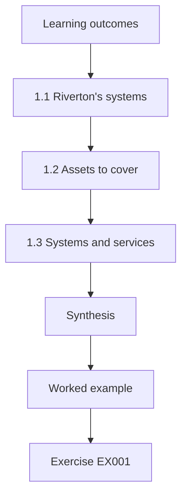

### Logical drawing


```text
[Learning outcomes]
    |
    v
[1.1 Riverton's systems]
    |
    v
[1.2 Assets to cover]
    |
    v
[1.3 Systems and services]
    |
    v
[Synthesis]
    |
    v
[Worked example] --> [Exercise EX001]
```
<!-- cyberabc:lesson-figures:end ch-01 -->


### Learning outcomes

You will (1) describe the systems a multi-site business relies on; (2) list assets that governance must cover; (3) link systems to the services they support.

### 1.1 Riverton's systems

Priya Natarajan is a technologist student at the fictional Halden Institute of Technology. Her tutor, Mr. Oskar Lind, uses one running case: the fictional Riverton Dental Group, with fourteen clinics and two hundred and fifty staff. Each clinic has reception computers, dental imaging devices and a card terminal. A cloud practice management system holds patient records and appointments. A booking website lets patients schedule visits. Priya learns that governance starts by knowing which systems exist and what each one does. With fourteen clinics, even a single unlisted device type repeated in every clinic would leave fourteen gaps at once.

### 1.2 Assets to cover

Priya lists assets by type: hardware such as reception computers and imaging devices, software such as the practice management system, data such as patient records and X-ray images, and services such as email and the booking site. For each she notes an owner and the clinics that use it. She finds that imaging devices are missing from IT's list because dentists bought them directly from suppliers. She learns that purchases outside IT create blind spots in governance. Mr. Lind asks who patches the imaging devices, and nobody at Riverton can answer, which shows why ownership must be recorded at purchase.

### 1.3 Systems and services

Priya links each system to the patient services it supports. Booking depends on the website and practice system. Treatment depends on imaging and patient records. Billing depends on card terminals and the practice system. This map shows which failures would stop clinics from treating patients, which matters most to Riverton. She learns that governance priorities should follow services that matter to customers and the business, not simply the most expensive or technically complex systems. The practice system, for instance, appears under booking, treatment and billing, so its failure would stop all three services.

### Worked example

Priya lists Riverton's systems and assets, finds imaging devices missing from IT records and maps systems to patient services.

> **Synthetic case.** Halden, Riverton and all details are synthetic.

### Errors and limits

Asset lists miss devices bought locally. Service maps simplify dependencies.

### Exercises

- **EX001 — Blind spot.** Why were imaging devices missing from IT's list? *Rubric:* 3 = dentists bought them directly from suppliers;; 2 = local purchase;; 1 = vague;; 0 = none.
- **EX002 — Asset types.** Name the four asset types Priya used. *Rubric:* 3 = hardware, software, data and services;; 2 = four;; 1 = vague;; 0 = none.
- **EX003 — Treatment dependency.** Which systems does treatment depend on? *Rubric:* 3 = imaging and patient records;; 2 = imaging;; 1 = vague;; 0 = none.

### Synthesis

Knowing systems, assets and the services they support is where governance begins.

### Continue studying — chapter 01 of 30

[← Course home](../../README.md) · [Course chapter index](../SUBJECTS.md) · [Chapter 02 (draft) →](#ch-02)

<a id="ch-02"></a>

## Chapter 2 — Networks and internet services

<!-- cyberabc:lesson-figures:start ch-02 -->
### Lesson map

Lesson 02 published. Map, example, EX004.

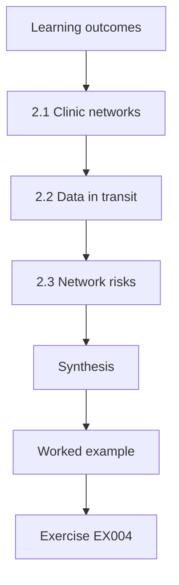

### Logical drawing


```text
[Learning outcomes]
    |
    v
[2.1 Clinic networks]
    |
    v
[2.2 Data in transit]
    |
    v
[2.3 Network risks]
    |
    v
[Synthesis]
    |
    v
[Worked example] --> [Exercise EX004]
```
<!-- cyberabc:lesson-figures:end ch-02 -->


### Learning outcomes

You will (1) describe clinic networks and cloud connections; (2) identify where sensitive data travel; (3) note network risks for governance.

### 2.1 Clinic networks

Each Riverton clinic has a small network: reception computers, imaging devices, a card terminal and guest Wi-Fi for patients. All connect through a router to the internet and to cloud services. Priya learns that card terminals should sit on a separate network segment from other devices, as PCI DSS v4.0 encourages segmentation to limit the scope of card data environments. In three clinics, the guest Wi-Fi shares the same network as reception computers, which creates unnecessary risk. Patients on the guest Wi-Fi in those three clinics can reach the same network as computers that open patient records.

### 2.2 Data in transit

Patient data travel from clinics to the cloud practice system, from imaging devices to the image archive and from reception to laboratories by email. Priya checks whether each path is encrypted. The practice system and image archive use encrypted connections. Laboratory orders sometimes go by ordinary email with patient names and treatment details. She records this as a risk and suggests the secure messaging feature that the practice system already includes but few staff use. Because the secure messaging feature is already licensed, the fix costs training time rather than money.

### 2.3 Network risks

Priya lists network risks for governance: guest Wi-Fi mixed with clinic devices, card terminals not separated, routers with default passwords in two clinics and no central view of which clinic networks match the standard design. She ranks them by impact and ease of fixing. Separating guest Wi-Fi ranks first because it is simple and reduces exposure of clinical devices. She learns that clear network standards help multi-site organisations keep clinics consistent. The default router passwords in two clinics rank close behind, since they are just as quick to change.

### Worked example

Priya maps clinic networks, finds mixed guest Wi-Fi and unencrypted lab emails and ranks network risks.

> **Synthetic case.** Clinic networks are synthetic; PCI DSS v4.0 is real.

### Errors and limits

Site surveys can miss changes. Encryption checks need technical confirmation.

### Exercises

- **EX004 — Card terminal placement.** Where should card terminals sit? *Rubric:* 3 = on a separate network segment;; 2 = segment;; 1 = guest Wi-Fi;; 0 = none.
- **EX005 — Unencrypted path.** Which data path was not always encrypted? *Rubric:* 3 = laboratory orders by ordinary email;; 2 = lab email;; 1 = vague;; 0 = none.
- **EX006 — Top network fix.** Which fix ranked first? *Rubric:* 3 = separating guest Wi-Fi from clinic devices;; 2 = guest Wi-Fi;; 1 = vague;; 0 = none.

### Synthesis

Network maps reveal where data travel unprotected and where segmentation is needed.

### Continue studying — chapter 02 of 30

[← Chapter 01 (draft)](#ch-01) · [Course chapter index](../SUBJECTS.md) · [Chapter 03 (draft) →](#ch-03)

<a id="ch-03"></a>

## Chapter 3 — Programming foundations

<!-- cyberabc:lesson-figures:start ch-03 -->
### Lesson map

Lesson 03 published. Map, example, EX007.

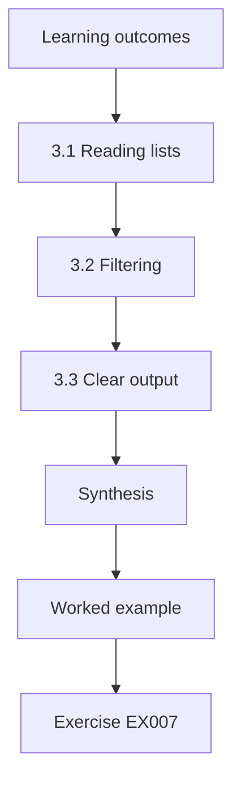

### Logical drawing


```text
[Learning outcomes]
    |
    v
[3.1 Reading lists]
    |
    v
[3.2 Filtering]
    |
    v
[3.3 Clear output]
    |
    v
[Synthesis]
    |
    v
[Worked example] --> [Exercise EX007]
```
<!-- cyberabc:lesson-figures:end ch-03 -->


### Learning outcomes

You will (1) write small scripts that read governance lists; (2) count and filter entries; (3) print clear results for managers.

### 3.1 Reading lists

Priya writes her first Python script to read Riverton's asset list from a CSV file. It counts assets per clinic and lists those without an owner. She learns to use lists, loops and conditions, and to handle a missing value without crashing. Mr. Lind explains that scripts make governance checks repeatable: the same list checked next month will be checked the same way, which manual counting cannot guarantee when staff are busy. When a new clinic is added to the CSV, the script counts it without any change to the code.

### 3.2 Filtering

Priya filters assets holding patient data that lack an owner, and those whose last update date is more than a year old. The script prints each with its clinic. Two imaging devices and one old reception computer appear. She learns that combining conditions focuses attention on the riskiest gaps. Filtering by sensitivity and age helps managers decide what to fix first, rather than receiving a long list without priorities. An imaging device holding patient images with no owner and no update for a year is exactly what the combined filter is meant to catch.

### 3.3 Clear output

Mr. Lind reviews Priya's output and asks whether a clinic manager would understand it. She adds headings, the date of the check and a short explanation of each problem. She also sorts results by clinic so each manager sees their own items. She learns that output is part of the control: unclear results get ignored, while clear, sorted results with explanations prompt action from the people responsible. Sorting by clinic means each of the fourteen clinic managers can find their own items in seconds.

### Worked example

Priya scripts counts and filters over the asset list and rewrites output sorted by clinic with explanations.

> **Synthetic case.** The asset list is synthetic.

### Errors and limits

Scripts depend on accurate input. Old dates may be data errors.

### Exercises

- **EX007 — Repeatability.** Why are scripts better than manual counting for repeated checks? *Rubric:* 3 = the same check runs the same way each time;; 2 = repeatable;; 1 = vague;; 0 = none.
- **EX008 — Filter conditions.** Which two conditions did Priya combine? *Rubric:* 3 = patient data without owner, or not updated for over a year;; 2 = sensitivity and age;; 1 = vague;; 0 = none.
- **EX009 — Output change.** How did Priya improve the output? *Rubric:* 3 = headings, date, explanations, sorted by clinic;; 2 = clarity;; 1 = vague;; 0 = none.

### Synthesis

Simple scripts with clear output make governance checks repeatable and actionable.

### Continue studying — chapter 03 of 30

[← Chapter 02 (draft)](#ch-02) · [Course chapter index](../SUBJECTS.md) · [Chapter 04 (draft) →](#ch-04)

<a id="ch-04"></a>

## Chapter 4 — Data models

<!-- cyberabc:lesson-figures:start ch-04 -->
### Lesson map

Lesson 04 published. Map, example, EX010.

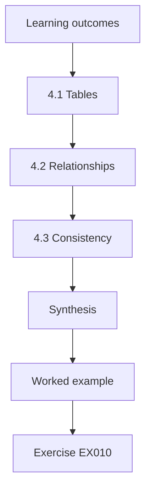

### Logical drawing


```text
[Learning outcomes]
    |
    v
[4.1 Tables]
    |
    v
[4.2 Relationships]
    |
    v
[4.3 Consistency]
    |
    v
[Synthesis]
    |
    v
[Worked example] --> [Exercise EX010]
```
<!-- cyberabc:lesson-figures:end ch-04 -->


### Learning outcomes

You will (1) model governance data as related tables; (2) define keys and relationships; (3) avoid duplication and inconsistency.

### 4.1 Tables

Priya designs tables for Riverton's governance data: clinics, assets, owners, risks and controls. Each table has a key: a clinic code, an asset tag, an owner's staff number. Separate tables avoid repeating the same information many times, such as a clinic's address on every asset row. She learns that well-structured data make it easier to answer questions and harder to introduce errors when information changes. If a clinic moves, for example, its address changes in one row of the clinics table rather than on every asset row.

### 4.2 Relationships

Assets belong to clinics, owners are responsible for assets, risks affect assets and controls treat risks. Priya draws these relationships. She finds that one control, encrypted laptops, treats several risks, and one risk, ransomware, affects many assets. She learns that many-to-many relationships need linking tables. Getting relationships right lets Riverton answer questions like which risks depend on a control that failed, which is important for audits. A linking table between controls and risks, for instance, lets one encryption test update the status of every risk it treats.

### 4.3 Consistency

In the old spreadsheet, the same clinic appears as North, North Clinic and N. Priya standardises names using codes and adds validation rules so only valid codes can be entered. She learns that inconsistency is a common source of reporting errors: counts per clinic were wrong because the same clinic was spelled differently. Simple data rules prevent problems that would otherwise appear in board reports and audit findings. Mr. Lind points out that the three spellings of North had made that clinic appear smaller than it was in every per-clinic count.

### Worked example

Priya models governance data in related tables with keys, uses linking tables for many-to-many relationships and standardises clinic codes.

> **Synthetic case.** The data model is synthetic.

### Errors and limits

Models need maintenance. Codes can be mistyped too.

### Exercises

- **EX010 — Key example.** Give one key used in Priya's tables. *Rubric:* 3 = clinic code, asset tag or staff number;; 2 = key;; 1 = vague;; 0 = none.
- **EX011 — Linking tables.** When are linking tables needed? *Rubric:* 3 = for many-to-many relationships;; 2 = many-to-many;; 1 = vague;; 0 = none.
- **EX012 — Clinic names.** What problem did inconsistent clinic names cause? *Rubric:* 3 = wrong counts per clinic;; 2 = miscounts;; 1 = vague;; 0 = none.

### Synthesis

Related tables with keys and validation keep governance data consistent.

### Continue studying — chapter 04 of 30

[← Chapter 03 (draft)](#ch-03) · [Course chapter index](../SUBJECTS.md) · [Chapter 05 (draft) →](#ch-05)

<a id="ch-05"></a>

## Chapter 5 — Security literacy

<!-- cyberabc:lesson-figures:start ch-05 -->
### Lesson map

Lesson 05 published. Map, example, EX013.

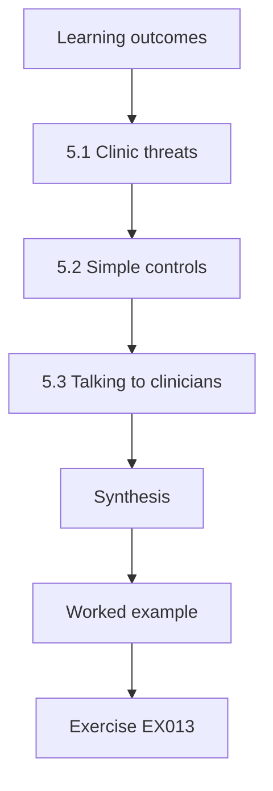

### Logical drawing


```text
[Learning outcomes]
    |
    v
[5.1 Clinic threats]
    |
    v
[5.2 Simple controls]
    |
    v
[5.3 Talking to clinicians]
    |
    v
[Synthesis]
    |
    v
[Worked example] --> [Exercise EX013]
```
<!-- cyberabc:lesson-figures:end ch-05 -->


### Learning outcomes

You will (1) explain common threats to dental clinics; (2) link threats to simple controls; (3) communicate security clearly to clinical staff.

### 5.1 Clinic threats

Priya learns the threats most relevant to Riverton: phishing emails aimed at reception staff, ransomware that could stop clinics, misdirected patient information, lost laptops and fraud through fake supplier invoices. Healthcare data are valuable and clinics are busy, so mistakes happen under time pressure. She notes that understanding everyday threats helps Riverton spend limited effort on controls that prevent the most common harm rather than rare scenarios. Fake supplier invoices, for example, target the finance process rather than clinicians, so their controls sit elsewhere.

### 5.2 Simple controls

For each threat Priya lists simple controls: multi-factor authentication for email, offline backups of the practice system and image archive, secure messaging for patient information, laptop encryption and a callback check for changed supplier bank details. She notes that most controls are already available in Riverton's systems but not consistently switched on. She learns that governance often means ensuring existing features are used rather than buying new tools. Turning on the callback check for changed supplier bank details, for instance, needs a procedure, not a purchase.

### 5.3 Talking to clinicians

Priya prepares a ten-minute talk for clinic staff. She uses examples from dental practice, avoids jargon and explains how each control protects patients. She encourages staff to report mistakes quickly, explaining that a misdirected email reported in minutes can often be recalled. She learns that clinicians respond to patient safety arguments and that respectful, practical messages work better than fear or blame. Framing laptop encryption as protecting patient confidentiality, for example, speaks to what clinicians already care about. She ends the talk by showing staff exactly how to report a mistake.

### Worked example

Priya identifies five clinic threats, maps them to existing controls and gives a practical, patient-focused talk.

> **Synthetic case.** Threats and talk are synthetic.

### Errors and limits

Talks fade without reinforcement. Features need configuration.

### Exercises

- **EX013 — Fraud control.** Which control addresses fake supplier invoices? *Rubric:* 3 = callback check for changed bank details;; 2 = callback;; 1 = vague;; 0 = none.
- **EX014 — Existing features.** What governance gap did Priya find with controls? *Rubric:* 3 = features available but not consistently switched on;; 2 = unused features;; 1 = vague;; 0 = none.
- **EX015 — Clinician argument.** Which argument works best with clinicians? *Rubric:* 3 = patient safety;; 2 = patients;; 1 = fear;; 0 = none.

### Synthesis

Security literacy ties common threats to simple, existing controls and respectful communication.

### Continue studying — chapter 05 of 30

[← Chapter 04 (draft)](#ch-04) · [Course chapter index](../SUBJECTS.md) · [Chapter 06 (draft) →](#ch-06)

<a id="ch-06"></a>

## Chapter 6 — Operating systems and virtualization

<!-- cyberabc:lesson-figures:start ch-06 -->
### Lesson map

Lesson 06 published. Map, example, EX016.

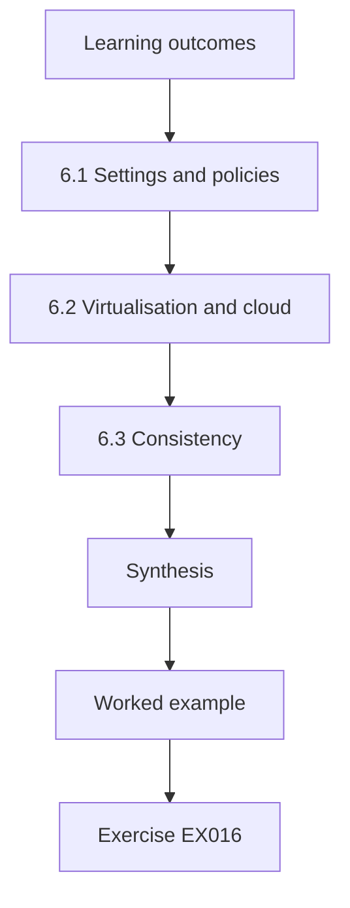

### Logical drawing


```text
[Learning outcomes]
    |
    v
[6.1 Settings and policies]
    |
    v
[6.2 Virtualisation and cloud]
    |
    v
[6.3 Consistency]
    |
    v
[Synthesis]
    |
    v
[Worked example] --> [Exercise EX016]
```
<!-- cyberabc:lesson-figures:end ch-06 -->


### Learning outcomes

You will (1) relate operating system settings to Riverton's policies; (2) understand virtual machines and cloud hosting; (3) check configuration consistency across clinics.

### 6.1 Settings and policies

Riverton's policy requires screen locks, automatic updates, encryption and no local administrator rights on reception computers. Priya learns how each requirement maps to operating system settings managed centrally through device management. She also learns that imaging devices often run older operating systems that suppliers control, so they cannot follow the same settings. These exceptions need separate treatment, such as network isolation, recorded in the risk register. Isolating imaging devices on their own segment lets them keep supplier-controlled software while limiting what can reach them.

### 6.2 Virtualisation and cloud

The practice management system runs on virtual machines hosted by a cloud provider. Priya learns that virtualisation lets many systems share hardware, while the provider manages the physical layer. Governance must therefore define which security tasks belong to the provider and which belong to Riverton. Under a shared responsibility model, the provider secures the infrastructure, while Riverton controls user access and configuration. She notes that misunderstandings about this division are common sources of gaps. User access to the practice system, for example, stays Riverton's job even though the provider runs the servers.

### 6.3 Consistency

Priya compares settings across fourteen clinics using the device management report. Eleven clinics match the baseline. Three have reception computers with screen locks disabled because staff found them inconvenient at busy times. She suggests a longer timeout with a quick unlock method rather than no lock at all. She learns that inconsistency often reflects real usability problems, and that adjusting the control can achieve compliance without fighting clinic staff. A longer timeout with quick unlock keeps a lock in place in the three busy clinics instead of none at all.

### Worked example

Priya maps policy to settings, isolates supplier-managed imaging devices, clarifies cloud responsibilities and fixes screen lock inconsistencies with a usable compromise.

> **Synthetic case.** Settings and clinics are synthetic.

### Errors and limits

Reports may lag reality. Shared responsibility terms vary by provider.

### Exercises

- **EX016 — Imaging exception.** How should imaging devices on old operating systems be treated? *Rubric:* 3 = network isolation recorded in the risk register;; 2 = isolation;; 1 = vague;; 0 = none.
- **EX017 — Provider duty.** Under shared responsibility, what does Riverton control? *Rubric:* 3 = user access and configuration;; 2 = access;; 1 = infrastructure;; 0 = none.
- **EX018 — Screen lock fix.** What did Priya suggest instead of disabled screen locks? *Rubric:* 3 = longer timeout with quick unlock;; 2 = usable compromise;; 1 = vague;; 0 = none.

### Synthesis

Settings enforce policy, but exceptions and shared responsibilities need explicit governance.

### Continue studying — chapter 06 of 30

[← Chapter 05 (draft)](#ch-05) · [Course chapter index](../SUBJECTS.md) · [Chapter 07 (draft) →](#ch-07)

<a id="ch-07"></a>

## Chapter 7 — Identity and access foundations

<!-- cyberabc:lesson-figures:start ch-07 -->
### Lesson map

Lesson 07 published. Map, example, EX019.

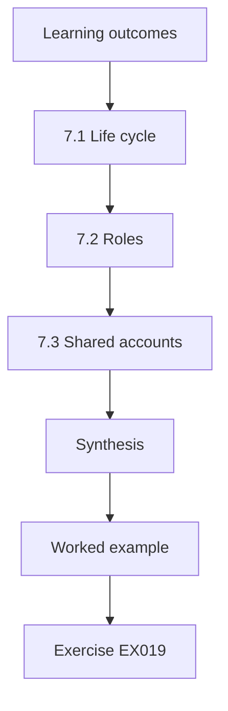

### Logical drawing


```text
[Learning outcomes]
    |
    v
[7.1 Life cycle]
    |
    v
[7.2 Roles]
    |
    v
[7.3 Shared accounts]
    |
    v
[Synthesis]
    |
    v
[Worked example] --> [Exercise EX019]
```
<!-- cyberabc:lesson-figures:end ch-07 -->


### Learning outcomes

You will (1) manage accounts through staff life-cycle events; (2) apply role-based access; (3) handle shared accounts.

### 7.1 Life cycle

Dental clinics employ many part-time and temporary staff. Priya maps how Riverton creates, changes and removes accounts. New staff receive accounts quickly, but locum dentists and temporary nurses often keep access after their last shift because clinic managers forget to tell IT. She proposes that temporary accounts be created with an end date that disables them automatically, and that managers confirm extensions. This reduces reliance on memory. An end date set at creation means a locum's access lapses even when nobody remembers to tell IT.

### 7.2 Roles

Priya defines roles for the practice system: receptionist, dental nurse, dentist, hygienist and clinic manager. Each role has the access needed for its tasks. Receptionists can see appointments and contact details but not clinical notes. Dentists can see full records for their patients. She learns that role-based access simplifies governance because reviews check role assignments rather than hundreds of individual permissions, making them faster and more accurate. Mr. Lind notes that keeping clinical notes out of the receptionist role also reduces how many staff could leak them by mistake.

### 7.3 Shared accounts

Some clinics use a shared reception account so staff can switch quickly. Priya explains that shared accounts make it impossible to know who did what, which matters for patient record audits. She suggests quick user switching with individual accounts and short sign-in using badges. Clinics agree to try it in two sites first. She learns that removing shared accounts requires a usable alternative, or staff will recreate them. Starting with two sites lets the badge sign-in be tested at busy reception desks before all fourteen clinics adopt it.

### Worked example

Priya adds automatic end dates for temporary accounts, defines five practice-system roles and pilots individual quick sign-in instead of shared accounts.

> **Synthetic case.** Roles and processes are synthetic.

### Errors and limits

End dates can cut off needed access. Badge systems cost money.

### Exercises

- **EX019 — Temporary fix.** How are temporary accounts controlled? *Rubric:* 3 = created with an end date that disables them automatically;; 2 = expiry;; 1 = vague;; 0 = none.
- **EX020 — Receptionist access.** What can receptionists not see? *Rubric:* 3 = clinical notes;; 2 = notes;; 1 = appointments;; 0 = none.
- **EX021 — Shared account problem.** Why are shared reception accounts a problem? *Rubric:* 3 = impossible to know who did what;; 2 = accountability;; 1 = vague;; 0 = none.

### Synthesis

Identity governance handles temporary staff, role-based access and usable alternatives to shared accounts.

### Continue studying — chapter 07 of 30

[← Chapter 06 (draft)](#ch-06) · [Course chapter index](../SUBJECTS.md) · [Chapter 08 (draft) →](#ch-08)

<a id="ch-08"></a>

## Chapter 8 — Security architecture basics

<!-- cyberabc:lesson-figures:start ch-08 -->
### Lesson map

Lesson 08 published. Map, example, EX022.

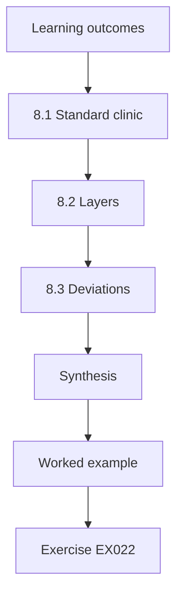

### Logical drawing


```text
[Learning outcomes]
    |
    v
[8.1 Standard clinic]
    |
    v
[8.2 Layers]
    |
    v
[8.3 Deviations]
    |
    v
[Synthesis]
    |
    v
[Worked example] --> [Exercise EX022]
```
<!-- cyberabc:lesson-figures:end ch-08 -->


### Learning outcomes

You will (1) describe a standard secure clinic design; (2) apply layered protection; (3) record deviations from the standard.

### 8.1 Standard clinic

Priya helps draft a standard design for Riverton clinics: separate network segments for clinical devices, reception, card terminals and guest Wi-Fi; managed and encrypted computers; individual accounts with multi-factor authentication for cloud services; and offline backups of the image archive. A standard design makes clinics easier to support and audit, because every clinic should look the same and differences stand out. Because every clinic should match, a guest Wi-Fi linked to reception computers in one clinic becomes an obvious exception to fix.

### 8.2 Layers

Priya applies layered protection to ransomware. Email filtering blocks many attacks. Multi-factor authentication stops stolen passwords being reused. Device controls limit unknown software. Network segments limit spread from reception to imaging. Offline backups allow recovery. She learns that each layer catches some of what the others miss, and that a clinic with all layers is far more resilient than one relying on a single strong control. Network segments between reception and imaging matter most when email filtering and authentication have already been bypassed.

### 8.3 Deviations

Two clinics in old buildings cannot install separate network cabling soon. Priya records each deviation in a register: what differs, why, the risk and compensating measures, such as wireless segmentation, plus a date for review. She learns that recording deviations keeps them visible and managed. Without a register, exceptions spread quietly until the standard exists only on paper, which auditors quickly discover. Wireless segmentation in the two old buildings, for example, gives partial separation until cabling can be installed. Each review date forces a decision on whether cabling can now be installed.

### Worked example

Priya drafts a standard clinic design with four segments, layers ransomware defences and records two building-related deviations.

> **Synthetic case.** The design is synthetic.

### Errors and limits

Standards lag new devices. Compensating measures may be weaker.

### Exercises

- **EX022 — Four segments.** Which four network segments does the standard define? *Rubric:* 3 = clinical devices, reception, card terminals, guest Wi-Fi;; 2 = four;; 1 = vague;; 0 = none.
- **EX023 — Standard benefit.** Why does a standard design help audits? *Rubric:* 3 = differences between clinics stand out;; 2 = consistency;; 1 = vague;; 0 = none.
- **EX024 — Deviation record.** What does each deviation record include? *Rubric:* 3 = difference, reason, risk, compensating measures and review date;; 2 = record;; 1 = vague;; 0 = none.

### Synthesis

Standard designs with layered protection and a deviation register keep multi-site security consistent.

### Continue studying — chapter 08 of 30

[← Chapter 07 (draft)](#ch-07) · [Course chapter index](../SUBJECTS.md) · [Chapter 09 (draft) →](#ch-09)

<a id="ch-09"></a>

## Chapter 9 — Evidence and measurement

<!-- cyberabc:lesson-figures:start ch-09 -->
### Lesson map

Lesson 09 published. Map, example, EX025.

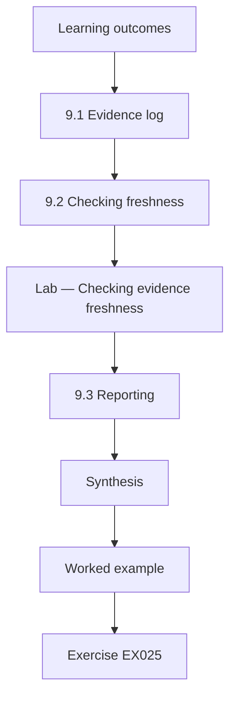

### Logical drawing

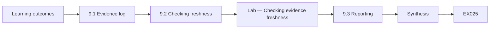

```text
[Learning outcomes]
    |
    v
[9.1 Evidence log]
    |
    v
[9.2 Checking freshness]
    |
    v
[Lab — Checking evidence freshness]
    |
    v
[9.3 Reporting]
    |
    v
[Synthesis]
    |
    v
[Worked example] --> [Exercise EX025]
```
<!-- cyberabc:lesson-figures:end ch-09 -->


### Learning outcomes

You will (1) keep an evidence log for controls; (2) check evidence freshness; (3) report stale evidence.

### 9.1 Evidence log

Riverton collects evidence that controls work: backup restore tests, access reviews, firewall reviews, policy acknowledgements, supplier assurance reports and encryption reports. Priya builds a log recording each item, its date and the maximum age allowed before it must be refreshed. She learns that evidence has a shelf life: a backup test from last year says little about whether backups work today, so freshness rules matter as much as the evidence itself. Each item's maximum age becomes the rule applied in the freshness check that follows.

### 9.2 Checking freshness

The lab checks six items against their limits on the last day of September. Three are stale. The second-quarter access review is ninety-four days old against a ninety-day limit. The firewall rule review is two hundred and thirty-two days old against one hundred and eighty. The supplier SOC 2 report is four hundred and fifty-seven days old against a year. The backup test, policy acknowledgements and encryption report are fresh. Priya notes that the access review is only slightly late. Four days over ninety needs a reminder, while the SOC 2 report at four hundred and fifty-seven days needs escalation.

### Lab — Checking evidence freshness

```python
"""Evidence freshness: items older than their allowed age (synthetic Riverton evidence log)."""
from datetime import date
today = date(2026, 9, 30)
log = [("backup restore test", date(2026, 7, 2), 90), ("access review Q2", date(2026, 6, 28), 90),
       ("firewall rule review", date(2026, 2, 10), 180), ("policy acknowledgement", date(2025, 11, 1), 365),
       ("vendor SOC 2 report", date(2025, 6, 30), 365), ("encryption report", date(2026, 9, 15), 30)]
stale = [(n, (today - d).days, m) for n, d, m in log if (today - d).days > m]
for n, age, m in stale: print(f"STALE {n}: {age} days old, limit {m}")
print(f"items {len(log)}; stale {len(stale)}; fresh {len(log) - len(stale)}")
```

Run with `python3 lab_fresh.py`. Verified output:

```text
STALE access review Q2: 94 days old, limit 90
STALE firewall rule review: 232 days old, limit 180
STALE vendor SOC 2 report: 457 days old, limit 365
items 6; stale 3; fresh 3
```

### 9.3 Reporting

Priya reports stale items with their owners and how overdue each is. She treats the supplier report as most serious because it concerns the practice system provider, which holds all patient records. She requests the latest report from the provider. She learns that measuring evidence freshness turns an assurance file into a living control, and that small delays deserve a reminder while long gaps need escalation. Asking the provider for the latest report also tests whether the contract gives Riverton the right to receive it.

### Worked example

Priya builds an evidence log with freshness limits, finds three stale items and escalates the old supplier report.

> **Synthetic case.** Evidence items are synthetic.

### Errors and limits

Fresh evidence can still be weak. Limits are judgement calls.

### Exercises

- **EX025 — Shelf life.** Why does evidence have a shelf life? *Rubric:* 3 = old tests say little about current control operation;; 2 = freshness;; 1 = vague;; 0 = none.
- **EX026 — Stale count.** How many of six items were stale? *Rubric:* 3 = three;; 2 = 3;; 1 = vague;; 0 = none.
- **EX027 — Most serious.** Which stale item was most serious and why? *Rubric:* 3 = the supplier SOC 2 report, as the provider holds all patient records;; 2 = supplier;; 1 = access review;; 0 = none.

### Synthesis

Evidence freshness rules keep assurance current and highlight what needs refreshing.

### Continue studying — chapter 09 of 30

[← Chapter 08 (draft)](#ch-08) · [Course chapter index](../SUBJECTS.md) · [Chapter 10 (draft) →](#ch-10)

<a id="ch-10"></a>

## Chapter 10 — Security governance, risk and compliance: orientation

<!-- cyberabc:lesson-figures:start ch-10 -->
### Lesson map

Lesson 10 published. Map, example, EX028.

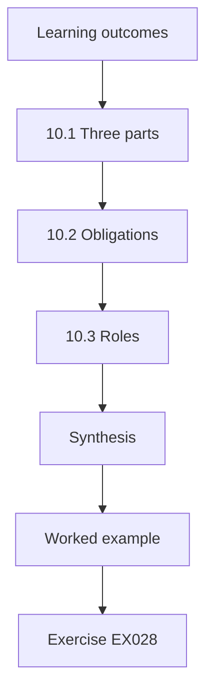

### Logical drawing


```text
[Learning outcomes]
    |
    v
[10.1 Three parts]
    |
    v
[10.2 Obligations]
    |
    v
[10.3 Roles]
    |
    v
[Synthesis]
    |
    v
[Worked example] --> [Exercise EX028]
```
<!-- cyberabc:lesson-figures:end ch-10 -->


### Learning outcomes

You will (1) explain governance, risk management and compliance in a clinic group; (2) identify Riverton's obligations; (3) describe the roles involved.

### 10.1 Three parts

Priya begins the GRC courses. Governance means Riverton's leaders set direction and check progress: they decide what risks are acceptable and who is responsible. Risk management means finding, assessing and treating risks in a structured way, following principles such as those in ISO 31000:2018. Compliance means meeting obligations from health data law, card payment rules and contracts. She learns that the three parts must work together for security to be managed rather than improvised. At Riverton, for example, the managing director deciding acceptable risk is governance, while checking PCI DSS obligations is compliance.

### 10.2 Obligations

Priya lists Riverton's obligations: data protection law covering patient records, health sector confidentiality rules, PCI DSS v4.0 for card payments through its bank, and contracts with the practice system provider and dental laboratories. She separates legal duties from contractual ones and from voluntary standards Riverton may adopt, such as aligning with NIST CSF 2.0. She learns that knowing where an obligation comes from helps determine its priority and who must be involved. Mr. Lind adds that the laboratory contracts belong in this list too, since two laboratories later turn out to have no written agreement.

### 10.3 Roles

Riverton's managing director is accountable for risk. An operations manager coordinates security with a small IT team and an external support provider. Clinic managers own local controls, such as access for their staff. A data protection officer advises on patient data. Priya draws a simple chart of these roles and notes that the external provider's responsibilities are not written down anywhere. She recommends clarifying them in the contract. Unwritten provider duties mean, for example, that nobody can say whether the support provider must patch clinic routers.

### Worked example

Priya explains the three GRC parts, lists Riverton's obligations by source and finds the support provider's responsibilities undocumented.

> **Synthetic case.** Riverton's structure is synthetic; ISO 31000:2018, PCI DSS v4.0 and CSF 2.0 are real.

### Errors and limits

Legal obligations need professional advice. Roles change with growth.

### Exercises

- **EX028 — Compliance meaning.** What does compliance mean for Riverton? *Rubric:* 3 = meeting obligations from law, card rules and contracts;; 2 = obligations;; 1 = vague;; 0 = none.
- **EX029 — Obligation source.** Why does the source of an obligation matter? *Rubric:* 3 = it determines priority and who is involved;; 2 = priority;; 1 = vague;; 0 = none.
- **EX030 — Undocumented role.** Whose responsibilities were not written down? *Rubric:* 3 = the external support provider's;; 2 = provider;; 1 = vague;; 0 = none.

### Synthesis

GRC orientation connects direction, risk management and obligations through clear roles.

### Continue studying — chapter 10 of 30

[← Chapter 09 (draft)](#ch-09) · [Course chapter index](../SUBJECTS.md) · [Chapter 11 (draft) →](#ch-11)

<a id="ch-11"></a>

## Chapter 11 — Security governance, risk and compliance: assets and context

<!-- cyberabc:lesson-figures:start ch-11 -->
### Lesson map

Lesson 11 published. Map, example, EX031.

```mermaid
flowchart TD
  N0["Learning outcomes"]
  N1["11.1 Context"]
  N2["11.2 Classification"]
  N3["11.3 Risk criteria"]
  N4["Synthesis"]
  N0 --> N1 --> N2 --> N3 --> N4
  N4 --> EX["Worked example"]
  EX --> Q["Exercise EX031"]
```

### Logical drawing

```mermaid
flowchart LR
  N0["Learning outcomes"]
  N1["11.1 Context"]
  N2["11.2 Classification"]
  N3["11.3 Risk criteria"]
  N4["Synthesis"]
  N0 --> N1 --> N2 --> N3 --> N4 --> Q["EX031"]
```

```text
[Learning outcomes]
    |
    v
[11.1 Context]
    |
    v
[11.2 Classification]
    |
    v
[11.3 Risk criteria]
    |
    v
[Synthesis]
    |
    v
[Worked example] --> [Exercise EX031]
```
<!-- cyberabc:lesson-figures:end ch-11 -->


### Learning outcomes

You will (1) set the context for risk assessment; (2) classify information assets; (3) define risk criteria with management.

### 11.1 Context

Before assessing risks, Priya documents Riverton's context: its services, patients, regulators, suppliers, growth plans and attitude to risk. ISO 31000:2018 begins its process with establishing scope, context and criteria. The managing director explains that Riverton plans to open three new clinics next year and that reputation with patients is its greatest asset. These facts shape which risks matter most and how much disruption Riverton can accept. Three new clinics next year means the standard clinic design must be ready before they open.

### 11.2 Classification

Priya classifies information into three levels: public, such as opening hours; internal, such as staff rotas; and confidential, such as patient records and images. Each level has handling rules for storage, sharing and disposal. Patient records require encryption and secure messaging; internal data stay within Riverton's systems. She learns that simple classifications are more likely to be followed than complex schemes with many levels that staff cannot remember. X-ray images fall under confidential, so they inherit the encryption and secure messaging rules automatically.

### 11.3 Risk criteria

With management, Priya defines criteria for likelihood and impact. Impact levels describe effects on patients, finances, regulators and reputation. For example, a major impact means clinics closed for more than a day or a reportable data breach affecting many patients. Likelihood levels use frequency ranges. She learns that agreed criteria make assessments consistent across assessors, and that defining them with management ensures they reflect Riverton's real priorities. Defining a major impact as clinics closed for more than a day, for instance, lets two assessors score the same ransomware scenario alike.

### Worked example

Priya documents Riverton's context, sets three classification levels and agrees impact and likelihood criteria with management.

> **Synthetic case.** Riverton's context and criteria are synthetic; ISO 31000:2018 is real.

### Errors and limits

Criteria involve judgement. Classifications are misapplied.

### Exercises

- **EX031 — Growth fact.** Which planned change affects Riverton's context? *Rubric:* 3 = three new clinics next year;; 2 = growth;; 1 = vague;; 0 = none.
- **EX032 — Classification levels.** What are the three classification levels? *Rubric:* 3 = public, internal, confidential;; 2 = three;; 1 = vague;; 0 = none.
- **EX033 — Major impact.** Give the example of a major impact. *Rubric:* 3 = clinics closed over a day or reportable breach affecting many patients;; 2 = major;; 1 = vague;; 0 = none.

### Synthesis

Context, classification and agreed criteria make risk assessments consistent and relevant.

### Continue studying — chapter 11 of 30

[← Chapter 10 (draft)](#ch-10) · [Course chapter index](../SUBJECTS.md) · [Chapter 12 (draft) →](#ch-12)

<a id="ch-12"></a>

## Chapter 12 — Security governance, risk and compliance: data flows

<!-- cyberabc:lesson-figures:start ch-12 -->
### Lesson map

Lesson 12 published. Map, example, EX034.

```mermaid
flowchart TD
  N0["Learning outcomes"]
  N1["12.1 Mapping flows"]
  N2["12.2 Third parties"]
  N3["12.3 Flow risks"]
  N4["Synthesis"]
  N0 --> N1 --> N2 --> N3 --> N4
  N4 --> EX["Worked example"]
  EX --> Q["Exercise EX034"]
```

### Logical drawing

```mermaid
flowchart LR
  N0["Learning outcomes"]
  N1["12.1 Mapping flows"]
  N2["12.2 Third parties"]
  N3["12.3 Flow risks"]
  N4["Synthesis"]
  N0 --> N1 --> N2 --> N3 --> N4 --> Q["EX034"]
```

```text
[Learning outcomes]
    |
    v
[12.1 Mapping flows]
    |
    v
[12.2 Third parties]
    |
    v
[12.3 Flow risks]
    |
    v
[Synthesis]
    |
    v
[Worked example] --> [Exercise EX034]
```
<!-- cyberabc:lesson-figures:end ch-12 -->


### Learning outcomes

You will (1) map flows of patient data; (2) identify third parties receiving data; (3) assess risks in each flow.

### 12.1 Mapping flows

Priya maps how patient data move: from patients via the booking site to the practice system, from clinics to the image archive, from dentists to laboratories, from reception to insurers for claims and from the practice system to backups. For each flow she records the data involved, the method and the recipient. The map shows eleven flows, three of which involve external parties beyond the practice system provider. The three external flows to laboratories, insurers and the booking site provider are examined in the next section.

### 12.2 Third parties

Laboratories, insurers and the booking site provider receive patient data. Priya checks whether each has a contract with data protection terms. Two laboratories have no written agreement. She recommends standard terms covering confidentiality, security and breach notification. She learns that third parties are often the weakest link in data flows because organisations assume suppliers protect data without checking. Standard terms for the two laboratories without agreements would also give Riverton a contractual right to be told of breaches. She also asks the booking site provider to confirm its own breach notification terms.

### 12.3 Flow risks

For each flow, Priya notes risks: misdirected laboratory emails, insurers receiving more data than needed and the booking site collecting medical history it does not need. She recommends reducing data at each step, using secure messaging and reviewing what the booking form asks. She learns that data flow analysis reveals risks invisible in an asset list, since harm often occurs while data move between systems and organisations. The booking form collecting medical history it does not need, for instance, can be fixed simply by removing fields.

### Worked example

Priya maps eleven patient data flows, finds two laboratories without agreements and recommends data reduction at each step.

> **Synthetic case.** Flows and parties are synthetic.

### Errors and limits

Maps miss informal flows such as phone photos. Contracts do not guarantee practice.

### Exercises

- **EX034 — Flow count.** How many data flows did Priya map? *Rubric:* 3 = eleven;; 2 = 11;; 1 = vague;; 0 = none.
- **EX035 — Missing agreements.** Which parties lacked written agreements? *Rubric:* 3 = two laboratories;; 2 = labs;; 1 = insurers;; 0 = none.
- **EX036 — Booking form issue.** What was wrong with the booking site? *Rubric:* 3 = it collected medical history it did not need;; 2 = excess data;; 1 = vague;; 0 = none.

### Synthesis

Data flow maps reveal third-party and minimisation risks that asset lists miss.

### Continue studying — chapter 12 of 30

[← Chapter 11 (draft)](#ch-11) · [Course chapter index](../SUBJECTS.md) · [Chapter 13 (draft) →](#ch-13)

<a id="ch-13"></a>

## Chapter 13 — Security governance, risk and compliance: risk scenarios

<!-- cyberabc:lesson-figures:start ch-13 -->
### Lesson map

Lesson 13 published. Map, example, EX037.

```mermaid
flowchart TD
  N0["Learning outcomes"]
  N1["13.1 Writing scenarios"]
  N2["13.2 Causes and consequences"]
  N3["13.3 Choosing scenarios"]
  N4["Synthesis"]
  N0 --> N1 --> N2 --> N3 --> N4
  N4 --> EX["Worked example"]
  EX --> Q["Exercise EX037"]
```

### Logical drawing

```mermaid
flowchart LR
  N0["Learning outcomes"]
  N1["13.1 Writing scenarios"]
  N2["13.2 Causes and consequences"]
  N3["13.3 Choosing scenarios"]
  N4["Synthesis"]
  N0 --> N1 --> N2 --> N3 --> N4 --> Q["EX037"]
```

```text
[Learning outcomes]
    |
    v
[13.1 Writing scenarios]
    |
    v
[13.2 Causes and consequences]
    |
    v
[13.3 Choosing scenarios]
    |
    v
[Synthesis]
    |
    v
[Worked example] --> [Exercise EX037]
```
<!-- cyberabc:lesson-figures:end ch-13 -->


### Learning outcomes

You will (1) write risk scenarios for Riverton; (2) identify causes and consequences; (3) choose scenarios for detailed analysis.

### 13.1 Writing scenarios

Priya writes risk scenarios as short stories with a cause, an event and consequences. Ransomware encrypts a clinic's reception computers and spreads to the image archive, stopping treatment for days. A receptionist sends a patient's records to the wrong laboratory. A malicious script on the booking site captures card details. A laptop with unencrypted patient lists is stolen from a car. She learns that scenarios help managers imagine risks concretely and judge them sensibly. The stolen laptop story, for example, points straight to encryption as the control that would change its outcome.

### 13.2 Causes and consequences

For each scenario Priya lists causes, such as phishing or missing segmentation, and consequences for patients, finances, regulators and reputation. For the ransomware scenario, consequences include cancelled appointments, lost income, notification to the regulator if records were affected and patient complaints. She learns that listing causes points to preventive controls, while listing consequences points to recovery and response planning. In the ransomware scenario, phishing as a cause points to email controls, while cancelled appointments point to recovery planning. For misdirected records, the cause is often a hurried choice of recipient at reception.

### 13.3 Choosing scenarios

With the operations manager, Priya chooses four scenarios for detailed analysis based on likely impact and management concern: ransomware at a clinic, misdirected patient records, card skimming on the booking site and lost laptops. Other scenarios are recorded for later review. She learns that analysis effort should focus on scenarios that matter most, and that a short, well-chosen list is more useful than a long list nobody analyses. Recording the other scenarios keeps them on the register for the next review rather than discarding them.

### Worked example

Priya writes four scenarios with causes and consequences and selects them for detailed analysis.

> **Synthetic case.** Scenarios are synthetic.

### Errors and limits

Scenarios reflect imagination limits. Selection involves judgement.

### Exercises

- **EX037 — Scenario structure.** What three parts does each scenario contain? *Rubric:* 3 = cause, event and consequences;; 2 = three;; 1 = vague;; 0 = none.
- **EX038 — Causes use.** What do listed causes point to? *Rubric:* 3 = preventive controls;; 2 = prevention;; 1 = recovery;; 0 = none.
- **EX039 — Short list.** Why focus on a short list of scenarios? *Rubric:* 3 = effort should go where it matters most;; 2 = focus;; 1 = vague;; 0 = none.

### Synthesis

Concrete scenarios link causes to prevention and consequences to response.

### Continue studying — chapter 13 of 30

[← Chapter 12 (draft)](#ch-12) · [Course chapter index](../SUBJECTS.md) · [Chapter 14 (draft) →](#ch-14)

<a id="ch-14"></a>

## Chapter 14 — Security governance, risk and compliance: methods I

<!-- cyberabc:lesson-figures:start ch-14 -->
### Lesson map

Lesson 14 published. Map, example, EX040.

```mermaid
flowchart TD
  N0["Learning outcomes"]
  N1["14.1 Estimating"]
  N2["14.2 Comparing"]
  N3["Lab — Expected annual loss for four Riverton scenari"]
  N4["14.3 Uncertainty"]
  N5["Synthesis"]
  N0 --> N1 --> N2 --> N3 --> N4 --> N5
  N5 --> EX["Worked example"]
  EX --> Q["Exercise EX040"]
```

### Logical drawing

```mermaid
flowchart LR
  N0["Learning outcomes"]
  N1["14.1 Estimating"]
  N2["14.2 Comparing"]
  N3["Lab — Expected annual loss for four Riverton scenari"]
  N4["14.3 Uncertainty"]
  N5["Synthesis"]
  N0 --> N1 --> N2 --> N3 --> N4 --> N5 --> Q["EX040"]
```

```text
[Learning outcomes]
    |
    v
[14.1 Estimating]
    |
    v
[14.2 Comparing]
    |
    v
[Lab — Expected annual loss for four Riverton scenari]
    |
    v
[14.3 Uncertainty]
    |
    v
[Synthesis]
    |
    v
[Worked example] --> [Exercise EX040]
```
<!-- cyberabc:lesson-figures:end ch-14 -->


### Learning outcomes

You will (1) estimate expected annual loss for scenarios; (2) compare scenarios in money terms; (3) recognise uncertainty in estimates.

### 14.1 Estimating

For the four chosen scenarios, Priya asks managers to estimate how often each might happen per year and a typical cost when it does. Ransomware at a clinic might happen once in about seven years at one hundred and eighty thousand. Misdirected records might happen twice a year at four thousand. Card skimming might happen once in twenty years at two hundred and twenty thousand. A lost laptop might happen once a year at nine thousand. These rough frequencies and costs feed directly into the expected loss comparison in the next section.

### 14.2 Comparing

The lab multiplies frequency by cost. Ransomware has the highest expected annual loss at twenty-seven thousand, card skimming eleven thousand, lost laptops nine thousand and misdirected records eight thousand. The total is fifty-five thousand a year. Priya notes that misdirected records happen most often but cost least per year, while ransomware is rare but most costly. Expected loss helps compare very different scenarios on one scale. Being able to put ransomware at twenty-seven thousand and misdirected records at eight thousand on one scale is what makes the ranking possible.

### Lab — Expected annual loss for four Riverton scenarios

```python
"""Expected annual loss per scenario and in total (synthetic Riverton estimates)."""
sc = [("ransomware at a clinic", 0.15, 180_000), ("patient record misdirected", 2.0, 4_000),
      ("card skimming on booking site", 0.05, 220_000), ("lost clinic laptop", 1.0, 9_000)]
for n, f, m in sc: print(f"{n}: {f} x {m:,} = {f*m:,.0f}")
print(f"total {sum(f*m for _, f, m in sc):,.0f}")
```

Run with `python3 lab_ale.py`. Verified output:

```text
ransomware at a clinic: 0.15 x 180,000 = 27,000
patient record misdirected: 2.0 x 4,000 = 8,000
card skimming on booking site: 0.05 x 220,000 = 11,000
lost clinic laptop: 1.0 x 9,000 = 9,000
total 55,000
```

### 14.3 Uncertainty

Mr. Lind asks how confident the managers were. Priya admits the estimates are rough and that ransomware's cost could be much higher if records were stolen and many patients notified. She records each estimate with a low and high value and notes the source. She learns that single numbers are useful for comparison but should always be read with their uncertainty, especially for rare, severe events where averages hide what could actually happen. For ransomware, for example, the high value would include notification costs if records were stolen.

### Worked example

Priya computes expected annual losses totalling fifty-five thousand, with ransomware highest at twenty-seven thousand, and records ranges for uncertainty.

> **Synthetic case.** Estimates are synthetic.

### Errors and limits

Manager estimates are rough. Averages hide severe outcomes.

### Exercises

- **EX040 — Highest scenario.** Which scenario has the highest expected annual loss? *Rubric:* 3 = ransomware at 27k;; 2 = ransomware;; 1 = records;; 0 = none.
- **EX041 — Total loss.** What is the total expected annual loss? *Rubric:* 3 = 55k;; 2 = 55,000;; 1 = vague;; 0 = none.
- **EX042 — Frequent but small.** Which scenario happens most often but costs least per year? *Rubric:* 3 = misdirected records at 8k;; 2 = records;; 1 = vague;; 0 = none.

### Synthesis

Expected loss puts different scenarios on one scale but must be read with its uncertainty.

### Continue studying — chapter 14 of 30

[← Chapter 13 (draft)](#ch-13) · [Course chapter index](../SUBJECTS.md) · [Chapter 15 (draft) →](#ch-15)

<a id="ch-15"></a>

## Chapter 15 — Security governance, risk and compliance: guided lab

<!-- cyberabc:lesson-figures:start ch-15 -->
### Lesson map

Lesson 15 published. Map, example, EX043.

```mermaid
flowchart TD
  N0["Learning outcomes"]
  N1["15.1 Workshop"]
  N2["15.2 Register"]
  N3["15.3 Owners and dates"]
  N4["Synthesis"]
  N0 --> N1 --> N2 --> N3 --> N4
  N4 --> EX["Worked example"]
  EX --> Q["Exercise EX043"]
```

### Logical drawing

```mermaid
flowchart LR
  N0["Learning outcomes"]
  N1["15.1 Workshop"]
  N2["15.2 Register"]
  N3["15.3 Owners and dates"]
  N4["Synthesis"]
  N0 --> N1 --> N2 --> N3 --> N4 --> Q["EX043"]
```

```text
[Learning outcomes]
    |
    v
[15.1 Workshop]
    |
    v
[15.2 Register]
    |
    v
[15.3 Owners and dates]
    |
    v
[Synthesis]
    |
    v
[Worked example] --> [Exercise EX043]
```
<!-- cyberabc:lesson-figures:end ch-15 -->


### Learning outcomes

You will (1) carry out a guided risk assessment workshop; (2) record results in a register; (3) agree treatment owners.

### 15.1 Workshop

Priya runs a guided workshop with the operations manager, two clinic managers, the IT lead and the data protection officer. They review the four scenarios, the expected loss estimates and the criteria. Each participant gives views on likelihood and impact before discussion, to avoid the first speaker anchoring everyone else. Differences are discussed and the group agrees ratings, recording any strong disagreement in the notes. Collecting views before discussion matters here because the IT lead and clinic managers may see ransomware's likelihood very differently.

### 15.2 Register

Priya records results in Riverton's risk register: scenario, owner, current controls, ratings, expected loss range and proposed treatment. For ransomware, treatment includes completing network segmentation and testing offline backups. For misdirected records, it includes secure messaging and staff guidance. She learns that a register entry should be complete enough that someone who missed the workshop understands the risk and what will be done. The ransomware entry, for instance, should name segmentation and offline backup testing so a reader knows exactly what changes.

### 15.3 Owners and dates

Each treatment receives an owner and a target date agreed in the workshop. The IT lead owns segmentation, due in four months; clinic managers own secure messaging adoption, due in two months. Priya schedules a follow-up review. She learns that treatments without owners and dates rarely happen, and that agreeing them in the room, rather than assigning them afterwards, increases commitment. Mr. Lind suggests checking the two-month secure messaging target first at the follow-up, since it falls due before segmentation.

### Worked example

Priya runs a workshop with independent first views, records four risks in the register and agrees owners and dates for treatments.

> **Synthetic case.** The workshop is synthetic.

### Errors and limits

Workshops reflect who attends. Dates slip.

### Exercises

- **EX043 — Anchoring defence.** How did Priya avoid anchoring in the workshop? *Rubric:* 3 = each participant gave views before discussion;; 2 = independent views;; 1 = vague;; 0 = none.
- **EX044 — Ransomware treatment.** What treatments were proposed for ransomware? *Rubric:* 3 = network segmentation and offline backup testing;; 2 = two;; 1 = vague;; 0 = none.
- **EX045 — Commitment.** Why agree owners and dates in the room? *Rubric:* 3 = it increases commitment;; 2 = commitment;; 1 = vague;; 0 = none.

### Synthesis

Guided workshops with independent views and agreed owners produce actionable registers.

### Continue studying — chapter 15 of 30

[← Chapter 14 (draft)](#ch-14) · [Course chapter index](../SUBJECTS.md) · [Chapter 16 (draft) →](#ch-16)

<a id="ch-16"></a>

## Chapter 16 — Security governance, risk and compliance: methods II

<!-- cyberabc:lesson-figures:start ch-16 -->
### Lesson map

Lesson 16 published. Map, example, EX046.

```mermaid
flowchart TD
  N0["Learning outcomes"]
  N1["16.1 Treatment options"]
  N2["16.2 Residual risk"]
  N3["16.3 Acceptance"]
  N4["Synthesis"]
  N0 --> N1 --> N2 --> N3 --> N4
  N4 --> EX["Worked example"]
  EX --> Q["Exercise EX046"]
```

### Logical drawing

```mermaid
flowchart LR
  N0["Learning outcomes"]
  N1["16.1 Treatment options"]
  N2["16.2 Residual risk"]
  N3["16.3 Acceptance"]
  N4["Synthesis"]
  N0 --> N1 --> N2 --> N3 --> N4 --> Q["EX046"]
```

```text
[Learning outcomes]
    |
    v
[16.1 Treatment options]
    |
    v
[16.2 Residual risk]
    |
    v
[16.3 Acceptance]
    |
    v
[Synthesis]
    |
    v
[Worked example] --> [Exercise EX046]
```
<!-- cyberabc:lesson-figures:end ch-16 -->


### Learning outcomes

You will (1) choose risk treatment options; (2) estimate residual risk after treatment; (3) document risk acceptance decisions.

### 16.1 Treatment options

Priya learns four treatment options: avoid the activity, reduce risk with controls, share risk through insurance or contracts, or accept it. For card skimming on the booking site, Riverton could avoid the risk by moving card payment to a hosted page run by its payment provider, removing card data from its own website entirely. For ransomware, it chooses to reduce risk with segmentation and backups and to share part of it through cyber insurance. Each choice depends on cost, effectiveness and the appetite agreed with management.

### 16.2 Residual risk

After choosing treatments, Priya estimates residual risk. With segmentation and tested backups, the ransomware scenario's expected cost falls because spread is limited and recovery is faster. Moving to a hosted payment page reduces the card skimming risk sharply, since card data no longer pass through Riverton's site. She records residual estimates next to the original ones so managers can see what each treatment achieves and whether remaining risk is within appetite. The card skimming estimate, for instance, should fall well below its original eleven thousand once card data leave Riverton's site.

### 16.3 Acceptance

Some risk remains. The managing director formally accepts the residual risk of lost laptops, because encryption makes data exposure unlikely and replacement costs are modest. Priya records the acceptance with the date, reasons, conditions and a review date. ISO/IEC 27001:2022 expects risk owners to approve treatment plans and accept residual risks. She learns that formal acceptance makes decisions accountable and prevents risks from being silently ignored. Mr. Lind asks what would change the decision, and Priya records the condition that unencrypted laptops found later would reopen it.

### Worked example

Priya applies four treatment options, estimates residual risk after segmentation and a hosted payment page and records formal acceptance for laptops.

> **Synthetic case.** Treatments and estimates are synthetic; ISO/IEC 27001:2022 is real.

### Errors and limits

Residual estimates are uncertain. Insurance terms limit cover.

### Exercises

- **EX046 — Avoidance example.** How can Riverton avoid the card skimming risk? *Rubric:* 3 = move card payment to a hosted page;; 2 = hosted page;; 1 = vague;; 0 = none.
- **EX047 — Residual purpose.** Why record residual next to original estimates? *Rubric:* 3 = to show what treatments achieve against appetite;; 2 = comparison;; 1 = vague;; 0 = none.
- **EX048 — Accepted risk.** Which residual risk did the managing director accept? *Rubric:* 3 = lost laptops;; 2 = laptops;; 1 = ransomware;; 0 = none.

### Synthesis

Treatment choices, residual estimates and formal acceptance complete the risk process.

### Continue studying — chapter 16 of 30

[← Chapter 15 (draft)](#ch-15) · [Course chapter index](../SUBJECTS.md) · [Chapter 17 (draft) →](#ch-17)

<a id="ch-17"></a>

## Chapter 17 — Security governance, risk and compliance: tooling

<!-- cyberabc:lesson-figures:start ch-17 -->
### Lesson map

Lesson 17 published. Map, example, EX049.

```mermaid
flowchart TD
  N0["Learning outcomes"]
  N1["17.1 Test results as data"]
  N2["17.2 Per-clinic summary"]
  N3["Lab — Pass rates per clinic from a CSV file"]
  N4["17.3 Patterns"]
  N5["Synthesis"]
  N0 --> N1 --> N2 --> N3 --> N4 --> N5
  N5 --> EX["Worked example"]
  EX --> Q["Exercise EX049"]
```

### Logical drawing

```mermaid
flowchart LR
  N0["Learning outcomes"]
  N1["17.1 Test results as data"]
  N2["17.2 Per-clinic summary"]
  N3["Lab — Pass rates per clinic from a CSV file"]
  N4["17.3 Patterns"]
  N5["Synthesis"]
  N0 --> N1 --> N2 --> N3 --> N4 --> N5 --> Q["EX049"]
```

```text
[Learning outcomes]
    |
    v
[17.1 Test results as data]
    |
    v
[17.2 Per-clinic summary]
    |
    v
[Lab — Pass rates per clinic from a CSV file]
    |
    v
[17.3 Patterns]
    |
    v
[Synthesis]
    |
    v
[Worked example] --> [Exercise EX049]
```
<!-- cyberabc:lesson-figures:end ch-17 -->


### Learning outcomes

You will (1) use scripts to process control test results; (2) summarise results per site; (3) spot patterns across sites.

### 17.1 Test results as data

Riverton begins testing three controls in four pilot clinics: backups, screen locks and access reviews. Results are recorded in a shared CSV file with the clinic, the control and pass or fail. Priya writes a script using Python's standard csv module to read the file and summarise results. She learns that simple, consistent data formats make tooling easy, and that a CSV file with clear columns can support useful analysis without expensive software. Twelve rows of clinic, control and result are enough to show which clinic needs help first.

### 17.2 Per-clinic summary

The lab reads twelve results. South passes all three controls. North and West pass two of three. East passes only one of three. The failures are access review at North, screen lock and access review at East and backup at West. Priya prints the summary for the operations manager and sends each clinic manager their own failures with a note on what each control requires. East, failing two of three, gets attention first, but the next section shows the access review failures share one cause.

### Lab — Pass rates per clinic from a CSV file

```python
"""Parse control test results and compute pass rates per clinic (synthetic CSV)."""
import csv, io
data = """clinic,control,result
North,backup,pass
North,screenlock,pass
North,access,fail
East,backup,pass
East,screenlock,fail
East,access,fail
South,backup,pass
South,screenlock,pass
South,access,pass
West,backup,fail
West,screenlock,pass
West,access,pass
"""
rows = list(csv.DictReader(io.StringIO(data))); by = {}
for r in rows: by.setdefault(r["clinic"], []).append(r["result"] == "pass")
for c, v in by.items(): print(f"{c}: {sum(v)}/{len(v)} passed")
fails = [f"{r['clinic']}/{r['control']}" for r in rows if r["result"] == "fail"]
print("failures:", ", ".join(fails))
```

Run with `python3 lab_tests.py`. Verified output:

```text
North: 2/3 passed
East: 1/3 passed
South: 3/3 passed
West: 2/3 passed
failures: North/access, East/screenlock, East/access, West/backup
```

### 17.3 Patterns

Looking across clinics, Priya sees that access review failed in two of four clinics, more than any other control. She asks why and learns that clinic managers did not receive the account lists in time. This is a process problem, not a local one, so she recommends fixing the central list distribution rather than blaming individual clinics. She learns that tooling is most valuable when it helps find patterns that point to root causes. Fixing list distribution once should improve access review results in every clinic, not just North and East.

### Worked example

Priya summarises twelve test results, finds East weakest and South strongest and traces repeated access review failures to late list distribution.

> **Synthetic case.** Test results are synthetic.

### Errors and limits

Four clinics are a small pilot. Pass or fail loses detail.

### Exercises

- **EX049 — Strongest clinic.** Which clinic passed all three controls? *Rubric:* 3 = South;; 2 = South, hedged with East;; 1 = East;; 0 = none.
- **EX050 — Failure list.** List the four failures. *Rubric:* 3 = North access, East screenlock, East access, West backup;; 2 = four;; 1 = vague;; 0 = none.
- **EX051 — Pattern cause.** Why did access review fail in two clinics? *Rubric:* 3 = managers received account lists late;; 2 = process;; 1 = vague;; 0 = none.

### Synthesis

Simple tooling summarises results and reveals cross-site patterns pointing to root causes.

### Continue studying — chapter 17 of 30

[← Chapter 16 (draft)](#ch-16) · [Course chapter index](../SUBJECTS.md) · [Chapter 18 (draft) →](#ch-18)

<a id="ch-18"></a>

## Chapter 18 — Security governance, risk and compliance: controls

<!-- cyberabc:lesson-figures:start ch-18 -->
### Lesson map

Lesson 18 published. Map, example, EX052.

```mermaid
flowchart TD
  N0["Learning outcomes"]
  N1["18.1 Documenting controls"]
  N2["18.2 Mapping to obligations"]
  N3["18.3 Statement of applicability"]
  N4["Synthesis"]
  N0 --> N1 --> N2 --> N3 --> N4
  N4 --> EX["Worked example"]
  EX --> Q["Exercise EX052"]
```

### Logical drawing

```mermaid
flowchart LR
  N0["Learning outcomes"]
  N1["18.1 Documenting controls"]
  N2["18.2 Mapping to obligations"]
  N3["18.3 Statement of applicability"]
  N4["Synthesis"]
  N0 --> N1 --> N2 --> N3 --> N4 --> Q["EX052"]
```

```text
[Learning outcomes]
    |
    v
[18.1 Documenting controls]
    |
    v
[18.2 Mapping to obligations]
    |
    v
[18.3 Statement of applicability]
    |
    v
[Synthesis]
    |
    v
[Worked example] --> [Exercise EX052]
```
<!-- cyberabc:lesson-figures:end ch-18 -->


### Learning outcomes

You will (1) document controls with owners and frequencies; (2) map controls to obligations; (3) prepare a simple statement of applicability.

### 18.1 Documenting controls

Priya documents Riverton's key controls in a control register: name, objective, owner, frequency, how it operates and the evidence produced. For example, the monthly backup test is owned by the IT lead, restores five sample files from the image archive and produces a dated test record. She learns that clear documentation lets anyone test a control and lets owners know exactly what is expected, which reduces disagreement during audits. Five sample files from the image archive give a concrete, repeatable test that any technician can perform.

### 18.2 Mapping to obligations

Priya maps each control to the obligations it supports. Encryption supports data protection law. Card terminal segmentation supports PCI DSS v4.0. Access reviews support both data protection and contractual commitments to the practice system provider. Mapping shows which obligations rely on which controls, so a failed control can be assessed for its compliance impact. She learns that one control often supports several obligations, which raises its importance. Access reviews, supporting both law and the provider contract, therefore rank among Riverton's most important controls.

### 18.3 Statement of applicability

Riverton is considering ISO/IEC 27001:2022 certification in two years. Priya prepares a draft statement of applicability listing reference controls from ISO/IEC 27002:2022 and whether each applies, with reasons. Controls for secure software development are marked not applicable because Riverton does not develop software, though supplier controls cover its providers. She learns that preparing the statement early clarifies scope and highlights gaps long before an audit. Marking supplier controls as applicable instead makes clear how Riverton covers its practice system provider.

### Worked example

Priya builds a control register, maps controls to obligations and drafts a statement of applicability with justified exclusions.

> **Synthetic case.** Controls are synthetic; ISO/IEC 27001:2022, 27002:2022 and PCI DSS v4.0 are real.

### Errors and limits

Registers age. Mappings can overstate coverage.

### Exercises

- **EX052 — Backup control.** How does the monthly backup test operate? *Rubric:* 3 = IT lead restores five sample files and records the result;; 2 = restore test;; 1 = vague;; 0 = none.
- **EX053 — Multi-obligation.** Why does a control supporting several obligations matter more? *Rubric:* 3 = its failure affects several obligations;; 2 = importance;; 1 = vague;; 0 = none.
- **EX054 — Not applicable.** Why are secure development controls not applicable? *Rubric:* 3 = Riverton develops no software;; 2 = no development;; 1 = vague;; 0 = none.

### Synthesis

Documented controls mapped to obligations show what each control is for and what its failure means.

### Continue studying — chapter 18 of 30

[← Chapter 17 (draft)](#ch-17) · [Course chapter index](../SUBJECTS.md) · [Chapter 19 (draft) →](#ch-19)

<a id="ch-19"></a>

## Chapter 19 — Security governance, risk and compliance: monitoring

<!-- cyberabc:lesson-figures:start ch-19 -->
### Lesson map

Lesson 19 published. Map, example, EX055.

```mermaid
flowchart TD
  N0["Learning outcomes"]
  N1["19.1 Choosing indicators"]
  N2["19.2 The trend"]
  N3["Lab — Vulnerability indicator trend against a thresh"]
  N4["19.3 Responding"]
  N5["Synthesis"]
  N0 --> N1 --> N2 --> N3 --> N4 --> N5
  N5 --> EX["Worked example"]
  EX --> Q["Exercise EX055"]
```

### Logical drawing

```mermaid
flowchart LR
  N0["Learning outcomes"]
  N1["19.1 Choosing indicators"]
  N2["19.2 The trend"]
  N3["Lab — Vulnerability indicator trend against a thresh"]
  N4["19.3 Responding"]
  N5["Synthesis"]
  N0 --> N1 --> N2 --> N3 --> N4 --> N5 --> Q["EX055"]
```

```text
[Learning outcomes]
    |
    v
[19.1 Choosing indicators]
    |
    v
[19.2 The trend]
    |
    v
[Lab — Vulnerability indicator trend against a thresh]
    |
    v
[19.3 Responding]
    |
    v
[Synthesis]
    |
    v
[Worked example] --> [Exercise EX055]
```
<!-- cyberabc:lesson-figures:end ch-19 -->


### Learning outcomes

You will (1) define key risk indicators; (2) track indicators over time against thresholds; (3) respond to breaches of thresholds.

### 19.1 Choosing indicators

Priya helps choose key risk indicators that give early warning of rising risk. One is the number of unpatched critical vulnerabilities across Riverton's computers at month end, with a threshold of ten. Others include overdue access reviews and stale evidence items. She learns that good indicators are measurable from existing systems, linked to specific risks and reviewed regularly, so that rising values prompt action before incidents occur. A threshold of ten for critical vulnerabilities, for instance, gives the monthly reviewer a clear point at which to act.

### 19.2 The trend

The lab shows six months of the vulnerability indicator: six in April, eight in May, twelve in June, fourteen in July, nine in August and seven in September. June and July breach the threshold, with the peak of fourteen in July. Priya investigates and finds that a supplier update for imaging software was delayed, preventing operating system patches on reception computers that share software with imaging devices. The cause lay with a supplier, so the indicator pointed to a contract issue rather than to the IT team's patching.

### Lab — Vulnerability indicator trend against a threshold

```python
"""KRI trend: unpatched critical vulnerabilities per month vs threshold 10 (synthetic)."""
months = ["Apr", "May", "Jun", "Jul", "Aug", "Sep"]; vals = [6, 8, 12, 14, 9, 7]
for m, v in zip(months, vals): print(f"{m}: {v}{'  BREACH' if v > 10 else ''}")
print(f"breaches {sum(v > 10 for v in vals)}; peak {max(vals)} in {months[vals.index(max(vals))]}")
```

Run with `python3 lab_trend.py`. Verified output:

```text
Apr: 6
May: 8
Jun: 12  BREACH
Jul: 14  BREACH
Aug: 9
Sep: 7
breaches 2; peak 14 in Jul
```

### 19.3 Responding

When the threshold was breached, the IT lead should have escalated, but no one was watching the indicator monthly. Priya recommends assigning an owner to review indicators each month and a rule that two consecutive breaches go to the operations manager. She also suggests asking the imaging supplier for update timelines in the contract. She learns that indicators help only if someone watches them and has agreed actions when thresholds are crossed. With monthly review, the June breach of twelve would have been escalated before July's peak of fourteen.

### Worked example

Priya tracks a vulnerability indicator with two breaches peaking at fourteen in July, traces them to a supplier delay and sets an escalation rule.

> **Synthetic case.** Indicator values are synthetic.

### Errors and limits

Thresholds are judgement calls. Indicators can be gamed.

### Exercises

- **EX055 — Threshold.** What threshold applies to unpatched critical vulnerabilities? *Rubric:* 3 = ten;; 2 = 10;; 1 = vague;; 0 = none.
- **EX056 — Breach months.** Which months breached the threshold? *Rubric:* 3 = June and July;; 2 = two;; 1 = vague;; 0 = none.
- **EX057 — Escalation rule.** What escalation rule did Priya recommend? *Rubric:* 3 = two consecutive breaches go to the operations manager;; 2 = rule;; 1 = vague;; 0 = none.

### Synthesis

Indicators warn only when owners watch them and agreed actions follow breaches.

### Continue studying — chapter 19 of 30

[← Chapter 18 (draft)](#ch-18) · [Course chapter index](../SUBJECTS.md) · [Chapter 20 (draft) →](#ch-20)

<a id="ch-20"></a>

## Chapter 20 — Security governance, risk and compliance: troubleshooting

<!-- cyberabc:lesson-figures:start ch-20 -->
### Lesson map

Lesson 20 published. Map, example, EX058.

```mermaid
flowchart TD
  N0["Learning outcomes"]
  N1["20.1 A failing control"]
  N2["20.2 Diagnosis"]
  N3["20.3 Fixing"]
  N4["Synthesis"]
  N0 --> N1 --> N2 --> N3 --> N4
  N4 --> EX["Worked example"]
  EX --> Q["Exercise EX058"]
```

### Logical drawing

```mermaid
flowchart LR
  N0["Learning outcomes"]
  N1["20.1 A failing control"]
  N2["20.2 Diagnosis"]
  N3["20.3 Fixing"]
  N4["Synthesis"]
  N0 --> N1 --> N2 --> N3 --> N4 --> Q["EX058"]
```

```text
[Learning outcomes]
    |
    v
[20.1 A failing control]
    |
    v
[20.2 Diagnosis]
    |
    v
[20.3 Fixing]
    |
    v
[Synthesis]
    |
    v
[Worked example] --> [Exercise EX058]
```
<!-- cyberabc:lesson-figures:end ch-20 -->


### Learning outcomes

You will (1) investigate why a control is not working; (2) separate design, operation and evidence problems; (3) fix the right thing.

### 20.1 A failing control

Screen locks fail tests in several clinics despite policy and central settings. Priya investigates. She checks the device management configuration, visits two clinics and talks to receptionists. She learns to separate three kinds of problems: design, where the control itself is unsuitable; operation, where it is suitable but not performed; and evidence, where it works but proof is missing. Each needs a different fix, so diagnosis comes before action. Visiting two clinics, rather than reading reports only, is what lets her distinguish these three kinds of problem.

### 20.2 Diagnosis

Priya finds that the central setting was correct, but receptionists had found a way to keep screens awake using a media player during busy periods, because unlocking repeatedly slowed patient check-in. The design did not fit the work. In another clinic, locks worked but the test recorded failure because the tester checked an unmanaged spare computer. That was an evidence problem. She learns that one symptom can hide different causes in different places. The media player workaround is a design problem, while the unmanaged spare computer is an evidence problem.

### 20.3 Fixing

For the design problem, Priya proposes badge unlocking that takes a second. For the evidence problem, she updates test instructions to check only managed reception computers and to record the spare as a separate asset. She avoids recommending disciplinary action against receptionists, since the workaround revealed a usability issue. She learns that troubleshooting governance controls resembles troubleshooting technology: test hypotheses, gather evidence and fix the actual cause. Recording the spare computer as a separate asset also brings it into the inventory, where it can be managed or retired.

### Worked example

Priya separates design, operation and evidence problems, finds a usability workaround and a test error and fixes each appropriately.

> **Synthetic case.** The investigation is synthetic.

### Errors and limits

Workarounds can hide malicious use. Badge systems need support.

### Exercises

- **EX058 — Problem types.** What three types of control problem did Priya separate? *Rubric:* 3 = design, operation and evidence;; 2 = three;; 1 = vague;; 0 = none.
- **EX059 — Workaround cause.** Why did receptionists keep screens awake? *Rubric:* 3 = unlocking repeatedly slowed patient check-in;; 2 = usability;; 1 = laziness;; 0 = none.
- **EX060 — Evidence error.** What evidence problem did Priya find? *Rubric:* 3 = tester checked an unmanaged spare computer;; 2 = test scope;; 1 = vague;; 0 = none.

### Synthesis

Troubleshooting controls means diagnosing design, operation and evidence problems separately.

### Continue studying — chapter 20 of 30

[← Chapter 19 (draft)](#ch-19) · [Course chapter index](../SUBJECTS.md) · [Chapter 21 (draft) →](#ch-21)

<a id="ch-21"></a>

## Chapter 21 — Security governance, risk and compliance: service integration

<!-- cyberabc:lesson-figures:start ch-21 -->
### Lesson map

Lesson 21 published. Map, example, EX061.

```mermaid
flowchart TD
  N0["Learning outcomes"]
  N1["21.1 Integration"]
  N2["21.2 Changes and incidents"]
  N3["21.3 Tickets as evidence"]
  N4["Synthesis"]
  N0 --> N1 --> N2 --> N3 --> N4
  N4 --> EX["Worked example"]
  EX --> Q["Exercise EX061"]
```

### Logical drawing

```mermaid
flowchart LR
  N0["Learning outcomes"]
  N1["21.1 Integration"]
  N2["21.2 Changes and incidents"]
  N3["21.3 Tickets as evidence"]
  N4["Synthesis"]
  N0 --> N1 --> N2 --> N3 --> N4 --> Q["EX061"]
```

```text
[Learning outcomes]
    |
    v
[21.1 Integration]
    |
    v
[21.2 Changes and incidents]
    |
    v
[21.3 Tickets as evidence]
    |
    v
[Synthesis]
    |
    v
[Worked example] --> [Exercise EX061]
```
<!-- cyberabc:lesson-figures:end ch-21 -->


### Learning outcomes

You will (1) integrate GRC with IT service management; (2) link changes and incidents to risk; (3) use tickets as evidence.

### 21.1 Integration

Riverton's IT team uses a ticketing system for requests, incidents and changes. Priya proposes integrating governance tasks into it: control tests become scheduled tickets, risk treatments become tracked work items and exceptions become tickets with expiry dates. She learns that integrating with existing service management reduces duplicate effort and ensures governance work is visible to the people who do it, rather than living in a separate spreadsheet. Exception tickets with expiry dates, for example, make the deviation register from chapter 8 something the IT team sees daily.

### 21.2 Changes and incidents

Priya links changes and incidents to risks. A change that alters clinic networks must reference the network segmentation risk and be checked against the standard design. An incident involving a misdirected email updates the likelihood of that risk. She learns that this linkage turns daily IT activity into evidence about risk and control effectiveness, helping governance stay current between formal reviews. Linking the misdirected email incident to its risk, for instance, gives the next register review real evidence about likelihood.

### 21.3 Tickets as evidence

Auditors can sample tickets to verify controls. A scheduled backup test ticket includes the date, steps, result and attached test record. Priya defines required fields so tickets contain enough information to serve as evidence. She learns that evidence built into normal work is more reliable and less burdensome than evidence assembled shortly before an audit, which often reveals gaps that cannot be fixed retrospectively. Required fields such as the attached test record make a ticket usable by an auditor without asking the IT lead to explain it.

### Worked example

Priya integrates control tests, treatments and exceptions into the ticketing system and defines evidence fields.

> **Synthetic case.** The ticketing setup is synthetic.

### Errors and limits

Ticket fields get skipped. Linkages need discipline.

### Exercises

- **EX061 — Exceptions as tickets.** How are exceptions handled in the ticketing system? *Rubric:* 3 = as tickets with expiry dates;; 2 = expiry;; 1 = vague;; 0 = none.
- **EX062 — Incident linkage.** How does a misdirected email incident affect the register? *Rubric:* 3 = it updates the likelihood of that risk;; 2 = update;; 1 = vague;; 0 = none.
- **EX063 — Evidence timing.** Why is evidence built into normal work better? *Rubric:* 3 = more reliable and less burdensome than pre-audit assembly;; 2 = built-in;; 1 = vague;; 0 = none.

### Synthesis

Integrating GRC with service management makes daily work produce governance evidence.

### Continue studying — chapter 21 of 30

[← Chapter 20 (draft)](#ch-20) · [Course chapter index](../SUBJECTS.md) · [Chapter 22 (draft) →](#ch-22)

<a id="ch-22"></a>

## Chapter 22 — Security governance, risk and compliance: automation

<!-- cyberabc:lesson-figures:start ch-22 -->
### Lesson map

Lesson 22 published. Map, example, EX064.

```mermaid
flowchart TD
  N0["Learning outcomes"]
  N1["22.1 Reconciliation"]
  N2["22.2 Findings"]
  N3["Lab — Reconciling the HR roster with system accounts"]
  N4["22.3 Humans in the loop"]
  N5["Synthesis"]
  N0 --> N1 --> N2 --> N3 --> N4 --> N5
  N5 --> EX["Worked example"]
  EX --> Q["Exercise EX064"]
```

### Logical drawing

```mermaid
flowchart LR
  N0["Learning outcomes"]
  N1["22.1 Reconciliation"]
  N2["22.2 Findings"]
  N3["Lab — Reconciling the HR roster with system accounts"]
  N4["22.3 Humans in the loop"]
  N5["Synthesis"]
  N0 --> N1 --> N2 --> N3 --> N4 --> N5 --> Q["EX064"]
```

```text
[Learning outcomes]
    |
    v
[22.1 Reconciliation]
    |
    v
[22.2 Findings]
    |
    v
[Lab — Reconciling the HR roster with system accounts]
    |
    v
[22.3 Humans in the loop]
    |
    v
[Synthesis]
    |
    v
[Worked example] --> [Exercise EX064]
```
<!-- cyberabc:lesson-figures:end ch-22 -->


### Learning outcomes

You will (1) automate a reconciliation check; (2) interpret automated findings; (3) keep humans in the loop.

### 22.1 Reconciliation

Priya automates a common check: comparing the human resources roster with accounts in the practice system. A script reads both lists and reports accounts belonging to people marked as leavers and accounts that match no one on the roster. Running it weekly replaces a manual comparison that took a clinic manager hours each quarter and was often skipped. Weekly runs also mean a leaver's account is found within days, not at the next quarterly comparison. The script prints each finding with the clinic, so the right manager can confirm it.

### 22.2 Findings

The lab compares a sample roster of five people with seven accounts. Two leavers, b.osei and d.wu, still have accounts. Two accounts, f.temp and g.test, match no one on the roster. That makes four issues among seven accounts. Priya investigates: f.temp was created for a locum and never removed, while g.test was left by the practice system provider after setup. Both orphan accounts are disabled after confirmation with their likely owners. Mr. Lind notes that g.test shows how a supplier's setup work can leave access behind, which the provider contract should address.

### Lab — Reconciling the HR roster with system accounts

```python
"""Reconcile HR roster with system accounts: leavers with access and orphan accounts."""
roster = {"a.khan": "active", "b.osei": "left", "c.lopez": "active", "d.wu": "left", "e.roy": "active"}
accounts = ["a.khan", "b.osei", "c.lopez", "d.wu", "f.temp", "e.roy", "g.test"]
leavers = [a for a in accounts if roster.get(a) == "left"]
orphans = [a for a in accounts if a not in roster]
print("leavers with accounts:", leavers); print("orphan accounts:", orphans)
print(f"accounts {len(accounts)}; issues {len(leavers) + len(orphans)}")
```

Run with `python3 lab_recon.py`. Verified output:

```text
leavers with accounts: ['b.osei', 'd.wu']
orphan accounts: ['f.temp', 'g.test']
accounts 7; issues 4
```

### 22.3 Humans in the loop

Priya does not let the script disable accounts automatically. A human checks each finding first, because a leaver might have returned or an account might belong to a supplier with a valid reason. She learns that automation should handle repetitive comparison while people make decisions that need context. Automated findings also need owners, or they accumulate unread, which defeats the purpose of automating the check in the first place. A returning locum, for example, could appear as a leaver on the roster yet need the account next week.

### Worked example

Priya automates roster reconciliation, finds two leavers and two orphan accounts among seven and keeps human confirmation before disabling.

> **Synthetic case.** Names and accounts are synthetic.

### Errors and limits

Name mismatches cause false findings. Unread reports defeat automation.

### Exercises

- **EX064 — Leaver accounts.** Which leavers still had accounts? *Rubric:* 3 = b.osei and d.wu;; 2 = two;; 1 = vague;; 0 = none.
- **EX065 — Orphan origins.** Where did the orphan accounts come from? *Rubric:* 3 = a locum account and a provider test account;; 2 = origins;; 1 = vague;; 0 = none.
- **EX066 — Manual decision.** Why not disable accounts automatically? *Rubric:* 3 = findings need context a human must check;; 2 = context;; 1 = vague;; 0 = none.

### Synthesis

Automation should do repetitive comparison while people make contextual decisions.

### Continue studying — chapter 22 of 30

[← Chapter 21 (draft)](#ch-21) · [Course chapter index](../SUBJECTS.md) · [Chapter 23 (draft) →](#ch-23)

<a id="ch-23"></a>

## Chapter 23 — Security governance, risk and compliance: evaluation

<!-- cyberabc:lesson-figures:start ch-23 -->
### Lesson map

Lesson 23 published. Map, example, EX067.

```mermaid
flowchart TD
  N0["Learning outcomes"]
  N1["23.1 Evaluation questions"]
  N2["23.2 Findings"]
  N3["23.3 Recommendations"]
  N4["Synthesis"]
  N0 --> N1 --> N2 --> N3 --> N4
  N4 --> EX["Worked example"]
  EX --> Q["Exercise EX067"]
```

### Logical drawing

```mermaid
flowchart LR
  N0["Learning outcomes"]
  N1["23.1 Evaluation questions"]
  N2["23.2 Findings"]
  N3["23.3 Recommendations"]
  N4["Synthesis"]
  N0 --> N1 --> N2 --> N3 --> N4 --> Q["EX067"]
```

```text
[Learning outcomes]
    |
    v
[23.1 Evaluation questions]
    |
    v
[23.2 Findings]
    |
    v
[23.3 Recommendations]
    |
    v
[Synthesis]
    |
    v
[Worked example] --> [Exercise EX067]
```
<!-- cyberabc:lesson-figures:end ch-23 -->


### Learning outcomes

You will (1) evaluate the GRC programme's first year; (2) use evidence to judge progress; (3) recommend improvements.

### 23.1 Evaluation questions

After a year, Priya helps evaluate Riverton's programme. She asks: are top risks lower? Are controls operating? Is evidence fresh? Are owners engaged? She gathers data from the register, test results, indicator trends, evidence log and a short survey of clinic managers. She learns that evaluation should use several sources, since any single measure can be misleading, and that questions should be set before looking at the data. Setting questions in advance keeps the evaluation from highlighting only the measures that improved.

### 23.2 Findings

Ransomware risk is lower: segmentation is complete in twelve of fourteen clinics and backups are tested monthly. Card skimming risk fell sharply after moving to a hosted payment page. Control tests pass more often than in the pilot. Evidence freshness improved, though supplier reports still lag. Clinic managers say tasks are clearer but the access review remains time-consuming. Priya presents findings with the evidence for each. Supplier reports lagging repeats the freshness problem found in chapter 9, so the cause lies with contracts, not with the clinics.

### 23.3 Recommendations

Priya recommends finishing segmentation in the last two clinics, automating access review lists, adding supplier report requests to contract renewals and simplifying the clinic manager checklist. She also recommends preparing for ISO/IEC 27001:2022 certification next year. She learns that evaluations are useful when they lead to specific improvements and that recognising progress motivates staff to continue the work. Each recommendation answers a specific finding, such as the access review still being time-consuming. Specific recommendations can also be tracked as actions with owners in the ticketing system.

### Worked example

Priya evaluates the programme with five sources, finds reduced ransomware and card risk and recommends four improvements.

> **Synthetic case.** Evaluation data are synthetic; ISO/IEC 27001:2022 is real.

### Errors and limits

One year is short. Survey responses may be polite.

### Exercises

- **EX067 — Evaluation sources.** Which sources did the evaluation use? *Rubric:* 3 = register, test results, indicators, evidence log and survey;; 2 = five;; 1 = vague;; 0 = none.
- **EX068 — Segmentation progress.** How many clinics completed segmentation? *Rubric:* 3 = twelve of fourteen;; 2 = 12/14;; 1 = vague;; 0 = none.
- **EX069 — Remaining burden.** Which task remained time-consuming? *Rubric:* 3 = the access review;; 2 = access review, hedged with another option;; 1 = vague;; 0 = none.

### Synthesis

Multi-source evaluation shows progress and points to specific improvements.

### Continue studying — chapter 23 of 30

[← Chapter 22 (draft)](#ch-22) · [Course chapter index](../SUBJECTS.md) · [Chapter 24 (draft) →](#ch-24)

<a id="ch-24"></a>

## Chapter 24 — Applied research methods

<!-- cyberabc:lesson-figures:start ch-24 -->
### Lesson map

Lesson 24 published. Map, example, EX070.

```mermaid
flowchart TD
  N0["Learning outcomes"]
  N1["24.1 Question"]
  N2["24.2 Method"]
  N3["24.3 Findings"]
  N4["Synthesis"]
  N0 --> N1 --> N2 --> N3 --> N4
  N4 --> EX["Worked example"]
  EX --> Q["Exercise EX070"]
```

### Logical drawing

```mermaid
flowchart LR
  N0["Learning outcomes"]
  N1["24.1 Question"]
  N2["24.2 Method"]
  N3["24.3 Findings"]
  N4["Synthesis"]
  N0 --> N1 --> N2 --> N3 --> N4 --> Q["EX070"]
```

```text
[Learning outcomes]
    |
    v
[24.1 Question]
    |
    v
[24.2 Method]
    |
    v
[24.3 Findings]
    |
    v
[Synthesis]
    |
    v
[Worked example] --> [Exercise EX070]
```
<!-- cyberabc:lesson-figures:end ch-24 -->


### Learning outcomes

You will (1) design a small applied study in GRC; (2) choose suitable data and methods; (3) report findings with limits.

### 24.1 Question

Priya designs a small study: does sending clinic managers pre-filled access review lists with role descriptions reduce the time they spend on reviews? She defines time spent as minutes reported in a short log, and quality as the number of inappropriate rights found by a second check. She learns that applied questions should be narrow, measurable and useful to the organisation, rather than broad questions that cannot be answered in a semester. Measuring quality by a second check guards against lists that save time by hiding inappropriate rights.

### 24.2 Method

Seven clinics receive the new lists and seven continue with the old lists for one quarter, with clinics allocated by drawing names. Priya records time and quality for each. She notes threats: managers know they are being studied, clinics differ in size and one quarter may be unusual. She learns that random allocation helps comparability but cannot remove all differences when groups are small. Drawing names avoids, for example, the larger clinics all ending up with the new lists. She records each threat in her report so readers can weigh the result themselves.

### 24.3 Findings

Managers with new lists report a median of forty minutes compared with ninety for the old lists. The second check finds similar numbers of inappropriate rights in both groups. Priya reports that the new lists saved time without reducing quality in this small study, while stating the limits. She learns that honest reporting of a small study can still support a practical decision, provided its uncertainty is clear. Forty against ninety minutes is a large difference, but seven clinics per group is too few to rule out chance entirely.

### Worked example

Priya randomly allocates fourteen clinics, finds median review time of forty versus ninety minutes with similar quality and reports limits.

> **Synthetic case.** The study is synthetic.

### Errors and limits

Self-reported time. Seven clinics per group.

### Exercises

- **EX070 — Quality measure.** How is review quality measured? *Rubric:* 3 = inappropriate rights found by a second check;; 2 = second check;; 1 = vague;; 0 = none.
- **EX071 — Allocation.** How were clinics allocated? *Rubric:* 3 = by drawing names;; 2 = random;; 1 = vague;; 0 = none.
- **EX072 — Time result.** What median times did the groups report? *Rubric:* 3 = forty versus ninety minutes;; 2 = 40 vs 90;; 1 = vague;; 0 = none.

### Synthesis

Small, well-designed applied studies support decisions when their limits are stated.

### Continue studying — chapter 24 of 30

[← Chapter 23 (draft)](#ch-23) · [Course chapter index](../SUBJECTS.md) · [Chapter 25 (draft) →](#ch-25)

<a id="ch-25"></a>

## Chapter 25 — Team project studio

<!-- cyberabc:lesson-figures:start ch-25 -->
### Lesson map

Lesson 25 published. Map, example, EX073.

```mermaid
flowchart TD
  N0["Learning outcomes"]
  N1["25.1 The brief"]
  N2["25.2 Peer review"]
  N3["25.3 Client presentation"]
  N4["Synthesis"]
  N0 --> N1 --> N2 --> N3 --> N4
  N4 --> EX["Worked example"]
  EX --> Q["Exercise EX073"]
```

### Logical drawing

```mermaid
flowchart LR
  N0["Learning outcomes"]
  N1["25.1 The brief"]
  N2["25.2 Peer review"]
  N3["25.3 Client presentation"]
  N4["Synthesis"]
  N0 --> N1 --> N2 --> N3 --> N4 --> Q["EX073"]
```

```text
[Learning outcomes]
    |
    v
[25.1 The brief]
    |
    v
[25.2 Peer review]
    |
    v
[25.3 Client presentation]
    |
    v
[Synthesis]
    |
    v
[Worked example] --> [Exercise EX073]
```
<!-- cyberabc:lesson-figures:end ch-25 -->


### Learning outcomes

You will (1) work in a team on a GRC deliverable; (2) divide work and review each other's output; (3) present to a client.

### 25.1 The brief

In the team studio, Priya's group is asked by Riverton to produce an onboarding pack for the three new clinics: a checklist for secure setup, a list of controls the clinic manager owns, evidence requirements and a short training session. The team has four members with different strengths: networks, documentation, training design and data. They agree roles, deadlines and a shared folder. Mr. Lind suggests that the data specialist check every evidence requirement can actually be produced by the new clinics' systems.

### 25.2 Peer review

Each member's work is reviewed by another before submission. Priya's evidence requirements are reviewed by the documentation specialist, who finds two terms used inconsistently. The training design is reviewed by Priya, who suggests adding a scenario about misdirected laboratory emails. Peer review catches errors and improves clarity. She learns that reviewing others' work is a skill in itself, requiring specific and respectful feedback. The misdirected laboratory email scenario draws on a risk Riverton has already recorded, so the training stays relevant.

### 25.3 Client presentation

The team presents to Riverton's operations manager and a clinic manager. They walk through the checklist and demonstrate the training scenario. The clinic manager asks for a version of the checklist on one page, which the team produces the next day. Priya learns that clients value practical usability, and that listening to feedback during a presentation is as important as delivering it well. A one-page checklist is more likely to be used at a busy new clinic than a longer document.

### Worked example

Priya's team produces a new-clinic onboarding pack, uses peer review to catch inconsistencies and adapts the checklist after client feedback.

> **Synthetic case.** The project is synthetic.

### Errors and limits

Team dynamics vary. Client requests can expand scope.

### Exercises

- **EX073 — Pack contents.** What does the onboarding pack contain? *Rubric:* 3 = setup checklist, manager-owned controls, evidence requirements, training;; 2 = four parts;; 1 = vague;; 0 = none.
- **EX074 — Review finding.** What did peer review find in Priya's work? *Rubric:* 3 = two terms used inconsistently;; 2 = inconsistency;; 1 = vague;; 0 = none.
- **EX075 — Client request.** What did the clinic manager ask for? *Rubric:* 3 = a one-page checklist;; 2 = one page;; 1 = vague;; 0 = none.

### Synthesis

Team projects succeed through clear roles, peer review and responsiveness to clients.

### Continue studying — chapter 25 of 30

[← Chapter 24 (draft)](#ch-24) · [Course chapter index](../SUBJECTS.md) · [Chapter 26 (draft) →](#ch-26)

<a id="ch-26"></a>

## Chapter 26 — Security governance, risk and compliance: operational handoff

<!-- cyberabc:lesson-figures:start ch-26 -->
### Lesson map

Lesson 26 published. Map, example, EX076.

```mermaid
flowchart TD
  N0["Learning outcomes"]
  N1["26.1 Runbooks"]
  N2["26.2 Readiness"]
  N3["26.3 Ownership"]
  N4["Synthesis"]
  N0 --> N1 --> N2 --> N3 --> N4
  N4 --> EX["Worked example"]
  EX --> Q["Exercise EX076"]
```

### Logical drawing

```mermaid
flowchart LR
  N0["Learning outcomes"]
  N1["26.1 Runbooks"]
  N2["26.2 Readiness"]
  N3["26.3 Ownership"]
  N4["Synthesis"]
  N0 --> N1 --> N2 --> N3 --> N4 --> Q["EX076"]
```

```text
[Learning outcomes]
    |
    v
[26.1 Runbooks]
    |
    v
[26.2 Readiness]
    |
    v
[26.3 Ownership]
    |
    v
[Synthesis]
    |
    v
[Worked example] --> [Exercise EX076]
```
<!-- cyberabc:lesson-figures:end ch-26 -->


### Learning outcomes

You will (1) hand over GRC processes to operations staff; (2) write runbooks; (3) confirm readiness before handoff.

### 26.1 Runbooks

Priya prepares runbooks for processes she helped build: the weekly roster reconciliation, monthly indicator review, evidence freshness check and quarterly access review. Each runbook lists the purpose, steps, tools, expected outputs, what to do when something fails and who to contact. She writes them for a person who has never done the task before. She learns that runbooks make processes independent of the people who designed them. The section on what to do when something fails matters most, since the coordinator will face it without Priya present.

### 26.2 Readiness

Before handoff, Priya watches the IT team's new coordinator perform each process using only the runbook. The coordinator completes three of four without help. For the indicator review, the coordinator is unsure what counts as an escalation, so Priya adds examples. She learns that readiness should be demonstrated, not assumed, and that the best test of documentation is someone else using it successfully. The added escalation examples close the only gap the coordinator found, so the runbooks are ready for handoff.

### 26.3 Ownership

Priya confirms that each process has an owner, a backup person and a place in the governance calendar. She agrees that she will be available for questions for one month, after which the coordinator is fully responsible. She learns that a clear end to support helps the new owner take responsibility, while a short support period reduces the risk of early mistakes going unnoticed. Naming a backup person for each process prevents the weekly reconciliation stopping when the coordinator is away.

### Worked example

Priya writes four runbooks, tests readiness by observing the coordinator and confirms owners, backups and a one-month support period.

> **Synthetic case.** The handoff is synthetic.

### Errors and limits

Runbooks age. Backup people may lack practice.

### Exercises

- **EX076 — Runbook audience.** Who should runbooks be written for? *Rubric:* 3 = someone who has never done the task;; 2 = newcomer;; 1 = expert;; 0 = none.
- **EX077 — Readiness gap.** Which process needed more guidance? *Rubric:* 3 = the indicator review escalation;; 2 = escalation;; 1 = vague;; 0 = none.
- **EX078 — Support period.** How long will Priya remain available after handoff? *Rubric:* 3 = one month;; 2 = 1 month;; 1 = vague;; 0 = none.

### Synthesis

Handoffs succeed when runbooks are tested by new owners and support has a clear end.

### Continue studying — chapter 26 of 30

[← Chapter 25 (draft)](#ch-25) · [Course chapter index](../SUBJECTS.md) · [Chapter 27 (draft) →](#ch-27)

<a id="ch-27"></a>

## Chapter 27 — Deployment and validation

<!-- cyberabc:lesson-figures:start ch-27 -->
### Lesson map

Lesson 27 published. Map, example, EX079.

```mermaid
flowchart TD
  N0["Learning outcomes"]
  N1["27.1 Deployment"]
  N2["27.2 Validation"]
  N3["27.3 Evidence"]
  N4["Synthesis"]
  N0 --> N1 --> N2 --> N3 --> N4
  N4 --> EX["Worked example"]
  EX --> Q["Exercise EX079"]
```

### Logical drawing

```mermaid
flowchart LR
  N0["Learning outcomes"]
  N1["27.1 Deployment"]
  N2["27.2 Validation"]
  N3["27.3 Evidence"]
  N4["Synthesis"]
  N0 --> N1 --> N2 --> N3 --> N4 --> Q["EX079"]
```

```text
[Learning outcomes]
    |
    v
[27.1 Deployment]
    |
    v
[27.2 Validation]
    |
    v
[27.3 Evidence]
    |
    v
[Synthesis]
    |
    v
[Worked example] --> [Exercise EX079]
```
<!-- cyberabc:lesson-figures:end ch-27 -->


### Learning outcomes

You will (1) deploy the standard clinic design at a new site; (2) validate controls before opening; (3) record validation evidence.

### 27.1 Deployment

The first new clinic is ready to open. Priya supports the deployment of the standard design: network segments, managed computers, card terminals on their own segment, guest Wi-Fi separated, imaging devices isolated and accounts created with end dates for temporary staff. She follows the onboarding checklist her team produced and records each completed step with the date and the person responsible. Recording who completed each step gives the validation in the next section a trail to check against. The checklist also lists who owns each control once the clinic opens.

### 27.2 Validation

Before the clinic opens, Priya validates key controls. She checks that guest Wi-Fi cannot reach clinic devices, that card terminals are on their segment, that reception computers are encrypted and lock correctly, that backups of the imaging archive run and that only authorised staff have accounts. One check fails: an imaging device was connected to the reception segment. The supplier corrects it and Priya retests successfully. An imaging device on the reception segment is exactly the spread path that the standard design's isolation is meant to block.

### 27.3 Evidence

Priya records validation results with screenshots and test notes in the evidence log, marking them with the clinic code and date. The operations manager approves opening based on the validation report. She learns that validation before go-live is much cheaper than fixing problems after patients arrive, and that a signed-off validation report gives management a clear basis for the decision to open. Marking evidence with the clinic code lets the new clinic's records be found alongside those of the other fourteen.

### Worked example

Priya deploys the standard design at a new clinic, validates five controls, fixes a misplaced imaging device and records sign-off evidence.

> **Synthetic case.** The deployment is synthetic.

### Errors and limits

Validation is a snapshot. Suppliers may reconnect devices later.

### Exercises

- **EX079 — Failed check.** Which validation check failed? *Rubric:* 3 = an imaging device on the reception segment;; 2 = imaging;; 1 = vague;; 0 = none.
- **EX080 — Approval basis.** On what basis did the operations manager approve opening? *Rubric:* 3 = the validation report;; 2 = report;; 1 = vague;; 0 = none.
- **EX081 — Pre-opening value.** Why validate before opening? *Rubric:* 3 = fixing problems before patients arrive is cheaper;; 2 = cost;; 1 = vague;; 0 = none.

### Synthesis

Validating controls before go-live gives management a clear, evidence-based basis to proceed.

### Continue studying — chapter 27 of 30

[← Chapter 26 (draft)](#ch-26) · [Course chapter index](../SUBJECTS.md) · [Chapter 28 (draft) →](#ch-28)

<a id="ch-28"></a>

## Chapter 28 — Field practice

<!-- cyberabc:lesson-figures:start ch-28 -->
### Lesson map

Lesson 28 published. Map, example, EX082.

```mermaid
flowchart TD
  N0["Learning outcomes"]
  N1["28.1 Placement"]
  N2["28.2 Assessment support"]
  N3["28.3 Professional conduct"]
  N4["Synthesis"]
  N0 --> N1 --> N2 --> N3 --> N4
  N4 --> EX["Worked example"]
  EX --> Q["Exercise EX082"]
```

### Logical drawing

```mermaid
flowchart LR
  N0["Learning outcomes"]
  N1["28.1 Placement"]
  N2["28.2 Assessment support"]
  N3["28.3 Professional conduct"]
  N4["Synthesis"]
  N0 --> N1 --> N2 --> N3 --> N4 --> Q["EX082"]
```

```text
[Learning outcomes]
    |
    v
[28.1 Placement]
    |
    v
[28.2 Assessment support]
    |
    v
[28.3 Professional conduct]
    |
    v
[Synthesis]
    |
    v
[Worked example] --> [Exercise EX082]
```
<!-- cyberabc:lesson-figures:end ch-28 -->


### Learning outcomes

You will (1) apply GRC skills in a supervised placement; (2) support an external assessment; (3) reflect on professional conduct.

### 28.1 Placement

Priya spends a term on placement with Riverton's operations team. She supports routine work: reviewing indicators, checking evidence freshness, chasing overdue actions and helping clinic managers with access reviews. She learns that much GRC work is steady follow-up rather than dramatic analysis, and that patience and good relationships with busy clinic staff matter as much as technical knowledge. Chasing overdue actions, for instance, depends on clinic managers trusting that she is helping rather than policing them. Those relationships later make it easier to raise uncomfortable findings.

### 28.2 Assessment support

Riverton's bank requests a PCI DSS self-assessment because of its card payments. With the hosted payment page and segmented terminals, Riverton's scope is small. Priya helps gather evidence: network diagrams, terminal inventories and confirmation from the payment provider of its compliance. She learns that the earlier architecture decisions made the assessment far easier, and that compliance work is shaped by design choices made long before assessment begins. Card data never touching Riverton's site removes most of the systems a larger assessment would otherwise examine.

### 28.3 Professional conduct

During the placement, a clinic manager asks Priya to mark an overdue access review as complete to avoid an escalation. She declines politely, explains that the record must reflect reality and offers to help complete the review that afternoon. They finish it together. She reflects that professional conduct means keeping records honest while helping people meet their obligations, and that refusing gently and offering help preserves the working relationship. Completing the review that afternoon meant the record could honestly show it done, only a little late.

### Worked example

Priya supports routine GRC work, helps a small-scope PCI DSS self-assessment and declines to falsify a record while helping complete the review.

> **Synthetic case.** The placement is synthetic; PCI DSS is real.

### Errors and limits

Placements vary in quality. Pressure can be subtle.

### Exercises

- **EX082 — Routine work.** What does much GRC work consist of? *Rubric:* 3 = steady follow-up;; 2 = follow-up;; 1 = analysis;; 0 = none.
- **EX083 — Small scope reason.** Why was Riverton's PCI DSS scope small? *Rubric:* 3 = hosted payment page and segmented terminals;; 2 = design;; 1 = vague;; 0 = none.
- **EX084 — Integrity response.** How did Priya respond to the request to mark a review complete? *Rubric:* 3 = declined and helped complete it;; 2 = honest help;; 1 = vague;; 0 = none.

### Synthesis

Field practice shows that GRC work is steady, design-shaped and grounded in honest records.

### Continue studying — chapter 28 of 30

[← Chapter 27 (draft)](#ch-27) · [Course chapter index](../SUBJECTS.md) · [Chapter 29 (draft) →](#ch-29)

<a id="ch-29"></a>

## Chapter 29 — Capstone build

<!-- cyberabc:lesson-figures:start ch-29 -->
### Lesson map

Lesson 29 published. Map, example, EX085.

```mermaid
flowchart TD
  N0["Learning outcomes"]
  N1["29.1 The tool"]
  N2["29.2 Testing"]
  N3["29.3 Documentation"]
  N4["Synthesis"]
  N0 --> N1 --> N2 --> N3 --> N4
  N4 --> EX["Worked example"]
  EX --> Q["Exercise EX085"]
```

### Logical drawing

```mermaid
flowchart LR
  N0["Learning outcomes"]
  N1["29.1 The tool"]
  N2["29.2 Testing"]
  N3["29.3 Documentation"]
  N4["Synthesis"]
  N0 --> N1 --> N2 --> N3 --> N4 --> Q["EX085"]
```

```text
[Learning outcomes]
    |
    v
[29.1 The tool]
    |
    v
[29.2 Testing]
    |
    v
[29.3 Documentation]
    |
    v
[Synthesis]
    |
    v
[Worked example] --> [Exercise EX085]
```
<!-- cyberabc:lesson-figures:end ch-29 -->


### Learning outcomes

You will (1) build a capstone GRC tool for Riverton; (2) test it with users; (3) document it for maintenance.

### 29.1 The tool

For her capstone, Priya builds a small governance dashboard using Python's standard library that reads the risk register, control test results, indicator values and evidence log, and produces a weekly HTML summary for the operations manager. It highlights overdue actions, stale evidence, threshold breaches and failed controls, each with its owner. She keeps the design simple so Riverton's IT coordinator can maintain it. Using only the standard library means the IT coordinator needs no extra packages to keep it running.

### 29.2 Testing

Priya tests the tool with sample data containing known problems, checking that each is reported correctly. She then asks the operations manager and two clinic managers to use the summary for two weeks. They find it useful but ask for a clinic filter. One manager notices that a resolved action still appears because the source file was not updated, which leads Priya to add the last-updated date for each source to the summary. The last-updated date lets a reader judge whether an item is truly open or simply based on stale data.

### 29.3 Documentation

Priya documents the tool: purpose, inputs, outputs, how to run it, how to add a new check, known limitations and who maintains it. She stores the code in Riverton's repository with a change log. She learns that a capstone tool succeeds only if it remains useful after the student leaves, which depends on simplicity, documentation and a named maintainer. The section on adding a new check matters most, because Riverton's needs will change after she leaves. A change log in the repository shows what changed between versions and why.

### Worked example

Priya builds a weekly governance summary, tests it with known problems and users, adds a clinic filter and source dates and documents maintenance.

> **Synthetic case.** The tool and data are synthetic.

### Errors and limits

Dashboards can be ignored. Source data quality limits value.

### Exercises

- **EX085 — Highlights.** What does the weekly summary highlight? *Rubric:* 3 = overdue actions, stale evidence, threshold breaches, failed controls;; 2 = four;; 1 = vague;; 0 = none.
- **EX086 — Source dates.** Why did Priya add last-updated dates for each source? *Rubric:* 3 = a resolved action appeared because a source was stale;; 2 = freshness;; 1 = vague;; 0 = none.
- **EX087 — Lasting value.** What does lasting value depend on? *Rubric:* 3 = simplicity, documentation and a named maintainer;; 2 = maintainability;; 1 = vague;; 0 = none.

### Synthesis

A capstone tool must be tested with users and documented for others to maintain.

### Continue studying — chapter 29 of 30

[← Chapter 28 (draft)](#ch-28) · [Course chapter index](../SUBJECTS.md) · [Chapter 30 (draft) →](#ch-30)

<a id="ch-30"></a>

## Chapter 30 — Capstone assessment

<!-- cyberabc:lesson-figures:start ch-30 -->
### Lesson map

Lesson 30 published. Map, example, EX088.

```mermaid
flowchart TD
  N0["Learning outcomes"]
  N1["30.1 Presentation"]
  N2["30.2 Evaluation"]
  N3["30.3 Reflection"]
  N4["Synthesis"]
  N0 --> N1 --> N2 --> N3 --> N4
  N4 --> EX["Worked example"]
  EX --> Q["Exercise EX088"]
```

### Logical drawing

```mermaid
flowchart LR
  N0["Learning outcomes"]
  N1["30.1 Presentation"]
  N2["30.2 Evaluation"]
  N3["30.3 Reflection"]
  N4["Synthesis"]
  N0 --> N1 --> N2 --> N3 --> N4 --> Q["EX088"]
```

```text
[Learning outcomes]
    |
    v
[30.1 Presentation]
    |
    v
[30.2 Evaluation]
    |
    v
[30.3 Reflection]
    |
    v
[Synthesis]
    |
    v
[Worked example] --> [Exercise EX088]
```
<!-- cyberabc:lesson-figures:end ch-30 -->


### Learning outcomes

You will (1) present a capstone to assessors; (2) evaluate it against criteria; (3) reflect on your development as a technologist.

### 30.1 Presentation

Priya presents her capstone to Mr. Lind and Riverton's operations manager. She explains the problem, the design, testing, user feedback and documentation, then demonstrates a weekly summary. The assessors ask how the tool handles missing files; she shows that it reports missing sources clearly instead of silently omitting them. They also ask how she protected patient data; she explains that the tool reads governance records only, not patient records. Mr. Lind adds that reading governance records only also keeps the tool outside the scope of patient data handling rules.

### 30.2 Evaluation

Assessors evaluate against criteria agreed at the start: usefulness to Riverton, correctness, maintainability, documentation and professional conduct. The operations manager reports that the summary has replaced a weekly meeting agenda and that overdue actions fell after it was introduced, though other changes also contributed. Priya receives strong marks, with a suggestion to add simple trend charts in a future version. The operations manager's caution that other changes also contributed is the same attribution limit Priya stated in her own study.

### 30.3 Reflection

Priya reflects on three years. She learned to see GRC as practical work: knowing assets, mapping data, estimating risks, documenting controls, watching indicators and fixing root causes. She also learned that people make governance work and that clear, respectful communication matters as much as tools. Mr. Lind notes that her habit of checking evidence before claiming success will serve her well in any role. Her refusal to mark an access review complete during her placement is one example of that habit in practice.

### Worked example

Priya presents and demonstrates her capstone, is evaluated on five criteria and reflects on her development.

> **Synthetic case.** The assessment is synthetic.

### Errors and limits

Assessments sample skills. Reported improvements have several causes.

### Exercises

- **EX088 — Missing files.** How does the tool handle missing source files? *Rubric:* 3 = reports them clearly;; 2 = explicit;; 1 = silent;; 0 = none.
- **EX089 — Patient data.** Does the tool read patient records? *Rubric:* 3 = no, only governance records;; 2 = no;; 1 = yes;; 0 = none.
- **EX090 — Future suggestion.** What did assessors suggest for a future version? *Rubric:* 3 = simple trend charts;; 2 = charts;; 1 = vague;; 0 = none.

### Synthesis

A capstone assessment confirms practical value and reflects on growth as a GRC technologist.

### Continue studying — chapter 30 of 30

[← Chapter 29 (draft)](#ch-29) · [Course chapter index](../SUBJECTS.md) · [Worked results ↓](#worked-results) · [Next course via chapter index →](../SUBJECTS.md)

<a id="worked-results"></a>

## Worked results

Model answers for EX001–EX090. Priya Natarajan, Mr. Oskar Lind, Halden Institute of Technology, Riverton Dental Group and every figure are synthetic. Lab answers quote verified outputs. Any answer meeting the rubric scores equally.

**EX001.** Because dentists bought them directly from suppliers, outside IT.

**EX002.** Hardware, software, data and services.

**EX003.** Imaging devices and patient records.

**EX004.** On a separate network segment from other devices.

**EX005.** Laboratory orders sent by ordinary email.

**EX006.** Separating guest Wi-Fi from clinic devices.

**EX007.** Because the same check runs the same way every time.

**EX008.** Assets holding patient data without an owner, and assets not updated for more than a year.

**EX009.** She added headings, the check date and explanations, and sorted results by clinic.

**EX010.** For example, the clinic code, asset tag or owner's staff number.

**EX011.** For many-to-many relationships, such as controls treating several risks.

**EX012.** Counts per clinic were wrong because the same clinic was spelled differently.

**EX013.** A callback check when supplier bank details change.

**EX014.** Most controls existed in Riverton's systems but were not consistently switched on.

**EX015.** Patient safety, presented respectfully and practically.

**EX016.** With separate treatment such as network isolation, recorded in the risk register.

**EX017.** User access and configuration.

**EX018.** A longer timeout with a quick unlock method.

**EX019.** They are created with an end date that disables them automatically, with manager-confirmed extensions.

**EX020.** Clinical notes.

**EX021.** Because it is impossible to know who did what in patient records.

**EX022.** Clinical devices, reception, card terminals and guest Wi-Fi.

**EX023.** Because every clinic should look the same, so differences stand out.

**EX024.** What differs, why, the risk, compensating measures and a review date.

**EX025.** Because old evidence says little about whether controls work today.

**EX026.** Three.

**EX027.** The supplier SOC 2 report, because the practice system provider holds all patient records.

**EX028.** Meeting obligations from health data law, card payment rules and contracts.

**EX029.** Because it helps determine priority and who must be involved.

**EX030.** The external support provider's.

**EX031.** Opening three new clinics next year.

**EX032.** Public, internal and confidential.

**EX033.** Clinics closed for more than a day, or a reportable breach affecting many patients.

**EX034.** Eleven.

**EX035.** Two laboratories.

**EX036.** It collected medical history it did not need.

**EX037.** A cause, an event and consequences.

**EX038.** Preventive controls.

**EX039.** Because analysis effort should go to the scenarios that matter most.

**EX040.** Ransomware at a clinic, at 27 thousand.

**EX041.** 55 thousand.

**EX042.** Misdirected patient records, at 8 thousand a year.

**EX043.** Each participant gave their view before discussion.

**EX044.** Completing network segmentation and testing offline backups.

**EX045.** Because agreeing them in the room increases commitment.

**EX046.** By moving card payment to a hosted page run by its payment provider.

**EX047.** So managers can see what each treatment achieves and whether remaining risk is within appetite.

**EX048.** The residual risk of lost laptops.

**EX049.** South.

**EX050.** North access review, East screen lock, East access review and West backup.

**EX051.** Because clinic managers did not receive account lists in time.

**EX052.** The IT lead restores five sample files from the image archive and records a dated test result.

**EX053.** Because its failure affects compliance with several obligations at once.

**EX054.** Because Riverton does not develop software, though supplier controls cover its providers.

**EX055.** Ten.

**EX056.** June (12) and July (14).

**EX057.** Two consecutive breaches are escalated to the operations manager.

**EX058.** Design, operation and evidence problems.

**EX059.** Because repeated unlocking slowed patient check-in.

**EX060.** The tester checked an unmanaged spare computer, recording a false failure.

**EX061.** As tickets with expiry dates.

**EX062.** It updates the likelihood of the misdirected email risk.

**EX063.** Because it is more reliable and less burdensome than evidence assembled just before an audit.

**EX064.** b.osei and d.wu.

**EX065.** f.temp was a locum's account never removed; g.test was left by the provider after setup.

**EX066.** Because a leaver might have returned or a supplier might have a valid reason, so a human must check.

**EX067.** The register, test results, indicator trends, the evidence log and a manager survey.

**EX068.** Twelve of fourteen.

**EX069.** The access review.

**EX070.** By the number of inappropriate rights found by a second check.

**EX071.** By drawing names, seven to each group.

**EX072.** Forty minutes with new lists and ninety with old lists.

**EX073.** A secure setup checklist, the controls the clinic manager owns, evidence requirements and a short training session.

**EX074.** Two terms used inconsistently.

**EX075.** A one-page version of the checklist.

**EX076.** A person who has never done the task before.

**EX077.** The monthly indicator review, specifically what counts as an escalation.

**EX078.** One month.

**EX079.** An imaging device was connected to the reception segment.

**EX080.** The validation report.

**EX081.** Because fixing problems before go-live is much cheaper than after patients arrive.

**EX082.** Steady follow-up, such as chasing actions and checking evidence.

**EX083.** Because of the hosted payment page and segmented card terminals.

**EX084.** She declined politely and helped the manager complete the review that afternoon.

**EX085.** Overdue actions, stale evidence, threshold breaches and failed controls, each with its owner.

**EX086.** Because a resolved action still appeared when its source file had not been updated.

**EX087.** Simplicity, documentation and a named maintainer.

**EX088.** It reports missing sources clearly instead of silently omitting them.

**EX089.** No; it reads governance records only.

**EX090.** Adding simple trend charts.

<a id="references"></a>

## References

Links checked 12 October 2026; re-verify editions before citing. Organisations, people, systems and figures in the running cases are synthetic; only the works below are real.

- AICPA. (2017). *2017 Trust services criteria for security, availability, processing integrity, confidentiality, and privacy (with revised points of focus — 2022)*. American Institute of CPAs. <https://www.aicpa-cima.com/resources/download/2017-trust-services-criteria-with-revised-points-of-focus-2022>
- International Organization for Standardization. (2018). *ISO 31000:2018 Risk management — Guidelines*. <https://www.iso.org/standard/65694.html>
- International Organization for Standardization. (2022a). *ISO/IEC 27001:2022 Information security, cybersecurity and privacy protection — Information security management systems — Requirements*. <https://www.iso.org/standard/27001>
- International Organization for Standardization. (2022b). *ISO/IEC 27002:2022 Information security, cybersecurity and privacy protection — Information security controls*. <https://www.iso.org/standard/75652.html>
- National Institute of Standards and Technology. (2024). *The NIST Cybersecurity Framework (CSF) 2.0* (NIST CSWP 29). <https://doi.org/10.6028/NIST.CSWP.29>
- PCI Security Standards Council. (2022). *Payment Card Industry Data Security Standard: Requirements and testing procedures, v4.0*. <https://www.pcisecuritystandards.org/document_library/>
