# Systems, Endpoint and Hardware Security: Technologist Course

- Language: English (`en`); course 081, Technologist course (3 years).
- Editorial state: **published**. Chapters 1–30 of 30 have hand-written teaching text; exercises EX001–EX090 have matching worked results with 0–3 rubrics; three offline labs use only the Python 3 standard library on synthetic evidence, and their outputs are embedded from real runs. Independent review and the 300-page A4 verification remain open.
- Audience: technologist students learning to administer, harden, patch, back up and monitor the Windows and Linux endpoints of a small organisation.
- Author: [hiagokinlevi](https://github.com/hiagokinlevi). Original text [CC0 1.0](../../../../../LICENSE); cited works keep their rights.
- Ethical and legal boundary: review and test only servers, endpoints and devices you are authorised to assess; no exploit code, no payloads, no attack procedures and no instructions for bypassing controls. Weaknesses are taught from the defender's side using synthetic configurations, inventories, logs and data. All evidence, people and organisations are **synthetic** unless a sentence cites a public source.

[Course home](../../README.md) · [Chapter index](../SUBJECTS.md) · [Book plan](PLAN.md) · [Course skill](../../skill/SKILL.md) · [Worked results](#worked-results)

## How to use this draft

Read in order: the foundation chapters cover hardware, operating systems, Linux and Windows administration, networks, accounts, scripting, principles and ethics; the specialist chapters apply them at a fictional schools trust; the final chapters follow one student's placement project from baseline to measured result. Run each lab where it appears, attempt the three exercises before the worked results, and score yourself with the rubrics.

### Synthetic running case

| Element | Role | Boundary |
|---|---|---|
| **Tomás Herrera** | Technologist student | Invented |
| **Renée Okafor** | Instructor | Invented |
| **Dev Malik** | IT technician at the partner | Invented |
| **Granite Coast College** | Fictional college | Invented |
| **Linden Schools Trust** | Fictional trust (two primary schools, ~90 laptops, 6 servers) | Invented |

### Core sources

NIST [SP 800-123](https://doi.org/10.6028/NIST.SP.800-123), [SP 800-40r4](https://doi.org/10.6028/NIST.SP.800-40r4), [SP 800-128](https://doi.org/10.6028/NIST.SP.800-128), [SP 800-53r5](https://doi.org/10.6028/NIST.SP.800-53r5) and [SP 800-193](https://doi.org/10.6028/NIST.SP.800-193); [CIS Controls v8](https://www.cisecurity.org/controls/v8) and [CIS Benchmarks](https://www.cisecurity.org/cis-benchmarks); DISA [STIGs](https://public.cyber.mil/stigs/); Microsoft [Windows security baselines](https://learn.microsoft.com/en-us/windows/security/operating-system-security/device-management/windows-security-configuration-framework/windows-security-baselines); Linux [kernel self-protection](https://www.kernel.org/doc/html/latest/security/self-protection.html). Full list in [References](#references).

## Contents

| Chapters |
|---|
| [1](#ch-01) · [2](#ch-02) · [3](#ch-03) · [4](#ch-04) · [5](#ch-05) · [6](#ch-06) · [7](#ch-07) · [8](#ch-08) · [9](#ch-09) · [10](#ch-10) |
| [11](#ch-11) · [12](#ch-12) · [13](#ch-13) · [14](#ch-14) · [15](#ch-15) · [16](#ch-16) · [17](#ch-17) · [18](#ch-18) · [19](#ch-19) · [20](#ch-20) |
| [21](#ch-21) · [22](#ch-22) · [23](#ch-23) · [24](#ch-24) · [25](#ch-25) · [26](#ch-26) · [27](#ch-27) · [28](#ch-28) · [29](#ch-29) · [30](#ch-30) |

[Worked results](#worked-results) · [References](#references)

<a id="ch-01"></a>

## Chapter 1 — What endpoint security covers

<!-- cykin:lesson-figures:start ch-01 -->
### Lesson map

Lesson 01 published. Map, example, EX001.

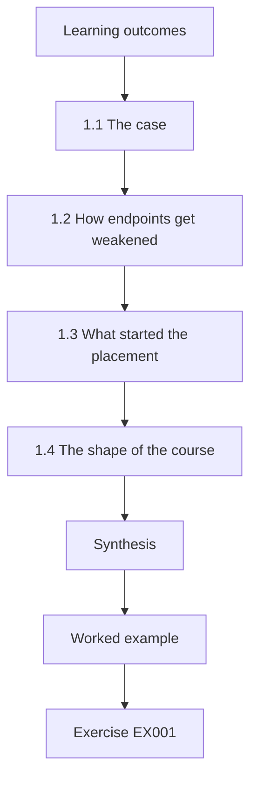

### Logical drawing

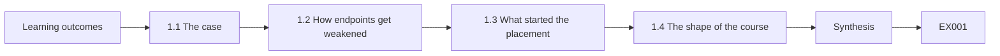

```text
[Learning outcomes]
    |
    v
[1.1 The case]
    |
    v
[1.2 How endpoints get weakened]
    |
    v
[1.3 What started the placement]
    |
    v
[1.4 The shape of the course]
    |
    v
[Synthesis]
    |
    v
[Worked example] --> [Exercise EX001]
```
<!-- cykin:lesson-figures:end ch-01 -->


### Learning outcomes

You will (1) describe the endpoints a small organisation runs; (2) explain the main ways they are weakened; (3) introduce the course case.

### 1.1 The case

Tomás Herrera studies on the three-year technologist programme at the fictional Granite Coast College, guided by his instructor Renée Okafor. His work placement is with the fictional Linden Schools Trust, which runs two primary schools. The trust has about ninety staff laptops, a set of classroom devices managed by the schools, and six servers: two directory servers, a file server, a print server, a small web server for the trust's intranet and a server running the management information system that stores pupil records. One part-time IT technician, Dev Malik, looks after all of it with help from an outside company for big projects.

### 1.2 How endpoints get weakened

Most problems on endpoints come from a few ordinary causes rather than clever attacks. Software is left without updates. Settings are weaker than they should be, often because a default was never changed. Accounts stay active after people leave. Too many people have administrator rights. Backups are assumed rather than checked. CIS Controls v8 is built around exactly these basics: know your assets, configure them securely, manage accounts and access, patch, and be able to recover.

At Linden the supply teacher's account was the second cause made visible, and Tomás expects the other four causes to be present somewhere among ninety laptops and six servers.

### 1.3 What started the placement

Shortly before Tomás arrived, Dev noticed that a supply teacher who had left months earlier could still sign in to the trust's systems. Nothing bad had happened, but it raised a question nobody could answer quickly: how many other accounts, settings and backups were not as everyone assumed? The trust asked the college for a student who could help find out, carefully and without disrupting teaching.

Dev could not say how many laptops were encrypted or when mis01 last had a good backup, because nobody had ever looked across all the devices at once. The placement agreement therefore asked Tomás to measure first and change only what Dev and the business manager approved.

### 1.4 The shape of the course

The first part of this book builds foundations: hardware, operating systems, Linux and Windows administration, networks, accounts and scripting. The middle part applies them to hardening, patching, account hygiene, backups, logging and monitoring at the trust. The final part is Tomás's placement project, in which he measures the starting point, makes agreed improvements and reports the result.

Each chapter follows the same pattern: a few short teaching parts, one worked example from the trust, the errors and limits, and three exercises with rubrics. Three chapters contain small Python labs on synthetic exports, and their numbers return later when Tomás measures the trust at the start and end of his placement.

### Worked example

Tomás lists the trust's endpoints on one page: 90 laptops, the classroom devices, six named servers, and the outside company's remote access. Beside each he writes who looks after it. This simple list already shows that nobody owns the classroom devices clearly.

> **Synthetic case.** Linden Schools Trust, Granite Coast College and all people and figures in this book are fictional; data are synthetic.

### Errors and limits

It is tempting to start with advanced tools. For a small organisation, the basics in CIS Controls v8 implementation group 1 prevent far more harm.

### Exercises

- **EX001 — Ordinary causes.** List four ordinary ways endpoints become weak. *Rubric:* 3 = four distinct causes with an example each;; 2 = four causes;; 1 = fewer than four;; 0 = none.
- **EX002 — Ownership gaps.** Why does the one-page list of endpoints and owners matter? *Rubric:* 3 = links ownership to responsibility and finds the classroom gap;; 2 = says it is useful;; 1 = no reason;; 0 = none.
- **EX003 — Starting point.** A manager asks why the trust should not buy an advanced detection tool first. Answer in two sentences. *Rubric:* 3 = explains basics prevent more harm and reference to CIS IG1;; 2 = mentions basics;; 1 = no answer;; 0 = none.

### Synthesis

Endpoint security in a small organisation is mostly about doing ordinary things reliably: knowing, configuring, updating, controlling access and recovering.

### Continue studying — chapter 01 of 30

[← Course home](../../README.md) · [Course chapter index](../SUBJECTS.md) · [Chapter 02 (draft) →](#ch-02)

<a id="ch-02"></a>

## Chapter 2 — Hardware and firmware basics

<!-- cykin:lesson-figures:start ch-02 -->
### Lesson map

Lesson 02 published. Map, example, EX004.

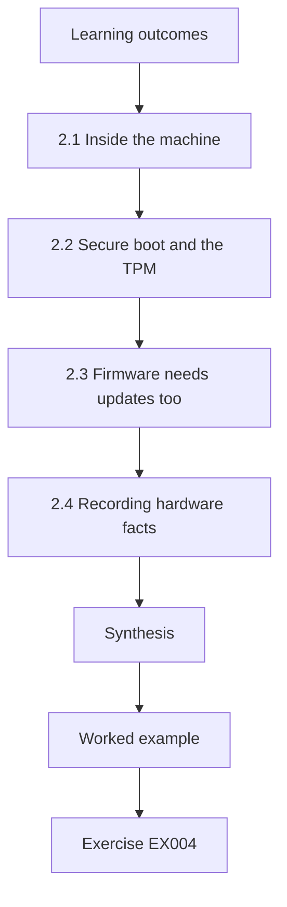

### Logical drawing

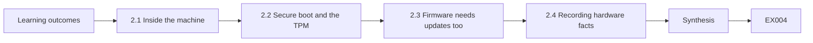

```text
[Learning outcomes]
    |
    v
[2.1 Inside the machine]
    |
    v
[2.2 Secure boot and the TPM]
    |
    v
[2.3 Firmware needs updates too]
    |
    v
[2.4 Recording hardware facts]
    |
    v
[Synthesis]
    |
    v
[Worked example] --> [Exercise EX004]
```
<!-- cykin:lesson-figures:end ch-02 -->


### Learning outcomes

You will (1) name the main parts of a computer; (2) explain firmware and secure boot; (3) record hardware facts in an inventory.

### 2.1 Inside the machine

A laptop or server has a processor, memory, storage, network interfaces and firmware. Firmware is the low-level software stored on the motherboard that starts the machine before the operating system. On modern machines this is UEFI. Storage may be a solid-state drive, which matters for encryption speed and for secure wiping when devices are disposed of.

Tomás records the storage type for each laptop, because solid-state drives need the vendor's secure erase at disposal rather than simple overwriting. He also notes that network interfaces count as hardware facts, since a laptop with both a wired and a wireless interface can sit on two networks at the same time.

### 2.2 Secure boot and the TPM

Secure Boot is a UEFI feature that checks the digital signature of each startup component, so that only trusted boot loaders and operating system kernels run. A Trusted Platform Module, or TPM, is a small security chip that can store keys and record measurements of the startup process. Windows BitLocker uses the TPM to unlock the disk only when the startup looks unchanged. NIST SP 800-147 describes how BIOS and firmware updates should be authenticated, and SP 800-193 describes firmware resiliency.

On the trust's laptops both features matter in practice, because BitLocker with a TPM only protects as intended when Secure Boot is on and the TPM is enabled.

### 2.3 Firmware needs updates too

Firmware has flaws like any software. Laptop vendors release firmware updates through their own tools or through Windows Update. Tomás checks five of the trust's laptops and finds three are several versions behind. He notes this for the patching work later, because firmware is often forgotten when people think of patching.

Before guessing at a cause, he checks whether the three outdated laptops share a model, since a model the vendor's tool no longer reaches would explain the gap across the fleet. He records models and versions rather than updating anything, because a firmware update interrupted by a flat battery can leave a laptop unable to start, and Dev decides when updates run.

### 2.4 Recording hardware facts

For the inventory, Tomás records for each laptop the model, serial number, whether a TPM is present and enabled, Secure Boot state and firmware version. These few fields answer later questions: can this laptop use BitLocker with a TPM, is its firmware current, and is it old enough to replace?

He collects the fields from the management service's hardware report where possible and checks the system information tool by hand only on laptops the report does not cover. Each entry carries the date it was checked, because a firmware version recorded last year says little about the laptop today, and a TPM can be switched off later in firmware settings.

### Worked example

On a test laptop Tomás opens the system information tool, finds Secure Boot on and TPM version 2.0 ready, and records both with the firmware version and the date checked.

> **Synthetic case.** Device details are synthetic.

### Errors and limits

A machine can have a TPM that is disabled in firmware settings; always record whether it is enabled, not just present.

### Exercises

- **EX004 — Firmware role.** In your own words, what does firmware do? *Rubric:* 3 = starts hardware before the OS and is updatable;; 2 = starts the machine;; 1 = vague;; 0 = none.
- **EX005 — TPM use.** Give one practical use of a TPM on a staff laptop. *Rubric:* 3 = explains BitLocker unlocking based on measured startup;; 2 = names BitLocker;; 1 = vague;; 0 = none.
- **EX006 — Inventory fields.** Which three hardware fields help plan encryption and replacement? *Rubric:* 3 = TPM enabled, Secure Boot, firmware version or model age, explained;; 2 = three fields;; 1 = fewer;; 0 = none.

### Synthesis

Firmware, Secure Boot and the TPM form the trust base under the operating system and belong in the inventory.

### Continue studying — chapter 02 of 30

[← Chapter 01 (draft)](#ch-01) · [Course chapter index](../SUBJECTS.md) · [Chapter 03 (draft) →](#ch-03)

<a id="ch-03"></a>

## Chapter 3 — Operating systems and privilege

<!-- cykin:lesson-figures:start ch-03 -->
### Lesson map

Lesson 03 published. Map, example, EX007.

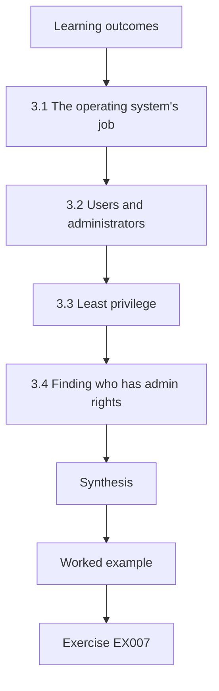

### Logical drawing

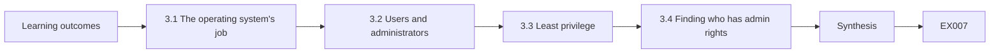

```text
[Learning outcomes]
    |
    v
[3.1 The operating system's job]
    |
    v
[3.2 Users and administrators]
    |
    v
[3.3 Least privilege]
    |
    v
[3.4 Finding who has admin rights]
    |
    v
[Synthesis]
    |
    v
[Worked example] --> [Exercise EX007]
```
<!-- cykin:lesson-figures:end ch-03 -->


### Learning outcomes

You will (1) explain what an operating system does; (2) distinguish user and administrator; (3) describe least privilege.

### 3.1 The operating system's job

The operating system manages hardware, runs programs, stores files and controls who can do what. It separates a privileged core, the kernel, from ordinary programs, so that one misbehaving program cannot easily take over the whole machine. The trust's laptops run Windows; the servers run a mix of Windows Server for the directory and Linux for the web, file, print and management system servers.

The kernel also decides which account owns each running program, which is why the privilege of the signed-in account matters so much. For Tomás this means the same review questions apply on both kinds of server, even though the commands differ: who can sign in, who can become an administrator and which services run with high privilege.

### 3.2 Users and administrators

Every action on a computer runs as some account. Standard users can run programs and change their own files. Administrators on Windows, or root on Linux, can change anything: install software, alter security settings and read other users' files. Because of this, malware that runs as an administrator can do far more damage than malware running as a standard user.

At the trust, a teacher who opens a malicious attachment while signed in as a standard user exposes their own files, but cannot switch off endpoint protection or install a service that survives a restart. The same attachment opened by one of the four teachers with local administrator rights could do both, which is why their rights became a finding.

### 3.3 Least privilege

Saltzer and Schroeder described least privilege in 1975: every program and user should operate using the least set of privileges needed. In practice, this means teachers use standard accounts, Dev uses a separate administrator account only when needed, and services on servers run as dedicated accounts rather than root. On Linux, the sudo tool lets named users run specific commands with higher privilege, with each use logged.

Least privilege applies to Tomás as well: his placement account can read logs and configuration through sudo but cannot install packages or change settings. Dev's separate administrator account means that a phishing email read in his everyday account does not reach the servers directly.

### 3.4 Finding who has admin rights

Tomás checks the local administrators group on ten laptops and finds that four teachers have been added over the years, usually to install a classroom app. He records the names and reasons. Removing these rights later must come with an alternative, such as Dev installing approved apps centrally.

The reasons are ordinary: in most cases a teacher needed a classroom app installed before a lesson and Dev was at the other school. None of the four rights had been removed afterwards, because nobody kept a list of who had been given them or why. Tomás records the reasons without naming anyone in his college notes, using synthetic names there instead.

### Worked example

On one Linux server, Tomás lists members of the sudo group and finds Dev and the outside company's engineer account, both expected, and an old account belonging to a previous technician, which is flagged.

> **Synthetic case.** Accounts are synthetic.

### Errors and limits

Removing admin rights without offering a way to get needed software leads staff to look for workarounds.

### Exercises

- **EX007 — Kernel separation.** Why does the OS separate the kernel from ordinary programs? *Rubric:* 3 = protects system from a misbehaving program;; 2 = mentions protection;; 1 = vague;; 0 = none.
- **EX008 — Admin risk.** Explain why malware running as administrator is more harmful. *Rubric:* 3 = can change security settings, install, read all files;; 2 = one example;; 1 = vague;; 0 = none.
- **EX009 — Replacing rights.** Suggest how teachers can get classroom apps once admin rights are removed. *Rubric:* 3 = central installation or self-service catalogue with approval;; 2 = ask IT;; 1 = vague;; 0 = none.

### Synthesis

The operating system enforces privilege boundaries; least privilege keeps those boundaries meaningful.

### Continue studying — chapter 03 of 30

[← Chapter 02 (draft)](#ch-02) · [Course chapter index](../SUBJECTS.md) · [Chapter 04 (draft) →](#ch-04)

<a id="ch-04"></a>

## Chapter 4 — Linux administration basics

<!-- cykin:lesson-figures:start ch-04 -->
### Lesson map

Lesson 04 published. Map, example, EX010.

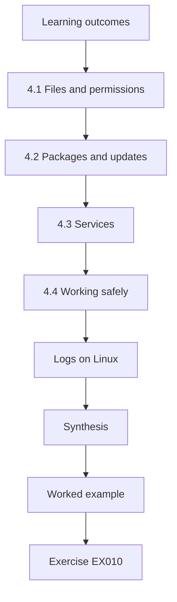

### Logical drawing

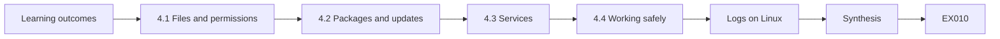

```text
[Learning outcomes]
    |
    v
[4.1 Files and permissions]
    |
    v
[4.2 Packages and updates]
    |
    v
[4.3 Services]
    |
    v
[4.4 Working safely]
    |
    v
[Logs on Linux]
    |
    v
[Synthesis]
    |
    v
[Worked example] --> [Exercise EX010]
```
<!-- cykin:lesson-figures:end ch-04 -->


### Learning outcomes

You will (1) navigate and manage a Linux server; (2) manage packages and services; (3) read configuration safely.

### 4.1 Files and permissions

Linux organises everything under one directory tree. Each file has an owner, a group and permissions for reading, writing and executing. Configuration lives mostly under /etc. Tomás learns to read permissions with the ls command and to check who owns sensitive files, such as SSH configuration, which should be writable only by root.

On the trust's servers he checks that the SSH configuration file under /etc/ssh is owned by root and not writable by any group, and records the permissions alongside the date. A configuration file that an ordinary account can edit undoes every other setting in it, because that account could quietly re-enable root sign-in or password authentication.

### 4.2 Packages and updates

Linux distributions install software through package managers such as apt or dnf. The package manager also applies security updates. On the trust's Debian-based servers, Dev uses unattended-upgrades to install security updates automatically each night, and reviews the log weekly. Tomás learns to list pending updates without installing them, which is safe to do during his placement.

On a Debian-based server the command apt list --upgradable shows pending updates without changing anything, so Tomás can run it under his read-only sudo rights. He compares its output with the unattended-upgrades log to see whether the nightly job is really installing security updates, or whether something such as a held package has stopped it quietly.

### 4.3 Services

Programs that run in the background are services, managed by systemd. The systemctl command lists running and enabled services. Every running service is something to keep updated and configured, so unneeded ones should be disabled. NIST SP 800-123 recommends removing or disabling unnecessary services on servers.

On the trust's servers Tomás runs systemctl list-unit-files with the enabled state, a read-only command, and compares each enabled service with what the server is for. A service that nobody can explain is not stopped by him; it goes on a list for Dev, who checks whether anything depends on it before disabling it in a planned change.

### 4.4 Working safely

Tomás works on a test virtual machine first. On live servers he only reads, using his own account with limited sudo rights granted for viewing logs and configuration. Any change is agreed with Dev and made by Dev, with a note in the change log.

The test virtual machine runs the same Debian release as the trust's servers, so commands behave the same way there. Any command Tomás wants to run on a live server is first written in his notes with what it reads and why, and Dev agrees it beforehand. If a read-only command unexpectedly asks for confirmation or a password, he stops and asks Dev, because that usually means it would change something.

### Logs on Linux

Linux servers record events in the systemd journal and in text files under /var/log. The journalctl command filters the journal by service, priority and time, so Tomás can list SSH sign-ins for the last day with a single read-only command instead of scrolling raw files. He learns three patterns: filter by unit to see one service, filter by time window to look around an event, and filter by priority to see only errors. He also checks how long the journal is kept on each server, because a server that keeps only a day of history cannot answer questions about last week. Retention is agreed with Dev and recorded in the server notes.

### Worked example

On the test machine, Tomás lists enabled services and finds a mail transfer agent installed by default but unused; disabling it on the test machine shows nothing else depends on it, which he reports to Dev.

> **Synthetic case.** Systems are synthetic.

### Errors and limits

Copying commands from the internet onto live servers is risky; test first and understand each command.

### Exercises

- **EX010 — Config location.** Where is most Linux system configuration stored, and who should be able to change it? *Rubric:* 3 = /etc, root only, with reason;; 2 = /etc;; 1 = wrong;; 0 = none.
- **EX011 — Safe update check.** Describe a safe way to see pending updates without installing them. *Rubric:* 3 = list upgradable packages read-only;; 2 = vague;; 1 = minimal attempt;; 0 = none.
- **EX012 — Service review.** Why disable unused services? *Rubric:* 3 = less to patch and configure, per SP 800-123;; 2 = less risk;; 1 = vague;; 0 = none.

### Synthesis

A few Linux skills, reading permissions, packages and services, are enough to assess a server safely.

### Continue studying — chapter 04 of 30

[← Chapter 03 (draft)](#ch-03) · [Course chapter index](../SUBJECTS.md) · [Chapter 05 (draft) →](#ch-05)

<a id="ch-05"></a>

## Chapter 5 — Windows administration basics

<!-- cykin:lesson-figures:start ch-05 -->
### Lesson map

Lesson 05 published. Map, example, EX013.

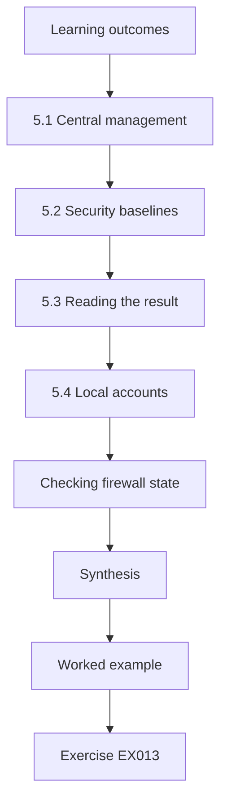

### Logical drawing

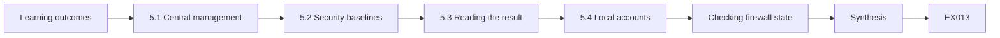

```text
[Learning outcomes]
    |
    v
[5.1 Central management]
    |
    v
[5.2 Security baselines]
    |
    v
[5.3 Reading the result]
    |
    v
[5.4 Local accounts]
    |
    v
[Checking firewall state]
    |
    v
[Synthesis]
    |
    v
[Worked example] --> [Exercise EX013]
```
<!-- cykin:lesson-figures:end ch-05 -->


### Learning outcomes

You will (1) manage Windows devices centrally; (2) use group policy or management tools; (3) read security settings.

### 5.1 Central management

Configuring ninety laptops one by one is impossible to keep consistent. The trust's laptops are joined to the directory and managed through group policy, with newer settings delivered by a cloud management service. Policies apply settings such as password rules, screen lock and firewall state to all laptops in a group.

Group policy applies when a laptop is on the school network or connected to the directory, while the cloud management service reaches laptops wherever they are online. Tomás learns which settings come from each, because a setting defined in both places with different values produces confusing results. Dev's rule is that new settings go only into the cloud management service.

### 5.2 Security baselines

Microsoft publishes security baselines: recommended settings for each Windows version. The CIS Benchmarks offer a similar, independently reviewed list. Both can be imported as starting points. Dev already applies some settings, but nobody has compared them with a baseline.

A baseline is useful only when someone compares it with what laptops actually have, and that comparison has never been done at the trust. Tomás treats the Microsoft and CIS lists as menus rather than orders: the trust will pick the settings that matter most, record which source each came from, and leave the rest for later rounds. Importing every recommended setting at once on ninety laptops would also break classroom software nobody had tested.

### 5.3 Reading the result

Tomás uses the built-in report of resulting settings on a laptop to see which policies applied. This shows, for example, that the screen lock is set to thirty minutes, while the CIS Benchmark suggests fifteen or less. He records each difference rather than changing anything.

The report also shows which policy set each value, so Tomás can tell a central setting from one changed locally on the laptop. For the screen lock, the thirty-minute value comes from an old group policy object that nobody had reviewed since it was created. He writes the policy name next to the difference, because that is where Dev will make the change.

### 5.4 Local accounts

Windows laptops each have a built-in local administrator account. If every laptop has the same password for it, one leaked password opens them all. Microsoft's Local Administrator Password Solution, LAPS, sets a unique random password on each machine and stores it in the directory, readable only by authorised staff.

Tomás checks whether LAPS is deployed and finds it is not yet, so every laptop built from the trust's image still shares one local administrator password. He records this as a single finding with ninety laptops affected rather than as ninety findings, because one central change fixes all of them. LAPS later becomes one of the fifteen settings in the laptop baseline.

### Checking firewall state

Windows Defender Firewall has three profiles: domain, private and public. Laptops use the domain profile at school and the public profile in cafés, hotels and other untrusted networks. Tomás checks the profile states on his sample of laptops and finds that on two the public profile is switched off, probably changed while troubleshooting a home printer and never reverted. These are exactly the laptops that would be most exposed when a teacher works from a café. He records both for the baseline work rather than changing them himself, and notes that a central policy would prevent the setting being switched off locally in future.

### Worked example

Tomás compares twelve settings on one laptop with the CIS Benchmark and finds four differences: screen lock timeout, guest account state, SMBv1 client and the PowerShell logging setting.

> **Synthetic case.** Settings are synthetic.

### Errors and limits

Applying a full baseline at once can break classroom software; differences are recorded first and changes piloted later.

### Exercises

- **EX013 — Why centralise.** Give two reasons central policy beats manual configuration. *Rubric:* 3 = consistency and speed of change, explained;; 2 = two reasons;; 1 = one;; 0 = none.
- **EX014 — LAPS purpose.** What problem does LAPS solve? *Rubric:* 3 = shared local admin password risk;; 2 = mentions passwords;; 1 = vague;; 0 = none.
- **EX015 — Recording differences.** Why record baseline differences before changing them? *Rubric:* 3 = understand impact, plan pilot;; 2 = safer;; 1 = vague;; 0 = none.

### Synthesis

Central management and published baselines make Windows settings consistent and measurable.

### Continue studying — chapter 05 of 30

[← Chapter 04 (draft)](#ch-04) · [Course chapter index](../SUBJECTS.md) · [Chapter 06 (draft) →](#ch-06)

<a id="ch-06"></a>

## Chapter 6 — Networks for endpoint work

<!-- cykin:lesson-figures:start ch-06 -->
### Lesson map

Lesson 06 published. Map, example, EX016.

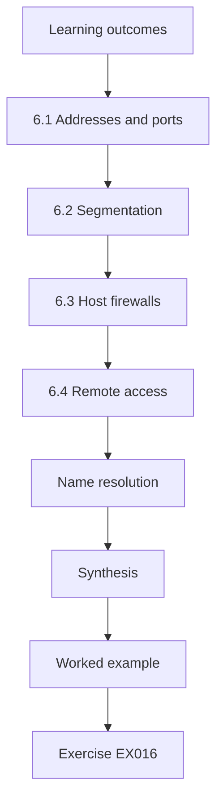

### Logical drawing

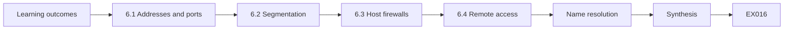

```text
[Learning outcomes]
    |
    v
[6.1 Addresses and ports]
    |
    v
[6.2 Segmentation]
    |
    v
[6.3 Host firewalls]
    |
    v
[6.4 Remote access]
    |
    v
[Name resolution]
    |
    v
[Synthesis]
    |
    v
[Worked example] --> [Exercise EX016]
```
<!-- cykin:lesson-figures:end ch-06 -->


### Learning outcomes

You will (1) explain addressing and ports; (2) describe segmentation; (3) use host firewalls.

### 6.1 Addresses and ports

Each device has an IP address, and each network service listens on a port: SSH on 22, web on 443, file sharing on 445. Knowing which ports a server exposes tells you which services can be reached. Tomás learns to list listening ports on a server with the ss command, a read-only check.

On a server, ss -tlnp lists listening TCP ports with the local address, which shows whether a service accepts connections from anywhere or only from the machine itself. That address is the difference between 0.0.0.0, meaning every network, and 127.0.0.1, meaning local only, and it is exactly what Tomás reads when he finds the database port on mis01.

### 6.2 Segmentation

The trust's network has a staff segment, a classroom segment and a server segment. Classroom devices should not reach the management information system server directly. Segmentation limits how far a problem on one device can spread, a principle NIST SP 800-53 Rev. 5 covers under boundary protection.

Tomás does not test the segmentation by trying to connect from a classroom device, which would be outside his agreement. Instead he reads the firewall rules between segments with Dev and checks whether any rule allows the classroom segment to reach mis01 or the other servers, recording each rule's purpose as Dev explains it.

### 6.3 Host firewalls

Each laptop and server also runs its own firewall. On Windows, Defender Firewall should be on for all profiles; on Linux, a tool such as nftables or ufw allows only needed ports. A host firewall still helps when a device joins an untrusted network, such as a teacher's home wireless.

The host firewall and the network segments protect different things: segments decide which networks can reach a server, while the host firewall decides which ports on that server answer. On mis01, the old database port open to all addresses is exactly the case a host firewall rule would have limited, even before the database configuration was changed to listen locally.

### 6.4 Remote access

The outside company connects to servers over a VPN. Tomás notes that the VPN account is shared by several engineers, which makes it impossible to tell who did what. He records this for the account work later.

With one shared account, the VPN log shows that someone from the company connected, but never which engineer, and the trust cannot check that person against the company's staff list. If one engineer leaves the company, the only way to remove their access is to change the password for everyone, which is disruptive enough that it tends to be postponed.

### Name resolution

DNS turns names such as the trust's intranet address into IP addresses. Every connection a device makes starts with this lookup, so DNS settings quietly decide where traffic goes. If a laptop is pointed at an unknown resolver, perhaps by a home router or a public hotspot, lookups can be answered wrongly or logged by someone else. The trust's laptops use the trust's own resolver at school and a known filtering DNS service elsewhere, which also blocks many known malicious domains. Tomás checks the configured resolvers on his sample, finds one laptop with a manually set public resolver left from troubleshooting, and records it for correction.

### Worked example

On mis01, ss shows SSH on 22, the application on 443 and an old database port open to all addresses; Tomás reports that the database should listen only locally.

> **Synthetic case.** Network details are synthetic.

### Errors and limits

A port open on a server is not automatically a problem; the question is whether it is needed and who can reach it.

### Exercises

- **EX016 — Reading exposure.** What does a list of listening ports tell you? *Rubric:* 3 = which services can be reached, to compare against needs;; 2 = services;; 1 = vague;; 0 = none.
- **EX017 — Segment purpose.** Why keep classroom devices off the server segment? *Rubric:* 3 = limits spread and access to pupil data;; 2 = security;; 1 = vague;; 0 = none.
- **EX018 — Shared VPN account.** Explain the problem with a shared VPN account. *Rubric:* 3 = no accountability, hard to revoke one person;; 2 = accountability;; 1 = vague;; 0 = none.

### Synthesis

Knowing ports, segments and firewalls lets you judge exposure without any attack tools.

### Continue studying — chapter 06 of 30

[← Chapter 05 (draft)](#ch-05) · [Course chapter index](../SUBJECTS.md) · [Chapter 07 (draft) →](#ch-07)

<a id="ch-07"></a>

## Chapter 7 — Identity and accounts

<!-- cykin:lesson-figures:start ch-07 -->
### Lesson map

Lesson 07 published. Map, example, EX019.

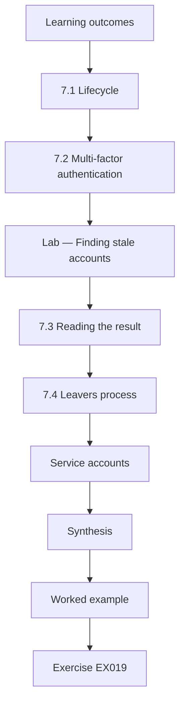

### Logical drawing

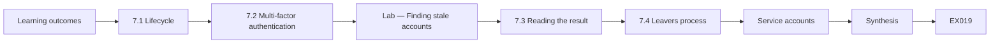

```text
[Learning outcomes]
    |
    v
[7.1 Lifecycle]
    |
    v
[7.2 Multi-factor authentication]
    |
    v
[Lab — Finding stale accounts]
    |
    v
[7.3 Reading the result]
    |
    v
[7.4 Leavers process]
    |
    v
[Service accounts]
    |
    v
[Synthesis]
    |
    v
[Worked example] --> [Exercise EX019]
```
<!-- cykin:lesson-figures:end ch-07 -->


### Learning outcomes

You will (1) describe the account lifecycle; (2) explain multi-factor authentication; (3) find stale accounts.

### 7.1 Lifecycle

Accounts should follow people: created when someone joins, changed when their role changes and disabled when they leave. In schools, supply teachers and temporary staff come and go often, which is exactly where the trust's earlier problem arose. CIS Controls v8 Control 5 covers account management and Control 6 covers access control.

The trust's earlier problem was a supply teacher whose account outlived the contract by months, because nothing told Dev the person had gone. For each stage Tomás writes who triggers the change: the school office for joiners and leavers, and the head teacher for role changes such as becoming a class teacher or leaving the leadership team.

### 7.2 Multi-factor authentication

A password alone can be guessed or phished. Multi-factor authentication adds a second factor, such as an app approval or a security key. The trust uses it for email and remote access but not yet for administrator accounts on servers, which Tomás notes as a gap.

Administrator accounts on servers are the most valuable to an attacker, since they reach pupil records on mis01 and every staff document on files01. Without a second factor, a phished administrator password could open them directly. Tomás records the gap with the servers affected rather than proposing a product, so Dev can choose a method that works with the existing directory.

### Lab — Finding stale accounts

```python
"""Find stale accounts in a synthetic directory export (stdlib only)."""
import datetime as dt
today = dt.date(2026, 5, 1)
acc = [("j.byrne","2026-04-28",True),("k.osei","2025-11-02",True),("temp.supply","2025-09-30",True),
       ("m.lund","2026-04-30",True),("old.head","2024-07-15",True),("lab.admin","2026-01-20",True),
       ("p.ward","2026-04-29",True),("a.nolan","2025-12-01",False)]
stale = [u for u, d, en in acc if en and (today - dt.date.fromisoformat(d)).days > 90]
print(f"enabled accounts {sum(1 for a in acc if a[2])}; stale over 90 days {len(stale)}: {stale}")
```

Run with `python3 lab_stale.py`. Verified output:

```text
enabled accounts 7; stale over 90 days 4: ['k.osei', 'temp.supply', 'old.head', 'lab.admin']
```

### 7.3 Reading the result

The synthetic export shows seven enabled accounts, four not used for over ninety days: a former teacher, a supply account, a former head teacher's account and a shared lab administrator account. Each needs a decision. Some may be needed occasionally; most should be disabled. The disabled account a.nolan is correctly excluded.

The lab's ninety-day threshold flags lab.admin at 101 days, only just over the line, while old.head has not been used for 655 days. Sorting by age would therefore put the oldest risks first. The count of four is what Tomás records as the starting value for stale accounts, using the same export and threshold he will use again at the end.

### 7.4 Leavers process

The fix is not only cleaning up once but making leavers trigger account disabling. Tomás drafts a simple form that the school office sends to Dev on a person's last day, with a weekly check of the stale list as a safety net.

The form asks for the person's name, last working day, which accounts they used and whether colleagues need any of their files. Dev disables the account on that day and records the date, so the weekly stale check should then find nothing new from leavers. Any account it does flag shows where the form was missed, which tells the office which step to fix.

### Service accounts

Some accounts belong to programs rather than people: the backup software, the scanner that saves to a shared folder and the management information system's database connection. These service accounts are easy to forget because nobody signs in with them, yet they often have broad rights and passwords that never change. Each should have only the rights its program needs, a long random password stored in the password manager, and a named owner who reviews it yearly. Tomás lists the trust's five service accounts and finds that the scanner account is a domain administrator, which is far more than saving files needs. Dev reduces it to write access on one folder.

### Worked example

Dev and the head teacher review the four stale accounts: three are disabled immediately, and lab.admin is replaced by named admin accounts for the two people who use it.

> **Synthetic case.** Accounts are synthetic.

### Errors and limits

Deleting accounts immediately can lose files that colleagues need; disabling first, then deleting after a retention period, is safer.

### Exercises

- **EX019 — Lifecycle stages.** Name the three lifecycle events that should change an account. *Rubric:* 3 = join, role change, leave with actions;; 2 = three events;; 1 = fewer;; 0 = none.
- **EX020 — Stale threshold.** Why might ninety days be a sensible stale threshold for a school? *Rubric:* 3 = covers holidays but catches leavers;; 2 = reasonable;; 1 = vague;; 0 = none.
- **EX021 — Disable or delete.** Why disable before deleting? *Rubric:* 3 = preserves data and allows reversal;; 2 = reversibility;; 1 = vague;; 0 = none.

### Synthesis

Account hygiene depends on a lifecycle process plus a regular check for what the process missed.

### Continue studying — chapter 07 of 30

[← Chapter 06 (draft)](#ch-06) · [Course chapter index](../SUBJECTS.md) · [Chapter 08 (draft) →](#ch-08)

<a id="ch-08"></a>

## Chapter 8 — Scripting for checks

<!-- cykin:lesson-figures:start ch-08 -->
### Lesson map

Lesson 08 published. Map, example, EX022.

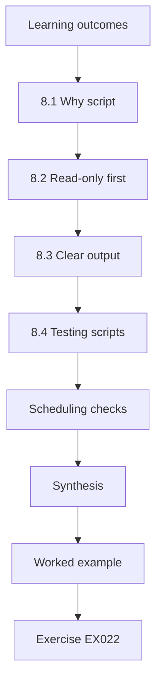

### Logical drawing

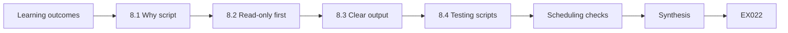

```text
[Learning outcomes]
    |
    v
[8.1 Why script]
    |
    v
[8.2 Read-only first]
    |
    v
[8.3 Clear output]
    |
    v
[8.4 Testing scripts]
    |
    v
[Scheduling checks]
    |
    v
[Synthesis]
    |
    v
[Worked example] --> [Exercise EX022]
```
<!-- cykin:lesson-figures:end ch-08 -->


### Learning outcomes

You will (1) write small read-only scripts; (2) parse simple data; (3) produce clear reports.

### 8.1 Why script

Many checks repeat: listing accounts, comparing settings, checking backup times. A short script makes them consistent and fast. Python's standard library is enough for most: csv to read exports, datetime for dates, json for configuration.

For Tomás the alternative is clicking through consoles and copying numbers by hand, which is slow and gives slightly different answers each time. A script reading the same export the same way gives the same answer for the same data, which is what makes a before-and-after comparison fair at the end of the placement.

### 8.2 Read-only first

Tomás's scripts only read exported data and print results. They never change systems. This makes them safe to run during the placement and easy to review: Dev can read every line.

The scripts read files that Dev exports from the directory, the management service and the backup software, so Tomás never needs credentials for those systems. Because nothing is written back, a mistake in a script can only produce a wrong number, which a test file can catch, rather than a changed account or a broken server. That read-only limit is also exactly what the placement agreement allows him to do.

### 8.3 Clear output

A good check prints a short summary and the specific items that need attention. A wall of text is ignored. Each script ends with one line such as "late 2 of 6" so the result is clear at a glance.

The summary line puts the count before its denominator, so 'stale 4 of 7' reads correctly even to someone who has never seen the script. The items needing attention are listed under it by name, sorted so the most urgent come first. Dev can paste that line straight into the weekly review notes without rewriting it.

### 8.4 Testing scripts

Tomás tests each script with small synthetic inputs where he knows the right answer, including edge cases such as an empty file or a missing date. A script that silently skips bad rows can hide problems.

For the stale-account script he builds a file with one account used yesterday, one used exactly ninety days ago and one used ninety-one days ago, so he can confirm the boundary is handled as intended. A row with no date should be reported as an error, not treated as recent or skipped, because an account that has never signed in still needs a decision.

### Scheduling checks

A script is most useful when it runs on a schedule rather than when someone remembers. Dev schedules the account and backup checks weekly with the system scheduler, writing each run's output to a dated file. The dated history shows whether things are improving, and lets Tomás compare one week with another or show an auditor that the checks really ran. Each script starts with a short header explaining what it reads, what it prints and who owns it, so another technician can keep it running after the placement. If a scheduled run fails to produce its file, that absence is itself flagged in the weekly review, so a broken check cannot pass silently.

### Worked example

Tomás writes a twelve-line script reading a CSV of accounts, computing days since last sign-in and printing the stale ones; with a test file of three rows he confirms it flags exactly the one he expects.

> **Synthetic case.** Data are synthetic.

### Errors and limits

Scripts that change systems need much more care, review and approval; keep checks read-only.

### Exercises

- **EX022 — Library choice.** Which standard library modules help read an account export with dates? *Rubric:* 3 = csv and datetime with roles;; 2 = names one;; 1 = vague;; 0 = none.
- **EX023 — Output design.** Write the final summary line for a script that found 3 of 50 laptops unencrypted. *Rubric:* 3 = clear count and denominator;; 2 = count only;; 1 = vague;; 0 = none.
- **EX024 — Edge cases.** Name two edge cases to test. *Rubric:* 3 = empty file and missing or malformed date;; 2 = one;; 1 = vague;; 0 = none.

### Synthesis

Small read-only scripts turn repetitive checks into reliable routines.

### Continue studying — chapter 08 of 30

[← Chapter 07 (draft)](#ch-07) · [Course chapter index](../SUBJECTS.md) · [Chapter 09 (draft) →](#ch-09)

<a id="ch-09"></a>

## Chapter 9 — Security principles in practice

<!-- cykin:lesson-figures:start ch-09 -->
### Lesson map

Lesson 09 published. Map, example, EX025.

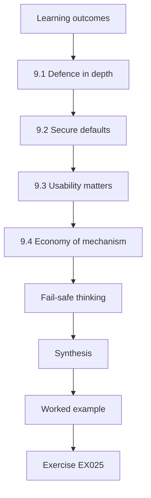

### Logical drawing

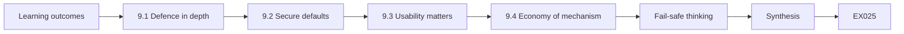

```text
[Learning outcomes]
    |
    v
[9.1 Defence in depth]
    |
    v
[9.2 Secure defaults]
    |
    v
[9.3 Usability matters]
    |
    v
[9.4 Economy of mechanism]
    |
    v
[Fail-safe thinking]
    |
    v
[Synthesis]
    |
    v
[Worked example] --> [Exercise EX025]
```
<!-- cykin:lesson-figures:end ch-09 -->


### Learning outcomes

You will (1) apply defence in depth; (2) use secure defaults; (3) balance usability.

### 9.1 Defence in depth

No single control is perfect, so several layers are combined. For a teacher's laptop: updates reduce flaws, standard accounts limit damage, the firewall limits exposure, encryption protects lost devices, and backups allow recovery. If one layer fails, others still help.

Each layer covers a different failure: an update missed for a week still leaves the teacher on a standard account, and a stolen laptop with an unpatched flaw is still encrypted. The layers only help if they are independent, which is why the shared local administrator password matters at the trust: one leak would defeat the same layer on every laptop at once.

### 9.2 Secure defaults

Systems should start safe and be loosened only when needed. A new laptop arrives from the build with all baseline settings; exceptions are requested and recorded. This is easier to maintain than starting open and hoping to remember to close things.

At the trust, the laptop image used to be built open and then tightened by hand, which is why the screen lock and the firewall's public profile differed between laptops. Building the image from the agreed baseline reverses that: every new laptop starts with fifteen settings applied, and the exceptions list shows exactly which laptops differ and why.

### 9.3 Usability matters

Controls that get in the way of teaching will be bypassed. A screen lock of one minute in a classroom where a teacher walks around while displaying slides will cause frustration. Tomás learns to discuss settings with staff and choose values that protect without blocking work.

Tomás asks three teachers how they use their laptops during lessons before suggesting any value, and they explain that they often leave slides on the projector for several minutes. A setting chosen without that conversation would either be ignored or lead to complaints that end with the whole baseline being relaxed.

### 9.4 Economy of mechanism

Simple designs are easier to check. Saltzer and Schroeder (1975) argued for keeping security mechanisms as small and simple as possible. For the trust, this means fewer tools, each well understood, rather than many overlapping products.

For Dev, every extra tool is another console to check weekly, another agent to update and another place where a setting can drift. Tomás's scripts follow the same idea: each one reads one export, checks one thing and prints one summary line, so Dev can understand any of them in a few minutes and fix it if an export format changes.

### Fail-safe thinking

When something goes wrong, the safer outcome should follow by default. Saltzer and Schroeder called this fail-safe defaults: base access decisions on permission rather than exclusion. At the trust it shows up in small choices. If the management agent cannot reach its server, the laptop keeps its last policy rather than dropping to an open state. If a backup check script finds no data to read, it reports a failure rather than printing nothing, so a missing report is never mistaken for success. And if a new staff account is created without a role, it gets no access until one is assigned, rather than inheriting a broad default group.

### Worked example

For the screen lock, staff and Dev agree on ten minutes with a keyboard shortcut to lock immediately, recorded as a deviation from the fifteen-minute CIS suggestion only in that it is stricter.

> **Synthetic case.** Discussion is synthetic.

### Errors and limits

Layers that all depend on one thing, such as the same admin password, are not independent.

### Exercises

- **EX025 — Layers.** List four layers protecting a teacher laptop. *Rubric:* 3 = four distinct with roles;; 2 = four;; 1 = fewer;; 0 = none.
- **EX026 — Default choice.** Explain secure defaults in one sentence with an example. *Rubric:* 3 = correct and example;; 2 = correct only;; 1 = vague;; 0 = none.
- **EX027 — Usability conflict.** How would you resolve a complaint that the screen lock is too short? *Rubric:* 3 = discuss, adjust within limits, offer shortcut, record;; 2 = adjust;; 1 = ignore;; 0 = none.

### Synthesis

Good security combines layers, starts from safe defaults and respects how people work.

### Continue studying — chapter 09 of 30

[← Chapter 08 (draft)](#ch-08) · [Course chapter index](../SUBJECTS.md) · [Chapter 10 (draft) →](#ch-10)

<a id="ch-10"></a>

## Chapter 10 — Data protection and ethics

<!-- cykin:lesson-figures:start ch-10 -->
### Lesson map

Lesson 10 published. Map, example, EX028.

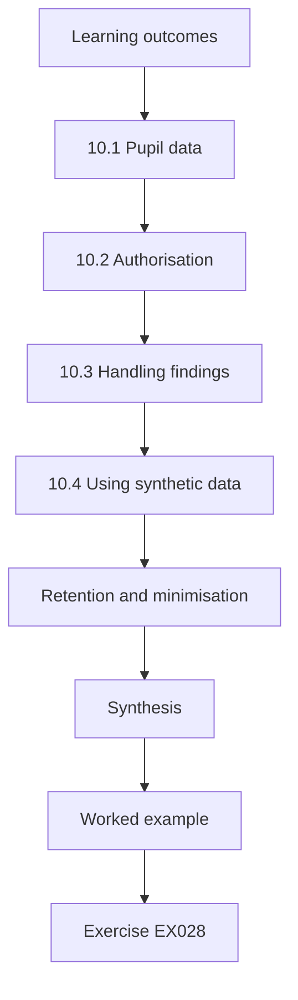

### Logical drawing

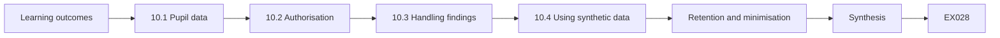

```text
[Learning outcomes]
    |
    v
[10.1 Pupil data]
    |
    v
[10.2 Authorisation]
    |
    v
[10.3 Handling findings]
    |
    v
[10.4 Using synthetic data]
    |
    v
[Retention and minimisation]
    |
    v
[Synthesis]
    |
    v
[Worked example] --> [Exercise EX028]
```
<!-- cykin:lesson-figures:end ch-10 -->


### Learning outcomes

You will (1) explain why pupil data need protection; (2) work within authorisation; (3) handle findings responsibly.

### 10.1 Pupil data

The management information system holds names, addresses, attendance, medical notes and safeguarding records. Children's data deserve particular care. A breach could harm families and require notifying the regulator.

Medical notes and safeguarding records are the most sensitive, because they can describe a child's health, family circumstances or contact with social services. Even attendance data can reveal patterns, such as regular absences for hospital appointments. Because mis01 holds all of this, Tomás treats every finding about that server, such as its late backup or its password sign-in, as higher priority than the same finding elsewhere.

### 10.2 Authorisation

Tomás works under a written placement agreement listing what he may access: configuration and logs on servers, exports of account and device data, but not pupil records. He never tests systems in ways that could disrupt them and never uses tools that look for weaknesses by attacking.

The agreement also names Dev as the person who approves every command on a live server and says that any finding involving personal data goes to the data protection officer through Dev. When Tomás is unsure whether something is in scope, the agreement tells him to stop and ask rather than interpret it himself.

### 10.3 Handling findings

When he finds something sensitive, such as a shared password in a document, he tells Dev privately and does not copy it into notes. Findings are written factually, without blame, and kept inside the trust.

His notes describe the spreadsheet by location and type, not content, so the notes themselves never become a second copy of the passwords. Findings about people, such as the four teachers with administrator rights, are written about the setting rather than the person. Reports leave the trust only in anonymised form for his college work, with synthetic names and figures in place of real ones.

### 10.4 Using synthetic data

For college work, Tomás replaces all real names and details with synthetic ones. His labs use invented data shaped like the real exports.

The synthetic data keep the shape of the real exports, such as the same column names, date formats and roughly the same number of rows, so the scripts work on both. The account names in his labs, such as k.osei and temp.supply, are invented, and the figures are chosen so the lessons still hold. Renée checks that nothing in his college submission could identify a real pupil, member of staff or school.

### Retention and minimisation

Data protection asks organisations to keep only the data they need, for as long as they need it. Tomás applies this to his own work. His project exports contain account names and dates but no other personal details, and they are deleted from his laptop at the end of the placement, with the deletion noted in his log. The trust's security logs follow a retention period agreed with the data protection officer, long enough for investigations but no longer. When preparing college reports, he uses counts and synthetic examples, and if an assessor asks for detail, he describes the method rather than sharing real records.

### Worked example

Tomás finds a spreadsheet of passwords on the file server; he tells Dev the location without opening it further, and Dev moves the passwords into a password manager and deletes the file.

> **Synthetic case.** The scenario is synthetic.

### Errors and limits

Curiosity is not authorisation: looking at pupil records "just to check" would breach the agreement.

### Exercises

- **EX028 — Sensitive categories.** Name three sensitive kinds of data in a school system. *Rubric:* 3 = three with reasons;; 2 = three;; 1 = fewer;; 0 = none.
- **EX029 — Scope check.** Is Tomás allowed to open a pupil's record to test permissions? Explain. *Rubric:* 3 = no, outside agreement;; 2 = no;; 1 = yes;; 0 = none.
- **EX030 — Finding a secret.** What should you do on finding passwords in a shared document? *Rubric:* 3 = report privately, don't copy, support fix;; 2 = report;; 1 = copy;; 0 = none.

### Synthesis

Ethical practice means staying within agreed access and handling findings carefully.

### Continue studying — chapter 10 of 30

[← Chapter 09 (draft)](#ch-09) · [Course chapter index](../SUBJECTS.md) · [Chapter 11 (draft) →](#ch-11)

<a id="ch-11"></a>

## Chapter 11 — Inventory in practice

<!-- cykin:lesson-figures:start ch-11 -->
### Lesson map

Lesson 11 published. Map, example, EX031.

```mermaid
flowchart TD
  N0["Learning outcomes"]
  N1["11.1 Sources"]
  N2["11.2 Reconciling"]
  N3["11.3 Fields that matter"]
  N4["11.4 Keeping it current"]
  N5["Disposal"]
  N6["Classroom devices"]
  N7["Synthesis"]
  N0 --> N1 --> N2 --> N3 --> N4 --> N5 --> N6 --> N7
  N7 --> EX["Worked example"]
  EX --> Q["Exercise EX031"]
```

### Logical drawing

```mermaid
flowchart LR
  N0["Learning outcomes"]
  N1["11.1 Sources"]
  N2["11.2 Reconciling"]
  N3["11.3 Fields that matter"]
  N4["11.4 Keeping it current"]
  N5["Disposal"]
  N6["Classroom devices"]
  N7["Synthesis"]
  N0 --> N1 --> N2 --> N3 --> N4 --> N5 --> N6 --> N7 --> Q["EX031"]
```

```text
[Learning outcomes]
    |
    v
[11.1 Sources]
    |
    v
[11.2 Reconciling]
    |
    v
[11.3 Fields that matter]
    |
    v
[11.4 Keeping it current]
    |
    v
[Disposal]
    |
    v
[Classroom devices]
    |
    v
[Synthesis]
    |
    v
[Worked example] --> [Exercise EX031]
```
<!-- cykin:lesson-figures:end ch-11 -->


### Learning outcomes

You will (1) build an asset list from several sources; (2) reconcile differences; (3) keep it current.

### 11.1 Sources

Tomás gathers the directory's computer list, the management service's device list and the purchasing records. Each is incomplete: the directory includes old computers never removed, the management service misses some classroom laptops, and purchasing lacks donated devices.

Tomás exports all three in the same week so that differences come from the sources rather than from time passing between exports. He also notes what each source is for: the directory controls sign-in, the management service applies settings, and purchasing records what the trust paid for. None of the three sources was ever designed to be a complete inventory.

### 11.2 Reconciling

He matches by serial number and lists differences. Twelve directory entries are for machines long gone; four laptops are in use but not managed; two donated laptops appear nowhere. Each difference is resolved with Dev: stale entries removed, unmanaged laptops enrolled, donated laptops recorded.

Serial numbers are used because hostnames change when a laptop is rebuilt or passed to a new teacher, while the serial stays with the hardware. Where a source has no serial for a device, Tomás matches it by hostname and last sign-in date instead, and marks it as a weaker match for Dev to confirm.

### 11.3 Fields that matter

For each device: owner or location, operating system and version, last check-in, encryption state and support end date. These fields support the later chapters on patching, encryption and replacement.

Owner or location says who to ask when something is wrong, which is exactly the field missing for the classroom tablets. Last check-in shows whether a device is still in use and reporting, and support end date drives the replacement plan. Encryption state is kept here as well as in the console, so the inventory alone can answer a data protection question about a lost laptop.

### 11.4 Keeping it current

A monthly comparison, run by a script, flags new differences. Leavers' laptops are returned and recorded through the same form as account disabling.

The script compares the three exports by serial and prints only the differences, so a month with no changes produces a one-line result. Each difference is resolved the same way as during reconciliation: removed, enrolled or recorded. Dev keeps the monthly outputs in a dated folder, which later shows whether the inventory stayed accurate after the placement ended.

### Disposal

An inventory also tracks devices leaving. Old laptops are wiped with the vendor's secure erase for solid-state drives, and the serial is marked as disposed with a certificate from the recycling company. NIST SP 800-88 gives guidance on media sanitisation; Tomás reads its summary to understand why simple deletion is not enough.

The twelve stale directory entries turn out to include four laptops that were recycled without records. Dev contacts the recycler and obtains certificates for three; the fourth is recorded as unknown and reported to the data protection officer.

### Classroom devices

The classroom tablets were the one group nobody clearly owned, which is why they were missing from every list. Unowned devices drift: nobody checks their updates, nobody notices when one disappears and nobody removes them when they break. Tomás proposes that each school's computing lead owns its tablets. Each term the lead confirms the count against the management service, reports any lost or broken tablets to Dev and checks that the tablets still receive updates. Ownership does not mean the computing lead does technical work; it means one person notices and asks. The first termly count finds two tablets missing, later found in a storeroom.

### Worked example

The reconciled list contains 94 laptops and 6 servers; four unmanaged laptops are enrolled within a week.

> **Synthetic case.** Figures are synthetic.

### Errors and limits

An inventory that is not maintained becomes wrong within months.

### Exercises

- **EX031 — Source weaknesses.** Give one weakness of each of the three inventory sources. *Rubric:* 3 = three correct;; 2 = two;; 1 = one;; 0 = none.
- **EX032 — Matching key.** What key should match records across sources? *Rubric:* 3 = serial with reason;; 2 = serial;; 1 = hostname;; 0 = none.
- **EX033 — Monthly check.** Describe what the monthly script compares. *Rubric:* 3 = management list against directory and purchasing, reporting differences;; 2 = lists;; 1 = vague;; 0 = none.

### Synthesis

Reconciling sources produces an inventory that later checks can trust.

### Continue studying — chapter 11 of 30

[← Chapter 10 (draft)](#ch-10) · [Course chapter index](../SUBJECTS.md) · [Chapter 12 (draft) →](#ch-12)

<a id="ch-12"></a>

## Chapter 12 — Configuration baselines on Linux

<!-- cykin:lesson-figures:start ch-12 -->
### Lesson map

Lesson 12 published. Map, example, EX034.

```mermaid
flowchart TD
  N0["Learning outcomes"]
  N1["12.1 Why SSH matters"]
  N2["12.2 The baseline"]
  N3["Lab — Comparing servers to the baseline"]
  N4["12.3 Reading the result"]
  N5["12.4 Fixing safely"]
  N6["Beyond SSH"]
  N7["Synthesis"]
  N0 --> N1 --> N2 --> N3 --> N4 --> N5 --> N6 --> N7
  N7 --> EX["Worked example"]
  EX --> Q["Exercise EX034"]
```

### Logical drawing

```mermaid
flowchart LR
  N0["Learning outcomes"]
  N1["12.1 Why SSH matters"]
  N2["12.2 The baseline"]
  N3["Lab — Comparing servers to the baseline"]
  N4["12.3 Reading the result"]
  N5["12.4 Fixing safely"]
  N6["Beyond SSH"]
  N7["Synthesis"]
  N0 --> N1 --> N2 --> N3 --> N4 --> N5 --> N6 --> N7 --> Q["EX034"]
```

```text
[Learning outcomes]
    |
    v
[12.1 Why SSH matters]
    |
    v
[12.2 The baseline]
    |
    v
[Lab — Comparing servers to the baseline]
    |
    v
[12.3 Reading the result]
    |
    v
[12.4 Fixing safely]
    |
    v
[Beyond SSH]
    |
    v
[Synthesis]
    |
    v
[Worked example] --> [Exercise EX034]
```
<!-- cykin:lesson-figures:end ch-12 -->


### Learning outcomes

You will (1) define an SSH baseline; (2) compare servers; (3) plan fixes.

### 12.1 Why SSH matters

Linux servers are administered remotely over SSH. Its settings decide who can sign in and how. The CIS Benchmarks for Linux distributions recommend, among other things, disallowing direct root sign-in, using keys instead of passwords, disabling X11 forwarding where unneeded and limiting authentication attempts.

At the trust, SSH is how Dev and the outside company's engineers administer the four Linux servers, including mis01 with the pupil records. A server that allows root to sign in directly with a password can be attacked by simply guessing that one password, while keys and named accounts leave a trace of which person did what.

### 12.2 The baseline

Tomás and Dev agree a four-item baseline for the trust's Linux servers, drawn from the CIS Benchmark: PermitRootLogin no, PasswordAuthentication no, X11Forwarding no, MaxAuthTries 4. They keep it short so it can be checked often.

Each item is a single line in the SSH server configuration, which makes it easy to read on each server and easy to compare in a script. Root sign-in is closed because Dev uses named accounts and sudo; passwords are closed because everyone has keys; X11 forwarding is unused; and four attempts give room for one or two typing mistakes.

### Lab — Comparing servers to the baseline

```python
"""Compare synthetic SSH server settings on four Linux servers with an agreed baseline (stdlib only)."""
base = {"PermitRootLogin": "no", "PasswordAuthentication": "no", "X11Forwarding": "no", "MaxAuthTries": "4"}
servers = {
 "web01": {"PermitRootLogin": "no", "PasswordAuthentication": "no", "X11Forwarding": "no", "MaxAuthTries": "4"},
 "files01": {"PermitRootLogin": "yes", "PasswordAuthentication": "no", "X11Forwarding": "no", "MaxAuthTries": "6"},
 "mis01": {"PermitRootLogin": "no", "PasswordAuthentication": "yes", "X11Forwarding": "yes", "MaxAuthTries": "4"},
 "print01": {"PermitRootLogin": "no", "PasswordAuthentication": "no", "X11Forwarding": "no", "MaxAuthTries": "4"}}
total = 0
for s, cfg in servers.items():
    bad = [k for k in base if cfg.get(k) != base[k]]; total += len(bad)
    print(f"{s:8} deviations {len(bad)} {bad}")
print("servers compliant:", sum(1 for c in servers.values() if all(c.get(k) == v for k, v in base.items())), "of", len(servers), "| deviations", total)
```

Run with `python3 lab_sshcfg.py`. Verified output:

```text
web01    deviations 0 []
files01  deviations 2 ['PermitRootLogin', 'MaxAuthTries']
mis01    deviations 2 ['PasswordAuthentication', 'X11Forwarding']
print01  deviations 0 []
servers compliant: 2 of 4 | deviations 4
```

### 12.3 Reading the result

Two of four servers comply. files01 allows root sign-in and more attempts; mis01 allows passwords and X11 forwarding. These match what Dev suspected: both servers were set up by different people at different times.

Neither server is wrong on purpose: files01's settings look like the distribution's old defaults, and mis01's password sign-in was probably left open for the outside company during installation. Because mis01 holds pupil records, its password sign-in is the more serious of the four deviations and the first one Dev plans to fix.

### 12.4 Fixing safely

Before disabling password sign-in on mis01, Dev confirms that everyone who needs access has a working key, keeps an existing session open while testing a new one, and records the change. This avoids locking himself out.

Dev changes one server at a time and reruns the lab script afterwards to confirm that only the intended setting moved. The open session is the rollback: if the new setting blocks sign-in, he can revert it from the session he kept. He also tells the outside company the date in advance, so nobody tries to sign in with a password that afternoon.

### Beyond SSH

SSH is one part of a Linux baseline. The CIS Benchmark also covers file permissions on sensitive files, unused filesystems, time synchronisation, audit logging and password rules for local accounts. Tomás lists five more items for a second round once the SSH changes settle, keeping each round small enough to check.

He also notes that automating the baseline with a configuration management tool would stop drift, but the trust lacks time to introduce one this year, so the weekly check script fills that role.

### Worked example

After changes, the lab rerun shows all four servers compliant with zero deviations.

> **Synthetic case.** Configurations are synthetic.

### Errors and limits

Changing SSH settings without testing a second session can lock out the administrator.

### Exercises

- **EX034 — Key over password.** Why prefer SSH keys over passwords? *Rubric:* 3 = resist guessing and reuse;; 2 = stronger;; 1 = vague;; 0 = none.
- **EX035 — Lab result.** Summarise the lab's findings. *Rubric:* 3 = 2 of 4 compliant, naming deviations;; 2 = counts;; 1 = wrong;; 0 = none.
- **EX036 — Safe change.** Describe how to change SSH settings without lockout. *Rubric:* 3 = keep session open, test new session, keys confirmed;; 2 = test;; 1 = vague;; 0 = none.

### Synthesis

A short agreed baseline makes Linux server settings checkable and fixable.

### Continue studying — chapter 12 of 30

[← Chapter 11 (draft)](#ch-11) · [Course chapter index](../SUBJECTS.md) · [Chapter 13 (draft) →](#ch-13)

<a id="ch-13"></a>

## Chapter 13 — Configuration baselines on Windows

<!-- cykin:lesson-figures:start ch-13 -->
### Lesson map

Lesson 13 published. Map, example, EX037.

```mermaid
flowchart TD
  N0["Learning outcomes"]
  N1["13.1 Choosing settings"]
  N2["13.2 Measuring"]
  N3["13.3 Piloting"]
  N4["13.4 Rolling out"]
  N5["Explaining changes and reaching every laptop"]
  N6["Synthesis"]
  N0 --> N1 --> N2 --> N3 --> N4 --> N5 --> N6
  N6 --> EX["Worked example"]
  EX --> Q["Exercise EX037"]
```

### Logical drawing

```mermaid
flowchart LR
  N0["Learning outcomes"]
  N1["13.1 Choosing settings"]
  N2["13.2 Measuring"]
  N3["13.3 Piloting"]
  N4["13.4 Rolling out"]
  N5["Explaining changes and reaching every laptop"]
  N6["Synthesis"]
  N0 --> N1 --> N2 --> N3 --> N4 --> N5 --> N6 --> Q["EX037"]
```

```text
[Learning outcomes]
    |
    v
[13.1 Choosing settings]
    |
    v
[13.2 Measuring]
    |
    v
[13.3 Piloting]
    |
    v
[13.4 Rolling out]
    |
    v
[Explaining changes and reaching every laptop]
    |
    v
[Synthesis]
    |
    v
[Worked example] --> [Exercise EX037]
```
<!-- cykin:lesson-figures:end ch-13 -->


### Learning outcomes

You will (1) compare laptops with a baseline; (2) pilot changes; (3) measure compliance.

### 13.1 Choosing settings

For laptops, Tomás and Dev pick fifteen settings from the CIS Benchmark and Microsoft security baseline that matter most for the trust: screen lock, firewall on, guest disabled, SMBv1 off, PowerShell logging, removable media scanning, LAPS, and others.

Each setting was chosen because it addresses something already seen at the trust, such as the thirty-minute screen lock, the public firewall profile switched off on two laptops and the shared local administrator password. Tomás records the source and value of each setting so the next technician knows why it is there.

### 13.2 Measuring

The management service reports each setting's state per device. Tomás exports this and computes how many laptops meet all fifteen. At the start, 31 of 94 do.

A laptop counts as compliant only if all fifteen settings match, so one missing setting is enough to fail it. Tomás chose this strict measure because a laptop with fourteen good settings and the firewall off is still exposed. The export also lists which setting failed on each laptop, so the 63 non-compliant laptops can be grouped by the setting they miss.

### 13.3 Piloting

Changes go to ten laptops in one school for two weeks. One problem appears: an old interactive whiteboard app needs SMBv1 to reach a shared folder. The app vendor's newer version works without it, so the app is updated rather than the setting relaxed.

The pilot laptops belong to staff who volunteered and who agreed to report anything that stopped working. Dev keeps the old settings documented so he can revert the pilot group within minutes if a classroom problem appears. The whiteboard app problem is exactly the kind of conflict the pilot exists to find before ninety-four laptops are affected rather than ten.

### 13.4 Rolling out

The baseline then goes to all laptops in two groups a week apart. Compliance rises to 86 of 94, with the rest offline over a holiday.

Rolling out in two groups a week apart means that a problem missed in the pilot affects only half the laptops before it is noticed. Dev watches the support requests during the first week and only releases the second group once there are no new complaints linked to the baseline. The eight laptops not yet compliant are listed by name for checking after the holiday.

### Explaining changes and reaching every laptop

Before rollout, Dev sends staff a short note listing what will change, such as the screen lock and blocked USB autorun, and why; questions drop when people know what to expect. Tomás also writes a one-page record of the fifteen settings with each value and source, so the next technician understands the baseline. One practical gap remains: laptops that stay at home over holidays never touch the school network. Because settings are delivered by the cloud management service, these laptops receive the baseline whenever they are online anywhere. Tomás confirms this by checking the policy timestamp on a laptop that was away for two weeks.

### Worked example

The final eight are checked when they reconnect after the holiday, bringing compliance to 93 of 94; the last laptop has a failed management agent and is reinstalled.

> **Synthetic case.** Figures are synthetic.

### Errors and limits

Relaxing a setting to suit old software is sometimes needed, but updating the software is usually better.

### Exercises

- **EX037 — Picking settings.** Why choose fifteen settings rather than the whole benchmark at first? *Rubric:* 3 = manageable, focus on impact, measurable;; 2 = easier;; 1 = vague;; 0 = none.
- **EX038 — Old software conflict.** How was the SMBv1 conflict resolved and why? *Rubric:* 3 = app updated rather than setting relaxed;; 2 = app updated;; 1 = vague;; 0 = none.
- **EX039 — Compliance measure.** Write the compliance result before and after as a fraction. *Rubric:* 3 = 31/94 to 93/94;; 2 = one;; 1 = vague;; 0 = none.

### Synthesis

A focused Windows baseline, piloted and measured, moves compliance from a third to nearly all laptops.

### Continue studying — chapter 13 of 30

[← Chapter 12 (draft)](#ch-12) · [Course chapter index](../SUBJECTS.md) · [Chapter 14 (draft) →](#ch-14)

<a id="ch-14"></a>

## Chapter 14 — Patching operating systems

<!-- cykin:lesson-figures:start ch-14 -->
### Lesson map

Lesson 14 published. Map, example, EX040.

```mermaid
flowchart TD
  N0["Learning outcomes"]
  N1["14.1 Rings"]
  N2["14.2 Timing in schools"]
  N3["14.3 Linux servers"]
  N4["14.4 Measuring"]
  N5["Failed updates and emergency updates"]
  N6["Synthesis"]
  N0 --> N1 --> N2 --> N3 --> N4 --> N5 --> N6
  N6 --> EX["Worked example"]
  EX --> Q["Exercise EX040"]
```

### Logical drawing

```mermaid
flowchart LR
  N0["Learning outcomes"]
  N1["14.1 Rings"]
  N2["14.2 Timing in schools"]
  N3["14.3 Linux servers"]
  N4["14.4 Measuring"]
  N5["Failed updates and emergency updates"]
  N6["Synthesis"]
  N0 --> N1 --> N2 --> N3 --> N4 --> N5 --> N6 --> Q["EX040"]
```

```text
[Learning outcomes]
    |
    v
[14.1 Rings]
    |
    v
[14.2 Timing in schools]
    |
    v
[14.3 Linux servers]
    |
    v
[14.4 Measuring]
    |
    v
[Failed updates and emergency updates]
    |
    v
[Synthesis]
    |
    v
[Worked example] --> [Exercise EX040]
```
<!-- cykin:lesson-figures:end ch-14 -->


### Learning outcomes

You will (1) plan update rings; (2) measure update latency; (3) handle failures.

### 14.1 Rings

Updates install first on Dev's and two volunteer teachers' laptops, then on everyone a few days later. NIST SP 800-40 Rev. 4 describes this kind of staged rollout as a way to balance speed with stability.

The first ring is small on purpose: Dev's own laptop shows management problems, while the two teachers' laptops show whether classroom software still works after an update. If a problem appears, Dev pauses the rollout before it reaches the other ninety laptops. The few days' delay is a small cost compared with a failed update across both schools.

### 14.2 Timing in schools

Laptops are often closed at the end of the day and taken home. Updates install during the day and restart at lunchtime or at the end of the day with a deadline of three days. During exam weeks, restarts are delayed to avoid disruption.

The three-day deadline means a teacher can postpone a restart before an important lesson, but not indefinitely. Exam weeks are entered in the management service in advance with an end date, so restarts resume automatically once exams finish. Before the deadline was enforced, some laptops had gone weeks without restarting, which is why so many missed the fourteen-day measure.

### 14.3 Linux servers

Security updates install automatically each night on Linux servers. Kernel updates need a reboot; Dev schedules these on Saturday mornings.

The nightly security updates come from unattended-upgrades, which Dev already reviews weekly through its log. A kernel update is installed overnight but only takes effect after a reboot, so a server can look updated while still running the old kernel. Saturday mornings are chosen because no staff or pupils depend on the servers then, and Dev checks each server comes back before leaving.

### 14.4 Measuring

Tomás measures days from release to installation for each laptop. In the first month, 70 of 94 install within 14 days; the rest are laptops rarely used. He lists them for follow-up.

The fourteen-day measure counts from the vendor's release date to the date the management service reports the update installed. Laptops that were offline all month are listed separately rather than counted as late, since the cause is different. Tomás groups the 24 late laptops by owner so the school offices can ask staff to switch them on and connect.

### Failed updates and emergency updates

Each month some updates fail. Tomás groups failures by cause: pending restart, low disk space, laptop offline all month. Low disk space is fixed by a clean-up task; offline laptops are chased with their owners. He samples three laptops by hand to confirm the update history matches the console, and one mismatch reveals a laptop reporting stale data, which is re-enrolled. Separately, when an update fixes a flaw already being exploited, the rings are compressed: Dev deploys to the first ring the same day and to everyone the next day, following the risk-based approach in NIST SP 800-40 Rev. 4.

Compressed rollouts are recorded in the change log with the reason, so they can be reviewed afterwards.

### Worked example

After enforcing the restart deadline, 88 of 94 laptops install within 14 days in the next month.

> **Synthetic case.** Figures are synthetic.

### Errors and limits

Pausing updates for exam weeks must have an end date; otherwise pauses become permanent.

### Exercises

- **EX040 — Ring benefit.** What does the first ring protect against? *Rubric:* 3 = bad updates reaching everyone;; 2 = problems;; 1 = vague;; 0 = none.
- **EX041 — Kernel updates.** Why schedule kernel update reboots? *Rubric:* 3 = needed to apply, avoid disruption;; 2 = reboot;; 1 = vague;; 0 = none.
- **EX042 — Measuring improvement.** Express the improvement as before and after counts. *Rubric:* 3 = 70 to 88 of 94;; 2 = one;; 1 = vague;; 0 = none.

### Synthesis

Staged, predictable updating with measurement keeps the fleet current.

### Continue studying — chapter 14 of 30

[← Chapter 13 (draft)](#ch-13) · [Course chapter index](../SUBJECTS.md) · [Chapter 15 (draft) →](#ch-15)

<a id="ch-15"></a>

## Chapter 15 — Patching applications and firmware

<!-- cykin:lesson-figures:start ch-15 -->
### Lesson map

Lesson 15 published. Map, example, EX043.

```mermaid
flowchart TD
  N0["Learning outcomes"]
  N1["15.1 Applications"]
  N2["15.2 Central updating"]
  N3["15.3 Firmware"]
  N4["15.4 Unsupported applications"]
  N5["Browser extensions"]
  N6["Measuring currency of applications and drivers"]
  N7["Synthesis"]
  N0 --> N1 --> N2 --> N3 --> N4 --> N5 --> N6 --> N7
  N7 --> EX["Worked example"]
  EX --> Q["Exercise EX043"]
```

### Logical drawing

```mermaid
flowchart LR
  N0["Learning outcomes"]
  N1["15.1 Applications"]
  N2["15.2 Central updating"]
  N3["15.3 Firmware"]
  N4["15.4 Unsupported applications"]
  N5["Browser extensions"]
  N6["Measuring currency of applications and drivers"]
  N7["Synthesis"]
  N0 --> N1 --> N2 --> N3 --> N4 --> N5 --> N6 --> N7 --> Q["EX043"]
```

```text
[Learning outcomes]
    |
    v
[15.1 Applications]
    |
    v
[15.2 Central updating]
    |
    v
[15.3 Firmware]
    |
    v
[15.4 Unsupported applications]
    |
    v
[Browser extensions]
    |
    v
[Measuring currency of applications and drivers]
    |
    v
[Synthesis]
    |
    v
[Worked example] --> [Exercise EX043]
```
<!-- cykin:lesson-figures:end ch-15 -->


### Learning outcomes

You will (1) inventory installed applications; (2) keep them updated; (3) update firmware.

### 15.1 Applications

Browsers, PDF readers, office apps and classroom tools all receive security updates. Tomás exports installed applications from the management service and finds four versions of the same PDF reader, two out of support.

Applications matter as much as the operating system because staff open documents and web pages in them every day, which is where most malicious content arrives. Four versions of one PDF reader mean four different sets of missing fixes, and two out-of-support versions will never be fixed at all. Tomás records the count of laptops running each of the four versions.

### 15.2 Central updating

Dev packages the current PDF reader in the management service with automatic updating and removes old versions. Browsers update themselves, but Tomás checks that the update service is not disabled.

Packaging one version centrally means new laptops get the same reader as old ones, and the vendor's automatic updates keep it current without Dev repackaging it each month. Removing the old versions is part of the change, because otherwise a second, unpatched reader stays installed and can still open attachments if a file association points to it.

### 15.3 Firmware

Laptop firmware updates are delivered through the vendor's tool. Dev enables firmware updates through Windows Update for supported models and records firmware versions in the inventory.

Delivering firmware through Windows Update means it follows the same rings as other updates, so a faulty firmware release reaches the first ring before anyone else. For models not supported that way, Dev uses the vendor's tool on laptops brought into the office on mains power. The three outdated laptops from the hardware check are updated first, and their new versions recorded.

### 15.4 Unsupported applications

One classroom app is no longer maintained. Tomás records it as an exception with an alternative to be chosen by the next school year.

The app is used for phonics lessons in one school, so removing it before a replacement is chosen would disrupt teaching. The exception records the app's name, why it is still needed, what limits apply, and the date by which the computing lead will propose an alternative. Dev reviews the exception each term, so it cannot quietly become permanent.

### Browser extensions

Browser extensions can read and change the web pages a user visits, including the school's management information system. Many free extensions are harmless, but some collect browsing data or are sold to new owners who change their behaviour. Tomás reviews extensions on a sample of laptops and finds several that nobody can explain. Dev sets a policy allowing only approved extensions, after asking teachers which ones they use in lessons. Teachers can still request new extensions through the self-service process, where Dev checks the publisher and the permissions requested. This reduces both risk and clutter without stopping legitimate classroom use.

### Measuring currency of applications and drivers

Tomás adds a monthly count of laptops running an out-of-date version of each key application. The first report exposes the PDF reader problem; later reports show it stays fixed, and a count that stays at zero is good evidence for auditors that application patching works. Drivers matter too: wireless and graphics drivers run with high privilege and receive security fixes. Dev allows driver updates through Windows Update for supported models after they pass the first ring, and the monthly report includes the driver version for the two most common laptop models so that any model left behind is visible.

### Worked example

After central packaging, all 94 laptops run the same current PDF reader.

> **Synthetic case.** Figures are synthetic.

### Errors and limits

Firmware updates can fail if a laptop loses power; apply them only on mains power.

### Exercises

- **EX043 — Application sprawl.** Why do multiple versions of one app cause risk? *Rubric:* 3 = old versions miss fixes, harder to manage;; 2 = old;; 1 = vague;; 0 = none.
- **EX044 — Firmware care.** Give one precaution for firmware updates. *Rubric:* 3 = mains power with reason;; 2 = precaution;; 1 = vague;; 0 = none.
- **EX045 — Unmaintained app.** What should happen with an unmaintained classroom app? *Rubric:* 3 = exception with deadline and replacement;; 2 = replace;; 1 = vague;; 0 = none.

### Synthesis

Patching covers applications and firmware, not just the operating system.

### Continue studying — chapter 15 of 30

[← Chapter 14 (draft)](#ch-14) · [Course chapter index](../SUBJECTS.md) · [Chapter 16 (draft) →](#ch-16)

<a id="ch-16"></a>

## Chapter 16 — Disk encryption

<!-- cykin:lesson-figures:start ch-16 -->
### Lesson map

Lesson 16 published. Map, example, EX046.

```mermaid
flowchart TD
  N0["Learning outcomes"]
  N1["16.1 What it protects"]
  N2["16.2 Turning it on centrally"]
  N3["16.3 Verifying"]
  N4["16.4 Recovery keys"]
  N5["16.5 Servers"]
  N6["Synthesis"]
  N0 --> N1 --> N2 --> N3 --> N4 --> N5 --> N6
  N6 --> EX["Worked example"]
  EX --> Q["Exercise EX046"]
```

### Logical drawing

```mermaid
flowchart LR
  N0["Learning outcomes"]
  N1["16.1 What it protects"]
  N2["16.2 Turning it on centrally"]
  N3["16.3 Verifying"]
  N4["16.4 Recovery keys"]
  N5["16.5 Servers"]
  N6["Synthesis"]
  N0 --> N1 --> N2 --> N3 --> N4 --> N5 --> N6 --> Q["EX046"]
```

```text
[Learning outcomes]
    |
    v
[16.1 What it protects]
    |
    v
[16.2 Turning it on centrally]
    |
    v
[16.3 Verifying]
    |
    v
[16.4 Recovery keys]
    |
    v
[16.5 Servers]
    |
    v
[Synthesis]
    |
    v
[Worked example] --> [Exercise EX046]
```
<!-- cykin:lesson-figures:end ch-16 -->


### Learning outcomes

You will (1) explain full-disk encryption; (2) verify status across laptops; (3) manage recovery keys.

### 16.1 What it protects

Full-disk encryption protects data when a device is lost or stolen while switched off. Teachers take laptops home with marking, reports and sometimes pupil details, so a stolen laptop without encryption could expose children's data. With BitLocker and a TPM, the disk is unreadable without the startup check passing or a recovery key being entered.

It does not protect a laptop stolen while switched on and signed in, nor data already synced to the cloud, which is why the screen lock and encryption work together. For the trust, the practical value is that a laptop left on a train becomes a lost device rather than a reportable breach of pupil data.

### 16.2 Turning it on centrally

Dev enables BitLocker through the management service with keys automatically saved to the directory. Laptops encrypt in the background while staff keep working. Older laptops without an enabled TPM need either a firmware setting change or a start-up password, so Tomás uses the hardware fields from chapter 2 to find them before rollout.

Saving keys to the directory before encryption starts is the important order: a laptop encrypted without its key stored anywhere becomes unrecoverable after the first motherboard repair. Background encryption means teachers do not lose lesson time, though a laptop closed all evening simply pauses and continues the next day.

### 16.3 Verifying

Turning encryption on is not proof that it is on. Tomás exports the encryption state of every laptop and finds 87 of 94 fully encrypted, four still encrypting, two with protection suspended after firmware updates and one never started because its TPM is disabled. Each case gets an action, and the export is repeated weekly until every laptop shows fully encrypted and protection on.

The four still encrypting are laptops that were rarely switched on, while the two suspended ones show a known effect of firmware updates that should resume after a restart. The one with a disabled TPM needs the firmware change from the hardware check, made with its teacher's agreement.

### 16.4 Recovery keys

If a laptop's startup changes, for example after a motherboard repair, it asks for the recovery key. Keys stored in the directory let Dev help the teacher quickly. Access to keys is limited to Dev and the outside company's lead engineer, and each retrieval is logged. Tomás tests one retrieval on a spare laptop to confirm the process works.

The test on the spare laptop matters because a key that exists in the directory but cannot be found quickly is little help to a teacher before a lesson. Tomás times the retrieval and writes the steps into the routine documents.

### 16.5 Servers

Linux servers in the locked server room use encrypted volumes for backups taken off site. Servers themselves are physically protected, so the trust decides encryption at rest on them is lower priority than on laptops.

The decision is recorded with its reason, the locked room and the limited number of people with keys to it, so it can be revisited if a server ever moves somewhere less protected. Backup volumes taken off site are different because they leave the locked room, and so they are encrypted before they go.

### Worked example

After fixes, the weekly export shows 94 of 94 laptops fully encrypted with protection on, and the result is filed as evidence for the trust's data protection records.

> **Synthetic case.** Figures are synthetic.

### Errors and limits

Suspended protection after firmware updates is easy to miss; always check protection status as well as encryption percentage.

### Exercises

- **EX046 — Theft scenario.** A teacher's laptop is stolen from a car. What does full-disk encryption protect, and what does it not? *Rubric:* 3 = protects data at rest when off; not if unlocked or account compromised;; 2 = protects data;; 1 = vague;; 0 = none.
- **EX047 — Verification states.** Name the four encryption states found and the action for each. *Rubric:* 3 = all four with actions;; 2 = three;; 1 = fewer;; 0 = none.
- **EX048 — Key access control.** Who should be able to read recovery keys, and why log retrieval? *Rubric:* 3 = few named people, logging for accountability;; 2 = IT;; 1 = anyone;; 0 = none.

### Synthesis

Encryption is effective only when it is on, verified and recoverable.

### Continue studying — chapter 16 of 30

[← Chapter 15 (draft)](#ch-15) · [Course chapter index](../SUBJECTS.md) · [Chapter 17 (draft) →](#ch-17)

<a id="ch-17"></a>

## Chapter 17 — Backups and recovery

<!-- cykin:lesson-figures:start ch-17 -->
### Lesson map

Lesson 17 published. Map, example, EX049.

```mermaid
flowchart TD
  N0["Learning outcomes"]
  N1["17.1 What to back up"]
  N2["17.2 The 3-2-1 idea"]
  N3["Lab — Checking backup age"]
  N4["17.3 Reading the result"]
  N5["17.4 Testing restores"]
  N6["Synthesis"]
  N0 --> N1 --> N2 --> N3 --> N4 --> N5 --> N6
  N6 --> EX["Worked example"]
  EX --> Q["Exercise EX049"]
```

### Logical drawing

```mermaid
flowchart LR
  N0["Learning outcomes"]
  N1["17.1 What to back up"]
  N2["17.2 The 3-2-1 idea"]
  N3["Lab — Checking backup age"]
  N4["17.3 Reading the result"]
  N5["17.4 Testing restores"]
  N6["Synthesis"]
  N0 --> N1 --> N2 --> N3 --> N4 --> N5 --> N6 --> Q["EX049"]
```

```text
[Learning outcomes]
    |
    v
[17.1 What to back up]
    |
    v
[17.2 The 3-2-1 idea]
    |
    v
[Lab — Checking backup age]
    |
    v
[17.3 Reading the result]
    |
    v
[17.4 Testing restores]
    |
    v
[Synthesis]
    |
    v
[Worked example] --> [Exercise EX049]
```
<!-- cykin:lesson-figures:end ch-17 -->


### Learning outcomes

You will (1) design backups for servers; (2) check backup success; (3) test restores.

### 17.1 What to back up

The file server holds staff documents, and the management information system holds pupil records. Both need daily backups. The directory servers replicate between each other, but still need a backup in case a mistake replicates too. CIS Controls v8 Control 11 covers data recovery, including automated backups, protection of backup data and testing.

The print server is backed up too, though its configuration matters more than any data it holds. Tomás lists, for each of the six servers, what must be restorable and how quickly, because restoring the management system before teaching resumes matters far more than restoring the print queue.

### 17.2 The 3-2-1 idea

A common rule is three copies, on two kinds of media, with one off site. The trust keeps nightly backups on a backup server, a weekly copy in a cloud storage service, and one copy offline that cannot be changed from the network. The offline copy matters because ransomware can encrypt anything it can reach.

The cloud copy protects against fire or flood at the school, while the offline copy protects against something that reaches the network and the cloud account together. Tomás checks that the offline copy is really disconnected between uses rather than mapped as a drive on the backup server.

### Lab — Checking backup age

```python
"""Check age of last successful backup per server against a 1-day target (stdlib only)."""
last_ok_hours = {"web01": 20, "files01": 22, "mis01": 70, "print01": 26, "dc01": 12, "dc02": 14}
late = {s: h for s, h in last_ok_hours.items() if h > 24}
for s, h in last_ok_hours.items(): print(f"{s:8} {h:3d} h {'LATE' if h > 24 else 'ok'}")
print(f"late {len(late)} of {len(last_ok_hours)}: {sorted(late)}")
```

Run with `python3 lab_backupage.py`. Verified output:

```text
web01     20 h ok
files01   22 h ok
mis01     70 h LATE
print01   26 h LATE
dc01      12 h ok
dc02      14 h ok
late 2 of 6: ['mis01', 'print01']
```

### 17.3 Reading the result

Two of six servers have backups older than the one-day target: mis01 at 70 hours and print01 at 26 hours. The print server is a minor concern because it holds little data; the management system is serious. Dev finds that mis01's backup job failed when the database was locked during a software update and nobody saw the failure email.

The lab only reports age, so it cannot tell a failed job from one that never ran, which is why Dev reads the backup software's own log for mis01. The failure email existed, but it reached an address nobody watched.

### 17.4 Testing restores

A backup that has never been restored is a hope, not a plan. Each term, Dev restores a sample folder from the file server and a copy of the management system database to a test machine, records how long it took and checks the data open correctly.

Restoring to a test machine rather than the live server means a mistake in the test cannot overwrite current data. The time taken matters as much as success, because a restore of the management system that takes a whole school day is a planning fact the trust needs to know in advance.

### Worked example

After fixing mis01's job and sending failure alerts to a shared mailbox, the next run of the lab shows all six servers within target.

> **Synthetic case.** Figures are synthetic.

### Errors and limits

Backup success emails are easily ignored; a check that lists only failures is more likely to be read.

### Exercises

- **EX049 — Offline copy.** Why keep one backup copy offline? *Rubric:* 3 = ransomware cannot reach or change it;; 2 = safety;; 1 = vague;; 0 = none.
- **EX050 — Lab findings.** Which servers were late and which matters more? *Rubric:* 3 = mis01 and print01, mis01 more due to pupil data;; 2 = names both;; 1 = wrong;; 0 = none.
- **EX051 — Restore test record.** List three things to record in a restore test. *Rubric:* 3 = what, time taken, data verified;; 2 = two;; 1 = one;; 0 = none.

### Synthesis

Backups need protection, monitoring of success and regular restore tests.

### Continue studying — chapter 17 of 30

[← Chapter 16 (draft)](#ch-16) · [Course chapter index](../SUBJECTS.md) · [Chapter 18 (draft) →](#ch-18)

<a id="ch-18"></a>

## Chapter 18 — Logging and monitoring

<!-- cykin:lesson-figures:start ch-18 -->
### Lesson map

Lesson 18 published. Map, example, EX052.

```mermaid
flowchart TD
  N0["Learning outcomes"]
  N1["18.1 Choosing events"]
  N2["18.2 Centralising"]
  N3["18.3 Weekly review"]
  N4["18.4 Privacy"]
  N5["18.5 Alert fatigue"]
  N6["Clock synchronisation"]
  N7["Synthesis"]
  N0 --> N1 --> N2 --> N3 --> N4 --> N5 --> N6 --> N7
  N7 --> EX["Worked example"]
  EX --> Q["Exercise EX052"]
```

### Logical drawing

```mermaid
flowchart LR
  N0["Learning outcomes"]
  N1["18.1 Choosing events"]
  N2["18.2 Centralising"]
  N3["18.3 Weekly review"]
  N4["18.4 Privacy"]
  N5["18.5 Alert fatigue"]
  N6["Clock synchronisation"]
  N7["Synthesis"]
  N0 --> N1 --> N2 --> N3 --> N4 --> N5 --> N6 --> N7 --> Q["EX052"]
```

```text
[Learning outcomes]
    |
    v
[18.1 Choosing events]
    |
    v
[18.2 Centralising]
    |
    v
[18.3 Weekly review]
    |
    v
[18.4 Privacy]
    |
    v
[18.5 Alert fatigue]
    |
    v
[Clock synchronisation]
    |
    v
[Synthesis]
    |
    v
[Worked example] --> [Exercise EX052]
```
<!-- cykin:lesson-figures:end ch-18 -->


### Learning outcomes

You will (1) choose events to collect; (2) centralise logs; (3) review them regularly.

### 18.1 Choosing events

NIST SP 800-92 recommends deciding which events matter before collecting. For the trust, the useful events are sign-in failures and successes on servers, new accounts and group changes, security software disabled, and backup failures. These answer simple questions: who signed in, what changed, and did protection stop.

Choosing first keeps the volume small enough for a part-time technician to read. Each chosen event answers a question someone at the trust has already asked, such as whether the supply teacher's account had been used after they left, which nobody could answer when Dev noticed it.

### 18.2 Centralising

Logs on each machine can be deleted by someone who gains control of that machine. Dev forwards server logs to the outside company's log service and uses the endpoint protection console for laptop events. Times are synchronised so events across machines line up.

Sending server logs to the outside company's service also gives a second pair of eyes when Dev is away. Tomás checks that each of the six servers actually appears in the log service, because a server that stopped forwarding would look exactly like a quiet one.

### 18.3 Weekly review

A thirty-minute weekly review covers a short checklist. Tomás writes it so anyone can follow it: check the sign-in failures list, the new admin group members, the disabled protection alerts and the backup report. Each finding is either explained or turned into a task.

The checklist is written so the business manager or an engineer from the outside company could follow it when Dev is absent. Thirty minutes is enough because the review only looks at the four chosen lists, and anything needing longer becomes a task with a named owner rather than extending the review.

### 18.4 Privacy

Logs contain staff names and times. They are viewed only for security, kept for ninety days and accessible to Dev and the outside company. Staff are told in the acceptable use policy that security logs are kept.

Viewing logs only for security means they are not used to check when a teacher arrives or how long they spend online, which would be a different purpose needing its own agreement. Ninety days is long enough to look back over a school holiday when investigating something noticed late.

### 18.5 Alert fatigue

If every alert demands attention, people stop reading them. Tomás suggests tuning alerts so only important events notify Dev immediately, and the rest wait for the weekly review.

In practice, an immediate notification is kept for protection disabled, a new member of an administrator group and a backup missing for two days. Routine blocked downloads stay in the console for the weekly review, and Tomás records each tuning decision so it can be reversed if something important is missed.

### Clock synchronisation

Logs are only useful together if their timestamps agree. If one server's clock is five minutes fast, a sign-in on that server can appear to happen after a change it actually caused, and an investigation draws the wrong conclusion. All the trust's servers and laptops take time from the directory servers, which take it from a reliable external source using the network time protocol. Tomás checks the time offset on each server and finds the print server several minutes out, because its time service was disabled. Dev re-enables it, and the weekly review gains a single line confirming that all clocks are synchronised.

### Worked example

In the first weekly review, Tomás notices that the shared outside-company account signed in to mis01 at 02:00; the company confirms an agreed maintenance task, and both agree that future maintenance will be noted in the change log beforehand.

> **Synthetic case.** Events are synthetic.

### Errors and limits

Collecting logs nobody reads gives false comfort; a short regular review is worth more.

### Exercises

- **EX052 — Why centralise.** Explain why logs should leave the machine that created them. *Rubric:* 3 = attacker could delete local logs;; 2 = safety;; 1 = vague;; 0 = none.
- **EX053 — Review checklist.** Write four items for a weekly log review. *Rubric:* 3 = four relevant;; 2 = three;; 1 = fewer;; 0 = none.
- **EX054 — Night sign-in.** How should a night-time sign-in by a supplier be handled? *Rubric:* 3 = verify with supplier, record, improve process;; 2 = ask;; 1 = ignore;; 0 = none.

### Synthesis

A few chosen events, centralised and reviewed weekly, give a small team real visibility.

### Continue studying — chapter 18 of 30

[← Chapter 17 (draft)](#ch-17) · [Course chapter index](../SUBJECTS.md) · [Chapter 19 (draft) →](#ch-19)

<a id="ch-19"></a>

## Chapter 19 — Endpoint protection

<!-- cykin:lesson-figures:start ch-19 -->
### Lesson map

Lesson 19 published. Map, example, EX055.

```mermaid
flowchart TD
  N0["Learning outcomes"]
  N1["19.1 What it does"]
  N2["19.2 Coverage"]
  N3["19.3 Responding to alerts"]
  N4["19.4 Attack surface rules"]
  N5["Linux integrity checks"]
  N6["Synthesis"]
  N0 --> N1 --> N2 --> N3 --> N4 --> N5 --> N6
  N6 --> EX["Worked example"]
  EX --> Q["Exercise EX055"]
```

### Logical drawing

```mermaid
flowchart LR
  N0["Learning outcomes"]
  N1["19.1 What it does"]
  N2["19.2 Coverage"]
  N3["19.3 Responding to alerts"]
  N4["19.4 Attack surface rules"]
  N5["Linux integrity checks"]
  N6["Synthesis"]
  N0 --> N1 --> N2 --> N3 --> N4 --> N5 --> N6 --> Q["EX055"]
```

```text
[Learning outcomes]
    |
    v
[19.1 What it does]
    |
    v
[19.2 Coverage]
    |
    v
[19.3 Responding to alerts]
    |
    v
[19.4 Attack surface rules]
    |
    v
[Linux integrity checks]
    |
    v
[Synthesis]
    |
    v
[Worked example] --> [Exercise EX055]
```
<!-- cykin:lesson-figures:end ch-19 -->


### Learning outcomes

You will (1) describe endpoint protection features; (2) check coverage; (3) respond to alerts.

### 19.1 What it does

Endpoint protection software scans files, watches behaviour and blocks known malicious programs. Microsoft Defender Antivirus is built into Windows; the trust also uses its cloud console to see alerts across laptops. On Linux servers, the main protections are minimal services, updates and file integrity checks rather than antivirus.

For the trust, the console's value is seeing ninety laptops in one place rather than learning about a problem when a teacher phones. The Linux servers rely on fewer, more predictable programs, so a change to one of their files is a clearer signal than any antivirus alert would be.

### 19.2 Coverage

Protection only helps where it is running. Tomás compares the endpoint console's device list with the inventory and finds three laptops not reporting: two were rebuilt and never onboarded, and one has protection turned off by a teacher who thought it slowed their laptop. All three are fixed, and tamper protection is enabled so staff cannot turn it off.

The comparison only works because the inventory had been reconciled first; against the old directory list, the twelve stale entries would have hidden the missing laptops. Tamper protection also stops malware that gains administrator rights from simply switching protection off.

### 19.3 Responding to alerts

Most alerts are routine: a blocked download or an unwanted toolbar. Dev handles them through the console. For alerts suggesting more, such as protection being disabled or a suspicious script, he isolates the laptop from the network through the console and contacts the outside company.

Isolation through the console cuts the laptop off from everything except the console itself, so the outside company can still examine it remotely without anyone travelling to the school. Dev records each isolation with the time and reason, and releases the laptop only after the cause is understood.

### 19.4 Attack surface rules

Defender includes attack surface reduction rules that block risky behaviours, such as office documents launching other programs. Dev turns them on in audit mode first, reviews what would be blocked for two weeks, then enforces the rules that cause no problems.

Two weeks covers a full timetable cycle, so lessons that happen only once a fortnight still appear in the audit results. Rules with no hits are enforced first, and rules with hits are examined one at a time, which leads to the signed macro decision in the worked example.

### Linux integrity checks

On Linux servers the main protections are minimal services, updates and noticing unexpected change. The package manager can verify installed files against the checksums recorded in its packages, which shows when a system binary or configuration file has been altered. Dev runs this verification weekly as a read-only check. Most differences are explained by deliberate configuration edits already recorded in the change log; anything not explained is investigated. Tomás learns to read the output: a changed configuration file is usually expected, while a changed program file is unusual and worth a closer look. This gives the servers a simple integrity check without new tools.

### Worked example

Audit mode shows one rule would block a teachers' assessment macro; the macro is signed by the provider, so Dev allows signed macros and enforces the rest.

> **Synthetic case.** Events are synthetic.

### Errors and limits

Turning on blocking rules without audit can stop legitimate teaching tools.

### Exercises

- **EX055 — Coverage gap.** Why compare the protection console with the inventory? *Rubric:* 3 = find devices without protection;; 2 = coverage;; 1 = vague;; 0 = none.
- **EX056 — Tamper protection.** What does tamper protection prevent? *Rubric:* 3 = users or malware turning off protection;; 2 = disabling;; 1 = vague;; 0 = none.
- **EX057 — Audit before enforce.** Explain why rules start in audit mode. *Rubric:* 3 = see impact before blocking;; 2 = safer;; 1 = vague;; 0 = none.

### Synthesis

Endpoint protection must be present everywhere, tamper-resistant and tuned through audit.

### Continue studying — chapter 19 of 30

[← Chapter 18 (draft)](#ch-18) · [Course chapter index](../SUBJECTS.md) · [Chapter 20 (draft) →](#ch-20)

<a id="ch-20"></a>

## Chapter 20 — Application control

<!-- cykin:lesson-figures:start ch-20 -->
### Lesson map

Lesson 20 published. Map, example, EX058.

```mermaid
flowchart TD
  N0["Learning outcomes"]
  N1["20.1 Allowlisting"]
  N2["20.2 Where it fits"]
  N3["20.3 Introducing safely"]
  N4["20.4 Maintaining"]
  N5["Explaining it to staff"]
  N6["Synthesis"]
  N0 --> N1 --> N2 --> N3 --> N4 --> N5 --> N6
  N6 --> EX["Worked example"]
  EX --> Q["Exercise EX058"]
```

### Logical drawing

```mermaid
flowchart LR
  N0["Learning outcomes"]
  N1["20.1 Allowlisting"]
  N2["20.2 Where it fits"]
  N3["20.3 Introducing safely"]
  N4["20.4 Maintaining"]
  N5["Explaining it to staff"]
  N6["Synthesis"]
  N0 --> N1 --> N2 --> N3 --> N4 --> N5 --> N6 --> Q["EX058"]
```

```text
[Learning outcomes]
    |
    v
[20.1 Allowlisting]
    |
    v
[20.2 Where it fits]
    |
    v
[20.3 Introducing safely]
    |
    v
[20.4 Maintaining]
    |
    v
[Explaining it to staff]
    |
    v
[Synthesis]
    |
    v
[Worked example] --> [Exercise EX058]
```
<!-- cykin:lesson-figures:end ch-20 -->


### Learning outcomes

You will (1) explain allowlisting; (2) choose where it fits; (3) introduce it safely.

### 20.1 Allowlisting

Application control allows only approved programs to run. Instead of trying to recognise every bad program, it recognises the good ones. Microsoft App Control for Business and AppLocker provide this on Windows; on Linux, package-managed software and restricted permissions achieve a similar effect.

The difference matters for new threats: a blocklist must already know a program is bad, while an allowlist blocks anything nobody approved, including programs never seen before. The cost is that every legitimate new program needs approval, so the request process has to be quick enough that staff use it.

### 20.2 Where it fits

Allowlisting is easiest on devices with a stable set of software. The trust's office and reception PCs run a few known programs and are good candidates. Teachers' laptops change more often, so they start with a looser policy allowing anything installed by the management service.

The six office and reception PCs run the finance software, the management system's client, a browser and office apps, and those change only with planned updates. Starting there gives Dev experience with the policy on devices where a mistake affects a handful of staff rather than every classroom.

### 20.3 Introducing safely

Like attack surface rules, application control starts in audit mode. For three weeks, Dev collects what runs on the office PCs. The list shows the expected programs plus a printer utility and an old payroll helper. Both are added after checking they are needed.

Three weeks of audit covers month-end on the office PCs, when the payroll helper is used, so a shorter audit would have missed it. Each program found in audit is checked with the office manager before it is added, and anything nobody recognises is removed rather than allowed.

### 20.4 Maintaining

Each new approved program is added to the policy through a simple request. The policy is reviewed each term.

A request names the program, the reason and the PCs that need it, and Dev adds a publisher rule where the program is signed. The termly review removes programs no longer used, so the allowlist does not grow into a list of everything ever installed. Each change is written in the change log like any other configuration change, with the date and who asked for it.

### Explaining it to staff

Office staff are told before enforcement that only approved programs will run on their PCs and how to request a new one. Dev promises to answer requests within two working days and keeps the request form to three questions: what program, what for, and how urgent. Clear expectations prevent frustration and stop people looking for workarounds when something is blocked, which would undermine the policy. On the Linux servers the equivalent idea is simpler: only packages from the distribution's signed repositories are installed, and home directories are mounted so programs cannot be run from them, so unapproved software has nowhere easy to run.

### Worked example

After enforcement on six office PCs, one unexpected block occurs for a new version of the finance software; Dev adds the publisher rule so future updates run without new entries.

> **Synthetic case.** Events are synthetic.

### Errors and limits

Allowlists based on file paths are weaker than those based on publisher signatures, since anyone who can write to the path can run code there.

### Exercises

- **EX058 — Allow versus block.** Contrast allowlisting with blocklisting. *Rubric:* 3 = allow known good vs block known bad, implications;; 2 = definitions;; 1 = vague;; 0 = none.
- **EX059 — Candidate devices.** Which trust devices suit allowlisting first, and why? *Rubric:* 3 = office PCs, stable software;; 2 = office;; 1 = teachers;; 0 = none.
- **EX060 — Rule type.** Why prefer publisher rules to path rules? *Rubric:* 3 = path writable risk, updates handled;; 2 = stronger;; 1 = vague;; 0 = none.

### Synthesis

Application control strongly reduces risk where software is stable and the policy is maintained.

### Continue studying — chapter 20 of 30

[← Chapter 19 (draft)](#ch-19) · [Course chapter index](../SUBJECTS.md) · [Chapter 21 (draft) →](#ch-21)

<a id="ch-21"></a>

## Chapter 21 — Mobile and remote working

<!-- cykin:lesson-figures:start ch-21 -->
### Lesson map

Lesson 21 published. Map, example, EX061.

```mermaid
flowchart TD
  N0["Learning outcomes"]
  N1["21.1 Off-site laptops"]
  N2["21.2 Remote access"]
  N3["21.3 Personal devices"]
  N4["21.4 Public networks"]
  N5["Device loss and long trips"]
  N6["Synthesis"]
  N0 --> N1 --> N2 --> N3 --> N4 --> N5 --> N6
  N6 --> EX["Worked example"]
  EX --> Q["Exercise EX061"]
```

### Logical drawing

```mermaid
flowchart LR
  N0["Learning outcomes"]
  N1["21.1 Off-site laptops"]
  N2["21.2 Remote access"]
  N3["21.3 Personal devices"]
  N4["21.4 Public networks"]
  N5["Device loss and long trips"]
  N6["Synthesis"]
  N0 --> N1 --> N2 --> N3 --> N4 --> N5 --> N6 --> Q["EX061"]
```

```text
[Learning outcomes]
    |
    v
[21.1 Off-site laptops]
    |
    v
[21.2 Remote access]
    |
    v
[21.3 Personal devices]
    |
    v
[21.4 Public networks]
    |
    v
[Device loss and long trips]
    |
    v
[Synthesis]
    |
    v
[Worked example] --> [Exercise EX061]
```
<!-- cykin:lesson-figures:end ch-21 -->


### Learning outcomes

You will (1) protect laptops used off site; (2) secure remote access; (3) handle personal devices.

### 21.1 Off-site laptops

Teachers work at home and on trips. Laptops off site still get updates and policies through the cloud management service. The host firewall's public profile is on, and encryption protects them if lost.

The firewall's public profile is the one that matters off site, which is why the two laptops found with it switched off were among the first baseline fixes. Encryption and the screen lock protect the laptop if it is left on a train, and management keeps it updated over a home connection.

### 21.2 Remote access

Staff reach the file server through a VPN with multi-factor authentication. Tomás recommends replacing the outside company's shared VPN account with individual accounts, each with multi-factor authentication, so actions are traceable and access can be removed per person.

The shared supplier account is the exception the recommendation targets, since four engineers use one password and no individual can be held to account or removed. With individual accounts, the VPN log shows which engineer connected and when, and an engineer who leaves the supplier can be removed without changing anyone else's password.

### 21.3 Personal devices

Some staff read email on personal phones. The trust uses the email service's app protection policies, which keep school data in managed apps and allow it to be wiped without touching personal data.

Staff were not asked to enrol personal phones in full device management, which many would refuse and which would give the trust more control than it needs. App protection limits the trust's control to the email and document apps, which is proportionate and easier to explain to staff.

### 21.4 Public networks

Teachers on hotel or café wireless should use the VPN for school systems. Tomás writes a short guide with three steps.

The guide fits on one card: connect to the network, start the VPN before opening any school system, and lock the laptop whenever stepping away. Tomás tests it with two teachers before a residential trip and rewrites the second step after one asks how to tell whether the VPN is connected. Café and hotel networks are where the two laptops with the public firewall profile switched off would have been most exposed before the baseline fixed them.

### Device loss and long trips

If a laptop is lost on a trip, the teacher phones the school office, which contacts Dev. Dev confirms encryption in the console, signs the user out of all sessions, resets the password and records the event for the data protection officer. Tomás adds these steps to the contact card from the incident chapter so they are the same wherever the loss happens. Long trips raise a second issue: laptops away for weeks still need updates. The cloud management service delivers them over the internet, and the weekly routine checks the last check-in date of travelling laptops so any that stop reporting are followed up.

### Worked example

Within a month, the outside company's four engineers have individual VPN accounts with multi-factor authentication, and the shared account is disabled.

> **Synthetic case.** The case is synthetic.

### Errors and limits

Wiping a whole personal phone to remove school data damages trust; app-level protection avoids that.

### Exercises

- **EX061 — Shared account fix.** What changes when supplier engineers get individual accounts? *Rubric:* 3 = traceability and per-person revocation;; 2 = accountability;; 1 = vague;; 0 = none.
- **EX062 — Personal phones.** How can school email on personal phones be protected without full device control? *Rubric:* 3 = app protection policies with selective wipe;; 2 = policies;; 1 = vague;; 0 = none.
- **EX063 — Public wireless.** Write the three-step guide for teachers on public wireless. *Rubric:* 3 = clear steps;; 2 = partial;; 1 = vague;; 0 = none.

### Synthesis

Remote work is safe when devices stay managed and access is individual and verified.

### Continue studying — chapter 21 of 30

[← Chapter 20 (draft)](#ch-20) · [Course chapter index](../SUBJECTS.md) · [Chapter 22 (draft) →](#ch-22)

<a id="ch-22"></a>

## Chapter 22 — Secure configuration management

<!-- cykin:lesson-figures:start ch-22 -->
### Lesson map

Lesson 22 published. Map, example, EX064.

```mermaid
flowchart TD
  N0["Learning outcomes"]
  N1["22.1 Changes"]
  N2["22.2 Recording configuration"]
  N3["22.3 Detecting drift"]
  N4["22.4 Emergency changes"]
  N5["Server role notes"]
  N6["Versioned documents"]
  N7["Synthesis"]
  N0 --> N1 --> N2 --> N3 --> N4 --> N5 --> N6 --> N7
  N7 --> EX["Worked example"]
  EX --> Q["Exercise EX064"]
```

### Logical drawing

```mermaid
flowchart LR
  N0["Learning outcomes"]
  N1["22.1 Changes"]
  N2["22.2 Recording configuration"]
  N3["22.3 Detecting drift"]
  N4["22.4 Emergency changes"]
  N5["Server role notes"]
  N6["Versioned documents"]
  N7["Synthesis"]
  N0 --> N1 --> N2 --> N3 --> N4 --> N5 --> N6 --> N7 --> Q["EX064"]
```

```text
[Learning outcomes]
    |
    v
[22.1 Changes]
    |
    v
[22.2 Recording configuration]
    |
    v
[22.3 Detecting drift]
    |
    v
[22.4 Emergency changes]
    |
    v
[Server role notes]
    |
    v
[Versioned documents]
    |
    v
[Synthesis]
    |
    v
[Worked example] --> [Exercise EX064]
```
<!-- cykin:lesson-figures:end ch-22 -->


### Learning outcomes

You will (1) control changes; (2) record configuration; (3) detect drift.

### 22.1 Changes

NIST SP 800-128 describes security-focused configuration management: establishing baselines, controlling changes and monitoring. At the trust, each server change is recorded in a simple change log with date, who, what and why, and agreed with Dev beforehand.

The log is a shared spreadsheet rather than a ticketing system, because one technician with a few changes a week does not need more. Agreement beforehand means a second person knows a change is planned, which is how the 02:00 sign-in by the outside company could be explained quickly.

### 22.2 Recording configuration

The baselines from chapters 12 and 13, plus server role notes, form the documented configuration. They are stored in a shared folder with version history.

The documented configuration includes the four SSH settings, the fifteen laptop settings with their sources, and a role note for each of the six servers. Version history means an older baseline can be compared with the current one when a question arises about when a setting changed and why. The folder is readable by Dev, the business manager and the outside company, so whoever is covering can check what a server is supposed to look like.

### 22.3 Detecting drift

The weekly check scripts compare servers and laptops with their baselines. When drift appears, Dev finds out why before reverting, because drift sometimes reveals a real need.

The SSH lab script and the laptop compliance export are the drift checks; they are the same tools used for measurement, rerun weekly. A deviation is first compared with the change log, since a recorded change explains itself, and only unexplained drift needs investigation before anything is reverted. The X11 forwarding found re-enabled on mis01 is the trust's first example, explained by the change log entry for the graphical installer.

### 22.4 Emergency changes

Urgent changes during outages are allowed but recorded afterwards within one working day.

An emergency change might be reopening password sign-in on a server when a key is lost and teaching depends on that server. The person making the change records it within one working day with the reason, and the next weekly review checks whether it should be reversed or made permanent through the normal process. Without the one-day rule, an emergency setting can stay in place for months and then appear in a weekly check as unexplained drift nobody remembers making.

### Server role notes

Each server has a short role note: what it does, who uses it, which services and ports it needs, who owns it and when it is patched. The notes make drift checks meaningful, because a check can only say something is wrong if it is clear what right looks like.

Writing the notes also surfaces surprises. The print server runs a web interface nobody uses, which is disabled after confirming with the school offices. The web server hosts an old test page that is removed.

### Versioned documents

Baselines and server role notes are stored with version history rather than as files that are overwritten. When a setting changes, Dev can see when the document changed, who changed it and compare that with the change log. When an auditor asks why a setting has a particular value, the history and the log together answer the question, which is the evidence trail NIST SP 800-128 describes for configuration management. Tomás also adds a short summary of changes at the top of each document, so readers do not need to compare versions themselves. Old versions are kept, never deleted, because past configurations explain past incidents.

### Worked example

A weekly check finds X11 forwarding re-enabled on mis01; the change log shows the outside company enabled it for a graphical installer, and it is turned off after installation.

> **Synthetic case.** Events are synthetic.

### Errors and limits

Unrecorded changes make every later problem harder to investigate.

### Exercises

- **EX064 — Change log fields.** List four fields of a change log entry. *Rubric:* 3 = date, who, what, why;; 2 = three;; 1 = fewer;; 0 = none.
- **EX065 — Drift reason.** Why investigate drift before reverting? *Rubric:* 3 = may be legitimate need;; 2 = caution;; 1 = vague;; 0 = none.
- **EX066 — Emergency rule.** How should emergency changes be handled? *Rubric:* 3 = allowed, recorded within a day, reviewed;; 2 = recorded;; 1 = vague;; 0 = none.

### Synthesis

Change control, documentation and drift checks keep systems as intended.

### Continue studying — chapter 22 of 30

[← Chapter 21 (draft)](#ch-21) · [Course chapter index](../SUBJECTS.md) · [Chapter 23 (draft) →](#ch-23)

<a id="ch-23"></a>

## Chapter 23 — Incident basics for endpoints

<!-- cykin:lesson-figures:start ch-23 -->
### Lesson map

Lesson 23 published. Map, example, EX067.

```mermaid
flowchart TD
  N0["Learning outcomes"]
  N1["23.1 What counts"]
  N2["23.2 First steps"]
  N3["23.3 Escalation"]
  N4["23.4 Practising"]
  N5["Lessons learned and preserving information"]
  N6["Synthesis"]
  N0 --> N1 --> N2 --> N3 --> N4 --> N5 --> N6
  N6 --> EX["Worked example"]
  EX --> Q["Exercise EX067"]
```

### Logical drawing

```mermaid
flowchart LR
  N0["Learning outcomes"]
  N1["23.1 What counts"]
  N2["23.2 First steps"]
  N3["23.3 Escalation"]
  N4["23.4 Practising"]
  N5["Lessons learned and preserving information"]
  N6["Synthesis"]
  N0 --> N1 --> N2 --> N3 --> N4 --> N5 --> N6 --> Q["EX067"]
```

```text
[Learning outcomes]
    |
    v
[23.1 What counts]
    |
    v
[23.2 First steps]
    |
    v
[23.3 Escalation]
    |
    v
[23.4 Practising]
    |
    v
[Lessons learned and preserving information]
    |
    v
[Synthesis]
    |
    v
[Worked example] --> [Exercise EX067]
```
<!-- cykin:lesson-figures:end ch-23 -->


### Learning outcomes

You will (1) recognise endpoint incidents; (2) take first steps; (3) escalate.

### 23.1 What counts

An incident is something that harms or may harm systems or data: malware detected and not blocked, a lost laptop, a suspicious sign-in, or an account used after its owner left. NIST SP 800-61 describes preparation, detection, containment, eradication, recovery and lessons learned.

The list deliberately includes events that are not attacks, such as a lost laptop, because they still need the same quick steps and records. The supply teacher's account that outlived the contract would have counted too, had anyone known whether it had been used after the teacher left.

### 23.2 First steps

For a suspected infected laptop: disconnect it from the network or isolate it through the console, do not switch it off if the outside company may need to examine it, record what was seen and when, and contact Dev.

Isolating rather than switching off keeps the laptop's memory and running state available if the outside company needs them, and stops it reaching other devices. The record of what was seen, when and by whom is written on paper or a phone if the laptop itself is the problem.

### 23.3 Escalation

Dev escalates to the outside company and the head teacher if pupil data may be affected. The data protection officer decides whether the regulator must be told.

The escalation order is written down so the school office does not have to decide who to call during an incident. The data protection officer's decision is recorded with its reason, whether or not the regulator is told, so the trust can show later that the question was considered. The contact card in each school office lists the same order, including the outside company's out-of-hours number added after the exercise.

### 23.4 Practising

Tomás runs a tabletop exercise with Dev and the school business manager using a made-up lost-laptop scenario, finding that nobody knew the out-of-hours contact for the outside company.

The exercise took an hour around a table, with Dev, the business manager and Tomás talking through who would do what at each step. Finding the missing out-of-hours contact cost nothing during the exercise, whereas finding it during a real loss on a Friday evening would have meant hours of delay.

### Lessons learned and preserving information

After any real incident, Dev writes a short blameless note: what happened, what went well, what was slow and what will change. NIST SP 800-61 treats this step as part of the incident cycle, because improvements are easiest to agree while the event is fresh, and blame makes people report less. During an incident, preserving information matters too. When the outside company may need to investigate, Dev keeps the affected laptop powered and isolated rather than switching it off, exports its endpoint protection timeline and records who handled it and when. These simple steps keep useful evidence without any specialist forensic tools.

### Worked example

The exercise adds a contact card to each school office with the escalation order.

> **Synthetic case.** The scenario is synthetic.

### Errors and limits

Switching off or wiping an affected device too early can destroy information needed to understand what happened.

### Exercises

- **EX067 — Incident examples.** Give three endpoint incident examples. *Rubric:* 3 = three distinct;; 2 = two;; 1 = one;; 0 = none.
- **EX068 — First action.** What is the first action for a suspected infected laptop? *Rubric:* 3 = isolate and record;; 2 = isolate;; 1 = wipe;; 0 = none.
- **EX069 — Exercise value.** What did the tabletop exercise reveal? *Rubric:* 3 = missing out-of-hours contact;; 2 = a gap;; 1 = vague;; 0 = none.

### Synthesis

Simple first steps and clear escalation matter more than advanced skills in a small organisation.

### Continue studying — chapter 23 of 30

[← Chapter 22 (draft)](#ch-22) · [Course chapter index](../SUBJECTS.md) · [Chapter 24 (draft) →](#ch-24)

<a id="ch-24"></a>

## Chapter 24 — Hardware lifecycle and supply

<!-- cykin:lesson-figures:start ch-24 -->
### Lesson map

Lesson 24 published. Map, example, EX070.

```mermaid
flowchart TD
  N0["Learning outcomes"]
  N1["24.1 Replacement"]
  N2["24.2 Buying"]
  N3["24.3 Disposal"]
  N4["24.4 Donated devices"]
  N5["Firmware support and warranty"]
  N6["Budgeting and reuse"]
  N7["Synthesis"]
  N0 --> N1 --> N2 --> N3 --> N4 --> N5 --> N6 --> N7
  N7 --> EX["Worked example"]
  EX --> Q["Exercise EX070"]
```

### Logical drawing

```mermaid
flowchart LR
  N0["Learning outcomes"]
  N1["24.1 Replacement"]
  N2["24.2 Buying"]
  N3["24.3 Disposal"]
  N4["24.4 Donated devices"]
  N5["Firmware support and warranty"]
  N6["Budgeting and reuse"]
  N7["Synthesis"]
  N0 --> N1 --> N2 --> N3 --> N4 --> N5 --> N6 --> N7 --> Q["EX070"]
```

```text
[Learning outcomes]
    |
    v
[24.1 Replacement]
    |
    v
[24.2 Buying]
    |
    v
[24.3 Disposal]
    |
    v
[24.4 Donated devices]
    |
    v
[Firmware support and warranty]
    |
    v
[Budgeting and reuse]
    |
    v
[Synthesis]
    |
    v
[Worked example] --> [Exercise EX070]
```
<!-- cykin:lesson-figures:end ch-24 -->


### Learning outcomes

You will (1) plan device replacement; (2) buy secure hardware; (3) dispose safely.

### 24.1 Replacement

Devices go out of support when the vendor stops updates. Tomás uses support dates from the inventory to plan replacements over three years, prioritising laptops that cannot run the current Windows version.

Laptops that cannot run the current Windows version will stop receiving security updates, so they come first regardless of their condition. Tomás groups the remaining laptops by support end date from the inventory, which gives the order and timing of the three yearly batches without guessing.

### 24.2 Buying

Purchase criteria include a TPM 2.0, Secure Boot, vendor firmware update support for at least five years and compatibility with the management service. CIS Controls and NIST SP 800-193 support choosing hardware that can protect and recover its firmware.

These criteria come directly from earlier findings: a laptop without an enabled TPM delayed encryption, and the outdated firmware showed why vendor support length matters. Compatibility with the management service means a new laptop is enrolled and receives the baseline on first start, rather than being configured by hand.

### 24.3 Disposal

Disposed devices are wiped following NIST SP 800-88 guidance, with certificates from the recycler recorded against serial numbers.

Solid-state drives are erased with the vendor's secure erase, since overwriting does not reliably reach every part of the drive. The certificate from the recycler is matched to the serial number in the inventory, and a device is marked disposed only once its certificate is on file. The four laptops recycled earlier without records show why that step cannot be skipped. The serial and certificate together let the trust answer a regulator's question about any disposed laptop.

### 24.4 Donated devices

Donated laptops must meet the same criteria and be enrolled before use.

Two donated laptops had appeared in no list during the inventory work, which is exactly the risk this rule addresses. A donated laptop is wiped, checked for a TPM 2.0 and Secure Boot, enrolled in the management service and recorded in the inventory before anyone uses it. One that cannot meet the criteria is politely declined or passed on for recycling with a certificate. Recording the donor and date alongside the serial also helps the business manager acknowledge donations correctly.

### Firmware support and warranty

Vendors publish how long each model receives firmware and driver updates. Laptops past that date may still run Windows, but no longer get fixes for low-level flaws. Tomás adds firmware support end dates and warranty end dates to the inventory and uses them, with operating system support, to set replacement order. Warranty matters because repairs after it expires often cost more than a replacement. When comparing models for purchase, he asks vendors for the support period in writing, because marketing pages change, and records the answer in the purchasing file so it can be checked later.

### Budgeting and reuse

Spreading replacements over three years keeps yearly spending even, which suits a schools trust whose budget is set annually. Tomás presents the plan with a simple yearly cost line and the risk of delaying each group, so leaders can make an informed decision if money is short. Old laptops that still receive updates are not left in cupboards, where they would miss updates and become forgotten risks. Instead they are reused for less sensitive tasks, such as library catalogue stations, enrolled in management like every other device, and retired when their support ends.

### Worked example

The plan replaces 18 laptops this year, 30 next year, and the rest after.

> **Synthetic case.** Figures are synthetic.

### Errors and limits

Buying cheapest devices can mean shorter firmware support and earlier replacement.

### Exercises

- **EX070 — Buying criteria.** List three security purchase criteria. *Rubric:* 3 = TPM, Secure Boot, firmware support duration;; 2 = two;; 1 = one;; 0 = none.
- **EX071 — Disposal evidence.** What evidence should disposal produce? *Rubric:* 3 = certificate linked to serial;; 2 = certificate;; 1 = vague;; 0 = none.
- **EX072 — Donations.** How should donated laptops be handled? *Rubric:* 3 = same criteria and enrolment;; 2 = check;; 1 = accept;; 0 = none.

### Synthesis

Planning the hardware lifecycle prevents unsupported devices accumulating.

### Continue studying — chapter 24 of 30

[← Chapter 23 (draft)](#ch-23) · [Course chapter index](../SUBJECTS.md) · [Chapter 25 (draft) →](#ch-25)

<a id="ch-25"></a>

## Chapter 25 — Project planning

<!-- cykin:lesson-figures:start ch-25 -->
### Lesson map

Lesson 25 published. Map, example, EX073.

```mermaid
flowchart TD
  N0["Learning outcomes"]
  N1["25.1 The project"]
  N2["25.2 Measures"]
  N3["25.3 Scope"]
  N4["25.4 Agreement"]
  N5["Why these measures"]
  N6["Timeline and project risks"]
  N7["Synthesis"]
  N0 --> N1 --> N2 --> N3 --> N4 --> N5 --> N6 --> N7
  N7 --> EX["Worked example"]
  EX --> Q["Exercise EX073"]
```

### Logical drawing

```mermaid
flowchart LR
  N0["Learning outcomes"]
  N1["25.1 The project"]
  N2["25.2 Measures"]
  N3["25.3 Scope"]
  N4["25.4 Agreement"]
  N5["Why these measures"]
  N6["Timeline and project risks"]
  N7["Synthesis"]
  N0 --> N1 --> N2 --> N3 --> N4 --> N5 --> N6 --> N7 --> Q["EX073"]
```

```text
[Learning outcomes]
    |
    v
[25.1 The project]
    |
    v
[25.2 Measures]
    |
    v
[25.3 Scope]
    |
    v
[25.4 Agreement]
    |
    v
[Why these measures]
    |
    v
[Timeline and project risks]
    |
    v
[Synthesis]
    |
    v
[Worked example] --> [Exercise EX073]
```
<!-- cykin:lesson-figures:end ch-25 -->


### Learning outcomes

You will (1) define a placement project; (2) set measures; (3) agree scope.

### 25.1 The project

Tomás's project is to measure and improve the trust's endpoint basics over one term: stale accounts, server SSH settings, laptop baseline compliance, encryption and backups.

One term gives enough time to measure, change and measure again, while staying within Tomás's placement. The five areas were chosen with Dev because each had already shown a problem: the supply teacher's account, the SSH settings on two servers, the laptop settings, the encryption gaps and mis01's late backup. Each area already had a script from the earlier chapters, so no new tool was needed.

### 25.2 Measures

For each area he defines one measure: stale accounts count, servers compliant with the SSH baseline, laptops meeting all baseline settings, laptops fully encrypted and servers with backups within target.

Each measure is a count out of a known total, such as laptops fully encrypted out of 94, so it can be compared directly at the end. Each comes from an existing export and one of the scripts, which means the end measurement can repeat the same method without new access.

### 25.3 Scope

Out of scope: pupil records, classroom tablets' apps, and any testing that could disrupt teaching.

Pupil records are excluded because the placement agreement does not give access to them. The classroom tablets' apps are left out because the schools' computing leads choose them, though the tablets themselves are counted in the inventory. Excluding disruptive testing means no change is made during lessons and nothing is scanned or attacked. Anything outside scope that Tomás notices is written down for Dev rather than investigated.

### 25.4 Agreement

The plan is signed by Dev, the trust's business manager and Renée Okafor.

Each signature means something different: Dev agrees to make the changes, the business manager accepts the time and any disruption on behalf of the trust, and Renée confirms the project meets the course requirements. Changes to scope later need the same three people, so the project cannot quietly grow beyond what was agreed. Tomás keeps the signed copy in his placement file for Renée's assessment. Signing before any change is made is what fixes the measures in advance, so they cannot be chosen after results to look good.

### Why these measures

Each measure was chosen because it relates to a real risk at the trust and can be produced by a simple script from existing data. Stale accounts relate directly to the supply teacher incident. SSH compliance relates to the servers holding pupil records. Laptop baseline and encryption relate to staff devices that travel. Backup age relates to recovery from ransomware or hardware failure.

Tomás avoids measures that would need new tools or access to personal data, which would slow the project and raise privacy concerns.

### Timeline and project risks

The term is divided into three stages: two weeks to measure, six weeks to improve and two weeks to re-measure and report, with a buffer week for school events such as inspections or exams, when changes stop. Tomás also lists the risks to the project itself. Dev may be unavailable; the response is a second contact at the outside company. Changes may disrupt teaching; the response is piloting each change on a few laptops first. Laptops may be offline during measurement; the response is counting them separately rather than guessing. Writing these down at the start means a problem triggers a planned response instead of a scramble.

### Worked example

The plan fits on two pages and lists measures, methods, timing and owners.

> **Synthetic case.** The plan is synthetic.

### Errors and limits

Measures chosen after results can be selected to look good; fixing them first prevents this.

### Exercises

- **EX073 — Measure list.** Name the five project measures. *Rubric:* 3 = all five;; 2 = four;; 1 = fewer;; 0 = none.
- **EX074 — Scope exclusion.** Why exclude pupil records? *Rubric:* 3 = privacy and authorisation;; 2 = privacy;; 1 = vague;; 0 = none.
- **EX075 — Sign-off.** Who signs the plan and why each? *Rubric:* 3 = operator, business, assessor roles;; 2 = names;; 1 = vague;; 0 = none.

### Synthesis

A short agreed plan makes the project measurable and safe.

### Continue studying — chapter 25 of 30

[← Chapter 24 (draft)](#ch-24) · [Course chapter index](../SUBJECTS.md) · [Chapter 26 (draft) →](#ch-26)

<a id="ch-26"></a>

## Chapter 26 — Measuring the starting point

<!-- cykin:lesson-figures:start ch-26 -->
### Lesson map

Lesson 26 published. Map, example, EX076.

```mermaid
flowchart TD
  N0["Learning outcomes"]
  N1["26.1 Collection"]
  N2["26.2 Method notes"]
  N3["26.3 Presenting"]
  N4["26.4 Unknowns"]
  N5["Checking the scripts against reality"]
  N6["Interpreting and sharing the baseline"]
  N7["Synthesis"]
  N0 --> N1 --> N2 --> N3 --> N4 --> N5 --> N6 --> N7
  N7 --> EX["Worked example"]
  EX --> Q["Exercise EX076"]
```

### Logical drawing

```mermaid
flowchart LR
  N0["Learning outcomes"]
  N1["26.1 Collection"]
  N2["26.2 Method notes"]
  N3["26.3 Presenting"]
  N4["26.4 Unknowns"]
  N5["Checking the scripts against reality"]
  N6["Interpreting and sharing the baseline"]
  N7["Synthesis"]
  N0 --> N1 --> N2 --> N3 --> N4 --> N5 --> N6 --> N7 --> Q["EX076"]
```

```text
[Learning outcomes]
    |
    v
[26.1 Collection]
    |
    v
[26.2 Method notes]
    |
    v
[26.3 Presenting]
    |
    v
[26.4 Unknowns]
    |
    v
[Checking the scripts against reality]
    |
    v
[Interpreting and sharing the baseline]
    |
    v
[Synthesis]
    |
    v
[Worked example] --> [Exercise EX076]
```
<!-- cykin:lesson-figures:end ch-26 -->


### Learning outcomes

You will (1) collect baseline data; (2) record method; (3) present results.

### 26.1 Collection

Using the scripts, Tomás records the starting values in one week: four stale accounts, two of four servers SSH-compliant, 31 of 94 laptops baseline-compliant, 87 of 94 fully encrypted and four of six servers with backups on time.

Collecting everything in one week keeps the five numbers comparable, since they describe the trust at the same point in time. The values match the earlier labs and checks: four stale accounts from the export, two compliant servers from the SSH script, 87 laptops fully encrypted and mis01 and print01 late on backups.

### 26.2 Method notes

For each measure, he writes the source, date and script used, so the measurement can be repeated exactly at the end.

The notes also record any manual step, such as the date range chosen for an export or which console page was used, because small differences in method can change a count. With these notes, Dev or another student could repeat the measurement at the end of term and get comparable numbers. Tomás keeps the notes beside the scripts so they are not separated.

### 26.3 Presenting

He shows Dev a one-page table and a short explanation of each gap.

The table has one row per measure with the count, the total, the date and a one-sentence explanation of the gap. Tomás keeps it to one page so Dev can share it with the business manager without editing. He presents it as facts about systems, not about anyone's work, and asks Dev to correct anything he has misread before it goes further. Encryption at 87 of 94 and laptop settings at 31 of 94 appear side by side, which makes the uneven picture obvious at a glance.

### 26.4 Unknowns

Laptops offline during the week are counted separately rather than assumed compliant.

Five laptops were offline during the measuring week, and each is listed by name as unknown. Counting them as compliant would have raised the result, while counting them as failing would have lowered it; neither would have been true. They are checked when they reconnect, and the method notes record when each one was finally measured and what it showed. The same rule applies at the end of term, so unknowns cannot quietly improve the final numbers either.

### Checking the scripts against reality

Before relying on the scripts, Tomás checks a few results by hand. He confirms one stale account in the directory console, opens the SSH configuration on one server and checks encryption on two laptops. All match the script output, which gives confidence in the rest, and he records the spot checks in his method notes so his instructor can see the measurements were validated. The whole baseline takes about six hours of his time and one hour of Dev's, a cost he records because it shows the measurement can be repeated cheaply every term.

### Interpreting and sharing the baseline

The baseline shows uneven strengths. Encryption is already good at 87 of 94 laptops, while laptop settings are weak at 31 of 94. This shapes the plan: encryption needs a handful of fixes, while the laptop baseline needs a proper pilot and rollout, and seeing it early stops Tomás spending equal time on every area. The table is shared with the business manager with a note that the numbers are a starting point, not a judgement on Dev's work. That framing matters: a single technician covering two schools has had little time for checks, and blame would make him less willing to share problems.

### Worked example

Five laptops were offline; the baseline table lists them as unknown.

> **Synthetic case.** Figures are synthetic.

### Errors and limits

Counting unknowns as compliant flatters the result.

### Exercises

- **EX076 — Repeatability.** Why record the script and date for each measure? *Rubric:* 3 = exact repeat later;; 2 = repeat;; 1 = vague;; 0 = none.
- **EX077 — Unknown handling.** How should offline laptops be counted? *Rubric:* 3 = separately as unknown;; 2 = excluded;; 1 = compliant;; 0 = none.
- **EX078 — Presentation.** What makes a baseline table useful to managers? *Rubric:* 3 = counts with totals and plain notes;; 2 = counts;; 1 = vague;; 0 = none.

### Synthesis

A careful, documented baseline makes later comparison fair.

### Continue studying — chapter 26 of 30

[← Chapter 25 (draft)](#ch-25) · [Course chapter index](../SUBJECTS.md) · [Chapter 27 (draft) →](#ch-27)

<a id="ch-27"></a>

## Chapter 27 — Making improvements

<!-- cykin:lesson-figures:start ch-27 -->
### Lesson map

Lesson 27 published. Map, example, EX079.

```mermaid
flowchart TD
  N0["Learning outcomes"]
  N1["27.1 Order"]
  N2["27.2 Recording"]
  N3["27.3 Communication"]
  N4["27.4 Problems"]
  N5["Stale accounts in practice"]
  N6["Backup alerting"]
  N7["SSH fixes"]
  N0 --> N1 --> N2 --> N3 --> N4 --> N5 --> N6 --> N7
  N7 --> EX["Worked example"]
  EX --> Q["Exercise EX079"]
```

### Logical drawing

```mermaid
flowchart LR
  N0["Learning outcomes"]
  N1["27.1 Order"]
  N2["27.2 Recording"]
  N3["27.3 Communication"]
  N4["27.4 Problems"]
  N5["Stale accounts in practice"]
  N6["Backup alerting"]
  N7["SSH fixes"]
  N0 --> N1 --> N2 --> N3 --> N4 --> N5 --> N6 --> N7 --> Q["EX079"]
```

```text
[Learning outcomes]
    |
    v
[27.1 Order]
    |
    v
[27.2 Recording]
    |
    v
[27.3 Communication]
    |
    v
[27.4 Problems]
    |
    v
[Stale accounts in practice]
    |
    v
[Backup alerting]
    |
    v
[SSH fixes]
    |
    v
[Worked example] --> [Exercise EX079]
```
<!-- cykin:lesson-figures:end ch-27 -->


### Learning outcomes

You will (1) carry out agreed changes; (2) record each; (3) avoid disruption.

### 27.1 Order

Changes go in order of risk and effort: stale accounts first, then backup alerting, SSH fixes, encryption fixes and finally the laptop baseline.

Stale accounts come first because they are a clear risk that takes an afternoon to fix. Backup alerting follows because mis01's failed job had gone unnoticed, and the SSH changes need only a Saturday morning. The laptop baseline comes last because it needs a pilot and two rollout groups, which take most of the six weeks.

### 27.2 Recording

Each change is logged with date, owner and result.

The log records the date, who made the change, what changed and the result, using the same four fields as the trust's change log. Tomás adds which measure each change is meant to affect, so that at the end each improvement in the numbers can be traced to a specific logged change. A change without a log entry is treated as unfinished. Dev and Tomás share one log for the project rather than keeping separate notes, so nothing is recorded twice or missed.

### 27.3 Communication

Staff get short notices before visible changes.

Notices go out before visible changes such as the new screen lock or blocked USB autorun, telling staff what will change, when, and who to ask. Changes staff will not notice, such as the SSH settings on servers, are not announced to everyone. Fewer surprises mean fewer calls to Dev during the busy weeks of the rollout. Each notice is short enough to read on a phone and is sent by the school office, whose emails staff already expect. Teachers who reply with a question get an answer from Dev before the change reaches their laptop.

### 27.4 Problems

Problems during the six weeks were few, and each change had prepared rollback steps.

Each change had a rollback written before it was made, such as the documented old settings for the laptop pilot and the open session kept during the SSH changes. The SMBv1 conflict was solved by updating the whiteboard app instead of rolling back. The SSH rollback was never needed, because the open session and confirmed keys meant nobody was locked out. Writing rollback steps first also made each change quicker to approve, because Dev and the business manager could see how it would be undone.

### Stale accounts in practice

Disabling the four stale accounts takes an afternoon. Before each is disabled, Dev checks with the head teacher that the person has left and whether colleagues need any files. One former teacher's folder holds lesson plans still in use; they are moved to a shared area before the account is disabled.

The leavers form is then introduced. The school offices send it on each person's last day, and Dev confirms the account is disabled within one working day.

The leavers form is reviewed after its first month: all three leavers that month were disabled on time.

### Backup alerting

The failed backup on mis01 had gone unnoticed because failure emails went to a mailbox nobody checked. That is a common pattern: the backup software worked as designed, but its warning reached no one. Alerts now go to a shared mailbox read daily by Dev and the business manager, so a single absence does not hide a failure. The weekly backup age script provides a second, independent check that does not depend on email at all. Tomás tests the alerting by asking Dev to pause a non-critical job for one night; the failure email arrives and the script flags the job the next morning.

### SSH fixes

Dev applies the SSH changes on a Saturday morning, when nobody depends on the servers. Before disabling password sign-in on mis01, he asks the outside company's engineers to confirm that their keys work, and keeps an existing session open while testing a new one, so a mistake cannot lock him out. Each server is changed separately and checked with the lab script before moving to the next. The change log records the time, the setting and the result. Nobody is locked out, and the rerun of the lab shows all four servers compliant with no deviations.

### Encryption and laptop baseline fixes

The seven laptops not yet fully encrypted are handled one by one: four finish encrypting on their own once left on overnight, two have protection resumed after a firmware update, and one needs its TPM enabled in firmware with the teacher's agreement. The laptop baseline follows the pilot and rollout described in chapter 13, with the interactive whiteboard app updated first so that SMBv1 can stay disabled. Handling the two areas in sequence rather than together means that any support call can be traced to one change, which keeps troubleshooting simple for a one-person IT team.

### Worked example

All changes are completed in six weeks.

> **Synthetic case.** Events are synthetic.

### Errors and limits

Doing all changes at once makes problems hard to trace.

### Exercises

- **EX079 — Ordering.** Why do stale accounts first? *Rubric:* 3 = high risk, low effort;; 2 = quick;; 1 = vague;; 0 = none.
- **EX080 — Rollback.** Why prepare rollback steps? *Rubric:* 3 = recover quickly from problems;; 2 = safety;; 1 = vague;; 0 = none.
- **EX081 — Communication value.** What does notifying staff achieve? *Rubric:* 3 = fewer surprises and support calls;; 2 = awareness;; 1 = vague;; 0 = none.

### Synthesis

Ordered, logged and communicated changes reduce surprises.

### Continue studying — chapter 27 of 30

[← Chapter 26 (draft)](#ch-26) · [Course chapter index](../SUBJECTS.md) · [Chapter 28 (draft) →](#ch-28)

<a id="ch-28"></a>

## Chapter 28 — Measuring the result

<!-- cykin:lesson-figures:start ch-28 -->
### Lesson map

Lesson 28 published. Map, example, EX082.

```mermaid
flowchart TD
  N0["Learning outcomes"]
  N1["28.1 Results"]
  N2["28.2 Fairness"]
  N3["28.3 Causes"]
  N4["28.4 Remaining gap"]
  N5["Reading the numbers against targets"]
  N6["What did not improve, and what staff said"]
  N7["Synthesis"]
  N0 --> N1 --> N2 --> N3 --> N4 --> N5 --> N6 --> N7
  N7 --> EX["Worked example"]
  EX --> Q["Exercise EX082"]
```

### Logical drawing

```mermaid
flowchart LR
  N0["Learning outcomes"]
  N1["28.1 Results"]
  N2["28.2 Fairness"]
  N3["28.3 Causes"]
  N4["28.4 Remaining gap"]
  N5["Reading the numbers against targets"]
  N6["What did not improve, and what staff said"]
  N7["Synthesis"]
  N0 --> N1 --> N2 --> N3 --> N4 --> N5 --> N6 --> N7 --> Q["EX082"]
```

```text
[Learning outcomes]
    |
    v
[28.1 Results]
    |
    v
[28.2 Fairness]
    |
    v
[28.3 Causes]
    |
    v
[28.4 Remaining gap]
    |
    v
[Reading the numbers against targets]
    |
    v
[What did not improve, and what staff said]
    |
    v
[Synthesis]
    |
    v
[Worked example] --> [Exercise EX082]
```
<!-- cykin:lesson-figures:end ch-28 -->


### Learning outcomes

You will (1) repeat measurements; (2) compare fairly; (3) discuss causes.

### 28.1 Results

Stale accounts 4 to 0, SSH compliance 2 to 4 of 4, baseline 31 to 93 of 94, encryption 87 to 94 of 94, backups on time 4 to 6 of 6.

These are the same five measures that were recorded at the start, now taken again at the end of term. Each result is written as a count out of the same total used in the baseline, so the before and after numbers can be compared directly. The comparison table lists all five rows with both dates. Every target set in the plan was met, with laptops on the baseline at 93 against a target of at least 90.

### 28.2 Fairness

The same scripts and sources are used.

The same scripts read the same kinds of export, with the same thresholds, such as ninety days for stale accounts and one day for backup age. The five laptops offline at the start were treated as unknown and checked on return, so neither measurement counts an unmeasured laptop as compliant. Any change to a script after the baseline would have broken this comparison, so none was made. The method notes written at the start are what made it possible to repeat each step exactly.

### 28.3 Causes

Each improvement links to a specific change, which is easier here than in larger studies because changes were separate.

Stale accounts fell after the disabling and the leavers form; SSH compliance rose after the Saturday changes; encryption reached all laptops after the seven individual fixes. Because each change touched one measure, a reader can follow each number to an entry in the change log rather than relying on Tomás's judgement. The laptop baseline is the one measure where two things changed together, the settings and the whiteboard app update, but both belonged to the same planned rollout.

### 28.4 Remaining gap

One laptop missed the baseline due to a failed agent, since fixed.

The one laptop below the baseline had a failed management agent, which is why it could not receive settings; reinstalling the agent brought it into line. Tomás reports the gap at the time of measurement and the later fix separately, so the result is not quietly rounded up to 94 of 94. The gap is small, but naming it shows readers that the table reports what was measured rather than what was hoped. The agent failure also suggests adding last check-in dates to the weekly routine, which the routine handed over in the next chapter already does.

### Reading the numbers against targets

The improvements are large, but Tomás is careful how he describes them. The measurements cover one term at one trust, and some values, such as encryption, were already high. Laptop compliance depends on laptops being online, so the five offline laptops were checked when they returned. The plan had set targets of zero stale accounts, all servers SSH-compliant and at least 90 of 94 laptops on the baseline. Every target was met, with laptops at 93. He writes that the project achieved its targets for this term and that keeping them depends on the routines in the next chapter.

### What did not improve, and what staff said

Not everything moved. The classroom tablets stayed outside the project, and the outside company's shared VPN account was replaced only in the final week, so its effect cannot yet be measured. Reporting these openly shows the limits of the work. Dev's time on the project was about twenty-five hours, more than planned, mainly on the laptop pilot. A short question to staff about disruption gets mostly neutral answers, with a few comments about the screen lock. This suggests the changes were acceptable, though the sample is small, and Tomás says so rather than claiming staff approval.

### Worked example

The comparison table is attached to the report.

> **Synthetic case.** Figures are synthetic.

### Errors and limits

Improvements may fade without routines; chapter 29 addresses this.

### Exercises

- **EX082 — Comparison table.** Write two rows of the comparison table. *Rubric:* 3 = correct values;; 2 = one;; 1 = vague;; 0 = none.
- **EX083 — Linking causes.** Why is attribution easier here? *Rubric:* 3 = separate changes per measure;; 2 = simpler;; 1 = vague;; 0 = none.
- **EX084 — Sustaining.** What risk remains after measurement? *Rubric:* 3 = fading without routine;; 2 = drift;; 1 = vague;; 0 = none.

### Synthesis

Repeating the method exactly allows confident comparison.

### Continue studying — chapter 28 of 30

[← Chapter 27 (draft)](#ch-27) · [Course chapter index](../SUBJECTS.md) · [Chapter 29 (draft) →](#ch-29)

<a id="ch-29"></a>

## Chapter 29 — Handing over routines

<!-- cykin:lesson-figures:start ch-29 -->
### Lesson map

Lesson 29 published. Map, example, EX085.

```mermaid
flowchart TD
  N0["Learning outcomes"]
  N1["29.1 Weekly routine"]
  N2["29.2 Termly routine"]
  N3["29.3 Training"]
  N4["29.4 Documents"]
  N5["Writing routines people can follow"]
  N6["Keeping scripts maintained"]
  N7["Reviewing routines, cover and escalation"]
  N0 --> N1 --> N2 --> N3 --> N4 --> N5 --> N6 --> N7
  N7 --> EX["Worked example"]
  EX --> Q["Exercise EX085"]
```

### Logical drawing

```mermaid
flowchart LR
  N0["Learning outcomes"]
  N1["29.1 Weekly routine"]
  N2["29.2 Termly routine"]
  N3["29.3 Training"]
  N4["29.4 Documents"]
  N5["Writing routines people can follow"]
  N6["Keeping scripts maintained"]
  N7["Reviewing routines, cover and escalation"]
  N0 --> N1 --> N2 --> N3 --> N4 --> N5 --> N6 --> N7 --> Q["EX085"]
```

```text
[Learning outcomes]
    |
    v
[29.1 Weekly routine]
    |
    v
[29.2 Termly routine]
    |
    v
[29.3 Training]
    |
    v
[29.4 Documents]
    |
    v
[Writing routines people can follow]
    |
    v
[Keeping scripts maintained]
    |
    v
[Reviewing routines, cover and escalation]
    |
    v
[Worked example] --> [Exercise EX085]
```
<!-- cykin:lesson-figures:end ch-29 -->


### Learning outcomes

You will (1) write routines; (2) train others; (3) schedule reviews.

### 29.1 Weekly routine

Dev's weekly routine: run the check scripts, review logs and fix findings.

The weekly routine takes about thirty minutes and covers the stale account, SSH and backup age scripts, the four-item log review and the encryption export. Findings are either fixed that week or recorded as tasks with an owner. The signed checklist is the evidence that the routine happened, which matters when an auditor or the business manager asks. Laptops that have not checked in for two weeks are also listed, since a silent laptop misses updates and baseline changes.

### 29.2 Termly routine

Restore tests, baseline review and inventory reconciliation.

Each term, Dev restores a sample folder and the management system database to a test machine, reviews the baselines against recent changes and reruns the inventory reconciliation. These tasks take about half a day together and are booked into the school calendar so they are not lost during inspections or exam weeks. The results of all three tasks are filed together with the term's date. Restore times are compared with the previous term's, so a restore that is getting slower is noticed before it matters. The inventory reconciliation also catches donated or replaced laptops that skipped enrolment.

### 29.3 Training

Tomás trains the business manager to read the summary outputs.

The business manager learns to read each script's summary line, such as late 0 of 6, and to know which results mean asking Dev or the outside company. The business manager does not run the scripts or change systems; the role is to notice when a number moves or a weekly output is missing. This gives the trust a second person who can tell when something is wrong. Training took one short session with the real weekly outputs, followed by the business manager reading the checklist aloud while Dev performed it.

### 29.4 Documents

Scripts, baselines, change log and routines are stored together.

Keeping the scripts, baselines, change log and routines in one shared folder with version history means a new technician finds everything in one place. Each script has its readme and synthetic test file beside it. Tomás checks that Dev, the business manager and the outside company can all open the folder before he leaves. The change log lives in the same folder, so the documents and the record of changes to them are never separated. Access to the folder is limited to Dev, the business manager and the outside company, because the scripts and notes describe where the servers were weak.

### Writing routines people can follow

Each routine is a short checklist with the command or console page for each step, what normal looks like and what to do if something is wrong. Tomás tests the routine by asking the business manager to read it aloud while Dev performs it; any unclear step is rewritten.

The weekly routine takes about thirty minutes. Termly tasks take half a day and are added to the school calendar so they are not forgotten during busy weeks.

Each checklist ends with a line to sign and date, which becomes the record of the routine.

### Keeping scripts maintained

Scripts break when exports change format, for example when the management service renames a column after an update. A broken script that prints wrong numbers is worse than one that stops. Each of Tomás's scripts therefore checks that the columns it needs exist and prints a clear error if one is missing. Dev is shown how to update the column names, and the scripts are stored with a short readme listing what each reads and prints. Tomás also includes a small synthetic test file for each script, so after any change Dev can run the test and confirm the output still matches the known answer.

### Reviewing routines, cover and escalation

At the end of each term, Dev and the business manager spend twenty minutes checking whether the routines happened and whether any step should change, so the checklists stay useful rather than becoming forgotten documents. When Dev is away, the outside company runs the weekly checks under its contract using the same checklist. Each routine also says when to escalate rather than just record: an unexplained change to an administrator group or a server backup missing for two days goes to the outside company the same day. Clear escalation rules matter most when the usual person is absent and a stand-in must decide what is urgent.

### Worked example

Dev completes the routine twice under Tomás's observation.

> **Synthetic case.** The routine is synthetic.

### Errors and limits

Routines that rely on one person stop when that person is away.

### Exercises

- **EX085 — Weekly items.** List three weekly routine items. *Rubric:* 3 = three;; 2 = two;; 1 = one;; 0 = none.
- **EX086 — Termly items.** List termly tasks. *Rubric:* 3 = restore, baseline, inventory;; 2 = two;; 1 = one;; 0 = none.
- **EX087 — Single person risk.** How can the trust reduce dependence on Dev? *Rubric:* 3 = train another, document;; 2 = document;; 1 = vague;; 0 = none.

### Synthesis

Routines keep improvements alive after the placement.

### Continue studying — chapter 29 of 30

[← Chapter 28 (draft)](#ch-28) · [Course chapter index](../SUBJECTS.md) · [Chapter 30 (draft) →](#ch-30)

<a id="ch-30"></a>

## Chapter 30 — Reporting and reflection

<!-- cykin:lesson-figures:start ch-30 -->
### Lesson map

Lesson 30 published. Map, example, EX088.

```mermaid
flowchart TD
  N0["Learning outcomes"]
  N1["30.1 Report"]
  N2["30.2 Presentation"]
  N3["30.3 Reflection"]
  N4["30.4 Next steps"]
  N5["Structure of the report"]
  N6["The presentation"]
  N7["Personal reflection"]
  N0 --> N1 --> N2 --> N3 --> N4 --> N5 --> N6 --> N7
  N7 --> EX["Worked example"]
  EX --> Q["Exercise EX088"]
```

### Logical drawing

```mermaid
flowchart LR
  N0["Learning outcomes"]
  N1["30.1 Report"]
  N2["30.2 Presentation"]
  N3["30.3 Reflection"]
  N4["30.4 Next steps"]
  N5["Structure of the report"]
  N6["The presentation"]
  N7["Personal reflection"]
  N0 --> N1 --> N2 --> N3 --> N4 --> N5 --> N6 --> N7 --> Q["EX088"]
```

```text
[Learning outcomes]
    |
    v
[30.1 Report]
    |
    v
[30.2 Presentation]
    |
    v
[30.3 Reflection]
    |
    v
[30.4 Next steps]
    |
    v
[Structure of the report]
    |
    v
[The presentation]
    |
    v
[Personal reflection]
    |
    v
[Worked example] --> [Exercise EX088]
```
<!-- cykin:lesson-figures:end ch-30 -->


### Learning outcomes

You will (1) write a placement report; (2) present to the trust; (3) reflect on learning.

### 30.1 Report

Introduction, method, results, recommendations and appendices with scripts and synthetic data.

The introduction explains the account left active after the supply teacher left, and the method describes the five measures and the scripts that produced them. Results present the before and after table, and recommendations list next steps in priority order with costs. The appendices hold the scripts and synthetic data, so the main text stays short enough for leaders. Renée's request to move technical detail into appendices means leaders can read the main report in about ten minutes.

### 30.2 Presentation

A fifteen-minute talk to the trust's leaders.

The fifteen minutes are split between four slides and questions, with most of the time left for questions. Tomás uses the before and after table rather than charts, because five counts out of known totals are easy to read aloud. The rehearsal with Dev means the cost question already has a prepared answer on the last slide. Leaders ask about cost and about what happens after the placement, and the routines and the outside company's cover answer the second question. The talk is assessed with the report, so the slides are filed as evidence alongside it.

### 30.3 Reflection

Tomás reflects that most improvements needed process, not tools.

The biggest gains came from routines such as the leavers form, the backup alerts and the weekly checks, none of which needed a new product. Tomás also reflects that measuring first changed his plans, since encryption needed far less work than he expected and the laptop baseline far more. He also records his own mistake of trusting the management console as a complete list, which the inventory reconciliation corrected. His lesson is to check one data source against an independent one before relying on it.

### 30.4 Next steps

Measuring the individual VPN accounts, application control expansion and the lifecycle plan.

The individual VPN accounts were introduced only in the final week, so their effect should be measured in the next term. Application control could extend from the office PCs to teachers' laptops after an audit period, and the three-year replacement plan needs its first year's purchases. Each next step is listed with an owner and an approximate cost in the report. Expanding application control depends on the request process staying quick, which the office PCs have already shown is workable.

### Structure of the report

The report begins with the problem: an account left active after its owner left, and uncertainty about other basics. The method chapter explains the five measures and scripts. Results show the before and after table. Recommendations list next steps in priority order with costs. Appendices hold the scripts, synthetic sample data and the routines.

Renée Okafor reviews a draft and asks Tomás to cut technical detail from the main text and move it to appendices, so leaders can read the main report in ten minutes.

### The presentation

Tomás's talk to the trust's leaders uses four slides: the problem, what was measured, what changed and what is needed next. He avoids jargon, explaining encryption as making a lost laptop's data unreadable and baselines as an agreed list of safe settings. Leaders ask about cost and about what happens when he leaves, and he points to the routines and the outside company's cover. He rehearses with Dev beforehand, which surfaces the cost question early. The placement is assessed on the report, the presentation and the trust's written feedback, so the talk is part of the evidence, not an extra.

### Personal reflection

Tomás notes that his most useful skills were not technical tricks but careful measurement, asking before changing and writing clearly. He also records a mistake: he first assumed the management console was a complete list of laptops, and only the inventory reconciliation showed four were missing. He now checks a data source against an independent one before trusting it. He thanks Dev and the school offices for their time and patience, since every change depended on their cooperation, and he plans to study configuration management tools next, which would replace some of his scripts with automated enforcement.

### Worked example

Leaders approve the replacement plan.

> **Synthetic case.** The case is synthetic.

### Errors and limits

Overstating results damages trust.

### Exercises

- **EX088 — Report structure.** List the report sections. *Rubric:* 3 = five;; 2 = four;; 1 = fewer;; 0 = none.
- **EX089 — Key lesson.** State the main lesson. *Rubric:* 3 = process over tools, explained;; 2 = stated;; 1 = vague;; 0 = none.
- **EX090 — Recommendation.** Give one recommendation with reason. *Rubric:* 3 = justified;; 2 = unjustified;; 1 = vague;; 0 = none.

### Synthesis

The placement shows basics done well make a measurable difference.

### Continue studying — chapter 30 of 30

[← Chapter 29 (draft)](#ch-29) · [Course chapter index](../SUBJECTS.md) · [Worked results ↓](#worked-results) · [Next course via chapter index →](../SUBJECTS.md)

<a id="worked-results"></a>

## Worked results

Model answers for EX001–EX090. Tomás Herrera, Renée Okafor, Dev Malik, Granite Coast College, Linden Schools Trust and every figure are synthetic. Lab answers quote verified outputs. Any answer meeting the rubric scores equally.

**EX001.** Missing updates, weak default settings, accounts left active after people leave, and too many administrators.

**EX002.** It shows who is responsible for each device and revealed that nobody clearly owned the classroom devices.

**EX003.** Most harm comes from missing basics such as updates and stale accounts. CIS Controls v8 implementation group 1 targets those first, at low cost.

**EX004.** It is low-level software on the motherboard that initialises hardware and starts the operating system, and it needs updates.

**EX005.** BitLocker uses the TPM to release the disk key only if the startup components are unchanged.

**EX006.** TPM present and enabled, Secure Boot state, and model with firmware version.

**EX007.** So that a faulty or malicious ordinary program cannot easily take control of the whole system.

**EX008.** It can disable protections, install persistent software and read other users' data.

**EX009.** Dev publishes approved apps in a self-service catalogue that installs them without admin rights.

**EX010.** Under /etc, writable only by root so ordinary users cannot weaken settings.

**EX011.** Use the package manager's list option, such as apt list --upgradable, which changes nothing.

**EX012.** Each running service must be patched and configured; removing unused ones shrinks what can go wrong.

**EX013.** Every laptop gets the same settings, and a change can be applied to all at once.

**EX014.** It replaces one shared local administrator password with a unique random one per machine.

**EX015.** Some differences exist for a reason, and recording them lets changes be tested and agreed first.

**EX016.** Which services accept connections, so you can check each is needed and properly restricted.

**EX017.** A compromised classroom device cannot directly reach the pupil records server.

**EX018.** Nobody can tell which engineer did what, and removing one person's access means changing it for all.

**EX019.** Joining creates it, a role change adjusts its access, and leaving disables it.

**EX020.** It is longer than school holidays, so active staff are not flagged, but catches accounts left behind.

**EX021.** Colleagues may need files, and a mistaken disable is easy to undo.

**EX022.** csv to read rows and datetime to compute days since last sign-in.

**EX023.** unencrypted 3 of 50: followed by the three device names.

**EX024.** An empty input file and a row with a missing last sign-in date.

**EX025.** Updates, standard accounts, host firewall and disk encryption, plus backups.

**EX026.** Devices start with strict settings and are relaxed only by recorded exception, such as a new laptop built with the full baseline.

**EX027.** Talk with staff, pick a value that still protects, offer a quick lock shortcut and record the decision.

**EX028.** Medical notes, safeguarding records and home addresses.

**EX029.** No. The agreement excludes pupil records, so he must ask Dev to verify permissions instead.

**EX030.** Report the location privately to the owner without copying the content, and help move them to a password manager.

**EX031.** Directory keeps old entries, management service misses unenrolled devices, purchasing misses donations.

**EX032.** Serial number, because names change when devices are rebuilt.

**EX033.** It compares the managed device list with the directory and purchasing and prints any devices found in one but not the others.

**EX034.** Keys cannot be guessed like passwords and are not reused across sites.

**EX035.** Two of four servers compliant; files01 allows root login and 6 tries, mis01 allows passwords and X11 forwarding.

**EX036.** Confirm keys work, keep one session open, apply the change and test a fresh session before closing.

**EX037.** A small set is easier to pilot and measure and covers the most important risks first.

**EX038.** The app was updated to a version not needing SMBv1, keeping the safer setting.

**EX039.** 31 of 94 before, 93 of 94 after.

**EX040.** A faulty update affects a few laptops first, so it can be paused before reaching all staff.

**EX041.** The new kernel only runs after a reboot, which should happen when nobody depends on the server.

**EX042.** 70 of 94 within 14 days before, 88 of 94 after the deadline.

**EX043.** Old versions lack security fixes and make updating inconsistent.

**EX044.** Keep the laptop on mains power, since an interruption can leave it unable to start.

**EX045.** Record it as an exception with controls and plan a replacement by a set date.

**EX046.** It protects data if the laptop was off or locked at boot, but not data already synced elsewhere or a laptop stolen while signed in.

**EX047.** Encrypting: wait; suspended: resume protection; TPM disabled: enable in firmware; fully encrypted: no action.

**EX048.** Only Dev and the lead engineer, with logging so every use can be traced.

**EX049.** Malware that reaches the network cannot encrypt or delete a copy that is offline.

**EX050.** mis01 (70 h) and print01 (26 h); mis01 matters more because it holds pupil records.

**EX051.** What was restored, how long it took and whether the data opened correctly.

**EX052.** Someone controlling a machine could delete its local logs, but not copies held elsewhere.

**EX053.** Server sign-in failures, admin group changes, disabled protection alerts, backup failures.

**EX054.** Confirm it with the supplier, record the explanation and require planned work to be logged in advance.

**EX055.** To find laptops that are not protected or not reporting.

**EX056.** It stops users or malicious programs from switching protection off.

**EX057.** Audit shows what would be blocked, so legitimate tools can be allowed before enforcement.

**EX058.** Allowlisting runs only approved software; blocklisting stops known bad software, missing anything new.

**EX059.** Office and reception PCs, because their software rarely changes.

**EX060.** Publisher rules trust signed software and survive updates; path rules can be abused if the folder is writable.

**EX061.** Each action can be traced to one person, and access can be removed individually.

**EX062.** App protection keeps school data in managed apps that can be wiped without affecting personal data.

**EX063.** Connect, start the VPN before opening school systems, and lock the laptop whenever you step away.

**EX064.** Date, person, change made and reason.

**EX065.** The change may serve a real purpose that should be handled properly.

**EX066.** Make the change, then record it within one working day and review it at the next weekly check.

**EX067.** Unblocked malware, lost laptop, sign-in by a leaver's account.

**EX068.** Isolate it from the network and record what was observed.

**EX069.** That nobody knew the outside company's out-of-hours contact.

**EX070.** TPM 2.0, Secure Boot and at least five years of firmware updates.

**EX071.** A wipe or destruction certificate recorded against each serial.

**EX072.** They must meet purchase criteria and be enrolled before use.

**EX073.** Stale accounts, SSH compliance, baseline compliance, encryption and backup age.

**EX074.** They are highly sensitive and outside the access agreed.

**EX075.** Dev as operator, the business manager as owner and the instructor as assessor.

**EX076.** So the end measurement uses the same method.

**EX077.** As unknown, listed separately.

**EX078.** Clear counts out of totals with a short plain explanation of each gap.

**EX079.** They pose clear risk and are quick to fix.

**EX080.** A failed change can be undone quickly.

**EX081.** Staff know what to expect, reducing confusion and calls.

**EX082.** Stale accounts 4 to 0; encryption 87 to 94 of 94.

**EX083.** Each measure was improved by a distinct change.

**EX084.** Without routines, settings and accounts will drift again.

**EX085.** Run checks, review logs, fix findings.

**EX086.** Restore test, baseline review and inventory reconciliation.

**EX087.** Train the business manager to read outputs and keep routines documented.

**EX088.** Introduction, method, results, recommendations, appendices.

**EX089.** Most improvements came from process and routine, not new tools.

**EX090.** Expand application control to teacher laptops after audit, because office PCs showed it works.

<a id="references"></a>

## References

Links checked 12 October 2026; re-verify editions before citing. Organisations, people, systems, code and data in this book are synthetic unless a sentence cites a public source.

- Center for Internet Security. (n.d.). *CIS Benchmarks*. <https://www.cisecurity.org/cis-benchmarks>
- Center for Internet Security. (2021). *CIS Critical Security Controls v8*. <https://www.cisecurity.org/controls/v8>
- Cooper, D., Polk, W., Regenscheid, A., & Souppaya, M. (2011). *BIOS protection guidelines* (NIST SP 800-147). NIST. <https://doi.org/10.6028/NIST.SP.800-147>
- Defense Information Systems Agency. (n.d.). *Security Technical Implementation Guides (STIGs)*. <https://public.cyber.mil/stigs/>
- Dietrich, C., Krombholz, K., Borgolte, K., & Fiebig, T. (2018). Investigating system operators' perspective on security misconfigurations. *2018 ACM SIGSAC Conference on Computer and Communications Security (CCS '18)*, 1272–1289. <https://doi.org/10.1145/3243734.3243794>
- Forrest, S., Hofmeyr, S. A., Somayaji, A., & Longstaff, T. A. (1996). A sense of self for Unix processes. *1996 IEEE Symposium on Security and Privacy*, 120–128. <https://doi.org/10.1109/SECPRI.1996.502675>
- Jacobs, J., Romanosky, S., Edwards, B., Adjerid, I., & Roytman, M. (2021). Exploit Prediction Scoring System (EPSS). *Digital Threats: Research and Practice*, 2(3), 1–17. <https://doi.org/10.1145/3436242>
- Johnson, A., Dempsey, K., Ross, R., Gupta, S., & Bailey, D. (2011, updated 2019). *Guide for security-focused configuration management of information systems* (NIST SP 800-128). NIST. <https://doi.org/10.6028/NIST.SP.800-128>
- Joint Task Force. (2020). *Security and privacy controls for information systems and organizations* (NIST SP 800-53 Rev. 5). NIST. <https://doi.org/10.6028/NIST.SP.800-53r5>
- Kent, K., & Souppaya, M. (2006). *Guide to computer security log management* (NIST SP 800-92). NIST. <https://doi.org/10.6028/NIST.SP.800-92>
- Kernel development community. (n.d.). *Kernel self-protection*. <https://www.kernel.org/doc/html/latest/security/self-protection.html>
- Kim, Y., Daly, R., Kim, J., Fallin, C., Lee, J. H., Lee, D., Wilkerson, C., Lai, K., & Mutlu, O. (2014). Flipping bits in memory without accessing them: An experimental study of DRAM disturbance errors. *41st International Symposium on Computer Architecture (ISCA)*, 361–372. <https://doi.org/10.1109/ISCA.2014.6853210>
- Kocher, P., Horn, J., Fogh, A., Genkin, D., Gruss, D., Haas, W., Hamburg, M., Lipp, M., Mangard, S., Prescher, T., Schwarz, M., & Yarom, Y. (2019). Spectre attacks: Exploiting speculative execution. *2019 IEEE Symposium on Security and Privacy*, 1–19. <https://doi.org/10.1109/SP.2019.00002>
- Landis, J. R., & Koch, G. G. (1977). The measurement of observer agreement for categorical data. *Biometrics*, 33(1), 159–174. <https://doi.org/10.2307/2529310>
- Li, F., & Paxson, V. (2017). A large-scale empirical study of security patches. *2017 ACM SIGSAC Conference on Computer and Communications Security (CCS '17)*, 2201–2215. <https://doi.org/10.1145/3133956.3134072>
- Microsoft. (n.d.). *Windows security baselines*. <https://learn.microsoft.com/en-us/windows/security/operating-system-security/device-management/windows-security-configuration-framework/windows-security-baselines>
- Microsoft. (n.d.). *BitLocker overview*. <https://learn.microsoft.com/en-us/windows/security/operating-system-security/data-protection/bitlocker/>
- Microsoft. (n.d.). *Application Control for Windows*. <https://learn.microsoft.com/en-us/windows/security/application-security/application-control/app-control-for-business/appcontrol>
- Nappa, A., Johnson, R., Bilge, L., Caballero, J., & Dumitraș, T. (2015). The attack of the clones: A study of the impact of shared code on vulnerability patching. *2015 IEEE Symposium on Security and Privacy*, 692–708. <https://doi.org/10.1109/SP.2015.48>
- Regenscheid, A. (2018). *Platform firmware resiliency guidelines* (NIST SP 800-193). NIST. <https://doi.org/10.6028/NIST.SP.800-193>
- Saltzer, J. H., & Schroeder, M. D. (1975). The protection of information in computer systems. *Proceedings of the IEEE*, 63(9), 1278–1308. <https://doi.org/10.1109/PROC.1975.9939>
- Scarfone, K., Jansen, W., & Tracy, M. (2008). *Guide to general server security* (NIST SP 800-123). NIST. <https://doi.org/10.6028/NIST.SP.800-123>
- Souppaya, M., & Scarfone, K. (2013). *Guide to malware incident prevention and handling for desktops and laptops* (NIST SP 800-83 Rev. 1). NIST. <https://doi.org/10.6028/NIST.SP.800-83r1>
- Souppaya, M., & Scarfone, K. (2022). *Guide to enterprise patch management planning: Preventive maintenance for technology* (NIST SP 800-40 Rev. 4). NIST. <https://doi.org/10.6028/NIST.SP.800-40r4>
