# Threat Intelligence and OSINT: A Technologist Book

- Language: English (`en`); technologist course, three years.
- Editorial state: **published**. Chapters 1–30 of 30 have hand-written teaching text; exercises EX001–EX090 have matching worked results with 0–3 rubrics; five offline labs use only the Python 3 standard library on synthetic data, with outputs embedded from real runs. Independent review and the 300-page A4 verification remain open.
- Audience: technologist students preparing for hands-on cyber threat intelligence (CTI) support roles in security teams.
- Author: [hiagokinlevi](https://github.com/hiagokinlevi). Original text [CC0 1.0](../../../../../LICENSE); cited works keep their rights.
- Ethical boundary: no collection on real private individuals, no terms-of-service evasion, no deanonymisation, no contact with adversary infrastructure. Organisations, people and indicators are **synthetic** unless a sentence cites a public source; addresses use RFC 5737 ranges and domains use `.example`.

[Course home](../../README.md) · [Chapter index](../SUBJECTS.md) · [Book plan](PLAN.md) · [Course skill](../../skill/SKILL.md) · [Worked results](#worked-results)

## How to use this draft

Chapters 1–9 build computing, network, programming, data, security, identity, architecture and evidence foundations through intelligence examples (labs on refanging indicators and reading STIX). Chapters 10–23 teach CTI orientation, context, data flows, risk scenarios, methods, a guided lab, tooling, controls, monitoring, troubleshooting, integration, automation and evaluation (labs on deduplication, log matching and indicator expiry). Chapters 24–30 cover research methods, a team studio, handoff, deployment, field practice and the capstone. Each chapter has outcomes, teaching, a worked example, a labelled synthetic case, errors and limits, three exercises scored 0–3, a synthesis and a **Continue studying** block.

### Synthetic running case

| Element | Role | Boundary |
|---|---|---|
| **Corvale Municipal Services (CMS)** — a city's IT for council offices, libraries, permits and payments portals | Organisation served by CTI | Invented |
| **Lena Park** | Technologist student on a work-study post in the CMS security team | Invented |
| **Municipal Cyber Exchange (MCX)** | Regional community of local governments sharing intelligence under TLP 2.0 | Invented |

### Core sources

MITRE [ATT&CK](https://attack.mitre.org/); OASIS [STIX 2.1](https://docs.oasis-open.org/cti/stix/v2.1/stix-v2.1.html) and [TAXII 2.1](https://docs.oasis-open.org/cti/taxii/v2.1/taxii-v2.1.html); [Diamond Model](https://www.activeresponse.org/wp-content/uploads/2013/07/diamond.pdf); Hutchins et al. [kill chain](https://www.lockheedmartin.com/content/dam/lockheed-martin/rms/documents/cyber/LM-White-Paper-Intel-Driven-Defense.pdf); NIST [SP 800-150](https://doi.org/10.6028/NIST.SP.800-150); FIRST [TLP 2.0](https://www.first.org/tlp/); [ICD 203](https://www.odni.gov/files/documents/ICD/ICD-203.pdf). Full list in [References](#references).

## Contents

| Chapters |
|---|
| [1](#ch-01) · [2](#ch-02) · [3](#ch-03) · [4](#ch-04) · [5](#ch-05) · [6](#ch-06) · [7](#ch-07) · [8](#ch-08) · [9](#ch-09) · [10](#ch-10) |
| [11](#ch-11) · [12](#ch-12) · [13](#ch-13) · [14](#ch-14) · [15](#ch-15) · [16](#ch-16) · [17](#ch-17) · [18](#ch-18) · [19](#ch-19) · [20](#ch-20) |
| [21](#ch-21) · [22](#ch-22) · [23](#ch-23) · [24](#ch-24) · [25](#ch-25) · [26](#ch-26) · [27](#ch-27) · [28](#ch-28) · [29](#ch-29) · [30](#ch-30) |

[Worked results](#worked-results) · [References](#references)

<a id="ch-01"></a>

## Chapter 1 — Computing systems

<!-- cykin:lesson-figures:start ch-01 -->
### Lesson map

Lesson 01 published. Map, example, EX001.

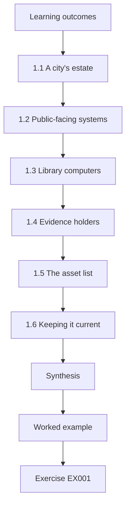

### Logical drawing

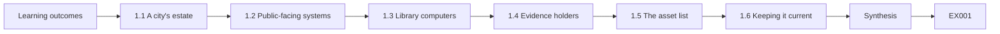

```text
[Learning outcomes]
    |
    v
[1.1 A city's estate]
    |
    v
[1.2 Public-facing systems]
    |
    v
[1.3 Library computers]
    |
    v
[1.4 Evidence holders]
    |
    v
[1.5 The asset list]
    |
    v
[1.6 Keeping it current]
    |
    v
[Synthesis]
    |
    v
[Worked example] --> [Exercise EX001]
```
<!-- cykin:lesson-figures:end ch-01 -->


### Learning outcomes

You will (1) map the computing estate of a municipal IT service; (2) identify which systems hold evidence useful to CTI; (3) explain why public-facing services attract attackers; (4) keep an asset list good enough for intelligence matching.

### 1.1 A city's estate

Corvale Municipal Services runs desktops for council staff, library public-access computers, a permits portal, a payments portal, email, a directory, file servers and a backup system. Each serves residents or staff and each can be the target or the evidence source in an intrusion.

Lena groups these systems by who uses them, because that decides which intelligence matters. Staff use desktops, email, the directory and file servers; residents use the permits and payments portals and the library computers; the backup system serves everything behind the scenes. An advisory about one of these groups rarely matters to all of them, so the grouping speeds up her first question about relevance.

### 1.2 Public-facing systems

The permits and payments portals are reachable from the internet. Exploit Public-Facing Application (T1190) in MITRE ATT&CK describes attackers abusing weaknesses in such services. Intelligence about vulnerabilities in the portal software therefore has direct value to CMS.

Being reachable from the internet means anyone can try the portals at any time, without first getting inside the council network. A flaw in the payments portal software could be found by an attacker scanning widely, not just by someone targeting Corvale. That is why Lena reads advisories about portal software first, and why the exposure column on her asset list matters so much.

### 1.3 Library computers

Public-access machines are used by anyone. They are reset daily, have no staff accounts and sit on a separate network. Intelligence about malware spreading by USB matters here; intelligence about executive phishing does not.

The daily reset and separate network limit what an infection on a library machine can reach: it cannot spread to staff systems and is wiped by the next morning. USB malware still matters, because a resident's infected stick can carry it in and another resident can carry it out on the same day. Lena therefore files intelligence by whether it fits these machines' real use.

### 1.4 Evidence holders

Email gateway, web proxy, DNS resolver, directory and endpoint agents keep logs. Lena lists each, its retention period and who can query it, because an indicator nobody can search for is useless.

For each log source Lena records how long entries are kept, because an indicator shared today about activity three weeks ago is useful only if the logs still reach back that far. She also records who can run queries, since a source she cannot search herself means waiting for its owner. Both facts decide how fast an indicator can be checked.

### 1.5 The asset list

A spreadsheet of product, version, owner and exposure (internet, internal, public-access) is enough to start. When MCX shares an advisory, Lena checks the product column first.

A spreadsheet is enough because the question Lena asks most often is simple: does CMS run this product, and where. Owner tells her who to send an advisory to, version tells her whether the flaw applies, and exposure tells her how urgent it is. The worked example below shows all three columns used together for one advisory.

### 1.6 Keeping it current

Every change ticket that adds or removes a system updates the list. Lena checks the list against the network team's scan results each quarter and flags differences to owners.

The quarterly comparison catches systems that were added without a change ticket. A difference between the list and the scan is either a system missing from the list or one on the list that no longer exists; either way the owner is asked to confirm. Without this check, an advisory about a forgotten system would be matched against nothing.

### Worked example

MCX warns about a flaw in a document-management product. Lena searches the asset list: CMS runs it internally for planning records, version 7.2, not internet-facing. She sends the advisory to the owner marked "internal exposure, patch in normal cycle unless exploitation is reported", rather than raising an emergency.

> **Synthetic case.** CMS, the product and the advisory are invented.

### Errors and limits

Shadow IT — systems departments bought without telling IT — will be missing from the list. Ask departments directly.

### Exercises

- **EX001 — Portal technique.** Which ATT&CK technique describes abuse of the payments portal's software flaws? *Rubric:* 3 = T1190 Exploit Public-Facing Application with reason; 2 = name; 1 = T1566; 0 = none.
- **EX002 — Library relevance.** Why is executive-phishing intelligence low priority for library computers? *Rubric:* 3 = no staff accounts/email, reset daily, separate network; 2 = one; 1 = high priority; 0 = none.
- **EX003 — Exposure call.** How did exposure change Lena's handling of the document-management advisory? *Rubric:* 3 = internal-only → normal patch cycle unless exploited; 2 = partial; 1 = emergency; 0 = none.

### Synthesis

Know the estate, its exposure and its logs; keep a simple, current asset list so intelligence can be matched quickly.

### Continue studying — chapter 01 of 30

[← Course home](../../README.md) · [Course chapter index](../SUBJECTS.md) · [Chapter 02 (draft) →](#ch-02)

<a id="ch-02"></a>

## Chapter 2 — Networks and internet services

<!-- cykin:lesson-figures:start ch-02 -->
### Lesson map

Lesson 02 published. Map, example, EX004.

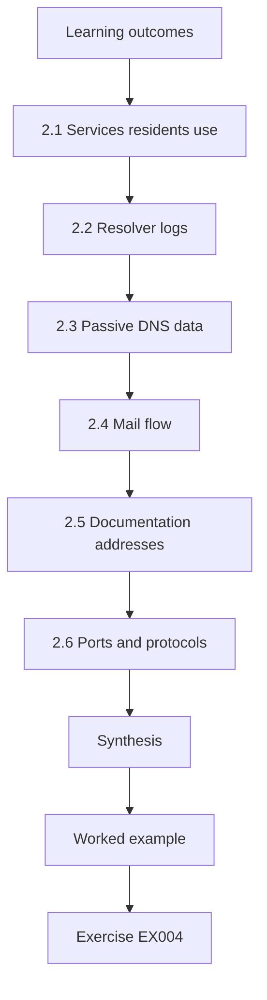

### Logical drawing

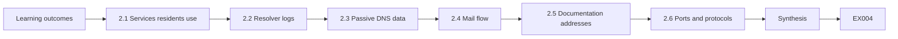

```text
[Learning outcomes]
    |
    v
[2.1 Services residents use]
    |
    v
[2.2 Resolver logs]
    |
    v
[2.3 Passive DNS data]
    |
    v
[2.4 Mail flow]
    |
    v
[2.5 Documentation addresses]
    |
    v
[2.6 Ports and protocols]
    |
    v
[Synthesis]
    |
    v
[Worked example] --> [Exercise EX004]
```
<!-- cykin:lesson-figures:end ch-02 -->


### Learning outcomes

You will (1) explain how DNS, web and email services expose indicators; (2) read a resolver log line; (3) use public DNS data passively; (4) understand the role of address ranges reserved for documentation.

### 2.1 Services residents use

Residents reach CMS through the website, the permits portal and email. Each depends on DNS records that CMS publishes. Attackers imitate these names with lookalike domains to trick residents into paying fake fees.

A resident who receives a message with a link has no easy way to tell corvale-permits-pay.example from a name CMS really publishes. Lena keeps a list of the council's genuine names, so a new lookalike can be compared against it. The fraud aims at residents, but CMS learns about it from residents' reports and from its own logs.

### 2.2 Resolver logs

A resolver log line typically records time, client, queried name and answer. Lena reads lines such as "08:03 ws-114 pay-portal.example". The client tells her which machine asked; the name tells her whether it matches an indicator.

If pay-portal.example is on an indicator list, the line shows that ws-114 at least looked up the name at 08:03. It does not show that the machine connected or entered anything, so Lena treats it as a lead to check, not proof of harm.

### 2.3 Passive DNS data

Some services publish historical DNS resolutions collected from many resolvers. Looking up a name there is passive: CMS does not contact the suspicious server. Lena may use services CMS has approved and whose terms allow this use.

Being passive matters because contacting a suspicious server could alert its operator or expose CMS's interest. A passive lookup answers questions such as when a name first resolved, without any CMS system touching it. Lena uses only approved services because their terms set what she may look up and how results may be shared.

### 2.4 Mail flow

Email enters through CMS's gateway, which logs sender, recipient, subject and attachment names. Phishing (T1566) indicators — sender domains, subjects, attachment hashes — are checked here.

The gateway log lets Lena check whether a phishing indicator from MCX has already reached CMS mailboxes. A matching sender domain or attachment hash shows which staff received the message and when. Her log-source notes say who can query the gateway, so she knows at once whether to search it herself or ask its owner. Attachment names in the log help when MCX shares a file name but no hash, though names are easy for attackers to change.

### 2.5 Documentation addresses

This course uses the ranges 192.0.2.0/24, 198.51.100.0/24 and 203.0.113.0/24, which RFC 5737 reserves for documentation, and the .example domain. Real addresses never appear in teaching material, so nobody blocks or investigates an innocent party by copying an example.

Using these ranges means an example in this book, such as 198.51.100.23, can be pasted into a search or a block list without harming anyone, because no real system uses that address. The 203.0.113.300 value in the chapter 3 lab is deliberately invalid as well as reserved, so it tests the validation step without pointing anywhere real.

### 2.6 Ports and protocols

Web services use 443 (HTTPS); mail uses 25 between servers. Traffic from office desktops to unusual ports is worth noting, but council applications sometimes use odd ports legitimately — check with owners before treating it as suspicious.

A council planning application might use an unusual port for its database, which looks odd in a log but is normal. Asking the owner first avoids sending an alert, or worse a block, against a service the council depends on. Lena records each confirmed exception so the same question is not asked again every time the port appears.

### Worked example

Residents report a text message linking to "corvale-permits-pay.example". Lena checks passive DNS through the approved service: the name first resolved three days ago. The resolver log shows two staff machines also looked it up after receiving the same text on work phones. She reports both findings to her supervisor.

> **Synthetic case.** The message and domain are invented.

### Errors and limits

Passive DNS coverage is incomplete; absence of records does not prove a name is unused.

### Exercises

- **EX004 — Log reading.** In "08:03 ws-114 pay-portal.example", what are the three fields? *Rubric:* 3 = time, client host, queried name; 2 = two; 1 = one; 0 = none.
- **EX005 — Passive meaning.** Why is a passive DNS lookup acceptable when visiting the site is not? *Rubric:* 3 = no contact with suspect server; approved service/terms; 2 = partial; 1 = both fine; 0 = none.
- **EX006 — Reserved ranges.** Why does teaching material use RFC 5737 addresses? *Rubric:* 3 = reserved for documentation; avoids harming real parties; 2 = partial; 1 = random; 0 = none.

### Synthesis

DNS, web and mail logs reveal indicator contact; use passive data through approved services and teach only with reserved examples.

### Continue studying — chapter 02 of 30

[← Chapter 01 (draft)](#ch-01) · [Course chapter index](../SUBJECTS.md) · [Chapter 03 (draft) →](#ch-03)

<a id="ch-03"></a>

## Chapter 3 — Programming foundations

<!-- cykin:lesson-figures:start ch-03 -->
### Lesson map

Lesson 03 published. Map, example, EX007.

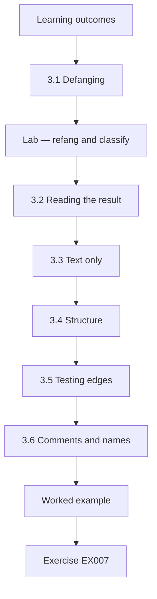

### Logical drawing

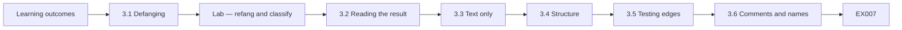

```text
[Learning outcomes]
    |
    v
[3.1 Defanging]
    |
    v
[Lab — refang and classify]
    |
    v
[3.2 Reading the result]
    |
    v
[3.3 Text only]
    |
    v
[3.4 Structure]
    |
    v
[3.5 Testing edges]
    |
    v
[3.6 Comments and names]
    |
    v
[Worked example] --> [Exercise EX007]
```
<!-- cykin:lesson-figures:end ch-03 -->


### Learning outcomes

You will (1) write small Python scripts that handle indicators as text; (2) refang defanged values safely; (3) validate addresses with the standard library; (4) keep scripts free of network activity.

### 3.1 Defanging

Analysts write "pay-portal[.]example" or "hxxps://" so that links in reports cannot be clicked by accident. Scripts must convert these back to normal form — refang — before matching against logs, but only as text.

The square brackets break the domain so that a mail client or document viewer does not turn it into a link. Refanging reverses that only inside the script, where the value is compared with log lines as plain text. In the lab, `replace("[.]", ".")` and `replace("hxxp", "http")` do the conversion, and nothing in the code opens a connection to the resulting host.

### Lab — refang and classify

```python
"""Lab (ch 03): refang defanged indicators safely as text and classify them (synthetic; no network)."""
import ipaddress
raw = ["hxxps://pay-portal[.]example/login", "198.51.100[.]23", "update-svc[.]example", "203.0.113.300", "notes"]
for r in raw:
    v = r.replace("[.]", ".").replace("hxxp", "http")
    host = v.split("//")[-1].split("/")[0]
    try:
        ipaddress.ip_address(host); kind = "ipv4"
    except ValueError:
        kind = "domain" if "." in host and not host.replace(".", "").isdigit() else "invalid"
    print(f"{r} -> {host} [{kind}]")
```

Run with `python3 lab_defang.py`. Verified output:

```text
hxxps://pay-portal[.]example/login -> pay-portal.example [domain]
198.51.100[.]23 -> 198.51.100.23 [ipv4]
update-svc[.]example -> update-svc.example [domain]
203.0.113.300 -> 203.0.113.300 [invalid]
notes -> notes [invalid]
```

### 3.2 Reading the result

The defanged URL becomes host pay-portal.example, classified as a domain. 198.51.100[.]23 becomes a valid IPv4 address. update-svc[.]example is a domain. 203.0.113.300 is invalid because 300 exceeds the maximum octet value of 255; the `ipaddress` module rejects it. "notes" is a stray word and is marked invalid rather than guessed.

Two of the five inputs are rejected, and for different reasons. The first is a well-formed address with an impossible octet, caught by the standard library rather than by a hand-written check. The second is not an indicator at all, the kind of stray word that slips into a pasted list. Marking both invalid means a human looks at them instead of the script deciding.

### 3.3 Text only

The script never opens a connection. Refanging for matching is safe; refanging for clicking is not. Keep defanged forms in documents and refanged forms only inside matching code.

In the lab the refanged value lives only in the variable `v` and in the printed line, which is a text label, not a link. If a report needs to show the indicator, it shows the defanged form. That way a reader who clicks by mistake reaches nothing, and the matching code still works on the normal form it needs.

### 3.4 Structure

Small functions — refang, extract host, classify — are easier to test than one long block. Each has one job.

The lab is short enough to keep in one loop, but its three steps are already distinct: refang the value, take the host from a URL, then classify the host. Splitting them into functions lets Lena test each step alone, for example checking that host extraction handles a URL with a path without also testing classification. Small functions also make reviews easier, because each change a colleague reads touches one clearly named job.

### 3.5 Testing edges

Test with values like trailing dots, capital letters and ports ("host.example:8443"). Each edge case either passes cleanly or produces a clear "invalid" so a human can look.

Each of those edge cases carries a clear risk for matching. A trailing dot or capital letters could make the same domain look like two values, and a port number could stop the classifier recognising a host. Lena adds such cases to her test list one at a time and writes down the expected label before running the script, so a surprise is visible.

### 3.6 Comments and names

Name variables for what they hold — `host`, `kind` — not `x` and `y`. A one-line docstring at the top states the script's purpose and that it uses synthetic data, which helps reviewers and future maintainers.

The lab's own docstring follows this rule: it says what the lab does, that it is synthetic and that it uses no network. A reviewer reading only that line knows the script is safe to run. Clear names matter when the script is reused months later by a colleague who has not seen Lena's notes.

### Version control

Keep scripts in the team's repository with short commit messages. When a script's output changes, the history shows which edit caused it, and colleagues can review changes before they affect daily matching.

### Worked example

Lena pastes 30 values from an MCX email. Her script classifies 27 and marks three invalid: two had octets above 255, typos introduced when the sender typed them. She asks MCX for corrections instead of guessing which digit was wrong.

> **Synthetic case.** The values are invented.

### Errors and limits

Simple host extraction fails for unusual URL forms; keep a manual review queue.

### Exercises

- **EX007 — Invalid octet.** Why was 203.0.113.300 marked invalid? *Rubric:* 3 = octet above 255; ipaddress rejects; 2 = partial; 1 = range reserved; 0 = none.
- **EX008 — Why defang.** What risk does defanging reduce in reports? *Rubric:* 3 = accidental clicks/auto-linking to malicious sites; 2 = partial; 1 = vague; 0 = none.
- **EX009 — Typo handling.** What should Lena do with indicators containing typos? *Rubric:* 3 = mark invalid, ask sender; do not guess; 2 = discard; 1 = guess; 0 = none.

### Synthesis

Refang only as text for matching, validate with the standard library, flag rather than guess, and test edge cases.

### Continue studying — chapter 03 of 30

[← Chapter 02 (draft)](#ch-02) · [Course chapter index](../SUBJECTS.md) · [Chapter 04 (draft) →](#ch-04)

<a id="ch-04"></a>

## Chapter 4 — Data models

<!-- cykin:lesson-figures:start ch-04 -->
### Lesson map

Lesson 04 published. Map, example, EX010.

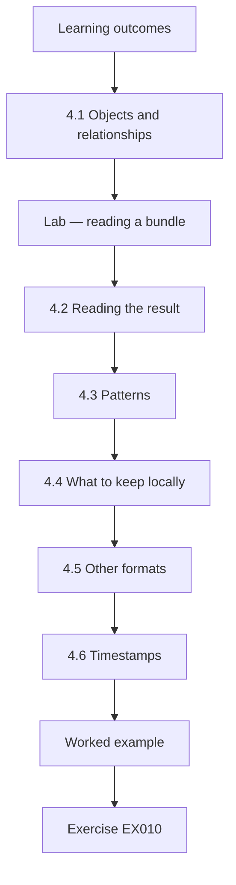

### Logical drawing

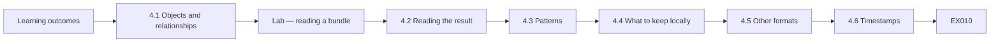

```text
[Learning outcomes]
    |
    v
[4.1 Objects and relationships]
    |
    v
[Lab — reading a bundle]
    |
    v
[4.2 Reading the result]
    |
    v
[4.3 Patterns]
    |
    v
[4.4 What to keep locally]
    |
    v
[4.5 Other formats]
    |
    v
[4.6 Timestamps]
    |
    v
[Worked example] --> [Exercise EX010]
```
<!-- cykin:lesson-figures:end ch-04 -->


### Learning outcomes

You will (1) explain the structure of STIX 2.1 objects; (2) read a bundle with Python's `json` module; (3) check relationships for missing targets; (4) choose fields worth storing locally.

### 4.1 Objects and relationships

STIX 2.1 represents intelligence as typed JSON objects — indicator, attack-pattern, malware, threat-actor, report — each with an `id` made from its type and a unique identifier. Relationship objects connect them with a `source_ref`, a `target_ref` and a `relationship_type` such as "indicates" or "uses".

The `id` field makes each object addressable, so a relationship can point to it by name instead of copying it. An indicator that "indicates" an attack-pattern is therefore two objects and a link between them. This structure lets a sender share pieces separately, which is also how a link can end up pointing to an object that was never sent, as the lab shows.

### Lab — reading a bundle

```python
"""Lab (ch 04): read a small synthetic STIX 2.1-style bundle with json and list objects and links."""
import json
bundle = json.loads('''{"type":"bundle","id":"bundle--1","objects":[
 {"type":"indicator","id":"indicator--a","name":"pay-portal domain","pattern":"[domain-name:value = 'pay-portal.example']","valid_from":"2026-09-01T00:00:00Z"},
 {"type":"attack-pattern","id":"attack-pattern--b","name":"Phishing","external_references":[{"source_name":"mitre-attack","external_id":"T1566"}]},
 {"type":"relationship","id":"relationship--c","relationship_type":"indicates","source_ref":"indicator--a","target_ref":"attack-pattern--b"},
 {"type":"relationship","id":"relationship--d","relationship_type":"indicates","source_ref":"indicator--a","target_ref":"malware--z"}]}''')
ids = {o["id"]: o for o in bundle["objects"]}
from collections import Counter
print(dict(Counter(o["type"] for o in bundle["objects"])))
for o in bundle["objects"]:
    if o["type"] == "relationship":
        ok = o["source_ref"] in ids and o["target_ref"] in ids
        print(o["id"], o["relationship_type"], "OK" if ok else "DANGLING target " + o["target_ref"])
```

Run with `python3 lab_stix.py`. Verified output:

```text
{'indicator': 1, 'attack-pattern': 1, 'relationship': 2}
relationship--c indicates OK
relationship--d indicates DANGLING target malware--z
```

### 4.2 Reading the result

The bundle holds one indicator, one attack-pattern (Phishing, external identifier T1566) and two relationships. The first links the indicator to the attack pattern correctly. The second points to malware--z, which is not in the bundle — a dangling reference. It may exist in the sender's database, but CMS cannot use it without the object.

Lena checks the counts against the bundle text: one indicator, one attack-pattern and two relationships, four objects in all, matching the printed dictionary. The check that finds the dangling link is the simplest possible one, whether each referenced id is present in the bundle, and it is enough to catch the export fault MCX later fixed.

### 4.3 Patterns

An indicator's `pattern` field uses STIX patterning, such as matching a domain-name value. Lena extracts the value for matching but keeps the full pattern for reference.

In the lab bundle the pattern is "[domain-name:value = 'pay-portal.example']", from which Lena extracts the value pay-portal.example. Matching only needs that value, but the full pattern records exactly what the sender meant, including the object type. Keeping both avoids losing information if a later pattern is more complex than a single equality.

### 4.4 What to keep locally

CMS's simple store keeps: indicator value, type, source, TLP marking, valid_from, and linked ATT&CK identifiers. Other fields are stored in the original JSON for reference.

These fields answer the questions Lena asks when a match occurs: what was matched, what kind of value it is, who sent it, how widely it may be shared, since when it applies, and what technique it relates to. The TLP marking is stored with each value, so a match never leads to sharing more widely than the source allowed.

### 4.5 Other formats

Partners also send CSV and email lists. Mapping each to the same local fields lets all sources be searched together.

A CSV row from one partner and an email list from another end up with the same value, type and source fields as an indicator taken from STIX. Lena can then search for pay-portal.example once and see every source that mentioned it. Without the mapping she would search three formats separately and might miss a source. Fields a format lacks, such as a TLP marking in a plain email list, are filled from the message's own label.

### 4.6 Timestamps

STIX timestamps are in UTC with a trailing "Z". Keep them in UTC in storage and convert only when displaying to staff, so comparisons across sources stay correct.

The resolver log and an MCX indicator may come from different systems, but if both are stored in UTC, comparing a lookup time with an indicator's valid_from date is direct. Staff see local time in their reports, converted at display, so they read a familiar clock while the stored records remain consistent with every other source.

### Worked example

Lena reports the dangling reference to MCX. The sender explains that the malware object is TLP:AMBER and was filtered out before the GREEN bundle was published, leaving the relationship behind. MCX fixes its export to drop relationships whose targets are filtered.

> **Synthetic case.** The bundle and exchange are invented.

### Errors and limits

Valid JSON can still be poor intelligence; structure checks are the first step only.

### Exercises

- **EX010 — Object count.** What object types and counts did the lab bundle contain? *Rubric:* 3 = indicator 1, attack-pattern 1, relationship 2; 2 = partial; 1 = wrong; 0 = none.
- **EX011 — Dangling cause.** What caused the dangling reference in the worked example? *Rubric:* 3 = AMBER target filtered out of GREEN export, relationship left; 2 = partial; 1 = typo; 0 = none.
- **EX012 — UTC rule.** Why keep timestamps in UTC in storage? *Rubric:* 3 = consistent comparison across sources; convert only for display; 2 = partial; 1 = no reason; 0 = none.

### Synthesis

Read STIX as typed objects and relationships, check references, keep useful fields and store times in UTC.

### Continue studying — chapter 04 of 30

[← Chapter 03 (draft)](#ch-03) · [Course chapter index](../SUBJECTS.md) · [Chapter 05 (draft) →](#ch-05)

<a id="ch-05"></a>

## Chapter 5 — Security literacy

<!-- cykin:lesson-figures:start ch-05 -->
### Lesson map

Lesson 05 published. Map, example, EX013.

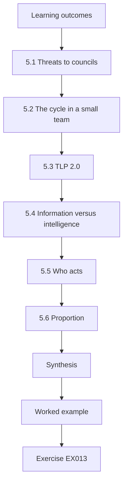

### Logical drawing

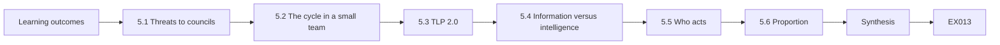

```text
[Learning outcomes]
    |
    v
[5.1 Threats to councils]
    |
    v
[5.2 The cycle in a small team]
    |
    v
[5.3 TLP 2.0]
    |
    v
[5.4 Information versus intelligence]
    |
    v
[5.5 Who acts]
    |
    v
[5.6 Proportion]
    |
    v
[Synthesis]
    |
    v
[Worked example] --> [Exercise EX013]
```
<!-- cykin:lesson-figures:end ch-05 -->


### Learning outcomes

You will (1) describe common threats to local government; (2) explain the CTI cycle in a small team; (3) use TLP 2.0 labels correctly; (4) separate information from intelligence.

### 5.1 Threats to councils

Local governments face payment fraud through lookalike portals, ransomware that disrupts services (Data Encrypted for Impact, T1486), credential phishing against staff, and defacement of public websites. Residents' trust makes even minor incidents newsworthy.

Each threat maps to part of the estate described in chapter 1. Lookalike portals copy the permits and payments services, ransomware would hit file servers and backups, phishing reaches staff email and the directory, and defacement targets the public website. Lena uses that mapping to decide which owner should receive each kind of intelligence.

### 5.2 The cycle in a small team

Direction from the security manager, collection from MCX and public advisories, processing in Lena's scripts, analysis with her supervisor, dissemination to owners and feedback at a weekly meeting. In a team of three, the cycle is informal but each stage still happens.

In practice, the security manager says what to watch, Lena gathers MCX items and public advisories, her scripts deduplicate and classify, and she and her supervisor judge relevance. Owners then receive what they need, and the weekly meeting reviews what was useful. Each stage can be done in minutes, but skipping one usually shows up as noise or a missed item.

### 5.3 TLP 2.0

TLP:CLEAR — no limit. TLP:GREEN — the community, not public. TLP:AMBER — the organisation and its clients, need to know. TLP:AMBER+STRICT — the organisation only. TLP:RED — named recipients only. FIRST's definitions are short; Lena keeps a copy beside her desk.

The difference between AMBER and AMBER+STRICT matters at CMS, because AMBER allows sharing with clients on a need-to-know basis while AMBER+STRICT keeps an item within the organisation. Lena checks the label before forwarding anything outside the security team, and the worked example shows what she does when a wider audience is needed.

### 5.4 Information versus intelligence

A list of fraud domains is information. A note saying "residents are being targeted with fake permit-payment sites this month; we have asked the hosting provider to take two down and posted a warning on the council site" is intelligence: assessed and tied to action.

The second statement adds what the first lacks: who is targeted, what CMS has done and what readers should know. A list of domains leaves every reader to work that out alone. Lena's job is to make the step from list to assessment once, so owners receive something they can act on immediately.

### 5.5 Who acts

Lena informs; owners act. The web team posts warnings; the network team blocks; the communications team speaks to residents.

Keeping action with owners means each team decides in its own area: the web team knows how to word a warning on the site, the network team knows what a block will affect, and communications knows how residents will read a message. Lena's notes name the owner and the suggested action, so nobody has to guess who should move. When an owner decides not to act, Lena records the decision so the weekly meeting can revisit it.

### 5.6 Proportion

Not every advisory is urgent. Lena labels each item as act now, act this week, or note only, so owners can plan.

The three labels map directly onto how owners plan their work. Act now goes to the right owner immediately, such as a block for a domain already in resolver logs; act this week fits a normal patch or change cycle; and note only is filed for reference. The worked example in chapter 1 shows an internal document system routed to the normal patch cycle rather than labelled act now.

### Worked example

An MCX item marked TLP:AMBER describes fraud domains targeting a neighbouring city. Lena may share it with CMS staff who need it, but not post it publicly. The communications team asks for a public warning; Lena asks MCX for a CLEAR version, which arrives the next day.

> **Synthetic case.** The item is invented.

### Errors and limits

TLP labels only work if everyone knows them; brief new staff.

### Exercises

- **EX013 — Council threats.** Name three threats typical for local government. *Rubric:* 3 = three of lookalike payment fraud, ransomware, credential phishing, defacement; 2 = two; 1 = one; 0 = none.
- **EX014 — Public warning.** How did Lena get a publishable version of the AMBER item? *Rubric:* 3 = asked MCX for CLEAR version; 2 = partial; 1 = posted AMBER; 0 = none.
- **EX015 — Item labels.** What three urgency labels does Lena use, and why? *Rubric:* 3 = act now/this week/note only; helps owners plan; 2 = labels only; 1 = one; 0 = none.

### Synthesis

Know the threats, run the cycle even in a small team, apply TLP precisely and turn information into actionable intelligence.

### Continue studying — chapter 05 of 30

[← Chapter 04 (draft)](#ch-04) · [Course chapter index](../SUBJECTS.md) · [Chapter 06 (draft) →](#ch-06)

<a id="ch-06"></a>

## Chapter 6 — Operating systems and virtualization

<!-- cykin:lesson-figures:start ch-06 -->
### Lesson map

Lesson 06 published. Map, example, EX016.

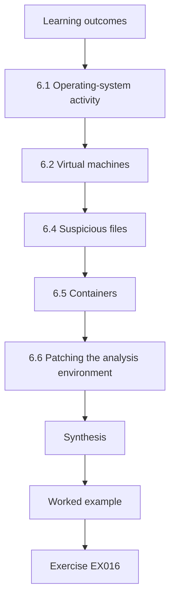

### Logical drawing

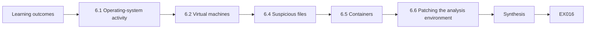

```text
[Learning outcomes]
    |
    v
[6.1 Operating-system activity]
    |
    v
[6.2 Virtual machines]
    |
    v
[6.4 Suspicious files]
    |
    v
[6.5 Containers]
    |
    v
[6.6 Patching the analysis environment]
    |
    v
[Synthesis]
    |
    v
[Worked example] --> [Exercise EX016]
```
<!-- cykin:lesson-figures:end ch-06 -->


### Learning outcomes

You will (1) relate operating-system activity to ATT&CK techniques; (2) use virtual machines safely for analysis tasks; (3) understand snapshots and isolation; (4) know what not to do with suspicious files.

### 6.1 Operating-system activity

Processes, services, scheduled tasks and accounts are where intrusions become visible. ATT&CK techniques such as Command and Scripting Interpreter (T1059) and Scheduled Task/Job (T1053) describe common behaviours. Endpoint logs recording process starts with command lines help confirm or rule out reported behaviour.

When MCX describes behaviour such as a scheduled task with a particular name, the endpoint logs are where CMS can check whether the same thing happened on its own machines. Command lines matter because the same program, such as a scripting interpreter, is used daily by administrators; the arguments are what separate routine maintenance from the behaviour described in a report.

### 6.2 Virtual machines

A virtual machine runs a separate operating system on shared hardware. Analysts use them to read reports, run scripts on synthetic data and open documents in an environment that can be reset. Snapshots capture a known-good state to return to.

For Lena, the main value is being able to undo mistakes. If a document she opens from a partner turns out to be harmful, or a script behaves unexpectedly, she returns the machine to its snapshot and loses nothing that mattered. Her own work, such as notes and scripts, is kept in the team repository rather than only inside the VM.

### 6.3 Isolation limits

Virtual machines reduce risk but are not perfect barriers. Network settings matter: a machine with internet access can still contact adversary servers. CMS's analysis VM has no network route except to the internal update server.

Restricting the analysis VM to the internal update server means a document that tries to fetch something from the internet simply fails. That also stops Lena from accidentally visiting a link from a report, because there is no route to follow it. The single permitted route exists so the machine can still receive patches.

### 6.4 Suspicious files

Technologist-level analysts do not run malware. If a suspicious attachment arrives, Lena records its hash and metadata, submits it through CMS's approved sandbox service if policy allows, and leaves deeper analysis to qualified staff.

Recording the hash and metadata lets Lena check the file against MCX intelligence and the email gateway logs without opening it. The approved sandbox is used only where policy allows, because uploading a council document to an outside service may share information CMS has not agreed to share. Deeper analysis needs skills and safeguards a technologist post does not have.

### 6.5 Containers

Containers share the host kernel and isolate less than virtual machines. They suit packaging scripts, not handling hostile files.

A container is a convenient way to give colleagues Lena's matching scripts with the right Python version, because it starts quickly and behaves the same on each machine. Because it shares the host's kernel, a flaw that lets a process escape would reach the host directly, which is why hostile files stay inside the VM. Lena notes this difference in the team's handling guide, so nobody chooses a container for a task that needs the stronger isolation of a VM.

### 6.6 Patching the analysis environment

Analysis machines need updates too; an outdated VM is an easy target. Lena refreshes the base image monthly and re-creates her snapshot afterwards.

Re-creating the snapshot after each update matters, because otherwise every reset would return the VM to its unpatched state and undo the month's fixes. Lena records the date of each refresh, so she can tell whether a problem appeared before or after an update. A monthly refresh fits the rhythm of the patch releases Lena's tools receive. An outdated VM is especially risky for Lena, because the documents she opens there come from outside the council by design.

### Worked example

An MCX report says attackers created a scheduled task named "CivicUpdate" on council servers. Lena asks the endpoint team to search for scheduled tasks with that name across CMS servers in the past 60 days. None appear. She records the query, period and data source, and notes that two servers lack endpoint agents — a coverage gap she reports.

> **Synthetic case.** The task name and report are invented.

### Errors and limits

A clean search covers only machines with logging; report gaps alongside results.

### Exercises

- **EX016 — Task technique.** Which ATT&CK technique fits a malicious scheduled task? *Rubric:* 3 = Scheduled Task/Job T1053; 2 = name; 1 = T1190; 0 = none.
- **EX017 — VM network.** Why does CMS's analysis VM lack internet access? *Rubric:* 3 = prevents contact with adversary infrastructure/leaks; 2 = partial; 1 = speed; 0 = none.
- **EX018 — Coverage gap.** What gap did Lena report alongside her clean search? *Rubric:* 3 = two servers without endpoint agents; 2 = vague gap; 1 = minimal attempt; 0 = none.

### Synthesis

Map OS behaviours to techniques, analyse in isolated, patched VMs, leave malware to qualified staff and report coverage gaps.

### Continue studying — chapter 06 of 30

[← Chapter 05 (draft)](#ch-05) · [Course chapter index](../SUBJECTS.md) · [Chapter 07 (draft) →](#ch-07)

<a id="ch-07"></a>

## Chapter 7 — Identity and access foundations

<!-- cykin:lesson-figures:start ch-07 -->
### Lesson map

Lesson 07 published. Map, example, EX019.

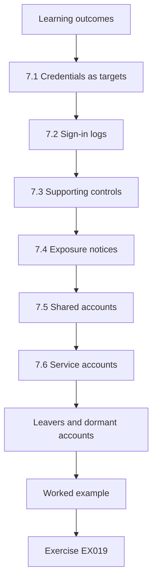

### Logical drawing

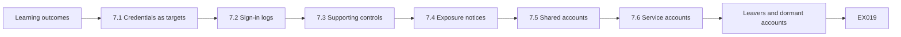

```text
[Learning outcomes]
    |
    v
[7.1 Credentials as targets]
    |
    v
[7.2 Sign-in logs]
    |
    v
[7.3 Supporting controls]
    |
    v
[7.4 Exposure notices]
    |
    v
[7.5 Shared accounts]
    |
    v
[7.6 Service accounts]
    |
    v
[Leavers and dormant accounts]
    |
    v
[Worked example] --> [Exercise EX019]
```
<!-- cykin:lesson-figures:end ch-07 -->


### Learning outcomes

You will (1) explain why stolen credentials are central to many intrusions; (2) read sign-in logs for intelligence matches; (3) support identity controls with intelligence; (4) handle exposed-credential notices safely.

### 7.1 Credentials as targets

Phishing pages that imitate the council's single sign-on page collect staff passwords. Attackers then log in normally — Valid Accounts (T1078). Many intrusions involve no malware at all.

A login with a stolen password looks like the real user to most systems, so no malware alert fires and no unusual file appears. This is why intelligence about credential phishing, such as lookalike sign-on pages, is matched against identity logs and DNS rather than against endpoint protection, which may see nothing at all.

### 7.2 Sign-in logs

The identity provider logs user, time, source address, application and result. When MCX shares addresses used in credential attacks against councils, Lena searches sign-in logs for successful logins from them.

Searching for successful logins matters most, because failures alone show attempts that did not work. A success from an address MCX has linked to credential attacks shows which account may now be in an attacker's hands. Lena records the time range searched with every result, because the addresses are useful only for days before attackers move on.

### 7.3 Supporting controls

Intelligence that councils face password-spraying justifies lockout thresholds and multi-factor authentication for all staff, including part-time library workers who were previously exempt.

The library workers were exempt from multi-factor authentication, which made their accounts the easiest target for password-spraying, since the attacker tries a few common passwords across many accounts. Intelligence that other councils face this attack gives the security manager evidence to remove the exemption, rather than an abstract argument about good practice. Lockout thresholds also limit how many guesses an attacker can make against one account before it is temporarily locked.

### 7.4 Exposure notices

Sometimes a partner reports CMS addresses found in a public credential dump. Lena never tests the passwords. She passes the list to the identity team through a restricted ticket; they force resets.

Testing the passwords, even to see whether they still work, would mean using credentials CMS staff never gave her and logging into accounts that are not hers. The restricted ticket limits who can see the list, because it contains staff names and possibly passwords. Forced resets make the leaked passwords useless whether or not they were still valid.

### 7.5 Shared accounts

Shared logins on library staff desks make it impossible to tell who did what. Intelligence about account abuse strengthens the case for individual accounts.

When a shared library login appears in an alert, nobody can say which staff member was at the desk, so investigation stops at the account. Individual accounts make each action traceable and let one account be disabled without locking out every library desk. MCX reports of account abuse at other councils give the case concrete examples.

### 7.6 Service accounts

Accounts used by applications often have broad rights and passwords that never change. When intelligence describes attackers seeking such accounts, the identity team reviews their rights and rotates credentials first.

Service accounts are attractive because one stolen password may give broad access and nobody notices unusual use. Reviewing rights first reduces what a stolen password could do, and rotation makes an older stolen password useless. The identity team schedules rotation with application owners, because changing a password the application still uses would break it.

### Leavers and dormant accounts

Accounts of staff who have left are attractive to attackers because nobody notices their use. A monthly report of accounts with no sign-in for 60 days, checked against human-resources leaver lists, closes many quiet entry points.

### Worked example

MCX shares five addresses used in password-spraying against councils. Lena's search finds 40 failed logins and one success from one address against a parks-department account. The identity team resets the password, revokes sessions and reviews the account's recent actions. The user had reused a password from a breached shopping site.

> **Synthetic case.** The addresses and account are invented.

### Errors and limits

Attackers rotate addresses quickly; address matches are useful for days, not months.

### Exercises

- **EX019 — No malware.** Explain how an intrusion can succeed without malware. *Rubric:* 3 = stolen credentials, valid-account login (T1078); 2 = partial; 1 = impossible; 0 = none.
- **EX020 — Testing passwords.** Why must Lena never test passwords from a dump? *Rubric:* 3 = unauthorised access/legal and policy breach; identity team resets instead; 2 = partial; 1 = acceptable; 0 = none.
- **EX021 — Spraying response.** List the identity team's three actions after the successful spray login. *Rubric:* 3 = reset password, revoke sessions, review actions; 2 = two; 1 = one; 0 = none.

### Synthesis

Credentials are prime targets; match intelligence against sign-in logs, support identity controls and handle exposure notices without touching passwords.

### Continue studying — chapter 07 of 30

[← Chapter 06 (draft)](#ch-06) · [Course chapter index](../SUBJECTS.md) · [Chapter 08 (draft) →](#ch-08)

<a id="ch-08"></a>

## Chapter 8 — Security architecture basics

<!-- cykin:lesson-figures:start ch-08 -->
### Lesson map

Lesson 08 published. Map, example, EX022.

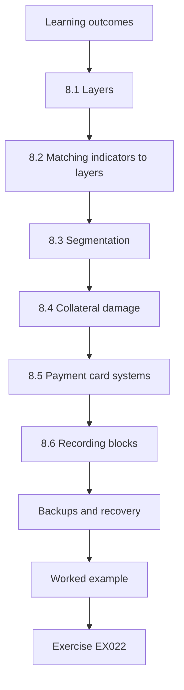

### Logical drawing

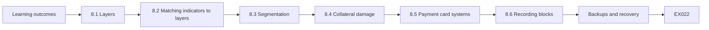

```text
[Learning outcomes]
    |
    v
[8.1 Layers]
    |
    v
[8.2 Matching indicators to layers]
    |
    v
[8.3 Segmentation]
    |
    v
[8.4 Collateral damage]
    |
    v
[8.5 Payment card systems]
    |
    v
[8.6 Recording blocks]
    |
    v
[Backups and recovery]
    |
    v
[Worked example] --> [Exercise EX022]
```
<!-- cykin:lesson-figures:end ch-08 -->


### Learning outcomes

You will (1) describe layered defences in a municipal network; (2) choose the right layer for each indicator type; (3) explain segmentation of public-access networks; (4) recognise collateral damage from blocking.

### 8.1 Layers

Email gateway, DNS filter, web proxy, endpoint protection, identity provider, network segmentation and backups. Each layer can use some intelligence; none uses all of it.

Lena keeps a short note of what each layer can accept: domains for DNS, addresses for the firewall, hashes for endpoint protection, sender details for the email gateway. That note answers the first question for every new indicator, which is where it can actually be used, before anyone discusses whether it should be. The backup layer cannot take indicators at all, so ransomware intelligence reaches it only as advice about design.

### 8.2 Matching indicators to layers

Sender domains go to the email gateway; malicious domains to DNS and proxy; file hashes to endpoint protection; addresses used in password attacks to identity-provider conditional access; ransomware technique intelligence to backup design.

The ransomware item in that list is different from the rest: it does not produce a block, but supports a design decision such as keeping an offline backup. Lena routes each type to the owner of the matching layer, so a hash does not end up in a firewall request where it could never match anything.

### 8.3 Segmentation

Library public computers, staff desktops, servers and payment systems sit in separate zones. Intelligence about attackers moving between systems via remote services (T1021) supports keeping those zones strictly separated.

If library public computers could reach staff servers, an infection brought in on a resident's USB stick would have a path to council data. Keeping the zones separate means an attacker who gains one zone must still cross a boundary, where the network team can watch and block. Intelligence about lateral movement reminds owners why that boundary must stay strict.

### 8.4 Collateral damage

Blocking a shared hosting address can cut off a legitimate supplier. Blocking a popular file-sharing domain stops staff from receiving planning documents. Before blocking, Lena checks whether the indicator is shared or popular and asks the owner.

The cost of a wrong block falls on residents and staff, not on the attacker, who usually moves to a new address. Lena checks how many sites share an address and whether a domain is widely used before recommending a block. The worked example shows that the narrower choice, a domain rather than an address, often achieves the same protection.

### 8.5 Payment card systems

The payments portal falls under card-industry rules. Changes there go through its own approval process; intelligence is passed to its owner, not applied directly.

The card rules require changes to the payments portal to be approved and recorded, so a block or configuration change applied directly by the security team could break compliance as well as the service. Lena therefore sends intelligence about payment fraud or portal software to the payments owner, who decides whether and how to act. Lena still records each item she sends there, so the payments owner's decision appears in her monthly table.

### 8.6 Recording blocks

Every block is recorded with its source, reason, date and review date. When a resident complains that a site is unreachable, the service desk can check the record and lift a mistaken block quickly.

The review date makes each block temporary unless renewed, which matters because addresses and domains change hands. A domain used for fraud today may be cleaned up or sold within months. Recording the source also lets Lena remove every block based on a feed that later proves unreliable, without hunting through firewall rules one by one.

### Backups and recovery

Ransomware intelligence often reports attackers deleting backups before encrypting. CMS keeps an offline copy and tests restores every quarter, so a council service can be rebuilt even if online copies are destroyed.

### Worked example

MCX lists an address hosting a fraud page. Lena checks it: a large cloud provider address used by thousands of sites. She recommends blocking the specific domain at DNS instead of the address at the firewall, and reporting the page to the provider's abuse team through the supervisor.

> **Synthetic case.** The address and page are invented.

### Errors and limits

Layer choices depend on what each tool supports; check product capabilities.

### Exercises

- **EX022 — Hash layer.** Where should a malicious attachment hash be enforced? *Rubric:* 3 = endpoint protection/mail attachment scanning; 2 = one; 1 = firewall; 0 = none.
- **EX023 — Cloud address choice.** Why block the domain at DNS rather than the address at the firewall? *Rubric:* 3 = address shared by many sites; collateral; domain precise; 2 = partial; 1 = no difference; 0 = none.
- **EX024 — Block record.** What should each block record contain? *Rubric:* 3 = source, reason, date, review date; 2 = two; 1 = one; 0 = none.

### Synthesis

Send each indicator to the layer that can use it, segment zones, avoid collateral damage and record every block.

### Continue studying — chapter 08 of 30

[← Chapter 07 (draft)](#ch-07) · [Course chapter index](../SUBJECTS.md) · [Chapter 09 (draft) →](#ch-09)

<a id="ch-09"></a>

## Chapter 9 — Evidence and measurement

<!-- cykin:lesson-figures:start ch-09 -->
### Lesson map

Lesson 09 published. Map, example, EX025.

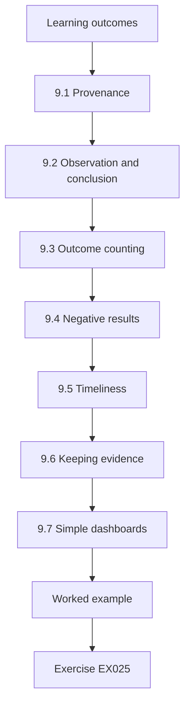

### Logical drawing

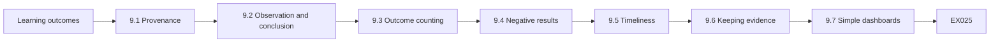

```text
[Learning outcomes]
    |
    v
[9.1 Provenance]
    |
    v
[9.2 Observation and conclusion]
    |
    v
[9.3 Outcome counting]
    |
    v
[9.4 Negative results]
    |
    v
[9.5 Timeliness]
    |
    v
[9.6 Keeping evidence]
    |
    v
[9.7 Simple dashboards]
    |
    v
[Worked example] --> [Exercise EX025]
```
<!-- cykin:lesson-figures:end ch-09 -->


### Learning outcomes

You will (1) record the provenance of each intelligence item; (2) separate what was observed from what was concluded; (3) count outcomes rather than activity; (4) report negative results with their coverage.

### 9.1 Provenance

For every item Lena records who sent it, when, how, under which TLP, and what the sender based it on. Without provenance, the same indicator copied by three newsletters looks like three confirmations.

Provenance answers the question of how much weight an item deserves. If three newsletters all repeat one MCX post, the indicator has one source, not three, and counting it three times would overstate confidence. The worked example below shows the method on exactly that case. How the item arrived matters too, since an email from an unknown address claiming to be MCX deserves checking before it is trusted.

### 9.2 Observation and conclusion

"The proxy logged ws-114 contacting pay-portal.example at 08:03" is an observation. "A staff member probably entered credentials" is a conclusion. Reports keep them in separate sentences so readers can judge each.

The observation can be checked by anyone with access to the proxy log, while the conclusion depends on what the user did on the page, which the log does not show. Keeping them apart lets a reader accept the first and question the second. It also keeps a manager from treating a guess as a fact when deciding on a password reset.

### 9.3 Outcome counting

"500 indicators imported" counts activity. "Two staff were stopped from reaching the fraud page by the DNS block" counts an outcome. Lena reports both but leads with outcomes in the monthly summary.

The number of indicators imported says nothing about whether anyone was protected, and a large number may only mean a noisy feed. Two blocked visits can be checked against the DNS log and named in the summary, which a raw import count never can. Leading with outcomes keeps the monthly summary about value rather than volume.

### 9.4 Negative results

"No matches" is useful only with its query, time range, data source and coverage. "No DNS lookups of the three domains in the last 30 days across all staff resolvers; library resolvers not included" lets the reader see what was and was not checked.

The example sentence names its gap explicitly: library resolvers were not searched. A reader then knows that a library computer could still have looked up the domains. The worked example below shows the gap mattering, when a widened search found one lookup on a library computer that the narrower search had missed.

### 9.5 Timeliness

Record when intelligence arrived and when it was acted on. Long gaps point to process problems.

For an MCX item about a fraud domain, the time between its arrival and the DNS block is what decides how many residents or staff could still reach the page. Recording both times for every item lets Lena find where delays occur, such as waiting for an owner to reply or a block request sitting in a queue. The median time to action in the monthly table is calculated from these two recorded times for every item that led to action.

### 9.6 Keeping evidence

Exported log extracts used in a finding are saved with the ticket, hashed, and kept under the retention rule. If the finding is challenged, the evidence can be shown exactly as it was.

Hashing the extract at the time it is saved means a later copy can be compared to show it has not changed. Keeping it with the ticket keeps the evidence next to the decision it supported. The retention rule sets how long the extract is kept, so evidence is neither deleted early nor held longer than the council's rules allow.

### 9.7 Simple dashboards

A one-page monthly table — items received, items acted on, blocks that stopped connections, median time to action — gives the manager a view of value without overwhelming detail.

Each column answers a question the manager might ask: how much arrived, how much led to action, whether any action prevented harm, and how fast the team works. Keeping it to a single page means the manager actually reads the table. Lena keeps the detailed records behind it, so any figure can be traced to the items that produced it.

### Worked example

Three newsletters list the same fraud domain. Lena traces them: all cite one MCX post. She records one independent source. Her DNS search shows one lookup by a library computer, outside the staff resolver she usually checks — so her report notes that she widened the search to library resolvers after a colleague's question.

> **Synthetic case.** The sources and lookup are invented.

### Errors and limits

Outcomes rarely prove intelligence alone made the difference; describe contribution.

### Exercises

- **EX025 — Three newsletters.** How many independent sources did Lena record, and why? *Rubric:* 3 = one; all cite same MCX post; 2 = number only; 1 = three; 0 = none.
- **EX026 — Split the sentence.** Separate observation from conclusion in "ws-114 hit the fraud site so the user gave away their password". *Rubric:* 3 = observation: contact logged; conclusion: probable credential entry; 2 = partial; 1 = merged; 0 = none.
- **EX027 — Negative result.** Write a complete "no match" statement. *Rubric:* 3 = query, range, source, coverage gaps; 2 = three; 1 = verdict only; 0 = none.

### Synthesis

Record provenance, separate observation from conclusion, lead with outcomes and give coverage with every negative result.

### Continue studying — chapter 09 of 30

[← Chapter 08 (draft)](#ch-08) · [Course chapter index](../SUBJECTS.md) · [Chapter 10 (draft) →](#ch-10)

<a id="ch-10"></a>

## Chapter 10 — Threat intelligence and OSINT: orientation

<!-- cykin:lesson-figures:start ch-10 -->
### Lesson map

Lesson 10 published. Map, example, EX028.

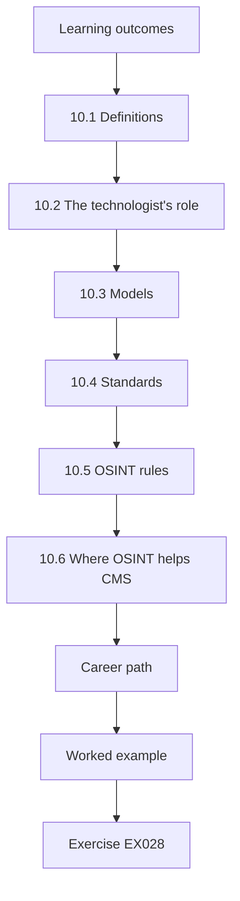

### Logical drawing

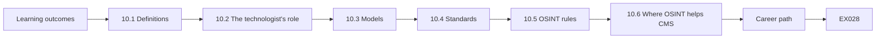

```text
[Learning outcomes]
    |
    v
[10.1 Definitions]
    |
    v
[10.2 The technologist's role]
    |
    v
[10.3 Models]
    |
    v
[10.4 Standards]
    |
    v
[10.5 OSINT rules]
    |
    v
[10.6 Where OSINT helps CMS]
    |
    v
[Career path]
    |
    v
[Worked example] --> [Exercise EX028]
```
<!-- cykin:lesson-figures:end ch-10 -->


### Learning outcomes

You will (1) define CTI and OSINT for a technologist role; (2) place the role within a security team; (3) name the core models and standards; (4) state the ethical rules for OSINT.

### 10.1 Definitions

Cyber threat intelligence is analysed information about threats that supports defensive decisions. Open-source intelligence is intelligence derived from publicly available information collected lawfully. NIST SP 800-150 describes how organisations share threat information to strengthen defences.

The word analysed is what separates intelligence from the lists Lena receives. An MCX list of fraud domains becomes intelligence once someone has judged its relevance to CMS and tied it to a decision, as the permit-payment note in chapter 5 showed. The OSINT definition adds a condition that matters as much as usefulness: the information must be public and gathered lawfully.

### 10.2 The technologist's role

Lena's tasks: collect from approved sources, validate and normalise indicators, match them against logs, maintain the indicator store, draft short notes and support analysts. She does not decide blocks on critical systems or publish attribution.

Every task on that list prepares information for someone else to decide on. Lena's matching may show that ws-114 looked up a fraud domain, but whether to block it on a critical system belongs to the owner. Attribution is left out because naming an actor publicly needs evidence and authority far beyond a work-study post.

### 10.3 Models

The intrusion kill chain (Hutchins, Cloppert and Amin, 2011) splits intrusions into phases, showing where defenders can act. The Diamond Model (Caltagirone, Pendergast and Betz, 2013) describes each event by adversary, capability, infrastructure and victim. MITRE ATT&CK catalogues observed techniques.

Each of the three models answers a different question for Lena. The kill chain asks where in an intrusion CMS can act, the Diamond Model asks what is known about one event and what is missing, and ATT&CK gives a shared name for each technique. Lena already uses ATT&CK identifiers such as T1566 and T1190 in her asset list and notes.

### 10.4 Standards

STIX 2.1 is the data format; TAXII 2.1 the exchange protocol; FIRST TLP 2.0 the sharing labels.

Each standard covers one part of the exchange with MCX. STIX defines how an indicator and its relationships are written, as in the bundle from chapter 4; TAXII defines how CMS collects those bundles from MCX; and TLP tells Lena how widely each item may travel once it arrives. Using shared standards means Lena's scripts can read a bundle from any MCX member without a custom parser for each council. The TLP labels mean the same thing to every member, so an AMBER item from a neighbouring city carries the same limits at CMS as it did where it was written. When a sender departs from a standard, as with the dangling reference in chapter 4, the standard gives Lena a clear basis for asking them to fix it.

### 10.5 OSINT rules

Use only approved sources and methods. Follow each site's terms of service. Do not create fake accounts, join closed groups, or collect personal data beyond the need. Data-protection law applies to public personal data.

These rules apply even when breaking them would be easy, for example joining a closed forum where fraud kits are discussed. A fake account there would breach the site's terms and could expose CMS legally, whatever the intent. The worked example below shows the personal-data rule applied to residents who complained about fraud texts.

### 10.6 Where OSINT helps CMS

Certificate-transparency logs for lookalike domains, public vulnerability advisories, official government alerts, and passive DNS through approved services. These answer CMS questions without touching adversaries.

Each of these sources answers a question that CMS already has. Certificate-transparency logs show new certificates for names resembling Corvale's, which often appear before a fraud page goes live. Advisories answer whether the portal software is affected, and passive DNS shows when a lookalike first resolved, all without CMS touching the suspicious infrastructure. Lena records which approved service answered each question, so a finding can be repeated by a colleague later.

### Career path

Technologists often move into analyst roles after building strong data-handling habits. Writing clear notes, asking good questions and respecting handling rules matter as much as scripting skill in that progression.

### Worked example

A colleague suggests searching social media for the names of people who complained about fraud texts to "see who was targeted". Lena points out that CMS needs the fraud domains, not residents' identities; she collects the domains from CMS's own complaint form instead, where residents agreed to share details.

> **Synthetic case.** The suggestion is invented.

### Errors and limits

Public information can be wrong or planted; validate before use.

### Exercises

- **EX028 — Role boundary.** Name two tasks outside a technologist's authority at CMS. *Rubric:* 3 = deciding blocks on critical systems, publishing attribution; 2 = one; 1 = matching logs; 0 = none.
- **EX029 — Social media idea.** Why did Lena reject searching residents' social media? *Rubric:* 3 = unnecessary personal data; complaint form gives what's needed lawfully; 2 = partial; 1 = acceptable; 0 = none.
- **EX030 — Useful OSINT.** List three OSINT sources that help CMS without touching adversaries. *Rubric:* 3 = three of CT logs, advisories, government alerts, passive DNS; 2 = two; 1 = one; 0 = none.

### Synthesis

Know the definitions, your role, the models and standards, and the ethical limits of OSINT.

### Continue studying — chapter 10 of 30

[← Chapter 09 (draft)](#ch-09) · [Course chapter index](../SUBJECTS.md) · [Chapter 11 (draft) →](#ch-11)

<a id="ch-11"></a>

## Chapter 11 — Threat intelligence and OSINT: assets and context

<!-- cykin:lesson-figures:start ch-11 -->
### Lesson map

Lesson 11 published. Map, example, EX031.

```mermaid
flowchart TD
  N0["Learning outcomes"]
  N1["11.1 Relevance view"]
  N2["11.2 Business impact"]
  N3["11.3 Seasonal context"]
  N4["11.4 Owner conversations"]
  N5["11.5 Dependencies"]
  N6["11.6 Writing context into notes"]
  N7["Crown jewels"]
  N0 --> N1 --> N2 --> N3 --> N4 --> N5 --> N6 --> N7
  N7 --> EX["Worked example"]
  EX --> Q["Exercise EX031"]
```

### Logical drawing

```mermaid
flowchart LR
  N0["Learning outcomes"]
  N1["11.1 Relevance view"]
  N2["11.2 Business impact"]
  N3["11.3 Seasonal context"]
  N4["11.4 Owner conversations"]
  N5["11.5 Dependencies"]
  N6["11.6 Writing context into notes"]
  N7["Crown jewels"]
  N0 --> N1 --> N2 --> N3 --> N4 --> N5 --> N6 --> N7 --> Q["EX031"]
```

```text
[Learning outcomes]
    |
    v
[11.1 Relevance view]
    |
    v
[11.2 Business impact]
    |
    v
[11.3 Seasonal context]
    |
    v
[11.4 Owner conversations]
    |
    v
[11.5 Dependencies]
    |
    v
[11.6 Writing context into notes]
    |
    v
[Crown jewels]
    |
    v
[Worked example] --> [Exercise EX031]
```
<!-- cykin:lesson-figures:end ch-11 -->


### Learning outcomes

You will (1) build a threat-relevance view of CMS assets; (2) link asset types to likely techniques; (3) prioritise intelligence by business impact; (4) keep context current with owners.

### 11.1 Relevance view

Lena adds two columns to the asset list: "services residents depend on" and "techniques of concern". The payments portal: fraud lookalikes and T1190. Staff email: T1566. File servers: T1486. This view lets her sort incoming intelligence quickly.

With these columns, an MCX item about T1190 against payment software sorts straight to the payments portal, while an item about T1486 goes to the file-server owner. Lena no longer reads every item against the whole estate; the technique identifier points to the rows that matter, and the owner column says who receives the note.

### 11.2 Business impact

Payments and permits affect residents directly and bring revenue; the intranet affects only staff. When two advisories arrive together, the one touching resident-facing services goes first.

Resident-facing services carry two kinds of harm at once: residents cannot do what they need, and CMS loses income and trust. An intranet outage inconveniences staff, but a fix can usually wait a day. This ordering lets Lena decide quickly when two items compete for the same morning, without asking the manager every time. Lena writes the reason for the order into her notes, so an owner whose item waited knows why it came second.

### 11.3 Seasonal context

Council tax deadlines and elections bring spikes in fraud and attention. Lena marks those dates on the team calendar so monitoring increases beforehand.

Fraudsters time lookalike payment pages for when residents expect to pay, so a deadline makes fake reminders more convincing. Marking the dates in advance gives time to warn residents and to watch for lookalike domains before the texts start. The worked example below shows this working two weeks before a council-tax deadline. The calendar also includes election dates, when defacement of the council website would attract more attention than usual.

### 11.4 Owner conversations

Owners know what spreadsheets say nothing about: that the permits portal will be replaced in spring, or that a supplier connects every night. Quarterly chats keep context fresh.

Knowing that the permits portal will be replaced in spring changes how Lena treats an advisory for its current software: still relevant now, but not worth a long-term plan. A supplier connecting every night explains traffic that would otherwise look suspicious. Both of these facts come only from talking to the owners themselves. Lena writes down what each owner tells her, so the context survives when she or the owner moves on.

### 11.5 Dependencies

The payments portal depends on an external payment provider. Intelligence about that provider matters to CMS even though CMS does not run it.

CMS cannot patch or monitor the payment provider's systems, but residents will blame the council if payments through its portal go wrong. Intelligence about the provider therefore goes to the payments owner, who can ask the provider questions under their contract. Lena keeps the provider's name beside the payments portal entry, so advisories that mention the provider are matched like any other product. The same applies to any supplier with access to CMS systems, such as the one that connects every night.

### 11.6 Writing context into notes

Each intelligence note names the affected asset, its owner, its exposure and the relevant date context, so the reader understands why the item matters to CMS today.

A note that names the payments portal, its owner, its internet exposure and an approaching tax deadline tells the reader why it cannot wait until next week. Without those details, the same item could look like general news. Writing context in also helps later readers who see the note without knowing what was happening at the time.

### Crown jewels

Ask leadership which three services would cause the most harm if lost for a week. For CMS the answer was payments, permits and the emergency-notification system. Intelligence touching these always receives same-day review, whatever its source or apparent severity.

### Worked example

Two weeks before the council-tax deadline, MCX reports fraud texts imitating tax-payment pages in another city. Lena's relevance view marks payments as top priority and the calendar shows the deadline. She drafts an early warning for the communications team and asks the network team to watch DNS for "tax" lookalikes.

> **Synthetic case.** The report and dates are invented.

### Errors and limits

Relevance views encode assumptions; revisit them when services change.

### Exercises

- **EX031 — Asset technique.** Which technique of concern did Lena assign to file servers, and why? *Rubric:* 3 = T1486 ransomware encryption; holds shared data; 2 = name; 1 = T1566; 0 = none.
- **EX032 — Seasonal spike.** Why mark council-tax deadlines on the calendar? *Rubric:* 3 = fraud spikes; raise monitoring in advance; 2 = partial; 1 = no reason; 0 = none.
- **EX033 — Provider dependency.** Why does intelligence about the payment provider matter to CMS? *Rubric:* 3 = portal depends on it; its compromise affects residents; 2 = partial; 1 = doesn't; 0 = none.

### Synthesis

Tie assets to techniques and impact, watch seasons and dependencies, and keep context fresh with owners.

### Continue studying — chapter 11 of 30

[← Chapter 10 (draft)](#ch-10) · [Course chapter index](../SUBJECTS.md) · [Chapter 12 (draft) →](#ch-12)

<a id="ch-12"></a>

## Chapter 12 — Threat intelligence and OSINT: data flows

<!-- cykin:lesson-figures:start ch-12 -->
### Lesson map

Lesson 12 published. Map, example, EX034.

```mermaid
flowchart TD
  N0["Learning outcomes"]
  N1["12.1 The flow at CMS"]
  N2["Lab — normalise and deduplicate"]
  N3["12.2 Reading the result"]
  N4["12.3 Why keep provenance"]
  N5["12.4 Loss points"]
  N6["12.5 Documentation"]
  N7["12.6 Normalisation rules"]
  N0 --> N1 --> N2 --> N3 --> N4 --> N5 --> N6 --> N7
  N7 --> EX["Worked example"]
  EX --> Q["Exercise EX034"]
```

### Logical drawing

```mermaid
flowchart LR
  N0["Learning outcomes"]
  N1["12.1 The flow at CMS"]
  N2["Lab — normalise and deduplicate"]
  N3["12.2 Reading the result"]
  N4["12.3 Why keep provenance"]
  N5["12.4 Loss points"]
  N6["12.5 Documentation"]
  N7["12.6 Normalisation rules"]
  N0 --> N1 --> N2 --> N3 --> N4 --> N5 --> N6 --> N7 --> Q["EX034"]
```

```text
[Learning outcomes]
    |
    v
[12.1 The flow at CMS]
    |
    v
[Lab — normalise and deduplicate]
    |
    v
[12.2 Reading the result]
    |
    v
[12.3 Why keep provenance]
    |
    v
[12.4 Loss points]
    |
    v
[12.5 Documentation]
    |
    v
[12.6 Normalisation rules]
    |
    v
[Worked example] --> [Exercise EX034]
```
<!-- cykin:lesson-figures:end ch-12 -->


### Learning outcomes

You will (1) trace intelligence from source to enforcement; (2) normalise and deduplicate indicators while keeping provenance; (3) identify points where data is lost or altered; (4) document the flow.

### 12.1 The flow at CMS

MCX TAXII collection and email, a vendor list and public advisories arrive; Lena's scripts normalise and deduplicate them; the indicator store holds results; exports feed the DNS filter, proxy and endpoint tool; feedback returns via tickets.

Each stage in this flow has a clear owner and a clear output. Lena owns the scripts and the store, network and endpoint teams own the tools that receive exports, and tickets carry feedback such as a false positive back to her. Seeing the whole path helps her find where an indicator went missing, as the worked example below shows.

### Lab — normalise and deduplicate

```python
"""Lab (ch 12): normalise and deduplicate indicators from three synthetic sources, keeping provenance."""
rows = [("MCX", "Pay-Portal.example."), ("vendor", "pay-portal.example"), ("public", "198.51.100.23"),
        ("MCX", "198.51.100.23"), ("vendor", "update-svc.example"), ("public", "PAY-PORTAL.EXAMPLE")]
seen = {}
for src, v in rows:
    k = v.strip().lower().rstrip(".")
    seen.setdefault(k, set()).add(src)
print("raw", len(rows), "unique", len(seen))
for k in sorted(seen):
    print(k, sorted(seen[k]))
```

Run with `python3 lab_dedupe.py`. Verified output:

```text
raw 6 unique 3
198.51.100.23 ['MCX', 'public']
pay-portal.example ['MCX', 'public', 'vendor']
update-svc.example ['vendor']
```

### 12.2 Reading the result

Six raw rows collapse to three unique indicators after lower-casing and removing trailing dots. pay-portal.example was reported by MCX, the vendor and a public source; 198.51.100.23 by MCX and a public source; update-svc.example only by the vendor. The script keeps every source for each value.

Lena checks the counts by hand: three spellings of pay-portal.example, two rows for 198.51.100.23 and one for update-svc.example make six rows and three values. The normalisation is the line `v.strip().lower().rstrip(".")`, which removes surrounding spaces, capital letters and a trailing dot.

### 12.3 Why keep provenance

When the vendor later withdraws update-svc.example as a false positive, Lena can remove it confidently because no other source reported it. If she had discarded sources during deduplication, she could not tell.

Removing it is safe because the store shows the vendor as the only source. If MCX had also listed update-svc.example, Lena would keep it and ask MCX whether they agreed with the vendor. Provenance therefore protects both directions: it prevents keeping a withdrawn indicator and prevents deleting one that still has independent support.

### 12.4 Loss points

Data is lost when spreadsheets reformat values, when exports truncate long fields, or when TLP labels are not carried into enforcement tools. Lena checks each hand-off.

Each loss point is silent: a spreadsheet that turns an address into a number, an export that cuts a long domain, or a block that loses its TLP label shows no error. Lena compares counts before and after each hand-off, which is how the shortened domains in the worked example were found. Each check is recorded on the flow diagram with its date, so a later difference can be compared with the last good count.

### 12.5 Documentation

A one-page diagram shows each source, script, store and export with owners and schedules. New staff learn the flow in minutes.

The diagram also records limits found at each step, such as the DNS filter's entry length. Owners and schedules matter when something breaks, because a new colleague can see whom to ask and when the next export should run. A one-page format keeps the diagram current, since it takes little effort to update. Lena updates the diagram whenever a source, script or export changes, and dates each update so readers know how current it is.

### 12.6 Normalisation rules

Rules are written down: lower-case domains, strip trailing dots, keep addresses as written after validation, never alter hashes except to lower-case them. Unwritten rules drift between scripts.

Hashes are only lower-cased because changing anything else would make them refer to a different file. Addresses are kept as written after validation because the `ipaddress` module has already confirmed they are well formed. Writing the rules down lets Lena's deduplication script and any colleague's script produce the same values. Each rule is written beside an example value, so a reader can see exactly what the rule changes and what it leaves untouched.

### Worked example

The DNS filter shows fewer entries than the store. Lena traces the export: the filter accepts at most 64 characters per entry, and two long lookalike domains were silently cut. She shortens nothing; instead she sends those two to the proxy, which accepts them, and notes the limit on the diagram.

> **Synthetic case.** The limits and domains are invented.

### Errors and limits

Normalisation can merge values that are actually different, such as internationalised domains; review edge cases.

### Exercises

- **EX034 — Lab counts.** How many raw and unique indicators did the lab report, and who reported pay-portal.example? *Rubric:* 3 = 6 raw, 3 unique; MCX, public, vendor; 2 = counts only; 1 = wrong; 0 = none.
- **EX035 — Withdrawal confidence.** Why could Lena remove update-svc.example confidently? *Rubric:* 3 = only vendor reported it; provenance kept; 2 = partial; 1 = guessed; 0 = none.
- **EX036 — Silent truncation.** What did Lena do about the filter's length limit? *Rubric:* 3 = routed long domains to proxy; documented limit; 2 = one; 1 = truncated; 0 = none.

### Synthesis

Trace the flow end to end, deduplicate with provenance, find loss points and document the path.

### Continue studying — chapter 12 of 30

[← Chapter 11 (draft)](#ch-11) · [Course chapter index](../SUBJECTS.md) · [Chapter 13 (draft) →](#ch-13)

<a id="ch-13"></a>

## Chapter 13 — Threat intelligence and OSINT: risk scenarios

<!-- cykin:lesson-figures:start ch-13 -->
### Lesson map

Lesson 13 published. Map, example, EX037.

```mermaid
flowchart TD
  N0["Learning outcomes"]
  N1["13.1 Scenario structure"]
  N2["13.2 Grounding"]
  N3["13.3 Mapping"]
  N4["13.4 Bands"]
  N5["13.5 Controls"]
  N6["13.6 Review rhythm"]
  N7["13.7 Audience"]
  N0 --> N1 --> N2 --> N3 --> N4 --> N5 --> N6 --> N7
  N7 --> EX["Worked example"]
  EX --> Q["Exercise EX037"]
```

### Logical drawing

```mermaid
flowchart LR
  N0["Learning outcomes"]
  N1["13.1 Scenario structure"]
  N2["13.2 Grounding"]
  N3["13.3 Mapping"]
  N4["13.4 Bands"]
  N5["13.5 Controls"]
  N6["13.6 Review rhythm"]
  N7["13.7 Audience"]
  N0 --> N1 --> N2 --> N3 --> N4 --> N5 --> N6 --> N7 --> Q["EX037"]
```

```text
[Learning outcomes]
    |
    v
[13.1 Scenario structure]
    |
    v
[13.2 Grounding]
    |
    v
[13.3 Mapping]
    |
    v
[13.4 Bands]
    |
    v
[13.5 Controls]
    |
    v
[13.6 Review rhythm]
    |
    v
[13.7 Audience]
    |
    v
[Worked example] --> [Exercise EX037]
```
<!-- cykin:lesson-figures:end ch-13 -->


### Learning outcomes

You will (1) write threat scenarios grounded in intelligence; (2) map scenarios to ATT&CK techniques and kill-chain phases; (3) estimate likelihood and impact in bands; (4) link scenarios to controls.

### 13.1 Scenario structure

A scenario names the actor type, goal, entry route, key techniques, affected service and impact. Example: "Fraud group registers lookalike payment domains, sends texts to residents, collects card details; residents lose money and trust in CMS falls."

The fraud example fills each part: a fraud group as actor, money as goal, texts with links as entry route, lookalike domains and fake pages as techniques, payments as the affected service, and losses and reduced trust as impact. A scenario missing one part usually means a question nobody has answered yet.

### 13.2 Grounding

Each scenario cites intelligence: MCX reports from other councils, public advisories, CMS incidents. Scenarios without evidence are speculation.

Grounding gives each scenario a reason to exist that a manager can check. The fraud scenario rests on MCX reports of fake payment pages at other councils and on residents' complaints at CMS. A scenario with no such basis may still be worth noting, but it is labelled as speculation so nobody spends money on it as if it were evidenced. Each citation in a scenario uses the source's TLP label, so the scenario itself is marked no more widely than its most restricted source.

### 13.3 Mapping

The ransomware scenario: phishing (T1566) for entry, valid accounts (T1078), remote services (T1021) to spread, encryption (T1486) for impact. Mapped to kill-chain phases: delivery, exploitation via credentials, actions on objectives.

The mapping shows where CMS can act at each step. Phishing is met at the email gateway, valid accounts at the identity provider with MFA, spread through remote services at zone boundaries, and encryption with offline backups. A step with no matching control is visible at once, which is the purpose of the next measure.

### 13.4 Bands

Likelihood: likely, roughly even, unlikely. Impact: minor, moderate, severe. Bands keep discussion honest when data is thin.

Lena rarely has data to calculate a probability, and a precise-looking number would invite arguments about decimals. Three bands are enough to rank scenarios, as the worked example shows: fraud likely and moderate, ransomware roughly even but severe. Managers can then see that rare but severe and frequent but minor need different responses. Lena rates each scenario together with her supervisor, so the band reflects two judgements rather than one person's impression.

### 13.5 Controls

Each scenario lists existing controls and gaps. The fraud scenario: CT-log monitoring exists; resident warnings exist; takedown process is slow — a gap.

Listing gaps next to controls turns the scenario into a request for something specific. For fraud, CT-log monitoring and resident warnings work, but a slow takedown process leaves fraud pages live longer. That gap is what the manager funded in the worked example, which shows the list leading directly to a decision. Gaps are written as specific missing capabilities, so the manager can see what money or time would close each one.

### 13.6 Review rhythm

Scenarios are reviewed every six months, or sooner if MCX reports a new pattern. Retired scenarios are archived, not deleted.

Six months suits a council whose services change slowly, while an MCX report of a new pattern is a reason to review early. Archiving retired scenarios keeps the reasoning behind past decisions, so if a pattern returns, Lena can see what was decided before and why the scenario was retired. Each review records what changed and why, so the history of a scenario's rating can be followed from one review to the next.

### 13.7 Audience

Managers read scenarios to set priorities; engineers read them to choose detections. A short summary line and a technical table serve both.

The summary line for fraud might say that residents are being targeted with fake payment pages and that takedown is slow. The technical table lists the techniques, data sources and detections. A manager reads the first and decides; an engineer reads the second and builds, from the same scenario. Lena checks that the summary line and the table agree, so the two audiences are not given different versions of the same risk.

### Using the Diamond Model

For each scenario, fill the four Diamond vertices: adversary (a fraud group), capability (lookalike pages and text messages), infrastructure (newly registered domains and bulk-text services) and victim (residents paying fees). Gaps in any vertex show where intelligence is missing, and the infrastructure vertex shows which monitoring — such as certificate-transparency checks — can detect the scenario early.

### Worked example

Lena drafts three scenarios: payment fraud, ransomware and website defacement. With her supervisor she rates fraud likely/moderate, ransomware roughly even/severe, defacement likely/minor. The manager funds faster takedown support for fraud and an offline backup test for ransomware.

> **Synthetic case.** The ratings are invented.

### Errors and limits

Scenarios can anchor thinking; add a "surprise" scenario each review.

### Exercises

- **EX037 — Scenario parts.** List six parts of a threat scenario. *Rubric:* 3 = actor, goal, entry, techniques, service, impact; 2 = four; 1 = two; 0 = none.
- **EX038 — Ransomware mapping.** Map the ransomware scenario to four ATT&CK techniques. *Rubric:* 3 = T1566, T1078, T1021, T1486; 2 = three; 1 = one; 0 = none.
- **EX039 — Funding link.** Which two decisions did the scenarios inform? *Rubric:* 3 = takedown support; offline backup test; 2 = one; 1 = vague; 0 = none.

### Synthesis

Write evidence-based scenarios, map them to techniques and phases, rate in bands and tie them to control decisions.

### Continue studying — chapter 13 of 30

[← Chapter 12 (draft)](#ch-12) · [Course chapter index](../SUBJECTS.md) · [Chapter 14 (draft) →](#ch-14)

<a id="ch-14"></a>

## Chapter 14 — Threat intelligence and OSINT: methods I

<!-- cykin:lesson-figures:start ch-14 -->
### Lesson map

Lesson 14 published. Map, example, EX040.

```mermaid
flowchart TD
  N0["Learning outcomes"]
  N1["14.1 Triage questions"]
  N2["14.2 Grading"]
  N3["14.3 Tagging"]
  N4["14.4 The three-line note"]
  N5["14.5 Consistency"]
  N6["14.6 Time budget"]
  N7["14.7 Logging"]
  N0 --> N1 --> N2 --> N3 --> N4 --> N5 --> N6 --> N7
  N7 --> EX["Worked example"]
  EX --> Q["Exercise EX040"]
```

### Logical drawing

```mermaid
flowchart LR
  N0["Learning outcomes"]
  N1["14.1 Triage questions"]
  N2["14.2 Grading"]
  N3["14.3 Tagging"]
  N4["14.4 The three-line note"]
  N5["14.5 Consistency"]
  N6["14.6 Time budget"]
  N7["14.7 Logging"]
  N0 --> N1 --> N2 --> N3 --> N4 --> N5 --> N6 --> N7 --> Q["EX040"]
```

```text
[Learning outcomes]
    |
    v
[14.1 Triage questions]
    |
    v
[14.2 Grading]
    |
    v
[14.3 Tagging]
    |
    v
[14.4 The three-line note]
    |
    v
[14.5 Consistency]
    |
    v
[14.6 Time budget]
    |
    v
[14.7 Logging]
    |
    v
[Worked example] --> [Exercise EX040]
```
<!-- cykin:lesson-figures:end ch-14 -->


### Learning outcomes

You will (1) triage incoming items consistently; (2) grade sources and information; (3) tag items with ATT&CK techniques; (4) write a three-line intelligence note.

### 14.1 Triage questions

Is it relevant to CMS assets? Is it timely? Is it actionable? Is the source known? Items failing relevance are logged and closed.

Lena asks the questions in that order because each one is cheaper to answer than the next. Relevance needs only the asset list; timeliness needs the date; actionability needs a look at what CMS could change; source needs the record of past items. An MCX item about software CMS does not run stops at the first question, logged and closed in under a minute.

### 14.2 Grading

The Admiralty scale grades source reliability A–F and information credibility 1–6. MCX, with a long accurate record, is usually B; an anonymous forum post is F. Information confirmed by CMS's own logs is 1.

The two grades are kept separate because a reliable source can pass on doubtful information and an unknown source can be right. B2 for the invoice-phishing item in the worked example means MCX is usually reliable and the report is probably true. If CMS's own gateway logs later show the same sender domains, the credibility part can move to 1.

### 14.3 Tagging

Lena tags each relevant item with ATT&CK identifiers supported by the text. "Attackers sent invoice emails with links" supports T1566; it does not support T1059 unless the text mentions scripts.

Tagging only what the text supports keeps the tags useful when Lena later searches by technique. If every phishing report were also tagged T1059 on a guess, a search for script-based activity would return items that never mentioned scripts, and the scenario mapping would show threats CMS has no evidence for.

### 14.4 The three-line note

Line one: what happened and where. Line two: relevance to CMS with confidence. Line three: recommended action and owner. Busy owners read three lines.

The worked example below follows this three-line pattern exactly, line by line. Line one says what MCX reported and against whom; line two says why it matters to CMS, the shared invoicing supplier, and gives moderate confidence; line three names actions for the email team and the finance manager. A reader who stops after line three still knows what to do.

### 14.5 Consistency

Lena and her supervisor triage the same ten items monthly and compare decisions, discussing differences.

Ten items a month is small enough to discuss each disagreement. If Lena closes an item her supervisor would have kept, the discussion shows which question they answered differently, often relevance. Over time, the comparison shows whether their decisions are converging, which matters because Lena triages most items alone. They record each disagreement and its resolution in a short table, which becomes a set of worked examples for future triage. When a disagreement turns on a missing rule, such as how to treat vendor blogs, the rule is written down and added to the triage guide.

### 14.6 Time budget

Triage takes minutes per item. If an item needs more, it moves to analysis with a note explaining why.

A few minutes per item keeps the daily flow moving: MCX alone can send many items in a week. Items that need more, such as a fraud domain that may be linked to others, go to analysis with a sentence saying what question remains. That keeps triage from turning into open-ended research on the first interesting item. Lena records the time each item took, so the monthly table can show whether triage is staying within its budget.

### 14.7 Logging

Every item, including closed ones, is logged with date, source, decision and reason, so patterns in irrelevant traffic can be spotted and sources tuned.

Logging closed items shows, for example, that a vendor list sends many items about products CMS does not run. That pattern is invisible if only relevant items are recorded. Lena can then ask the vendor to filter, or lower the feed's priority, using the log as evidence rather than impression. The reason field matters most, because a closed item whose reason is blank cannot be reviewed when the same threat returns.

### Calibrating with peers

At MCX meetings, analysts from different councils grade the same anonymised item and compare. Differences reveal local habits: one city rates vendor blogs C, another B. Agreeing shared guidance makes grades on shared items mean the same thing to every member, which increases trust in the exchange.

### Worked example

Note: "MCX (B2) reports invoice-themed phishing (T1566) against two councils' finance teams this week. Relevant: CMS finance uses the same invoicing supplier; moderate confidence. Action: email team to add sender domains; finance manager to brief staff."

> **Synthetic case.** The report is invented.

### Errors and limits

Grades and tags are judgments; record reasons.

### Exercises

- **EX040 — Triage quartet.** List the four triage questions. *Rubric:* 3 = relevance, timeliness, actionability, source known; 2 = three; 1 = one; 0 = none.
- **EX041 — Tag support.** Does "attackers sent invoice emails with links" support T1059? Explain. *Rubric:* 3 = no; no scripts mentioned; supports T1566; 2 = no; 1 = yes; 0 = none.
- **EX042 — Three-line note.** Write a three-line note for a fictional advisory. *Rubric:* 3 = what/where, relevance+confidence, action+owner; 2 = two; 1 = one; 0 = none.

### Synthesis

Triage consistently, grade and tag with reasons, and write short notes owners can act on.

### Continue studying — chapter 14 of 30

[← Chapter 13 (draft)](#ch-13) · [Course chapter index](../SUBJECTS.md) · [Chapter 15 (draft) →](#ch-15)

<a id="ch-15"></a>

## Chapter 15 — Threat intelligence and OSINT: guided lab

<!-- cykin:lesson-figures:start ch-15 -->
### Lesson map

Lesson 15 published. Map, example, EX043.

```mermaid
flowchart TD
  N0["Learning outcomes"]
  N1["15.1 Lab setup"]
  N2["Lab — matching a log"]
  N3["15.2 Reading the result"]
  N4["15.3 Exact versus substring"]
  N5["15.4 Hand-off"]
  N6["15.5 What a hit means"]
  N7["15.6 Repeat lookups"]
  N0 --> N1 --> N2 --> N3 --> N4 --> N5 --> N6 --> N7
  N7 --> EX["Worked example"]
  EX --> Q["Exercise EX043"]
```

### Logical drawing

```mermaid
flowchart LR
  N0["Learning outcomes"]
  N1["15.1 Lab setup"]
  N2["Lab — matching a log"]
  N3["15.2 Reading the result"]
  N4["15.3 Exact versus substring"]
  N5["15.4 Hand-off"]
  N6["15.5 What a hit means"]
  N7["15.6 Repeat lookups"]
  N0 --> N1 --> N2 --> N3 --> N4 --> N5 --> N6 --> N7 --> Q["EX043"]
```

```text
[Learning outcomes]
    |
    v
[15.1 Lab setup]
    |
    v
[Lab — matching a log]
    |
    v
[15.2 Reading the result]
    |
    v
[15.3 Exact versus substring]
    |
    v
[15.4 Hand-off]
    |
    v
[15.5 What a hit means]
    |
    v
[15.6 Repeat lookups]
    |
    v
[Worked example] --> [Exercise EX043]
```
<!-- cykin:lesson-figures:end ch-15 -->


### Learning outcomes

You will (1) match indicators against a synthetic DNS log; (2) summarise hits per host with first-seen times; (3) avoid false matches from partial strings; (4) turn results into a hand-off for responders.

### 15.1 Lab setup

The lab uses a synthetic resolver log and two indicators. It runs offline in the course virtual machine with the standard library. Students must not paste real CMS logs into lab files.

Keeping real CMS logs out of lab files protects staff privacy and avoids copying council data into teaching material that might be shared. The synthetic log has six lines, which is small enough for a student to check every output by hand. Running offline means the lab cannot contact any of the names it contains.

### Lab — matching a log

```python
"""Lab (ch 15): match a synthetic DNS log against an indicator list and report hits per host."""
iocs = {"pay-portal.example", "update-svc.example"}
log = ["2026-09-04T08:01Z ws-114 intranet.example", "2026-09-04T08:03Z ws-114 pay-portal.example",
       "2026-09-04T08:05Z ws-207 news.example", "2026-09-04T09:12Z ws-207 update-svc.example",
       "2026-09-04T09:13Z ws-207 update-svc.example", "2026-09-04T10:40Z ws-031 pay-portal.example.org"]
hits = {}
for line in log:
    t, host, q = line.split()
    if q in iocs:
        hits.setdefault(host, []).append((t, q))
for h, v in sorted(hits.items()):
    print(h, len(v), "first", v[0][0], v[0][1])
print("non-match kept for review: pay-portal.example.org (suffix differs)")
```

Run with `python3 lab_match.py`. Verified output:

```text
ws-114 1 first 2026-09-04T08:03Z pay-portal.example
ws-207 2 first 2026-09-04T09:12Z update-svc.example
non-match kept for review: pay-portal.example.org (suffix differs)
```

### 15.2 Reading the result

ws-114 looked up pay-portal.example once, first at 08:03 UTC. ws-207 looked up update-svc.example twice, first at 09:12. A lookup of pay-portal.example.org was not matched: it contains the indicator as a substring but is a different domain. The script prints it for review rather than ignoring it silently.

Lena checks the printout against the six lines: two exact matches for ws-207 and one for ws-114, with the 10:40 lookup by ws-031 excluded. The first times printed come from the first matching line for each host. The near miss is printed by a fixed statement in the lab rather than detected by the code, a simplification a real script would replace with a lookalike check.

### 15.3 Exact versus substring

Substring matching would flag pay-portal.example.org and perhaps legitimate names. Exact matching on the full name, after normalisation, avoids false alarms. Separate rules can watch for lookalikes deliberately.

A substring check for pay-portal.example would also match pay-portal.example.org and any longer name containing that text, so every such lookup would look like contact with the fraud domain. Exact matching on the full name keeps each reported hit precise. Lookalike detection is a different question with different tolerance for noise, so it gets its own rule and review.

### 15.4 Hand-off

Responders need host, indicator, first and last time, count and source of the indicator with its TLP. They do not need the script.

Each item in the hand-off answers a responder's question: which machine, what name, when it started, how often, and how much to trust the source and how widely to share. The worked example below gives all of these for both hosts in two lines. The script itself stays with Lena, because responders act on results, not code.

### 15.5 What a hit means

A DNS lookup shows that a machine asked for a name. It does not prove a connection succeeded or a user entered data. Proxy logs and user contact follow.

For ws-114, the lookup at 08:03 shows that the machine asked for pay-portal.example. The proxy log can show whether a page was then fetched, and only the user can say whether anything was typed into it. Lena's hand-off therefore asks the analyst to check proxy logs and contact users, rather than reporting a compromise.

### 15.6 Repeat lookups

ws-207's two lookups a minute apart may be one browser retry or software checking repeatedly. Repeated automatic lookups over hours would suggest installed software rather than a single click.

Two lookups is too few to tell which explanation is right, so Lena reports the count and timing without choosing. Proxy logs for ws-207 around 09:12 can show whether anything was fetched, and further lookups later in the day would point towards software. The vendor's TLP:AMBER label on update-svc.example means the details stay inside CMS.

### 15.7 Lab report

Students record inputs, the command run, the output, interpretation and one improvement they would make, such as reading last-seen times as well as first-seen.

The suggested improvement fits this lab: it prints only the first time per host, so a reader cannot tell when lookups stopped. Adding last-seen would show whether ws-207 kept looking up update-svc.example after 09:13. Recording inputs and the exact command lets a marker rerun the lab and get the same output. The improvement is written as a proposal, not applied to the lab, so the marked output stays the one embedded in the course.

### Worked example

Lena's hand-off: "ws-114 — pay-portal.example (MCX, TLP:GREEN) — 1 lookup at 08:03 UTC. ws-207 — update-svc.example (vendor, TLP:AMBER) — 2 lookups from 09:12 UTC. Please check proxy logs and contact users. One near-miss name (pay-portal.example.org) listed for analyst review."

> **Synthetic case.** The hosts and log are invented teaching material.

### Errors and limits

Logs without client identity (shared resolvers, NAT) cannot pinpoint machines.

### Exercises

- **EX043 — Lab hits.** Report hits per host from the lab with first-seen times. *Rubric:* 3 = ws-114 1 at 08:03 pay-portal; ws-207 2 from 09:12 update-svc; 2 = one host; 1 = wrong; 0 = none.
- **EX044 — Substring trap.** Why was pay-portal.example.org not matched? *Rubric:* 3 = different domain; exact match avoids false alarms; 2 = partial; 1 = bug; 0 = none.
- **EX045 — Lookup meaning.** What does a DNS hit not prove? *Rubric:* 3 = connection success or data entry; needs proxy/user follow-up; 2 = partial; 1 = proves compromise; 0 = none.

### Synthesis

Match exactly, summarise per host, flag near misses for review and hand off what responders need.

### Continue studying — chapter 15 of 30

[← Chapter 14 (draft)](#ch-14) · [Course chapter index](../SUBJECTS.md) · [Chapter 16 (draft) →](#ch-16)

<a id="ch-16"></a>

## Chapter 16 — Threat intelligence and OSINT: methods II

<!-- cykin:lesson-figures:start ch-16 -->
### Lesson map

Lesson 16 published. Map, example, EX046.

```mermaid
flowchart TD
  N0["Learning outcomes"]
  N1["16.1 Pivoting"]
  N2["16.2 Shared services"]
  N3["16.3 Certificate transparency"]
  N4["16.4 Confidence"]
  N5["16.5 Recording pivots"]
  N6["16.6 Stopping rules"]
  N7["16.7 Registration data"]
  N0 --> N1 --> N2 --> N3 --> N4 --> N5 --> N6 --> N7
  N7 --> EX["Worked example"]
  EX --> Q["Exercise EX046"]
```

### Logical drawing

```mermaid
flowchart LR
  N0["Learning outcomes"]
  N1["16.1 Pivoting"]
  N2["16.2 Shared services"]
  N3["16.3 Certificate transparency"]
  N4["16.4 Confidence"]
  N5["16.5 Recording pivots"]
  N6["16.6 Stopping rules"]
  N7["16.7 Registration data"]
  N0 --> N1 --> N2 --> N3 --> N4 --> N5 --> N6 --> N7 --> Q["EX046"]
```

```text
[Learning outcomes]
    |
    v
[16.1 Pivoting]
    |
    v
[16.2 Shared services]
    |
    v
[16.3 Certificate transparency]
    |
    v
[16.4 Confidence]
    |
    v
[16.5 Recording pivots]
    |
    v
[16.6 Stopping rules]
    |
    v
[16.7 Registration data]
    |
    v
[Worked example] --> [Exercise EX046]
```
<!-- cykin:lesson-figures:end ch-16 -->


### Learning outcomes

You will (1) pivot carefully from one indicator to related infrastructure using passive sources; (2) avoid pivoting through shared services; (3) monitor certificate transparency for lookalikes; (4) write findings with confidence levels.

### 16.1 Pivoting

From a fraud domain, an analyst may look at passive DNS (what addresses it used), certificate records (which other names shared the certificate), and registration timing. Each pivot can reveal related infrastructure — or mislead.

In the worked example below, the certificate pivot from corvale-permits-pay.example found a second name, corvale-tax-pay.example, and the address pivot was stopped. Each pivot uses passive data from approved services, so CMS never connects to the fraud infrastructure. The risk is in the reading: a shared address or registrar can make unrelated sites look connected.

### 16.2 Shared services

Cloud hosting, content-delivery networks and privacy-protected registrations are shared by thousands of unrelated customers. Pivoting through them links innocent sites. Lena stops a pivot when the shared item serves many unrelated names.

The address in the worked example below was a large cloud provider address shared by thousands of sites, so following it would have listed thousands of unrelated names as suspects. Blocking any of those names would harm owners who had done nothing wrong. Lena stops at such points and records why, so a reviewer can see the pivot was deliberately ended rather than missed.

### 16.3 Certificate transparency

Publicly trusted certificates appear in public logs. Searching for names containing "corvale" with payment words finds lookalikes early. This is passive and lawful through approved search services.

A certificate is often requested before a fraud page goes live, so a new certificate for a name such as corvale-tax-pay.example can warn CMS before residents receive any text. Searching through approved services keeps the method passive: Lena reads public logs and never contacts the site the certificate was issued for. Lena saves each search with its date, because certificate logs keep growing and a later search returns more results.

### 16.4 Confidence

Write "likely related" only when two independent pivots agree, such as shared certificate and registration minutes apart. One weak link is "possibly related".

In the worked example, the two domains share a certificate issued at the same minute, which is a strong link, and Lena still reports moderate confidence. The address they share counts for nothing, because thousands of sites use it. Writing likely or possibly makes the reader aware of how much weight the link can bear. The confidence wording is copied into the change request, so the network team sees how strong the link is before blocking.

### 16.5 Recording pivots

Each pivot step is logged: source, query, result and decision. Others can repeat or challenge it.

A logged pivot looks like this: certificate search for corvale-permits-pay.example, result a certificate also covering corvale-tax-pay.example, decision follow it. Another analyst can run the same query and either confirm the result or find that the data changed. Without the log, the conclusion would rest only on Lena's memory of each step. Pivots that were stopped are logged as well, with the reason, such as the shared cloud address in the worked example. A reviewer can then see both the paths followed and the paths deliberately left, and judge whether the stopping decisions were sound.

### 16.6 Stopping rules

Set a limit — three pivots or 30 minutes — unless the supervisor extends it. Endless pivoting wastes time and drifts from CMS's question.

The limit protects CMS's question, which is usually what to block and what to report for takedown. After three pivots, new findings tend to be further from Corvale and closer to general infrastructure. If the supervisor extends the limit, the reason is written in the pivot log, so time spent beyond it is a decision rather than drift. The limit also protects Lena's time for triage, which would otherwise wait while one domain absorbed the morning.

### 16.7 Registration data

Public registration records are often redacted for privacy. Analysts do not try to uncover redacted registrant identities; the domain and its timing are enough for defence.

Uncovering a redacted registrant would mean collecting personal data CMS does not need, and possibly using methods outside the approved list. For defence, the facts that matter are the domain, when it was registered and what it resembles. Those are enough to request a block and a takedown. The redaction is respected even when the domain is clearly fraudulent, because the limit concerns CMS's methods rather than the target's character.

### Takedown requests

Takedowns go through CMS's supervisor or a contracted service, citing the impersonation and evidence. Lena prepares the evidence package — screenshots from approved services, certificate records, resident reports — but does not contact hosting providers herself.

### Worked example

From corvale-permits-pay.example, Lena finds the certificate also covers corvale-tax-pay.example, issued the same minute. Passive DNS shows both on a large cloud provider address shared by thousands of sites, so she does not pivot further through the address. She reports both domains as "likely related, moderate confidence" for blocking and takedown requests.

> **Synthetic case.** The domains are invented.

### Errors and limits

Passive datasets are incomplete and sometimes outdated.

### Exercises

- **EX046 — Stop the pivot.** When should Lena stop pivoting through an address? *Rubric:* 3 = shared by many unrelated sites (cloud/CDN); 2 = partial; 1 = never; 0 = none.
- **EX047 — Likely wording.** What evidence justified "likely related" for the two domains? *Rubric:* 3 = same certificate, issued same minute (two links); 2 = one; 1 = address; 0 = none.
- **EX048 — Redacted registrants.** Should Lena try to uncover redacted registrant identities? *Rubric:* 3 = no; privacy; unnecessary for defence; 2 = no; 1 = yes; 0 = none.

### Synthesis

Pivot passively and briefly, stop at shared services, use certificate transparency and calibrate confidence to independent links.

### Continue studying — chapter 16 of 30

[← Chapter 15 (draft)](#ch-15) · [Course chapter index](../SUBJECTS.md) · [Chapter 17 (draft) →](#ch-17)

<a id="ch-17"></a>

## Chapter 17 — Threat intelligence and OSINT: tooling

<!-- cykin:lesson-figures:start ch-17 -->
### Lesson map

Lesson 17 published. Map, example, EX049.

```mermaid
flowchart TD
  N0["Learning outcomes"]
  N1["17.1 The CMS stack"]
  N2["17.2 Scripts or platform"]
  N3["17.3 Securing tools"]
  N4["17.4 API keys"]
  N5["17.5 Maintenance"]
  N6["17.6 Choosing new tools"]
  N7["17.7 Licences"]
  N0 --> N1 --> N2 --> N3 --> N4 --> N5 --> N6 --> N7
  N7 --> EX["Worked example"]
  EX --> Q["Exercise EX049"]
```

### Logical drawing

```mermaid
flowchart LR
  N0["Learning outcomes"]
  N1["17.1 The CMS stack"]
  N2["17.2 Scripts or platform"]
  N3["17.3 Securing tools"]
  N4["17.4 API keys"]
  N5["17.5 Maintenance"]
  N6["17.6 Choosing new tools"]
  N7["17.7 Licences"]
  N0 --> N1 --> N2 --> N3 --> N4 --> N5 --> N6 --> N7 --> Q["EX049"]
```

```text
[Learning outcomes]
    |
    v
[17.1 The CMS stack]
    |
    v
[17.2 Scripts or platform]
    |
    v
[17.3 Securing tools]
    |
    v
[17.4 API keys]
    |
    v
[17.5 Maintenance]
    |
    v
[17.6 Choosing new tools]
    |
    v
[17.7 Licences]
    |
    v
[Worked example] --> [Exercise EX049]
```
<!-- cykin:lesson-figures:end ch-17 -->


### Learning outcomes

You will (1) describe the tools in a small CTI stack; (2) choose between scripts and platforms; (3) secure the tools themselves; (4) maintain tools sustainably.

### 17.1 The CMS stack

Lena's stack: standard-library Python scripts for parsing and matching, a small open-source threat intelligence platform that stores STIX 2.1 and pulls MCX's TAXII 2.1 collection, the log search tool owned by operations, and a shared ticket queue.

Each part has a clear job: scripts do the checks Lena can read line by line, the platform holds and shares indicators in STIX with their TLP marks, the log search tool answers matching questions and the ticket queue carries requests to owners. Because operations owns the log search tool, Lena's searches run under their rules.

### 17.2 Scripts or platform

Scripts are flexible and transparent but depend on their author. A platform offers storage, sharing, TLP marking and a web interface but needs maintenance. CMS uses the platform for storage and sharing and scripts for local checks.

The split between platform and scripts plays to each side's strength. The platform keeps TLP marks and partner data in one controlled place, which a folder of scripts would do badly; scripts handle quick local tasks such as refanging or deduplicating, where Lena wants to see every step. Neither has to do everything at CMS, which keeps both of them simpler.

### 17.3 Securing tools

The platform holds TLP:AMBER partner data, so it needs strong authentication, restricted access, updates and backups. A compromised CTI platform would leak partner trust.

A leak of TLP:AMBER items would expose what other councils shared in confidence, and MCX members might stop sharing with CMS. That loss of trust would last longer than any technical fix. Strong authentication and restricted access therefore protect partners' data as much as CMS's own. Access is limited to the security team, and each account on the platform is reviewed when staff join or leave.

### 17.4 API keys

Keys for MCX's TAXII server live in the platform's secret store, not in scripts or tickets. Rotating them is a scheduled task.

A key pasted into a script or ticket can be copied by anyone who sees it, and remains valid until someone notices. The secret store limits who can read the key and records its use. Scheduled rotation means a key that leaked unnoticed stops working after a known period. Rotation dates appear in the tool register, so a missed rotation is visible to whoever owns the platform that month.

### 17.5 Maintenance

Each tool has an owner, an update schedule and documentation. Lena writes a README for every script: purpose, inputs, outputs, example run.

A README written at the time the script is created costs minutes, while working out an undocumented script a year later can take hours. The example run lets a colleague check that the script still behaves as described. Owners and update schedules apply to the platform as well as to Lena's scripts. The documentation is kept beside the code in the repository, so a change to a script and its README are reviewed together.

### 17.6 Choosing new tools

Before adding a tool, ask what requirement it serves, who maintains it, what data it touches and how it will be retired. Many small teams accumulate tools nobody uses.

The retirement question is often skipped, which is how small teams end up with tools nobody uses but that still hold data. The worked example below applies the data question to a browser extension and finds the answer unacceptable. Asking all four questions before adoption costs less than removing a tool later.

### 17.7 Licences

Open-source licences and commercial terms both apply. Check before redistributing tool outputs or modifying code for partners.

A partner may forbid redistribution of its data, and a tool's licence may limit how its outputs can be shared. If Lena modifies an open-source parser and gives it to MCX members, the licence decides what she must include. Checking first avoids breaching terms CMS agreed to when it adopted the tool. Lena records the licence of each tool in the tool register beside its owner, so the check is quick when a question arises later.

### Testing tool changes

Before upgrading the platform, the team restores last night's backup to a test machine and upgrades that first. If imports or exports break, they find out without losing partner data or interrupting the daily feed to defensive tools.

### Worked example

A colleague finds a browser extension that "auto-checks indicators against 20 online services". Lena reviews it: it sends every highlighted value to external sites, including TLP:AMBER material. She declines it and documents why in the tool register.

> **Synthetic case.** The extension is invented.

### Errors and limits

Tools encode assumptions; read their documentation before trusting outputs.

### Exercises

- **EX049 — Extension risk.** Why was the browser extension declined? *Rubric:* 3 = sends restricted data to external services; TLP breach; 2 = partial; 1 = slow; 0 = none.
- **EX050 — Key storage.** Where should TAXII keys be stored, and where not? *Rubric:* 3 = secret store; not scripts/tickets; 2 = one; 1 = in script; 0 = none.
- **EX051 — Script README.** List the four parts of Lena's script README. *Rubric:* 3 = purpose, inputs, outputs, example run; 2 = three; 1 = one; 0 = none.

### Synthesis

Keep the stack small, secure and documented; choose tools by requirement and protect partner data inside them.

### Continue studying — chapter 17 of 30

[← Chapter 16 (draft)](#ch-16) · [Course chapter index](../SUBJECTS.md) · [Chapter 18 (draft) →](#ch-18)

<a id="ch-18"></a>

## Chapter 18 — Threat intelligence and OSINT: controls

<!-- cykin:lesson-figures:start ch-18 -->
### Lesson map

Lesson 18 published. Map, example, EX052.

```mermaid
flowchart TD
  N0["Learning outcomes"]
  N1["18.1 From note to change"]
  N2["18.2 Change request contents"]
  N3["18.3 Verification"]
  N4["18.4 Rollback"]
  N5["18.5 Review dates"]
  N6["18.6 Avoiding overload"]
  N7["18.7 Mitigation ideas from ATT&CK"]
  N0 --> N1 --> N2 --> N3 --> N4 --> N5 --> N6 --> N7
  N7 --> EX["Worked example"]
  EX --> Q["Exercise EX052"]
```

### Logical drawing

```mermaid
flowchart LR
  N0["Learning outcomes"]
  N1["18.1 From note to change"]
  N2["18.2 Change request contents"]
  N3["18.3 Verification"]
  N4["18.4 Rollback"]
  N5["18.5 Review dates"]
  N6["18.6 Avoiding overload"]
  N7["18.7 Mitigation ideas from ATT&CK"]
  N0 --> N1 --> N2 --> N3 --> N4 --> N5 --> N6 --> N7 --> Q["EX052"]
```

```text
[Learning outcomes]
    |
    v
[18.1 From note to change]
    |
    v
[18.2 Change request contents]
    |
    v
[18.3 Verification]
    |
    v
[18.4 Rollback]
    |
    v
[18.5 Review dates]
    |
    v
[18.6 Avoiding overload]
    |
    v
[18.7 Mitigation ideas from ATT&CK]
    |
    v
[Worked example] --> [Exercise EX052]
```
<!-- cykin:lesson-figures:end ch-18 -->


### Learning outcomes

You will (1) convert intelligence into control changes through owners; (2) write a change request with evidence; (3) verify controls after change; (4) plan rollback.

### 18.1 From note to change

Intelligence becomes protection only when a control changes: a DNS block, an email rule, an endpoint rule, a configuration fix. Lena drafts; owners decide and implement through change management.

Lena's notes and matches change nothing on their own; the DNS filter, email gateway and endpoint tools do. Owners decide because they know what a change will affect, and change management records each change so it can be reviewed or undone. The worked example below shows a DNS block passing through this route.

### 18.2 Change request contents

Intelligence summary with source and TLP, affected asset, proposed change, expected effect, possible side effects, verification method, rollback plan and review date.

Each part answers a question the owner would otherwise have to ask. Source and TLP show how much to trust the request; side effects and rollback show what could go wrong and how to undo it; verification shows how everyone will know it worked; and the review date makes sure the change is revisited rather than left in place indefinitely.

### 18.3 Verification

After a DNS block, a test lookup from an approved test machine should fail. After an email rule, a harmless test message matching the rule should be quarantined. Results are attached to the change.

A test from an approved machine proves the control is active without anyone visiting the fraud page. For an email rule, a harmless message built to match the rule shows that the gateway catches it. Attaching the result means the change record shows evidence of success, not just that the change was made.

### 18.4 Rollback

If a block breaks a service, the owner removes it quickly. The plan says how and who approves.

A block on a domain that turns out to be used by a supplier could stop invoices or deliveries the same day. Naming who approves removal in advance means the owner does not wait for Lena or the manager at a busy moment. The block's record helps the service desk find the cause when users report a site as unreachable. The rollback steps are tested with the verification, so the owner knows removal works before it is ever needed in a hurry.

### 18.5 Review dates

Domain and address blocks are reviewed after a set period; techniques-based rules are reviewed when ATT&CK or the threat changes.

Domains and addresses change hands, so a block based on last month's fraud page may later hit an innocent site. A rule built on a technique, such as filtering phishing attachments, stays useful as long as the technique is in use. The two kinds of control therefore need different review triggers. Each review asks whether the control still matches a current threat and whether its hits justify keeping it.

### 18.6 Avoiding overload

Owners receive many requests. Lena bundles low-urgency indicator blocks into a weekly change and keeps single urgent changes for genuine emergencies.

A weekly bundle gives owners one change to review instead of many small ones, and keeps the emergency route credible. If every block were labelled urgent, owners would stop treating urgent requests as special. The fraud domains in the worked example were applied in the evening change window rather than as an emergency. Bundled changes still list each indicator with its own source and review date, so one can be removed without undoing the rest.

### 18.7 Mitigation ideas from ATT&CK

Technique pages list mitigations. For T1566, filtering and user training; for T1078, multi-factor authentication. These guide proposals but must be adapted to CMS tools.

Adapting the mitigation means turning it into something CMS can do with its own tools. Filtering for T1566 becomes a rule in CMS's email gateway, and multi-factor authentication for T1078 builds on the identity provider and the case for including part-time library workers. The ATT&CK page supplies the idea; the proposal supplies the details. Lena cites the ATT&CK page in the change request, so the owner can read the original mitigation text.

### Measuring effect

After a month, check whether the control did anything: blocked lookups counted by the DNS filter, quarantined messages counted by the gateway. A control with zero hits may still be worthwhile, but the count informs the review decision.

### Worked example

Lena requests a DNS block for the two fraud domains, with an MCX source at TLP:GREEN, verification by test lookup and rollback by removing the entries. The network team applies it in the evening change window. Her test lookup fails as expected; she attaches the result.

> **Synthetic case.** The change is invented.

### Errors and limits

Verification proves the control is active, not that it stops every variant.

### Exercises

- **EX052 — Change contents.** List six items in Lena's change request. *Rubric:* 3 = six of summary/source/TLP, asset, change, effect, side effects, verification, rollback, review; 2 = four; 1 = two; 0 = none.
- **EX053 — Verify email rule.** How can an email rule be verified safely? *Rubric:* 3 = harmless test message matching rule quarantined; 2 = partial; 1 = real phish; 0 = none.
- **EX054 — Bundling.** Why bundle low-urgency blocks weekly? *Rubric:* 3 = reduce owner overload; reserve urgent path; 2 = partial; 1 = no reason; 0 = none.

### Synthesis

Turn intelligence into owner-approved changes with evidence, verify them, plan rollback and review over time.

### Continue studying — chapter 18 of 30

[← Chapter 17 (draft)](#ch-17) · [Course chapter index](../SUBJECTS.md) · [Chapter 19 (draft) →](#ch-19)

<a id="ch-19"></a>

## Chapter 19 — Threat intelligence and OSINT: monitoring

<!-- cykin:lesson-figures:start ch-19 -->
### Lesson map

Lesson 19 published. Map, example, EX055.

```mermaid
flowchart TD
  N0["Learning outcomes"]
  N1["19.1 Continuous matching"]
  N2["Lab — expiry review"]
  N3["19.2 Reading the result"]
  N4["19.4 Review, not delete"]
  N5["19.5 Monitoring health"]
  N6["19.6 Lookalike watch"]
  N7["19.7 Thresholds"]
  N0 --> N1 --> N2 --> N3 --> N4 --> N5 --> N6 --> N7
  N7 --> EX["Worked example"]
  EX --> Q["Exercise EX055"]
```

### Logical drawing

```mermaid
flowchart LR
  N0["Learning outcomes"]
  N1["19.1 Continuous matching"]
  N2["Lab — expiry review"]
  N3["19.2 Reading the result"]
  N4["19.4 Review, not delete"]
  N5["19.5 Monitoring health"]
  N6["19.6 Lookalike watch"]
  N7["19.7 Thresholds"]
  N0 --> N1 --> N2 --> N3 --> N4 --> N5 --> N6 --> N7 --> Q["EX055"]
```

```text
[Learning outcomes]
    |
    v
[19.1 Continuous matching]
    |
    v
[Lab — expiry review]
    |
    v
[19.2 Reading the result]
    |
    v
[19.4 Review, not delete]
    |
    v
[19.5 Monitoring health]
    |
    v
[19.6 Lookalike watch]
    |
    v
[19.7 Thresholds]
    |
    v
[Worked example] --> [Exercise EX055]
```
<!-- cykin:lesson-figures:end ch-19 -->


### Learning outcomes

You will (1) monitor indicator matches over time; (2) apply type-specific expiry rules; (3) watch for lookalike registrations continuously; (4) report monitoring health.

### 19.1 Continuous matching

Matching runs daily against new logs, not just once. A domain from last month can appear today when a staff member opens an old message.

A fraud text can sit in a resident's or staff member's phone for weeks, and a phishing email can be opened long after it arrived. Matching only on the day an indicator is received would miss those later contacts. Daily matching against new logs means an indicator stays useful for as long as it is active in the store.

### Lab — expiry review

```python
"""Lab (ch 19): flag indicators for review by type-specific age limits (synthetic)."""
from datetime import date
LIMIT = {"ipv4": 30, "domain": 90, "sha256": 365}
today = date(2026, 10, 1)
items = [("198.51.100.23", "ipv4", date(2026, 8, 20)), ("pay-portal.example", "domain", date(2026, 8, 20)),
         ("update-svc.example", "domain", date(2026, 6, 10)), ("ab12" * 16, "sha256", date(2026, 1, 5))]
for v, t, last in items:
    age = (today - last).days
    print(v[:20], t, age, "REVIEW" if age > LIMIT[t] else "keep")
```

Run with `python3 lab_expiry.py`. Verified output:

```text
198.51.100.23 ipv4 42 REVIEW
pay-portal.example domain 42 keep
update-svc.example domain 113 REVIEW
ab12ab12ab12ab12ab12 sha256 269 keep
```

### 19.2 Reading the result

With a reference date of 1 October 2026, the address last seen 42 days ago exceeds its 30-day limit and is flagged for review. The fraud domain at 42 days is within its 90-day limit and kept. update-svc.example at 113 days exceeds 90 and is flagged. The hash at 269 days is within its 365-day limit.

Lena checks the ages by hand: from 20 August to 1 October is 42 days, from 10 June is 113 and from 5 January is 269. The same age of 42 days gives different decisions for the address and the domain, which is the point of type-specific limits. The hash is printed shortened to its first 20 characters, as the lab code does with `v[:20]`.

### 19.3 Why limits differ

Addresses are reassigned quickly, especially in cloud services, so stale address blocks hit innocent parties. Domains last longer; hashes identify exact files indefinitely, though the file may stop circulating. Bianco's Pyramid of Pain explains this ordering.

Bianco places hashes and addresses near the bottom of the pyramid because attackers change them cheaply, but the limits here follow a different property: how long a value keeps pointing at the same thing. An address may serve a different customer next month, while a hash always names the same file, so the hash limit can be the longest.

### 19.4 Review, not delete

Flagged items go to review: check fresh sightings and source updates. Expired items are marked inactive with a date, keeping history.

Review checks whether the indicator has been seen recently in MCX items or CMS logs and whether its source has updated it. If neither, the indicator is marked inactive and removed from exports, but its record stays. That way, if update-svc.example appears again in a year, Lena can see its earlier history and the vendor's original report. The inactive date is shown in the store, so nobody mistakes an expired indicator for a current one during a search.

### 19.5 Monitoring health

Lena reports weekly: logs received from each source, matches, flagged expiries and any source that stopped sending. A silent log source is itself an alert.

Each item in the report answers a different question: whether data is arriving, whether anything matched, what needs review and which sources have gone quiet. A source that stops sending looks the same as a clean week unless someone checks the volume, which is how the library resolver outage in the worked example was noticed.

### 19.6 Lookalike watch

A daily certificate-transparency query for CMS-like names runs automatically and lists new matches for triage.

The query looks for names containing corvale together with payment words, as described in chapter 16, and its results go to triage like any other item. Running it daily matters because a certificate can be issued only a day or two before the fraud texts begin, and an early match gives time to request a block and a takedown. Matches that turn out to be legitimate, such as a council supplier's new name, are recorded so the same name is not triaged again.

### 19.7 Thresholds

Limits are set with owners and written down. Changing them is a recorded decision, not a script edit.

The limits in the lab, 30 days for addresses, 90 for domains and 365 for hashes, are examples of such agreed values. If someone edits the script to change one, the decision has no owner and no reason on record. Writing them down with owners means a later reviewer can see who agreed them and why. When a limit changes, the date and reason are added to the lab's notes and the store, so old and new results can be compared.

### Alert fatigue

If monitoring produces dozens of low-value matches daily, people stop reading. Tune by removing stale indicators and grouping repeat matches per host, so each alert represents something worth a look.

### Worked example

The weekly health report shows the library resolver sent no logs for three days. The network team finds a full disk on the log forwarder. Matching for those days is rerun after repair, and the gap is noted in the report.

> **Synthetic case.** The outage is invented.

### Errors and limits

Fixed limits are crude; a still-active campaign may justify keeping an old indicator.

### Exercises

- **EX055 — Lab expiry.** Which items did the lab flag for review, and why? *Rubric:* 3 = address 42>30; update-svc 113>90; 2 = one; 1 = wrong; 0 = none.
- **EX056 — Address ageing.** Why do addresses get the shortest limit? *Rubric:* 3 = reassigned quickly, esp. cloud; innocent parties; 2 = partial; 1 = random; 0 = none.
- **EX057 — Silent source.** What did the weekly health report catch, and what followed? *Rubric:* 3 = library resolver silent 3 days; disk full fixed; rerun; gap noted; 2 = partial; 1 = vague; 0 = none.

### Synthesis

Monitor continuously, expire by type with review, watch for lookalikes and report the health of the monitoring itself.

### Continue studying — chapter 19 of 30

[← Chapter 18 (draft)](#ch-18) · [Course chapter index](../SUBJECTS.md) · [Chapter 20 (draft) →](#ch-20)

<a id="ch-20"></a>

## Chapter 20 — Threat intelligence and OSINT: troubleshooting

<!-- cykin:lesson-figures:start ch-20 -->
### Lesson map

Lesson 20 published. Map, example, EX058.

```mermaid
flowchart TD
  N0["Learning outcomes"]
  N1["20.1 Symptoms"]
  N2["20.2 Method"]
  N3["20.3 Fault types"]
  N4["20.4 Communicating"]
  N5["20.5 Preventing recurrence"]
  N6["20.6 Keeping a fault log"]
  N7["20.7 Asking for help"]
  N0 --> N1 --> N2 --> N3 --> N4 --> N5 --> N6 --> N7
  N7 --> EX["Worked example"]
  EX --> Q["Exercise EX058"]
```

### Logical drawing

```mermaid
flowchart LR
  N0["Learning outcomes"]
  N1["20.1 Symptoms"]
  N2["20.2 Method"]
  N3["20.3 Fault types"]
  N4["20.4 Communicating"]
  N5["20.5 Preventing recurrence"]
  N6["20.6 Keeping a fault log"]
  N7["20.7 Asking for help"]
  N0 --> N1 --> N2 --> N3 --> N4 --> N5 --> N6 --> N7 --> Q["EX058"]
```

```text
[Learning outcomes]
    |
    v
[20.1 Symptoms]
    |
    v
[20.2 Method]
    |
    v
[20.3 Fault types]
    |
    v
[20.4 Communicating]
    |
    v
[20.5 Preventing recurrence]
    |
    v
[20.6 Keeping a fault log]
    |
    v
[20.7 Asking for help]
    |
    v
[Worked example] --> [Exercise EX058]
```
<!-- cykin:lesson-figures:end ch-20 -->


### Learning outcomes

You will (1) diagnose failures in the intelligence pipeline methodically; (2) distinguish data, code and configuration faults; (3) communicate incidents in the pipeline; (4) prevent recurrence.

### 20.1 Symptoms

Typical symptoms: no new indicators today; a spike of false-positive blocks; exports rejected by a tool; matches missing that should exist. Each starts a structured check rather than random fixes.

Each symptom points to a different part of the flow. No new indicators suggests the source or import; a spike of false blocks suggests a bad batch or a normalisation fault; rejected exports point to the receiving tool; missing matches may mean logs are not arriving. Naming the symptom first narrows where in the flow Lena needs to look.

### 20.2 Method

Work from the source forward: did data arrive? Did parsing accept it? Did the store hold it? Did export send it? Did the tool load it? Check one hand-off at a time and record each result.

Checking the hand-offs in order avoids fixing the wrong thing first. In the worked example, Lena's first check showed that data did not arrive at all, because TAXII requests were refused, so there was no point examining parsing or exports. Recording each result also lets a colleague take over if the fault outlasts her shift.

### 20.3 Fault types

Data faults: a partner changed a column name or label spelling. Code faults: a script assumed lower-case labels. Configuration faults: an expired API key, a firewall rule blocking TAXII, a full disk.

The three categories decide who is responsible for fixing the fault. A data fault needs a conversation with the partner, a code fault needs a change to Lena's script, and a configuration fault needs whoever owns that setting, such as the supervisor renewing an API key. The expired key in the worked example is a configuration fault.

### 20.4 Communicating

If indicators stopped flowing, tell consumers: "Since 06:00 no new MCX indicators have reached the DNS filter; existing blocks remain; fix expected by noon." Silence makes people assume protection that is not there.

The example message gives three facts: what stopped and since when, what still works, and when it should be fixed. Consumers such as the network team can then decide whether to watch new fraud domains manually until noon. Without the message, they would assume the DNS filter was receiving MCX indicators as usual.

### 20.5 Preventing recurrence

After the fix, add a check: a test that alerts when daily imports fall to zero, or when a new label value appears.

Each new check targets the specific fault that has just been seen. A zero-import alert would have caught the expired key on Monday morning rather than when someone noticed the platform, and a new-label alert catches a partner's spelling change before indicators are silently dropped. Lena's authentication-failure alert in the worked example is this kind of check. Each new check is listed in the fault log entry that prompted it, so the link between fault and prevention is kept.

### 20.6 Keeping a fault log

Each fault gets an entry: symptom, cause, fix, prevention, time lost. Patterns appear over months — for example, most faults follow partner format changes.

Recording time lost shows which faults cost the most, which helps decide where to put prevention effort. If most faults follow partner format changes, asking MCX for advance notice and test files is worth more than further work on Lena's own scripts. The log turns individual outages into evidence for that choice. Lena reviews the log with her supervisor every few months, looking for repeated causes rather than single incidents.

### 20.7 Asking for help

Escalate when the fault sits in another team's system. Bring evidence of where the flow stops so they can act quickly.

If the fault is in the DNS filter or a firewall rule, Lena cannot fix it and should not try. Evidence of where the flow stops, for example that exports leave the platform but the filter shows no new entries, lets the owning team start at the right place. That shortens the outage more than a general report that something is broken.

### Partner format changes

Ask MCX to announce format changes in advance and keep a test file of the new format. Running it through the parser before the change date prevents a Monday morning outage.

### Worked example

On Monday the platform shows zero MCX imports. Lena checks: TAXII requests return "unauthorised". The API key expired over the weekend. She informs consumers, the supervisor renews the key, imports resume, and Lena adds an alert for authentication failures and a calendar reminder 30 days before expiry.

> **Synthetic case.** The outage is invented.

### Errors and limits

Root causes can be multiple; do not stop at the first plausible one if symptoms remain.

### Exercises

- **EX058 — Key fault type.** Classify the expired API key fault and name the prevention added. *Rubric:* 3 = configuration; auth-failure alert + expiry reminder; 2 = one; 1 = data fault; 0 = none.
- **EX059 — Forward check.** In what order should Lena check pipeline hand-offs? *Rubric:* 3 = source→parse→store→export→tool, one at a time; 2 = partial; 1 = random; 0 = none.
- **EX060 — Outage message.** Why must consumers be told when indicators stop flowing? *Rubric:* 3 = avoid false assumption of protection; plan around gap; 2 = partial; 1 = unnecessary; 0 = none.

### Synthesis

Troubleshoot hand-off by hand-off, classify faults, communicate gaps and add checks so the same fault is caught earlier.

### Continue studying — chapter 20 of 30

[← Chapter 19 (draft)](#ch-19) · [Course chapter index](../SUBJECTS.md) · [Chapter 21 (draft) →](#ch-21)

<a id="ch-21"></a>

## Chapter 21 — Threat intelligence and OSINT: service integration

<!-- cykin:lesson-figures:start ch-21 -->
### Lesson map

Lesson 21 published. Map, example, EX061.

```mermaid
flowchart TD
  N0["Learning outcomes"]
  N1["21.1 Consumers"]
  N2["21.2 Service desk"]
  N3["21.3 Operations"]
  N4["21.4 Incident response"]
  N5["21.5 Service levels"]
  N6["21.6 Feedback"]
  N7["21.7 Routing table"]
  N0 --> N1 --> N2 --> N3 --> N4 --> N5 --> N6 --> N7
  N7 --> EX["Worked example"]
  EX --> Q["Exercise EX061"]
```

### Logical drawing

```mermaid
flowchart LR
  N0["Learning outcomes"]
  N1["21.1 Consumers"]
  N2["21.2 Service desk"]
  N3["21.3 Operations"]
  N4["21.4 Incident response"]
  N5["21.5 Service levels"]
  N6["21.6 Feedback"]
  N7["21.7 Routing table"]
  N0 --> N1 --> N2 --> N3 --> N4 --> N5 --> N6 --> N7 --> Q["EX061"]
```

```text
[Learning outcomes]
    |
    v
[21.1 Consumers]
    |
    v
[21.2 Service desk]
    |
    v
[21.3 Operations]
    |
    v
[21.4 Incident response]
    |
    v
[21.5 Service levels]
    |
    v
[21.6 Feedback]
    |
    v
[21.7 Routing table]
    |
    v
[Worked example] --> [Exercise EX061]
```
<!-- cykin:lesson-figures:end ch-21 -->


### Learning outcomes

You will (1) integrate CTI outputs with the service desk, operations and incident response; (2) define simple service levels; (3) route items to the right team; (4) gather feedback systematically.

### 21.1 Consumers

The service desk receives resident and staff reports of suspicious messages. Operations runs monitoring tools. Incident response handles confirmed incidents. Communications warns the public. Each needs a different product.

The service desk needs to know what to tell callers; operations needs indicators and technique notes; incident response needs fast searches during an incident; and communications needs a plain description for residents. Sending everyone the same note would give each team too much of what it does not need and too little of what it does.

### 21.2 Service desk

Lena gives the service desk a short weekly list of current scams with sample subject lines and what to tell callers. When reports come in, the desk forwards samples to the CTI queue, closing the loop.

The weekly list helps the desk recognise a scam on the first call rather than after many. Samples forwarded by the desk give Lena new indicators, such as the domain in a fresh fraud text, which she can then check and add to block requests. The worked example below starts from exactly such reports by the service desk.

### 21.3 Operations

Operations receives indicators through the platform's export and technique notes for tuning alerts. Urgent items come by phone.

The export carries indicators directly into tools, so operations does not retype them. Technique notes explain what behaviour to watch for, which helps tune alerts beyond single indicators. A phone call for urgent items is used because a ticket or export could sit unseen for hours, which is too slow when a fraud page is live. Operations tells Lena which technique notes led to tuned alerts, which helps her judge what to write next.

### 21.4 Incident response

During incidents, Lena searches for related indicators and checks MCX for similar cases, following the incident lead's priorities. NIST SP 800-61r3 places such intelligence support within incident response.

Following the incident lead's priorities keeps Lena's searches on the questions that decide containment rather than on interesting side paths. Similar cases from MCX can show what the attacker did next elsewhere, which helps the team look ahead. Lena's searches and their results are recorded in the incident ticket like any other evidence.

### 21.5 Service levels

Urgent items reviewed within four hours in working time; routine items within two days; weekly scam list every Monday.

Four working hours for urgent items means a fraud domain reported in the morning can be in a block request by the afternoon. Two days for routine items keeps the queue moving without demanding instant answers. The Monday scam list gives the service desk a fixed point in the week they can plan around. The service levels are written in the routing table, so anyone covering for Lena knows the deadlines without asking.

### 21.6 Feedback

A two-question monthly form: what helped, what was noise. Answers adjust content.

Two questions are short enough that busy teams actually answer. If the service desk says the scam list helped but the vulnerability notes were noise for them, Lena stops sending those notes to the desk. The answers also show which products to keep when time is short, for example during staff absence. Lena summarises the answers each month for her supervisor, with the changes she made in response to them. A product that several teams call noise twice in a row is shortened or dropped, which frees time for the products they do use.

### 21.7 Routing table

A table maps item types to teams: fraud against residents to communications and web; staff phishing to email and service desk; vulnerabilities to system owners; partner compromise to supervisor.

The table removes guesswork for Lena and for anyone covering her. A fake parking-fine text goes to communications and web; an invoice phishing email aimed at finance goes to email and the service desk; a flaw in portal software goes to its owner. Partner compromise goes to the supervisor because it may change what CMS shares with that partner.

### Communications partnership

Public warnings must be accurate and calm. Lena gives communications a plain description — what the scam looks like, what the council will never ask for, how to report it — and leaves wording and timing to them. Agreeing a template in advance makes the next warning faster.

### Worked example

The service desk reports twenty calls about a fake parking-fine text. Lena checks: the domain is new and absent from MCX. She adds it to the block request, sends a CLEAR description to communications for a public warning and shares a GREEN item with MCX so neighbouring councils can prepare.

> **Synthetic case.** The text and calls are invented.

### Errors and limits

Service levels slip during staff absence; plan cover.

### Exercises

- **EX061 — Desk loop.** How does the service desk close the intelligence loop? *Rubric:* 3 = forwards reported samples to CTI queue; 2 = partial; 1 = vague; 0 = none.
- **EX062 — Parking text routing.** Which three teams or bodies received outputs from the parking-fine case? *Rubric:* 3 = network block, communications, MCX; 2 = two; 1 = one; 0 = none.
- **EX063 — Routing table.** Where should a vulnerability advisory be routed? *Rubric:* 3 = system owner (via asset list); 2 = IT generally; 1 = communications; 0 = none.

### Synthesis

Serve each consumer with the product it needs, set service levels, route by type and collect feedback.

### Continue studying — chapter 21 of 30

[← Chapter 20 (draft)](#ch-20) · [Course chapter index](../SUBJECTS.md) · [Chapter 22 (draft) →](#ch-22)

<a id="ch-22"></a>

## Chapter 22 — Threat intelligence and OSINT: automation

<!-- cykin:lesson-figures:start ch-22 -->
### Lesson map

Lesson 22 published. Map, example, EX064.

```mermaid
flowchart TD
  N0["Learning outcomes"]
  N1["22.1 Good candidates"]
  N2["22.2 Poor candidates"]
  N3["22.3 Human checkpoints"]
  N4["22.4 Logging"]
  N5["22.5 Unsafe automation"]
  N6["22.6 Scheduling"]
  N7["22.7 Small steps"]
  N0 --> N1 --> N2 --> N3 --> N4 --> N5 --> N6 --> N7
  N7 --> EX["Worked example"]
  EX --> Q["Exercise EX064"]
```

### Logical drawing

```mermaid
flowchart LR
  N0["Learning outcomes"]
  N1["22.1 Good candidates"]
  N2["22.2 Poor candidates"]
  N3["22.3 Human checkpoints"]
  N4["22.4 Logging"]
  N5["22.5 Unsafe automation"]
  N6["22.6 Scheduling"]
  N7["22.7 Small steps"]
  N0 --> N1 --> N2 --> N3 --> N4 --> N5 --> N6 --> N7 --> Q["EX064"]
```

```text
[Learning outcomes]
    |
    v
[22.1 Good candidates]
    |
    v
[22.2 Poor candidates]
    |
    v
[22.3 Human checkpoints]
    |
    v
[22.4 Logging]
    |
    v
[22.5 Unsafe automation]
    |
    v
[22.6 Scheduling]
    |
    v
[22.7 Small steps]
    |
    v
[Worked example] --> [Exercise EX064]
```
<!-- cykin:lesson-figures:end ch-22 -->


### Learning outcomes

You will (1) choose which CTI tasks to automate; (2) design automation with human checkpoints; (3) log automated decisions; (4) avoid automating unsafe actions.

### 22.1 Good candidates

Repetitive, rule-based tasks: importing feeds, normalising, deduplicating, matching logs, flagging expiries, producing weekly counts.

Each of these tasks follows written rules that give the same answer every time, such as the normalisation rules in chapter 12 or the age limits in the expiry lab. Automating them saves Lena time and removes mistakes made while typing values. The worked example below shows expiry flagging catching two items Lena had missed by hand. Weekly counts for the monthly table are a further good case, since they come from logs that already exist and need no judgement to add up.

### 22.2 Poor candidates

Judgment tasks: deciding relevance of a novel report, grading new sources, writing assessments, blocking on critical systems.

Each of these needs judgement about context that a script does not have. Deciding whether a novel report matters to CMS depends on asset knowledge and current events, and grading a new source depends on its track record. A block on a critical system needs the owner's decision, as chapter 18 sets out. Lena keeps a short list of these judgement tasks in the pipeline documentation, so nobody automates one by accident.

### 22.3 Human checkpoints

Automation proposes; humans approve where impact is high. Lena's pipeline auto-exports indicators to the DNS filter only from MCX at TLP:GREEN or CLEAR with grade B or better; others wait for review.

The rule combines three conditions: MCX as source, a sharing label that allows the export, and a grade of B or better. An item meeting all three is low risk to block automatically; anything else, such as a vendor item at TLP:AMBER, waits for Lena. The checkpoint is therefore set by risk rather than applied to everything.

### 22.4 Logging

Every automated action logs input, rule applied and output. When a block causes complaints, the log shows exactly why it happened.

If a resident complains that a site is blocked, the log shows the input, for example a domain from MCX graded B2, the rule that exported it and when. The block record and this log together let the service desk answer quickly and lift a mistaken block. Without this logging, the automation would be a black box to everyone. The log is kept as long as the block record, so an old block can still be explained when it is reviewed months later.

### 22.5 Unsafe automation

Never automate contact with adversary infrastructure — automated visits, downloads or scans of suspicious sites. Never automate sharing of AMBER or RED data outward.

Automated contact with suspicious sites could alert their operators, download harmful files or breach site terms, and it would happen at machine speed. Automatic sharing of AMBER or RED data could break the conditions under which partners shared it. These two limits protect CMS and its partners whatever else is automated. Lena writes both limits at the top of the pipeline documentation, so anyone extending it sees them first.

### 22.6 Scheduling

Jobs run at fixed times with alerts on failure. A job that fails silently is worse than none.

A failed job with an alert is noticed and fixed; a failed job without one leaves people believing the work is done. The expired TAXII key in chapter 20 is the kind of failure that a silent job would hide. Fixed times also make it clear when results should appear, so a missing result is itself noticeable. Each job's failure alert goes to its named owner, so a failure always reaches a person who knows how to fix it.

### 22.7 Small steps

Automate one task, run it alongside manual work for two weeks, compare results, then switch.

Running both side by side gives a direct comparison on the same items. In the worked example, two weeks showed that the script found two items Lena had missed and missed none she had found. Only then was manual work replaced, and a monthly spot-check keeps a small human comparison going. The comparison is recorded with dates and counts, so the decision to switch can be reviewed later if the script misbehaves.

### Maintaining automated jobs

Each job has an owner, a short description, its schedule and its failure alert recipient. When a job's owner changes role, ownership transfers explicitly; orphaned jobs are a frequent cause of silent pipeline decay. Twice a year Lena reviews every job and retires those that no longer serve a requirement, because each running job is code that must be maintained and secured. A job inventory makes this review quick, and it also helps auditors see exactly which decisions are taken by machines and which by people.

### Worked example

Lena automates weekly expiry flagging. For two weeks she compares the script's list with her manual list: the script catches two items she missed and misses none. She switches to the script, keeping a monthly manual spot-check.

> **Synthetic case.** The comparison is invented.

### Errors and limits

Automation multiplies mistakes as fast as successes; test thoroughly.

### Exercises

- **EX064 — Auto-export rule.** Which items does Lena's pipeline auto-export to DNS? *Rubric:* 3 = MCX, GREEN/CLEAR, grade B or better; 2 = two conditions; 1 = all; 0 = none.
- **EX065 — Never automate.** Name two things that must never be automated. *Rubric:* 3 = contact with adversary infra; outward AMBER/RED sharing; 2 = one; 1 = imports; 0 = none.
- **EX066 — Parallel run.** Why run automation alongside manual work first? *Rubric:* 3 = compare results; catch errors before relying; 2 = partial; 1 = unnecessary; 0 = none.

### Synthesis

Automate repetitive rules, keep humans on judgment and high impact, log everything and never automate unsafe contact or sharing.

### Continue studying — chapter 22 of 30

[← Chapter 21 (draft)](#ch-21) · [Course chapter index](../SUBJECTS.md) · [Chapter 23 (draft) →](#ch-23)

<a id="ch-23"></a>

## Chapter 23 — Threat intelligence and OSINT: evaluation

<!-- cykin:lesson-figures:start ch-23 -->
### Lesson map

Lesson 23 published. Map, example, EX067.

```mermaid
flowchart TD
  N0["Learning outcomes"]
  N1["23.1 What to evaluate"]
  N2["23.2 Source measures"]
  N3["23.3 Product measures"]
  N4["23.4 Comparing fairly"]
  N5["23.5 Recommendations"]
  N6["23.6 Small numbers"]
  N7["23.7 Writing the evaluation"]
  N0 --> N1 --> N2 --> N3 --> N4 --> N5 --> N6 --> N7
  N7 --> EX["Worked example"]
  EX --> Q["Exercise EX067"]
```

### Logical drawing

```mermaid
flowchart LR
  N0["Learning outcomes"]
  N1["23.1 What to evaluate"]
  N2["23.2 Source measures"]
  N3["23.3 Product measures"]
  N4["23.4 Comparing fairly"]
  N5["23.5 Recommendations"]
  N6["23.6 Small numbers"]
  N7["23.7 Writing the evaluation"]
  N0 --> N1 --> N2 --> N3 --> N4 --> N5 --> N6 --> N7 --> Q["EX067"]
```

```text
[Learning outcomes]
    |
    v
[23.1 What to evaluate]
    |
    v
[23.2 Source measures]
    |
    v
[23.3 Product measures]
    |
    v
[23.4 Comparing fairly]
    |
    v
[23.5 Recommendations]
    |
    v
[23.6 Small numbers]
    |
    v
[23.7 Writing the evaluation]
    |
    v
[Worked example] --> [Exercise EX067]
```
<!-- cykin:lesson-figures:end ch-23 -->


### Learning outcomes

You will (1) evaluate sources and products against requirements; (2) compute simple usefulness measures; (3) gather consumer judgments; (4) recommend keeping, changing or dropping a source.

### 23.1 What to evaluate

Sources (MCX, vendor list, public advisories) and products (weekly scam list, three-line notes, block requests). Each should serve a requirement.

Linking each source and product to a requirement gives the evaluation its yardstick. MCX serves the requirement to know what is hitting other councils; the weekly scam list serves the service desk's need to answer callers. A source or product that serves no current requirement is a candidate to drop, however interesting its content may be. Lena lists each requirement beside its sources and products at the top of the evaluation, so the reader sees the yardstick first.

### 23.2 Source measures

For each source over a quarter: items received, items relevant to CMS, items leading to action, false positives reported, median delay from first public appearance. A ratio of actionable to received gives a rough usefulness figure.

Lena's worked example shows why several measures are needed together. MCX sent 120 items with 12 leading to action, a ratio of one in ten; the vendor list sent 2,000 indicators with 6 actions, three in a thousand, plus 9 false-positive complaints. On volume alone the vendor list looks far more productive, which the ratio shows is not the case.

### 23.3 Product measures

For products: did consumers read them, act on them, find them clear? The monthly feedback form and service-desk call reasons answer these.

A product can be read and still fail if nobody acts on it or if readers misunderstand it. Service-desk call reasons help here: if callers describe a scam that was on Monday's list and the desk handled it without escalation, the list did its job. The feedback form adds what consumers themselves found useful or noisy. Lena also notes when a product was not opened at all, because an unread product cannot be judged on clarity.

### 23.4 Comparing fairly

Compare sources over the same period and against the same requirements. A source covering a different threat may look worse but fill a gap.

Public advisories, for example, mostly cover software flaws rather than fraud domains, so judging them by blocks produced would be unfair. They meet a different requirement: telling owners about vulnerabilities in products CMS runs. Comparing each source against the requirement it serves avoids dropping the only source that covers a particular need. Lena also uses the same quarter for every source, so seasonal peaks such as a tax deadline affect all of them equally.

### 23.5 Recommendations

Keep, change (for example, filter by type) or drop. Each recommendation states evidence and cost.

In the worked example, the recommendation for the vendor list is to change rather than drop: filter to domains only, where its false-positive rate was lowest. The evidence is the quarter's counts, and the cost is the licence plus triage time. Stating both lets the manager weigh the recommendation without redoing the analysis. Each recommendation also names who would carry it out, such as the supervisor renegotiating the vendor licence. A recommendation without an owner tends to be agreed in the meeting and then forgotten.

### 23.6 Small numbers

A quarter may hold few actionable items; avoid strong claims from tiny counts and repeat next quarter.

Six actions from the vendor list in a quarter is a small number, and one more or fewer would move its ratio noticeably. Lena reports counts beside ratios and repeats the evaluation next quarter before treating a pattern as settled. A recommendation based on one quarter is labelled as provisional. The evaluation states the counts behind each ratio in the table, so readers can see for themselves how small the numbers are. Lena keeps the quarterly tables together, so a pattern that holds across several quarters can be told apart from one that appeared once.

### 23.7 Writing the evaluation

One page: question, method, table, interpretation, recommendation, limits. Managers read the recommendation first.

The question says what is being evaluated, the method shows how, and the table holds the counts, so a reader can check the interpretation against the numbers. Limits come last but are never dropped, for example that context which shaped a decision is not counted as an action. One page keeps the evaluation short enough to be read in a meeting. Lena keeps the detailed counts behind the table, so any figure the manager questions can be traced to its items.

### Cost per useful item

Include cost: the vendor list's licence and the analyst hours spent triaging its matches. Dividing total cost by actionable items gives a rough price per useful item. MCX membership costs little, while the vendor list's price per action was high until filtering cut wasted triage. Present this figure carefully, since some value — such as context that shaped a decision — never appears as an action count.

### Worked example

Over a quarter MCX delivered 120 items, 30 relevant and 12 actionable; the vendor list delivered 2,000 indicators, 40 matched CMS logs and 6 led to action, with 9 false-positive complaints. Lena recommends keeping MCX, and filtering the vendor list to domains only, where its false-positive rate was lowest.

> **Synthetic case.** The figures are invented.

### Errors and limits

Actions are not the only value; context that prevented a wrong decision is hard to count.

### Exercises

- **EX067 — Actionable ratio.** Compute the actionable-to-received ratio for MCX. *Rubric:* 3 = 12/120 = 10%; 2 = number; 1 = wrong; 0 = none.
- **EX068 — Vendor change.** What change did Lena recommend for the vendor list, and why? *Rubric:* 3 = filter to domains; lowest false-positive rate; 2 = change only; 1 = drop; 0 = none.
- **EX069 — Gap source.** Why might a low-scoring source still be worth keeping? *Rubric:* 3 = covers a different threat/fills gap; 2 = partial; 1 = never; 0 = none.

### Synthesis

Evaluate sources and products against requirements with simple measures, compare fairly and recommend with evidence.

### Continue studying — chapter 23 of 30

[← Chapter 22 (draft)](#ch-22) · [Course chapter index](../SUBJECTS.md) · [Chapter 24 (draft) →](#ch-24)

<a id="ch-24"></a>

## Chapter 24 — Applied research methods

<!-- cykin:lesson-figures:start ch-24 -->
### Lesson map

Lesson 24 published. Map, example, EX070.

```mermaid
flowchart TD
  N0["Learning outcomes"]
  N1["24.1 Practical questions"]
  N2["24.2 Data collection"]
  N3["24.3 Coding"]
  N4["24.4 Simple analysis"]
  N5["24.5 Ethics"]
  N6["24.6 Reporting honestly"]
  N7["24.7 Literature"]
  N0 --> N1 --> N2 --> N3 --> N4 --> N5 --> N6 --> N7
  N7 --> EX["Worked example"]
  EX --> Q["Exercise EX070"]
```

### Logical drawing

```mermaid
flowchart LR
  N0["Learning outcomes"]
  N1["24.1 Practical questions"]
  N2["24.2 Data collection"]
  N3["24.3 Coding"]
  N4["24.4 Simple analysis"]
  N5["24.5 Ethics"]
  N6["24.6 Reporting honestly"]
  N7["24.7 Literature"]
  N0 --> N1 --> N2 --> N3 --> N4 --> N5 --> N6 --> N7 --> Q["EX070"]
```

```text
[Learning outcomes]
    |
    v
[24.1 Practical questions]
    |
    v
[24.2 Data collection]
    |
    v
[24.3 Coding]
    |
    v
[24.4 Simple analysis]
    |
    v
[24.5 Ethics]
    |
    v
[24.6 Reporting honestly]
    |
    v
[24.7 Literature]
    |
    v
[Worked example] --> [Exercise EX070]
```
<!-- cykin:lesson-figures:end ch-24 -->


### Learning outcomes

You will (1) frame a practical research question for a CTI improvement; (2) collect and code data systematically; (3) analyse results simply and honestly; (4) respect research ethics in the workplace.

### 24.1 Practical questions

"Does the weekly scam list reduce service-desk calls that need escalation?" is answerable with existing data. "Are councils safer with CTI?" is too broad.

The first question names a product, an outcome and data that already exist in service-desk tickets. The second has no single measure and would need data CMS does not have. Lena starts with the narrow question because it can be answered in weeks, and a clear answer to a small question is more useful than a vague answer to a large one.

### 24.2 Data collection

Use existing records — tickets, logs, feedback forms — where policy allows. Define what counts before collecting: an escalated call means one forwarded to the CTI queue.

Defining an escalated call before counting stops the measure shifting during collection. If some calls were counted because they were long and others because they were forwarded, the before and after numbers would measure different things. Using existing records avoids asking anyone new questions and keeps within what the data's owners already allow. Lena writes the definition into her study notes before collecting, so it cannot quietly change once she sees the data.

### 24.3 Coding

When reading free-text tickets, use a small set of categories with examples. Code a sample twice, a week apart, to check your own consistency.

A category such as "scam call recognised by caller" needs an example, otherwise the same ticket could be coded differently on different days. Coding a sample twice a week apart shows whether Lena's own coding is stable. If her two passes disagree often, the categories need clearer definitions before the full set is coded. The final category list and examples are kept with the results, so a reader can see how each ticket was classified.

### 24.4 Simple analysis

Counts before and after, by week, with a chart. Note other changes in the same period, such as a news story about scams, that could explain differences.

A weekly chart shows whether a change appeared suddenly when the scam list started or drifted gradually. In the worked example, total scam calls stayed similar while escalated calls fell from 34 to 21, a drop of 13. The news story about scams during the after period is exactly the kind of other change this rule asks her to record.

### 24.5 Ethics

Tickets contain residents' and staff's personal data. Use only what the question needs, remove names, store results securely and get the manager's and data-protection officer's approval.

Removing names before analysis means Lena works with categories and counts rather than identifiable tickets. The question only needs to know whether a call was escalated, not who called. The data-protection officer's approval confirms that this use fits the purposes for which the tickets were collected. The anonymised dataset is stored with restricted access and deleted when the study's retention period ends.

### 24.6 Reporting honestly

State what changed, what else might explain it and how confident you are. A small improvement with honest caveats is more useful than an inflated claim.

For Lena's study, an honest statement says that escalated calls fell from 34 to 21 over eight weeks, that total calls were similar, that a news story may have helped, and that the evidence suggests rather than proves an effect. The manager can then decide whether to continue the list knowing how strong the evidence is.

### 24.7 Literature

Look for published guidance and studies on security awareness and CTI sharing; cite sources you actually read.

Citing only what was read means that if a claim from a study is questioned, Lena can say exactly where it came from and what it showed. A source cited from someone else's summary may say something different from the summary. Her reference list therefore contains only works she has actually opened and checked. She records where each source was found and when she read it, so the reference list can be checked later.

### Choosing a time window

Pick equal periods before and after the change and avoid holidays or known campaign peaks that would distort counts. Eight weeks each side gave Lena enough calls to see a pattern without waiting a whole year. Write the window down before looking at results, so it cannot be adjusted to make the change look better.

### Worked example

Lena compares eight weeks before and after starting the scam list. Escalated calls fell from 34 to 21, while total scam-related calls stayed similar. She notes that a regional news story about scams ran during the "after" period, which might have helped callers recognise scams themselves.

> **Synthetic case.** The numbers are invented.

### Errors and limits

Before/after comparisons cannot prove causation; they suggest.

### Exercises

- **EX070 — Define the measure.** Define "escalated call" for Lena's study. *Rubric:* 3 = call forwarded to CTI queue, defined before collection; 2 = vague definition; 1 = minimal attempt; 0 = none.
- **EX071 — Confounder.** What else might explain the fall in escalations? *Rubric:* 3 = regional news story/other awareness; 2 = vague; 1 = minimal attempt; 0 = none.
- **EX072 — Ticket ethics.** List three ethical steps when using tickets as data. *Rubric:* 3 = minimise, remove names, secure storage, approvals; 2 = two; 1 = one; 0 = none.

### Synthesis

Ask practical questions, define measures first, code consistently, analyse simply and report with honest caveats.

### Continue studying — chapter 24 of 30

[← Chapter 23 (draft)](#ch-23) · [Course chapter index](../SUBJECTS.md) · [Chapter 25 (draft) →](#ch-25)

<a id="ch-25"></a>

## Chapter 25 — Team project studio

<!-- cykin:lesson-figures:start ch-25 -->
### Lesson map

Lesson 25 published. Map, example, EX073.

```mermaid
flowchart TD
  N0["Learning outcomes"]
  N1["25.1 The brief"]
  N2["25.2 Roles"]
  N3["25.3 Planning"]
  N4["25.4 Scope"]
  N5["25.5 Quality"]
  N6["25.6 Ethics in the studio"]
  N7["25.7 Presentation"]
  N0 --> N1 --> N2 --> N3 --> N4 --> N5 --> N6 --> N7
  N7 --> EX["Worked example"]
  EX --> Q["Exercise EX073"]
```

### Logical drawing

```mermaid
flowchart LR
  N0["Learning outcomes"]
  N1["25.1 The brief"]
  N2["25.2 Roles"]
  N3["25.3 Planning"]
  N4["25.4 Scope"]
  N5["25.5 Quality"]
  N6["25.6 Ethics in the studio"]
  N7["25.7 Presentation"]
  N0 --> N1 --> N2 --> N3 --> N4 --> N5 --> N6 --> N7 --> Q["EX073"]
```

```text
[Learning outcomes]
    |
    v
[25.1 The brief]
    |
    v
[25.2 Roles]
    |
    v
[25.3 Planning]
    |
    v
[25.4 Scope]
    |
    v
[25.5 Quality]
    |
    v
[25.6 Ethics in the studio]
    |
    v
[25.7 Presentation]
    |
    v
[Worked example] --> [Exercise EX073]
```
<!-- cykin:lesson-figures:end ch-25 -->


### Learning outcomes

You will (1) plan and deliver a small CTI tool or process as a team; (2) divide roles and review each other's work; (3) manage scope and deadlines; (4) present results to a client.

### 25.1 The brief

Teams of three build a "lookalike watch" for a fictional client council: generate candidate names, check them against a provided synthetic certificate-log extract, triage matches and produce a weekly report template.

The brief mirrors CMS's own needs: lookalikes of a council's names are what the certificate-transparency watch in chapter 19 looks for. Using a provided synthetic extract keeps the work offline and repeatable. The report template is part of the deliverable because a watch that produces matches nobody can read is not finished.

### 25.2 Roles

One student owns the generator, one the matcher, one triage and reporting. Each reviews another's work. Roles rotate at mid-point so everyone learns all parts.

Owning one part gives each student responsibility for a working component, and reviewing another's part catches mistakes the owner overlooks, as the worked example below shows. Rotating at mid-point means each student understands every stage by the end, which matters when one is absent or the team presents to the panel. Reviews are recorded on the board, so the tutor can credit reviewing work alongside building it.

### 25.3 Planning

A simple board with to-do, doing and done columns. Weekly stand-ups: what I did, what I will do, what blocks me.

The board shows at a glance what each student is doing and what is waiting. The third stand-up question, what blocks me, matters most: a matcher waiting for the generator's output format can say so immediately rather than discovering the problem a week later. Stand-ups stay short because each answer is one or two sentences. The board also holds the client's mid-project request, so the scope decision is visible to the whole team.

### 25.4 Scope

The client asks midway for SMS-scam monitoring. The team records it, estimates effort and agrees with the tutor to note it as future work.

Recording the request and estimating it shows the client that it was heard, while agreeing it as future work protects the lookalike watch from being left half-built. Adding SMS monitoring would have needed new data and different methods. Writing it into the report also gives a later team a clear starting point. The estimate stays in the project record, which shows the tutor that the team made the scope decision deliberately.

### 25.5 Quality

Each component has tests on synthetic inputs. The final report includes a table of planted lookalikes found and missed.

Planted lookalikes give a known answer, so the team can count what the system found and missed. The report's table makes misses visible rather than hiding them behind a list of successes. In the worked example, a reviewer's planted case revealed that names replacing o with 0 were missed until a rule was added. Tests run each time a component changes, so a fix to the generator cannot silently break the matcher.

### 25.6 Ethics in the studio

All data is synthetic. The team must not run the generator against live certificate services during the studio unless the tutor approves and terms allow.

Live certificate services are public, but running a new generator against them repeatedly could breach their terms or produce real names that the team then has no authority to act on. Keeping to synthetic data means every name in the studio is invented, and results can be shared within the class without risk. The team's notes record this rule at the start, together with the name of the tutor who could approve an exception.

### 25.7 Presentation

Ten minutes to the client panel: problem, demo on synthetic data, results, limits, next steps.

Ten minutes forces the team to choose what matters to the client: whether the watch finds lookalikes and how much noise it produces. The demonstration uses the same synthetic extract, so the panel sees real output. Limits and next steps, including the SMS request, show the panel what the watch does not yet do. The team rehearses the presentation once with the tutor, so timing problems are found before the panel.

### Handling disagreement

Teams disagree about design. Agree a rule early: the component owner decides after hearing the reviewer, and unresolved issues go to the tutor with both views written down. Disagreement handled openly improves the design; disagreement left unspoken delays it.

### Worked example

Lena's team finds their generator misses names that replace "o" with "0". The reviewer catches it with a planted test case. They add the rule; the next run finds all twelve planted lookalikes and flags three harmless names, which triage dismisses.

> **Synthetic case.** The client and data are invented teaching material.

### Errors and limits

Team projects reward visible work; make sure reviewing and testing are credited too.

### Exercises

- **EX073 — Role rotation.** Why rotate roles at mid-point? *Rubric:* 3 = everyone learns all parts; reduces dependency; 2 = partial; 1 = no reason; 0 = none.
- **EX074 — SMS request.** How was the client's mid-project SMS request handled? *Rubric:* 3 = recorded, estimated, agreed as future work; 2 = partial; 1 = added immediately; 0 = none.
- **EX075 — Planted cases.** How did planted test cases improve the generator? *Rubric:* 3 = revealed missing 0-for-o rule; after fix all 12 found; 2 = partial; 1 = vague; 0 = none.

### Synthesis

Plan with clear roles, review each other, control scope, test with planted cases and present honestly.

### Continue studying — chapter 25 of 30

[← Chapter 24 (draft)](#ch-24) · [Course chapter index](../SUBJECTS.md) · [Chapter 26 (draft) →](#ch-26)

<a id="ch-26"></a>

## Chapter 26 — Threat intelligence and OSINT: operational handoff

<!-- cykin:lesson-figures:start ch-26 -->
### Lesson map

Lesson 26 published. Map, example, EX076.

```mermaid
flowchart TD
  N0["Learning outcomes"]
  N1["26.1 Why handover matters"]
  N2["26.2 Handover note"]
  N3["26.3 Access"]
  N4["26.4 Restricted items"]
  N5["26.5 Verbal briefing"]
  N6["26.6 Return"]
  N7["26.7 Templates"]
  N0 --> N1 --> N2 --> N3 --> N4 --> N5 --> N6 --> N7
  N7 --> EX["Worked example"]
  EX --> Q["Exercise EX076"]
```

### Logical drawing

```mermaid
flowchart LR
  N0["Learning outcomes"]
  N1["26.1 Why handover matters"]
  N2["26.2 Handover note"]
  N3["26.3 Access"]
  N4["26.4 Restricted items"]
  N5["26.5 Verbal briefing"]
  N6["26.6 Return"]
  N7["26.7 Templates"]
  N0 --> N1 --> N2 --> N3 --> N4 --> N5 --> N6 --> N7 --> Q["EX076"]
```

```text
[Learning outcomes]
    |
    v
[26.1 Why handover matters]
    |
    v
[26.2 Handover note]
    |
    v
[26.3 Access]
    |
    v
[26.4 Restricted items]
    |
    v
[26.5 Verbal briefing]
    |
    v
[26.6 Return]
    |
    v
[26.7 Templates]
    |
    v
[Worked example] --> [Exercise EX076]
```
<!-- cykin:lesson-figures:end ch-26 -->


### Learning outcomes

You will (1) hand over CTI duties between shifts or staff; (2) write a handover note; (3) transfer open items and their handling labels; (4) keep continuity during absence.

### 26.1 Why handover matters

Intelligence work spans days: an advisory awaits a patch, a takedown request awaits a reply, a fraud wave continues. Without handover, items stall when someone is away.

Each of those examples has a next step owned by someone outside the team, such as a hosting provider's reply or a system owner's patch. If Lena is away and nobody tracks them, the takedown request may never be chased; the takedown in the worked example still needed chasing on her return. A good handover keeps each of these items moving and visible.

### 26.2 Handover note

Open items with status, owner and next step; scheduled jobs and their health; partner commitments such as promised MCX feedback; anything unusual seen this week. Each item keeps its TLP label.

Each heading answers a question the cover person will face. Open items say what to chase, job health says whether the automation is working, partner commitments say what MCX is expecting, and unusual events say what to watch. Keeping TLP labels on each item stops the cover person sharing something more widely than allowed.

### 26.3 Access

The cover person needs platform access, the ticket queue and MCX portal access approved in advance. Sharing passwords is not handover; individual accounts are.

Approving access in advance means the cover person can work from the first day of the absence, rather than waiting for accounts. Individual accounts mean the platform and MCX portal record who did what, which matters for TLP:AMBER and RED material. A shared password would hide that and break the access rules partners rely on.

### 26.4 Restricted items

TLP:RED items go only to named recipients. If the cover person is not named, the item is noted as "restricted item pending; supervisor holds details".

TLP:RED limits an item to named recipients, and handover does not change that. Noting the item without its content tells the cover person that something exists and who holds it, so they can direct questions to the supervisor. Lena's handover in the worked example uses exactly this wording. The supervisor decides whether the cover person needs to be added as a named recipient, after asking the original sender.

### 26.5 Verbal briefing

A fifteen-minute conversation alongside the written note catches nuance: "the parks owner prefers phone calls".

Some things are hard to write down or would look odd in a note, such as an owner's preference for phone calls. The conversation also lets the cover person ask questions about items they do not understand. Fifteen minutes is short enough to fit in before leave and long enough to cover the open items. The cover person writes down anything important from the conversation, so it is not lost if they also hand over later.

### 26.6 Return

On return, the person reads the cover log and confirms each item's state before resuming.

Items may have changed in ways the cover log records but the returning person does not know. Confirming each item's state before acting avoids repeating a request the cover person already sent or missing one they could not finish. In the worked example, this check showed the takedown request still waiting and needing a chase. The returning person also reads the job-health entries, since a failed job during the absence may have left gaps.

### 26.7 Templates

A fixed template with the same headings every time speeds writing and reading. Missing sections are visible at a glance.

A fixed template means the cover person knows where to find open items and partner commitments in every handover. An empty heading, such as no entry under partner commitments, prompts the question of whether nothing was due or something was forgotten. Writing the note becomes faster because the headings prompt the content. Lena keeps the template in the team repository, so changes to its headings are reviewed like any other change.

### 26.8 Long absence

For absences over two weeks, the supervisor reassigns items formally rather than leaving them with temporary cover.

Temporary cover suits a week, but over two weeks items may need decisions the cover person cannot make. Formal reassignment gives each item a named owner with the authority to act. It also stops a returning person facing a backlog of items that waited for them unnecessarily. The supervisor records each reassignment in the ticket queue, so owners and partners know whom to contact. When the original owner returns, items are handed back formally in the same way, with their current state confirmed.

### Handover in incidents

During a live incident, handover happens at shift change with the incident lead present. The outgoing person states current hypotheses, pending searches and promised updates, so the incoming person does not repeat work or contradict earlier messages.

### Worked example

Before a week's leave, Lena hands over to a colleague: four open items, one awaiting the hosting provider's takedown reply, the weekly scam list due Monday, an MCX feedback form due Friday, and one TLP:RED item noted only as "held by supervisor". On return everything has moved except the takedown, which is chased.

> **Synthetic case.** The items are invented.

### Errors and limits

Notes cannot hold everything; the verbal briefing fills gaps.

### Exercises

- **EX076 — Handover parts.** List four sections of a handover note. *Rubric:* 3 = open items, jobs health, partner commitments, unusual observations; 2 = three; 1 = one; 0 = none.
- **EX077 — RED in handover.** How should a TLP:RED item appear in a handover to someone not named? *Rubric:* 3 = noted only as pending, details held by supervisor; 2 = partial; 1 = full details; 0 = none.
- **EX078 — Access, not passwords.** Why must cover use individual accounts? *Rubric:* 3 = accountability/audit; password sharing breaches policy; 2 = partial; 1 = sharing fine; 0 = none.

### Synthesis

Write structured handovers, keep labels, arrange access properly, brief verbally and check items on return.

### Continue studying — chapter 26 of 30

[← Chapter 25 (draft)](#ch-25) · [Course chapter index](../SUBJECTS.md) · [Chapter 27 (draft) →](#ch-27)

<a id="ch-27"></a>

## Chapter 27 — Deployment and validation

<!-- cykin:lesson-figures:start ch-27 -->
### Lesson map

Lesson 27 published. Map, example, EX079.

```mermaid
flowchart TD
  N0["Learning outcomes"]
  N1["27.1 From lab to production"]
  N2["27.2 Validation set"]
  N3["27.3 Acceptance criteria"]
  N4["27.4 Staged rollout"]
  N5["27.5 Rights"]
  N6["27.6 Documentation"]
  N7["27.7 Rollback"]
  N0 --> N1 --> N2 --> N3 --> N4 --> N5 --> N6 --> N7
  N7 --> EX["Worked example"]
  EX --> Q["Exercise EX079"]
```

### Logical drawing

```mermaid
flowchart LR
  N0["Learning outcomes"]
  N1["27.1 From lab to production"]
  N2["27.2 Validation set"]
  N3["27.3 Acceptance criteria"]
  N4["27.4 Staged rollout"]
  N5["27.5 Rights"]
  N6["27.6 Documentation"]
  N7["27.7 Rollback"]
  N0 --> N1 --> N2 --> N3 --> N4 --> N5 --> N6 --> N7 --> Q["EX079"]
```

```text
[Learning outcomes]
    |
    v
[27.1 From lab to production]
    |
    v
[27.2 Validation set]
    |
    v
[27.3 Acceptance criteria]
    |
    v
[27.4 Staged rollout]
    |
    v
[27.5 Rights]
    |
    v
[27.6 Documentation]
    |
    v
[27.7 Rollback]
    |
    v
[Worked example] --> [Exercise EX079]
```
<!-- cykin:lesson-figures:end ch-27 -->


### Learning outcomes

You will (1) deploy a CTI script or process into production safely; (2) validate outputs against known cases; (3) plan monitoring after deployment; (4) document acceptance.

### 27.1 From lab to production

A script that worked on synthetic data now meets real feeds and logs. Deployment moves it to a managed server, under a service account with minimum rights, scheduled and monitored.

On Lena's laptop the matcher read a six-line synthetic log; in production it reads the full resolver logs every day, with real formats and real failures. Running it on a managed server means it keeps working when she is on leave, and scheduling and monitoring mean a failed run is noticed. The service account ties the script's actions to the job rather than to Lena personally.

### 27.2 Validation set

Before go-live, run the script on a validation set: a sample of real past indicators and logs where results are already known — matches that were confirmed, near misses that were not. Outputs must agree.

Known results make the comparison objective: if the manual process confirmed that a host looked up a fraud domain on a given day, the script must find the same match. Near misses that were judged not to match test the other direction, that the script does not raise alerts the analysts already dismissed. Disagreement in either direction stops go-live until the difference is explained.

### 27.3 Acceptance criteria

Written beforehand: no missed known matches; false-positive rate no worse than the manual process; runtime under ten minutes; failure alerts reach the team.

Writing the criteria before the run prevents them being shaped around whatever the script produces. Each criterion is measurable: missed known matches can be counted, the false-positive rate compared with the manual process, runtime timed and failure alerts tested. The worked example below shows the script meeting them, including a four-minute runtime against the ten-minute limit. Any criterion not met is recorded with the reason, and go-live waits until it is met or formally waived by the manager.

### 27.4 Staged rollout

Run in report-only mode for two weeks, producing outputs humans check but no automatic exports. Then enable exports.

In report-only mode the script's mistakes cost only the time to check them, because nothing reaches the DNS filter or other tools. Two weeks gives enough runs to see daily variation, such as busier Mondays. Exports are enabled only after the comparison is accepted, which in the worked example meant the manager's signature. During those two weeks Lena compares each day's report with the manual results, as she did for expiry flagging.

### 27.5 Rights

The service account can read logs and write to the store; it cannot change firewall rules. Least privilege limits damage if the script misbehaves.

The script needs to read logs and write matches; it has no reason to touch firewall rules. If a bug or a bad input made it misbehave, the worst it could do is write wrong entries to the store, which can be corrected. With firewall rights, the same bug could block legitimate services across the council.

### 27.6 Documentation

A deployment record: version, date, configuration, validation results, approver.

The record answers the questions that come up when something changes later: which version is running, how it is configured, how it was validated and who approved it. If a fault appears months afterwards, the record shows whether the configuration has drifted since acceptance. The approver's name ties the go-live to a decision by a named person. The record is stored with the change ticket, so operations staff supporting the job out of hours can find it. Each later change to the script or its configuration adds a new entry rather than overwriting the old one, keeping the full history.

### 27.7 Rollback

Keep the previous version ready; if outputs go wrong, switch back and investigate.

Keeping the previous version ready means switching back takes minutes rather than a rebuild. Investigating after the switch keeps protection running while the cause is found. The deployment record shows exactly which version to return to and how it was configured when it last worked. The rollback steps are written in the deployment record and tested once before go-live, so they are known to work. Who may decide to switch back is named as well, so operations can act out of hours without waiting for Lena.

### 27.8 Privacy in validation

Validation data comes from real logs, so it contains personal data. Keep it on the managed server, use only what is needed and delete the extract after acceptance.

Resolver logs show which staff machines looked up which names, so they reveal what people were browsing. Keeping the extract on the managed server avoids copies on laptops, and using only the fields the validation needs limits what is exposed. Deleting it after acceptance means the extract does not outlive its purpose.

### Change approval

Deployment goes through the normal change process: description, risk, test evidence, rollback and approver. Treating CTI scripts as production software, rather than personal tools, means operations knows they exist and can support them out of hours. It also ensures someone other than the author can restart or disable the job safely.

### Worked example

Lena's matching script runs report-only for two weeks. It finds every match the manual process found plus one extra, confirmed real by the supervisor. Runtime is four minutes. The manager signs acceptance and exports are enabled.

> **Synthetic case.** The results are invented.

### Errors and limits

Validation sets age; refresh them when data formats change.

### Exercises

- **EX079 — Acceptance list.** List four acceptance criteria for the matching script. *Rubric:* 3 = no missed known matches, FP ≤ manual, runtime, alerts; 2 = three; 1 = one; 0 = none.
- **EX080 — Report-only mode.** What is report-only mode and why use it? *Rubric:* 3 = outputs checked by humans, no automatic action; catch errors safely; 2 = partial; 1 = vague; 0 = none.
- **EX081 — Service account rights.** What rights should the script's account lack, and why? *Rubric:* 3 = no firewall/control changes; limits damage; 2 = partial; 1 = admin fine; 0 = none.

### Synthesis

Deploy with least privilege, validate against known cases, roll out in stages, document acceptance and keep rollback ready.

### Continue studying — chapter 27 of 30

[← Chapter 26 (draft)](#ch-26) · [Course chapter index](../SUBJECTS.md) · [Chapter 28 (draft) →](#ch-28)

<a id="ch-28"></a>

## Chapter 28 — Field practice

<!-- cykin:lesson-figures:start ch-28 -->
### Lesson map

Lesson 28 published. Map, example, EX082.

```mermaid
flowchart TD
  N0["Learning outcomes"]
  N1["28.1 Placement"]
  N2["28.2 Confidentiality"]
  N3["28.3 Tasks"]
  N4["28.4 Journal"]
  N5["28.5 Feedback"]
  N6["28.6 Professional conduct"]
  N7["28.7 Assessment"]
  N0 --> N1 --> N2 --> N3 --> N4 --> N5 --> N6 --> N7
  N7 --> EX["Worked example"]
  EX --> Q["Exercise EX082"]
```

### Logical drawing

```mermaid
flowchart LR
  N0["Learning outcomes"]
  N1["28.1 Placement"]
  N2["28.2 Confidentiality"]
  N3["28.3 Tasks"]
  N4["28.4 Journal"]
  N5["28.5 Feedback"]
  N6["28.6 Professional conduct"]
  N7["28.7 Assessment"]
  N0 --> N1 --> N2 --> N3 --> N4 --> N5 --> N6 --> N7 --> Q["EX082"]
```

```text
[Learning outcomes]
    |
    v
[28.1 Placement]
    |
    v
[28.2 Confidentiality]
    |
    v
[28.3 Tasks]
    |
    v
[28.4 Journal]
    |
    v
[28.5 Feedback]
    |
    v
[28.6 Professional conduct]
    |
    v
[28.7 Assessment]
    |
    v
[Worked example] --> [Exercise EX082]
```
<!-- cykin:lesson-figures:end ch-28 -->


### Learning outcomes

You will (1) work under supervision in a real CTI environment; (2) apply confidentiality agreements; (3) keep a practice journal; (4) receive and act on feedback.

### 28.1 Placement

Lena spends six weeks with MCX's coordination desk under a confidentiality agreement. She sees how members' submissions are checked, labelled and redistributed.

The coordination desk sits at the centre of the exchange that CMS normally sees only from the outside. Lena sees how submissions arrive in different formats, how labels are checked and how items are redistributed to members. The confidentiality agreement covers everything she sees from other councils, which she would not normally have access to. Six weeks gives time to see both routine days and at least one surge, such as the fraud wave Lena later observes.

### 28.2 Confidentiality

Everything seen on placement stays there unless released. Her coursework uses synthetic examples inspired by patterns, never real member details.

Patterns can be used in coursework because they are general lessons, such as how a fraud wave produces many duplicate submissions. Details of a member's incident cannot, because they were shared with MCX on terms that do not include Lena's polytechnic. Synthetic examples keep the lesson while leaving the data where it belongs. Lena checks each piece of coursework against this rule before submitting it, removing anything traceable to a member.

### 28.3 Tasks

Normalising submissions, checking labels, drafting summaries for review, answering members' format questions. She does not approve releases.

Each task uses skills from the course: normalising follows the rules of chapter 12, label checks follow TLP 2.0, and summaries follow the three-line note. Answering members' format questions teaches her how other councils send data, which helps CMS later. Approving releases is left to the coordinators, because a release decision affects every member. Each task is supervised, and Lena's drafts go to her mentor before any member sees them. Answers to format questions follow the desk's published guidance, so members receive the same answer whoever replies.

### 28.4 Journal

Daily notes: what I did, what I learned, what I would ask. Notes contain no restricted details; they record lessons, not data.

The third question, what I would ask, keeps open questions from being forgotten and gives the mentor topics for review. Recording lessons rather than data means the journal can be shown to her polytechnic tutor without breaching the confidentiality agreement. An entry might note how labels were checked without naming the member or item. Lena reviews the week's notes each Friday and turns repeated lessons into short points for her CMS work.

### 28.5 Feedback

Her mentor reviews every draft. Early feedback: "Your summaries bury the action at the end." Lena moves actions to the first line.

Reviewing every draft is possible because Lena's drafts are short summaries. The feedback about burying the action matches the three-line note she already uses at CMS, where the action has its own line. Moving the action to the first line reflects the desk's readers, members who scan many summaries and need to know at once whether to act.

### 28.6 Professional conduct

Arrive prepared, ask questions, admit mistakes immediately. A wrong label caught early is a lesson; one hidden is a breach.

A wrong label on a shared item can reach every member before anyone notices, so admitting it at once lets the desk correct it before it spreads further. Hiding it turns a handling mistake into a breach of the trust members place in the desk. Lena's own flag of a mislabelled submission, in the worked example, shows the expected behaviour.

### 28.7 Assessment

The placement supervisor rates reliability, handling discipline, communication and learning; the journal shows reflection.

Handling discipline is rated separately because a placement at a sharing desk tests it constantly: every item carries a label that decides who may see it. The journal shows what Lena learned and how she reasoned, which the supervisor's ratings alone would not reveal. Both the ratings and the journal count towards her placement assessment. The supervisor bases each rating on observed work, such as the mislabelled submission she flagged, so the ratings can be explained. Lena reads the assessment with her mentor and adds the points raised to her journal as goals for the next stage.

### 28.8 After placement

Contacts made are professional; requests to them go through proper channels, not personal favours for restricted data.

A contact at MCX might be able to answer a question informally, but if the answer involves restricted data, the proper route is a request through CMS's membership. Using personal favours would bypass the controls members rely on. Keeping contacts professional also protects the colleague, who could breach their own rules by helping. Lena records her placement contacts in her notes with their roles, so later requests go to the right desk through CMS.

### Learning from the desk

Lena observes how the desk handles a surge: twenty submissions on one fraud wave in an hour. The coordinator merges them into one item, credits each member and publishes once. Watching triage under pressure teaches more than any slide; Lena notes the merge procedure and later proposes a similar approach for CMS's own service-desk reports during campaigns.

### Worked example

Lena notices a member submission labelled TLP:CLEAR containing a staff email address. She flags it to her mentor rather than editing it herself. The mentor contacts the member, who confirms the address should be removed; the corrected version is released.

> **Synthetic case.** The submission is invented.

### Errors and limits

Placements show one organisation's habits; compare them with standards.

### Exercises

- **EX082 — Journal content.** What should the placement journal contain and avoid? *Rubric:* 3 = lessons/actions/questions; no restricted details; 2 = one; 1 = data copies; 0 = none.
- **EX083 — CLEAR with email.** Why did Lena flag rather than edit the submission? *Rubric:* 3 = not her authority; member/mentor decide; 2 = partial; 1 = should edit; 0 = none.
- **EX084 — Summary feedback.** What feedback changed Lena's summaries? *Rubric:* 3 = put action first; 2 = partial; 1 = vague; 0 = none.

### Synthesis

Work within supervision and confidentiality, journal lessons not data, welcome feedback and act professionally.

### Continue studying — chapter 28 of 30

[← Chapter 27 (draft)](#ch-27) · [Course chapter index](../SUBJECTS.md) · [Chapter 29 (draft) →](#ch-29)

<a id="ch-29"></a>

## Chapter 29 — Capstone build

<!-- cykin:lesson-figures:start ch-29 -->
### Lesson map

Lesson 29 published. Map, example, EX085.

```mermaid
flowchart TD
  N0["Learning outcomes"]
  N1["29.1 The capstone"]
  N2["29.2 Integration"]
  N3["29.3 Tests"]
  N4["29.4 Build log"]
  N5["29.5 Scope discipline"]
  N6["29.6 Safety rules"]
  N7["29.7 Code review"]
  N0 --> N1 --> N2 --> N3 --> N4 --> N5 --> N6 --> N7
  N7 --> EX["Worked example"]
  EX --> Q["Exercise EX085"]
```

### Logical drawing

```mermaid
flowchart LR
  N0["Learning outcomes"]
  N1["29.1 The capstone"]
  N2["29.2 Integration"]
  N3["29.3 Tests"]
  N4["29.4 Build log"]
  N5["29.5 Scope discipline"]
  N6["29.6 Safety rules"]
  N7["29.7 Code review"]
  N0 --> N1 --> N2 --> N3 --> N4 --> N5 --> N6 --> N7 --> Q["EX085"]
```

```text
[Learning outcomes]
    |
    v
[29.1 The capstone]
    |
    v
[29.2 Integration]
    |
    v
[29.3 Tests]
    |
    v
[29.4 Build log]
    |
    v
[29.5 Scope discipline]
    |
    v
[29.6 Safety rules]
    |
    v
[29.7 Code review]
    |
    v
[Worked example] --> [Exercise EX085]
```
<!-- cykin:lesson-figures:end ch-29 -->


### Learning outcomes

You will (1) build a capstone CTI pipeline end to end on synthetic data; (2) integrate earlier labs into one tested system; (3) keep a build log; (4) meet a fixed scope by a deadline.

### 29.1 The capstone

Lena's capstone: an "MCX-to-CMS pipeline" that imports a synthetic STIX bundle, refangs and validates values, deduplicates with provenance, stores them with TLP labels, matches a synthetic DNS log, flags expiries and produces the weekly note and a TLP-filtered export for MCX feedback.

The pipeline joins the labs of the book in the order data flows at CMS: the STIX bundle from chapter 4, refanging and validation from chapter 3, deduplication from chapter 12, matching from chapter 15 and expiry flagging from chapter 19. The weekly note and export add the dissemination steps of the intelligence cycle.

### 29.2 Integration

Each earlier lab becomes a module with clear inputs and outputs. A single runner calls them in order and stops with a clear message if any stage fails.

Clear inputs and outputs let each module be tested and replaced alone. If the matcher changes, as in the worked example, the deduplicator does not need to. Stopping with a message on failure prevents later stages running on bad data, for example exporting indicators that were never validated. The runner prints which stage is running, so a failure is easy to place even before reading the error message.

### 29.3 Tests

Each module keeps its lab test cases; an end-to-end test checks the whole run against expected outputs: three unique indicators, two hosts with hits, two expiry flags, one dangling relationship reported.

The end-to-end figures come straight from the lab outputs: three unique indicators from deduplication, two hosts with hits from matching, two expiry flags from the expiry lab and one dangling relationship from the STIX lab. If any number changes, a module has changed behaviour, and the test points to which one.

### 29.4 Build log

Daily entries: what was built, decisions and reasons, problems. The log becomes an appendix.

Recording reasons as well as decisions helps assessors understand choices that might otherwise look odd, such as stopping on any failure rather than skipping a bad stage. Problems recorded daily, like the matcher fault in the worked example, show how Lena found and fixed them. As an appendix, the log is part of the assessed evidence. Entries are short and dated, so the log can be read quickly by an assessor checking a particular decision.

### 29.5 Scope discipline

Features beyond the brief — a web dashboard, a chat bot — go to a "later" list. The deadline holds.

A web dashboard or chat bot might impress, but neither is in the brief, and either would take time from tests and documentation. The later list keeps ideas without letting them threaten the deadline. It also feeds the transition plan, because some ideas may be worth building once the pipeline proves itself at CMS. Each later item records why it was deferred, so the reasoning is clear when the list is revisited after assessment.

### 29.6 Safety rules

No network calls, no real data, standard library only. The export filter refuses anything not CLEAR or GREEN and any unknown label.

Refusing unknown labels is the important detail: a typo such as GRENE should not be treated as GREEN. Failing closed means a mistake stops an item from being shared rather than letting it through. No network calls and no real data keep the capstone safe to run anywhere, including on assessors' machines. The tests include an item with an unknown label, so the refusal is checked every time the pipeline runs.

### 29.7 Code review

The tutor and one peer review the code before submission, focusing on clarity, error handling and the export filter.

The export filter gets special attention because it is the one part whose failure could share restricted data outside CMS. Clarity and error handling matter because the code may later be maintained by someone else. Review comments and Lena's responses become part of the evidence assessors see. Lena responds to each comment in writing, either with a change or with a reason for leaving the code as it is. The peer reviewer is a classmate who did not work on the pipeline, so the review comes from someone reading the code fresh.

### 29.8 Packaging

A README explains how to run the pipeline and tests in one command each, so assessors can reproduce results.

One command for the pipeline and one for the tests means an assessor does not need to understand the design to check that it works. If results differ on their machine, the README's description of the expected output shows what should have appeared, so a reproduction problem is easy to spot. The README also lists the expected test output, so a result that differs on an assessor's machine is noticed at once.

### Error messages

When a stage fails, the message names the stage, the input file and the offending line, so the operator can act without reading code.

### Worked example

The end-to-end test fails: two hosts expected, three reported. Lena traces it to the matcher reading a new log column. She fixes the parser, reruns, and records the cause in the build log.

> **Synthetic case.** The pipeline and data are invented teaching material.

### Errors and limits

A capstone proves design on synthetic inputs; production needs validation on real data.

### Exercises

- **EX085 — Module chain.** List the pipeline stages in order. *Rubric:* 3 = import, refang/validate, dedupe, store, match, expiry, report/export; 2 = most; 1 = few; 0 = none.
- **EX086 — Export filter.** What does the export filter refuse? *Rubric:* 3 = anything not CLEAR/GREEN and unknown labels; 2 = one; 1 = vague; 0 = none.
- **EX087 — Failing test.** What caused the end-to-end test failure and how was it recorded? *Rubric:* 3 = new log column misread; parser fixed; logged; 2 = partial; 1 = ignored; 0 = none.

### Synthesis

Integrate tested modules, log decisions, hold scope, keep safety rules and make results reproducible.

### Continue studying — chapter 29 of 30

[← Chapter 28 (draft)](#ch-28) · [Course chapter index](../SUBJECTS.md) · [Chapter 30 (draft) →](#ch-30)

<a id="ch-30"></a>

## Chapter 30 — Capstone assessment

<!-- cykin:lesson-figures:start ch-30 -->
### Lesson map

Lesson 30 published. Map, example, EX088.

```mermaid
flowchart TD
  N0["Learning outcomes"]
  N1["30.1 Against the brief"]
  N2["30.2 Evidence"]
  N3["30.3 Presentation"]
  N4["30.4 Reflection"]
  N5["30.6 Transition plan"]
  N6["30.7 Assessment criteria"]
  N7["30.8 Continuing"]
  N0 --> N1 --> N2 --> N3 --> N4 --> N5 --> N6 --> N7
  N7 --> EX["Worked example"]
  EX --> Q["Exercise EX088"]
```

### Logical drawing

```mermaid
flowchart LR
  N0["Learning outcomes"]
  N1["30.1 Against the brief"]
  N2["30.2 Evidence"]
  N3["30.3 Presentation"]
  N4["30.4 Reflection"]
  N5["30.6 Transition plan"]
  N6["30.7 Assessment criteria"]
  N7["30.8 Continuing"]
  N0 --> N1 --> N2 --> N3 --> N4 --> N5 --> N6 --> N7 --> Q["EX088"]
```

```text
[Learning outcomes]
    |
    v
[30.1 Against the brief]
    |
    v
[30.2 Evidence]
    |
    v
[30.3 Presentation]
    |
    v
[30.4 Reflection]
    |
    v
[30.6 Transition plan]
    |
    v
[30.7 Assessment criteria]
    |
    v
[30.8 Continuing]
    |
    v
[Worked example] --> [Exercise EX088]
```
<!-- cykin:lesson-figures:end ch-30 -->


### Learning outcomes

You will (1) evaluate the capstone against its brief; (2) present results to assessors and a client panel; (3) reflect on limits and next steps; (4) document a transition plan to real use.

### 30.1 Against the brief

Each requirement is checked: imports work, labels are preserved, matching is exact, expiries are flagged, export filter refuses restricted items, tests pass in one command.

Each requirement in the brief maps to a test or a demonstration. Exact matching is shown by the near miss pay-portal.example.org not matching, and the export filter by an AMBER item being refused. Tests passing in one command shows the whole pipeline can be checked by an assessor in minutes. Each check's result is shown in a single table, so assessors can see at a glance which requirements are met.

### 30.2 Evidence

Assessors see test outputs, the build log, code review comments and a short demonstration on synthetic data.

Each kind of evidence covers something the others do not: test outputs show correctness, the build log shows reasoning and problem-solving, review comments show how feedback was handled, and the demonstration shows that the pipeline runs. Together they let assessors judge the work without relying on Lena's own description. The demonstration runs the same tests assessors can run themselves, so nothing shown depends on Lena's own machine. The build log and review comments are submitted with the code, so assessors can follow how the final version came about.

### 30.3 Presentation

Ten minutes: purpose, design diagram, demonstration, results, limits, next steps. A panel member from MCX asks about handling; Lena explains the fail-closed export.

A fail-closed export refuses any item whose label is not CLEAR or GREEN, including unknown or misspelt labels. The question from an MCX panel member reflects the exchange's main concern, that members' restricted items never leave CMS by mistake. Lena's answer shows that the filter's design follows directly from TLP handling rules. The demonstration includes the refused AMBER item, so the panel sees the filter work as well as hears it explained.

### 30.4 Reflection

What went well (modular design, tests); what was hard (format changes); what she would do differently (write the end-to-end test first).

Format changes were hard because the matcher fault in the worked example came from a new log column, the kind of change real feeds make often. Writing the end-to-end test first would have shown expected outputs from the start, so each module could be built against them. Her reflection names specific events from the build rather than general impressions. Each point in the reflection is linked to a dated entry in the build log, so assessors can check the account.

### 30.5 Limits

Synthetic data is cleaner than reality; the pipeline has not met real feeds; performance at scale is untested.

Each limit points to a step in the transition plan. Validation on real past data addresses the gap between clean synthetic inputs and messy feeds, and a report-only run shows behaviour on real data without risk. Performance at scale would be measured during that run, against the ten-minute runtime used in chapter 27. Lena states these limits in the presentation as well as the report, so the panel does not overestimate readiness.

### 30.6 Transition plan

To use it at CMS: validation on real past data, report-only run, change approval, service account, monitoring, owner and documentation — as in chapter 27.

Following chapter 27 means the pipeline is treated as production software rather than a student project. It must pass validation, run in report-only mode, go through change approval and run under a service account with minimum rights. The client panel's two requested changes are added to the transition requirements. The plan names CMS's supervisor as the likely owner, pending the manager's agreement, so responsibility is clear from the start.

### 30.7 Assessment criteria

Correctness, safety, code quality, documentation, reflection and presentation, each scored with the published rubric.

Publishing the rubric in advance lets Lena check her work against the same criteria the assessors use. Safety is scored separately from correctness, because a pipeline that works but could share restricted data would not be acceptable. Reflection and presentation are scored too, because explaining work is part of the job. Each criterion has rubric levels with descriptions, so two assessors marking the same work should reach similar scores. The scores and written comments return to Lena with the result, so she can see which criteria held her mark down.

### 30.8 Continuing

Graduates move toward analyst roles; the next courses build analysis and leadership skills on these foundations.

The habits built here, careful handling, exact matching, honest limits and clear notes, are the ones Lena will rely on as an analyst. Later courses add deeper analysis, assessment writing and team leadership. Her placement contacts and capstone give her concrete examples to draw on when she applies for analyst roles. Lena's capstone report and placement journal stay in her portfolio, giving evidence of these habits to future employers. The pipeline itself may continue at CMS if the transition plan is approved, which would give her a working tool to point to.

### Feedback from the client panel

The panel asks for two changes before any real use: weekly notes in the council's house style, and an extra column showing which resident-facing service each match affects. Lena records both as transition requirements rather than rushing them into the assessed version, keeping the submitted work stable while the client's needs are captured for the next phase.

### Worked example

A panel member asks whether the pipeline could share AMBER items with partner councils automatically. Lena answers no: AMBER restricts sharing to CMS and its clients, and outward sharing needs human approval. The panel notes the answer as evidence of handling discipline.

> **Synthetic case.** The panel is invented.

### Errors and limits

Assessment captures one moment; skills grow with practice.

### Exercises

- **EX088 — Brief check.** List four brief requirements assessed. *Rubric:* 3 = four of imports, labels, exact matching, expiry, export filter, one-command tests; 2 = three; 1 = one; 0 = none.
- **EX089 — AMBER to partners.** How did Lena answer the AMBER-sharing question? *Rubric:* 3 = no; AMBER limited; human approval for outward sharing; 2 = no; 1 = yes; 0 = none.
- **EX090 — Transition steps.** List five steps to move the capstone into real use. *Rubric:* 3 = five of validation, report-only, change approval, service account, monitoring, owner, docs; 2 = three; 1 = one; 0 = none.

### Synthesis

Assess against the brief with evidence, present clearly, reflect honestly and plan a careful transition.

### Continue studying — chapter 30 of 30

[← Chapter 29 (draft)](#ch-29) · [Course chapter index](../SUBJECTS.md) · [Worked results ↓](#worked-results) · [Next course via chapter index →](../SUBJECTS.md)

<a id="worked-results"></a>

## Worked results

Model answers for EX001–EX090. Corvale Municipal Services, Lena Park, the Municipal Cyber Exchange and every figure are synthetic. Lab answers quote verified outputs. Any answer meeting the rubric scores equally.

**EX001.** Exploit Public-Facing Application (T1190), because the portal is internet-reachable software that attackers can target directly.

**EX002.** Library machines have no staff mailboxes or accounts, are wiped daily and sit on their own network, so executive phishing does not reach them.

**EX003.** Because the product was internal only, she routed it for patching in the normal cycle, with escalation only if exploitation were reported.

**EX004.** The time of the query, the client machine that asked, and the domain name it asked for.

**EX005.** A passive lookup queries a third-party dataset under approved terms and never touches the suspect server; visiting the site contacts adversary infrastructure.

**EX006.** Those ranges are reserved for documentation, so copied examples cannot accidentally point at or accuse a real network.

**EX007.** Its last octet is 300, above the 255 maximum, so the standard library's ipaddress module rejects it.

**EX008.** It stops readers or mail clients from turning indicators into live links that someone might click by accident.

**EX009.** Mark them invalid, keep them out of matching, and ask the sender for the correct values.

**EX010.** One indicator, one attack-pattern and two relationship objects.

**EX011.** The malware object was TLP:AMBER and filtered from the GREEN export, but the relationship pointing to it was not removed.

**EX012.** Storing every time in UTC keeps comparisons correct across sources in different zones; local times are only for display.

**EX013.** Lookalike payment-portal fraud, ransomware disrupting services, and credential phishing against staff.

**EX014.** She asked MCX to release a TLP:CLEAR version, which could then be used in the public warning.

**EX015.** "Act now", "act this week" and "note only" — so owners can schedule work by urgency instead of treating every item as an emergency.

**EX016.** Scheduled Task/Job (T1053), which covers adversaries using task schedulers to run code.

**EX017.** Without internet access the VM cannot accidentally reach adversary servers or leak data while analysts work.

**EX018.** Two servers had no endpoint agent, so the search could not see scheduled tasks on them.

**EX019.** An attacker phishes or buys a password and logs in as the user (Valid Accounts, T1078), so no malicious code is needed.

**EX020.** Trying the passwords would be unauthorised account access and breach policy and law; the identity team forces resets instead.

**EX021.** They reset the password, revoked active sessions and reviewed the account's recent activity.

**EX022.** In endpoint protection and the mail gateway's attachment scanning, which inspect files.

**EX023.** The address serves thousands of sites; blocking it would cut off legitimate services, while the domain block targets only the fraud page.

**EX024.** The intelligence source, the reason, the date applied and the date for review.

**EX025.** One; each newsletter repeated the same MCX post, so they are not independent.

**EX026.** Observation: the proxy logged ws-114 contacting the fraud site. Conclusion: the user may have entered a password — not yet confirmed.

**EX027.** "Searched staff DNS resolver logs for the three domains from 1 to 30 September; no lookups found; library resolvers and mobile devices not covered."

**EX028.** Deciding blocks on critical systems such as the payments portal, and publishing attribution of attacks.

**EX029.** CMS needs fraud domains, not residents' identities; the complaint form already provides those details with consent, so searching profiles would collect personal data needlessly.

**EX030.** Certificate-transparency logs, public vulnerability advisories and official government alerts (also approved passive DNS).

**EX031.** Data Encrypted for Impact (T1486), because file servers hold shared data whose encryption would halt many services.

**EX032.** Fraud campaigns cluster around payment deadlines, so monitoring and warnings should increase beforehand.

**EX033.** The payments portal relies on the provider; a compromise there could expose residents' payments even though CMS does not run the system.

**EX034.** Six raw rows, three unique values; pay-portal.example came from MCX, the public source and the vendor.

**EX035.** Provenance showed the vendor was its only source, so withdrawing it removed the sole support.

**EX036.** She sent the two long domains to the proxy, which accepts them, and recorded the filter's limit on the flow diagram.

**EX037.** Actor type, goal, entry route, key techniques, affected service and impact.

**EX038.** Phishing (T1566), Valid Accounts (T1078), Remote Services (T1021) and Data Encrypted for Impact (T1486).

**EX039.** Funding faster takedown support for payment fraud and an offline backup restore test for ransomware.

**EX040.** Is it relevant, is it timely, is it actionable, and is the source known?

**EX041.** No. The text describes emails with links (T1566) and says nothing about scripts or interpreters.

**EX042.** Example: "Public advisory reports exploitation of a permits-software flaw at two cities. Relevant: CMS runs the same version on its portal; high confidence. Action: portal owner to apply the vendor fix by Friday."

**EX043.** ws-114: one lookup of pay-portal.example, first at 2026-09-04T08:03Z. ws-207: two lookups of update-svc.example, first at 2026-09-04T09:12Z.

**EX044.** It is a different domain that merely contains the indicator text; exact matching prevents that false alarm.

**EX045.** That the machine connected successfully or that a user typed anything; proxy logs and contacting the user are needed.

**EX046.** When the address belongs to a shared service hosting many unrelated sites, because further links would be meaningless.

**EX047.** Both names appeared on the same certificate, issued in the same minute — two pieces of linking evidence.

**EX048.** No. Redaction protects privacy, and defensive action needs only the domains and timing.

**EX049.** It forwards highlighted values, including TLP:AMBER partner data, to external websites, breaking sharing rules.

**EX050.** In the platform's secret store; never inside scripts or tickets.

**EX051.** Purpose, inputs, outputs and an example run.

**EX052.** Intelligence summary with source and TLP, affected asset, proposed change, expected effect, side effects and verification method (also rollback and review date).

**EX053.** Send a harmless test message that matches the rule and confirm it is quarantined.

**EX054.** Owners face many requests; bundling routine blocks reduces disruption and keeps the urgent route meaningful.

**EX055.** The address (42 days, limit 30) and update-svc.example (113 days, limit 90).

**EX056.** Addresses change hands quickly, particularly in cloud hosting, so an old address block can hit an innocent new user.

**EX057.** The library resolver had sent no logs for three days; a full disk was fixed, matching was rerun and the gap recorded.

**EX058.** A configuration fault; she added an alert on authentication failures and a reminder 30 days before key expiry.

**EX059.** From the source forward: arrival, parsing, storage, export, then loading in the tool — one hand-off at a time.

**EX060.** Otherwise they assume new threats are being blocked when they are not, and cannot compensate during the gap.

**EX061.** It forwards suspicious samples reported by residents and staff to the CTI queue, giving new evidence back to Lena.

**EX062.** The network team (block request), communications (public warning) and MCX (shared GREEN item).

**EX063.** To the owner of the affected system, identified through the asset list.

**EX064.** Indicators from MCX labelled TLP:GREEN or CLEAR with a source grade of B or better.

**EX065.** Visiting, downloading from or scanning adversary infrastructure, and sharing AMBER or RED data outward.

**EX066.** Running both side by side shows whether the script matches or beats manual work before people depend on it.

**EX067.** 12 actionable out of 120 received, which is 10%.

**EX068.** Keep only its domain indicators, because that type had the lowest false-positive rate among its feeds.

**EX069.** It may cover a threat or service that other sources miss, so its value lies in filling that gap.

**EX070.** A call the service desk forwarded to the CTI queue for analysis, defined before data collection began.

**EX071.** A regional news story about scams during the same period may have helped people recognise them without escalation.

**EX072.** Use only needed fields, remove names, store results securely and obtain manager and data-protection officer approval.

**EX073.** So every member understands every component and the team does not depend on one person.

**EX074.** The team recorded it, estimated effort and agreed with the tutor to list it as future work.

**EX075.** A planted name using "0" for "o" exposed a missing rule; after adding it, all twelve planted lookalikes were found.

**EX076.** Open items with status and next step, scheduled jobs and their health, partner commitments and anything unusual observed.

**EX077.** As a restricted item pending, with the details held by the supervisor, who is a named recipient.

**EX078.** Individual accounts keep actions attributable and auditable; sharing passwords breaks policy and accountability.

**EX079.** No known matches missed, false positives no worse than manual work, runtime under ten minutes, and failure alerts reaching the team.

**EX080.** The script produces outputs for people to check but triggers no exports; it reveals errors before they affect defences.

**EX081.** Rights to change firewall or filter rules, so a fault in the script cannot alter defences directly.

**EX082.** Daily lessons, tasks done and questions to ask; never restricted details from members.

**EX083.** Changing a member's submission is for the member and mentor to decide; her role was to spot and report the problem.

**EX084.** Her mentor said actions were buried at the end, so she moved the recommended action to the first line.

**EX085.** Import the bundle, refang and validate, deduplicate with provenance, store with labels, match the DNS log, flag expiries, then produce the note and filtered export.

**EX086.** Any item not labelled TLP:CLEAR or TLP:GREEN, and any item with an unrecognised label.

**EX087.** The matcher misread a new log column; Lena fixed the parser, reran the test and recorded the cause in the build log.

**EX088.** Imports work, TLP labels are preserved, matching is exact, and the export filter refuses restricted or unknown labels.

**EX089.** No. TLP:AMBER limits sharing to CMS and its clients on a need-to-know basis, and any outward sharing requires human approval.

**EX090.** Validate on real past data, run report-only, obtain change approval, use a least-privilege service account and set up monitoring (also name an owner and document).

<a id="references"></a>

## References

Links checked 12 October 2026; re-verify editions before citing.

- Bianco, D. (2013). The Pyramid of Pain. <https://detect-respond.blogspot.com/2013/03/the-pyramid-of-pain.html>
- Caltagirone, S., Pendergast, A. and Betz, C. (2013). The Diamond Model of Intrusion Analysis. Technical Report ADA586960, Center for Cyber Intelligence Analysis and Threat Research. <https://www.activeresponse.org/wp-content/uploads/2013/07/diamond.pdf>
- European Union. Regulation (EU) 2016/679 (General Data Protection Regulation). <https://eur-lex.europa.eu/eli/reg/2016/679/oj>
- FIRST. Traffic Light Protocol (TLP) version 2.0. <https://www.first.org/tlp/>
- Heuer, R. J. (1999). Psychology of Intelligence Analysis. CIA Center for the Study of Intelligence. <https://www.cia.gov/resources/csi/books-monographs/psychology-of-intelligence-analysis-2/>
- Hutchins, E. M., Cloppert, M. J. and Amin, R. M. (2011). Intelligence-Driven Computer Network Defense Informed by Analysis of Adversary Campaigns and Intrusion Kill Chains. Lockheed Martin. <https://www.lockheedmartin.com/content/dam/lockheed-martin/rms/documents/cyber/LM-White-Paper-Intel-Driven-Defense.pdf>
- Kent, S. (1964). Words of Estimative Probability. CIA Studies in Intelligence. <https://www.cia.gov/resources/csi/static/Words-of-Estimative-Probability.pdf>
- MITRE ATT&CK Enterprise matrix, groups, software and technique pages. <https://attack.mitre.org/>
- NIST SP 800-150 (2016). Guide to Cyber Threat Information Sharing. <https://doi.org/10.6028/NIST.SP.800-150>
- NIST SP 800-61 Rev. 3 (2025). Incident Response Recommendations and Considerations for Cybersecurity Risk Management. <https://doi.org/10.6028/NIST.SP.800-61r3>
- OASIS. STIX Version 2.1 (Committee Specification / OASIS Standard). <https://docs.oasis-open.org/cti/stix/v2.1/stix-v2.1.html>
- OASIS. TAXII Version 2.1. <https://docs.oasis-open.org/cti/taxii/v2.1/taxii-v2.1.html>
- ODNI. Intelligence Community Directive 203: Analytic Standards (2015, amended 2022). <https://www.odni.gov/files/documents/ICD/ICD-203.pdf>
