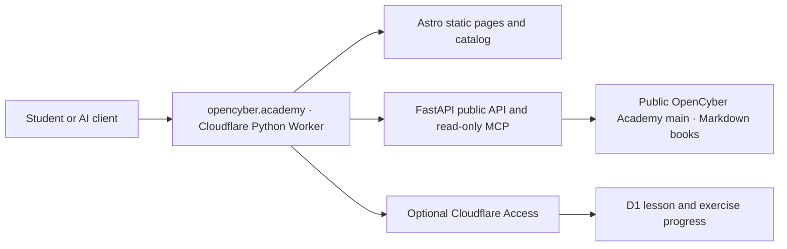

# OpenCyber Academy web application

The public site runs as one Cloudflare Python Worker: Astro builds the frontend, FastAPI serves the API and MCP endpoint, and Workers Static Assets serves the built pages. The public [OpenCyber Academy repository](https://github.com/hiagokinlevi/OpenCyberAcademy) is the source of teaching content. Course metadata is generated at build time; a selected manuscript and its plan are read from `main` on GitHub when a visitor opens a course. Editing an existing lesson in `MANUSCRIPT.md` and pushing it to `main` updates that lesson, its full-book view and the MCP reader on the next source request, without copying it into the site or deploying again. New course folders, changed catalog metadata and frontend/API code require a validated local deployment.

## Architecture and content flow



The repository is the canonical source for one `MANUSCRIPT.md` per course and language. `SUBJECTS.md` lists chapters and their daily lessons; `PLAN.md` records the editorial sequence. The default hierarchy is **course → weekly chapter → five weekday lessons → examples, exercise and worked answer**. Longer courses have more and deeper chapters. Astro builds the catalog locally and carries each level's planning baseline of 20–1,300 weekday lessons. That baseline is separate from legacy subject chapters and actually authored lessons. The API reads `ch-NN`, `lesson-NN` and `week-WW-day-DD` anchors. During conversion, the course syllabus shows newly written daily lessons alongside all existing subject chapters, with planned slots clearly labeled. The full book and each individual lesson are rendered on OpenCyber Academy. Source responses are requested without caching so visitors and AI clients receive the latest published `main` text; GitHub's own propagation may still take a short time after a push. Only optional saved progress crosses the Access boundary and uses D1.

## Local development

From this directory:

```sh
npm ci
uv sync --frozen
npm run build
uv run pytest -q
uv run pywrangler dev --local --port 8787
```

Open `http://localhost:8787/`. The site and `/api/*` and `/mcp` are public. The protected progress endpoints require a Cloudflare Access token and are unavailable in local development without a matching Access session.

Readers use the separate **By level** and **By subject** menus. `/levels/` and `/subjects/` open distinct directories; `/levels/{level}/` lists the 23 separate courses at that level, and `/subjects/{area}/` lists the nine distinct levels of that subject. Each `/courses/{level}/{area}/?lang=...` page has its own lesson guide, lesson reader and navigation. `/book/?level=...&area=...&lang=...` displays the complete manuscript, and `/read/?path=...` displays course references and plans. Old `/learn/` links redirect to the corresponding course or directory. These pages render Markdown within OpenCyber Academy and route book, chapter, index and reference links internally. Readers can select any of the nine planned book editions; availability is shown from the actual manuscript. The interface starts in English, follows a supported browser language (English, Portuguese or Spanish), and offers a persistent interface-language switch. The selected course edition (`lang`) remains separate from the interface translation (`ui`); an outline is never shown as a written lesson.

The daily curriculum target applies to all nine language editions. Current subject chapters remain visible as separate chapter entries until an edition is expanded into weekly chapters and daily lessons. The API supports chapter and lesson identifiers through `1300` and exercise identifiers through `EX1300`; it does not invent missing teaching. Course links use `?unit=daily&chapter=N` for a weekday lesson and `?unit=chapter&chapter=N` for an existing subject chapter. Old `?chapter=N` links remain compatible: they resolve to a written daily lesson when present, otherwise to the existing written chapter. The full-book reader links to `#ch-NN`, `#lesson-NN` and `#week-WW-day-DD` inside the site. See the [curriculum grid](../CURRICULUM_GRID.md) and [book standard](../BOOK_STANDARD.md) for authoring and release criteria.

## Search discovery and optional analytics

Every authored daily lesson has a permanent public page at `/courses/{level}/{area}/lessons/{language}/{number}/`; existing full subject chapters have `/courses/{level}/{area}/chapters/{language}/{number}/`. FastAPI renders the complete lesson, exercise and worked answer into the initial HTML from the public `main` manuscript. These pages include a unique title and description, canonical URL, Open Graph and Twitter metadata, and truthful `LearningResource` and breadcrumb JSON-LD. Unwritten lessons return 404. The complete page can be read without JavaScript, an account or analytics consent. The HTML uses the same public manuscript that serves REST and MCP, so editing an existing lesson updates that page without rebuilding the site.

`scripts/build_catalog.py` generates `public/lesson-index.json` and `public/sitemap.xml` from authored manuscript anchors. The static course pages link to those permanent lesson URLs, and `robots.txt` points to the sitemap. A newly authored lesson becomes readable immediately after the source push, but its sitemap entry and static course link appear only after the next local build and deployment. Search Console sitemap submission is a discovery request, not an indexing or ranking guarantee. Plans and unwritten study slots do not get lesson URLs in the sitemap. The source Markdown remains public and the public HTML reader keeps course, previous and next navigation within the site.

Google Analytics 4 uses measurement ID `G-7KDGFR12FS` for optional page-view measurement. The Google tag is requested only after a visitor explicitly allows it; the choice is stored in that browser and can be changed through the footer. The site sends the canonical path without query parameters in its page-view event. See `/privacy/` for the public explanation. The Search Console domain property `opencyber.academy` is verified using a Cloudflare DNS TXT record; keep that record in place to retain verification. Neither account nor analytics is needed to learn.

## Student sign-in and progress

Reading never requires an account. Saved progress is designed for a Cloudflare Access self-hosted application covering only `opencyber.academy/private/*` with a verified one-time email PIN. This application still needs to be configured for the new domain; until then, optional sign-in is unavailable and FastAPI rejects progress requests without a valid Access JWT. FastAPI validates the token's signature, issuer, audience, expiration, not-before time and user ID. The new D1 `open-cyber-academy-progress` database has the progress tables and currently contains no student records. The `/account/` page and all books, lessons, catalog, OpenAPI and MCP routes remain public.

The Access application audience and team domain are non-secret Wrangler variables. Once configured, the Access application should use an HTTP-only, path-scoped, SameSite=Lax cookie. Monitor the account's Access seat usage before inviting more students. Audio and video are future features and are not claimed as available.

## Publish from an authorized local computer

The `open-cyber-academy-progress` database was created in the DECRIPTE Cloudflare account and `migrations/0001_progress.sql` has been applied. Check the account, database ID and current schema before any later migration.

After committing and pushing the site to the public repository's `main` branch, run:

```sh
./scripts/deploy-local.sh
```

The script checks the GitHub remote, requires a clean checkout at the exact public `main` commit, checks the Cloudflare account, builds and tests locally, deploys with PyWrangler, and checks the live health and MCP endpoints. No GitHub Actions or cloud build pipeline is used.

For a content-only publication, push the Markdown to GitHub; the reader fetches the selected book from GitHub `main`. To update the static catalog after course structure changes, rebuild and deploy locally.

## Public AI interface

- `GET /api/catalog` lists 207 courses and build-time edition hints.
- `GET /api/courses/{level}/{area}/{language}` distinguishes authored weekly chapters and daily lessons from legacy subject chapters and outlines.
- `GET /api/lessons/{level}/{area}/{language}/{chapter}` returns a numbered daily lesson when the edition has `lesson-NN` or `week-WW-day-DD` anchors; older editions return their existing subject chapter. The response includes exercises, worked answers, the public source URL and SHA-256 hashes for the current manuscript and returned lesson.
- `GET /api/chapters/{level}/{area}/{language}/{chapter}` keeps a written subject chapter accessible while its weekday lessons are being expanded.
- `GET /api/books/{level}/{area}/{language}` returns the current Markdown manuscript.
- `GET /api/source?path=...` returns a public Markdown course reference for internal reading routes.
- `GET /api/search/{level}/{area}/{language}?q=...` searches the current book.
- `POST /mcp` provides stateless MCP Streamable HTTP discovery, reading and search. `GET /mcp` returns 405 as required when no event stream is offered.
- `GET /llms.txt` gives AI clients a compact entry point.

Published text is not automatically an approved or completed book. The API and reader do not present plan-only chapters as finished lessons.
