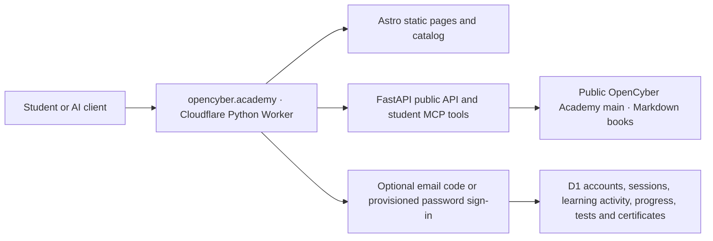

# OpenCyber Academy web application

The public site runs as one Cloudflare Python Worker: Astro builds the frontend, FastAPI serves the API and MCP endpoint, and Workers Static Assets serves the built pages. The public [OpenCyber Academy repository](https://github.com/hiagokinlevi/OpenCyberAcademy) is the source of teaching content. Course metadata is generated at build time; a selected manuscript and its plan are read from `main` on GitHub when a visitor opens a course. Editing an existing lesson in `MANUSCRIPT.md` and pushing it to `main` updates its permanent HTML page, its stable individual Markdown response, the course directory, the course sitemap, the full-book view and the MCP reader on the next source request, without copying it into the site or deploying again. New course folders, changed catalog metadata and frontend/API code require a validated local deployment.

## Architecture and content flow



The repository is the canonical source for one `MANUSCRIPT.md` per course and language. `SUBJECTS.md` lists chapters and their daily lessons; `PLAN.md` records the editorial sequence. The default hierarchy is **course → weekly chapter → five weekday lessons → examples, exercise and worked answer**. Longer courses have more and deeper chapters. Astro builds the catalog locally and carries each level's planning baseline of 20–1,300 weekday lessons. That baseline is separate from legacy subject chapters and actually authored lessons. The API reads `ch-NN`, `lesson-NN` and `week-WW-day-DD` anchors. An edition that uses one chapter per weekday lesson marks its manuscript with `<!-- open-cyber-academy:chapter-lessons -->`; the guide groups its authored chapter-lessons into study weeks, and `/chapters/{language}/{number}/` remains the sole canonical reading URL for each. The marker alone does not establish editorial approval. During conversion, the course syllabus shows newly written daily lessons alongside all existing subject chapters, with planned slots clearly labeled. The full book and each individual lesson are rendered on OpenCyber Academy. Source responses are requested without caching so visitors and AI clients receive the latest published `main` text; GitHub's own propagation may still take a short time after a push. Only optional saved progress requires sign-in and uses D1.

The [canonical editorial rule](../BOOK_STANDARD.md#sequential-production-order) makes English the source-writing and review priority, followed by complete Portuguese and then Spanish editions. Planned work in the other six languages begins only after all three collections have independently reached 100% verified completion across all 207 courses. Existing editions remain readable. Interface language, catalog availability and legacy chapter percentages are not completion evidence. The public MCP exposes this live rule through `open-cyber-academy://editorial-policy` and `get_editorial_policy`.

## Local development

From this directory:

```sh
npm ci
uv sync --frozen
npm run build
uv run pytest -q
uv run pywrangler dev --local --port 8787
```

Open `http://localhost:8787/`. The site, `/api/*` and `/mcp` are public. Student endpoints require a D1-backed session. Email delivery requires a Cloudflare Email Sending binding; local unit tests use an in-memory sender.

Readers use the separate **By level** and **By subject** menus. `/levels/` and `/subjects/` open distinct directories; `/levels/{level}/` lists the 23 separate courses at that level, and `/subjects/{area}/` lists the nine distinct levels of that subject. Each `/courses/{level}/{area}/?lang=...` page has its own lesson guide, lesson reader and navigation. `/book/?level=...&area=...&lang=...` displays the complete manuscript, and `/read/?path=...` displays course references and plans. Old `/learn/` links redirect to the corresponding course or directory. These pages render Markdown within OpenCyber Academy and route book, chapter, index and reference links internally. Readers can select any of the nine planned book editions; availability is shown from the actual manuscript. The interface starts in English, follows a supported browser language (English, Portuguese or Spanish), and offers a persistent interface-language switch. The selected course edition (`lang`) remains separate from the interface translation (`ui`); an outline is never shown as a written lesson.

The daily curriculum target applies to all nine language editions. Current subject chapters remain visible as separate chapter entries until an edition is expanded into weekly chapters and daily lessons. The API supports chapter and lesson identifiers through `1300` and exercise identifiers through `EX1300`; it does not invent missing teaching. Course links use `?unit=daily&chapter=N` for a weekday lesson and `?unit=chapter&chapter=N` for an existing subject chapter. Old `?chapter=N` links remain compatible: they resolve to a written daily lesson when present, otherwise to the existing written chapter. The full-book reader links to `#ch-NN`, `#lesson-NN` and `#week-WW-day-DD` inside the site. See the [curriculum grid](../CURRICULUM_GRID.md) and [book standard](../BOOK_STANDARD.md) for authoring and release criteria.

## Search discovery and optional analytics

Every authored daily lesson has a permanent public page at `/courses/{level}/{area}/lessons/{language}/{number}/`; existing full subject chapters have `/courses/{level}/{area}/chapters/{language}/{number}/`. A marked chapter-lesson uses its chapter URL as its one permanent lesson page, and the `/lessons/` route redirects there. Each authored unit also has a stable `.md` address at the same path with `.md` instead of the trailing slash. This Markdown response includes the current teaching and worked answers, with the course and unit ID in headers. The file is a live representation of one section of the canonical `MANUSCRIPT.md`, not a second editable copy. Changing a title or paragraph does not change the numbered URL. FastAPI renders the complete lesson, exercise and worked answer into the initial HTML from the public `main` manuscript. These pages include a unique title and description, canonical URL, Open Graph and Twitter metadata, and truthful `LearningResource` and breadcrumb JSON-LD. A valid but unwritten study day has a distinct navigable guide page that explicitly says teaching is pending and sends `noindex,follow`; it is not misrepresented as a finished lesson or included in a sitemap. Numbers outside the course schedule still return 404. The complete page can be read without JavaScript, an account or analytics consent. The HTML uses the same public manuscript that serves REST and MCP, so editing an existing lesson updates that page without rebuilding the site.

`scripts/build_catalog.py` generates `public/lesson-index.json`, common-page sitemaps and a sitemap index per language hostname. The English home is `opencyber.academy`; Portuguese and Spanish are `pt.opencyber.academy` and `es.opencyber.academy`. The six other planned languages have reserved subdomains and truthful landing pages, but no books or indexable course URLs until translated teaching exists. `robots.txt` and `/sitemap.xml` are served for the request hostname. Each active sitemap index links to live per-course sitemaps at `/sitemaps/{level}/{area}/{language}.xml`; those read the current published manuscript, so newly authored lessons in an existing book enter discovery without redeploying. The course directory is also server-rendered from the current manuscript. Unwritten study slots and untranslated directory shells stay out of lesson sitemaps. A brand-new book edition, course folder or changed catalog still requires a local deployment to add its child sitemap to the index. Search Console sitemap submission is a discovery request, not an indexing guarantee. The public HTML reader keeps course, previous and next navigation within the site.

The request hostname determines the interface edition. The main English home uses the browser's `Accept-Language` on first entry to send readers to a supported language subdomain; explicit domain visits remain on that domain. English is the original edition and default. Localized static HTML is generated at build time for Portuguese and Spanish, so their home and About pages contain server-visible translations and self-canonical metadata. Other localized static course shells are accessible but `noindex` until the translated content and metadata have been reviewed; authored book sections have their own indexed URLs. Do not add `hreflang` to two lesson URLs merely because their path differs: both must contain genuine localized teaching.

Google Analytics 4 uses measurement ID `G-7KDGFR12FS` across all language hosts. The Google tag is requested only after a visitor explicitly allows it; the choice is stored in that browser and can be changed through the footer. The event sends `location.origin + location.pathname`, so GA4 can separate hosts without query parameters. See `/privacy/` for the public explanation. The Search Console domain property `opencyber.academy` covers the root and its subdomains; submit each active language's `/sitemap.xml` there and inspect index coverage by host. Keep the verification DNS TXT record in place. Neither account nor analytics is needed to learn.

## Student sign-in and progress

Reading never requires an account. Optional student sign-in uses a six-digit code sent from `login@auth.opencyber.academy` through Cloudflare Email Sending. The code is valid for ten minutes, can be tried at most five times and is stored only as an HMAC digest in D1. A successful sign-in creates a seven-day revocable session; D1 stores a SHA-256 digest of its opaque token. The browser receives a Secure, HttpOnly, SameSite=Lax cookie shared with the language subdomains. The `/account/` page and all books, lessons, catalog, OpenAPI and MCP routes remain public.

`/auth/*` handles email sign-in and individually provisioned username/password accounts; `/student/*` requires a session for progress, learning activity, private analyses, statistics, tests and certificates. Passwords use a unique salt and six chained PBKDF2-HMAC-SHA256 rounds of 100,000 iterations each; plaintext never enters D1 or Git. Same-origin checks protect browser writes. D1 limits code requests per email, source IP and month, with a 2,500-send monthly application ceiling, and also rate-limits password attempts. Configure `AUTH_HMAC_KEY` as a Wrangler secret, never in Git. The branded `/account/` page is the student login in every active language and returns the student to a test or lesson after sign-in. A Cloudflare Single Redirect on the exact legacy path `/private/login` sends visitors to `/account/` while preserving the `next` query. The old Cloudflare Access application still protects the remaining `/private/*` routes during migration; it is not part of the student login flow. Audio and video remain future features.

Signed-in canonical lesson pages record an opening and visible reading time; the course portal records opened lessons. Explicit completion, exercise answers, test attempts and optional written analyses have individual D1 records. Each activity event identifies whether it came from the site or an authenticated MCP tool; historical events default to the site. `/student/stats` returns only the current student's summary, recent activity and per-course performance (reading time, completed lessons, saved exercises and analyses, AI actions, and best chapter-test scores). Anonymous reading is not written to D1. The `/account/` dashboard shows actual totals, recent activity, saved lessons, exercise answers and privately saved analyses; each course opens to show its own lesson, exercise and chapter-test detail.

The signed-in **Connect your AI** menu opens `/account/#connect-ai`. The student can create up to five active personal MCP keys, name them, see their last use and revoke them. Each key lasts 180 days. The complete key is returned once, is stored only as a SHA-256 digest in D1 and must be kept in the MCP client's private credential storage. Send it as `Authorization: Bearer <personal-key>` over HTTPS to `https://opencyber.academy/mcp`; do not put it in prompts, Git, URLs or MCP tool arguments. A key authenticates only its owner for the MCP student tools and is rejected by browser REST progress endpoints and by the key-management API. Creating and revoking keys requires the student's browser cookie and a same-origin request. Revocation takes effect immediately. Existing short-lived bearer sessions remain supported for compatibility, but personal keys are the supported way to connect an AI without passing a password to an MCP client.

The private MCP tools can read a lesson while recording the visit, save completion, exercise answers and analyses, list and retrieve the student's own saved analyses, take published ten-question timed chapter tests, resume an attempt, and read course results, recent activity and performance. Activity created through MCP is labeled in the student's dashboard. A chapter test exists only where an authored bank has been published; no unpublished test is invented for MCP. The public MCP reading tools remain anonymous. The legacy `student_sign_in` Basic-auth exchange is retained only for existing clients; new clients should use a personal key. This is a site-issued bearer credential, not an OAuth flow; clients must support secret HTTP headers.

## Test yourself and course certificates

`/tests/` offers the language → subject → level route for all 207 courses and their nine planned editions. Only chapters with an authored, source-pinned bank appear as available tests. A bank lives at `question-banks/<level>/<area>/<language>/<chapter>.json`; it must contain exactly ten distinct four-option questions with explanations and a SHA-256 hash of the chapter text. `scripts/build_question_index.py` validates these banks against the current manuscript and publishes their availability in `public/test-index.json`. A change to the teaching text invalidates its test until a reviewer updates the bank. Unwritten or unreviewed questions are never synthesized from an outline.

The current pilot contains **one chapter test in English, Portuguese and Spanish** (30 authored questions total). The other course chapters and six remaining language editions have no published tests yet. This is not a claim that the requested collection-wide question bank is complete. The question keys remain public educational material in the source repository; results and certificates are therefore self-study records, not proctored examination credentials.

The FastAPI `/student/tests/*` routes require a valid student session. An attempt stores one deadline per question in D1; the browser displays a ten-second countdown and the Worker checks elapsed time when each answer arrives. A duplicate or out-of-order answer cannot advance the attempt. D1 migrations `migrations/0002_chapter_tests.sql` through `migrations/0006_student_activity_source.sql` create test, account, learning-activity and personal-key tables, then add activity-source attribution. The local deploy script applies the final column migration only if needed. The public `/api/tests/catalog` endpoint reports coverage without disclosing answer keys.

`public/approved-books.json` is an explicit editorial gate and currently lists no completed books. A self-study course-completion certificate can be issued only after the **current** manuscript hash is approved, every planned chapter is authored and has a current bank, and the student has scored 10/10 on every chapter bank. The student's printable certificate is under `/student/certificates/{id}`; `/api/certificates/{id}` verifies its course and issue date without disclosing the holder's email. Editorial approval must follow `BOOK_STANDARD.md` and must never be inferred from draft chapter coverage or a test score alone.

## Publish from an authorized local computer

The `open-cyber-academy-progress` database was created in the DECRIPTE Cloudflare account and `migrations/0001_progress.sql` has been applied. Check the account, database ID and current schema before any later migration.

After committing and pushing the site to the public repository's `main` branch, run:

```sh
./scripts/deploy-local.sh
```

The script checks the GitHub remote, requires a clean checkout at the exact public `main` commit, checks the Cloudflare account, builds and tests locally, deploys with PyWrangler, and checks the live health and MCP endpoints. No GitHub Actions or cloud build pipeline is used.

For a content-only publication, push the Markdown to GitHub; the reader fetches the selected book from GitHub `main`. To update the static catalog after course structure changes, rebuild and deploy locally.

## Public AI interface

- `GET /api/catalog` lists 207 courses and build-time edition hints.
- `GET /api/courses/{level}/{area}/{language}` distinguishes authored weekly chapters, daily lessons and explicitly marked chapter-lessons from subject chapters and outlines.
- `GET /api/lessons/{level}/{area}/{language}/{chapter}` returns a numbered daily lesson when the edition has `lesson-NN` or `week-WW-day-DD` anchors; marked chapter-lesson editions return that authored chapter as one lesson, and other older editions return their existing subject chapter. The `content_kind` field distinguishes these cases. The response includes exercises, worked answers, the public source URL and SHA-256 hashes for the current manuscript and returned lesson.
- `GET /api/chapters/{level}/{area}/{language}/{chapter}` keeps a written subject chapter accessible while its weekday lessons are being expanded.
- `GET /api/books/{level}/{area}/{language}` returns the current Markdown manuscript.
- `GET /api/source?path=...` returns a public Markdown course reference for internal reading routes.
- `GET /api/search/{level}/{area}/{language}?q=...` searches the current book.
- `POST /mcp` provides stateless MCP Streamable HTTP discovery, reading and search. Its `get_editorial_policy` tool and `open-cyber-academy://editorial-policy` resource read the current public `BOOK_STANDARD.md` from `main`, including the three-language gate. `GET /mcp` returns 405 as required when no event stream is offered.
- `GET /llms.txt` gives AI clients a compact entry point.

Published text is not automatically an approved or completed book. The API and reader do not present plan-only chapters as finished lessons.
