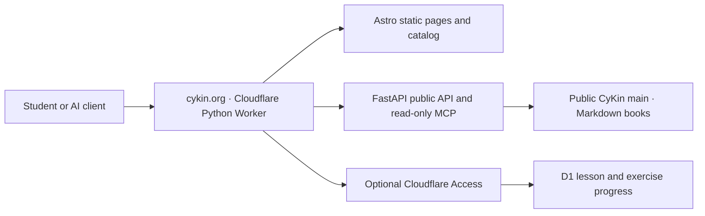

# CyKin web application

The public site runs as one Cloudflare Python Worker: Astro builds the frontend, FastAPI serves the API and MCP endpoint, and Workers Static Assets serves the built pages. The public [CyKin repository](https://github.com/hiagokinlevi/CyKin) is the source of teaching content. Course metadata is generated at build time; a selected manuscript and its plan are read from `main` on GitHub when a visitor opens a course. A new chapter is therefore visible without a site rebuild, while new course folders or changed course metadata require a deployment.

## Architecture and content flow



The repository is the canonical source for one `MANUSCRIPT.md` per course and language. `SUBJECTS.md` organizes modules, `PLAN.md` records the editorial sequence, and the site reads **authored** chapters, examples and worked answers from the manuscript. The weekday calendar sets a lesson minimum and no maximum. A new book commit appears in the API and reader when fetched from `main`; a structural catalog or frontend change requires a validated local build and Worker deploy. Only optional saved progress crosses the Access boundary and uses D1.

## Local development

From this directory:

```sh
npm ci
uv sync --frozen
npm run build
uv run pytest -q
uv run pywrangler dev --local --port 8787
```

Open `http://localhost:8787/`. The site and `/api/*` and `/mcp` are public. The protected progress endpoints require a Cloudflare Access token and are unavailable in local development without a matching Access session.

Readers use the separate **By level** and **By subject** menus. `/levels/` and `/subjects/` open distinct directories; `/levels/{level}/` lists the 23 separate courses at that level, and `/subjects/{area}/` lists the nine distinct levels of that subject. Each `/courses/{level}/{area}/?lang=...` page has its own lesson guide, lesson reader and navigation. `/book/?level=...&area=...&lang=...` displays the complete manuscript, and `/read/?path=...` displays course references and plans. Old `/learn/` links redirect to the corresponding course or directory. These pages render Markdown within CyKin and route book, chapter, index and reference links internally. Readers can select any of the nine planned book editions; availability is shown from the actual manuscript. The interface starts in English, follows a supported browser language (English, Portuguese or Spanish), and offers a persistent interface-language switch. The selected course edition (`lang`) remains separate from the interface translation (`ui`); an outline is never shown as a written lesson.

The same quality rule applies to all nine language editions. The site shows the chapters that exist. It does not require a book to grow to a fixed lesson count. The API can address a chapter id that is present in the manuscript; it does not invent missing lesson text. See the [curriculum grid](../CURRICULUM_GRID.md) and [book standard](../BOOK_STANDARD.md).

## Student sign-in and progress

Reading never requires an account. Only `/private/*` is protected by the Cloudflare Access self-hosted application **CyKin student progress** for `cykin.org/private/*`. Its **Allow** policy requires a verified one-time email PIN. FastAPI independently validates the signed Access JWT, its issuer, application audience, expiration, not-before time and user ID. The D1 `cykin-progress` database stores completed lessons and attempted exercises under that user ID. The optional `/account/` page and all books, lessons, catalog, OpenAPI and MCP routes remain public.

The Access application audience and team domain are non-secret Wrangler variables. The configured Access application uses an HTTP-only, path-scoped, SameSite=Lax cookie. Cloudflare Access Free currently has a 50-user seat limit; monitor usage before inviting more students. Audio and video are future features and are not claimed as available.

## Publish from an authorized local computer

The database is created once and `migrations/0001_progress.sql` is applied with `wrangler d1 execute cykin-progress --remote --file=migrations/0001_progress.sql`. Do not repeat setup against another account without checking the destination.

After committing and pushing the site to the public repository's `main` branch, run:

```sh
./scripts/deploy-local.sh
```

The script checks the GitHub remote, requires a clean checkout at the exact public `main` commit, checks the Cloudflare account, builds and tests locally, deploys with PyWrangler, and checks the live health and MCP endpoints. No GitHub Actions or cloud build pipeline is used.

For a content-only publication, push the Markdown to GitHub; the reader fetches the selected book from GitHub `main`. To update the static catalog after course structure changes, rebuild and deploy locally.

## Public AI interface

- `GET /api/catalog` lists 207 courses and build-time edition hints.
- `GET /api/courses/{level}/{area}/{language}` distinguishes authored chapters from outlines.
- `GET /api/lessons/{level}/{area}/{language}/{chapter}` returns a chapter, exercises, worked answers and its GitHub source URL.
- `GET /api/books/{level}/{area}/{language}` returns the current Markdown manuscript.
- `GET /api/source?path=...` returns a public Markdown course reference for internal reading routes.
- `GET /api/search/{level}/{area}/{language}?q=...` searches the current book.
- `POST /mcp` provides stateless MCP Streamable HTTP discovery, reading and search. `GET /mcp` returns 405 as required when no event stream is offered.
- `GET /llms.txt` gives AI clients a compact entry point.

Published text is not automatically an approved or completed book. The API and reader do not present plan-only chapters as finished lessons.
